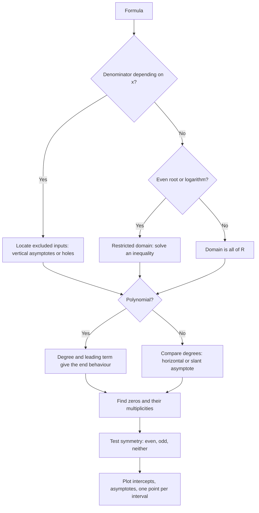

# Functions and Graphs

> [Precalculus](../README.md) · Level: Intermediate · Prerequisites: [Relations and Functions](../../00-foundations/05-relations-and-functions/README.md), [Algebra](../../03-algebra/README.md) — in particular [Polynomials](../../03-algebra/06-polynomials/README.md), [Factoring](../../03-algebra/07-factoring/README.md) and [Rational Expressions](../../03-algebra/09-rational-expressions/README.md) — and [The Coordinate Plane](../../02-pre-algebra/05-the-coordinate-plane/README.md) · Estimated time: 9 h

## 1. Introduction

A function is a rule that turns an input into exactly one output. That sentence is short enough to memorise and deep enough to occupy a whole discipline. Everything in this repository after this point — polynomials, exponentials, logarithms, trigonometric functions, limits, derivatives, integrals, probability densities, linear maps — is a statement *about* functions. Precalculus is where the object itself, rather than any particular example of it, becomes the subject.

You have already met functions in [Algebra](../../03-algebra/README.md): notation, evaluation, the vertical line test, and the first families of graphs. This tutorial goes deeper in five directions that the algebra treatment only touches.

1. **Representations.** A function can be given by a formula, a table, a graph or a verbal description, and a competent mathematician converts freely between all four. Each representation hides something the others reveal: a table hides the shape, a graph hides the exact value, a formula hides the domain.
2. **Domain and range as first-class objects.** A formula without a stated domain is shorthand. We compute domains algebraically from the restrictions that denominators, even roots and logarithms impose, and we compute ranges by solving for the input.
3. **Geometry of a single graph.** Symmetry, monotonicity, extrema and rates of change are properties of the graph that can be read off the formula and, conversely, properties of the formula that can be read off the graph.
4. **Building new functions from old ones.** Shifts, stretches and reflections form a grammar with a fixed order of operations; composition is the operation that builds complicated functions from simple ones; inversion is the operation that undoes a function.
5. **The idea of a family.** A family is a formula with parameters, such as $a(b(x-h))^2+k$. Each parameter deforms one aspect of a common shape. Recognising the family of a function is the single most useful skill in applied mathematics, because it tells you what the function can and cannot do.

## 2. Prerequisites

You should be comfortable with the following, each taught in the listed tutorial.

* **Relations, ordered pairs and the definition of a function** — including the difference between a relation and a function:
  [Relations and Functions](../../00-foundations/05-relations-and-functions/README.md).
* **Cartesian coordinates, plotting points and reading a graph** — including intercepts:
  [The Coordinate Plane](../../02-pre-algebra/05-the-coordinate-plane/README.md) and
  [Coordinate Geometry](../../04-geometry/04-coordinate-geometry/README.md).
* **Algebraic manipulation** — expanding, factoring, completing the square, simplifying rational
  expressions and rationalising: [Polynomials](../../03-algebra/06-polynomials/README.md),
  [Factoring](../../03-algebra/07-factoring/README.md),
  [Rational Expressions](../../03-algebra/09-rational-expressions/README.md).
* **Inequalities and interval notation** — including quadratic inequalities solved by a sign chart:
  [Inequalities](../../03-algebra/03-inequalities/README.md).
* **Geometric transformations of the plane** — translations, stretches and reflections as motions of a
  figure: [Transformations](../../04-geometry/06-transformations/README.md).
* **Exponential and logarithmic functions** — used as examples of function families in Section 7.10;
  the full treatment is [Exponential and Logarithmic Functions](../../03-algebra/12-exponential-and-logarithmic-functions/README.md).

## 3. Learning Objectives

After working through this tutorial you will be able to:

1. State the definition of a function as a set of ordered pairs, and explain why the vertical line test
   is exactly the statement that no input has two outputs.
2. Move between the four representations — formula, table, graph, words — and say what each one hides.
3. Determine the domain of a function given by a formula, by solving the inequalities imposed by
   denominators, even roots and logarithms, and determine its range by solving $y=f(x)$ for $x$.
4. Test a function for even symmetry, odd symmetry, or neither, and interpret the result geometrically.
5. Prove monotonicity on an interval from the definition, locate extrema, and distinguish a local from a
   global maximum.
6. Compute average rates of change, interpret them as slopes of secants, and explain how the
   instantaneous rate of change arises as the limit of average rates.
7. Graph $y=a\,f\!\left(b(x-h)\right)+k$ from the graph of $y=f(x)$ by identifying the parameters, and
   explain why the horizontal parameters act in the reverse of the naive order.
8. Compute compositions, state the domain of a composite function correctly, and decompose a given
   function into a composition of simpler ones.
9. Prove that a composition of injective functions is injective, that a function with an inverse is
   injective, and that the inverse of a bijection is unique.
10. Find inverse functions algebraically, restrict domains to create inverses, and use the reflection
    property of the graphs of $f$ and $f^{-1}$.
11. Recognise the standard function families by shape and match a data set to a plausible family.
12. Build and criticise a simple model of a real situation, including stating its domain of validity.

## 4. Intuition

**A function is a machine with a guarantee.** Put a number in; exactly one number comes out. The
guarantee is the whole definition. A vending machine that sometimes gives two cans for one coin is not a
function; a machine that refuses some coins is still a function, just one with a restricted domain.

**The graph is a map of all the machine's behaviour.** Instead of running the machine once per input, we
plot one point per input and look at the whole collection at once. A graph converts a question about a
*rule* into a question about a *shape*, and human eyes are very good at shapes. Monotonicity becomes
"the curve goes up", an extremum becomes "the top of a hill", a rate of change becomes "how steep", and
an inverse becomes "read the same curve sideways".

**Families: one shape, many sizes.** A square is one shape at many sizes; a parabola is one shape at
many widths and positions. The function $f(x)=x^2$ is the *template*, and $a(b(x-h))^2+k$ is the whole
family obtained by stretching, squashing, sliding and flipping the template. The parameters do not
create new shapes; they move the old shape around the plane. This is why a graph sketched from three
points and a known family looks right, while a graph sketched from three points with no family in mind
is worthless.

**Transformations as a stencil.** Imagine the graph of $f$ printed on transparent film. A vertical
shift slides the film up; a horizontal shift slides it sideways; a stretch pulls the film; a reflection
turns it over. Composition of transformations is composition of motions, and motions do not generally
commute — sliding then stretching is not the same as stretching then sliding. Section 7.6 makes that
precise with a single mapping rule that removes all ambiguity.

**The inverse as a return journey.** If $f$ takes you from home to the shop, $f^{-1}$ takes you from
the shop back home. A return journey exists only if no two starting points arrive at the same
destination: if two roads ended at the shop, "go back" would be ambiguous. That is the whole content of
Theorem 8.4.

## 5. Formal Definition

**Definition 5.1 (relation and function).** A **relation** from a set $A$ to a set $B$ is a subset
$R \subseteq A \times B$. A relation $f \subseteq A \times B$ is a **function from $A$ to $B$** when

$$\forall a \in A\ \exists!\, b \in B \quad (a,b) \in f .$$

The symbol $\exists!$ means "there exists exactly one". We write $f : A \to B$ and $f(a)=b$ for
$(a,b) \in f$.

The definition has two halves and both matter. *Existence*: every element of $A$ is served. *Uniqueness*:
no element of $A$ is served twice. A relation may fail either half and still be perfectly respectable;
it is then simply not a function.

**Definition 5.2 (domain, codomain, image).** Let $f : A \to B$.

* $A$ is the **domain** of $f$, written $\operatorname{dom} f$.
* $B$ is the **codomain** of $f$; it is the set in which values are declared to lie.
* The **image** (or **range**) of $f$ is
  $$f[A] = \operatorname{ran} f = \{\, f(a) : a \in A \,\} \subseteq B .$$
* For $S \subseteq A$, the image of $S$ is $f[S] = \{ f(s) : s \in S \}$; for $T \subseteq B$, the
  preimage is $f^{-1}[T] = \{ a \in A : f(a) \in T \}$.

The codomain is part of the declaration, the range is a consequence of the rule. The function
$f : \mathbb{R} \to \mathbb{R}$, $f(x)=x^2$ and the function $g : \mathbb{R} \to [0,\infty)$,
$g(x)=x^2$ have the same formula and different codomains; they are different functions in the formal
sense. In practice we often say "the range is $[0,\infty)$" when we mean "the image is $[0,\infty)$",
and no confusion arises.

**Definition 5.3 (equality of functions).** Functions $f$ and $g$ are **equal**, written $f=g$, when
they have the same domain and $f(x)=g(x)$ for every $x$ in that domain. Consequently $f(x)=x^2/x$ and
$g(x)=x$ are *not* equal: the first is undefined at $0$. "Simplifying" a formula can change the
function.

**Definition 5.4 (restriction).** If $f : A \to B$ and $S \subseteq A$, the **restriction** of $f$ to $S$
is the function $f|_S : S \to B$ with $f|_S(s)=f(s)$ for $s \in S$.

Restriction is how we repair a function that is not one-to-one: $x \mapsto x^2$ is not invertible on
$\mathbb{R}$, but $x \mapsto x^2$ restricted to $[0,\infty)$ is.

**Definition 5.5 (injective, surjective, bijective).** Let $f : A \to B$.

* $f$ is **injective** (one-to-one) when distinct inputs have distinct outputs:
  $$\forall a_1,a_2 \in A,\quad f(a_1)=f(a_2) \Rightarrow a_1=a_2 .$$
* $f$ is **surjective** (onto) when every element of the codomain is attained:
  $$\forall b \in B\ \exists a \in A,\quad f(a)=b .$$
* $f$ is **bijective** when it is both injective and surjective.

Note the asymmetry: injectivity is a property of the rule alone, surjectivity depends on the declared
codomain. The squaring map $\mathbb{R}\to\mathbb{R}$ is neither; $\mathbb{R}\to[0,\infty)$ is
surjective but not injective; $[0,\infty)\to[0,\infty)$ is bijective.

**Definition 5.6 (composition).** For $g : A \to B$ and $f : B \to C$, the **composite** $f \circ g :
A \to C$ is defined by

$$(f \circ g)(x) = f\bigl(g(x)\bigr).$$

The right-hand function acts first. For $f \circ g$ to be defined at $x$, we need $x \in
\operatorname{dom} g$ **and** $g(x) \in \operatorname{dom} f$.

**Definition 5.7 (identity function).** On a set $A$, the **identity** is $\operatorname{id}_A : A \to A$,
$\operatorname{id}_A(x)=x$.

**Definition 5.8 (inverse function).** Let $f : A \to B$. A function $g : B \to A$ is an **inverse** of
$f$ when

$$g\bigl(f(a)\bigr)=a \ \text{ for all } a \in A, \qquad f\bigl(g(b)\bigr)=b \ \text{ for all } b \in B .$$

Equivalently $g \circ f = \operatorname{id}_A$ and $f \circ g = \operatorname{id}_B$. If such a $g$
exists we say $f$ is **invertible** and write $g = f^{-1}$.

**Definition 5.9 (monotonicity).** Let $f$ be defined on an interval $I$.

* $f$ is **increasing** on $I$ when $x_1<x_2$ in $I$ implies $f(x_1) \le f(x_2)$; **strictly
  increasing** when the inequality is strict.
* $f$ is **decreasing** (or strictly decreasing) on $I$ when the inequalities reverse.
* $f$ is **monotone** on $I$ when it is either increasing or decreasing there.

**Definition 5.10 (symmetry).** Let $f$ have a domain symmetric about $0$, i.e. $x \in \operatorname{dom} f
\Rightarrow -x \in \operatorname{dom} f$.

* $f$ is **even** when $f(-x)=f(x)$ for all $x$ in the domain.
* $f$ is **odd** when $f(-x)=-f(x)$ for all $x$ in the domain.

**Definition 5.11 (extrema).** Let $f$ be defined on a set $S$ containing $c$.

* $f(c)$ is a **global maximum** of $f$ on $S$ when $f(c) \ge f(x)$ for every $x \in S$; a **global
  minimum** when $f(c) \le f(x)$ for every $x \in S$.
* $f(c)$ is a **local maximum** when there is an open interval $I$ containing $c$ with $f(c) \ge f(x)$
  for all $x \in I \cap S$; a **local minimum** is defined with $\le$.

**Definition 5.12 (average rate of change).** For $a \ne b$ in the domain of $f$, the **average rate of
change of $f$ on $[a,b]$** is

$$\operatorname{ARC}(a,b) = \frac{f(b)-f(a)}{b-a}.$$

## 6. Mathematical Notation

| Symbol | Read as | Meaning |
|---|---|---|
| $f : A \to B$ | "$f$ maps $A$ to $B$" | domain $A$, codomain $B$ |
| $f(x)$ | "$f$ of $x$" | the value of $f$ at the input $x$ |
| $\operatorname{dom} f$ | "the domain of $f$" | the set of legal inputs |
| $\operatorname{ran} f$, $f[A]$ | "the range of $f$", "the image of $A$" | the set of attained values |
| $f[S]$ | "the image of the set $S$" | $\{f(s) : s \in S\}$ |
| $f^{-1}[T]$ | "the preimage of $T$" | $\{a : f(a) \in T\}$ — a set, not a function value |
| $f^{-1}$ | "$f$ inverse" | the inverse *function*; exists only for bijections |
| $f(x)^{-1}$ | "the reciprocal of $f(x)$" | $1/f(x)$, a completely different object from $f^{-1}$ |
| $f \circ g$ | "$f$ composed with $g$" | $(f\circ g)(x)=f(g(x))$; $g$ acts first |
| $f|_S$ | "$f$ restricted to $S$" | same rule, smaller domain |
| $\operatorname{id}_A$ | "the identity on $A$" | $\operatorname{id}_A(x)=x$ |
| $\Delta x$, $\Delta y$ | "delta $x$", "delta $y$" | a change in the input or output |
| $\dfrac{\Delta y}{\Delta x}$ | "delta $y$ over delta $x$" | average rate of change, slope of a secant |
| $\mathbb{R}$ | "the real numbers" | the default domain for formulas with no restriction |

Two typographic warnings, both from the [notation reference](../../MATHEMATICAL_NOTATION.md). First,
$f^{-1}(x)$ is the inverse function, never $1/f(x)$; write $f(x)^{-1}$ or $\dfrac{1}{f(x)}$ when you mean
the reciprocal. Second, $f(x+h)$ is "the value of $f$ at the input $x+h$", which is almost never equal
to $f(x)+h$; mixing the two is the most common error in the whole of calculus.

## 7. Core Concepts

### 7.1 The four representations

A function can be presented in four ways, and each representation is a different projection of the same
object.

| Representation | Example | Reveals | Hides |
|---|---|---|---|
| Formula | $f(x)=2x+3$ | exact values, algebraic structure | shape, asymptotic behaviour |
| Table | $x=0,1,2,3 \mapsto 3,5,7,9$ | measured values, irregular data | behaviour between the sampled points |
| Graph | a straight line through $(0,3)$ | shape, monotonicity, intercepts | exact values off the grid |
| Words | "double the input, then add three" | meaning, units, context | anything precise about the endpoints |

**Translating.** From a formula to a table: substitute. From a table to a graph: plot. From a graph to
a formula: guess the family from the shape, then fit. From words to a formula: name the quantities with
units and translate each phrase into an operation. The last direction is the one that models the world,
and it is the one that needs the most practice because natural language is ambiguous: "the cost is
$\$5$ plus $\$2$ per kilometre" is $C(d)=5+2d$, while "the cost is $\$5$ for the first kilometre plus
$\$2$ for every further kilometre" is piecewise.

### 7.2 Domain and range determined algebraically

**Domain from a formula.** Start with $\mathbb{R}$ and remove every input at which an operation fails.

| Restriction | Condition | Example |
|---|---|---|
| Denominator | denominator $\ne 0$ | $\dfrac{1}{x-2}$ requires $x \ne 2$ |
| Even root | radicand $\ge 0$ | $\sqrt{x+3}$ requires $x \ge -3$ |
| Logarithm | argument $> 0$ | $\ln(9-x)$ requires $x<9$ |
| Odd root, integer powers | none | $\sqrt[3]{x}$, $x^4$ are defined everywhere |

With several restrictions, intersect the resulting sets: the domain of a sum, difference, product or
quotient of functions is the intersection of the individual domains, minus the zeros of any denominator.
For $f(x)=\dfrac{\sqrt{x+3}}{x-4}$ the conditions $x \ge -3$ and $x \ne 4$ give
$[-3,4)\cup(4,\infty)$.

For a square root of a quadratic the condition is an inequality solved by a sign chart. For
$g(x)=\sqrt{x^2-5x+6}$ we need $(x-2)(x-3) \ge 0$, which holds outside the roots:
$(-\infty,2]\cup[3,\infty)$.

**Range from a formula.** There is no general algorithm, but three techniques cover most of this
course.

* *Completing the square.* $f(x)=x^2+4x+7=(x+2)^2+3$, and a square is never negative, so the range is
  $[3,\infty)$ with the minimum attained at $x=-2$.
* *Solving for the input.* Write $y=f(x)$ and solve for $x$. The values of $y$ for which a real solution
  exists form the range. For $y=\dfrac{2x+1}{x-3}$ we get $x(y-2)=3y+1$, so $x=\dfrac{3y+1}{y-2}$ exists
  exactly when $y \ne 2$: the range is $\mathbb{R}\setminus\{2\}$.
* *Reading the graph.* A continuous function on an interval attains every value between its extreme
  values (the intermediate value property, proved in
  [Real Analysis](../../14-real-analysis/README.md)); combined with the shape of a known family this
  identifies the range quickly.

The range of $f$ is the domain of $f^{-1}$, which is why this computation returns in Section 7.8.

### 7.3 Symmetry

Symmetry is an algebraic identity with a geometric meaning.

* $f$ even $\iff f(-x)=f(x)$ $\iff$ the graph is unchanged by reflection in the $y$-axis $\iff$ the
  points $(x,y)$ and $(-x,y)$ are both on the graph.
* $f$ odd $\iff f(-x)=-f(x)$ $\iff$ the graph is unchanged by a half-turn about the origin $\iff$ the
  points $(x,y)$ and $(-x,-y)$ are both on the graph.

**How to test.** Replace $x$ by $-x$ and simplify; compare with $f(x)$.

* $f(x)=x^4-3x^2$: $f(-x)=x^4-3x^2=f(x)$, even.
* $g(x)=x^3-x$: $g(-x)=-x^3+x=-(x^3-x)=-g(x)$, odd.
* $h(x)=x^2+x$: $h(-x)=x^2-x$, which equals neither $h(x)$ nor $-h(x)$, so $h$ is neither. (One
  counterexample suffices: $h(1)=2$ and $h(-1)=0$.)

A function can be even, odd, both, or neither — and only the zero function is both, provided its domain
is symmetric. Polynomials are even exactly when they contain only even powers, odd exactly when they
contain only odd powers; a mixed polynomial is neither. A quotient of an even and an odd function is odd;
of two odd or two even functions, even. Constants are even, and $x \mapsto 0$ is also odd.

Symmetry is a labour-saving device: knowing $f$ is odd on $[0,\infty)$ determines the graph on
$(-\infty,0]$, and an integral over a symmetric interval of an odd function is zero (see
[Calculus](../../07-calculus/README.md)).

### 7.4 Monotonicity and extrema

Monotonicity describes the *direction* of a function; extrema describe its *turning points*. Both are
statements about comparisons, so both are proved by comparing values.

**Proving monotonicity.** For $f(x)=x^2-4x+1$ on $(-\infty,2]$, take $x_1<x_2 \le 2$. Completing the
square gives $f(x)=(x-2)^2-3$, so

$$f(x_2)-f(x_1) = (x_2-2)^2-(x_1-2)^2 = (x_2-x_1)\bigl(x_1+x_2-4\bigr).$$

Here $x_2-x_1>0$, and $x_1+x_2<4$ because both inputs are below $2$; hence the product is negative and
$f(x_2)<f(x_1)$. The function is strictly decreasing on $(-\infty,2]$. The same computation with
$2 \le x_1<x_2$ gives $x_1+x_2>4$, hence $f(x_2)>f(x_1)$: strictly increasing on $[2,\infty)$.

**Reading monotonicity from a graph.** A function is increasing where the graph rises as it is read from
left to right. Flat stretches (as in a constant function) satisfy the non-strict definition; strictly
increasing functions have no flat stretches.

**Extrema.** A local maximum is the top of a hill; a global maximum is the highest point of the entire
graph on the stated set. The set matters: $f(x)=x^2$ has no maximum on $\mathbb{R}$ but has a maximum on
$[-1,2]$, namely $f(2)=4$; and it has a local minimum at $0$ that is also global. On an interval
$[a,b]$, the candidates for global extrema are the **critical inputs** (where the graph turns or the
formula is undefined) and the two endpoints.

A function need not have any extremum: $f(x)=x$ on $\mathbb{R}$ has neither. Nor need a local extremum
be unique: $\sin x$ has infinitely many. Existence of extrema on closed intervals is guaranteed for
continuous functions (the extreme value theorem, proved in
[Real Analysis](../../14-real-analysis/README.md)); we use it but do not prove it here.

### 7.5 Average and instantaneous rate of change

Fix two inputs $a$ and $a+h$ with $h \ne 0$. The **average rate of change** of $f$ between them is

$$\operatorname{ARC} = \frac{f(a+h)-f(a)}{h} = \frac{\Delta y}{\Delta x},$$

the slope of the **secant line** through the two graph points. It answers a concrete question: per unit
of input, how much did the output change on average over that stretch?

**Example.** For $f(x)=x^3$ on $[1,3]$: $\operatorname{ARC} = (27-1)/(3-1)=13$. On $[2,2+h]$:

$$\frac{(2+h)^3-8}{h} = \frac{8+12h+6h^2+h^3-8}{h} = 12+6h+h^2 .$$

As $h$ shrinks, this average rate approaches $12$. That limiting value is the **instantaneous rate of
change** at $x=2$, written $f'(2)$ and called the derivative. The whole of differential calculus begins
with the observation that this limit exists for reasonable functions and equals the slope of the
**tangent line**.

### 7.6 Transformations, and the order of operations

Start with a **base** function $y=f(x)$ and its graph. The transformed function

$$y = a\,f\bigl(b(x-h)\bigr)+k$$

is obtained by the following rule, which is the only one you need to remember.

> **Mapping rule.** The point $\bigl(u,\,f(u)\bigr)$ on the base graph moves to
> $$\left(\frac{u}{b}+h,\; a\,f(u)+k\right).$$

*Proof of the rule.* Put $x=\frac{u}{b}+h$. Then $b(x-h)=u$, so the new function takes the value
$a f(u)+k$ at $x$. $\square$

Read the rule as a recipe: **horizontal** changes act on the input $u$ (divide by $b$, then add $h$);
**vertical** changes act on the output $f(u)$ (multiply by $a$, then add $k$).

| Parameter | Effect on the graph | Effect on the point $(u,f(u))$ |
|---|---|---|
| $a>1$ | vertical stretch by $a$ | $y$-coordinate multiplied by $a$ |
| $0<a<1$ | vertical compression by $a$ | $y$-coordinate multiplied by $a$ |
| $a<0$ | reflection in the $x$-axis, then stretch by $\lvert a\rvert$ | $y$-coordinate negated and scaled |
| $b>1$ | horizontal compression by $1/b$ | $x$-coordinate divided by $b$ |
| $0<b<1$ | horizontal stretch by $1/b$ | $x$-coordinate divided by $b$ |
| $b<0$ | reflection in the $y$-axis, then compression by $1/\lvert b\rvert$ | $x$-coordinate negated and divided |
| $h>0$ | shift **right** by $h$ | $x$-coordinate increased by $h$ |
| $k>0$ | shift **up** by $k$ | $y$-coordinate increased by $k$ |

**Why the horizontal parameters look backwards.** We are used to reading $x-3$ as "minus three", yet it
shifts the graph three units *right*. The reason is that the new function must reproduce the old output
*three units later*: to get the value $f(0)$ you now input $x=3$. The transformation acts on the inputs
inversely because the formula is a prescription for the output in terms of the input.

**Order matters, and the factored form settles it.** Consider $y=f(3x+6)$. Factoring the inside gives
$f\bigl(3(x+2)\bigr)$, so $b=3$, $h=-2$: compress horizontally by $1/3$, then shift left by $2$. If you
shifted left by $6$ first and then compressed by $1/3$, you would also land in the right place — because
$(u-6)/3 = u/3-2$ — but the shift amount you state must match the order you use. Stating "shift left 6
and compress by $1/3$" and "shift left 2 and compress by $1/3$" as if they were the same instruction is
the classic error; they are the same only if the shift is performed first.

### 7.7 Composition and decomposition

Composition builds a function in stages: $g$ acts first, then $f$. The essential subtlety is the domain.

$$\operatorname{dom}(f \circ g) = \{\, x \in \operatorname{dom} g : g(x) \in \operatorname{dom} f \,\} .$$

**Example.** Let $g(x)=\dfrac{1}{x-3}$ and $f(u)=\sqrt{u}$. Then $(f \circ g)(x)=\sqrt{\dfrac{1}{x-3}}$.
The formula is defined only where $x \ne 3$ *and* $\dfrac{1}{x-3} \ge 0$, i.e. $x>3$. Note that $g$'s
range is $(-\infty,0)\cup(0,\infty)$, and cutting it down to $f$'s domain $(0,\infty)$ is exactly what
the inequality does. Simplifying the formula first would give no simplification here, but for
$g(x)=x^2-1$ and $f(u)=\sqrt{u}$ the composite $\sqrt{x^2-1}$ has domain $\lvert x\rvert \ge 1$, while
the inner function's domain is all of $\mathbb{R}$.

**Composition is not commutative.** With $f(x)=x^2$ and $g(x)=x+1$:
$(f\circ g)(x)=(x+1)^2$ but $(g\circ f)(x)=x^2+1$. Different functions, different values at every
$x \ne 0$.

**Decomposition.** To write $h$ as $f \circ g$, peel the outermost operation first. For
$h(x)=\sqrt{9-x^2}$ the outer operation is the square root and the inner one is $9-x^2$:
$f(u)=\sqrt{u}$, $g(x)=9-x^2$. For $h(x)=(x+1)^3-5$ a natural choice is $g(x)=x+1$,
$f(u)=u^3-5$; another is $g(x)=(x+1)^3$, $f(u)=u-5$. Decompositions are never unique, and the useful
one is the one that exposes the structure of the problem.

### 7.8 Inverse functions and their graphs

An inverse reverses the arrow. The mechanics are a three-line algorithm: write $y=f(x)$; solve for $x$
in terms of $y$; interchange the names $x$ and $y$.

**Linear.** $y=2x+7 \Rightarrow x=\frac{y-7}{2} \Rightarrow f^{-1}(x)=\frac{x-7}{2}$. Check:
$f^{-1}(f(x))=\frac{2x+7-7}{2}=x$ and $f(f^{-1}(x))=2\cdot\frac{x-7}{2}+7=x$.

**Rational.** $f(x)=\dfrac{3x-2}{x+1}$, $x \ne -1$. Then $y(x+1)=3x-2$, so $x(y-3)=-2-y$ and
$x=\dfrac{y+2}{3-y}$. Hence $f^{-1}(x)=\dfrac{x+2}{3-x}$ with domain $x \ne 3$; the excluded value $3$ is
the horizontal asymptote of $f$, i.e. the value $f$ never attains.

**With a restricted domain.** $f(x)=x^2-6x+5=(x-3)^2-4$ is not one-to-one on $\mathbb{R}$, but on
$[3,\infty)$ it is strictly increasing and its range is $[-4,\infty)$. Solving $y=(x-3)^2-4$ gives
$x=3\pm\sqrt{y+4}$; the restriction $x \ge 3$ forces the plus sign, so
$f^{-1}(x)=3+\sqrt{x+4}$ on $[-4,\infty)$.

**The graph.** Because $y=f(x)$ is the same statement as $x=f^{-1}(y)$, the point $(a,b)$ lies on the
graph of $f$ exactly when $(b,a)$ lies on the graph of $f^{-1}$. Interchanging coordinates reflects the
plane in the line $y=x$. Therefore:

> The graphs of $f$ and $f^{-1}$ are mirror images in the line $y=x$.

**The horizontal line test.** A function is injective precisely when no horizontal line meets its graph
twice. Restricting the domain to a stretch where the graph is monotone is the standard way to create an
injectivity, and hence an inverse; the choice of stretch is a modelling decision, as with $x^2$ on
$[0,\infty)$ for areas and on $(-\infty,0]$ for the negative square root.

### 7.9 Modelling with functions

A model is a function chosen to represent a real quantity. The workflow is always the same.

1. **Name the quantities and their units.** "Let $t$ be the time in hours since midnight and $C(t)$ the
   temperature in $^\circ$C."
2. **Choose a family from qualitative behaviour.** Constant difference between equally spaced outputs
   suggests a linear function; constant ratio suggests an exponential; a single turning point suggests a
   quadratic; saturation suggests a logistic or rational function; a periodic pattern suggests a
   trigonometric function (see [Trigonometric Functions](../../05-trigonometry/01-trigonometric-functions/README.md)).
3. **Fit the parameters** to data or to stated conditions. Two points determine a line, three determine a
   quadratic, two points determine an exponential.
4. **Check and criticise.** Does the model reproduce the data? Does it predict absurdities outside the
   range of the data (negative populations, infinite costs)?
5. **State the domain of validity.** A model fitted to $0 \le t \le 24$ has no authority at $t=100$.

### 7.10 Function families as shapes

The families below are the vocabulary of precalculus. Recognising a family from a graph, or from a
formula's structure, tells you the domain, the range, the symmetry, the number of turning points and the
long-run behaviour before any computation.

| Family | Formula | Domain | Range | Symmetry | Shape |
|---|---|---|---|---|---|
| Constant | $f(x)=c$ | $\mathbb{R}$ | $\{c\}$ | even | horizontal line |
| Identity | $f(x)=x$ | $\mathbb{R}$ | $\mathbb{R}$ | odd | line through the origin, slope $1$ |
| Linear | $f(x)=mx+b$ | $\mathbb{R}$ | $\mathbb{R}$ | odd iff $b=0$ | straight line, slope $m$ |
| Quadratic | $f(x)=ax^2+bx+c$ | $\mathbb{R}$ | $[k,\infty)$ if $a>0$; $(-\infty,k]$ if $a<0$ | even iff $b=0$ | parabola, one turning point |
| Cubic | $f(x)=ax^3+\cdots$ | $\mathbb{R}$ | $\mathbb{R}$ | odd iff only odd powers | S-shaped, up to two turning points |
| Absolute value | $f(x)=\lvert x\rvert$ | $\mathbb{R}$ | $[0,\infty)$ | even | V with a corner at the origin |
| Square root | $f(x)=\sqrt{x}$ | $[0,\infty)$ | $[0,\infty)$ | none | half-parabola opening right |
| Cube root | $f(x)=\sqrt[3]{x}$ | $\mathbb{R}$ | $\mathbb{R}$ | odd | flattened S through the origin |
| Reciprocal | $f(x)=\dfrac1x$ | $\mathbb{R}\setminus\{0\}$ | $\mathbb{R}\setminus\{0\}$ | odd | two hyperbola branches |
| Reciprocal square | $f(x)=\dfrac{1}{x^2}$ | $\mathbb{R}\setminus\{0\}$ | $(0,\infty)$ | even | two branches above the axis |
| Exponential | $f(x)=a^x$, $a>0$, $a \ne 1$ | $\mathbb{R}$ | $(0,\infty)$ | none | rapid growth or decay, one asymptote |
| Logarithmic | $f(x)=\log_a x$ | $(0,\infty)$ | $\mathbb{R}$ | none | inverse shape of the exponential |
| Greatest integer | $f(x)=\lfloor x\rfloor$ | $\mathbb{R}$ | $\mathbb{Z}$ | none | staircase |
| Logistic | $f(x)=\dfrac{K}{1+Ae^{-rx}}$ | $\mathbb{R}$ | $(0,K)$ | none | S-curve between two horizontal asymptotes |

Three patterns organise the table. Inverse pairs — square and square root, exponential and logarithm,
$1/x$ and itself — are reflected shapes. Vertical asymptotes belong only to formulas whose denominator
can vanish. And the symmetry of $x^n$ is decided by the parity of $n$, for every $n$, not merely for the
small powers drawn in textbooks.

* **Inverse pairs are reflected shapes.** Square and square root (after restricting the square to
  $[0,\infty)$), cube and cube root, exponential and logarithm, $1/x$ and itself. Recognising
  $y=\sqrt[3]{x}$ as the reflection of $y=x^3$ gives its domain ($\mathbb{R}$, unlike the square root)
  and its odd symmetry at once.
* **Vertical asymptotes belong to the reciprocal family and its descendants**, never to polynomials. A
  formula whose denominator can vanish has a graph with a break; a formula built only from powers and
  additions cannot.
* **Symmetry is a property of exponents, not of size.** Among power functions $x^n$, even $n$ gives an
  even function and odd $n$ an odd function — for every $n$, not merely for the small ones drawn in
  textbooks. This is why $x^{100}$ is even and $x^{99}$ is odd.

## 8. Formulas and Properties

The results of this section are the reason the tutorial exists. Each is stated with its hypotheses, and
each is proved from the definitions of Section 5.

**Theorem 8.1 (strict monotonicity implies injectivity).** Let $f$ be defined on an interval $I$ and
strictly monotone there. Then $f$ is injective on $I$.

*Proof.* Suppose $f$ is strictly increasing on $I$ and let $a \ne b$ be elements of $I$. One of them is
smaller; say $a<b$. Strict increase gives $f(a)<f(b)$, hence $f(a) \ne f(b)$. The case $b<a$ is
identical, and the decreasing case repeats the argument with both inequalities reversed. Therefore
distinct inputs have distinct outputs. $\blacksquare$

The converse is false: an injective function on an interval need not be monotone (for example
$f(0)=0$, $f(1)=1$, $f(2)=0.5$ defines an injective function on $\{0,1,2\}$, which is not monotone).
Monotonicity is a *sufficient* condition, and it is the one that can be checked by algebra.

**Theorem 8.2 (compositions of injective functions are injective).** Let $g : A \to B$ and $f : B \to C$
be injective. Then $f \circ g : A \to C$ is injective.

*Proof.* Let $a_1,a_2 \in A$ and suppose $(f\circ g)(a_1)=(f\circ g)(a_2)$, i.e.
$f\bigl(g(a_1)\bigr)=f\bigl(g(a_2)\bigr)$. Since $f$ is injective, this forces $g(a_1)=g(a_2)$. Since
$g$ is injective, this forces $a_1=a_2$. Hence distinct inputs give distinct outputs. $\blacksquare$

**Theorem 8.3 (surjectivity and bijectivity compose).** Let $g : A \to B$ and $f : B \to C$ be
surjective. Then $f \circ g$ is surjective. Consequently a composition of bijections is a bijection.

*Proof.* Let $c \in C$. Since $f$ is surjective there is $b \in B$ with $f(b)=c$. Since $g$ is
surjective there is $a \in A$ with $g(a)=b$. Then $(f\circ g)(a)=f(b)=c$. Hence every $c \in C$ is
attained, and $f \circ g$ is surjective. Combine with Theorem 8.2 for the bijection statement.
$\blacksquare$

**Theorem 8.4 (an invertible function must be injective).** Let $f : A \to B$ and suppose there exists
$g : B \to A$ with $g(f(a))=a$ for all $a \in A$ and $f(g(b))=b$ for all $b \in B$. Then $f$ is
injective.

*Proof.* Suppose $f(a_1)=f(a_2)$ for some $a_1,a_2 \in A$. Applying $g$ to both sides gives
$g\bigl(f(a_1)\bigr)=g\bigl(f(a_2)\bigr)$, and by the first inverse identity this is $a_1=a_2$. Hence
$f$ is injective. $\blacksquare$

The second identity, $f(g(b))=b$ for all $b \in B$, is exactly the statement that $f$ is surjective: each
$b$ is the image of $g(b)$. Thus invertibility is *equivalent* to bijectivity, which the next theorem
states in the other direction.

**Theorem 8.5 (every bijection is invertible).** Let $f : A \to B$ be a bijection. Define
$g : B \to A$ by

$$g(b) := \text{the unique } a \in A \text{ such that } f(a)=b .$$

Then $g$ is a function and $g=f^{-1}$.

*Proof.* For each $b \in B$, existence of such an $a$ is surjectivity and uniqueness is injectivity; so
$g$ is well defined (each $b$ is assigned exactly one $a$, and the assignment is total on $B$). For
$a \in A$: $g(f(a))$ is the unique element mapped by $f$ to $f(a)$, and $a$ is such an element, so
$g(f(a))=a$. For $b \in B$: $f(g(b))=b$ by the definition of $g$. Hence $g$ is an inverse of $f$.
$\blacksquare$

The phrase "the unique" in the definition of $g$ is doing real work: without injectivity, $g(b)$ would be
ambiguous and $g$ would not be a function.

**Theorem 8.6 (the inverse is unique).** Let $f : A \to B$. If $g : B \to A$ and $h : B \to A$ both
satisfy $g \circ f = h \circ f = \operatorname{id}_A$ and $f \circ g = f \circ h =
\operatorname{id}_B$, then $g=h$.

*Proof.* Let $b \in B$. Since $f$ has the inverse $g$, it is surjective: each $b$ equals $f(g(b))$.
So there is $a \in A$ with $f(a)=b$, namely $a=g(b)$. Then

$$g(b) = g\bigl(f(a)\bigr) = a \quad\text{and}\quad h(b) = h\bigl(f(a)\bigr) = a .$$

Hence $g(b)=h(b)$ for every $b \in B$, so $g=h$. $\blacksquare$

This is why the notation $f^{-1}$ is unambiguous: uniqueness is a theorem, not a convention. It also
shows the shape of every uniqueness proof — assume two candidates, evaluate both at a general point, use
a shared structural fact (here surjectivity) to reduce to the same value.

**Theorem 8.7 (inverse of a composite).** Let $g : A \to B$ and $f : B \to C$ be bijections. Then
$f \circ g$ is a bijection and

$$(f\circ g)^{-1} = g^{-1}\circ f^{-1}.$$

*Proof.* Bijectivity of $f\circ g$ is Theorem 8.3. For the formula, compute

$$(g^{-1}\circ f^{-1})\circ(f\circ g) = g^{-1}\circ\bigl(f^{-1}\circ f\bigr)\circ g
= g^{-1}\circ \operatorname{id}_B \circ g = g^{-1}\circ g = \operatorname{id}_A,$$

and similarly $(f\circ g)\circ(g^{-1}\circ f^{-1}) = \operatorname{id}_C$. The two identities are
precisely the definition of an inverse, and inverses are unique by Theorem 8.6. $\blacksquare$

**Theorem 8.8 (the inverse is a bijection).** If $f : A \to B$ is a bijection with inverse
$f^{-1} : B \to A$, then $f^{-1}$ is a bijection and $(f^{-1})^{-1}=f$.

*Proof.* The identities $f \circ f^{-1}=\operatorname{id}_B$ and $f^{-1}\circ f=\operatorname{id}_A$
say that $f^{-1}$ has $f$ as an inverse; by Theorem 8.4 applied to $f^{-1}$, the map $f^{-1}$ is
injective, and by the second identity it is surjective. Hence $f^{-1}$ is a bijection, and
$(f^{-1})^{-1}=f$ because $f$ satisfies the definition of the inverse of $f^{-1}$. $\blacksquare$

**Theorem 8.9 (graphs of a function and its inverse).** Let $f : A \to B$ be a bijection. Then

$$(a,b) \in \text{graph}(f) \iff (b,a) \in \text{graph}(f^{-1}).$$

*Proof.* $(a,b) \in \text{graph}(f) \iff b=f(a) \iff a=f^{-1}(b) \iff (b,a) \in
\text{graph}(f^{-1})$, where the middle equivalence applies $f^{-1}$ to both sides and then applies $f$.
$\blacksquare$

Consequently the two graphs are reflections of one another in the line $y=x$; the reflection
$(x,y)\mapsto(y,x)$ maps one to the other by the theorem.

**Theorem 8.10 (average rate of change of a quadratic).** For $f(x)=x^2$ and inputs $a$ and $a+h$ with
$h \ne 0$,

$$\frac{f(a+h)-f(a)}{h} = 2a+h .$$

*Proof.* $(a+h)^2-a^2 = a^2+2ah+h^2-a^2 = 2ah+h^2 = h(2a+h)$; divide by $h$. $\blacksquare$

**Proposition 8.11 (rates of change of a linear function).** If $f(x)=mx+b$, then
$\operatorname{ARC}(a,b)=m$ for every pair of distinct inputs, and $f$ is strictly increasing when $m>0$,
strictly decreasing when $m<0$, constant when $m=0$.

*Proof.* $\dfrac{(mb'+b)-(ma'+b)}{b'-a'}=\dfrac{m(b'-a')}{b'-a'}=m$ for $b' \ne a'$. The monotonicity
statements follow from $f(x_2)-f(x_1)=m(x_2-x_1)$ and the sign of $m$. $\blacksquare$

## 9. Step-by-Step Examples

### Example 9.1 — Domains and ranges from formulas

Find the domain and the range of each function.

**(a)** $f(x)=\sqrt{2x-6}+3$.

*Domain.* The radicand must be non-negative: $2x-6 \ge 0$, so $x \ge 3$. There is no other restriction;
the domain is $[3,\infty)$.

*Range.* On the domain, $\sqrt{2x-6}$ takes every value in $[0,\infty)$ (it is $0$ at $x=3$ and grows
without bound), so $f$ takes every value in $[3,\infty)$. The minimum $3$ is attained at $x=3$.

**(b)** $g(x)=\dfrac{1}{x^2-4}$.

*Domain.* $x^2-4=(x-2)(x+2) \ne 0$, so the domain is $\mathbb{R}\setminus\{-2,2\}$.

*Range.* Put $u=x^2-4$. As $x$ ranges over the domain, $u$ ranges over $[-4,\infty)\setminus\{0\}$.
On $u>0$ the reciprocal runs over $(0,\infty)$. On $-4 \le u<0$ it runs over $(-\infty,-\tfrac14]$,
because $1/u$ is decreasing there: at $u=-4$ it equals $-\tfrac14$ (attained at $x=0$) and it tends to
$-\infty$ as $u \to 0^-$. Hence the range is $(-\infty,-\tfrac14]\cup(0,\infty)$.

**(c)** $h(x)=\dfrac{x+1}{x-2}$.

*Domain.* $x \ne 2$.

*Range.* Solve $y=\dfrac{x+1}{x-2}$ for $x$: $xy-2y=x+1$, so $x(y-1)=2y+1$ and
$x=\dfrac{2y+1}{y-1}$. A real $x$ exists precisely when $y \ne 1$; at $y=1$ the equation would read
$x+1=x-2$, i.e. $1=-2$. Hence the range is $\mathbb{R}\setminus\{1\}$. The missing value is exactly the
horizontal asymptote.

**Moral.** In (a) the range came from the shape of the square-root family; in (b) and (c) it came from
solving for the input. Both techniques are needed.

### Example 9.2 — Classifying symmetry

Classify each function as even, odd, or neither.

**(a)** $f(x)=\dfrac{x}{x^2-1}$. The domain $\mathbb{R}\setminus\{-1,1\}$ is symmetric about $0$, and

$$f(-x)=\frac{-x}{(-x)^2-1}=-\frac{x}{x^2-1}=-f(x),$$

so $f$ is odd. Its graph has a half-turn symmetry about the origin.

**(b)** $g(x)=\dfrac{x^2}{x^2+1}$. Here

$$g(-x)=\frac{(-x)^2}{(-x)^2+1}=\frac{x^2}{x^2+1}=g(x),$$

so $g$ is even. Consistently, $g(x)=1-\dfrac{1}{x^2+1}$ shows the graph is symmetric about the $y$-axis
and lies in $[0,1)$.

**(c)** $h(x)=x^3+x^2$. Then $h(-x)=-x^3+x^2$, which is neither $h(x)=x^3+x^2$ nor
$-h(x)=-x^3-x^2$. A single counterexample certifies "neither": $h(1)=2$ while $h(-1)=0$, and neither
$0=2$ nor $0=-2$ holds.

**Method.** Substituting $-x$ and simplifying is decisive. Testing one value can *disprove* a symmetry
but never *prove* one, because the identity must hold for every $x$ in the domain.

### Example 9.3 — Transformations, including asymptotes

**(a)** Describe how to obtain the graph of $y=-\dfrac{1}{x+2}+3$ from $y=\dfrac1x$, and state the
domain, range, asymptotes and intercepts.

In the form $a f\bigl(b(x-h)\bigr)+k$ we have $f(u)=\dfrac1u$, $a=-1$, $b=1$, $h=-2$, $k=3$. The mapping
rule sends $\bigl(u,\tfrac1u\bigr)$ to $\bigl(u-2,\,-\tfrac1u+3\bigr)$. So: shift left by $2$, then
reflect in the $x$-axis, then shift up by $3$. The vertical order matters: reflecting after the upward
shift would give $-\bigl(\tfrac1u+3\bigr)=-\tfrac1u-3$, a different graph.

* Domain: $x \ne -2$; the vertical asymptote $x=0$ of the base has moved to $x=-2$.
* Range: $y \ne 3$; the horizontal asymptote $y=0$ has moved to $y=3$.
* $x$-intercept: $0=-\dfrac{1}{x+2}+3 \Rightarrow \dfrac{1}{x+2}=3 \Rightarrow x+2=\dfrac13$, so
  $x=-\dfrac53$.
* $y$-intercept: $x=0$ gives $-\dfrac12+3=\dfrac52$.

**(b)** Distinguish $y=f(2x-4)$ from $y=f(2x)-4$ and from $y=2f(x-1)$.

* $f(2x-4)=f\bigl(2(x-2)\bigr)$: a horizontal compression by $\tfrac12$ followed by a shift **right** by
  $2$.
* $f(2x)-4$: a horizontal compression by $\tfrac12$ and a shift **down** by $4$.
* $2f(x-1)$: a vertical stretch by $2$ and a shift **right** by $1$.

They differ at almost every input. With $f(u)=u^2$: $f(2\cdot0-4)=16$, $f(0)-4=-4$, $2f(-1)=2$. The
three graphs are genuinely different curves.

### Example 9.4 — Composition and its domain

Let $f(x)=\sqrt{x+4}$ and $g(x)=x^2-2x$.

**(a)** $(f\circ g)(x)=\sqrt{x^2-2x+4}$. The radicand is
$x^2-2x+4=(x-1)^2+3$, which is always at least $3$. Hence the domain is $\mathbb{R}$ — even though $f$
alone is defined only on $[-4,\infty)$, because $g$ never produces a value below $3$.

**(b)** $(g\circ f)(x)=\bigl(\sqrt{x+4}\bigr)^2-2\sqrt{x+4}=x+4-2\sqrt{x+4}$, with domain
$x \ge -4$ (the domain of the inner function; $g$ is defined everywhere).

**(c)** Decompose $h(x)=\dfrac{1}{\sqrt{4-x}}$. The outermost operation is the reciprocal, applied to a
square root, applied to $4-x$. Writing $j(x)=4-x$, $m(u)=\sqrt{u}$ and $n(v)=\dfrac1v$, we have
$h=n\circ m\circ j$, and the domain is $x<4$ (the conditions $4-x>0$ and $\sqrt{4-x}\ne0$ coincide).

### Example 9.5 — An inverse with a restricted domain

Let $f(x)=x^2+2x$ with domain $[-1,\infty)$.

**(a)** Show that $f$ is injective on its domain, and find its range. Completing the square,
$f(x)=(x+1)^2-1$. On $[-1,\infty)$ the input $x+1$ is non-negative and $u \mapsto u^2-1$ is strictly
increasing on $[0,\infty)$, so $f$ is strictly increasing (a composition of strictly increasing
functions is strictly increasing) and hence injective by Theorem 8.1. The range is $[-1,\infty)$.

**(b)** Find $f^{-1}$. From $y=(x+1)^2-1$ we get $(x+1)^2=y+1$, so $x+1=\pm\sqrt{y+1}$. The condition
$x \ge -1$ selects the plus sign, giving $x=-1+\sqrt{y+1}$. Hence
$f^{-1}(x)=-1+\sqrt{x+1}$ with domain $[-1,\infty)$.

**(c)** Verify on both sides. Since $f(3)=9+6=15$, we get $f^{-1}(15)=-1+\sqrt{16}=3$ ✓. In the other
order, $f\bigl(f^{-1}(8)\bigr)=f\bigl(-1+\sqrt9\bigr)=f(2)=4+4=8$ ✓.

### Example 9.6 — Modelling an open box

A square of side $x$ is cut from each corner of a $20\ \text{cm} \times 30\ \text{cm}$ sheet of card, and
the flaps are folded up to make an open box.

**(a)** Volume model. The base measures $(20-2x)$ by $(30-2x)$ and the height is $x$, so

$$V(x)=x(20-2x)(30-2x)=4x^3-100x^2+600x .$$

**(b)** Domain. All three dimensions must be positive: $x>0$, $20-2x>0$ and $30-2x>0$. The binding
condition is $x<10$, so the domain of the model is $(0,10)$.

**(c)** Behaviour. Evaluate at convenient points:

| $x$ (cm) | $1$ | $2$ | $3$ | $4$ | $5$ | $6$ | $9$ |
|---|---|---|---|---|---|---|---|
| $V$ (cm$^3$) | $504$ | $832$ | $1008$ | $1056$ | $1000$ | $864$ | $216$ |

The volume rises, turns, and falls, vanishing at both endpoints of the domain ($V(0)=0$ and $V(10)=0$,
which the model excludes but the formula reports). The maximum lies between $3$ and $4$, close to $4$.

**(d)** Refinement. A finer table gives $V(3.9)\approx1056.28$ and $V(4.0)=1056$, so the peak is slightly
below $4$. Calculus locates it exactly: setting $V'(x)=12x^2-200x+600=0$ and dividing by $4$ gives
$3x^2-50x+150=0$, whose relevant root is $x=\dfrac{25-5\sqrt7}{3}\approx3.924$, with
$V\approx1056.31\ \text{cm}^3$. Precalculus can certify that a maximum exists and bracket it; calculus
finds it.

### Example 9.7 — Identifying a family from a table

Two data sets, both with inputs $x=0,1,2,3$:

| $x$ | $0$ | $1$ | $2$ | $3$ |
|---|---|---|---|---|
| $A(x)$ | $5$ | $9$ | $13$ | $17$ |
| $B(x)$ | $3$ | $6$ | $12$ | $24$ |

**(a)** For $A$, consecutive differences are $4,4,4$: constant. Constant differences mean the average
rate of change is constant, which by Proposition 8.11 identifies a linear function. The slope is $4$ and
$A(0)=5$, so $A(x)=4x+5$.

**(b)** For $B$, consecutive ratios are $2,2,2$: constant. Constant ratios mean each unit of input
multiplies the output by the same factor, which is the defining property of an exponential
(see [Exponential and Logarithmic Functions](../../03-algebra/12-exponential-and-logarithmic-functions/README.md)).
Hence $B(x)=3\cdot2^x$.

## 10. Visual Explanations

### 10.1 Reading a formula for its graph

The decision tree below turns an unfamiliar formula into a list of features to expect. Practise it until
the questions are automatic; the point is to know *what to look for* before plotting any points.

### 10.2 Features that survive a transformation

| Feature of the base graph | Where it goes under $y=a f(b(x-h))+k$ |
|---|---|
| zero at $u=c$, i.e. the point $(c,0)$ | the point $\left(\frac{c}{b}+h,\ k\right)$; an $x$-intercept of the new graph only when $k=0$ |
| vertical asymptote $x=c$ | $x=\frac{c}{b}+h$ |
| horizontal asymptote $y=L$ | $y=aL+k$ (for $a \ne 0$) |
| period of a periodic function | divided by $\lvert b\rvert$ |
| even symmetry of the base | preserved when $h=0$ (any $b$ and $k$); any horizontal shift destroys it |

## 11. Common Mistakes

1. **Treating $f(x+h)$ as $f(x)+h$.** They are different: for $f(x)=x^2$, $f(x+h)=x^2+2xh+h^2$ while
   $f(x)+h=x^2+h$. Every difference quotient depends on keeping them apart.
2. **Assuming $f(a+b)=f(a)+f(b)$.** This "linearity" holds only for functions of the form $mx$ with
   $b=0$. It fails for $x^2$, $\lvert x\rvert$, $1/x$, $\sqrt{x}$ and every other nonlinear family.
3. **Declaring a domain without checking composed functions.** The domain of $f\circ g$ is not the domain
   of $f$; it is the set of $x$ in the domain of $g$ whose value lands in the domain of $f$.
4. **Cancelling a factor and calling the functions equal.** $\dfrac{x^2-1}{x-1}=x+1$ for $x \ne 1$ only.
   The punctured graph is a different function from the line, and the puncture is a genuine feature
   (the next topic treats it as a hole).
5. **Confusing $f^{-1}(x)$ with $\dfrac{1}{f(x)}$.** The notation $\sin^{-1}$ muddies this further; in
   this repository $\arcsin$ is preferred for that reason. Write $f(x)^{-1}$ for a reciprocal.
6. **Assuming every function has an inverse.** $x^2$ on $\mathbb{R}$ does not, because it is not
   injective; restricting the domain repairs the defect. Check injectivity *before* solving for $x$.
7. **Getting the direction of $f(x-3)$ backwards.** Subtracting inside the argument shifts the graph
   *right*. Check with a point: the vertex of $y=(x-3)^2$ is at $x=3$.
8. **Stretching before shifting, or shifting before stretching, without saying which.** For
   $y=f(2x-6)$, "compress by $\tfrac12$ then shift right $3$" is correct; "shift right $6$ then compress
   by $\tfrac12$" is also correct; "shift right $6$ and compress by $\tfrac12$ applied in the other
   order" is wrong. State the order.
9. **Using the horizontal line test on a graph you have not drawn completely.** A single branch of a
   hyperbola or a restricted parabola can look injective while the full graph is not. The test applies to
   the function with its stated domain.
10. **Reporting a range as an interval without the missing points.** $\dfrac{1}{x^2-4}$ misses
    $[-\tfrac14,0]$; $\dfrac{x+1}{x-2}$ misses $1$; $\sqrt{9-x^2}$ is bounded above. Solving for the
    input exposes these gaps; sketching alone may not.
11. **Treating an average rate of change as if it were the rate at a point.** The average over
    $[1,3]$ of $x^3$ is $13$, but the instantaneous rate at $x=1$ is $3$. Equality is a special
    coincidence: it holds for every interval of a linear function, and for $x^2$ at the midpoint.
12. **Forgetting units and the domain of validity in a model.** A formula fitted to $0 \le t \le 24$
    makes no claim at $t=1000$; a population model that predicts $10^9$ people in a village is wrong
    about the village, not about arithmetic.

## 12. Applications

**Physics and engineering.** Every kinematic quantity is a function of time, and velocity is the
instantaneous rate of change of position — the limit of the average rates of Section 7.5. Damping,
resonance and heat transfer are described by function families whose parameters carry physical meaning
(a time constant, a frequency, a gain). Transformation reasoning is used constantly: a circuit's response
is shifted in time by a delay, scaled by an amplifier, and inverted by an inverting stage, and the order
of stages matters exactly as in Section 7.6.

**Economics and business.** Cost, revenue and profit are functions of quantity. Average cost is a rational
function of output, and its long-run behaviour (Section 7.2's "solving for the input" and the asymptote
analysis of the next topic) tells a firm whether expansion lowers unit cost. Demand curves are usually
decreasing, and their inverses — price as a function of quantity — are what revenue calculations use.
Elasticity is the ratio of two relative rates of change.

**Computing.** A pure function in programming is precisely a mathematical function: same input, same
output, no side effects. Composition of functions is function composition in code (`f(g(x))`), and
inverses appear as encoders/decoders and as data conversions. The distinction between domain and codomain
is the type signature; a function that throws on some inputs is partial, not total. Complexity analysis
compares families — $\log n$, $n$, $n\log n$, $n^2$, $2^n$ — by exactly the shape reasoning of
Section 7.10.

**Biology and medicine.** Dose–response curves are monotone, saturating functions; body surface area
scales as a power of mass; drug concentration after a dose rises and falls, often modelled as a
difference of exponentials. Growth of a culture is exponential until nutrients bind, then logistic.

**Why inverses matter outside mathematics.** Solving an equation $f(x)=c$ *is* applying $f^{-1}$ to $c$.
Logarithms solve $a^x=c$; cube roots solve $x^3=c$; trig inverses solve $\sin x=c$ on a restricted
interval. Every "solve for $x$" that is not mere algebra is an inverse function in disguise.

## 13. Exercises

The problem set is in [exercises.md](exercises.md): 38 problems graded as Beginner, Intermediate,
Advanced and Challenge. They cover domains and ranges, symmetry, monotonicity proofs, rates of change,
transformations, composition and decomposition, inverses with restricted domains, modelling, and the
existence and uniqueness theorems for inverses.

## 14. Solutions

Complete worked solutions are in [solutions.md](solutions.md). Attempt the problems first; the solutions
are written as models of exposition, not merely as answer keys.

## 15. Summary

* A function is a set of ordered pairs with exactly one output per input; the vertical line test is that
  definition read off a graph.
* The four representations — formula, table, graph, words — are projections of one object, and each
  hides something the others show.
* Domains come from restrictions (denominators, even roots, logarithms) intersected; ranges come from
  completing the square, solving for the input, or reading a graph of a known family.
* $f$ is even when $f(-x)=f(x)$ and odd when $f(-x)=-f(x)$; only the zero function is both on a symmetric
  domain. Symmetry halves the work of graphing.
* Monotonicity is proved by comparing $f(x_2)-f(x_1)$ to $0$; strict monotonicity implies injectivity
  (Theorem 8.1), and extrema are located among critical inputs and endpoints.
* The average rate of change is the slope of a secant; the instantaneous rate is its limit as the
  interval shrinks, and for $f(x)=x^2$ it equals $2a$ at $x=a$.
* Every transformation follows one rule: $\bigl(u,f(u)\bigr) \mapsto
  \bigl(\tfrac{u}{b}+h,\ a f(u)+k\bigr)$. Horizontal parameters act on the input, hence "backwards".
* $(f\circ g)(x)=f(g(x))$ with $g$ acting first; the domain requires $g(x) \in \operatorname{dom} f$, and
  composition is not commutative.
* A function is invertible exactly when it is a bijection (Theorems 8.4 and 8.5), the inverse is unique
  (Theorem 8.6), and $(f\circ g)^{-1}=g^{-1}\circ f^{-1}$ (Theorem 8.7).
* The graphs of $f$ and $f^{-1}$ are reflections in $y=x$; the domain of one is the range of the other.
* Function families are shapes; recognising the family gives domain, range, symmetry and long-run
  behaviour before any computation.
* A model is a function together with a domain of validity, and it must be criticised as well as fitted.

## 16. Further Learning

**Next in this curriculum.**

* [Polynomial and Rational Functions](../02-polynomial-and-rational-functions/README.md) — the two
  families whose graphs are richest: roots, multiplicity, end behaviour and asymptotes.
* [Polynomials](../../03-algebra/06-polynomials/README.md) and
  [Rational Expressions](../../03-algebra/09-rational-expressions/README.md) — the algebra that the next
  topic leans on.
* [Exponential and Logarithmic Functions](../../03-algebra/12-exponential-and-logarithmic-functions/README.md) —
  inverse pairs and their graphs, worked out in full.
* [Trigonometric Functions](../../05-trigonometry/01-trigonometric-functions/README.md) — the periodic
  family, and the clearest illustration of how a horizontal stretch changes a period.
* [Calculus](../../07-calculus/README.md) — the limit of the difference quotient, and monotonicity read
  from the sign of the derivative.
* [Linear Algebra](../../08-linear-algebra/README.md) — functions between vector spaces, where "function"
  and "structure-preserving" become one idea.
* [Mathematical Modeling](../../22-mathematical-modeling/README.md) — the discipline of choosing,
  fitting and criticising families.

**Standard references.**

* Gelfand, Glagoleva & Shnol, *Functions and Graphs* — a short, beautiful book entirely about reading
  graphs; the best companion to this tutorial.
* Stewart, Redlin & Watson, *Precalculus: Mathematics for Calculus* — chapters on functions, graphs and
  transformations, with many applied exercises.
* Spivak, *Calculus*, Chapters 3 and 4 — functions as sets of pairs, and a rigorous treatment of graphs.
* Halmos, *Naive Set Theory*, Sections 8–10 — relations and functions at the level of logic.
* Tao, *Analysis I*, Chapter 3 — the formal set-theoretic definition, with careful attention to equality
  of functions.

