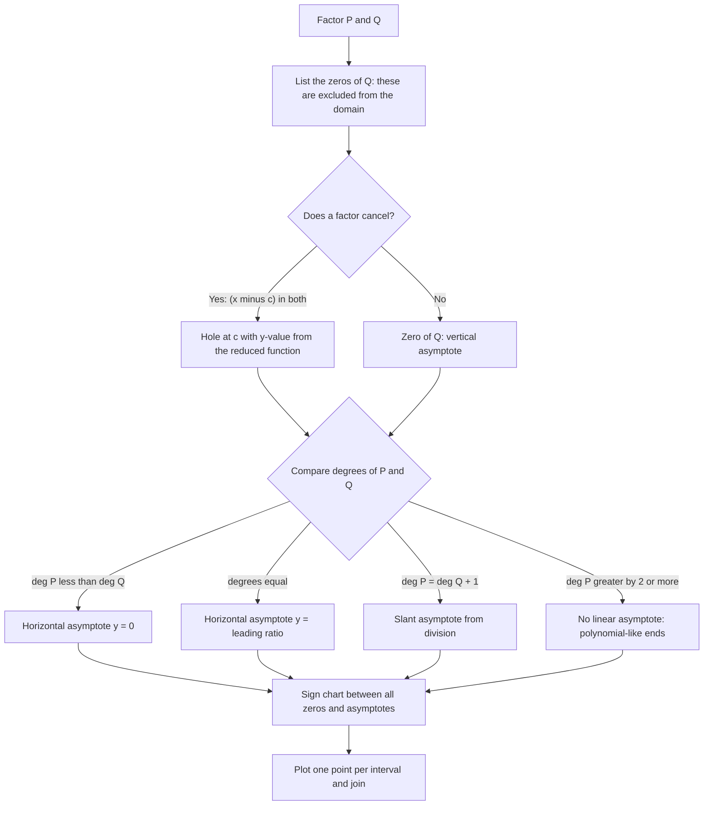

# Polynomial and Rational Functions

> [Precalculus](../README.md) · Level: Intermediate · Prerequisites: [Functions and Graphs](../01-functions-and-graphs/README.md), [Polynomials](../../03-algebra/06-polynomials/README.md), [Factoring](../../03-algebra/07-factoring/README.md), [Quadratic Equations](../../03-algebra/08-quadratic-equations/README.md), [Rational Expressions](../../03-algebra/09-rational-expressions/README.md), [Complex Numbers](../../03-algebra/13-complex-numbers/README.md) · Estimated time: 9 h

## 1. Introduction

Polynomials are the arithmetic of algebra. They are built from a variable and constants using only
addition and multiplication, so every algebraic identity you know — distributivity, the difference of
squares, the binomial theorem — applies to them directly. Their graphs are the smoothest curves in the
subject: no breaks, no asymptotes, no corners, and only as many turns as the degree allows. Rational
functions, their quotients, inherit that smoothness on the intervals between the zeros of the denominator
and add the vertical lines where the graph escapes to infinity.

This topic is where the graph of a function and the algebra of its formula become the same subject.
Three facts make the translation exact.

1. **Division with remainder.** Every polynomial $P$ can be written as $P(x)=D(x)Q(x)+R(x)$ with
   $\deg R<\deg D$. Long division computes it; synthetic division does the job in one line when
   $D(x)=x-c$.
2. **The remainder and factor theorems.** Setting $x=c$ in that identity shows that the remainder on
   division by $x-c$ is $P(c)$, and therefore that $x-c$ divides $P$ exactly when $P(c)=0$. Roots and
   factors are the same thing. This single observation converts every question about zeros into a
   question about factoring.
3. **The conjugate root theorem.** A polynomial with real coefficients that has $a+bi$ as a root also has
   $a-bi$ as a root. Complex roots never travel alone: they come in pairs, so a real polynomial of odd
   degree must have at least one real root.

Around these three facts we develop the tools that a calculus student must already own: multiplicity and
the local behaviour of a graph near a root; end behaviour and the dominance of the leading term;
Descartes' rule of signs and the rational root theorem as search strategies for zeros; the anatomy of a
rational function — domain, holes, vertical, horizontal and slant asymptotes, each justified by a limit;
sign charts, which convert inequalities into questions about factors; and a graphing strategy that turns
a formula into a picture with no wasted plotting.

The applications are not decoration. Cost, revenue and profit are polynomials in the quantity produced;
average cost is a rational function whose horizontal asymptote is the marginal cost; concentration after
mixing is a rational function of the volume; and the sign charts that solve polynomial inequalities are
the same ones that determine when a physical model predicts a positive, physically meaningful quantity.

## 2. Prerequisites

You should be comfortable with the following, each taught in the listed tutorial.

* **Function concepts** — domain, range, symmetry, transformations, and polynomials as a family of graphs:
  [Functions and Graphs](../01-functions-and-graphs/README.md).
* **Polynomial arithmetic** — expanding, collecting like terms, recognising the degree and leading
  coefficient: [Polynomials](../../03-algebra/06-polynomials/README.md).
* **Factoring** — common factors, trinomials, difference and sum of cubes, factoring by grouping:
  [Factoring](../../03-algebra/07-factoring/README.md).
* **Solving quadratics** — factoring and the quadratic formula, including the discriminant:
  [Quadratic Equations](../../03-algebra/08-quadratic-equations/README.md).
* **Rational expressions** — simplifying, adding, multiplying and dividing algebraic fractions, and
  identifying excluded values: [Rational Expressions](../../03-algebra/09-rational-expressions/README.md).
* **Complex numbers** — arithmetic, conjugates, and the fact that a negative discriminant gives a
  conjugate pair of complex roots: [Complex Numbers](../../03-algebra/13-complex-numbers/README.md).
* **Inequalities and interval notation** — including sign-chart solutions:
  [Inequalities](../../03-algebra/03-inequalities/README.md).

## 3. Learning Objectives

After working through this tutorial you will be able to:

1. State the degree, leading coefficient and constant term of a polynomial, and use them to predict the
   end behaviour of its graph.
2. Carry out polynomial long division, including with missing powers, and state the division identity.
3. Use synthetic division to divide by $x-c$ and to evaluate $P(c)$ efficiently.
4. State and prove the remainder theorem and the factor theorem, and use them to test candidate factors.
5. Define the multiplicity of a root and describe the local behaviour of the graph near roots of even and
   odd multiplicity.
6. Prove that a polynomial of degree $n$ has at most $n$ real roots, counted with multiplicity.
7. State the rational root theorem and use it, together with Descartes' rule of signs, to find all
   rational roots of a polynomial with integer coefficients.
8. State and prove the complex conjugate root theorem, and deduce that a real polynomial of odd degree
   has a real root.
9. Find the domain of a rational function, distinguish a hole from a vertical asymptote, and justify both
   with limits.
10. Determine horizontal and slant asymptotes from a degree comparison, with a limit-based justification,
    and verify a slant asymptote by division.
11. Solve polynomial and rational inequalities using a sign chart with correct endpoint conventions.
12. Graph a polynomial or rational function from its formula using a fixed strategy, and build cost,
    revenue and concentration models and interpret their features.

## 4. Intuition

**A polynomial is a sum of simple powers, and the biggest power wins.** For large inputs the leading term
$a_nx^n$ dwarfs everything else, so the graph eventually behaves like that single term: up at both ends if
$n$ is even and $a_n>0$, opposite directions if $n$ is odd. Near the origin the lower powers matter. The
whole art of reading a polynomial is deciding which term dominates in which region.

**A root is a factor, and a factor is a touch or a crossing.** If $P(c)=0$, then $P$ has a factor
$(x-c)$; the number of times that factor occurs is the multiplicity. A factor occurring an even number of
times does not change sign, so the graph touches the axis and turns back; an odd number of times and the
graph crosses. A triple root crosses but flattens as it passes, because three factors of the same sign
make the approach to zero very gradual.

**Division is the reverse of multiplication, and it always works.** $12$ divided by $5$ leaves $2$; the
claim is that $x^4-3x+1$ divided by $x^2+1$ leaves a remainder of degree less than $2$. When the divisor
is linear, the remainder is a single number — and that number is $P(c)$, which is why evaluating a
polynomial and dividing it are the same computation in different clothes.

**A rational function is a ratio, so its graph is governed by its numerator and denominator.** Numerator
zero gives an $x$-intercept. Denominator zero gives a place where the function is undefined: if the
numerator is also zero there, the two zeros may cancel and leave a hole; if not, the graph escapes to
infinity and there is a vertical asymptote. For large inputs both numerator and denominator are dominated
by their leading terms, so the ratio tends to a constant (horizontal asymptote) or to a line (slant
asymptote).

**A sign chart is a summary of the factorisation.** Each factor changes sign only at its own root, so the
sign of a product changes only at the roots of odd multiplicity. Mark those points on a number line, test
one point per interval, and the inequality is solved. The only care needed is at the roots themselves:
zeros of the numerator are allowed when the inequality is non-strict, zeros of the denominator never are.

## 5. Formal Definition

**Definition 5.1 (polynomial).** A **polynomial in $x$** is an expression

$$P(x)=a_nx^n+a_{n-1}x^{n-1}+\cdots+a_1x+a_0,$$

where $n$ is a non-negative integer, the **coefficients** $a_0,\dots,a_n$ are real numbers, and
$a_n \ne 0$. The number $n$ is the **degree** of $P$, written $\deg P$; $a_n$ is the **leading
coefficient**; $a_0$ is the **constant term**. The zero polynomial has no degree (some texts give it
$-\infty$). Two polynomials are equal exactly when all corresponding coefficients are equal.

**Definition 5.2 (root, zero).** A real number $c$ is a **zero** (or **root**) of $P$ when $P(c)=0$.
Equivalently $c$ is a solution of the equation $P(x)=0$.

**Definition 5.3 (divisibility).** A polynomial $D$ **divides** $P$, written $D \mid P$, when there is a
polynomial $Q$ with $P(x)=D(x)Q(x)$ for all $x$.

**Definition 5.4 (multiplicity).** Let $c$ be a root of the nonzero polynomial $P$. The **multiplicity**
of $c$ is the largest positive integer $m$ such that $(x-c)^m \mid P$. Equivalently,
$P(x)=(x-c)^mQ(x)$ with $Q(c) \ne 0$.

Existence of such an $m$ follows from the factor theorem plus the finiteness of the degree: each factor
$x-c$ increases the degree by one, so at most $\deg P$ of them can be extracted.

**Definition 5.5 (rational function).** A **rational function** is a quotient

$$f(x)=\frac{P(x)}{Q(x)}, \qquad Q \not\equiv 0,$$

of polynomials. Its **domain** is $\{x \in \mathbb{R} : Q(x) \ne 0\}$.

**Definition 5.6 (horizontal asymptote).** The line $y=L$ is a **horizontal asymptote** of $f$ when

$$\lim_{x \to +\infty} f(x)=L \quad\text{or}\quad \lim_{x \to -\infty} f(x)=L .$$

Here $\lim_{x\to+\infty} f(x)=L$ means: $f(x)$ can be made as close to $L$ as desired by taking $x$
sufficiently large. The formal $\varepsilon$-definition is given in
[Real Analysis](../../14-real-analysis/README.md); for this topic the intuitive reading is enough, and
every limit we assert is proved by algebra.

**Definition 5.7 (vertical asymptote).** The line $x=c$ is a **vertical asymptote** of $f$ when at least
one of the one-sided limits of $f$ at $c$ is $+\infty$ or $-\infty$:

$$\lim_{x\to c^-} f(x)=\pm\infty \quad\text{or}\quad \lim_{x\to c^+} f(x)=\pm\infty .$$

**Definition 5.8 (hole).** A point $c$ is a **removable discontinuity** (a **hole**) of $f$ when
$\lim_{x\to c} f(x)=L$ exists as a finite number but $f(c)$ is undefined (or differs from $L$). On the
graph this appears as a missing point at $(c,L)$.

**Definition 5.9 (slant asymptote).** The line $y=mx+b$ with $m \ne 0$ is a **slant** (oblique)
**asymptote** of $f$ when

$$\lim_{x\to\pm\infty}\bigl(f(x)-(mx+b)\bigr)=0 .$$

The same definition with $m=0$ is the horizontal asymptote, so a horizontal asymptote is a special case
of a slant asymptote in this terminology. In practice "slant" refers to the case $m \ne 0$.

**Definition 5.10 (end behaviour).** The **end behaviour** of $f$ is the description of $f(x)$ as
$x \to +\infty$ and as $x \to -\infty$.

## 6. Mathematical Notation

| Symbol | Read as | Meaning |
|---|---|---|
| $P(x)$, $Q(x)$ | "P of x" | polynomials in the variable $x$ |
| $\deg P$ | "the degree of $P$" | the highest exponent with nonzero coefficient |
| $a_n$ | "a sub n" | the leading coefficient when $\deg P=n$ |
| $P(c)$ | "P evaluated at c" | the value of the polynomial at $x=c$ |
| $D \mid P$ | "$D$ divides $P$" | $P=DQ$ for some polynomial $Q$ |
| $P(x)=(x-c)^mQ(x)$ | "P equals $(x-c)$ to the $m$ times $Q$" | $c$ is a root of multiplicity $m$ |
| $\dfrac{P(x)}{Q(x)}$ | "P of x over Q of x" | a rational function; $Q \not\equiv 0$ |
| $x \to \infty$ | "$x$ tends to infinity" | $x$ grows without bound; a limit, not a value |
| $\lim_{x\to c^+}f(x)$ | "the limit from the right" | $x$ approaches $c$ through values $>c$ |
| $\operatorname{sign}(a)$ | "the sign of $a$" | $+1$ if $a>0$, $-1$ if $a<0$ |
| $\bar z$ | "z bar" | the complex conjugate of $z$ |
| $\mathbb{C}$ | "the complex numbers" | $\{a+bi : a,b \in \mathbb{R}\}$ |

## 7. Core Concepts

### 7.1 The anatomy of a polynomial

Write a polynomial in **standard form**, with powers in descending order:

$$P(x)=\underbrace{a_n}_{\text{leading coefficient}}x^n+\cdots+\underbrace{a_1x}_{\text{linear term}}+\underbrace{a_0}_{\text{constant term}} .$$

Four quantities control everything: the degree $n$, the leading coefficient $a_n$, the constant term
$a_0$, and the factorisation. The first three are read off; the fourth must be computed.

Two degree rules are used constantly. For nonzero polynomials $P$ and $Q$:

$$\deg(PQ)=\deg P+\deg Q, \qquad \deg(P\pm Q) \le \max(\deg P,\deg Q).$$

The second is an inequality because the leading terms can cancel: $(x^3+x)+(-x^3+x)=2x$ has degree $1$,
not $3$. The first is an equality because $a_nb_m \ne 0$ when both factors are nonzero.

### 7.2 Polynomial long division

Given polynomials $P$ (the **dividend**) and $D$ (the **divisor**) with $D \not\equiv 0$, long division
produces polynomials $Q$ (the **quotient**) and $R$ (the **remainder**) with

$$P(x)=D(x)Q(x)+R(x), \qquad \deg R<\deg D .$$

The algorithm is the one learned in arithmetic, with "multiply and subtract" replaced by "divide leading
terms, multiply, subtract". At each stage the leading term of the current remainder is killed, so the
degree of the remainder strictly decreases and the process stops after at most $\deg P-\deg D+1$ steps.

**A one-step example.** Divide $x^3+1$ by $x+1$. The leading terms give $x^3/x=x^2$; multiply
$x^2(x+1)=x^3+x^2$; subtract from $x^3+0x^2+0x+1$ to get $-x^2$. Repeat: $-x^2/x=-x$; multiply
$-x(x+1)=-x^2-x$; subtract to get $x+1$. Repeat: $x/x=1$; multiply $x+1$; subtract to get $0$. Hence

$$x^3+1=(x+1)(x^2-x+1),$$

which is the familiar sum-of-cubes identity, here *derived* rather than quoted.

**Layout.** Write the dividend with every power present, inserting $0x^k$ for missing terms. The
alignment of like powers is not cosmetic: it is what makes the subtraction work column by column.

### 7.3 Synthetic division

When the divisor is $x-c$, long division can be compressed to a row of coefficients. Write the
coefficients of $P$ (all of them, including zeros) in a row, bring the first down, and repeatedly
multiply by $c$ and add:

$$\begin{array}{r|rrrr} c & a_n & a_{n-1} & \cdots & a_0\\ & & cb_{n-1} & \cdots & cb_0\\ \hline & b_{n-1} & b_{n-2} & \cdots & r \end{array}$$

The final entry $r$ is the remainder, and the other entries are the coefficients of the quotient, whose
degree is one less than $\deg P$.

**Why it works.** Synthetic division is long division with the powers suppressed. Dividing by $x-c$
means subtracting $c$ times each coefficient from the next one, because
$(x-c)(b_{n-1}x^{n-1}+\cdots+b_0)=b_{n-1}x^n+(b_{n-2}-cb_{n-1})x^{n-1}+\cdots-cb_0$. Reading that
identity from right to left gives the algorithm.

### 7.4 The remainder and factor theorems

Set $x=c$ in the division identity $P(x)=(x-c)Q(x)+R$. The first term vanishes and $P(c)=R$. That is the
whole proof, and it is the most useful one-line argument in the theory of equations.

**Remainder theorem.** The remainder on dividing $P$ by $x-c$ is $P(c)$.

**Factor theorem.** $(x-c) \mid P$ if and only if $P(c)=0$.

The factor theorem converts the search for roots into the search for linear factors, and vice versa. Its
consequences run through the rest of the topic:

* If $c_1,\dots,c_k$ are distinct roots, then $(x-c_1)\cdots(x-c_k) \mid P$, so $k \le \deg P$: a
  polynomial of degree $n$ has at most $n$ real roots, counted with multiplicity.
* A root of multiplicity $m$ contributes the factor $(x-c)^m$, and the multiplicities of all real roots
  sum to at most $n$.
* Dividing out a known factor reduces the degree, which is the only practical way to solve cubic and
  higher-degree equations by hand.

### 7.5 Multiplicity and local behaviour

Let $P(x)=(x-c)^mQ(x)$ with $Q(c) \ne 0$. Near $x=c$ the factor $Q(x)$ is approximately the nonzero
number $Q(c)$, so

$$P(x) \approx Q(c)\,(x-c)^m .$$

The sign of $P$ near $c$ is therefore the sign of $Q(c)$ times the sign of $(x-c)^m$: the graph behaves
like a shifted copy of $y=Q(c)x^m$ near the origin.

| Multiplicity $m$ | Sign of $(x-c)^m$ for $x<c$ / $x>c$ | Shape at $(c,0)$ |
|---|---|---|
| $1$ (simple) | $-$ / $+$ | crosses the axis transversally |
| $2$ (double) | $+$ / $+$ | touches the axis, turns back |
| $3$ (triple) | $-$ / $+$ | crosses, flattening as it passes |
| $4$ (quadruple) | $+$ / $+$ | touches, flattening on both sides |
| odd $m$ | $-$ / $+$ | crosses; flatter for larger $m$ |
| even $m$ | $+$ / $+$ | touches; flatter for larger $m$ |

When $Q(c)<0$ the picture is reflected in the $x$-axis, but the crossing/touching verdict is unchanged
because it depends only on the parity of $m$.

### 7.6 End behaviour and leading-term dominance

For $|x|$ large, the leading term overwhelms the rest. Factor it out:

$$P(x)=a_nx^n\left(1+\frac{a_{n-1}}{a_n x}+\cdots+\frac{a_0}{a_n x^n}\right).$$

The bracket tends to $1$ as $|x| \to \infty$, because every term contains a positive power of $1/x$.
Hence $P(x)$ has the sign and the magnitude of $a_nx^n$ for large $|x|$, and the end behaviour is
determined by the degree and the leading coefficient alone:

| Degree | Leading coefficient | $x \to -\infty$ | $x \to +\infty$ |
|---|---|---|---|
| even | $a_n>0$ | $+\infty$ | $+\infty$ |
| even | $a_n<0$ | $-\infty$ | $-\infty$ |
| odd | $a_n>0$ | $-\infty$ | $+\infty$ |
| odd | $a_n<0$ | $+\infty$ | $-\infty$ |

### 7.7 The toolbox for zeros

No general formula solves degree-five equations, so finding zeros is a search guided by three results.

**Rational root theorem.** Let $P(x)=a_nx^n+\cdots+a_0$ have integer coefficients with $a_n \ne 0$ and
$a_0 \ne 0$. If the fraction $\frac pq$ in lowest terms is a root, then $p \mid a_0$ and $q \mid a_n$.
Consequently all rational roots lie in the finite list
$\pm\dfrac{\text{divisor of }a_0}{\text{divisor of }a_n}$, and a monic integer polynomial has only
integer roots, each dividing $a_0$.

**Descartes' rule of signs.** The number of positive real roots of $P$ (counted with multiplicity) is
either equal to the number of sign changes in the sequence of its nonzero coefficients, or less than it
by an even number. The number of negative roots is the same count applied to $P(-x)$. A zero coefficient
is ignored when counting sign changes.

**Complex conjugate root theorem.** If $P$ has real coefficients and $z=a+bi$ with $b \ne 0$ is a root,
then $\bar z=a-bi$ is also a root, with the same multiplicity. Hence the non-real roots of a real
polynomial occur in conjugate pairs.

### 7.8 Rational functions: domain, holes, vertical asymptotes

For $f(x)=\dfrac{P(x)}{Q(x)}$ begin by factoring both polynomials and cancelling common factors **while
recording what was cancelled**.

* **Domain.** All $x$ with $Q(x) \ne 0$. Cancellation does not enlarge the domain: the original formula
  is undefined at a cancelled zero.
* **Hole.** If $(x-c)$ cancels from numerator and denominator, then near $c$ the function agrees with the
  reduced quotient $g$, and $\lim_{x\to c}f(x)=g(c)$ is finite. The graph is the graph of $g$ with the
  single point $(c,g(c))$ removed.
* **Vertical asymptote.** If $Q(c)=0$ and, after cancellation, $P(c) \ne 0$, then the denominator tends
  to $0$ while the numerator stays away from $0$, so $|f(x)| \to \infty$ as $x \to c$. The line $x=c$ is
  a vertical asymptote. Its two branches may go the same way ($1/(x-c)^2$: both $+\infty$) or opposite
  ways ($1/(x-c)$: $+\infty$ on one side, $-\infty$ on the other).

**Example.** $f(x)=\dfrac{x^2-1}{x^2-3x+2}=\dfrac{(x-1)(x+1)}{(x-1)(x-2)}$. The domain is
$\mathbb{R}\setminus\{1,2\}$. After cancelling, $g(x)=\dfrac{x+1}{x-2}$, so the limit at $x=1$ is
$g(1)=-2$: there is a hole at $(1,-2)$. At $x=2$ the reduced denominator still vanishes and the reduced
numerator equals $3 \ne 0$, so $x=2$ is a vertical asymptote.

### 7.9 Rational functions: horizontal and slant asymptotes

Divide numerator and denominator by the highest power of $x$ that appears in the denominator. Every
negative power tends to $0$, leaving a comparison of degrees. For
$f=\dfrac{P}{Q}$ with $\deg P=d_p$ and $\deg Q=d_q$, leading coefficients $a$ and $b$:

| Degree comparison | End behaviour | Asymptote |
|---|---|---|
| $d_p<d_q$ | $f(x) \to 0$ | $y=0$ |
| $d_p=d_q$ | $f(x) \to \dfrac ab$ | $y=\dfrac ab$ |
| $d_p=d_q+1$ | $f(x)$ behaves like a linear function | slant asymptote, found by division |
| $d_p>d_q+1$ | $f(x)$ behaves like a polynomial of degree $d_p-d_q$ | no linear asymptote |

**Justification of the middle case.** Write $P(x)=ax^{d}+(\text{lower})$ and $Q(x)=bx^{d}+(\text{lower})$
with $d=d_p=d_q$. Dividing both by $x^d$,

$$f(x)=\frac{a+\frac{a_{d-1}}{x}+\cdots+\frac{a_0}{x^d}}{b+\frac{b_{d-1}}{x}+\cdots+\frac{b_0}{x^d}}
\longrightarrow \frac ab ,$$

because each term with a positive power of $1/x$ tends to $0$. The other cases are the same computation
with the common power replaced by the larger of the two degrees.

**Finding a slant asymptote.** When $d_p=d_q+1$, perform the division:
$f(x)=mx+k+\dfrac{R(x)}{Q(x)}$ with $\deg R<\deg Q$. The fraction tends to $0$ at both ends, so
$y=mx+k$ is the slant asymptote.

**Examples.** $\dfrac{2x^2+1}{x^2-3}\to2$; $\dfrac{x}{x^2+1}\to0$; and

$$\frac{x^3}{x^2+1}=x-\frac{x}{x^2+1},$$

obtained by division, so $y=x$ is a slant asymptote. For $\dfrac{x^4}{x^2+1}=x^2-1+\dfrac{1}{x^2+1}$
there is no linear asymptote: the graph resembles the parabola $y=x^2-1$ at both ends.

### 7.10 Sign charts and inequalities

A sign chart records the sign of a factored expression on each interval between its zeros. The procedure
is always the same.

1. Move everything to one side so that the inequality reads $F(x) \ge 0$ or $F(x)>0$.
2. Factor the numerator and the denominator completely, and list every real zero of each.
3. Mark those numbers on a number line. Mark zeros of the numerator with a filled dot if the inequality
   is non-strict ($\le$ or $\ge$) and an open dot if it is strict; always mark zeros of the denominator
   with an open dot, because the function is undefined there.
4. Test one point in each interval to fix the sign there. A zero of odd multiplicity changes the sign; a
   zero of even multiplicity does not.
5. Read off the intervals whose sign satisfies the inequality, and include the filled endpoints.

**One worked instance.** Solve $\dfrac{x+1}{x-2} \ge 2$. Subtract $2$ rather than cross-multiplying:

$$\frac{x+1}{x-2}-2=\frac{x+1-2x+4}{x-2}=\frac{5-x}{x-2}\ge 0 .$$

The critical numbers are $2$ (denominator, always excluded) and $5$ (numerator, included). Testing
$x=0$ gives $-\tfrac52<0$; testing $x=3$ gives $2>0$; testing $x=6$ gives $-\tfrac14<0$. The solution is
$(2,5]$.

### 7.11 A graphing strategy

Given $f(x)=\dfrac{P(x)}{Q(x)}$ (with $Q=1$ for a polynomial), work through the list in order.

1. **Factor** $P$ and $Q$ completely over the reals.
2. **Domain**: exclude the zeros of $Q$.
3. **Cancel** common factors and record the holes, with their $y$-values.
4. **Intercepts**: $x$-intercepts are the remaining zeros of $P$; the $y$-intercept is $f(0)$ if defined.
5. **Vertical asymptotes**: the remaining zeros of $Q$, with the one-sided behaviour where it is easy to
   determine.
6. **End behaviour**: compare degrees for a horizontal or slant asymptote; for a polynomial, use the
   leading term.
7. **Sign chart**: signs on the intervals cut out by the intercepts and asymptotes.
8. **Plot** one or two points per interval and join them respecting asymptotes, holes and multiplicity.

The order matters. Factoring first prevents the two most common errors: treating a hole as an asymptote,
and reading an intercept from a factor that was cancelled.

## 8. Formulas and Properties

Each result below is stated with its hypotheses. Proofs are complete unless a citation is given; the two
places where a full proof would require analysis beyond this level (the sign-change bound behind
Descartes' rule, and the fundamental theorem of algebra) are marked and cited.

**Theorem 8.1 (division algorithm).** Let $P$ and $D$ be polynomials with $D \not\equiv 0$. Then there
exist unique polynomials $Q$ and $R$ with

$$P(x)=D(x)Q(x)+R(x), \qquad \deg R<\deg D .$$

*Proof of existence.* Induct on $m=\deg P$. If $m<\deg D$, take $Q=0$ and $R=P$. Otherwise write the
leading terms as $ax^m$ and $bx^d$ with $d=\deg D \le m$, and set
$S(x)=P(x)-\frac ab x^{m-d}D(x)$. The term $ax^m$ cancels, so $\deg S<m$. By the induction hypothesis
$S=DQ'+R$ with $\deg R<\deg D$, hence $P=D\left(\frac abx^{m-d}+Q'\right)+R$, which has the required form.

*Proof of uniqueness.* Suppose $P=DQ+R=D\tilde Q+\tilde R$ with $\deg R,\deg\tilde R<\deg D$. Then
$D(Q-\tilde Q)=\tilde R-R$. If $Q \ne \tilde Q$, the left side has degree at least $\deg D$ (a nonzero
product), while the right side has degree less than $\deg D$ — impossible. Hence $Q=\tilde Q$, and then
$R=\tilde R$. $\blacksquare$

**Theorem 8.2 (remainder theorem).** For any polynomial $P$ and real $c$, the remainder on dividing $P$
by $x-c$ is $P(c)$.

*Proof.* By Theorem 8.1, $P(x)=(x-c)Q(x)+R$ where $R$ is a constant (its degree is less than $1$).
Substituting $x=c$ gives $P(c)=0\cdot Q(c)+R=R$. $\blacksquare$

**Theorem 8.3 (factor theorem).** For a polynomial $P$ and real $c$:
$(x-c) \mid P \iff P(c)=0$.

*Proof.* If $(x-c) \mid P$ then $P(x)=(x-c)Q(x)$, so $P(c)=0$. Conversely, if $P(c)=0$ then by Theorem
8.2 the remainder on division by $x-c$ is $0$, so $P(x)=(x-c)Q(x)$ and $(x-c) \mid P$. $\blacksquare$

**Corollary 8.4 (at most $n$ roots).** A nonzero polynomial of degree $n$ has at most $n$ real roots,
counted with multiplicity; in particular it has at most $n$ distinct real roots.

*Proof.* Let $c_1,\dots,c_k$ be distinct roots with multiplicities $m_1,\dots,m_k$. Extracting the
factors one at a time using Theorem 8.3,

$$P(x)=(x-c_1)^{m_1}\cdots(x-c_k)^{m_k}S(x)$$

for some polynomial $S$. Degrees add, so $n=m_1+\cdots+m_k+\deg S \ge m_1+\cdots+m_k$. $\blacksquare$

**Lemma 8.5 (local behaviour at a root).** Let $P(x)=(x-c)^mQ(x)$ with $m \ge 1$ and $Q(c) \ne 0$. Then
there is an interval around $c$ on which $Q$ keeps the constant sign of $Q(c)$, and consequently

$$\operatorname{sign}P(x)=\operatorname{sign}Q(c)\cdot(-1)^m \ (x<c), \qquad
\operatorname{sign}P(x)=\operatorname{sign}Q(c)\ (x>c).$$

Moreover $P(x) \to 0$ as $x \to c$. Hence the graph crosses the axis at $c$ when $m$ is odd and touches
it without crossing when $m$ is even.

*Proof.* $Q$ is continuous at $c$ and $Q(c) \ne 0$. If $Q$ took both signs arbitrarily close to $c$, the
intermediate value property would give points with $Q=0$ arbitrarily close to $c$, contradicting
continuity and $Q(c) \ne 0$. So $Q$ has constant sign near $c$. The sign statements follow because
$(x-c)^m$ has the sign $(-1)^m$ on the left and $+1$ on the right. Finally $|P(x)| \le |Q(x)|\,|x-c|^m
\to 0$. $\blacksquare$

**Proposition 8.6 (end behaviour).** Let $P(x)=a_nx^n+\cdots+a_0$ with $a_n \ne 0$. Then

$$\frac{P(x)}{a_nx^n} \longrightarrow 1 \quad\text{as } |x| \to \infty .$$

Consequently, for sufficiently large $|x|$, $P(x)$ has the sign of $a_nx^n$, and the table in Section 7.6
describes the four possible end behaviours.

*Proof.* Divide by $a_nx^n$:

$$\frac{P(x)}{a_nx^n}=1+\frac{a_{n-1}}{a_n}\cdot\frac{1}{x}+\cdots+\frac{a_0}{a_n}\cdot\frac{1}{x^n} .$$

Each term after the first contains a positive power of $1/x$ and tends to $0$ as $|x| \to \infty$, so the
whole expression tends to $1$. A quantity tending to $1$ is eventually positive, so $P(x)$ eventually has
the sign of $a_nx^n$. $\blacksquare$

**Theorem 8.7 (rational root theorem).** Let $P(x)=a_nx^n+\cdots+a_0$ have integer coefficients with
$a_n \ne 0$ and $a_0 \ne 0$. If $\frac pq$ is a root with $p,q$ integers, $q \ne 0$, and $\gcd(p,q)=1$,
then $p \mid a_0$ and $q \mid a_n$.

*Proof.* Substitute $x=\frac pq$ and multiply by $q^n$:

$$a_np^n+a_{n-1}p^{n-1}q+\cdots+a_1pq^{n-1}+a_0q^n=0 .$$

Every term except the last is divisible by $p$, so $p \mid a_0q^n$. Since $\gcd(p,q)=1$, also
$\gcd(p,q^n)=1$, and Euclid's lemma gives $p \mid a_0$. Similarly, every term except the first is
divisible by $q$, so $q \mid a_np^n$; since $\gcd(q,p^n)=1$, we get $q \mid a_n$. $\blacksquare$

**Corollary 8.8 (integer and monic cases).** If $P$ is monic with integer coefficients, every rational
root is an integer dividing $a_0$. In particular the only possible rational roots of $x^3-2$ are
$\pm1,\pm2$, none of which works; hence $\sqrt[3]{2}$ is irrational.

**Theorem 8.9 (Descartes' rule of signs).** Let $P$ be a nonzero polynomial with real coefficients, and
let $s$ be the number of sign changes in the sequence of its nonzero coefficients, read in descending
order of degree. Then the number $p$ of positive real roots, counted with multiplicity, satisfies

$$p \le s \quad\text{and}\quad s-p \text{ is even}.$$

The number of negative roots is obtained by applying the same count to $P(-x)$.

*Proof.* Write the positive roots (with multiplicity) as $r_1,\dots,r_p$ and factor
$P(x)=(x-r_1)\cdots(x-r_p)R(x)$, where $R$ has no positive root. Since $R$ is continuous and never zero
on $(0,\infty)$, it has a constant sign there; therefore its leading coefficient and its lowest nonzero
coefficient have the same sign, which means $R$ has an even number $v(R)$ of sign changes.

The key lemma is this: for $c>0$, multiplying a polynomial $Q$ by $x-c$ produces a polynomial whose
number of sign changes is $v(Q)+1+2j$ for some integer $j \ge 0$. (The parity half is proved below; the
full lemma, including $j \ge 0$, is proved by induction on the number of nonzero coefficients in
Burnside & Panton, *The Theory of Equations*, Chapter I.) Applying the lemma $p$ times,

$$v(P)=v(R)+p+2J \ge p \quad\text{and}\quad v(P)\equiv v(R)+p\equiv p \pmod 2,$$

since $v(R)$ is even. That is exactly the statement.

*Proof of the parity half of the lemma.* For $t>0$ let $v(t)$ be the number of sign changes of
$(x-t)Q$. The coefficients of $(x-t)Q$ are linear functions $b_{k-1}-tb_k$ of $t$, and the first and last
are nonzero for $t>0$. As $t$ increases, $v(t)$ changes only when an intermediate coefficient passes
through $0$, and each such event changes the count by an even number (two sign changes are created,
destroyed, or replaced); so $v$ is constant modulo $2$ on $(0,\infty)$. For large $t$ the signs are those
of $b_n,-b_n,-b_{n-1},\dots,-b_0$, giving $v=v(Q)+1$. Hence $v((x-c)Q)\equiv v(Q)+1 \pmod 2$.
$\blacksquare$

**Theorem 8.10 (fundamental theorem of algebra).** Every non-constant polynomial with complex
coefficients has at least one complex root. Consequently a polynomial of degree $n$ factors into $n$
linear factors over $\mathbb{C}$.

The theorem is proved in [Complex Analysis](../../15-complex-analysis/README.md); it is not an algebraic
fact but an analytic one (it depends on completeness of $\mathbb{C}$), and no purely algebraic proof
exists. We use it here only to know that the roots being counted actually exist.

**Theorem 8.11 (complex conjugate root theorem).** Let $P$ have real coefficients. If $z \in \mathbb{C}$
is a root of $P$, then $\bar z$ is a root of $P$ as well, with the same multiplicity.

*Proof.* Complex conjugation satisfies $\overline{w+u}=\bar w+\bar u$, $\overline{wu}=\bar w\bar u$ and
$\bar r=r$ for real $r$. Hence, for real coefficients $a_k$,

$$P(\bar z)=\sum_k a_k\bar z^k=\sum_k \overline{a_k z^k}=\overline{\sum_k a_k z^k}=\overline{P(z)} .$$

If $P(z)=0$ then $P(\bar z)=\overline0=0$. For the multiplicity, write $P(x)=(x-z)^mQ(x)$ with
$Q(z) \ne 0$ and $m \ge 1$. Conjugating the coefficients of this identity gives
$P(x)=(x-\bar z)^m\bar Q(x)$, where $\bar Q$ is the polynomial obtained by conjugating every coefficient.
Since $\bar Q(\bar z)=\overline{Q(z)} \ne 0$, the multiplicity of $\bar z$ is exactly $m$. $\blacksquare$

**Corollary 8.12 (real factorisation).** A real polynomial factors over $\mathbb{R}$ as

$$P(x)=a_n\prod_i (x-r_i)^{m_i}\prod_j\bigl(x^2+b_jx+c_j\bigr)^{n_j},$$

where the $r_i$ are its real roots and each quadratic has negative discriminant and no real roots.

*Proof.* By Theorem 8.10, $P$ has $\deg P$ complex roots counted with multiplicity. By Theorem 8.11 the
non-real roots split into conjugate pairs $z,\bar z$, and

$$(x-z)(x-\bar z)=x^2-2(\operatorname{Re}z)x+\lvert z\rvert^2$$

has real coefficients and discriminant $4(\operatorname{Re}z)^2-4\lvert z\rvert^2=-4(\operatorname{Im}z)^2<0$.
Multiplying the real linear factors and these quadratic factors reproduces $P$ up to the leading
coefficient. $\blacksquare$

**Corollary 8.13 (odd degree).** Every real polynomial of odd degree has at least one real root.

*Proof.* Let $P$ have odd degree $n$ and leading coefficient $a_n>0$ (the other case is symmetric). By
Proposition 8.6, $P(x) \to -\infty$ as $x \to -\infty$ and $P(x) \to +\infty$ as $x \to +\infty$; choose
$a<b$ with $P(a)<0<P(b)$. Since $P$ is continuous, the intermediate value property gives $c \in (a,b)$
with $P(c)=0$. $\blacksquare$

**Proposition 8.14 (horizontal asymptotes).** Let $f=\dfrac{P}{Q}$ with $P,Q$ nonzero polynomials,
$\deg P=d_p$, $\deg Q=d_q$, leading coefficients $a$ and $b$. If $d_p \le d_q$, then

$$\lim_{x\to\pm\infty}f(x)=
\begin{cases}
0, & d_p<d_q,\\[2pt]
\dfrac ab, & d_p=d_q .
\end{cases}$$

*Proof.* Divide numerator and denominator by $x^{d_q}$:

$$f(x)=\frac{a x^{d_p-d_q}+(\text{terms with negative powers of }x)}{b+(\text{terms with negative powers of }x)} .$$

If $d_p<d_q$, the numerator tends to $0$ and the denominator to $b \ne 0$, so the limit is $0$. If
$d_p=d_q$, the numerator tends to $a$ and the limit is $a/b$. $\blacksquare$

**Proposition 8.15 (holes and vertical asymptotes).** Let $f=P/Q$ and let $c$ be a real zero of $Q$.
Write $Q(x)=(x-c)^kS(x)$ and $P(x)=(x-c)^\ell T(x)$ with $S(c) \ne 0$, $T(c) \ne 0$, and $k \ge 1$,
$\ell \ge 0$ (where $\ell=0$ means $P(c) \ne 0$).

* If $\ell<k$, then $\lvert f(x)\rvert \to \infty$ as $x \to c$, so $x=c$ is a **vertical asymptote**.
* If $\ell \ge k$, then $f(x) \to T(c)/S(c)$ when $\ell=k$ and $f(x) \to 0$ when $\ell>k$; the limit is
  finite, so $c$ is a **hole** (removable discontinuity).

*Proof.* In both cases
$f(x)=(x-c)^{\ell-k}\,\dfrac{T(x)}{S(x)}$, and $\dfrac{T(x)}{S(x)} \to \dfrac{T(c)}{S(c)} \ne 0$. If
$\ell-k<0$ the power blows up in magnitude; if $\ell-k \ge 0$ the power tends to $0$ or $1$ and the
product has the finite limit stated. $\blacksquare$

## 9. Step-by-Step Examples

### Example 9.1 — Long division with missing terms

Divide $2x^4-3x^3+x-5$ by $x^2-x+1$.

Write the dividend with all powers present: $2x^4-3x^3+0x^2+x-5$. Then repeat "divide leading terms,
multiply, subtract":

$$\begin{aligned}
&\text{divide } 2x^4 \text{ by } x^2: && 2x^2\\
&\text{subtract } 2x^2(x^2-x+1)=2x^4-2x^3+2x^2, &&\text{leaving } -x^3-2x^2+x-5\\
&\text{divide } -x^3 \text{ by } x^2: && -x\\
&\text{subtract } -x(x^2-x+1)=-x^3+x^2-x, &&\text{leaving } -3x^2+2x-5\\
&\text{divide } -3x^2 \text{ by } x^2: && -3\\
&\text{subtract } -3(x^2-x+1)=-3x^2+3x-3, &&\text{leaving } -x-2
\end{aligned}$$

The quotient is $2x^2-x-3$ and the remainder is $-x-2$, so

$$2x^4-3x^3+x-5=(x^2-x+1)(2x^2-x-3)+(-x-2).$$

**Degree check.** The dividend has degree $4$ and the divisor degree $2$, so the quotient must have degree
$2$ and the remainder degree at most $1$; both hold.

### Example 9.2 — Synthetic division, the remainder theorem and a full factorisation

**(a)** Divide $P(x)=2x^3-5x^2-4x+3$ by $x-3$ using synthetic division.

$$\begin{array}{r|rrrr}
3 & 2 & -5 & -4 & 3\\
  &   &  6 &  3 & -3\\
\hline
  & 2 &  1 & -1 & 0
\end{array}$$

The quotient is $2x^2+x-1$ and the remainder is $0$. Hence $x-3$ is a factor:
$P(x)=(x-3)(2x^2+x-1)=(x-3)(2x-1)(x+1)$, and the roots are $3$, $\tfrac12$ and $-1$.

**(b)** Evaluate $P(-2)$ using synthetic division with $c=-2$:

$$\begin{array}{r|rrrr}
-2 & 2 & -5 & -4 & 3\\
   &   & -4 & 18 & -28\\
\hline
   & 2 & -9 & 14 & -25
\end{array}$$

The remainder is $-25$, so $P(-2)=-25$. **Check** by substitution:
$2(-8)-5(4)-4(-2)+3=-16-20+8+3=-25$ ✓.

### Example 9.3 — Multiplicity, sign chart and a polynomial inequality

Let $P(x)=-(x+1)(x-2)^2(x-3)$. Describe its zeros and their behaviour, sketch its sign, and solve
$P(x) \le 0$.

**Degree and end behaviour.** The leading term is $-x\cdot x^2\cdot x=-x^4$, so $\deg P=4$ with negative
leading coefficient: both ends go to $-\infty$.

**Zeros.** $x=-1$ (multiplicity $1$, crosses), $x=2$ (multiplicity $2$, touches), $x=3$ (multiplicity $1$,
crosses).

**Sign chart.** The factors $(x-2)^2$ and the minus sign control the pattern; only $x=-1$ and $x=3$
change the sign.

| Interval | $-(x+1)$ | $(x-2)^2$ | $(x-3)$ | $P(x)$ |
|---|---|---|---|---|
| $x<-1$ | $+$ | $+$ | $-$ | $-$ |
| $-1<x<2$ | $-$ | $+$ | $-$ | $+$ |
| $2<x<3$ | $-$ | $+$ | $-$ | $+$ |
| $x>3$ | $-$ | $+$ | $+$ | $-$ |

**Solution of $P(x) \le 0$.** Negative on $(-\infty,-1)$ and $(3,\infty)$, zero at $-1,2,3$. Hence the
solution set is

$$(-\infty,-1]\cup\{2\}\cup[3,\infty).$$

### Example 9.4 — Rational roots and Descartes' rule together

Factor $P(x)=2x^4+5x^3-14x^2-5x+12$ completely.

**Step 1 — rational candidates.** Here $a_0=12$ and $a_4=2$, so candidates are
$\pm1,\pm2,\pm3,\pm4,\pm6,\pm12$ and the same numbers halved: $\pm\tfrac12,\pm\tfrac32$.

**Step 2 — Descartes.** The signs are $+,+,-,-,+$: two sign changes, so there are $2$ or $0$ positive
roots. For $P(-x)=2x^4-5x^3-14x^2+5x+12$ the signs are $+,-,-,+,+$: again two changes, so $2$ or $0$
negative roots.

**Step 3 — find one root.** Testing the small candidates, $P(1)=2+5-14-5+12=0$. Synthetic division by
$1$:

$$\begin{array}{r|rrrrr}
1 & 2 & 5 & -14 & -5 & 12\\
  &   & 2 &   7 & -7 & -12\\
\hline
  & 2 & 7 &  -7 & -12 & 0
\end{array}$$

So $P(x)=(x-1)(2x^3+7x^2-7x-12)$.

**Step 4 — repeat.** Test $x=-1$ in the cubic: $-2+7+7-12=0$. Synthetic division by $-1$:

$$\begin{array}{r|rrrr}
-1 & 2 & 7 & -7 & -12\\
   &   & -2 & -5 & 12\\
\hline
   & 2 & 5 & -12 & 0
\end{array}$$

So $P(x)=(x-1)(x+1)(2x^2+5x-12)=(x-1)(x+1)(2x-3)(x+4)$.

**Step 5 — check against Descartes.** The roots are $1,\tfrac32,-1,-4$: two positive and two negative,
consistent with both predictions.

### Example 9.5 — Graphing a rational function

Analyse and sketch $f(x)=\dfrac{x^2-4}{x^2-x-6}$.

**Factor.** $f(x)=\dfrac{(x-2)(x+2)}{(x-3)(x+2)}$.

**Domain.** $x \ne 3$ and $x \ne -2$.

**Hole.** The factor $x+2$ cancels. The reduced function is $g(x)=\dfrac{x-2}{x-3}$, so
$\lim_{x\to-2}f(x)=g(-2)=\dfrac{-4}{-5}=\dfrac45$. There is a hole at $\left(-2,\tfrac45\right)$.

**Vertical asymptote.** At $x=3$ the reduced denominator vanishes and the reduced numerator equals
$1 \ne 0$, so $f(x) \to \pm\infty$: the line $x=3$ is a vertical asymptote. Indeed, as $x \to 3^-$,
$x-2 \to 1^+$ and $x-3 \to 0^-$, so $f(x) \to -\infty$; as $x \to 3^+$, $f(x) \to +\infty$.

**Horizontal asymptote.** The degrees are equal (both $2$) with leading coefficients $1$ and $1$, so
$\lim_{x\to\pm\infty}f(x)=1$: the line $y=1$ is a horizontal asymptote.

**Intercepts.** $x$-intercept: $x=2$ gives the point $(2,0)$ (the factor $x+2$ belongs to the hole, not to
an intercept). $y$-intercept: $f(0)=\dfrac{-4}{-6}=\dfrac23$.

**Sign chart.** Using the reduced form, $f$ has the sign of $\dfrac{x-2}{x-3}$ away from $x=-2$:

| Interval | $x-2$ | $x-3$ | $f(x)$ |
|---|---|---|---|
| $x<-2$ | $-$ | $-$ | $+$ |
| $-2<x<2$ | $-$ | $-$ | $+$ |
| $2<x<3$ | $+$ | $-$ | $-$ |
| $x>3$ | $+$ | $+$ | $+$ |

**Sketch.** Above the axis on $(-\infty,-2)$ and $(-2,2)$, below on $(2,3)$, above on $(3,\infty)$;
hole at $\left(-2,\tfrac45\right)$; vertical asymptote $x=3$ with the two branches going to $-\infty$ and
$+\infty$. Since $f(x)-1=\dfrac{1}{x-3}$, the graph lies *below* $y=1$ for $x<3$ and *above* it for
$x>3$: it approaches the asymptote from the two sides without ever crossing it, and indeed
$\dfrac{x-2}{x-3}=1$ has no solution.

### Example 9.6 — A slant asymptote and a rational inequality

Let $h(x)=\dfrac{x^2+1}{x-1}$.

**(a) Division and slant asymptote.** Dividing,

$$x^2+1=(x-1)(x+1)+2 \;\Longrightarrow\; h(x)=x+1+\frac{2}{x-1}.$$

As $x \to \pm\infty$ the fraction tends to $0$, so $y=x+1$ is a slant asymptote. The vertical asymptote
is $x=1$; there is no horizontal asymptote.

**(b) Solve $h(x) \ge 2x$.** Subtract $2x$:

$$\frac{x^2+1}{x-1}-2x=\frac{x^2+1-2x^2+2x}{x-1}=\frac{-x^2+2x+1}{x-1}\ge 0 .$$

The numerator vanishes at $x=\dfrac{2\pm\sqrt{4+4}}{2}=1\pm\sqrt2$, and the denominator vanishes at
$x=1$, which is excluded. The critical numbers in increasing order are $1-\sqrt2\approx-0.414$, $1$, and
$1+\sqrt2\approx2.414$. The numerator is an upside-down parabola, positive between its roots; the
denominator is negative for $x<1$ and positive for $x>1$. Therefore the quotient is positive on
$(-\infty,1-\sqrt2)$ and on $(1,1+\sqrt2)$, negative on $(1-\sqrt2,1)$ and on $(1+\sqrt2,\infty)$.

The solution is $\left(-\infty,1-\sqrt2\right]\cup\left(1,1+\sqrt2\right]$.

### Example 9.7 — Cost, revenue and average cost

A workshop produces $x$ items per day. Its daily cost is $C(x)=5x+100$ dollars, and the price it can
charge is such that revenue is $R(x)=30x-x^2$ dollars, for $0 \le x \le 30$.

**(a) Profit.** $P(x)=R(x)-C(x)=30x-x^2-5x-100=-x^2+25x-100$.

**(b) Break-even points.** Solve $P(x)=0$: $x^2-25x+100=0$, so
$x=\dfrac{25\pm\sqrt{625-400}}{2}=\dfrac{25\pm15}{2}$, giving $x=5$ and $x=20$. Because $P$ is a
downward parabola, profit is positive for $5<x<20$ and negative outside.

**(c) Maximum profit.** Completing the square,
$P(x)=-(x-12.5)^2+56.25$, so the maximum is $\$56.25$ at $x=12.5$. Since items come in whole numbers,
the best integer productions are $x=12$ and $x=13$, each giving $\$56$.

**Check.** $P(12)=-144+300-100=56$ ✓; $P(13)=-169+325-100=56$ ✓; $P(12.5)=56.25$ ✓.

**(d) Average cost.** The cost per item is

$$A(x)=\frac{C(x)}{x}=\frac{5x+100}{x}=5+\frac{100}{x}, \qquad x>0 .$$

This is a rational function with vertical asymptote $x=0$ and horizontal asymptote $y=5$:
$\lim_{x\to\infty}A(x)=5$. The asymptote is the **marginal cost** — the cost of one additional item,
here $\$5$ — and the interpretation is that fixed costs are spread over more items, so the unit cost
falls towards the marginal cost as production grows.

## 10. Visual Explanations

### 10.1 Deciding what a rational function does

The diagram is a decision procedure for the analysis of $f=P/Q$, in the order of Section 7.11. Each
branch is decided by algebra (factoring and comparing degrees), not by plotting.

The order of the first three boxes is not negotiable. A cancelled zero looks exactly like a vertical
asymptote on a calculator screen but is not one, and the only way to tell is to factor before dividing.

## 11. Common Mistakes

1. **Forgetting the zero coefficient in synthetic division.** Dividing $x^3-1$ by $x-1$ needs the row
   $1,0,0,-1$, not $1,0,-1$; the missing columns shift every entry.
2. **Using synthetic division for a non-linear divisor.** Synthetic division computes division by
   $x-c$ only. For $x^2+1$ or $2x-3$ (without adjusting), use long division.
3. **Cancelling and then claiming the domain is unchanged.** $\dfrac{x^2-4}{x-2}=x+2$ for $x \ne 2$. The
   original function is undefined at $2$; the line is defined there. The graphs differ by one point.
4. **Treating a hole as an asymptote.** After cancellation, a zero of the denominator gives a finite
   limit, hence a hole. Only an uncancelled zero gives a vertical asymptote.
5. **Reading an $x$-intercept from a cancelled factor.** In $\dfrac{(x-2)(x+2)}{(x-3)(x+2)}$ the root
   $x=-2$ belongs to the hole, not to an intercept; the only intercept is $x=2$.
6. **Thinking a graph cannot cross a horizontal asymptote.** A horizontal asymptote describes behaviour
   as $x \to \pm\infty$; the graph may cross the line anywhere in between, as $\dfrac{x}{x^2+1}$ does at
   the origin.
7. **Believing every rational function has all three kinds of asymptote.** Many have none of one kind:
   $\dfrac{x^2+1}{x^2-1}$ has no slant asymptote, $\dfrac{1}{x^2+1}$ has no vertical asymptote, and
   $\dfrac{x^3}{x^2+1}$ has no horizontal asymptote.
8. **Cross-multiplying in a rational inequality.** From $\dfrac{x+1}{x-2}\ge2$ one may not deduce
   $x+1 \ge 2(x-2)$: multiplying by $x-2$ reverses the inequality when $x<2$. Subtract instead, and use
   a sign chart. The zeros of the denominator are never in the solution, however it is written.
9. **Omitting an isolated zero from a solution set.** The solution of $(x-1)(x+2)^2(x-3)\le0$ is
    $[1,3]\cup\{-2\}$, not $[1,3]$; the point $-2$ satisfies the inequality with equality.
10. **Confusing "no real roots" with "no roots".** $x^4+1$ has four complex roots and no real ones; a
    quartic with no $x$-intercepts still factors completely over $\mathbb{C}$.
11. **Assuming the rational root theorem finds all roots.** It lists only *rational* candidates. A cubic
    with no rational root may still have three real roots, all irrational, as $x^3-3x+1$ does.

## 12. Applications

**Economics and business.** Cost, revenue and profit are modelled by polynomials — often quadratics for
price–demand relationships — and average cost is their quotient. Break-even analysis is a polynomial
equation; the sign chart of the profit polynomial answers "when is the venture profitable?"; and the
horizontal asymptote of average cost is the long-run marginal cost, which is why factories expand.

**Chemistry and pharmacology.** Mixing $V$ litres of a solution of concentration $c_0$ with $x$ litres
of pure solvent gives concentration $\dfrac{c_0V}{V+x}$, a rational function of $x$ with horizontal
asymptote $0$: the solution becomes arbitrarily dilute but never reaches zero concentration. Drug
concentration after a dose often follows $C(t)=\dfrac{k t}{t^2+a}$ or a difference of exponentials; the
rational model's long-run decay to zero is the elimination phase.

**Engineering and computing.** The deflection of a loaded beam is a quartic in the position; a control
system is a rational transfer function whose poles are the zeros of its denominator; and comparing
polynomial algorithms is precisely the degree comparison of Proposition 8.14.

## 13. Exercises

The problem set is in [exercises.md](exercises.md): 38 problems graded as Beginner, Intermediate,
Advanced and Challenge. They cover polynomial division, the remainder and factor theorems, multiplicity
and sign charts, end behaviour, Descartes' rule, the rational root theorem, conjugate pairs, rational
functions and their asymptotes, inequalities, and modelling with cost and concentration functions.

## 14. Solutions

Complete worked solutions are in [solutions.md](solutions.md). Attempt the problems first; every solution
shows the strategy and checks the result.

## 15. Summary

* A polynomial of degree $n$ has leading term $a_nx^n$; its end behaviour is that of $a_nx^n$, and it has
  at most $n$ real roots counted with multiplicity.
* Division with remainder: $P=DQ+R$ with $\deg R<\deg D$, unique. Long division computes it; synthetic
  division does it for $D=x-c$ and simultaneously evaluates $P(c)$.
* Remainder theorem: the remainder on division by $x-c$ is $P(c)$. Factor theorem: $(x-c)\mid P \iff
  P(c)=0$.
* A root of multiplicity $m$ gives the local shape of $Q(c)(x-c)^m$: even $m$ touches, odd $m$ crosses,
  larger $m$ is flatter.
* Rational roots $\frac pq$ in lowest terms satisfy $p \mid a_0$ and $q \mid a_n$; Descartes' rule bounds
  the number of positive and negative roots by sign changes and fixes the parity.
* Non-real roots of a real polynomial occur in conjugate pairs with equal multiplicity; hence real
  polynomials factor into linear and irreducible quadratic factors, and odd-degree real polynomials have
  a real root.
* A rational function has a hole where a factor cancels (finite limit) and a vertical asymptote where the
  denominator vanishes after cancellation (infinite limit).
* The degree comparison gives the horizontal asymptote: none when $\deg P>\deg Q$, $y=0$ when
  $\deg P<\deg Q$, $y=a/b$ when the degrees are equal, and a slant asymptote computed by division when
  $\deg P=\deg Q+1$.
* Polynomial and rational inequalities are solved by a sign chart: factor, mark zeros and excluded
  values, test one point per interval, include numerator zeros only when the inequality is non-strict.
* Graphing follows a fixed order: factor, domain, holes, intercepts, asymptotes, end behaviour, sign
  chart, plot.
* Cost, revenue, profit, average cost and concentration are polynomial or rational models whose
  algebraic features — roots, extrema, asymptotes — are the economically or physically meaningful
  quantities.

## 16. Further Learning

**Next in this curriculum.**

* [Exponential and Logarithmic Functions](../../03-algebra/12-exponential-and-logarithmic-functions/README.md) —
  the next family of models, treated in full in the Algebra discipline.
* [Functions and Graphs](../01-functions-and-graphs/README.md) — the transformation and inverse theory
  used throughout this topic.
* [Polynomials](../../03-algebra/06-polynomials/README.md), [Factoring](../../03-algebra/07-factoring/README.md)
  and [Rational Expressions](../../03-algebra/09-rational-expressions/README.md) — the algebraic
  prerequisites, in more detail.
* [Complex Numbers](../../03-algebra/13-complex-numbers/README.md) — the arithmetic behind conjugate
  pairs.
* [Calculus](../../07-calculus/README.md) — derivatives locate the turning points that this topic can
  only bound, and the derivative of a polynomial is again a polynomial.
* [Optimization](../../18-optimization/README.md) — the systematic study of the cost and profit problems
  of Section 9.7.
* [Abstract Algebra](../../13-abstract-algebra/README.md) — polynomial rings, where the division
  algorithm becomes the definition of a Euclidean domain.

**Standard references.**

* Stewart, Redlin & Watson, *Precalculus: Mathematics for Calculus* — polynomial and rational functions,
  with graphing strategy and applications.
* Burnside & Panton, *The Theory of Equations* — the classical treatment of Descartes' rule, the rational
  root theorem and symmetric functions of roots.

