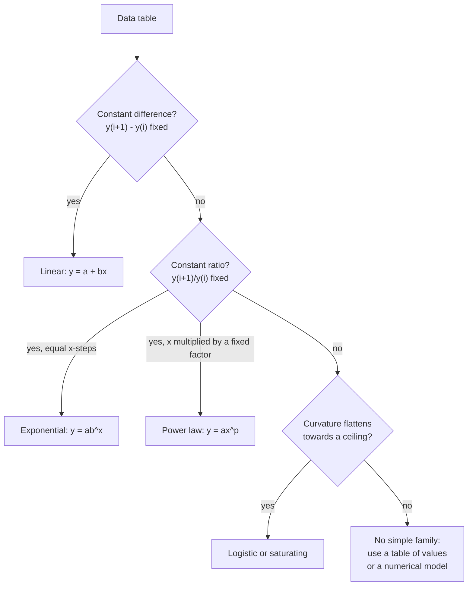

# Exponential and Logarithmic Models

> [Mathematics](../../README.md) › [Precalculus](../README.md) · Level: Intermediate · Prerequisites: [Functions and Graphs](../01-functions-and-graphs/README.md), [Percentages](../../01-arithmetic/05-percentages/README.md), [Exponential and Logarithmic Functions](../../03-algebra/12-exponential-and-logarithmic-functions/README.md) · Estimated time: 8 h

## 1. Introduction

[Exponential and Logarithmic Functions](../../03-algebra/12-exponential-and-logarithmic-functions/README.md) taught you what $2^x$ and $\ln x$ *are*: the laws, the graphs, the techniques for solving equations. This topic asks a different question. Given a table of measurements — transistor counts, bacterial counts, drug concentrations, earthquake amplitudes — **which exponential or logarithmic model describes it, how do you find its parameters, and how far are you allowed to trust it?**

That last clause is the heart of the subject. Fitting a curve is easy; a computer will do it in one line. Deciding whether the curve means anything is hard, and it is where most quantitative mistakes are made. A two-point data set determines an exponential exactly and tells you nothing about the future. A logistic curve and an exponential curve are indistinguishable over the first part of the data and wildly different afterwards. A straight line on a log-log plot is evidence of a power law, not proof of a mechanism.

The mathematics you need is modest, and almost all of it is already in your hands. A model of the form $Q(t) = Q_0 b^t$ has two parameters; two data points fix them, a third tests them. Taking logarithms turns a multiplicative model into a linear one, which is why *log-linear* and *log-log* plots are the working tools of every experimental scientist: on the right paper, the model is a straight line whose slope *is* the parameter you want. The three famous scales of this topic — decibels, the Richter scale, pH — are all the same idea in different clothing: a logarithm of a ratio, so that equal *distances* on the scale correspond to equal *factors*.

Two structural ideas complete the picture. First, **continuous compounding** is where the number $e$ actually comes from: the limit of $(1+r/n)^n$ as $n \to \infty$. Second, **logistic growth** is what an exponential model becomes when the environment is finite. It has a carrying capacity $K$, an S-shaped graph, and a maximum growth rate at exactly $K/2$ — a fact that follows from algebra alone, without calculus.

By the end you will be able to look at a data table, say what family of model is consistent with it, estimate the parameters by hand, check the fit, compute the derived quantities (doubling time, half-life, effective interest rate, energy ratio), and state clearly what the model does and does not establish.

## 2. Prerequisites

You should be comfortable with:

* **Function notation and reading graphs** — evaluating $f(t)$, distinguishing the independent from the dependent variable, and reading a curve's shape (increasing, concave, asymptotic). See [Functions and Graphs](../01-functions-and-graphs/README.md).
* **Percentages and percentage change** — a $4\%$ increase multiplies by $1.04$; a $4\%$ *rate* per year applied ten times is not a $40\%$ increase. See [Percentages](../../01-arithmetic/05-percentages/README.md).
* **Exponent laws for real exponents** — $b^{s+t} = b^sb^t$, $b^{st} = (b^s)^t$, $b^{-t} = 1/b^t$, $b^0 = 1$ for $b>0$. These are what make exponential models tractable.
* **Logarithm laws** — $\ln(xy) = \ln x + \ln y$, $\ln(x^p) = p\ln x$, $\ln 1 = 0$, and change of base $\log_a x = \dfrac{\ln x}{\ln a}$. You will use the second one on almost every page.
* **Solving exponential equations by taking logarithms** — from $2^n = 20000$ to $n = \dfrac{\ln 20000}{\ln 2}$.
* **Straight lines** — slope $m = \dfrac{y_2-y_1}{x_2-x_1}$, intercept, and the meaning of $y = mx + c$. Fitting and reading straight lines is the entire technology of Sections 7.4–7.6.
* **Geometric sequences** (helpful, not required) — an exponential model sampled at integer times is a geometric sequence. See [Sequences and Series](../05-sequences-and-series/README.md).

## 3. Learning Objectives

After working through this topic you will be able to:

1. Build an exponential model $Q(t) = Q_0b^{t}$ or $Q(t) = Q_0e^{kt}$ from a verbal description, and convert between the two forms.
2. Derive and use the doubling-time and half-life formulas, and explain why they do not depend on the starting amount.
3. Derive the continuous-compounding formula as a limit, and distinguish a nominal annual rate from an effective annual rate.
4. Explain what a logarithmic transformation does to a model, and use it to turn an exponential or power law into a straight line.
5. Fit $y = ab^x$ to data, fit $y = ax^p$ to data, and state exactly how many data points each fit consumes and what a third point tests.
6. Read a semi-log and a log-log plot: identify the model family from the shape and extract the parameters from the slope.
7. Compute with decibels, the Richter scale, pH and stellar magnitude, and state precisely what ratio each scale measures.
8. Write down the logistic model, explain each parameter, and derive its carrying capacity, inflection point, maximum growth rate and symmetry.
9. Compare competing models, and identify the specific ways a fitted model can mislead (extrapolation, identifiability, transformed-error distortion, mechanism versus correlation).
10. Apply all of the above to data from biology, finance, physics and computing, and quantify the error when a model is checked against held-back data.

## 4. Intuition

### 4.1 Growth by a fixed factor, not a fixed amount

Additive growth is what most people expect: a salary rising by $\$2{,}000$ a year, a tree growing $30$ cm a year. Multiplicative growth is different: a quantity that is multiplied by the same factor in every equal time step. $3, 6, 12, 24, 48$ is multiplicative; $3, 6, 9, 12, 15$ is additive.

The difference is not cosmetic. Additive growth is a straight line. Multiplicative growth eventually beats *any* straight line, and then keeps beating it by larger and larger margins. A quantity doubling every year multiplies by about $1{,}000$ in ten years and by $10^{30}$ in a century. That is why compound interest, epidemics and nuclear chain reactions all feel like they "suddenly" explode: nothing sudden happened; the *factor* was constant the whole time.

The right mental picture is not a hill but a **staircase of equal ratios**: equal horizontal steps (equal time intervals) multiply the height by the same number. Doubling time is the width of one step.

### 4.2 The log scale is a ruler for factors

Put the numbers $1, 10, 100, 1000, 10000$ on a line. Equally spaced, they require a line about ten thousand units long, and $1$ and $10$ are crushed into the first thousandth. Put them at *equal distances* instead, and you get a scale on which the marks $1, 10, 100, \dots$ are evenly spaced. That is a **logarithmic scale**. Its defining property:

> Equal distances on the scale mean equal *ratios*, not equal differences.

This is exactly what a human ear and eye do. A sound of ten times the intensity does not sound ten times louder; it sounds like a fixed increment. Doubling the power of an amplifier sounds like "one step up". Our senses are ratio detectors, and any scale built to match perception must be logarithmic. Decibels, pH, the Richter scale and stellar magnitude are four such scales, invented independently in four sciences.

### 4.3 Straight lines are the language of plotting

Experimenters love straight lines because the eye is excellent at spotting deviation from a line and useless at distinguishing $y = 3\cdot 2^x$ from $y = 2x^3$ on ordinary axes. So the standard move is to *change the axes* until the model becomes a line.

* Plot $\log y$ against $x$. An exponential becomes a line; a power law becomes a curve.
* Plot $\log y$ against $\log x$. A power law becomes a line; an exponential becomes a violently curving graph.

These two plots, the **semi-log** and the **log-log** plot, are the difference between "the data looks curvy" and "the exponent is $1.50 \pm 0.01$".

### 4.4 Every model is a story about a mechanism

An exponential model says: "the rate of change is proportional to how much there is." That story is right for a population with unlimited food, for a bank account, and for a radioactive sample (where each nucleus decays independently). It is wrong for a population in a closed lake, where the story must include the finite supply. Adding the sentence "growth slows as the population approaches the capacity" changes the model from exponential to **logistic** — same early behaviour, completely different long-run behaviour.

So a model is not a curve fitted to points. It is a *claim about a mechanism*, dressed in parameters. Fitting is cheap; justifying the mechanism is the actual work, and the data can only ever fail to refute it.

## 5. Formal Definition

**Definition 5.1 (Exponential model).** Let $Q_0 > 0$ and $b > 0$ with $b \ne 1$. The *exponential model* with initial value $Q_0$ and growth factor $b$ per unit time is

$$Q(t) = Q_0\,b^{t}, \qquad t \in \mathbb{R}.$$

If $b>1$ the model describes **growth**; if $0<b<1$ it describes **decay**. Because $b = e^{\ln b}$, the same model can be written $Q(t) = Q_0e^{kt}$ with $k = \ln b$, called the **continuous rate** or *intrinsic rate*. The two parameterisations describe exactly the same family of functions; only the interpretation of the constant differs.

**Definition 5.2 (Doubling time and half-life).** For a growth model with $b>1$, the *doubling time* is the number $T_2>0$ with $Q(t+T_2) = 2Q(t)$ for all $t$. For a decay model with $0<b<1$, the *half-life* is the number $T_{1/2}>0$ with $Q(t+T_{1/2}) = \tfrac12 Q(t)$ for all $t$. Definition 5.1 guarantees such a number exists and is unique, because $b^t$ is strictly monotone.

**Definition 5.3 (Continuous compounding).** A principal $P$ invested at nominal annual rate $r>0$ compounded $n$ times per year grows to $P\left(1+\frac{r}{n}\right)^{nt}$ after $t$ years. *Continuous compounding* is the limit of this expression as $n \to \infty$; it equals $Pe^{rt}$ (Section 7.3). The **effective annual rate** of a scheme is the annually-compounded rate that produces the same one-year growth.

**Definition 5.4 (Logarithmic scale).** A scale on which a positive quantity $x$ is represented by the position $\log_b x$ for a fixed base $b>1$. On such a scale, a change of position by $d$ multiplies the quantity by $b^{d}$. A *level* is a quantity expressed on a logarithmic scale; a *level difference* of $d$ corresponds to the factor $b^{d}$.

**Definition 5.5 (Power law).** A model of the form $y = ax^{p}$ with $a>0$ and $p \in \mathbb{R}$, on a domain $x>0$. Unlike an exponential, the variable is in the *base*; the exponent is a fixed parameter.

**Definition 5.6 (Logistic model).** Let $K>0$ (the *carrying capacity*), $r>0$ (the *intrinsic growth rate*) and $P_0 \in (0,K)$ (the initial population). With $A = \dfrac{K-P_0}{P_0}$, the *logistic model* is

$$P(t) = \frac{K}{1 + A e^{-rt}}.$$

It satisfies $P(0) = P_0$, is strictly increasing, and $P(t) \to K$ as $t\to+\infty$. Its defining assumption, stated as a rate, is $\dfrac{dP}{dt} = rP\left(1-\dfrac{P}{K}\right)$ — growth proportional to the population *and* to the remaining room. Section 7.8 explains why Definition 5.6 is the solution of that assumption.

**Definition 5.7 (Model, fit, residual).** A *model family* is a set of functions indexed by parameters, for example $\{Q_0b^t : Q_0>0,\ b>0\}$. A *fit* is a choice of parameters. For data $(x_i,y_i)$ the *residuals* are $y_i - \hat y_i$, where $\hat y_i$ is the model's prediction. A model *interpolates* between measured points and *extrapolates* outside the measured range; the two carry very different levels of support.

## 6. Mathematical Notation

| Symbol | Read as | Meaning |
|---|---|---|
| $Q(t)$ | $Q$ of $t$ | quantity at time $t$ |
| $Q_0$ | $Q$ nought | value at $t=0$; the *initial value* |
| $b$ | the growth factor | multiplier applied per unit time; $b>1$ growth, $0<b<1$ decay |
| $r$ | the rate | in $e^{rt}$, the continuous rate per unit time; in finance, a nominal annual rate |
| $k$ | the continuous rate | $k = \ln b$; the exponent in $Q_0e^{kt}$ |
| $T_2$ | doubling time | time for the quantity to double |
| $T_{1/2}$ | half-life | time for the quantity to halve |
| $\lambda$ | lambda | decay constant; $Q = Q_0e^{-\lambda t}$, so $\lambda = -k > 0$ |
| $\ln x$ | natural log of $x$ | logarithm base $e$ |
| $\log x$ | log of $x$ | base $10$ in this topic, always stated when it matters |
| $\log_b x$ | log base $b$ of $x$ | the exponent to which $b$ must be raised to give $x$ |
| $e$ | Euler's number | $2.718281828\dots$, the limit of $(1+1/n)^n$ |
| $r_{\text{eff}}$ | effective annual rate | annually-compounded rate with the same one-year effect |
| $K$ | carrying capacity | the limiting population in a logistic model |
| $A$ | the logistic shape constant | $A = (K-P_0)/P_0$; controls how far $P_0$ is below $K$ |
| $L$ | level (dB, pH, $M$, $m$) | a value on a logarithmic scale |
| $p$ | the exponent | power-law exponent in $y = ax^p$ |
| $R^2$ | R squared | fraction of the variance in $y$ explained by a fit; a *description*, never a mechanism |
| $\propto$ | proportional to | $y \propto x^p$ means $y = ax^p$ for some constant $a$ |
| $[\,\cdot\,]$ | concentration | $[\mathrm{H}^+]$ is hydrogen-ion concentration in mol/L |

## 7. Core Concepts

### 7.1 Building an exponential model from a description

Every exponential model is determined by two numbers: **where it starts** and **how fast it multiplies**. The modelling work is to identify those two numbers in the words of the problem.

| Sentence | $Q_0$ | $b$ per unit time |
|---|---|---|
| "A town of $12{,}000$ grows $4\%$ per year" | $12{,}000$ | $1.04$ |
| "A sample loses $12\%$ of its mass each century" | original mass | $0.88$ |
| "A culture doubles every $20$ minutes" | initial count | $2^{1/20}$ per minute |
| "A machine loses a third of its value every $4$ years" | purchase price | $(2/3)^{1/4}$ per year |
| "Prices rise $0.5\%$ per month" | initial price | $1.005$ per month |

Two warnings, both of them the source of most errors in this chapter.

**Warning 1: the percentage must match the time step.** "$4\%$ per year" with $t$ measured in *months* is $b = 1.04^{1/12} \approx 1.00327$, not $1.04$. If you write $1.04^{t}$ with $t$ in months you have described $4\%$ per *month*, which is $60\%$ per year.

**Warning 2: a rate per period is not a continuous rate.** "$4\%$ per year compounded annually" gives $b = 1.04$ and continuous rate $k = \ln 1.04 = 0.03922$. The same money at a *continuous* rate of $4\%$ gives $e^{0.04} = 1.04081$ per year — the same nominal $4\%$, slightly more money. The two conventions are not interchangeable, and finance mixes them freely, which is why Definition 5.3 separates nominal from effective.

Converting between the two forms is pure exponent algebra:

$$Q_0b^{t} = Q_0\left(e^{\ln b}\right)^{t} = Q_0e^{(\ln b)t}.$$

### 7.2 Doubling time and half-life

Doubling time is defined by an equation, and the equation is easy:

$$Q_0b^{T_2} = 2Q_0 \;\Longrightarrow\; b^{T_2} = 2 \;\Longrightarrow\; T_2 = \frac{\ln 2}{\ln b} = \frac{\ln 2}{k}.$$

Three things are worth noticing.

1. **$Q_0$ cancelled.** Doubling time does not depend on how much you start with. A colony of $10$ bacteria and a colony of ten million with the same doubling time are equally far from doubling.
2. **$T_2$ depends only on $b$, and inversely on the logarithm.** Doubling the growth rate *halves* the doubling time; adding a fixed amount to the rate does not.
3. **The same computation gives every "multiply by $m$" time:** $Q_0b^{T} = mQ_0$ gives $T = \dfrac{\ln m}{\ln b}$. Tripling time is $\ln 3/\ln b$; the time to grow by $50\%$ is $\ln 1.5/\ln b$.

For decay, with $Q = Q_0e^{-\lambda t}$,

$$T_{1/2} = \frac{\ln 2}{\lambda}, \qquad Q(t) = Q_0\left(\frac12\right)^{t/T_{1/2}}.$$

The second form is the one to use in your head. After $3$ half-lives, $1/8$ remains; after $10$, $1/1024 \approx 0.1\%$; after $n$ half-lives, $2^{-n}$. Note that the amount never reaches zero in the model — it becomes small, then smaller. "Gone" is a statement about your instrument's sensitivity, not about the mathematics. This is one of the honest limitations of the model, not a defect of the calculation.

**Rule of 72.** For a growth rate of $R\%$ per year, the doubling time is about $72/R$ years. For $R = 7$ the exact value is $\ln 2/\ln 1.07 = 10.24$ years and the rule gives $10.29$ — an error of $0.4\%$. The rule overstates the doubling time for large $R$ (at $20\%$: exact $3.80$, rule $3.60$) and understates it slightly for very small $R$. It is a mental-arithmetic device, not a formula.

### 7.3 Continuous compounding and the number $e$

Compounding $n$ times per year at nominal rate $r$ means multiplying by $1+\frac rn$, $n$ times:

$$A = P\left(1+\frac rn\right)^{nt}.$$

What happens as $n \to \infty$? Write the bracket as a power of $r$:

$$\left(1+\frac rn\right)^{n} = \left[\left(1+\frac rn\right)^{n/r}\right]^{r}.$$

As $n\to\infty$ the inner expression has the shape $\left(1+\frac{1}{m}\right)^{m}$ with $m = n/r \to \infty$, which is the sequence that *defines* Euler's number:

$$\left(1+\frac1m\right)^{m} \longrightarrow e = 2.71828\,1828\dots$$

Numerically, for $m = 1, 2, 10, 100, 1000, 10^6$ the values are $2$, $2.25$, $2.5937$, $2.7048$, $2.7169$, $2.718280$ — a slow approach to $e$ from below. Hence

$$\left(1+\frac rn\right)^{n} \longrightarrow e^{r}, \qquad A = P\left(1+\frac rn\right)^{nt} \longrightarrow Pe^{rt}.$$

So **continuous compounding is the same model with $b = e^{r}$**: an annual growth factor of $e^{0.05} = 1.051271$ for $r = 0.05$, i.e. an effective annual rate of $5.1271\%$. The general effective rate for compounding $n$ times a year is

$$r_{\text{eff}} = \left(1+\frac rn\right)^{n} - 1,$$

which increases with $n$ and tends to $e^{r}-1$. For $r = 0.048$ compounded monthly, $r_{\text{eff}} = 1.004^{12}-1 = 4.9070\%$.

This is the honest origin of $e$: not a mysterious constant but *the* factor by which money grows in one year when interest is credited continuously at $100\%$ per year. The exponential $e^{x}$ is important for a deeper reason — its rate of growth equals its size, which is the content of Definition 5.6's rate assumption — but that reason belongs to calculus, and this section is where the number first becomes unavoidable.

**Present value.** Reversing the model gives the *discounting* formula. Money $A$ at time $t$ is worth $Ae^{-rt}$ today at continuous rate $r$. This is the same statement read backwards, and it is the basis of every valuation formula in finance.

### 7.4 Logarithms as linearising transforms

Suppose $y = ab^{x}$ and take logarithms of both sides:

$$\log y = \log a + (\log b)\,x.$$

Define $Y = \log y$. Then $Y = (\log b)x + \log a$, which is a **straight line** in $x$ with slope $\log b$ and intercept $\log a$. The exponential has been converted into the one shape everybody can read.

Now suppose instead that $y = ax^{p}$. Taking logarithms:

$$\log y = \log a + p\log x.$$

Define $Y = \log y$ and $X = \log x$. Then $Y = pX + \log a$: a straight line in $\log x$ with slope $p$.

The two transforms are different and the difference is diagnostic:

| Model | Equation | Straight line when plotted as | Slope | Intercept |
|---|---|---|---|---|
| Exponential | $y = ab^{x}$ | $\log y$ vs $x$ (semi-log) | $\log b$ | $\log a$ |
| Power law | $y = ax^{p}$ | $\log y$ vs $\log x$ (log-log) | $p$ | $\log a$ |
| Linear | $y = a+bx$ | $y$ vs $x$ | $b$ | $a$ |
| Logarithmic | $y = a + b\log x$ | $y$ vs $\log x$ | $b$ | $a$ |

The base of the logarithm changes the numerical values of slope and intercept but not the conclusion: a straight line stays a straight line. It does change the *numbers* you read off, so always state the base. In this topic, $\log$ means $\log_{10}$ and $\ln$ means $\log_e$; converting a slope $m$ from base $10$ to base $e$ multiplies it by $\ln 10 = 2.302585$.

Why this matters is not aesthetic. On ordinary axes, $y = 2^{x}$ and $y = x^{3}$ both look like "curves going up"; on a log-log plot the power law is a perfectly straight line with slope $3$, while the exponential bends upwards so sharply that it leaves the paper. The transform *separates the families*.

### 7.5 Fitting an exponential and fitting a power law

**Two points are enough for two parameters.** Given $(x_1,y_1)$ and $(x_2,y_2)$ with $y_1,y_2>0$ and $x_1 \ne x_2$:

$$y_1 = ab^{x_1},\quad y_2 = ab^{x_2} \;\Longrightarrow\; \frac{y_2}{y_1} = b^{\,x_2-x_1} \;\Longrightarrow\; b = \left(\frac{y_2}{y_1}\right)^{1/(x_2-x_1)},\quad a = \frac{y_1}{b^{x_1}}.$$

The same computation on a power law gives $p = \dfrac{\ln(y_2/y_1)}{\ln(x_2/x_1)}$ and $a = \dfrac{y_1}{x_1^{p}}$.

A two-parameter model fitted to two points passes through both **by construction**. That is not evidence of anything. The evidence comes from the third point: compute the model's prediction there and compare. A model that predicts a held-back measurement to within a few percent is informative; a model that misses it by a factor of two has been refuted.

**Least squares on transformed data.** With many points, the standard choice is the line that minimises the sum of squared *vertical* deviations on the transformed plot. For an exponential that means minimising $\sum_i\left(\log y_i - \log a - x_i\log b\right)^2$. Because the deviations are measured in log space, this procedure minimises **relative** error, so it treats a miss of $10\%$ at a small $y$ as seriously as a miss of $10\%$ at a large $y$. That is usually what you want for a quantity spanning orders of magnitude, and it is definitely *not* what "minimise the squared error in $y$" would do. State which one you used; the two fits give different parameters, and neither is "the" fit.

**A test for the family, not just the parameters.** If $y_i = ab^{x_i}$ exactly, then successive ratios $y_{i+1}/y_i$ are all equal to $b$ when the $x_i$ are equally spaced. If $y_i = ax_i^{p}$ exactly and the $x_i$ form a geometric progression (each $x$ a fixed multiple of the last), then successive ratios are all equal to (that multiple)$^{p}$. The same list of numbers can therefore support either family, depending on how the inputs are spaced — see Example 9.5, where one table is exponential and an identically-valued table is a power law.

### 7.6 Reading semi-log and log-log plots

**Semi-log (log $y$, linear $x$).** A straight line means exponential growth. Its slope is the log of the growth factor per unit $x$. A convenient reading: the *horizontal distance needed to double* is constant, and equals $\dfrac{\log 2}{\text{slope}}$ (base $10$) — the doubling time, read directly off the axis. Concave-up curvature on a semi-log plot means faster than exponential; concave-down means slower, which is the signature of a logistic or saturating process.

**Log-log (log $y$, log $x$).** A straight line means a power law, slope = exponent. The slope is dimensionless and does not depend on the units of $x$ and $y$ — a genuinely useful property, because it means an exponent estimated from a graph is the same in any unit system. Concave-down curvature indicates an exponent that decreases with $x$ (a saturating law); concave-up indicates one that increases.

**The characteristic "kink" test.** An exponential plotted on log-log axes steepens without limit; a power law plotted on semi-log axes flattens towards a straight line as $x$ grows. So if you only have one plot, you can often still tell the families apart by which way the curvature goes.

### 7.7 Logarithmic scales: decibels, Richter, pH, magnitude

All four scales measure a **ratio**, and all four are logarithmic because the ratios involved span many orders of magnitude. The differences among them are only in the constant in front of the logarithm and in what is being compared.

**Decibels (power and amplitude).** With $P$ a power and $P_0$ a reference power,

$$L = 10\log_{10}\!\left(\frac{P}{P_0}\right)\ \text{dB}.$$

A factor of $2$ in power is $10\log_{10}2 = 3.0103$ dB ≈ $3$ dB; a factor of $10$ is $10$ dB; a factor of $10^{6}$ is $60$ dB. For *amplitudes* (voltage, pressure, displacement) the power is proportional to the square of the amplitude, so

$$L = 20\log_{10}\!\left(\frac{A}{A_0}\right)\ \text{dB},$$

and a factor of $2$ in amplitude is $6.02$ dB. Confusing the $10$ and the $20$ is the most common error with decibels; the rule is: *the formula counts powers, so amplitudes get twice the coefficient*.

**The Richter scale (and its successor, the moment magnitude scale).** With $A$ the amplitude of the largest ground motion recorded by a standard seismograph at $100$ km,

$$M = \log_{10}\!\left(\frac{A}{A_0}\right).$$

Because one unit of $M$ is a factor of $10$ in amplitude, and the energy released by an earthquake scales as amplitude$^{3/2}$, one unit of magnitude is a factor $10^{1.5} \approx 31.6$ in energy. Two units is $10^{3} = 1000$ in energy. So $M = 6.8$ versus $M = 5.4$ — a difference of $1.4$ — releases $10^{2.1} \approx 126$ times as much energy, while the ground amplitude differs by only $10^{1.4} \approx 25$ times. Reporting "126 times stronger" without saying *in energy* is a classic overstatement.

**pH.** By definition

$$\mathrm{pH} = -\log_{10}\left[\mathrm{H}^{+}\right],$$

with the concentration in mol/L. One pH unit is a factor of $10$ in hydrogen-ion concentration, and because pH carries a minus sign, *lower* pH means *more* acid. A solution at pH $3.5$ has $\left[\mathrm{H}^{+}\right] = 10^{-3.5} = 3.16\times10^{-4}$ mol/L. Note that pH is defined for dilute aqueous solutions; in concentrated or non-aqueous media the simple definition fails, and "pH $= -3$" is not a meaningful measurement.

**Stellar magnitude.** Historically brighter stars got *smaller* numbers, so the modern definition carries a minus sign:

$$m = -2.5\log_{10}\!\left(\frac{F}{F_0}\right),$$

where $F$ is the measured flux. Five magnitudes is a factor $100$ in flux (because $2.5 \times 2 = 5$ and $10^{2} = 100$). The Sun has $m \approx -26.7$; Sirius, the brightest night star, $m \approx -1.46$; the faintest star visible to the naked eye, about $m = 6$. The Sun–Sirius difference of $25.2$ magnitudes is a flux ratio of $10^{25.2/2.5} = 10^{10.08} \approx 1.2\times10^{10}$.

**The common structure.** In every case, a difference of levels is a ratio of quantities:

$$L_1 - L_2 = c\log_{10}\!\left(\frac{Q_1}{Q_2}\right) \;\Longleftrightarrow\; \frac{Q_1}{Q_2} = 10^{(L_1-L_2)/c},$$

with $c = 10$ for dB of power, $20$ for dB of amplitude, $1$ for Richter and pH, and $-2.5$ for magnitude. Read as "differences of levels are ratios", all four scales become one idea.

### 7.8 Logistic growth

An exponential model says the rate of growth is proportional to the current size. In a finite environment that cannot persist: the food, the market, the susceptible population run out. The simplest repair keeps the proportionality to size but multiplies it by the fraction of the environment still unused:

$$\frac{dP}{dt} = rP\left(1-\frac{P}{K}\right).$$

When $P$ is small compared with $K$ the bracket is nearly $1$ and the model is exponential with rate $r$. When $P$ approaches $K$ the bracket approaches $0$ and growth stalls. That is the whole mechanism, and it has exactly one consequence at each end: **exponential start, flat finish.**

The solution is given in Definition 5.6. Rather than verify it by differentiation (which is calculus), verify it algebraically, in the spirit of this topic. Invert the model:

$$\frac{1}{P(t)} = \frac{1+Ae^{-rt}}{K} = \frac1K + \frac{A}{K}e^{-rt}.$$

So **the reciprocal of a logistic curve is a constant plus a decaying exponential**. This is a *logistic linearisation*: plot $1/P$ against $t$ (or against $e^{-rt}$) and you should see a straight line. Conversely, if a data set's reciprocals fall on a straight line, the logistic family is exactly the right family. It also shows immediately that $P(t) \to K$ as $t\to\infty$, since $e^{-rt}\to0$ and hence $1/P \to 1/K$.

The model's five structural facts, all provable with algebra:

1. **Initial value.** At $t = 0$, $P(0) = \dfrac{K}{1+A} = \dfrac{K}{1+(K-P_0)/P_0} = P_0$.
2. **Carrying capacity.** $P(t)<K$ for all finite $t$ and $P(t)\to K$. The capacity is an *asymptote*; the population never reaches it in finite time. It is *not* the largest value you happened to observe.
3. **Inflection at $K/2$.** The model is steepest when $P = K/2$. One way to see it: the rate is $rP(1-P/K)$, a downward parabola in $P$ with roots at $0$ and $K$, so its maximum sits at the midpoint $P = K/2$. The maximum rate is $\dfrac{rK}{4}$.
4. **Symmetry.** Let $t_0$ be the time at which $P = K/2$, so $Ae^{-rt_0} = 1$. Then for any $s$,
   $$P(t_0+s) + P(t_0-s) = \frac{K}{1+e^{-rs}} + \frac{K}{1+e^{rs}} = \frac{K}{1+e^{-rs}} + \frac{Ke^{rs}}{e^{rs}+1} = K.$$
   The S-curve is symmetric about its midpoint: growth before $t_0$ mirrors growth after it.
5. **Time to the midpoint.** $P = K/2$ requires $Ae^{-rt} = 1$, so $t_0 = \dfrac{\ln A}{r}$. A larger $A$ (a smaller starting population relative to $K$) delays the midpoint logarithmically.

**Fitting a logistic requires care.** There are three parameters $(K, r, P_0)$ but early data contains almost no information about $K$: while $P \ll K$, every choice of $K$ large enough gives nearly the same curve. This is an *identifiability* problem, not a numerical one, and it is why logistic fits to the first half of an epidemic or a product launch can be wildly wrong about the total. Data near and beyond the inflection is what pins $K$ down.

### 7.9 Comparing models and their limits

Suppose two candidate models both describe your data well on the measured range. What can you do?

* **Compare on held-back data.** Fit on part of the data, predict the rest, and report the errors. This is the only test that actually discriminates, and it requires data you did not fit.
* **Compare the *mechanism*, not the curve.** Is there a reason for proportionality to size (independent decay, compounding) or for a rate proportional to a power of size (geometry, allometry)? A curve cannot answer this; the science can.
* **Check the tail's qualitative behaviour.** Exponential models grow without bound; power laws also grow without bound but far more slowly; logistic models saturate. If the physical situation must saturate, an exponential fit that looks perfect on the data is still wrong beyond it.

Six specific ways a fitted model misleads:

1. **Extrapolation.** A two-parameter model fitted to two points has zero degrees of freedom left; its extrapolation is a restatement of its assumption, not a prediction. Even a good fit over a decade of data can be meaningless one decade out.
2. **Identifiability.** As above: $K$ in a logistic model, and the asymptote in any saturating model, are poorly determined by data far from the asymptote.
3. **Transformed error.** A least-squares fit in log space weights relative error; in $y$-space it weights absolute error. Changing the transform changes the parameters. Neither is "correct" without a noise model.
4. **$R^2$ is not validity.** $R^2$ close to $1$ means the chosen curve passes near the points. It says nothing about whether the curve is the mechanism, and it can be inflated by fitting many parameters to few points.
5. **Correlation is not causation.** Moore's law for transistor counts is an observation about an industry, not a law of nature; it held because thousands of people worked to make it hold.
6. **Units and scale.** A rate is per unit time; changing the unit changes the number but not the doubling time. Doubling time is unit-free in this sense, which is partly why it is the best summary statistic for growth.

### 7.10 Examples from biology, finance, physics and computing

**Biology.** Unrestricted bacterial growth is exponential: *E. coli* can double every $20$ minutes, so $18$ doublings — six hours — multiplies a colony by $2^{18} = 262{,}144$. Radioactive tracers decay exponentially: iodine-131 has a half-life of about $8.02$ days, so after $30$ days $2^{-30/8.02} = 2^{-3.74} = 7.5\%$ remains. Drug clearance is approximately exponential (a fixed *fraction* is metabolised per hour), which is why a drug's "half-life" determines its dosing interval. *Allometric* scaling laws are power laws: metabolic rate scales roughly as (body mass)$^{3/4}$ (Kleiber's law), and many biological times scale as mass$^{1/4}$.

**Finance.** Compound interest is exponential; continuous compounding is its limit; the effective annual rate is the honest way to compare products. The "rule of 72" is the fast approximation. Discounting is the same model reversed: at a continuous $5\%$, a payment of $\$1{,}000$ in ten years is worth $1000e^{-0.5} = \$606.53$ today. Annuities and mortgages combine exponential growth with a geometric sum, which is the link to [Sequences and Series](../05-sequences-and-series/README.md).

**Physics and chemistry.** Radioactive decay, the charging and discharging of a capacitor, and the absorption of light in a medium (Beer–Lambert: intensity falls exponentially with depth) are all $Q_0e^{-kt}$ processes. They share the mechanism "each entity acts independently with a fixed probability per unit time", which is exactly what produces an exponential. The decibel, pH, Richter and magnitude scales are logarithmic *measurements* of such quantities, not models of them.

**Computing.** Moore's law: transistor counts per chip grew from $2{,}300$ (Intel 4004, 1971) to about $42$ million (Pentium 4, 2000), a factor of $18{,}261$ in $29$ years, i.e. $18{,}261^{1/29} = 1.4026$ per year, a doubling time of $2.05$ years. Extrapolating that fit to $2010$ predicts $1.24$ billion transistors; the six-core Westmere of that year had about $1.17$ billion — a miss of $5.8\%$ over four decades, which is genuinely impressive. It is still not a law: clock frequencies stopped scaling at about $4$ GHz around $2005$, so transistor count and performance diverged. Algorithmic complexity is where exponential growth bites hardest: doubling the input size of an $O(2^{n})$ algorithm squares its running time, whereas an $O(n^{2})$ algorithm merely quadruples it. Concretely, an algorithm taking $2^{n}$ microseconds takes about $1$ ms at $n=10$, $1.05$ s at $n=20$, $12.7$ days at $n=40$ and about $36{,}600$ years at $n=60$.

## 8. Formulas and Properties

All logarithms below may be taken in any fixed base; the base must be the same on both sides of an equation.

**Property 8.1 (Model equivalence).** For $Q_0>0$ and $b>0$, $b\ne1$, $Q_0b^{t} = Q_0e^{kt}$ with $k = \ln b$, and $b = e^{k}$. *Why:* $b = e^{\ln b}$ by definition of the logarithm, then $(e^{\ln b})^t = e^{t\ln b}$ by the exponent law $(x^{s})^{t} = x^{st}$.

**Property 8.2 (Doubling time, half-life).** For $b>1$, $T_2 = \dfrac{\ln 2}{\ln b} = \dfrac{\ln 2}{k}$. For $Q = Q_0e^{-\lambda t}$ with $\lambda>0$, $T_{1/2} = \dfrac{\ln 2}{\lambda}$. More generally, the time to change by a factor $m>0$ is $\dfrac{\ln m}{\ln b}$. *Why:* solve $b^{T} = m$ by taking logarithms; note $Q_0$ cancels, so the time is independent of the starting value.

**Property 8.3 (Fraction remaining).** After $t$ units, the fraction of a decaying quantity remaining is $2^{-t/T_{1/2}}$, and the number of half-lives elapsed is $t/T_{1/2}$. *Why:* $e^{-\lambda t} = \left(e^{-\lambda T_{1/2}}\right)^{t/T_{1/2}} = 2^{-t/T_{1/2}}$.

**Property 8.4 (Continuous compounding).** $\displaystyle\lim_{n\to\infty}\left(1+\frac rn\right)^{nt} = e^{rt}$, so $A = Pe^{rt}$. The effective annual rate is $e^{r}-1$; for $n$ compoundings per year it is $\left(1+\frac rn\right)^{n}-1$, which increases with $n$ towards $e^{r}-1$. *Why:* $\left(1+\frac rn\right)^{n} = \left[\left(1+\frac{1}{n/r}\right)^{n/r}\right]^{r} \to e^{r}$.

**Property 8.5 (Present value).** At continuous rate $r$, an amount $A$ due at time $t$ has present value $Ae^{-rt}$; equivalently $P$ grows to $Pe^{rt}$. *Why:* Property 8.4 solved for $P$.

**Property 8.6 (Log-linear form).** $y = ab^{x}$ with $a,b>0$ satisfies $\log y = \log a + x\log b$. Hence on a semi-log plot the graph is a straight line of slope $\log b$ through $(0,\log a)$. *Why:* take $\log$ of both sides and apply $\log(xy) = \log x + \log y$ and $\log b^{x} = x\log b$.

**Property 8.7 (Log-log form).** $y = ax^{p}$ with $a>0$, $x>0$ satisfies $\log y = \log a + p\log x$. Hence on a log-log plot the graph is a straight line of slope $p$. Changing the base of the logarithm multiplies both slope and intercept by a constant, so the *straightness* and the value of $p$ are base-independent (when both axes use the same base). *Why:* as above, with $\log x^{p} = p\log x$. If the base is changed from $10$ to $e$, every logarithm is multiplied by $\ln 10$, so a slope $m_{10}$ becomes $m_e = m_{10}\ln 10$.

**Property 8.8 (Two-point fits).** For $y = ab^{x}$ through $(x_1,y_1),(x_2,y_2)$: $b = \left(y_2/y_1\right)^{1/(x_2-x_1)}$ and $a = y_1 b^{-x_1}$. For $y = ax^{p}$: $p = \dfrac{\ln(y_2/y_1)}{\ln(x_2/x_1)}$ and $a = y_1 x_1^{-p}$. *Why:* divide the two equations to eliminate $a$, then solve for the remaining parameter by logarithms.

**Property 8.9 (Levels and ratios).** If $L = c\log_{10}(Q/Q_0)$ then $L_1 - L_2 = c\log_{10}(Q_1/Q_2)$ and $Q_1/Q_2 = 10^{(L_1-L_2)/c}$. With $c = 10$ this is power decibels, $c = 20$ amplitude decibels, $c=1$ Richter or pH, $c = -2.5$ stellar magnitude. *Why:* $\log(Q_1/Q_0) - \log(Q_2/Q_0) = \log(Q_1/Q_2)$.

**Property 8.10 (Logistic model).** With $K>0$, $r>0$, $0<P_0<K$ and $A = (K-P_0)/P_0$:
$$P(t) = \frac{K}{1+Ae^{-rt}}, \qquad P(0) = P_0, \qquad \lim_{t\to\infty}P(t) = K.$$
The rate $rP(1-P/K)$ is largest at $P = K/2$, where it equals $rK/4$; the curve is symmetric about that point, $P(t_0+s)+P(t_0-s) = K$ with $t_0 = \ln A/r$. *Why:* completing the square, $P(K-P) = \frac{K^2}{4}-\left(P-\frac K2\right)^2 \le \frac{K^2}{4}$, with equality iff $P = K/2$; and the symmetry computation of Section 7.8.

**Property 8.11 (Logistic linearisation).** $\dfrac{1}{P(t)} = \dfrac1K + \dfrac{A}{K}e^{-rt}$, so $1/P$ is an exponential decay towards $1/K$. Equivalently $\dfrac{K-P}{P} = Ae^{-rt}$, so a plot of $\ln\!\left(\dfrac{K-P}{P}\right)$ against $t$ is a straight line of slope $-r$. *Why:* invert Definition 5.6 and simplify; the second form follows from $\dfrac{K-P}{P} = Ae^{-rt}$.

**Property 8.12 (Growth-rate ordering).** For $x$ large, $(\ln x)^{a} \ll x^{p} \ll b^{x}$ for any fixed $a,p>0$ and $b>1$. Consequently a power law with any exponent is eventually overtaken by an exponential growth model, no matter how small the exponential's rate. *Why (sketch):* this is a standard limit fact, proved in [Calculus](../../07-calculus/README.md) by comparing growth rates; the practical consequence is that "it looked like a straight line on log-log paper" cannot be used to rule out exponential behaviour far outside the data range.

## 9. Step-by-Step Examples

### Example 9.1 (easy) — A bacterial culture

A culture of $500$ bacteria doubles every $20$ minutes. (a) Write a model for the count after $t$ hours. (b) Find the count after $6$ hours. (c) When does the count reach $10^{7}$?

**Solution.**

(a) Time is in hours and half the given information is in minutes, so the first job is to convert. There are $3$ doubling periods per hour, so the hourly growth factor is $2^{3} = 8$:

$$N(t) = 500\cdot 8^{t}, \quad t \text{ in hours}.$$

Equivalently $N(t) = 500\left(2^{1/20}\right)^{m}$ with $m$ in minutes. The continuous rate is $k = \ln 8 = 2.0794$ per hour, so $N(t) = 500e^{2.0794t}$.

(b) At $t = 6$: $N = 500\cdot 8^{6} = 500\cdot 262{,}144 = 131{,}072{,}000$. Equivalently, $18$ doublings from $500$: $500\cdot 2^{18}$.

(c) Solve $500\cdot 8^{t} = 10^{7}$:

$$8^{t} = \frac{10^{7}}{500} = 20{,}000, \qquad t = \frac{\ln 20{,}000}{\ln 8} = \frac{9.90349}{2.07944} = 4.763 \text{ h}.$$

**Check.** $4.763$ hours is $285.8$ minutes, i.e. $14.29$ doubling periods, and $500\cdot 2^{14.29} = 500\cdot 20{,}000^{0.9998}\approx 10^{7}$. ✓

**Remark.** The answer is about $4$ h $46$ min. Note how little the *model's* answer depends on the starting count: with $5{,}000$ bacteria the same threshold is reached $3.32$ doubling periods — $66$ minutes — earlier, because $\log(10^7/5000) = \log(10^7/500) - \ln 10$.

### Example 9.2 (easy) — Carbon dating, both directions

Carbon-14 has a half-life of about $5730$ years. (a) What fraction of the original carbon-14 remains after $3000$ years? (b) A sample contains $27\%$ of its original carbon-14. Estimate its age.

**Solution.** Write the decay as $N(t) = N_0\left(\tfrac12\right)^{t/5730}$.

(a) The number of half-lives in $3000$ years is $3000/5730 = 0.52356$. So

$$\frac{N}{N_0} = \left(\tfrac12\right)^{0.52356} = e^{-0.52356\ln 2} = e^{-0.36291} = 0.6957.$$

About $69.6\%$ remains.

(b) Solve $\left(\tfrac12\right)^{t/5730} = 0.27$. Take natural logarithms:

$$\frac{t}{5730}\ln\tfrac12 = \ln 0.27 \;\Longrightarrow\; t = 5730\cdot\frac{\ln(1/0.27)}{\ln 2} = 5730\cdot\frac{1.30933}{0.69315} = 5730(1.88897) = 10{,}824 \text{ years}.$$

**Check.** $10{,}824/5730 = 1.889$ half-lives, and $2^{-1.889} = 0.2700$. ✓

**Remark.** Radiocarbon dating is only valid while enough carbon-14 survives; beyond roughly $50{,}000$ years the residual activity is below the noise of the measurement, which is why the method has a practical ceiling of about ten half-lives. The model still "works" past that point; the *measurement* does not.

### Example 9.3 (medium) — Comparing two savings products

Bank A offers $5\%$ per year compounded continuously. Bank B offers $5.1\%$ per year compounded annually. Which is better, and by how much?

**Solution.** Convert both to effective annual rates, which are directly comparable.

Bank A: $r_{\text{eff}} = e^{0.05}-1 = 1.0512711-1 = 0.0512711$, i.e. $5.1271\%$.

Bank B: $r_{\text{eff}} = 1.051-1 = 0.051$, i.e. $5.1000\%$.

Bank A is better, by $0.0271$ percentage points. On a deposit of $\$10{,}000$ over $10$ years the difference is

$$10{,}000\left(e^{0.5} - 1.051^{10}\right) = 10{,}000\left(1.6487213 - 1.6444746\right) = \$42.47.$$

**Check.** The effective rates differ by $0.0271$ percentage points. Over ten years, simple scaling gives $10 \times 0.0271\% = 0.271\%$ of the principal, i.e. $\$27.1$, and compounding the difference adds about half as much again — the computed $\$42.47$ is the right order for $5\%$ rates over a decade ✓.

**Remark.** This is the practical content of the nominal-versus-effective distinction: the quoted rate alone cannot rank two products unless the compounding convention is also quoted. Regulations in most countries now require the effective rate to be disclosed for exactly this reason.

### Example 9.4 (medium) — Fitting an exponential and testing it

A biologist measures a yeast culture at four times:

| $t$ (hours) | $0$ | $2$ | $4$ | $6$ |
|---|---|---|---|---|
| $N$ (millions) | $250$ | $360$ | $518.4$ | $746.5$ |

Fit $N = ab^{t}$ using the first two points, then check the other two.

**Solution.** Two points determine the two parameters. From $t=0$, $a = 250$. Then

$$360 = 250b^{2} \;\Longrightarrow\; b^{2} = 1.44 \;\Longrightarrow\; b = 1.2.$$

So $N = 250(1.2)^{t}$.

Predictions: at $t = 4$, $250(1.2)^{4} = 250(2.0736) = 518.4$ — exact. At $t = 6$, $250(1.2)^{6} = 250(2.985984) = 746.50$ — also exact.

So the data are *generated* by an exponential with growth factor $1.2$ per hour, i.e. $20\%$ per hour, continuous rate $k = \ln 1.2 = 0.18232$, doubling time $\ln2/\ln1.2 = 3.802$ hours.

**Check.** The successive ratios are $360/250 = 1.44$, $518.4/360 = 1.44$, $746.50/518.4 = 1.44$ — constant, as they must be for equal time steps under an exponential. ✓

**Remark.** Real data would not be exact. The right procedure is then: fit on part of the data, and report the *ratios* of predictions to measurements on the rest. Quoting $R^2 = 1$ for a fit that used all the points would be circular.

### Example 9.5 (medium) — The same numbers, two different models

Two experiments produce the same list of measurements $2, 16, 128, 1024$. In Experiment A the inputs are $x = 1,2,3,4$; in Experiment B they are $x = 1,2,4,8$. Identify each model and its parameters.

**Solution.** The numbers alone cannot decide: the *spacing of the inputs* decides.

**Experiment A.** Equal steps in $x$ (each $+1$) with a constant ratio $16/2 = 8$. A constant ratio per unit input is the signature of an exponential with growth factor $b = 8$, and $a = y_1/b^{x_1} = 2/8 = 0.25$:

$$y = 0.25\cdot 8^{x}.$$

Check: $x=1$: $0.25\cdot8 = 2$; $x=2$: $0.25\cdot64 = 16$; $x=3$: $0.25\cdot512 = 128$; $x=4$: $0.25\cdot4096 = 1024$. ✓

**Experiment B.** Each input is *doubled*, and each output is multiplied by $8$. A constant ratio of outputs for a constant ratio of inputs is the signature of a power law. With $y = ax^{p}$, doubling $x$ multiplies $y$ by $2^{p}$, so $2^{p} = 8$ and $p = 3$. Then $2 = a(1)^{3}$ gives $a = 2$:

$$y = 2x^{3}.$$

Check: $x=2$: $2\cdot8 = 16$; $x=4$: $2\cdot64=128$; $x=8$: $2\cdot512=1024$. ✓

**How to tell them apart in practice.** Plot $\log y$ against $x$: Experiment A is a straight line (slope $\log 8$), Experiment B is not. Plot $\log y$ against $\log x$: Experiment B is a straight line (slope $3$), Experiment A is not. Only the log-log plot distinguishes power laws from exponentials; on ordinary axes both are merely "curved".

### Example 9.6 (hard) — Reading an exponent off planetary data

Kepler's third law states $T^{2} = a^{3}$ in astronomical units and years, i.e. $T = a^{3/2}$. Test the power-law form on the inner and outer planets and estimate the exponent from the data alone.

| Planet | $a$ (AU) | $T$ (years) |
|---|---|---|
| Mercury | $0.387$ | $0.241$ |
| Venus | $0.723$ | $0.615$ |
| Earth | $1.000$ | $1.000$ |
| Mars | $1.524$ | $1.881$ |
| Jupiter | $5.203$ | $11.862$ |
| Saturn | $9.537$ | $29.457$ |

**Solution.** Take logarithms of both columns and fit a line $\ln T = p\ln a + \ln K$. Using the two extreme planets, which maximises the lever arm:

$$p = \frac{\ln(29.457) - \ln(0.241)}{\ln(9.537) - \ln(0.387)} = \frac{3.38288 - (-1.42311)}{2.25529 - (-0.94933)} = \frac{4.80599}{3.20462} = 1.4997.$$

So $p \approx 1.50$, and $\ln K = \ln T - p\ln a = 3.38288 - 1.5(2.25529) = 3.38288 - 3.38294 = -0.00006$, i.e. $K \approx 1.000$. The data give

$$T = 1.000\,a^{1.500}.$$

**Check each planet.** Mercury: $0.387^{1.5} = 0.2408$ (measured $0.241$) ✓. Venus: $0.723^{1.5} = 0.6147$ (measured $0.615$) ✓. Mars: $1.524^{1.5} = 1.8814$ (measured $1.881$) ✓. Jupiter: $5.203^{1.5} = 11.868$ (measured $11.862$: $0.05\%$ high) ✓. Saturn: $9.537^{1.5} = 29.452$ (measured $29.457$: $0.02\%$ low) ✓.

**What the fit does and does not show.** It shows that the exponent is $3/2$ to within about $0.001$ across a factor of $25$ in orbital radius — strong evidence for the power law, and consistent with $T^2 \propto a^3$. It does *not* by itself prove Newtonian gravitation; the value $3/2$ is a *consequence* of the inverse-square law, and other theories can be tuned to reproduce it. What the data do establish is that an exponential model is out of the question: the exponential through Mercury and Saturn, $T = 0.241(1.6909)^{a-0.387}$, predicts Earth's period as $0.33$ years instead of $1.00$ — wrong by a factor of three in the middle of the data range.

**A numerical caution.** The exponent is a ratio of two differences of logarithms. If $a$ and $T$ are both uncertain by $1\%$, then $p$ is uncertain by roughly $0.01/3.2 \approx 0.003$ — so quoting $p = 1.4997$ to four decimals overstates the precision of a real measurement. Round to the precision the data supports.

### Example 9.7 (hard) — A logistic lake

A lake is stocked with $50$ fish. The carrying capacity is estimated at $1000$ fish and the intrinsic growth rate at $r = 0.5$ per year. (a) Write the model. (b) Find the population after $2$, $5$ and $10$ years. (c) Find the time and population of the fastest growth, and the maximum rate. (d) Verify the symmetry property numerically.

**Solution.**

(a) With $P_0 = 50$, $K = 1000$: $A = (1000-50)/50 = 19$, so

$$P(t) = \frac{1000}{1 + 19e^{-0.5t}}.$$

(b) Evaluate with care; $e^{-0.5t}$ is the only non-trivial factor.

* $t=2$: $e^{-1} = 0.367879$, so $19(0.367879) = 6.9897$, and $P = 1000/7.9897 = 125.2$.
* $t=5$: $e^{-2.5} = 0.082085$, so $19(0.082085) = 1.55962$, and $P = 1000/2.55962 = 390.7$.
* $t=10$: $e^{-5} = 0.0067379$, so $19(0.0067379) = 0.128021$, and $P = 1000/1.128021 = 886.5$.

(c) The fastest growth is at $P = K/2 = 500$ fish. That happens when $19e^{-0.5t} = 1$:

$$e^{-0.5t} = \tfrac{1}{19} \;\Longrightarrow\; -0.5t = -\ln 19 \;\Longrightarrow\; t = \frac{2.94444}{0.5} = 5.889 \text{ years}.$$

The maximum rate is $rK/4 = 0.5\cdot1000/4 = 125$ fish per year.

(d) Symmetry about $t_0 = 5.889$: the value at $t_0 - 3 = 2.889$ and at $t_0+3 = 8.889$ should sum to $1000$. At $t=2.889$: $e^{-1.4445}=0.23588$, $19(0.23588)=4.48172$, $P = 1000/5.48172 = 182.4$. At $t = 8.889$: $e^{-4.4445}=0.011711$, $19(0.011711)=0.222509$, $P = 1000/1.222509 = 817.6$. Sum: $182.4+817.6 = 1000.0$ ✓ (the exact sum is $1000$ by Property 8.10; the two figures are rounded).

**Check.** $P(0) = 1000/20 = 50$ ✓. The sequence $50, 79.9, 125.2, 190.9, \dots$ is increasing and concave up at first — exponential-like — and by $t=10$ the increments have shrunk, as they must near $K$. ✓

**Remark.** The model never reaches $1000$; at $t=20$, $P = 1000/(1+19e^{-10}) = 999.14$. And $K=1000$ was *assumed*, not measured. If the lake could really hold $2000$ fish, this same data would fit a different curve just as well; only years of observation near saturation can distinguish them.

### Example 9.8 (hard) — A chain of logarithmic scales

A rock concert measures $110$ dB; a quiet room measures $35$ dB. (a) What is the ratio of sound intensities? (b) An earthquake of magnitude $6.8$ follows one of magnitude $5.4$; by what factor do the ground amplitudes differ, and by what factor do the energies differ? (c) A solution is diluted by a factor of $100$; by how much does the pH change?

**Solution.** Use Property 8.9 in each case, with the correct constant.

(a) For acoustic power, $L = 10\log_{10}(I/I_0)$. The difference is $110-35 = 75$ dB, so

$$\frac{I_{\text{concert}}}{I_{\text{quiet}}} = 10^{75/10} = 10^{7.5} = 3.16\times10^{7}.$$

The concert is about $3.2\times10^{7}$ times as intense — not $75/35$ times, and not $75$ times.

(b) Amplitudes: one magnitude unit is a factor $10$ in amplitude, so $\Delta M = 1.4$ gives $10^{1.4} = 25.1$. Energies: one magnitude unit is $10^{1.5}$ in energy, so $\Delta M = 1.4$ gives $10^{2.1} = 126$. The larger earthquake shakes the ground about $25$ times as much and releases about $126$ times as much energy.

(c) pH $= -\log_{10}[\mathrm{H}^+]$. Diluting by $100$ divides the concentration by $100$, so

$$\Delta\mathrm{pH} = -\log_{10}\!\left(\frac{[\mathrm{H}^+]/100}{[\mathrm{H}^+]}\right) = -\log_{10}(10^{-2}) = +2.$$

The pH rises by $2$ units, from, say, $4.0$ to $6.0$. **Caveat:** this linear dilution rule holds only for a strong acid with no buffering and only while the autoionisation of water is negligible. Near pH $7$ the rule fails badly, because water's own dissociation supplies hydrogen ions; a tenfold dilution of a solution at pH $7$ leaves the pH essentially unchanged, not at $8$.

### Example 9.9 (hard) — When is an exponential algorithm unusable?

An exact algorithm for a scheduling problem runs in $2^{n}$ microseconds on inputs of size $n$; a heuristic runs in $3n^{2}$ microseconds but does not always give the right answer. (a) For which $n$ is the exact algorithm faster? (b) How large an input can the exact algorithm handle in one hour?

**Solution.**

(a) Compare $2^{n}$ with $3n^{2}$ in microseconds. Test small values:

| $n$ | $2^{n}$ | $3n^{2}$ | exact faster? |
|---|---|---|---|
| $5$ | $32$ | $75$ | yes |
| $7$ | $128$ | $147$ | yes |
| $8$ | $256$ | $192$ | no |
| $10$ | $1024$ | $300$ | no |
| $20$ | $1{,}048{,}576$ | $1200$ | no |

The crossover is between $n=7$ and $n=8$; at $n = 8$ the exponential already loses, and it never wins again (Property 8.12: exponentials eventually dominate every power, and here the comparison is already settled by $n=10$, after which the ratio only grows). So the exact algorithm is faster only for $n \le 7$.

(b) One hour is $3.6\times10^{9}$ microseconds, so we need $2^{n} \le 3.6\times10^{9}$:

$$n \le \log_2(3.6\times10^{9}) = \frac{\ln(3.6\times10^{9})}{\ln 2} = \frac{22.0042}{0.693147} = 31.75.$$

So $n = 31$. Each extra unit of $n$ doubles the run time: $n = 32$ needs two hours, $n = 41$ needs about $73$ days, and $n = 61$ needs about $73$ thousand years.

**Check.** $2^{31} = 2{,}147{,}483{,}648 \le 3.6\times10^{9}$ and $2^{32} = 4{,}294{,}967{,}296 > 3.6\times10^{9}$ ✓.

**Remark.** The comparison is not "exponential bad, polynomial good". Here the exponential algorithm is *exact* and the polynomial one may be wrong, so the honest statement is: exactness is affordable only up to $n\approx31$, beyond which one must either accept approximation or find structure the general algorithm does not exploit. That is a statement about the model of computation, not about the mathematics of the problem.

## 10. Visual Explanations

### 10.1 Which model for which data?

### 10.2 The two transforms, side by side

| Question | Plot | Straight line means | Slope gives |
|---|---|---|---|
| Does $y$ grow by a fixed factor per unit $x$? | $\log y$ vs $x$ | exponential $y = ab^{x}$ | $\log b$ |
| Does $y$ grow as a fixed power of $x$? | $\log y$ vs $\log x$ | power law $y = ax^{p}$ | $p$ |
| Is the growth rate itself decreasing linearly? | $1/y$ vs $x$ | saturating/logistic | rate of approach to $1/K$ |
| Is the process exponential in time? | $\ln y$ vs $t$ | exponential decay/growth | $k$ (or $-\lambda$) |

### 10.3 Two models on the same data

The table shows the same hypothetical measurements fitted first by an exponential and then by a logistic with $K = 1000$. Both are within measurement noise for the first four rows; they diverge afterwards. This is the single most important picture in the topic.

| $t$ | measured | exponential $250(1.2)^t$ | logistic $K=1000$, $P_0=250$, $r=0.275$ |
|---|---|---|---|
| $0$ | $250$ | $250.0$ | $250.0$ |
| $1$ | $300$ | $300.0$ | $305.0$ |
| $2$ | $360$ | $360.0$ | $366.2$ |
| $3$ | $432$ | $432.0$ | $432.0$ |
| $4$ | $?$ | $518.4$ | $500.3$ |
| $6$ | $?$ | $746.5$ | $634.4$ |
| $10$ | $?$ | $1547.9$ | $839.0$ |

Both models are consistent with the first four rows to within $1.7\%$; by $t = 6$ they differ by $18\%$, and at $t = 10$ by a factor of $1.8$, with the exponential already far above the assumed capacity of $1000$. Data on the early, exponential-looking part of a curve cannot choose between them.

### 10.4 The shape of the three families

| Family | Behaviour at $x\to0^+$ | Behaviour at $x\to\infty$ | Straight on |
|---|---|---|---|
| $y = ax^{p}$, $p>0$ | $0$ (or $a$ if $p=0$) | grows like a power | log-log |
| $y = ab^{x}$, $b>1$ | $a$ | grows faster than any power | semi-log |
| $y = K/(1+Ae^{-rx})$ | small, near exponential | tends to $K$ | neither; $1/y$ vs $e^{-rx}$ |

## 11. Common Mistakes

1. **Mixing the time unit of the rate and of the variable.** "$4\%$ per year" with $t$ in months is $b = 1.04^{1/12}$, not $1.04$. Always write the unit next to the rate and check that it matches $t$.
2. **Treating a nominal rate as an effective one.** $6\%$ compounded monthly is $6.17\%$ per year, not $6\%$. Comparing products by nominal rate is comparing incomparable numbers.
3. **Thinking a half-life means "half is gone at the halfway point, all at the end".** After two half-lives, $25\%$ remains, not $0\%$. The model is asymptotic: "gone" is a statement about the instrument.
4. **Confusing doubling time with growth rate linearly.** Doubling time is $\ln2/\ln b$, not $1/b$ and not $2/b$. Only the rule of 72 is approximately linear, and only for small rates.
5. **Adding growth rates over time.** A $10\%$ gain followed by a $10\%$ loss is a $1\%$ loss, since $1.1\times0.9 = 0.99$. Exponential models multiply; they never add.
6. **Fitting with two points and calling it evidence.** Two parameters, two points: the fit is forced. Evidence requires a third, held-back point.
7. **Using the $10$ coefficient for amplitude decibels.** $20\log_{10}$ for amplitude, $10\log_{10}$ for power. A "$6$ dB" increase is a factor $2$ in amplitude but a factor $4$ in power.
8. **Confusing Richter amplitude with energy.** One magnitude unit is $10\times$ amplitude and $31.6\times$ energy. Saying "10 times more energy" for one magnitude unit understates it by a factor of three.
9. **Reading a log-log slope with mixed bases.** If the vertical axis is $\ln$ and the horizontal is $\log_{10}$, the slope you read is $p/\ln 10$, not $p$. Keep both axes in the same base, or convert.
10. **Believing $R^2$.** A high $R^2$ means the curve passes near the points. It is not evidence that the mechanism is right, and with few points it can be high for a wrong model.
11. **Taking a logistic's carrying capacity from the maximum observation.** $K$ is an asymptote. The largest observed value is always below it and usually well below it.
12. **Extrapolating an exponential past its mechanism.** Every exponential model assumes unlimited resources or constant proportional growth. Past the point where that assumption fails, the curve is fiction — precisely and confidently computed fiction.
13. **Forgetting that logarithms require positive arguments.** $\log y$ is undefined for $y \le 0$; in fitting, a single zero or negative measurement invalidates the whole log transformation. Handle such points explicitly (often by adding a constant, or by excluding them and saying so).

## 12. Applications

**Biology and medicine.** Population growth with unlimited resources; bacterial doubling; viral load during the early phase of an infection; radioactive tracers; drug clearance (an exponential decay with a "half-life" that sets the dosing interval); the decay of a drug's effect; allometric power laws relating metabolic rate, lifespan and body mass; the logistic model for growth in a closed environment and for the spread of an infection through a finite population.

**Finance.** Compound interest, continuous compounding, effective annual rates, present value and discounting; the rule of 72; the exponential growth of a portfolio and the exponential decay of purchasing power under inflation; mortgage amortisation, which combines exponential growth with a geometric sum (see [Sequences and Series](../05-sequences-and-series/README.md)); option pricing, where log-returns rather than returns are the natural variable, which is why the log-normal distribution appears.

**Physics and chemistry.** Radioactive decay and radiometric dating; the charging and discharging of capacitors and the decay of current in an inductor; Beer–Lambert absorption; the Arrhenius law for reaction rates; Newton's law of cooling as an exponential approach to ambient temperature; the decibel, pH and Richter scales as logarithmic *measurements*; stellar magnitude and the distance modulus, which is a logarithmic relation between apparent brightness and distance.

**Computing.** Moore's law as an empirical trend (and its breakdown as a *performance* law after about $2005$); algorithmic complexity, where the difference between $n\log n$, $n^{2}$ and $2^{n}$ decides whether a problem is feasible; binary search and balanced trees, whose depth is $\log_2 n$ — searching a billion items takes about $30$ comparisons; information measured in bits, $\log_2$ of the number of equally likely outcomes; the logarithmic decay of cache hit rates with size; and exponential backoff in networks, which deliberately grows a delay by a constant factor.

**Statistics and modelling.** Log transforms to stabilise variance and to make multiplicative models additive; the log-normal distribution for quantities that arise as products of many factors (incomes, particle sizes, stock prices); Poisson regression, where a log link makes the mean multiplicative; and the general practice of plotting on log axes to see orders of magnitude. See [Statistics](../../11-statistics/README.md) and [Mathematical Modeling](../../22-mathematical-modeling/README.md).

**Earth and environmental science.** Earthquake magnitude and energy; the logarithmic attenuation of seismic waves; the pH of rain, oceans and soil, and ocean acidification as a change of a few tenths of a pH unit — which is a change of tens of percent in hydrogen-ion concentration; the logarithmic response of many biological systems to stimuli.

## 13. Exercises

The problem set is in [exercises.md](exercises.md). It contains 36 problems in four bands.

* **Beginner (1–13)** — building models, doubling times, half-lives, effective rates, and first computations on the dB, pH, Richter and magnitude scales.
* **Intermediate (14–25)** — two-point fits, log-linear and log-log reading, carbon dating, drug clearance, logistic parameters, and a compounding comparison.
* **Advanced (26–31)** — derivations of the doubling formula and the continuous-compounding limit, the effect of the log base, logistic structure and symmetry, and a critical analysis of Moore's law as a model.
* **Challenge (32–36)** — model selection between exponential and logistic on the same data, an exponent estimation with uncertainty, an identifiability argument, a proof about log scales, and an open-ended modelling design.

Attempt every problem before opening [solutions.md](solutions.md), and check every numerical answer by a second route.

## 14. Solutions

Full worked solutions for all 36 problems are in [solutions.md](solutions.md): strategy first, every algebraic step shown, a numerical check, and — where it matters — a remark on what the computation does *not* establish.

## 15. Summary

* An **exponential model** is $Q(t) = Q_0b^{t} = Q_0e^{kt}$ with $k = \ln b$; two parameters, fixed by two data points, tested by a third.
* **Doubling time** and **half-life** are $\ln 2/\ln b$ and $\ln 2/\lambda$; they do not depend on the starting amount, and after $n$ half-lives the fraction remaining is $2^{-n}$.
* **Continuous compounding** arises as $\lim_{n\to\infty}(1+r/n)^{nt} = e^{rt}$; the **effective annual rate** $e^{r}-1$ is the only fair basis for comparing products.
* A **log transform linearises**: $\log y = \log a + x\log b$ (exponential, semi-log) and $\log y = \log a + p\log x$ (power law, log-log). The slope *is* the parameter.
* **Fitting** is cheap; **validation** is the work. Hold back a point; report the errors; never present a two-point fit's extrapolation as a prediction.
* **Log scales** — dB ($10\log_{10}$ power, $20\log_{10}$ amplitude), Richter (amplitude, with energy $10^{1.5\Delta M}$), pH ($-\log_{10}[\mathrm{H}^+]$), stellar magnitude ($-2.5\log_{10}$ flux) — all measure ratios; equal steps mean equal factors.
* **Logistic growth** $P = K/(1+Ae^{-rt})$ starts exponentially and saturates at $K$; steepest at $K/2$, with maximum rate $rK/4$, and symmetric about that point. Its reciprocal is linear in $e^{-rt}$.
* **Model choice is a claim about mechanism**, and data can only fail to refute a mechanism. Exponential, power law and logistic curves can agree on the observed range and disagree completely outside it.
* Every extrapolation is a bet that the mechanism continues unchanged. Sometimes that bet is excellent (radioactive decay); sometimes it is worthless (a trend with no mechanism).

## 16. Further Learning

**Next in this discipline.** Continue with [Conic Sections](../04-conic-sections/README.md) and [Sequences and Series](../05-sequences-and-series/README.md), whose geometric series is the discrete skeleton of every exponential model here, then [Introduction to Limits](../06-introduction-to-limits/README.md), where the limit $\lim_{n\to\infty}(1+r/n)^{n}$ of Section 7.3 becomes a routine computation rather than a miracle.

**Alongside.** [Statistics](../../11-statistics/README.md) develops regression properly, including why fitting in log space changes the error criterion, and how to attach uncertainty to a fitted parameter. [Mathematical Modeling](../../22-mathematical-modeling/README.md) treats model selection, validation and the reporting of limitations as a discipline in its own right. [Numerical Analysis](../../19-numerical-analysis/README.md) covers the algorithms (linear and nonlinear least squares) behind a computer fit, and the numerical hazards of exponentials with large arguments.

**Later.** [Calculus](../../07-calculus/README.md) supplies the derivative of $e^{x}$ and the integral that turns the rate assumption $dP/dt = rP(1-P/K)$ into the logistic formula of Definition 5.6. [Differential Equations](../../16-differential-equations/README.md) generalises that: every equation of the form $y' = ky$ has an exponential solution, and every "exponential approach" in physics is one of these. [Real Analysis](../../14-real-analysis/README.md) makes the limit in Section 7.3 rigorous. [Algorithms and Complexity](../../09-discrete-mathematics/03-algorithms-and-complexity/README.md) formalises the growth-rate comparisons of Example 9.9.

**Standard texts.**

* J. Stewart, *Calculus*, Early Transcendentals — the chapters on exponential and logarithmic functions, and the section on exponential growth and decay, are the standard reference for the formulas of Sections 7.2–7.3.
* D. S. Moore, W. I. Notz and M. A. Fligner, *The Basic Practice of Statistics* — for log transformations, regression, and residual analysis.
* J. R. Taylor, *An Introduction to Error Analysis* — for what a fitted exponent with uncertainties actually means, and why a slope from two points has no error bar.
* E. R. Tufte, *The Visual Display of Quantitative Information* — for log plots and for the honest display of data.
* Any actuarial or fixed-income text for compounding conventions and present value.
* Intel's published transistor-count data (the "Moore's law" tables are widely reproduced) for the data of Section 7.10; always record the exact product and year when using such figures, because "transistor count" is not a single well-defined quantity across architectures.

**Practice.** Take any table of real measurements you can find, plot it three ways (linear, semi-log, log-log), and see which one looks straight. Estimate the parameters by hand, then check the prediction against a value you did not use. Do this ten times and the diagnostic instinct becomes automatic.
