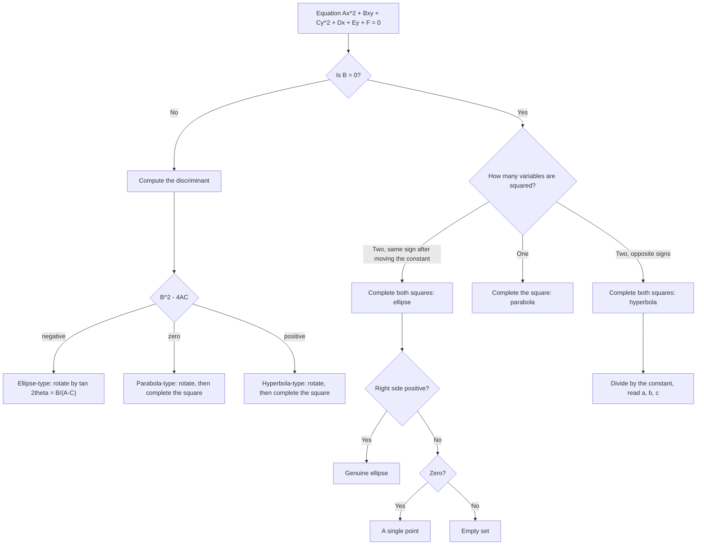

# Conic Sections

> [Mathematics](../../README.md) › [Precalculus](../README.md) · Level: Intermediate · Prerequisites: [Intermediate Algebra](../../03-algebra/04-intermediate-algebra/README.md), [Quadratic Equations](../../03-algebra/08-quadratic-equations/README.md), [Functions](../../03-algebra/11-functions/README.md), [Coordinate Geometry](../../04-geometry/04-coordinate-geometry/README.md), [The Unit Circle and Radian Measure](../../05-trigonometry/02-unit-circle/README.md) · Estimated time: 8 h

## 1. Introduction

Cut a cone with a knife. Hold the blade horizontal and the cut is a circle. Tilt it slightly and the cut becomes an oval. Tilt it until the blade is parallel to the side of the cone and the cut is no longer closed — it is a curve that runs off to infinity and never comes back. Tilt it further and the blade slices *both* halves of the cone, producing two separate branches. Those four curves — circle, ellipse, parabola, hyperbola — are the **conic sections**, and this is the last great family of curves in elementary mathematics.

The remarkable fact is that the same four curves have a second, completely different description. Each one is the set of points satisfying a *distance condition* involving one or two fixed points. A circle is the set of points at a fixed distance from a point. A parabola is the set of points equally far from a point and a line. An ellipse is the set of points whose distances to two fixed points add to a constant. A hyperbola is the set whose distances to two fixed points *differ* by a constant. The two descriptions — slicing a cone, and obeying a distance law — describe exactly the same four curves. That equivalence is one of the deepest elementary facts in geometry, and it is why conics appear everywhere: the distance law is what makes them useful.

The usefulness is not decorative. A planet follows an ellipse with the Sun at one focus (Kepler, 1609). A thrown ball follows a parabola. A satellite dish is a paraboloid because a parabola converts parallel rays into a single focus, and the reverse. A hyperbola is the set of points where the *difference* of two distances is fixed — which is exactly the information a navigation system gets when it measures the difference in arrival time of two radio signals, so LORAN and its descendants locate ships and aircraft on hyperbolas. The reflective property of the ellipse focuses sound in the "whispering galleries" of St Paul's Cathedral and the shock wave in a lithotripter. And in pure mathematics, every conic is a quadratic equation in two variables, so the whole subject is also the first serious study of the second-degree polynomial — the topic that continues as quadric surfaces in linear algebra and as level sets in multivariable calculus.

This topic takes the *precalculus* route: everything is derived from the distance definition, using only the distance formula, completing the square, and algebra. The geometric treatment of the cone as a solid, and the analytic treatment of lines and planes in space, live in the [Geometry](../../04-geometry/README.md) discipline; this topic links there rather than repeating it.

## 2. Prerequisites

You should be comfortable with:

* **The distance formula** $d(P,Q) = \sqrt{(x_2-x_1)^2 + (y_2-y_1)^2}$ and the midpoint formula, both of which are consequences of the Pythagorean theorem. See [Coordinate Geometry](../../04-geometry/04-coordinate-geometry/README.md).
* **Completing the square** — writing $x^2 + Dx = \left(x + \tfrac{D}{2}\right)^2 - \tfrac{D^2}{4}$ — and solving quadratic equations, including the discriminant test for the number of real roots. See [Quadratic Equations](../../03-algebra/08-quadratic-equations/README.md) and [Intermediate Algebra](../../03-algebra/04-intermediate-algebra/README.md).
* **Function notation, domain and range, and graph transformations** — in particular that replacing $x$ by $x-h$ shifts a graph right by $h$. See [Functions](../../03-algebra/11-functions/README.md).
* **Square roots and absolute value**, including the facts $\sqrt{X^2} = |X|$ and that $X^2 = Y^2$ is equivalent to $X = Y$ or $X = -Y$.
* **The unit circle**, the identity $\cos^2 t + \sin^2 t = 1$, and radian measure, which supply the parametric descriptions in Section 7.8. See [The Unit Circle and Radian Measure](../../05-trigonometry/02-unit-circle/README.md).
* **Basic trigonometric values** at multiples of $30^\circ$ and $45^\circ$, needed for the rotation example in Section 7.9.

## 3. Learning Objectives

After working through this topic you will be able to:

1. State the locus definition of each conic — circle, parabola, ellipse, hyperbola — with every quantifier explicit.
2. Derive the standard equation of each conic from its locus definition, and explain why each algebraic step is reversible.
3. Convert a general second-degree equation $Ax^2 + Bxy + Cy^2 + Dx + Ey + F = 0$ into standard form by completing the square.
4. Read off from a standard equation its centre or vertex, its axes, its foci, its directrices, its asymptotes, its eccentricity and its latus rectum.
5. Compute the eccentricity of a conic and explain what it measures geometrically.
6. Classify any second-degree equation as ellipse-type, parabola-type or hyperbola-type by the sign of the discriminant $B^2 - 4AC$, and recognise degenerate cases.
7. Determine when the $xy$-term of a general equation can be removed by a rotation, and compute the required angle.
8. Write each conic in parametric form and explain which identity makes the parameterisation work.
9. Apply conics to orbits, reflectors and hyperbolic navigation, and compute the numbers involved.
10. Recognise and avoid the standard errors collected in Section 11.

## 4. Intuition

### 4.1 One cone, four curves

Imagine a double cone — two ice-cream cones joined at their tips — cut by a plane. The shape of the cut depends only on how steeply the plane is tilted relative to the cone's side:

| The cutting plane | The curve it cuts out |
|---|---|
| perpendicular to the axis | circle |
| steeper than the cone's side, but not perpendicular | ellipse |
| parallel to exactly one line on the cone | parabola |
| less steep than the cone's side | hyperbola (two branches) |

The two branches of the hyperbola come from the plane hitting *both* nappes of the cone. The parabola is the borderline case, the instant between "closed curve" and "two branches", and this is precisely why the parabola has eccentricity exactly $1$ while the others are either less or greater.

### 4.2 The same curves as distance laws

Here is a different way to think about the four curves, in increasing order of complexity of the rule.

* **Circle.** "Stay at distance $r$ from a point." One condition, one number.
* **Parabola.** "Stay equally far from a point and a line." Still one condition; the line is a new ingredient.
* **Ellipse.** "Keep the *sum* of your distances to two points constant." Two points, one sum.
* **Hyperbola.** "Keep the *difference* of your distances to two points constant." Two points, one difference.

The last two are variations on a single idea: a fixed *sum* closes the curve into a loop, a fixed *difference* forces it open. If the sum is just barely larger than the distance between the two foci, the loop is a thin sausage; if the sum is huge compared with the separation, the loop is nearly a circle. That single number — how big the constant is relative to the separation — is what the eccentricity measures.

### 4.3 Why the parabola reflects

Put a point source of light at the focus of a parabolic mirror. Every ray travels outward, hits the mirror, and leaves *parallel to the axis*. Run the film backwards: parallel rays arriving along the axis all converge on the focus. This one property explains satellite dishes, car headlights, solar cookers, radar antennas, the parabolic microphones used to pick up a conversation across a room, and the shape of the mirror in a reflecting telescope. The reason it is true is that light takes the shortest path, and the parabola is the curve on which every path from the focus to the mirror and then out to a distant wavefront has the same length — which is exactly the "equal distance to point and line" condition, with the distant wavefront playing the role of the directrix. Section 12 comes back to this.

The ellipse has its own version: a ray leaving one focus reflects into the other focus, because the sum of the two distances is constant. That is the whispering gallery, the lithotripter, and the elliptical billiard table on which every shot from one focus passes through the other focus.

## 5. Formal Definition

Throughout, points are written $P = (x,y)$ in the Cartesian plane and $|PQ|$ denotes the Euclidean distance between $P$ and $Q$.

**Definition 5.1 (Distance from a point to a line).** Let $\ell$ be a line and $P$ a point. The *distance from $P$ to $\ell$*, written $d(P,\ell)$, is the smallest of the distances $|PQ|$ over all points $Q \in \ell$. The minimum is attained at the unique point $Q$ for which $PQ \perp \ell$ — the *foot of the perpendicular*. If $\ell$ has equation $ux + vy + w = 0$ with $u^2 + v^2 \neq 0$, then for $P = (x_0,y_0)$

$$d(P,\ell) = \frac{|ux_0 + vy_0 + w|}{\sqrt{u^2+v^2}}.$$

*Why the formula.* The vector $(u,v)$ is perpendicular to $\ell$, so the projection of any vector from a point of $\ell$ to $P$ onto the unit normal $(u,v)/\sqrt{u^2+v^2}$ has length exactly the perpendicular distance. Taking absolute values gives the formula. $\blacksquare$

**Definition 5.2 (Circle).** Let $C$ be a point and $r > 0$ a real number. The *circle* with centre $C$ and radius $r$ is the set

$$\{P : |PC| = r\}.$$

When $r = 0$ the set is the single point $\{C\}$, and one says the circle is *degenerate*.

**Definition 5.3 (Parabola).** Let $\ell$ be a line (the *directrix*) and $F$ a point not on $\ell$ (the *focus*). The *parabola* with focus $F$ and directrix $\ell$ is the set

$$\{P : d(P,F) = d(P,\ell)\}.$$

The condition $F \notin \ell$ is essential: if $F$ lay on $\ell$, every point of $\ell$ would satisfy the equation (both distances zero) and the "parabola" would degenerate to the line $\ell$ itself.

**Definition 5.4 (Ellipse).** Let $F_1 \neq F_2$ be points (the *foci*) and let $a > \tfrac12|F_1F_2|$. The *ellipse* with foci $F_1, F_2$ and semi-major axis $a$ is the set

$$\{P : |PF_1| + |PF_2| = 2a\}.$$

The strict inequality $a > \tfrac12|F_1F_2|$ guarantees that the set is a curve rather than a segment: the triangle inequality gives $|PF_1| + |PF_2| \ge |F_1F_2|$ for every $P$, so no point exists when $2a < |F_1F_2|$, and when $2a = |F_1F_2|$ the set is exactly the segment $F_1F_2$.

**Definition 5.5 (Hyperbola).** Let $F_1 \neq F_2$ be points (the *foci*) and let $0 < a < \tfrac12|F_1F_2|$. The *hyperbola* with foci $F_1, F_2$ and semi-transverse axis $a$ is the set

$$\left\{P : \big||PF_1| - |PF_2|\big| = 2a\right\}.$$

The absolute value is not cosmetic. Without it, $|PF_1| - |PF_2| = 2a$ selects only the branch nearer $F_2$, and $|PF_2| - |PF_1| = 2a$ selects the branch nearer $F_1$; together they form the two-branched hyperbola. Note also that $2a < |F_1F_2|$ is forced: the reverse triangle inequality gives $\big||PF_1|-|PF_2|\big| \le |F_1F_2|$, so no point exists when $2a > |F_1F_2|$, and when $2a = |F_1F_2|$ the set is the two rays of the line $F_1F_2$ outside the segment $F_1F_2$.

**Definition 5.6 (Eccentricity).** For a conic in standard position with semi-major (or semi-transverse) axis $a$ and centre-to-focus distance $c$, the *eccentricity* is

$$e := \frac{c}{a}.$$

Equivalently, and uniformly for all four types: if a conic is described by a focus $F$ and a directrix $\ell$, then $e$ is the constant ratio

$$e = \frac{d(P,F)}{d(P,\ell)},$$

which is the same for every point $P$ of the conic. Section 7.5 proves that the two definitions agree, that $0 < e < 1$ corresponds to the ellipse, $e = 1$ to the parabola and $e > 1$ to the hyperbola, and that the circle is the limiting case $e \to 0$.

**Definition 5.7 (Double cone; conic section).** Let $V$ be a point (the *vertex*), $\Lambda$ a line through $V$ (the *axis*), and $\alpha \in (0,\pi/2)$ an angle (the *half-angle*). The *double right circular cone* is the union of all lines through $V$ that make angle $\alpha$ with $\Lambda$, together with those same lines extended through $V$ to the other side. A *conic section* is the intersection of this surface with a plane that does not pass through $V$.

**Theorem 5.8 (Apollonius; equivalence of the two descriptions).** A conic section is a conic in the sense of Definitions 5.2–5.5, and conversely. More precisely, let $\beta \in (0,\pi/2]$ be the angle between the cutting plane and the axis. Then the section is

* a circle if $\beta = \pi/2$;
* an ellipse if $\alpha < \beta < \pi/2$;
* a parabola if $\beta = \alpha$;
* a hyperbola if $0 < \beta < \alpha$;

and in every case the eccentricity is $e = \dfrac{\cos\beta}{\cos\alpha}$.

The general proof uses the *Dandelin spheres*: spheres inscribed in the cone and tangent to the cutting plane, whose points of tangency are the foci. Tangent segments from a point of the section to a fixed sphere are equal, which converts the geometry of the cone into a constant sum or difference of distances. That is a solid-geometry argument and belongs with [Solid Geometry](../../04-geometry/05-solid-geometry/README.md); this topic does not reproduce it. The formula $e = \cos\beta/\cos\alpha$ is worth noticing even so: it shows at once that the four cases above are exhaustive (as $\beta$ decreases, $\cos\beta$ increases) and that the parabola is exactly the borderline $\beta = \alpha$, where $e = 1$. The rest of this topic *derives* the standard equations from Definitions 5.2–5.5 and never needs the cone again.

## 6. Mathematical Notation

| Symbol | Read as | Meaning here |
|---|---|---|
| $P = (x,y)$ | the point $P$ with coordinates $x$, $y$ | a variable point on a conic |
| $(h,k)$ | $h$ comma $k$ | centre of a circle or of a translated conic |
| $r$ | $r$ | radius of a circle |
| $F$, $F_1$, $F_2$ | focus, first focus, second focus | the fixed points defining the conic |
| $\ell$ | ell | a line; here usually the directrix |
| $d(P,\ell)$ | distance from $P$ to $\ell$ | perpendicular distance, Definition 5.1 |
| $a$ | $a$ | semi-major axis (ellipse) or semi-transverse axis (hyperbola) |
| $b$ | $b$ | semi-minor axis (ellipse) or semi-conjugate axis (hyperbola) |
| $c$ | $c$ | distance from the centre to either focus |
| $p$ | $p$ | signed distance from the vertex of a parabola to its focus; the sign gives the opening direction |
| $e$ | $e$ | eccentricity, Definition 5.6 |
| $2a$, $2b$, $2c$ | twice $a$, twice $b$, twice $c$ | major axis, minor axis, focal separation |
| $\Delta = B^2-4AC$ | discriminant | classifies a general second-degree equation |
| $t$, $\theta$, $u$ | $t$, theta, $u$ | parameters in parametric and polar descriptions |
| $A,B,C,D,E,F$ | the coefficients | of the general second-degree equation |
| $\operatorname{sgn}(p)$ | sign of $p$ | $+1$ if $p>0$, $-1$ if $p<0$ |

Read $\dfrac{x^2}{a^2} + \dfrac{y^2}{b^2} = 1$ aloud as "ex squared over a squared, plus why squared over b squared, equals one". Read $|PF_1| + |PF_2| = 2a$ as "the distance from P to F one, plus the distance from P to F two, equals two a". Read $\big||PF_1| - |PF_2|\big| = 2a$ as "the absolute value of the difference of those two distances equals two a".

## 7. Core Concepts

### 7.1 The circle as a locus

Let $C = (h,k)$ and $r > 0$. A point $P = (x,y)$ lies on the circle exactly when $|PC| = r$, that is

$$\sqrt{(x-h)^2 + (y-k)^2} = r.$$

Both sides are non-negative, so squaring is reversible:

$$(x-h)^2 + (y-k)^2 = r^2.$$

This is the **standard form** of the circle. Expanding gives

$$x^2 + y^2 - 2hx - 2ky + (h^2 + k^2 - r^2) = 0,$$

which is the special case $A = C = 1$, $B = 0$ of the general second-degree equation. Written as $x^2 + y^2 + Dx + Ey + F = 0$ with $D = -2h$, $E = -2k$, $F = h^2+k^2-r^2$, completing the square recovers

$$\left(x + \frac{D}{2}\right)^2 + \left(y + \frac{E}{2}\right)^2 = \frac{D^2+E^2}{4} - F.$$

The right-hand side decides everything, and all three cases occur:

| Value of $\frac{D^2+E^2}{4} - F$ | The equation represents |
|---|---|
| $> 0$ | a genuine circle of radius $\sqrt{\frac{D^2+E^2}{4} - F}$ |
| $= 0$ | the single point $\left(-\frac{D}{2}, -\frac{E}{2}\right)$ |
| $< 0$ | the empty set (no real points) |

A circle is also an ellipse whose two foci coincide. If $F_1 = F_2 = C$, the condition $|PF_1| + |PF_2| = 2r$ becomes $2|PC| = 2r$, that is $|PC| = r$. In the notation of Section 7.3, $c = 0$, hence $e = 0$, and the two semi-axes $a$ and $b$ are both equal to $r$.

### 7.2 The parabola: equidistant from focus and directrix

Place the focus at $F = (p,0)$ and the directrix on the line $x = -p$, with $p \neq 0$. This arrangement puts the vertex half-way between focus and directrix, at the origin, as it must be: the vertex is the point of the parabola on the axis, and on the axis the two distances to focus and directrix are $|x-p|$ and $|x+p|$, which are equal exactly when $x = 0$.

**Derivation of the standard equation.** For $P = (x,y)$,

$$d(P,F) = \sqrt{(x-p)^2 + y^2}, \qquad d(P,\ell) = |x-(-p)| = |x+p|.$$

The parabola is the set where these are equal:

$$\sqrt{(x-p)^2 + y^2} = |x+p|.$$

Both sides are non-negative, so squaring is reversible — no spurious solutions are introduced:

$$(x-p)^2 + y^2 = (x+p)^2.$$

Expand both squares:

$$x^2 - 2px + p^2 + y^2 = x^2 + 2px + p^2.$$

The terms $x^2$ and $p^2$ cancel, and moving $-2px$ across gives

$$y^2 = 4px.$$

Every step was an equivalence, so the solution set is exactly the parabola.

**Reading the equation.** The equation $y^2 = 4px$ contains $y$ squared and $x$ to the first power. That asymmetry is what makes the curve open sideways. If $p > 0$ the right-hand side is non-negative only for $x \ge 0$, so the curve lives in the right half-plane and opens to the right; if $p < 0$ it opens to the left. The point $(0,0)$ is the **vertex**, the $x$-axis is the **axis of symmetry**, and the curve is symmetric about it because only $y^2$ appears.

**The latus rectum.** The chord through the focus perpendicular to the axis is called the *latus rectum*. Putting $x = p$ in $y^2 = 4px$ gives $y^2 = 4p^2$, hence $y = \pm 2|p|$.

So the chord runs from $(p,-2|p|)$ to $(p,2|p|)$ and has length $4|p|$ — the same as the coefficient of $x$. This is a useful sanity check on any computed focus.

**The other orientations.** Interchanging the roles of $x$ and $y$ gives the vertical parabolas

$$x^2 = 4py,$$

with focus $(0,p)$ and directrix $y = -p$; it opens upward if $p>0$ and downward if $p<0$. With vertex $(h,k)$ the two forms become

$$(y-k)^2 = 4p(x-h) \quad\text{(axis horizontal)}, \qquad (x-h)^2 = 4p(y-k) \quad\text{(axis vertical)}.$$

### 7.3 The ellipse: constant sum of distances

Place the foci at $F_1 = (-c,0)$ and $F_2 = (c,0)$ with $c>0$, and let the constant sum be $2a$ with $a>c$. By Definition 5.4, $P = (x,y)$ is on the ellipse exactly when

$$\sqrt{(x+c)^2+y^2} + \sqrt{(x-c)^2+y^2} = 2a.$$

**Derivation.** The trick is to isolate one radical before each squaring, so that only one square root survives.

*Step 1 — isolate.* Move the second radical to the right:

$$\sqrt{(x+c)^2+y^2} = 2a - \sqrt{(x-c)^2+y^2}.$$

*Step 2 — square once.* The right side is non-negative, because $|PF_2| \le |PF_1| + |F_1F_2| = 2a$, so $2a - |PF_2| \ge 0$; squaring is safe. Expanding $(x\pm c)^2 = x^2 \pm 2cx + c^2$:

$$x^2 + 2cx + c^2 + y^2 = 4a^2 - 4a\sqrt{(x-c)^2+y^2} + x^2 - 2cx + c^2 + y^2.$$

Cancel $x^2$, $c^2$ and $y^2$ from both sides:

$$2cx = 4a^2 - 4a\sqrt{(x-c)^2+y^2} - 2cx.$$

*Step 3 — collect.* Add $2cx$ to both sides and divide by $4$:

$$a\sqrt{(x-c)^2+y^2} = a^2 - cx.$$

*Step 4 — square again.*

$$a^2\left[(x-c)^2+y^2\right] = (a^2-cx)^2.$$

Expand both sides:

$$a^2x^2 - 2a^2cx + a^2c^2 + a^2y^2 = a^4 - 2a^2cx + c^2x^2.$$

The cross terms $-2a^2cx$ cancel:

$$a^2x^2 - c^2x^2 + a^2y^2 = a^4 - a^2c^2, \qquad\text{that is}\qquad (a^2-c^2)x^2 + a^2y^2 = a^2(a^2-c^2).$$

*Step 5 — divide.* Since $a > c > 0$ we have $a^2-c^2 > 0$ and $a \neq 0$, so division is legitimate:

$$\frac{x^2}{a^2} + \frac{y^2}{a^2-c^2} = 1.$$

**Naming $b$.** Put $b^2 := a^2-c^2$ and $b := \sqrt{a^2-c^2} > 0$. Then the ellipse is

$$\frac{x^2}{a^2} + \frac{y^2}{b^2} = 1.$$

Because $b^2 = a^2-c^2 < a^2$, we have $b<a$: the $x$-intercepts $\pm a$ are further out than the $y$-intercepts $\pm b$. The segment from $(-a,0)$ to $(a,0)$ is the **major axis** (length $2a$) and the segment from $(0,-b)$ to $(0,b)$ is the **minor axis** (length $2b$).

**Geometric meaning of $b$.** The point $(0,b)$ is a *co-vertex*. Its distance to the focus $(c,0)$ is $\sqrt{c^2+b^2} = \sqrt{a^2} = a$. So the co-vertex lies at distance exactly $a$ from each focus. This is the standard way to construct an ellipse with two pins and a loop of string: pin the foci, loop a string of length $2a + |F_1F_2|$ around them, and pull it taut with a pencil. The pencil traces the ellipse, because the two straight pieces of string always have total length $2a$.

**Which axis is major.** If $a>b$, the major axis is horizontal and the foci are at $(\pm c,0)$ with $c^2 = a^2-b^2$. If $b>a$, the major axis is vertical, the foci are at $(0,\pm c)$ with $c^2 = b^2-a^2$, and the standard form is still written $\frac{x^2}{a^2} + \frac{y^2}{b^2} = 1$ with $b$ now the larger number. The safe habit is to compare the two denominators: the larger one is $a^2$, and the major axis lies along that variable.

### 7.4 The hyperbola: constant difference of distances

Place the foci at $F_1 = (-c,0)$, $F_2 = (c,0)$ with $c>0$, and let the constant difference be $2a$ with $a<c$. By Definition 5.5, $P = (x,y)$ is on the hyperbola exactly when

$$\sqrt{(x+c)^2+y^2} - \sqrt{(x-c)^2+y^2} = \pm 2a.$$

**Derivation for one branch.** Take the sign that selects the branch nearer $F_2$, that is $|PF_1| - |PF_2| = 2a$:

$$\sqrt{(x+c)^2+y^2} = 2a + \sqrt{(x-c)^2+y^2}.$$

*Square once.* The right side is positive, so squaring is safe:

$$x^2 + 2cx + c^2 + y^2 = 4a^2 + 4a\sqrt{(x-c)^2+y^2} + x^2 - 2cx + c^2 + y^2.$$

Cancel the common terms and collect:

$$4cx - 4a^2 = 4a\sqrt{(x-c)^2+y^2}, \qquad\text{so}\qquad cx - a^2 = a\sqrt{(x-c)^2+y^2}.$$

*Square again.*

$$c^2x^2 - 2a^2cx + a^4 = a^2\left[(x-c)^2+y^2\right] = a^2x^2 - 2a^2cx + a^2c^2 + a^2y^2.$$

The cross terms cancel:

$$(c^2-a^2)x^2 - a^2y^2 = a^2(c^2-a^2), \qquad\text{that is}\qquad \frac{x^2}{a^2} - \frac{y^2}{c^2-a^2} = 1$$

after dividing by $a^2(c^2-a^2) > 0$. Put $b^2 := c^2-a^2$. Then

$$\frac{x^2}{a^2} - \frac{y^2}{b^2} = 1.$$

The other sign leads to exactly the same equation, so both branches together are this single curve — which is why Definition 5.5 uses the absolute value.

**Reading the equation.** The curve meets the $x$-axis at $x = \pm a$; these are the **vertices**, and the segment joining them is the **transverse axis**, of length $2a$. It never meets the $y$-axis: $y=0$ forces $x^2 = a^2$, and $x = 0$ would force $-y^2/b^2 = 1$, which is impossible. For large $|x|$ the constant $1$ is negligible and $y^2 \approx (b^2/a^2)x^2$, so the branches approach the two lines

$$y = \pm\frac{b}{a}x,$$

the **asymptotes**. Section 8.6 makes "approach" precise.

The rectangle with corners $(\pm a, \pm b)$ — the *central rectangle* — is the key to sketching: its diagonals are the asymptotes, and the hyperbola passes through the midpoints of its left and right sides. When $a = b$ the hyperbola is called *rectangular* (or equilateral) and its asymptotes are perpendicular.

If the transverse axis is vertical instead, the standard form is

$$\frac{y^2}{a^2} - \frac{x^2}{b^2} = 1,$$

with vertices $(0,\pm a)$, foci $(0,\pm c)$, $c^2 = a^2+b^2$ and asymptotes $y = \pm\frac{a}{b}x$. Note the asymmetry: the asymptote slope is $b/a$ when the transverse axis is horizontal but $a/b$ when it is vertical. The safe rule is that *the asymptotes are the diagonals of the rectangle through the vertices*: $\pm a$ along the transverse direction, $\pm b$ along the other.

### 7.5 Eccentricity, and the unity of the four curves

The eccentricity $e = c/a$ measures how far the foci are pushed from the centre relative to the size of the conic.

| Conic | $c$ in terms of $a,b$ | Range of $e$ | Shape |
|---|---|---|---|
| circle | $c = 0$ | $e = 0$ | perfectly round |
| ellipse | $c = \sqrt{a^2-b^2}$ | $0 < e < 1$ | $e$ near $0$ round, $e$ near $1$ long and thin |
| parabola | — | $e = 1$ | exactly the borderline |
| hyperbola | $c = \sqrt{a^2+b^2}$ | $e > 1$ | $e$ near $1$ narrow branches, $e$ large wide ones |

For the ellipse $e = \sqrt{1-b^2/a^2}$, so $b = a\sqrt{1-e^2}$: the eccentricity is a complete description of the *shape*, while $a$ fixes the *size*. This is why orbital elements are quoted as a pair $(a,e)$.

**The uniform focus–directrix law.** Here is the statement that unifies everything, and it is worth proving rather than asserting.

**Theorem 7.1.** Let $0<e<1$, let $F = (c,0)$, and consider the ellipse $\frac{x^2}{a^2} + \frac{y^2}{b^2} = 1$ with $c^2 = a^2-b^2$ and $e = c/a$. Then for every point $P$ on the ellipse,

$$\frac{|PF|}{d(P,\ell)} = e, \qquad \text{where } \ell \text{ is the line } x = \frac{a^2}{c}.$$

*Proof.* First compute the focal distance. For $P = (x,y)$ on the ellipse, $y^2 = b^2\left(1-\frac{x^2}{a^2}\right)$, so

$$\begin{aligned}
|PF|^2 &= (x-c)^2 + y^2 \\
&= x^2 - 2cx + c^2 + b^2 - \frac{b^2}{a^2}x^2 \\
&= x^2\left(1-\frac{b^2}{a^2}\right) - 2cx + (b^2+c^2).
\end{aligned}$$

Now $1 - b^2/a^2 = (a^2-b^2)/a^2 = c^2/a^2$ and $b^2+c^2 = a^2$, so

$$|PF|^2 = \frac{c^2}{a^2}x^2 - 2cx + a^2 = \left(\frac{cx}{a}-a\right)^2 = (ex-a)^2.$$

Since $|x| \le a$ and $e<1$, we have $ex \le ea = c < a$, so $ex - a < 0$ and therefore

$$|PF| = a - ex.$$

The directrix $x = a^2/c$ lies to the right of the ellipse because $a^2/c > a$ is equivalent to $a > c$. Hence for $x \le a$,

$$d(P,\ell) = \frac{a^2}{c} - x = \frac{a}{e} - x = \frac{a-ex}{e} = \frac{|PF|}{e}.$$

Therefore $|PF| = e\,d(P,\ell)$, as claimed. $\blacksquare$

**Theorem 7.2.** Let $e>1$ and consider $\frac{x^2}{a^2} - \frac{y^2}{b^2} = 1$ with $c^2 = a^2+b^2$ and $e = c/a$. On the branch with $x \ge a$, with $F = (c,0)$ and $\ell$ the line $x = a^2/c$,

$$\frac{|PF|}{d(P,\ell)} = e.$$

*Proof.* On the hyperbola $y^2 = b^2\left(\frac{x^2}{a^2}-1\right)$, so

$$\begin{aligned}
|PF|^2 &= (x-c)^2 + y^2 = x^2 - 2cx + c^2 + \frac{b^2}{a^2}x^2 - b^2 \\
&= x^2\left(1+\frac{b^2}{a^2}\right) - 2cx + (c^2-b^2).
\end{aligned}$$

Now $1 + b^2/a^2 = (a^2+b^2)/a^2 = c^2/a^2$ and $c^2-b^2 = a^2$, so

$$|PF|^2 = \frac{c^2}{a^2}x^2 - 2cx + a^2 = (ex-a)^2.$$

On this branch $x \ge a$, so $ex \ge ea = c > a$ and $|PF| = ex-a$. Also $x \ge a > a^2/c$ (because $a > a^2/c$ is equivalent to $c>a$), so $d(P,\ell) = x - a^2/c$ and

$$\frac{|PF|}{d(P,\ell)} = \frac{ex-a}{x-a/e} = \frac{e\left(x-a/e\right)}{x-a/e} = e. \qquad\blacksquare$$

For the parabola the statement is Definition 5.3 itself. Thus all three non-circular types obey one law:

$$\{P : |PF| = e\,d(P,\ell)\}.$$

**Why the circle is the odd one out.** In the law $|PF| = e\,d(P,\ell)$, putting $e = 0$ forces $|PF| = 0$, that is the single point $F$ — not a circle. The circle is the *limit*: keep the product $e\,d_0$ (where $d_0$ is the distance from the focus to the directrix) fixed at $r$ while $e \to 0$ and $d_0 \to \infty$. The directrix recedes to infinity and the law becomes $|PF| = r$. So the circle has $e = 0$ in the $c/a$ sense and is the degenerate limit in the focus–directrix sense. Statements that set $e = 0$ in the focus–directrix formula and expect a circle are wrong; this is Common Mistake 3 in Section 11.

**Polar form.** A useful consequence of Theorem 7.1: put the focus at the origin and the directrix at $x = d_0 > 0$. For a point at distance $r$ from the focus and angle $\theta$ from the positive $x$-axis, the distance to the directrix is $d_0 - r\cos\theta$, so the law gives

$$r = e\left(d_0 - r\cos\theta\right) \quad\Longrightarrow\quad r = \frac{e\,d_0}{1+e\cos\theta}.$$

With $0<e<1$, $e=1$ and $e>1$ this single formula produces the ellipse, the parabola and one branch of the hyperbola. It is the reason orbital mechanics quotes a *true anomaly* $\theta$ and a *semi-latus rectum* $\ell_0 = e\,d_0$: the orbit of any body under an inverse-square force is $r = \ell_0/(1+e\cos\theta)$.

### 7.6 Completing the square: identifying a translated conic

A conic whose centre or vertex is not at the origin has the same equation with $x$ replaced by $x-h$ and $y$ by $y-k$. To recognise one, **complete the square in $x$ and in $y$ separately**.

The procedure, for $Ax^2 + Cy^2 + Dx + Ey + F = 0$ with no $xy$ term:

1. Group: $A\left(x^2 + \frac{D}{A}x\right) + C\left(y^2 + \frac{E}{C}y\right) = -F$.
2. Complete each bracket, using $x^2 + \frac{D}{A}x = \left(x+\frac{D}{2A}\right)^2 - \frac{D^2}{4A^2}$ and the analogous identity in $y$.
3. Move the constants out of the brackets and combine them on the right-hand side.
4. Divide by the right-hand side to obtain a $1$ there.
5. Read the type from the signs of the two squared terms, then read the parameters.

**The mechanism.** A worked example of the whole procedure is Example 3 of Section 9, where $4x^2+9y^2-16x+54y+61=0$ reduces to $\frac{(x-2)^2}{9}+\frac{(y+3)^2}{4}=1$.

The same procedure applied to a squared term that appears with a minus sign gives a hyperbola; applied when only one variable is squared gives a parabola; when the right-hand side comes out as $0$ or negative, the "conic" is degenerate.

**Translation rules.** Replacing $x$ by $x-h$ and $y$ by $y-k$ moves the whole picture by the vector $(h,k)$, with no change of shape, size or eccentricity:

| Standard form | Centre or vertex | Foci |
|---|---|---|
| $\dfrac{(x-h)^2}{a^2} + \dfrac{(y-k)^2}{b^2} = 1$, $a>b$ | $(h,k)$ | $(h\pm c, k)$, $c^2 = a^2-b^2$ |
| $\dfrac{(y-k)^2}{a^2} + \dfrac{(x-h)^2}{b^2} = 1$, $a>b$ | $(h,k)$ | $(h, k\pm c)$, $c^2 = a^2-b^2$ |
| $\dfrac{(x-h)^2}{a^2} - \dfrac{(y-k)^2}{b^2} = 1$ | $(h,k)$ | $(h\pm c, k)$, $c^2 = a^2+b^2$ |
| $\dfrac{(y-k)^2}{a^2} - \dfrac{(x-h)^2}{b^2} = 1$ | $(h,k)$ | $(h, k\pm c)$, $c^2 = a^2+b^2$ |
| $(y-k)^2 = 4p(x-h)$ | vertex $(h,k)$ | $(h+p, k)$ |
| $(x-h)^2 = 4p(y-k)$ | vertex $(h,k)$ | $(h, k+p)$ |
| $(x-h)^2 + (y-k)^2 = r^2$ | centre $(h,k)$ | focus $(h,k)$, $e=0$ |

### 7.7 The general second-degree equation and the discriminant

Every conic, and nothing else, is described by an equation

$$Ax^2 + Bxy + Cy^2 + Dx + Ey + F = 0 \qquad (A,B,C \text{ not all zero}).$$

The quantity that governs the classification is the **discriminant**

$$\Delta := B^2 - 4AC.$$

**Theorem 7.3 (Classification).** Suppose the equation above defines a non-degenerate conic. Then

* $\Delta < 0$: the conic is an **ellipse** (a circle when $A = C$ and $B = 0$);
* $\Delta = 0$: the conic is a **parabola**;
* $\Delta > 0$: the conic is a **hyperbola**.

*Why the discriminant works.* Read the quadratic part $Ax^2 + Bxy + Cy^2$ as the quadratic form with symmetric matrix

$$M = \begin{pmatrix} A & B/2 \\ B/2 & C \end{pmatrix}.$$

Its determinant is $AC - B^2/4 = -\Delta/4$, so

$$\Delta = -4\det M.$$

A rotation of coordinates replaces $M$ by $R^{\mathsf T}MR$ for a rotation matrix $R$, and determinants are multiplicative, so $\det\left(R^{\mathsf T}MR\right) = \det M$: the sign of $\Delta$ cannot change under rotation. Because every non-degenerate conic with $B \neq 0$ can be rotated into a position with $B = 0$ (Section 7.9 proves the angle formula), it is enough to test the rotated equation, in which

$$\Delta = -4AC \qquad (B=0).$$

If $A$ and $C$ have the same sign then $AC>0$ and $\Delta<0$, and the rotated equation $Ax^2 + Cy^2 = \text{constant}$ describes an ellipse. If they have opposite signs then $AC<0$ and $\Delta>0$, and $Ax^2 - |C|y^2 = \text{constant}$ is a hyperbola. If one of $A$, $C$ vanishes then $\Delta = 0$, and the rotated equation is linear in one of the variables — a parabola. $\blacksquare$

**A caution.** The discriminant classifies the *type*, not the existence of a curve. The equation $x^2+y^2+1 = 0$ has $\Delta = -4 < 0$ but no real solutions; $x^2+y^2 = 0$ has $\Delta<0$ and only the origin; $x^2-y^2 = 0$ has $\Delta = 4 > 0$ and is a pair of crossing lines; $y^2 = 0$ has $\Delta = 0$ and is a single line. Section 7.10 catalogues all of these.

**A caution about conventions.** Some books define the discriminant as $B^2-4AC$, others as $4AC-B^2$. This repository uses $B^2-4AC$ throughout, with $\Delta<0$ for an ellipse, $\Delta=0$ for a parabola and $\Delta>0$ for a hyperbola. Check the convention of any source before quoting a sign.

### 7.8 Parametric forms

A parametric description gives the coordinates of a point of the conic as functions of one parameter. Each of the four conics is parametrised by a *Pythagorean identity* — an identity of the form $X^2+Y^2 = 1$ or $X^2-Y^2 = 1$.

**Circle.** With $x = h + r\cos t$ and $y = k + r\sin t$,

$$(x-h)^2 + (y-k)^2 = r^2\cos^2 t + r^2\sin^2 t = r^2.$$

Every $t$ gives a point of the circle, and every point of the circle arises from exactly one $t \in [0,2\pi)$. Here $t$ *is* the polar angle measured from the centre.

**Ellipse.** With $x = a\cos t$ and $y = b\sin t$,

$$\frac{x^2}{a^2} + \frac{y^2}{b^2} = \cos^2 t + \sin^2 t = 1.$$

Again every point arises, with $t \in [0,2\pi)$ one-to-one. But $t$ is **not** the polar angle from the centre: $(a\cos t, b\sin t)$ lies on the radius making angle $t$ only when $a = b$. Instead $t$ is the *eccentric angle*: the point $(a\cos t, b\sin t)$ is the image of the *auxiliary circle* point $(a\cos t, a\sin t)$ under the vertical compression $y \mapsto (b/a)y$. Drawing the auxiliary circle of radius $a$ next to the ellipse makes this vivid — drop a perpendicular from the circle point to the major axis and scale it by $b/a$.

**Hyperbola.** Since $\sec^2 t - \tan^2 t = 1$, the choice $x = a\sec t$, $y = b\tan t$ gives

$$\frac{x^2}{a^2} - \frac{y^2}{b^2} = \sec^2 t - \tan^2 t = 1.$$

As $t$ runs over $(-\pi/2,\pi/2)$ this traces the right branch; the left branch comes from $t \in (\pi/2, 3\pi/2)$. Equivalently, using the hyperbolic identity $\cosh^2 u - \sinh^2 u = 1$, the substitution $x = \pm a\cosh u$, $y = b\sinh u$ with $u \in \mathbb{R}$ traces the whole curve without the singularities at $t = \pm\pi/2$.

**Parabola.** For $y^2 = 4px$ take $x = pt^2$ and $y = 2pt$. Then

$$y^2 = 4p^2t^2 = 4p\cdot pt^2 = 4px$$

for every real $t$, and every point of the parabola arises from exactly one $t$, namely $t = y/(2p)$ when $p \ne 0$.

**Why parametrise at all?** Because a parameter turns a two-variable constraint into a one-variable problem. Areas, arc lengths, intersections with a moving line and — later — line integrals all become integrals in $t$. The parameterisation of the ellipse is also the quickest route to its area, $\pi ab$ (Section 8.9), and the eccentric angle is exactly the quantity an astronomer computes to locate a planet on its orbit.

### 7.9 Rotations, the $xy$ term, and a first look at the general case

If $B \neq 0$ the conic's axes are tilted. Rotating the coordinate axes by an angle $\theta$ counter-clockwise means substituting

$$x = X\cos\theta - Y\sin\theta, \qquad y = X\sin\theta + Y\cos\theta,$$

which expresses the old coordinates in terms of the new ones. Substituting into $Ax^2 + Bxy + Cy^2$ and collecting terms gives

$$\begin{aligned}
A' &= A\cos^2\theta + B\sin\theta\cos\theta + C\sin^2\theta, \\
B' &= B\left(\cos^2\theta - \sin^2\theta\right) + 2(C-A)\sin\theta\cos\theta = B\cos 2\theta + (C-A)\sin 2\theta, \\
C' &= A\sin^2\theta - B\sin\theta\cos\theta + C\cos^2\theta.
\end{aligned}$$

Two facts fall out immediately.

**Fact 1 (the angle that removes $B$).** Setting $B' = 0$ gives $B\cos 2\theta = (A-C)\sin 2\theta$, so, when $B \neq 0$,

$$\tan 2\theta = \frac{B}{A-C}, \qquad\text{equivalently}\qquad \cot 2\theta = \frac{A-C}{B}.$$

When $A = C$ the condition becomes $B\cos 2\theta = 0$, so $\theta = \pi/4$. Because $\tan$ has period $\pi$, the equation for $2\theta$ has two solutions in $[0,2\pi)$ differing by $\pi$; the corresponding $\theta$ differ by $\pi/2$, which merely exchanges the names of the two axes. Either choice removes the $xy$ term.

**Fact 2 (invariants).** Adding the first and third formulas gives $A' + C' = A + C$. Writing the quadratic part as $\mathbf{x}^{\mathsf T}M\mathbf{x}$ with $M = \begin{pmatrix}A & B/2\\ B/2 & C\end{pmatrix}$ and $\mathbf{x} = R\mathbf{X}$, so that $M' = R^{\mathsf T}MR$ with $\det R = \cos^2\theta+\sin^2\theta = 1$, gives

$$\det M' = \det\left(R^{\mathsf T}\right)\det M \det R = \det M .$$

Since $\det M = AC - B^2/4$, this says exactly that $B'^2-4A'C' = -4\det M' = -4\det M = B^2-4AC$. The *trace* and the *discriminant* are therefore rotation invariants, an excellent check on any computation. Indeed, with $\theta$ chosen to kill $B'$ the rotated coefficients satisfy

$$A' + C' = A + C, \qquad A'C' = AC - \frac{B^2}{4} = -\frac{\Delta}{4},$$

so $A'$ and $C'$ are the roots of $\lambda^2 - (A+C)\lambda - \frac{\Delta}{4} = 0$ — the characteristic polynomial of $M$. This is an early appearance of eigenvalues, and the reason conic classification is a linear-algebra problem in disguise.

**Worked miniature: $xy = 1$.** Here $A = 0$, $B = 1$, $C = 0$, so $\Delta = 1 > 0$: a hyperbola. The angle satisfies $\cot 2\theta = (A-C)/B = 0$, so $2\theta = \pi/2$ and $\theta = \pi/4$. Substituting $x = (X-Y)/\sqrt2$ and $y = (X+Y)/\sqrt2$ into $xy = 1$ gives

$$\frac{(X-Y)(X+Y)}{2} = 1 \quad\Longrightarrow\quad X^2 - Y^2 = 2 \quad\Longrightarrow\quad \frac{X^2}{2} - \frac{Y^2}{2} = 1,$$

a rectangular hyperbola with $a = b = \sqrt2$, $c = 2$, $e = \sqrt2$ and asymptotes $Y = \pm X$ — which in the original coordinates are the coordinate axes, exactly as $xy = 1$ suggests.

### 7.10 Degenerate cases

The word "conic" is often extended to the curves obtained by a plane through the *vertex* of the cone: a point, a line, or a pair of lines. Algebraically these are the solution sets of second-degree equations that fail to be curves. In the language of Section 7.7:

| Equation | $\Delta$ | Solution set |
|---|---|---|
| $x^2+y^2 = r^2$, $r>0$ | $<0$ | circle |
| $x^2+y^2 = 0$ | $<0$ | the single point $(0,0)$ |
| $x^2+y^2 = -1$ | $<0$ | empty |
| $x^2+2y^2 = 1$ | $<0$ | ellipse |
| $y^2 = 4px$, $p\neq0$ | $0$ | parabola |
| $y^2 = 0$ | $0$ | the $x$-axis (a "double line") |
| $y^2 = 4p^2$, $p\neq0$ | $0$ | the two parallel lines $y = \pm2|p|$ |
| $y^2 = -1$ | $0$ | empty |
| $x^2-y^2 = 1$ | $>0$ | hyperbola |
| $x^2-y^2 = 0$ | $>0$ | the two lines $y = \pm x$ |
| $x^2-y^2 = -1$ | $>0$ | hyperbola with transverse axis vertical |

The pattern is worth memorising. **An ellipse-type equation becomes a point when the right-hand side is $0$ and empty when it is negative; a parabola-type becomes two parallel lines, or one line, or nothing; a hyperbola-type becomes two crossing lines when the constant is $0$.**

Two warnings. First, over the complex numbers $x^2+y^2 = 0$ factors as $(x+iy)(x-iy) = 0$ and its solution set is a pair of lines; over $\mathbb{R}$ it is a single point. The discriminant reports the algebraic type, not the real points. Second, a pair of parallel lines is a conic that meets the line at infinity in one doubled point, exactly as a parabola does — which is why the discriminant cannot separate them. That is a projective-geometry remark; it is not needed for computation, only for understanding why the discriminant is a *type* test rather than a *shape* test.

## 8. Formulas and Properties

Each property below is stated with its hypotheses, and each carries a *why* — either a reference to the derivation in Section 7 or a short proof.

**Property 8.1 (Circle, standard and general form).** The circle with centre $(h,k)$ and radius $r>0$ is

$$(x-h)^2 + (y-k)^2 = r^2,$$

equivalently $x^2+y^2+Dx+Ey+F = 0$ with centre $\left(-\frac{D}{2},-\frac{E}{2}\right)$ and radius

$$r = \sqrt{\frac{D^2+E^2}{4} - F},$$

which is real exactly when $\frac{D^2+E^2}{4} \ge F$, and positive (a genuine circle) exactly when the inequality is strict.

*Why.* Definition 5.2 and the distance formula, then completing the square in both variables (Section 7.1). $\blacksquare$

**Property 8.2 (Parabola, four standard positions).** With $p \neq 0$:

| Equation | Vertex | Focus | Directrix | Opens toward | Latus rectum |
|---|---|---|---|---|---|
| $y^2 = 4px$ | $(0,0)$ | $(p,0)$ | $x = -p$ | $\operatorname{sgn}(p)\,x$ | $4\lvert p\rvert$ |
| $x^2 = 4py$ | $(0,0)$ | $(0,p)$ | $y = -p$ | $\operatorname{sgn}(p)\,y$ | $4\lvert p\rvert$ |
| $(y-k)^2 = 4p(x-h)$ | $(h,k)$ | $(h+p,k)$ | $x = h-p$ | $\operatorname{sgn}(p)\,x$ | $4\lvert p\rvert$ |
| $(x-h)^2 = 4p(y-k)$ | $(h,k)$ | $(h,k+p)$ | $y = k-p$ | $\operatorname{sgn}(p)\,y$ | $4\lvert p\rvert$ |

*Why.* Each is the computation of Section 7.2, translated by $(h,k)$; the latus rectum was computed there by putting $x = p$. $\blacksquare$

**Property 8.3 (Ellipse).** With $a>b>0$ and $c := \sqrt{a^2-b^2}$,

$$\frac{x^2}{a^2} + \frac{y^2}{b^2} = 1$$

has centre $(0,0)$, vertices $(\pm a, 0)$, co-vertices $(0,\pm b)$, foci $(\pm c,0)$, eccentricity $e = c/a$, directrices $x = \pm a^2/c$, latus rectum $2b^2/a$, major axis $2a$, minor axis $2b$, area $\pi ab$.

*Why.* Section 7.3 derives the equation and $b^2 = a^2-c^2$; Theorem 7.1 identifies the directrices; the latus rectum is computed by setting $x = c$ in $\frac{x^2}{a^2}+\frac{y^2}{b^2} = 1$, giving $y^2 = b^2\left(1-\frac{c^2}{a^2}\right) = \frac{b^4}{a^2}$, so the chord has length $2b^2/a$; the area is Property 8.9. $\blacksquare$

**Property 8.4 (Hyperbola).** With $a>0$, $b>0$ and $c := \sqrt{a^2+b^2}$,

$$\frac{x^2}{a^2} - \frac{y^2}{b^2} = 1$$

has centre $(0,0)$, vertices $(\pm a,0)$, foci $(\pm c,0)$, eccentricity $e = c/a > 1$, asymptotes $y = \pm\frac{b}{a}x$, directrices $x = \pm a^2/c$ and latus rectum $2b^2/a$. For the vertical form $\frac{y^2}{a^2}-\frac{x^2}{b^2} = 1$ the vertices are $(0,\pm a)$, the foci $(0,\pm c)$ and the asymptotes $y = \pm\frac{a}{b}x$.

*Why.* Section 7.4 derives the equation and $b^2 = c^2-a^2$; Theorem 7.2 identifies the directrices; the latus rectum follows by setting $x = c$, giving $y^2 = b^2\left(\frac{c^2}{a^2}-1\right) = \frac{b^4}{a^2}$. $\blacksquare$

**Property 8.5 (Focal radii).** Let $P = (x,y)$ be on the ellipse $\frac{x^2}{a^2}+\frac{y^2}{b^2} = 1$ with foci $F_{\pm} = (\pm c, 0)$. Then

$$|PF_{-}| = a + ex, \qquad |PF_{+}| = a - ex.$$

For $P$ on the hyperbola $\frac{x^2}{a^2}-\frac{y^2}{b^2} = 1$ with $x \ge a$,

$$|PF_{-}| = ex + a, \qquad |PF_{+}| = ex - a.$$

*Why.* The computation of Theorem 7.1 gives $|PF_+|^2 = (ex-a)^2$. On the ellipse $|ex| \le ea = c < a$, so $|PF_+| = a-ex$; replacing $c$ by $-c$ (equivalently $x$ by $-x$) gives $|PF_-| = a+ex$. On the right branch of the hyperbola $ex \ge c > a$, so $|PF_+| = ex-a$ and $|PF_-| = ex+a$. Adding gives the defining constant $2a$ for the ellipse; subtracting gives $2a$ for the hyperbola — a second proof that the standard equations really are the loci of Definitions 5.4 and 5.5. $\blacksquare$

**Property 8.6 (The asymptotes are approached).** For the hyperbola $\frac{x^2}{a^2}-\frac{y^2}{b^2}=1$ with $x>0$, let $P = (x,y)$ lie on the upper half of the right branch. Then the distance from $P$ to the line $y = \frac{b}{a}x$ tends to $0$ as $x \to \infty$.

*Why.* The vertical distance is

$$\frac{b}{a}x - y = \frac{b}{a}\left(x - \sqrt{x^2-a^2}\right) = \frac{b}{a}\cdot\frac{a^2}{x+\sqrt{x^2-a^2}},$$

after multiplying by the conjugate. As $x \to \infty$ the denominator grows without bound, so the expression tends to $0$. The perpendicular distance is this vertical distance multiplied by the constant $\cos\varphi$, where $\varphi$ is the angle between the asymptote and the horizontal, so it too tends to $0$. $\blacksquare$

**Property 8.7 (Uniform focus–directrix law).** For $e>0$, a focus $F$, a directrix $\ell$ with $d(F,\ell) = d_0>0$, the set

$$\{P : |PF| = e\,d(P,\ell)\}$$

is an ellipse when $0<e<1$, a parabola when $e=1$, and a hyperbola (one branch, with the other branch obtained from the reflected focus and directrix) when $e>1$. In polar coordinates centred at $F$, with $\theta$ measured from the axis toward the directrix,

$$r = \frac{e\,d_0}{1+e\cos\theta}.$$

*Why.* Theorems 7.1 and 7.2 prove the ellipse and hyperbola cases in the reverse direction; Section 7.5 derives the polar form from the law. $\blacksquare$

**Property 8.8 (Parametric forms).**

| Conic | Parameterisation | Identity used |
|---|---|---|
| circle $(x-h)^2+(y-k)^2 = r^2$ | $x = h+r\cos t$, $y = k+r\sin t$ | $\cos^2 t+\sin^2 t = 1$ |
| ellipse $\frac{x^2}{a^2}+\frac{y^2}{b^2}=1$ | $x = a\cos t$, $y = b\sin t$ | $\cos^2 t+\sin^2 t = 1$ |
| hyperbola $\frac{x^2}{a^2}-\frac{y^2}{b^2}=1$ | $x = a\sec t$, $y = b\tan t$ | $\sec^2 t-\tan^2 t = 1$ |
| hyperbola (no singularities) | $x = \pm a\cosh u$, $y = b\sinh u$ | $\cosh^2 u-\sinh^2 u = 1$ |
| parabola $y^2 = 4px$ | $x = pt^2$, $y = 2pt$ | $4p^2t^2 = 4p\cdot pt^2$ |

*Why.* Substitution, as in Section 7.8. Each identity converts the two-variable equation into a statement that is true for all $t$. $\blacksquare$

**Property 8.9 (Area of the ellipse).** The region $\frac{x^2}{a^2}+\frac{y^2}{b^2}\le 1$ has area $\pi ab$.

*Why.* The linear map $T(u,v) = (au, bv)$ carries the unit disc $u^2+v^2\le1$ onto the ellipse, and a linear map multiplies every area by $|\det T| = ab$. (Equivalently: slice the disc into thin vertical strips; the strip at $u$ has height $2\sqrt{1-u^2}$ and becomes a strip of height $2b\sqrt{1-u^2}$ at position $x = au$, so the total area is $b\int_{-1}^{1}2\sqrt{1-u^2}\,du = b\cdot\pi$, the area of the unit disc, times $a$ from the change of variable $x = au$.) Taking $a=b=r$ recovers $\pi r^2$. $\blacksquare$

**Property 8.10 (Discriminant classification and invariants).** For $Ax^2+Bxy+Cy^2+Dx+Ey+F = 0$, let $\Delta = B^2-4AC$. For a non-degenerate conic, $\Delta<0$ means ellipse, $\Delta = 0$ means parabola, $\Delta>0$ means hyperbola. Under any rotation of coordinates, $A+C$ and $B^2-4AC$ are unchanged, and

$$A'+C' = A+C, \qquad A'C' - \frac{B'^2}{4} = AC - \frac{B^2}{4}.$$

*Why.* Theorem 7.3. $\blacksquare$

## 9. Step-by-Step Examples

### Example 1 (easy): a circle from its general equation

*Find the centre and radius of the circle $x^2+y^2-6x+10y+18 = 0$, and verify that $(7,-5)$ lies on it.*

**Strategy.** Complete the square in $x$ and in $y$ separately; the coefficients of $x^2$ and $y^2$ are both $1$, so no division is needed first.

Group the $x$-terms and the $y$-terms and move the constant to the right:

$$(x^2-6x) + (y^2+10y) = -18.$$

Complete each square. For $x$: half of $-6$ is $-3$, and $(-3)^2 = 9$, so $x^2-6x = (x-3)^2-9$. For $y$: half of $10$ is $5$, and $5^2 = 25$, so $y^2+10y = (y+5)^2-25$. Substituting,

$$(x-3)^2 - 9 + (y+5)^2 - 25 = -18,$$

$$(x-3)^2 + (y+5)^2 = 16.$$

The right-hand side is positive, so this is a genuine circle with centre $(3,-5)$ and radius $r = \sqrt{16} = 4$.

**Check.** The point $(7,-5)$ satisfies $(7-3)^2+(-5+5)^2 = 16+0 = 16$; substituting into the original equation, $49+25-42-50+18 = 0$. Both agree.

**Answer.** Centre $(3,-5)$, radius $4$.

### Example 2 (easy): reading a parabola

*For $y^2 = 12x$, give the vertex, the focus, the directrix, the axis of symmetry and the latus rectum.*

**Strategy.** Compare with the template $y^2 = 4px$; the coefficient of $x$ is $4p$.

Here $4p = 12$, so $p = 3 > 0$ and the parabola opens to the right. Since the equation is in the standard position with vertex at the origin:

* vertex: $(0,0)$;
* focus: $(p,0) = (3,0)$;
* directrix: $x = -p$, that is $x = -3$;
* axis of symmetry: the $x$-axis, $y=0$;
* latus rectum: length $4|p| = 12$, the chord from $(3,-6)$ to $(3,6)$.

**Check.** The point $(3,6)$ should satisfy the locus condition. Its distance to the focus $(3,0)$ is $6$. Its distance to the line $x = -3$ is $|3-(-3)| = 6$. Equal, as required. The point $(12,12)$, which satisfies $12^2 = 144 = 12\cdot 12$, has distance to $(3,0)$ equal to $\sqrt{9^2+12^2} = \sqrt{225} = 15$ and distance to $x=-3$ equal to $15$. Also equal.

**Answer.** Vertex $(0,0)$, focus $(3,0)$, directrix $x=-3$, axis $y=0$, latus rectum $12$.

### Example 3 (medium): completing the square for an ellipse

*Identify and describe the curve $4x^2+9y^2-16x+54y+61 = 0$.*

**Strategy.** The equation has both squares with the same sign and no $xy$ term, so it is an ellipse (or degenerate). Complete both squares.

Group by variable, factoring out the leading coefficients:

$$4\left(x^2-4x\right) + 9\left(y^2+6y\right) = -61.$$

Complete each bracket. For $x$: half of $-4$ is $-2$, square $4$, so $x^2-4x = (x-2)^2-4$. For $y$: half of $6$ is $3$, square $9$, so $y^2+6y = (y+3)^2-9$. Substituting:

$$4\left[(x-2)^2-4\right] + 9\left[(y+3)^2-9\right] = -61,$$

$$4(x-2)^2 - 16 + 9(y+3)^2 - 81 = -61,$$

$$4(x-2)^2 + 9(y+3)^2 = -61+16+81 = 36.$$

Divide by $36$:

$$\frac{(x-2)^2}{9} + \frac{(y+3)^2}{4} = 1.$$

This is an ellipse with centre $(2,-3)$, $a^2 = 9$ (horizontal, since $9>4$), $b^2 = 4$, so $a = 3$, $b = 2$ and

$$c = \sqrt{9-4} = \sqrt5 \approx 2.236, \qquad e = \frac{\sqrt5}{3} \approx 0.745.$$

The foci are $(2\pm\sqrt5, -3) \approx (4.236, -3)$ and $(-0.236,-3)$; the vertices are $(5,-3)$ and $(-1,-3)$; the co-vertices are $(2,-1)$ and $(2,-5)$.

**Check.** Put the vertex $(5,-3)$ into the original equation:

$$4(25) + 9(9) - 16(5) + 54(-3) + 61 = 100 + 81 - 80 - 162 + 61 = 0. \checkmark$$

Put the co-vertex $(2,-1)$:

$$4(4) + 9(1) - 16(2) + 54(-1) + 61 = 16 + 9 - 32 - 54 + 61 = 0. \checkmark$$

**Answer.** An ellipse centred at $(2,-3)$ with semi-axes $3$ and $2$, foci $(2\pm\sqrt5,-3)$, directrices $x = 2\pm\frac{9}{\sqrt5} \approx 2\pm4.025$, latus rectum $\frac{2b^2}{a} = \frac83$, eccentricity $\frac{\sqrt5}{3} \approx 0.745$.

### Example 4 (medium–hard): completing the square for a hyperbola

*Describe the curve $9x^2-16y^2-54x+64y-127 = 0$: type, centre, axes, foci, asymptotes, eccentricity.*

**Strategy.** The squared terms have opposite signs, so this should be a hyperbola. Complete both squares and divide so that the right-hand side is $1$.

Group with the leading coefficients factored out:

$$9\left(x^2-6x\right) - 16\left(y^2-4y\right) = 127.$$

Complete: $x^2-6x = (x-3)^2-9$ and $y^2-4y = (y-2)^2-4$. Hence

$$9\left[(x-3)^2-9\right] - 16\left[(y-2)^2-4\right] = 127,$$

$$9(x-3)^2 - 81 - 16(y-2)^2 + 64 = 127,$$

$$9(x-3)^2 - 16(y-2)^2 = 127 + 81 - 64 = 144.$$

Divide by $144$:

$$\frac{(x-3)^2}{16} - \frac{(y-2)^2}{9} = 1.$$

Now $a^2 = 16$, $b^2 = 9$, so $a = 4$, $b = 3$ and

$$c = \sqrt{a^2+b^2} = \sqrt{25} = 5, \qquad e = \frac{c}{a} = \frac54 = 1.25.$$

The transverse axis is horizontal (the positive term is in $x$), so:

* centre $(3,2)$;
* vertices $(3\pm4, 2)$, that is $(7,2)$ and $(-1,2)$;
* foci $(3\pm5,2)$, that is $(8,2)$ and $(-2,2)$;
* asymptotes $y-2 = \pm\frac{3}{4}(x-3)$;
* latus rectum $2b^2/a = 18/4 = 4.5$.

**Sketch.** Mark the centre $(3,2)$; mark the central rectangle with corners $(3\pm4, 2\pm3)$, i.e. $(-1,-1)$, $(7,-1)$, $(7,5)$, $(-1,5)$; draw its diagonals — those are the asymptotes; pass the branches through the vertices, approaching the diagonals.

**Check.** (i) The vertex $(7,2)$: substituting gives $9(49) - 16(4) - 54(7) + 64(2) - 127 = 441 - 64 - 378 + 128 - 127 = 0$. $\checkmark$ (ii) The vertex $(7,2)$ is at distance $8-7 = 1$ from the focus $(8,2)$ and $7-(-2) = 9$ from the other focus; the difference is $8 = 2a$. $\checkmark$ (iii) The asymptote through the centre with slope $\frac34$ passes through $(7,5)$: $2 + \frac34(7-3) = 2+3 = 5$. $\checkmark$

**Answer.** Hyperbola, centre $(3,2)$, transverse axis horizontal with $a=4$, $b=3$, $c=5$, foci $(8,2)$ and $(-2,2)$, asymptotes $y-2 = \pm\frac34(x-3)$, $e = 5/4$.

### Example 5 (hard): a rotated parabola

*Classify $x^2 - 2xy + y^2 - 8x - 8y = 0$ and find its vertex, focus and directrix.*

**Strategy.** The presence of $xy$ means the axes are tilted. Compute the discriminant to learn the type, then rotate by the angle that removes the cross term.

Here $A = 1$, $B = -2$, $C = 1$, so

$$\Delta = B^2-4AC = 4-4 = 0,$$

hence a parabola. Since $A = C$, the rotation angle is $\theta = \pi/4 = 45^\circ$, with

$$\cos\theta = \sin\theta = \frac{1}{\sqrt2}, \qquad x = \frac{X-Y}{\sqrt2}, \qquad y = \frac{X+Y}{\sqrt2}.$$

Substitute. It is quicker to spot the combinations:

$$x - y = \frac{X-Y-X-Y}{\sqrt2} = -\sqrt2\,Y, \qquad x + y = \frac{X-Y+X+Y}{\sqrt2} = \sqrt2\,X.$$

Therefore $x^2-2xy+y^2 = (x-y)^2 = 2Y^2$ and $-8x-8y = -8(x+y) = -8\sqrt2\,X$, so the equation becomes

$$2Y^2 - 8\sqrt2\,X = 0 \quad\Longrightarrow\quad Y^2 = 4\sqrt2\,X.$$

This is a parabola in the $(X,Y)$ frame with $4p = 4\sqrt2$, that is $p = \sqrt2$, opening along the positive $X$-axis.

In the rotated frame: vertex $(0,0)$; focus $(\sqrt2, 0)$; directrix $X = -\sqrt2$.

Converting back, using $x = (X-Y)/\sqrt2$ and $y = (X+Y)/\sqrt2$:

* vertex: $X=Y=0$ gives $(0,0)$;
* focus: $(X,Y) = (\sqrt2,0)$ gives $x = 1$, $y = 1$, so the focus is $(1,1)$;
* directrix: $X = -\sqrt2$ means $\frac{x+y}{\sqrt2} = -\sqrt2$, that is $x+y = -2$.

**Check.** The distance from the focus $(1,1)$ to the line $x+y+2 = 0$ is $\frac{|1+1+2|}{\sqrt2} = \frac{4}{\sqrt2} = 2\sqrt2 = 2p$, and the distance from the vertex $(0,0)$ to that line is $\frac{2}{\sqrt2} = \sqrt2 = p$, exactly as a parabola requires. Also the vertex lies on the curve: $0-0-0-0 = 0$. $\checkmark$ A further check: the point of the curve at $X = 2\sqrt2$, $Y = 4$ is $(x,y) = \left(\frac{2\sqrt2-4}{\sqrt2},\frac{2\sqrt2+4}{\sqrt2}\right) = (2-2\sqrt2, 2+2\sqrt2)$; numerically $(x,y) \approx (-0.8284, 4.8284)$, and substituting gives $x^2-2xy+y^2-8x-8y = (x-y)^2 - 8(x+y) = (-\sqrt2\cdot4)^2 - 8(4) = 32-32 = 0$. $\checkmark$

**Answer.** A parabola; in rotated coordinates $Y^2 = 4\sqrt2 X$; vertex $(0,0)$, focus $(1,1)$, directrix $x+y = -2$.

### Example 6 (hard): hyperbolic navigation (LORAN)

*Two radio stations stand at $A = (-150, 0)$ and $B = (150,0)$, distances in kilometres. A receiver measures that the signal from $A$ arrives $0.0004$ seconds later than the signal from $B$, and radio travels at $3\times10^{5}$ km/s. (a) Find the equation of the curve of possible positions. (b) If the receiver is $80$ km due north of the midpoint of $AB$, where is it?*

**Strategy.** A constant time difference is a constant distance difference, and a constant distance difference is a hyperbola by Definition 5.5.

*(a)* The extra distance travelled by the signal from $A$ is

$$2a = (3\times10^{5}\ \mathrm{km/s})(0.0004\ \mathrm{s}) = 120\ \mathrm{km},$$

so $a = 60$. The foci are at $(\pm c, 0)$ with $c = 150$. Therefore

$$b^2 = c^2 - a^2 = 22500 - 3600 = 18900,$$

and the curve is

$$\frac{x^2}{3600} - \frac{y^2}{18900} = 1.$$

Because the signal from $B$ arrives *first*, the receiver is nearer $B = (150,0)$, so it lies on the branch with $x>0$, i.e. $x \ge 60$.

*(b)* Put $y = 80$:

$$\frac{x^2}{3600} = 1 + \frac{6400}{18900} = 1 + \frac{64}{189} = \frac{253}{189}.$$

Hence $x^2 = 3600\cdot\frac{253}{189} = \frac{3600}{189}\cdot253 = \frac{400}{21}\cdot253 = \frac{101200}{21} \approx 4819.05$, so

$$x \approx 69.42.$$

The receiver is at approximately $(69.4, 80)$ km.

**Check.** Compute the two distances. To $B = (150,0)$: $\sqrt{(150-69.42)^2+80^2} = \sqrt{80.58^2+6400} = \sqrt{6493.1+6400} = \sqrt{12893.1} \approx 113.55$. To $A = (-150,0)$: $\sqrt{219.42^2+6400} = \sqrt{48145+6400} = \sqrt{54545} \approx 233.55$. The difference is $233.55-113.55 = 120.00$. $\checkmark$

**Answer.** (a) $\frac{x^2}{3600}-\frac{y^2}{18900} = 1$ on the branch $x\ge60$. (b) About $(69.4,\,80)$ km.

## 10. Visual Explanations

### 10.1 A decision procedure for a general second-degree equation

The chart below is the algorithm of Sections 7.6–7.9, in the order in which it is best applied by hand.

### 10.2 The four standard forms side by side

| | Circle | Parabola | Ellipse | Hyperbola |
|---|---|---|---|---|
| Equation | $(x-h)^2+(y-k)^2 = r^2$ | $(x-h)^2 = 4p(y-k)$ | $\frac{(x-h)^2}{a^2}+\frac{(y-k)^2}{b^2}=1$ | $\frac{(x-h)^2}{a^2}-\frac{(y-k)^2}{b^2}=1$ |
| Distinguished point | centre $(h,k)$ | vertex $(h,k)$ | centre $(h,k)$ | centre $(h,k)$ |
| Foci | $(h,k)$, coincident | $(h,k+p)$ | $(h\pm c,k)$, $c^2=a^2-b^2$ | $(h\pm c,k)$, $c^2=a^2+b^2$ |
| Directrix | none (limit $e\to0$) | $y = k-p$ | $x = h\pm\frac{a^2}{c}$ | $x = h\pm\frac{a^2}{c}$ |
| Eccentricity | $0$ | $1$ | $0<e<1$ | $e>1$ |
| Extra structure | — | latus rectum $4\lvert p\rvert$ | minor axis $2b$ | asymptotes $y-k=\pm\frac{b}{a}(x-h)$ |
| A point on it | $(h+r,k)$ | $(h+4p, k+4p)$ | $(h+a,k)$ | $(h+a,k)$ |

## 11. Common Mistakes

**1. Forgetting to compare the two denominators.** In $\frac{x^2}{4}+\frac{y^2}{25}=1$ the larger denominator is under $y$, so the major axis is **vertical** and the foci are at $(0,\pm c)$, not $(\pm c, 0)$. The habit "the foci are on the $x$-axis" is a symptom of having only seen examples with $a>b$ in the $x$ position.

**2. Using $c^2 = a^2-b^2$ for a hyperbola.** For the hyperbola $c^2 = a^2+b^2$, so $c>a$ and hence $e>1$. Using the ellipse relation would give $c<a$ and an eccentricity below $1$ for a curve that obviously opens up.

**3. Believing $e=0$ gives a circle in the focus–directrix formula.** With $|PF| = e\,d(P,\ell)$ and $e=0$, the only solution is $P=F$. The circle is the limit $e\to0$ with the directrix receding, which is why the circle is called a conic of eccentricity zero only in the $c/a$ convention. See Section 7.5.

**4. Confusing the directrix with the axis.** For $(x-h)^2 = 4p(y-k)$ the axis is the vertical line $x = h$ (through vertex and focus), while the directrix is the horizontal line $y = k-p$. They are perpendicular, not parallel.

**5. Sign errors in $p$.** In $x^2 = -8y$ we have $4p = -8$, so $p = -2$: the parabola opens **downward**, the focus is $(0,-2)$ and the directrix is $y = 2$ (above the vertex). Students routinely write focus $(0,2)$ and directrix $y=-2$, which is the mirror image of the truth.

**6. Squaring without checking the sign.** Squaring an equation can introduce solutions. In the derivations of Sections 7.2–7.4 each squaring was justified by an explicit non-negativity argument; in an exercise, if you square $\sqrt{A} = B$ you must verify $B \ge 0$ afterwards, or check the solutions in the original equation.

**7. Using the ellipse's "sum" for a hyperbola.** The hyperbola is a **difference** of distances. Writing $|PF_1|+|PF_2| = 2a$ with $2a < |F_1F_2|$ produces the empty set, because the triangle inequality forbids it.

**8. Taking $t$ in $(a\cos t, b\sin t)$ to be the polar angle.** The polar angle $\varphi$ of the point satisfies $\tan\varphi = \frac{b}{a}\tan t$, so $\varphi \ne t$ unless $a = b$. Using $t$ as the polar angle in a problem about directions produces wrong answers.

**9. Forgetting that $b$ in a hyperbola is not the semi-minor axis.** The hyperbola has no minor axis; $b$ is the *semi-conjugate* axis, appearing in the asymptote slope $b/a$ and in $c^2 = a^2+b^2$. It is the half-height of the central rectangle, not a distance on the curve.

**10. Applying the discriminant to the wrong coefficient.** $\Delta = B^2-4AC$ uses only the quadratic coefficients. Including $D$, $E$ or $F$ (or using $b$ for $B$) gives nonsense. Also, the classification is a statement about the *type*, so an equation may still be degenerate or empty (Section 7.10).

**11. Rotating by the wrong angle.** The formula is $\tan 2\theta = B/(A-C)$, not $\tan\theta = B/(A-C)$. Because the equation is in $2\theta$, the natural rotation is often $22.5^\circ$ or $30^\circ$ rather than a "nice" angle, and one must not assume $\theta$ is small.

**12. Losing the translation.** After completing the square, the parameters must be read relative to the **new** centre. In $\frac{(x-2)^2}{9}+\frac{(y+3)^2}{4}=1$ the foci are $(2\pm\sqrt5,-3)$, not $(2\pm\sqrt5, 3)$ and not $(\pm\sqrt5, 0)$.

## 12. Applications

**Planetary orbits (Kepler's first law).** A body moving under an inverse-square central force follows a conic with the centre of force at one focus. For a bound orbit (a planet or a moon) the conic is an ellipse, and the orbital parameters are the semi-major axis $a$ and the eccentricity $e$. The closest approach (perihelion) is $a(1-e)$ and the farthest (aphelion) is $a(1+e)$. For the Earth, $a \approx 1.496\times10^{8}$ km and $e \approx 0.0167$, so $c = ea \approx 2.50\times10^{6}$ km, perihelion $\approx 1.471\times10^{8}$ km (early January) and aphelion $\approx 1.521\times10^{8}$ km (early July). For Halley's comet, $a \approx 17.8$ AU and $e \approx 0.967$, so perihelion $\approx 0.587$ AU — inside the orbit of Venus — and aphelion $\approx 35.0$ AU, beyond Neptune. Orbits with $e=1$ (parabolic) and $e>1$ (hyperbolic) are unbound: the object arrives from infinity and returns to infinity, which is how the interstellar object 1I/ʻOumuamua was identified as hyperbolic.

**Parabolic reflectors.** A parabola reflects every ray parallel to its axis into the focus, and every ray from the focus into a direction parallel to the axis. Two consequences follow. A **satellite dish** of diameter $1.2$ m and depth $0.25$ m, whose cross-section is $x^2 = 4py$ with the vertex at the centre of the dish, satisfies $(0.6)^2 = 4p(0.25)$, hence $p = 0.36$ m: the feed horn belongs $36$ cm in front of the vertex. The ratio $p/(\text{diameter}) = 0.3$ is the dish's *focal ratio*. The same geometry, in reverse, is why a car headlight bulb sits at the focus of a paraboloid and why parabolic troughs concentrate sunlight onto a pipe of oil in a solar-thermal plant. The classic warning: the Gateway Arch in St. Louis *looks* parabolic but is a weighted catenary — a hanging chain, not a projectile path — and its equation is a hyperbolic cosine, not a quadratic.

**Elliptical reflectors.** Because the sum of the focal distances is constant, a ray from one focus of an ellipse reflects into the other. **Whispering galleries** — the dome of St Paul's Cathedral in London, the Statuary Hall of the US Capitol, the ear of Dionysius in Syracuse — exploit this: a whisper at one focus is audible at the other. **Lithotripters** use an ellipsoidal reflector to concentrate a shock wave generated at one focus onto a kidney stone at the other, avoiding surgery. The same property underlies elliptical billiard tables, elliptical "whispering" rooms in palace architecture, and the optical cavities of some lasers.

**Hyperbolic navigation (LORAN).** A receiver that measures the *difference* in arrival times of two synchronised transmitters knows that it lies on a branch of a hyperbola with the transmitters at the foci (Example 6). Two such measurements, from three stations, intersect in a point, giving a position fix. LORAN-C used ground-wave radio at $100$ kHz over ranges of $1000$ km or more; its descendants are the hyperbolic systems used in surveying and in some aircraft landing aids. The same principle is used in acoustic positioning under water, in which sound travel-time differences between buoys localise a submerged vehicle, and in the "time difference of arrival" methods of modern radio localisation.

**Projectile motion.** With uniform gravity and no air resistance, a projectile's trajectory is a parabola: $y = x\tan\alpha - \frac{gx^2}{2v_0^2\cos^2\alpha}$, which is a quadratic in $x$ and therefore a vertical parabola. The range, the maximum height, and the launch angles giving equal ranges all follow from the vertex and intercepts of that parabola. With air resistance the trajectory is no longer parabolic, which is why artillery tables are computed numerically.

**Cooling towers, saddles and gear teeth.** A vertical cross-section of a hyperbolic cooling tower is a hyperbola, and the surface is a hyperboloid of one sheet, which is strong, thin-walled and buildable from straight generators. Hyperboloids also appear as the "saddle" of a mountain pass, as the shape of certain gear teeth (hyperbolic gears transmit motion with less sliding), and in the mathematics of special relativity, where the "hyperbolas" $x^2-c^2t^2 = \text{const}$ are the curves of constant interval.

**Why the same curves keep appearing.** All four conics are level sets of a quadratic function of two variables, so they appear wherever a physical system has an energy that is a quadratic function of position — harmonic oscillators, orbits, optical paths, least-squares problems, the Hessian at a critical point of a function of two variables. The classification by $\Delta$ is then exactly the classification of critical points into minima, maxima and saddles, which is the subject of the second-derivative test in multivariable calculus.

## 13. Exercises

The problem set is in [exercises.md](exercises.md). It contains 34 problems in four bands, numbered continuously.

* **Beginner (1–12)** — reading standard equations, writing equations from given data, and the elementary square-completion of circles.
* **Intermediate (13–22)** — completing the square for translated ellipses and hyperbolas, constructing conics from foci, vertices and directrices, discriminant classification, and a conic through three given points.
* **Advanced (23–30)** — proofs of the focal-radius formulas and the directrix property, invariance of the discriminant under rotation, the asymptote limit, an explicit rotation, and a LORAN position fix.
* **Challenge (31–34)** — a locus defined by a ratio of distances, a proof of the tangent formula for an ellipse, a proof that all parabolas are similar, and an open-ended modelling task.

Work the derivations without looking at the formulas of Section 8 where you can, and check every numerical answer by substitution.

## 14. Solutions

Full worked solutions for all 34 problems — with the strategy stated first, every algebraic step shown, and a numerical or algebraic check at the end — are in [solutions.md](solutions.md). Where a problem has more than one natural route, the solution names the alternative.

## 15. Summary

* A **conic** is a curve obtained by cutting a double cone with a plane, and equivalently a locus defined by a distance condition. The two descriptions agree (Theorem 5.8), and the eccentricity $e = \cos\beta/\cos\alpha$ measures the tilt of the cutting plane.
* **Circle**: $\lvert PC\rvert = r$, equation $(x-h)^2+(y-k)^2 = r^2$, eccentricity $0$.
* **Parabola**: $d(P,F) = d(P,\ell)$, equation $y^2 = 4px$ (or $x^2 = 4py$) with focus $(p,0)$, directrix $x=-p$, latus rectum $4\lvert p\rvert$, eccentricity $1$.
* **Ellipse**: $\lvert PF_1\rvert+\lvert PF_2\rvert = 2a$, equation $\frac{x^2}{a^2}+\frac{y^2}{b^2}=1$ with $b^2 = a^2-c^2$, foci $(\pm c,0)$, directrices $x = \pm a^2/c$, latus rectum $2b^2/a$, $e = c/a<1$.
* **Hyperbola**: $\big\lvert\lvert PF_1\rvert-\lvert PF_2\rvert\big\rvert = 2a$, equation $\frac{x^2}{a^2}-\frac{y^2}{b^2}=1$ with $b^2 = c^2-a^2$, foci $(\pm c,0)$, asymptotes $y = \pm\frac{b}{a}x$, $e = c/a>1$.
* **Completing the square** in $x$ and in $y$ identifies any translated conic and gives its centre or vertex; the signs of the squared terms give the type.
* The **discriminant** $\Delta = B^2-4AC$ classifies a general second-degree equation: $\Delta<0$ ellipse, $\Delta=0$ parabola, $\Delta>0$ hyperbola. It is a *type* test only — the equation may still be a point, a line, two lines, or empty.
* A rotation through $\theta$ with $\tan 2\theta = B/(A-C)$ removes the $xy$ term; $A+C$ and $B^2-4AC$ are invariant.
* Every conic has a **parametric** description built on a Pythagorean identity, and the ellipse's auxiliary circle explains the eccentric angle.
* The **focus–directrix law** $\lvert PF\rvert = e\,d(P,\ell)$ unifies the parabola, ellipse and hyperbola, and gives the polar equation $r = ed_0/(1+e\cos\theta)$.
* Conics model **orbits** (ellipses and hyperbolas with the Sun at a focus), **reflectors** (parabolic dishes, elliptical whispering galleries, hyperbolic telescope mirrors) and **navigation** (LORAN measures a distance difference, hence a hyperbola).

## 16. Further Learning

**Next in this discipline.** The next topic in [Precalculus](../README.md) is Sequences and Series, which replaces the continuous curve by a discrete list of values and builds the arithmetic that calculus will need for its limits. After that, Introduction to Limits makes precise the "as $x \to \infty$" language used informally in Section 8.6.

**Geometry.** The cone itself — its generators, its plane sections, and the Dandelin-sphere proof of Theorem 5.8 — belongs to [Solid Geometry](../../04-geometry/05-solid-geometry/README.md). Circles as geometric objects (chords, tangents, inscribed angles) are treated in the Geometry discipline index, [Geometry](../../04-geometry/README.md), along with the coordinate geometry of lines and distances assumed in Section 2.

**Later.** [Calculus](../../07-calculus/README.md) differentiates the conics (the tangent to $\frac{x^2}{a^2}+\frac{y^2}{b^2}=1$ at $(x_0,y_0)$ is $\frac{xx_0}{a^2}+\frac{yy_0}{b^2}=1$) and computes their arc lengths and the areas they bound. [Linear Algebra](../../08-linear-algebra/README.md) turns the classification of Section 7.7 into the spectral theorem for symmetric matrices: the axes of a conic are the eigenvectors of its quadratic form, and the semi-axis lengths are the square roots of the reciprocals of the eigenvalues. [Differential Equations](../../16-differential-equations/README.md) shows why the inverse-square force law produces conic orbits (the Kepler problem), and the [Geometry](../../04-geometry/README.md) discipline carries the same ideas into surfaces in space.

**Standard texts.**

* Apollonius of Perga, *Conics* — the ancient source; Book I derives the standard forms from the cone.
* G. B. Thomas, *Calculus*, or J. Stewart, *Calculus*, for the chapters on conic sections, polar coordinates and conics in polar form.
* H. S. M. Coxeter, *Introduction to Geometry*, for Dandelin spheres, the focus–directrix theory and the projective classification.
* E. H. Lockwood, *A Book of Curves*, for the constructions, the reflection properties and a great many beautiful figures.
* Any orbital-mechanics text (for example R. H. Battin, *An Introduction to the Mathematics and Methods of Astrodynamics*) for the use of $(a,e)$ and the true anomaly in Section 12.
