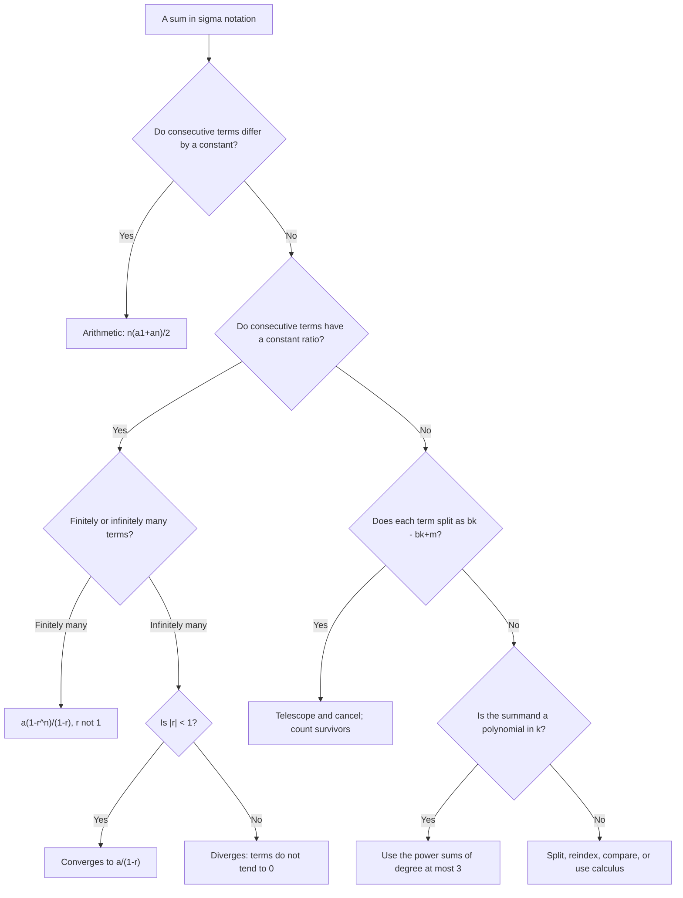

# Sequences and Series

> [Mathematics](../../README.md) › [Precalculus](../README.md) · Level: Intermediate · Prerequisites: [Elementary Algebra](../../03-algebra/01-elementary-algebra/README.md), [Intermediate Algebra](../../03-algebra/04-intermediate-algebra/README.md), [Functions](../../03-algebra/11-functions/README.md), [Exponential and Logarithmic Functions](../../03-algebra/12-exponential-and-logarithmic-functions/README.md), [Proof Techniques](../../00-foundations/04-proof-techniques/README.md) · Estimated time: 9 h

## 1. Introduction

Calculus begins with a question about *approach*: what happens to a quantity as something grows without bound? To answer it, one needs a precise object that can grow without bound — an infinite list of numbers, and the sum of that list. Those two objects are a **sequence** and a **series**, and this topic builds them.

A sequence is an ordered list $a_1, a_2, a_3, \dots$ with a rule that produces each entry. A series is what happens when the entries are added up. Some series add to a finite number even though they have infinitely many terms: $\tfrac12 + \tfrac14 + \tfrac18 + \cdots = 1$, and the identity $0.\overline{9} = 1$ — surprising to almost everyone on first meeting it — is the same fact. Others explode: $1+2+3+\cdots$ has no finite sum. Distinguishing the two cases is the whole subject, and it is the prototype of every convergence question in mathematics.

The tools built here are elementary but they are not throwaway. The closed forms for arithmetic and geometric sums are used on every page of calculus and finance; **telescoping** is the standard trick for turning a sum into a difference; **induction** is the first genuine proof technique a student meets in algebra; and the **binomial theorem** is the identity behind probability distributions, the derivative of $x^n$, and the binomial coefficients that organise combinatorics. The last section of the topic shows how far a single *counting argument* can take you, which is the doorway to [Combinatorics](../../20-combinatorics/README.md).

The applications are unusually direct. An annuity is a geometric series. A mortgage is a geometric series solved for the payment. A dose of medicine repeated every day accumulates as a geometric series and approaches a steady state. Compound interest is a sequence; continuous compounding is its limit. Very little abstraction is needed to turn the formulas of this topic into money.

## 2. Prerequisites

You should be comfortable with:

* **Algebraic manipulation** — expanding, factoring, and adding algebraic fractions, in particular writing $\dfrac{1}{k}-\dfrac{1}{k+1}$ as a single fraction. See [Elementary Algebra](../../03-algebra/01-elementary-algebra/README.md) and [Intermediate Algebra](../../03-algebra/04-intermediate-algebra/README.md).
* **Function notation** — writing $a_n = f(n)$ and evaluating $f$ at $n = 1, 2, 3, \dots$. See [Functions](../../03-algebra/11-functions/README.md).
* **Exponents and their laws** — $r^{m+n} = r^mr^n$, $r^{m-n} = r^m/r^n$, and $r^0 = 1$ for $r \ne 0$. These are used constantly for geometric sequences.
* **Exponential functions and logarithms** — the graph of $y = b^x$, and $\ln x$ as the inverse of $e^x$, needed for the continuous-compounding limit. See [Exponential and Logarithmic Functions](../../03-algebra/12-exponential-and-logarithmic-functions/README.md).
* **The idea of a proof, and of induction as a proof technique** — the base case and the inductive step. See [Proof Techniques](../../00-foundations/04-proof-techniques/README.md).
* **Factorials and binomial coefficients** $\binom{n}{k} = \dfrac{n!}{k!(n-k)!}$, at least at the level of Pascal's triangle.

## 3. Learning Objectives

After working through this topic you will be able to:

1. Define a sequence as a function on the natural numbers and distinguish explicit from recursive definitions.
2. Derive and use the closed forms $a_n = a_1 + (n-1)d$ and $a_n = a_1r^{n-1}$.
3. Read, write and manipulate sums in sigma notation, including reindexing and splitting.
4. Derive the arithmetic-sum and geometric-sum formulas, and use them without a formula sheet.
5. Prove that an infinite geometric series converges exactly when $|r|<1$, and compute its sum.
6. Recognise a telescoping sum and evaluate it by writing out the cancellation.
7. Prove summation formulas by mathematical induction.
8. State and prove the binomial theorem, and use Pascal's rule.
9. Give a counting argument for a binomial identity.
10. Model annuities, compound interest and amortisation with geometric series, and compute the numbers.

## 4. Intuition

### 4.1 A sequence is a function you can list

An ordinary function takes any real number and returns a value. A sequence is stingier: it only accepts the inputs $1, 2, 3, \dots$ So it can be written as a list. The *rule* is what matters, not the list; "$a_n = 2n$" and "$2, 4, 6, 8, \dots$" are the same sequence, but the rule tells you the millionth term without counting.

The graph of a sequence is a set of isolated dots, one above each natural number, not a continuous curve. This is the single most useful picture to carry into calculus: a sequence is a function sampled at the integers, and "the limit of a sequence" is what the dots approach as you move right.

### 4.2 Two ways to say the same thing

A **recursive** definition says how to get the next term from the previous ones, plus a starting point: "start at $3$, then keep adding $5$." An **explicit** definition says how to get the $n$-th term directly: "$a_n = 5n-2$." Both describe the same list, and each has advantages. Recursive definitions are how computers compute and how the process is usually described in words; explicit definitions are how you answer "what is the thousandth term?" without a thousand steps.

Converting from recursive to explicit is a *solving* problem, and for arithmetic and geometric sequences it is easy. For the Fibonacci sequence it is famously not: there is a closed form, Binet's formula, but it involves $\sqrt5$ and the golden ratio, and it is not obvious from the recursion.

### 4.3 Adding up: the shapes of growth

Three patterns dominate.

* **Arithmetic** growth adds a fixed amount each step. The terms lie on a straight line, and the total grows like $n^2$ — the sum of the first $n$ numbers is about $n^2/2$.
* **Geometric** growth multiplies by a fixed factor each step. The terms grow (or shrink) exponentially, and — this is the crucial point — when the factor is smaller than $1$, the *total* is finite. Halving forever never gets you past twice the first term.
* **Telescoping** is not about growth at all but about shape: if each term can be written as a difference of two consecutive values of some other sequence, everything cancels except the two ends.

Almost every sum you will meet in a first course is one of these three, or a combination.

### 4.4 Why "sum of infinitely many" is not nonsense

Add $\tfrac12 + \tfrac14$: you are at $\tfrac34$. Add $\tfrac18$: $\tfrac78$. Add $\tfrac1{16}$: $\tfrac{15}{16}$. You never pass $1$, and you get as close to $1$ as you like. That is the whole idea: an infinite series is not "add infinitely many things and see what happens" — it is "look at the running totals and ask what number they approach". The running total is an ordinary finite sum at every stage; the infinite sum is the *limit* of those finite sums.

This definition is what makes the subject rigorous, and it is why the geometric series is the gateway: it is the one infinite series whose running totals can be written down in closed form, so the limit can be computed exactly.

## 5. Formal Definition

**Definition 5.1 (Sequence).** A *sequence of real numbers* is a function $a : \mathbb{N} \to \mathbb{R}$. Its value at $n$ is written $a_n$ and called the $n$-th *term*. The sequence is written $(a_n)_{n \ge 1}$, or listed as $a_1, a_2, a_3, \dots$. When the domain includes $0$ — for example when a sequence starts with a "zeroth" payment — the notation is $(a_n)_{n \ge 0}$.

**Definition 5.2 (Explicit and recursive definitions).** An *explicit* (or *closed*) definition gives $a_n$ as a formula in $n$ alone, such as $a_n = n^2+1$. A *recursive* definition gives the first few terms and a rule expressing $a_n$ in terms of earlier terms, such as $a_1 = 1$, $a_{n+1} = 2a_n+1$. A recursive definition is *well founded* when the rule determines $a_n$ from terms that are already determined, so that the sequence exists and is unique; this is a consequence of the recursion theorem, and in practice it is checked by "the rule refers only to smaller indices".

**Definition 5.3 (Arithmetic sequence).** A sequence is *arithmetic* with *common difference* $d$ if

$$a_{n+1} - a_n = d \quad \text{for every } n \ge 1.$$

**Definition 5.4 (Geometric sequence).** A sequence is *geometric* with *common ratio* $r$ if

$$\frac{a_{n+1}}{a_n} = r \quad \text{for every } n \ge 1,$$

which presupposes $a_n \ne 0$ for all $n$.

**Definition 5.5 (Partial sums and series).** Given a sequence $(a_n)_{n\ge1}$, its *partial sums* are

$$S_n := a_1 + a_2 + \cdots + a_n = \sum_{k=1}^{n} a_k.$$

The *series* $\displaystyle\sum_{k=1}^{\infty} a_k$ *converges* to the real number $S$ when the sequence of partial sums converges to $S$, that is when

$$\forall \varepsilon>0\ \exists N\ \forall n \ge N: \quad \left|S_n - S\right| < \varepsilon .$$

Otherwise the series *diverges*. A series whose terms are all non-negative either converges or diverges to $+\infty$; it cannot oscillate.

**Definition 5.6 (Geometric series).** The series $\displaystyle\sum_{k=1}^{\infty} ar^{k-1} = a + ar + ar^2 + \cdots$ is the *geometric series* with first term $a$ and ratio $r$.

**Definition 5.7 (Telescoping sum).** A sum of the form $\displaystyle\sum_{k=1}^{n}\left(b_k - b_{k+1}\right)$ is called *telescoping*; more generally a sum telescopes when each term can be written as a difference of consecutive terms of a single sequence.

**Definition 5.8 (Binomial coefficient).** For integers $0 \le k \le n$,

$$\binom{n}{k} := \frac{n!}{k!\,(n-k)!}, \qquad \text{with } 0! := 1.$$

It counts the number of $k$-element subsets of an $n$-element set (Section 7.12) and appears as the $k$-th entry of row $n$ of Pascal's triangle.

**Definition 5.9 (Principle of mathematical induction).** Let $P(n)$ be a statement about a natural number $n$. If

* $P(1)$ is true, and
* for every $n \ge 1$, $P(n)$ true implies $P(n+1)$ true,

then $P(n)$ is true for every $n \in \mathbb{N}$.

This is an axiom of the natural numbers (the Peano induction axiom), not a theorem of algebra; it is the formal content of "and so on forever".

## 6. Mathematical Notation

| Symbol | Read as | Meaning |
|---|---|---|
| $(a_n)_{n\ge1}$ | the sequence $a$ sub $n$ | the whole sequence |
| $a_n$ | $a$ sub $n$ | the $n$-th term |
| $a_1$, $d$ | first term, common difference | arithmetic data |
| $a$, $r$ | first term, common ratio | geometric data |
| $S_n$ | $S$ sub $n$ | the $n$-th partial sum |
| $\sum_{k=1}^{n} a_k$ | sum from $k$ equals one to $n$ of $a$ sub $k$ | $a_1 + a_2 + \cdots + a_n$ |
| $\sum_{k=1}^{\infty} a_k$ | sum to infinity | the limit of $S_n$, when it exists |
| $\prod_{k=1}^{n} a_k$ | product from $k$ equals one to $n$ | $a_1a_2\cdots a_n$ |
| $n!$ | $n$ factorial | $n(n-1)\cdots2\cdot1$, with $0!=1$ |
| $\binom{n}{k}$ | $n$ choose $k$ | $\frac{n!}{k!(n-k)!}$ |
| $\Delta a_n$ | delta $a$ sub $n$ | the difference $a_{n+1}-a_n$ |
| $\to$, $\lim_{n\to\infty}$ | tends to, limit | convergence of a sequence |
| $\infty$ | infinity | a limit symbol, not a number |
| $\lvert r\rvert < 1$ | absolute value of $r$ less than one | the convergence condition |

Read $\displaystyle\sum_{k=1}^{n} k^2$ aloud as "the sum, from $k$ equals one to $n$, of $k$ squared". The letter $k$ is a *dummy variable*: $\sum_{k=1}^{n}k^2$ and $\sum_{j=1}^{n}j^2$ are the same number, because the name of the index does not survive the summation.

## 7. Core Concepts

### 7.1 Sequences as functions on the natural numbers

A sequence is a function whose domain is $\mathbb{N}$. Everything true of functions is true of sequences: you can add them, multiply them, compose them with functions, and ask about their graphs. What is *not* available is continuity, because the domain has gaps.

Two sequences are equal when they agree term by term. A sequence is *increasing* when $a_{n+1} \ge a_n$ for all $n$, *decreasing* when $a_{n+1} \le a_n$, and *monotone* when it is one of these. It is *bounded* when there is a number $M$ with $|a_n| \le M$ for all $n$.

The graph of a sequence is a scatter of points at the integer $x$-values. Seeing the dots lets you guess the limit; proving the guess needs the definition or a theorem. For example the dots of $a_n = 1/n$ march down toward the $x$-axis and never reach it, which suggests the limit $0$; the dots of $a_n = (-1)^n$ jump between $1$ and $-1$ forever, which suggests no limit; and the dots of $a_n = (1+1/n)^n$ rise toward $e \approx 2.71828$, a limit that can be proved but not guessed reliably.

**Definition 7.1 (Limit of a sequence).** $(a_n)$ *converges to* $L$, written $\lim_{n\to\infty} a_n = L$, when for every $\varepsilon>0$ there is an $N$ such that $|a_n-L|<\varepsilon$ for all $n \ge N$. A sequence that does not converge *diverges*.

**Theorem 7.2 (Uniqueness of the limit).** A sequence has at most one limit.

*Proof.* Suppose $a_n \to L$ and $a_n \to M$ with $L \ne M$. Let $\varepsilon = |L-M|/3 > 0$. Choose $N_1$ with $|a_n-L|<\varepsilon$ for $n\ge N_1$ and $N_2$ with $|a_n-M|<\varepsilon$ for $n \ge N_2$, and let $n = \max(N_1,N_2)$. Then by the triangle inequality

$$|L-M| \le |L-a_n|+|a_n-M| < 2\varepsilon = \tfrac23|L-M|,$$

which forces $|L-M| = 0$, a contradiction. $\blacksquare$

Three facts about limits of sequences are used later, and all three are proved from Definition 7.1 in any analysis text: if $a_n \to L$ and $b_n \to M$ then $a_n+b_n \to L+M$ and $a_nb_n \to LM$; and if $a_n \to 0$ then $|a_n| \to 0$. This topic uses them only in the forms quoted in Section 7.8.

### 7.2 Recursive definitions

A recursive definition consists of *initial conditions* and a *recurrence*. The arithmetic sequence is the simplest case:

$$a_1 = 3, \qquad a_{n+1} = a_n + 5 .$$

The first terms are $3, 8, 13, 18, \dots$. The recurrence says "add five", and it is a complete description because the initial condition starts the machine.

**Unrolling.** To find a closed form, write out the recurrence repeatedly:

$$\begin{aligned}
a_2 &= a_1 + d, \\
a_3 &= a_2 + d = a_1 + 2d, \\
a_4 &= a_3 + d = a_1 + 3d.
\end{aligned}$$

The pattern is $a_n = a_1 + (n-1)d$, and Section 7.3 proves it by induction, because a pattern in three lines is evidence but not proof.

The Fibonacci sequence $F_1 = F_2 = 1$, $F_{n} = F_{n-1}+F_{n-2}$ shows that unrolling is not always enough: its closed form (Binet's formula)

$$F_n = \frac{1}{\sqrt5}\left[\left(\frac{1+\sqrt5}{2}\right)^n - \left(\frac{1-\sqrt5}{2}\right)^n\right]$$

is not visible from the first few terms at all. The method that finds it (generating functions, or solving a linear recurrence) belongs to [Discrete Mathematics](../../09-discrete-mathematics/README.md).

**Recursion with a running total.** Many useful sequences are defined by *how much has accumulated* rather than by the next term alone. For example a savings account with balance $B_n$ after $n$ months, interest rate $i$ per month and deposit $P$ at the end of each month satisfies

$$B_{n} = B_{n-1}(1+i) + P, \qquad B_0 \text{ given}.$$

This is again a recurrence, and unrolling it produces a geometric series — Section 12.

### 7.3 Arithmetic sequences and their closed form

**Theorem 7.3.** If $(a_n)$ is arithmetic with first term $a_1$ and common difference $d$, then for every $n \ge 1$

$$a_n = a_1 + (n-1)d.$$

*Proof by induction on $n$.* Base case $n=1$: the right side is $a_1 + 0\cdot d = a_1$. ✓

Inductive step: assume $a_n = a_1+(n-1)d$ for some $n \ge 1$. Then by the definition of arithmetic,

$$a_{n+1} = a_n + d = a_1+(n-1)d + d = a_1 + nd = a_1 + \big((n+1)-1\big)d,$$

which is the formula with $n$ replaced by $n+1$. By the principle of induction the formula holds for all $n \ge 1$. $\blacksquare$

**Consequences.** The terms lie on a straight line as a function of $n$: $a_n = dn + (a_1-d)$, with slope $d$. The sequence is strictly increasing when $d>0$, constant when $d = 0$, and strictly decreasing when $d<0$. Each term is the average of its two neighbours,

$$a_n = \frac{a_{n-1}+a_{n+1}}{2},$$

because both neighbours differ from $a_n$ by exactly $d$; this "arithmetic mean" property is often the quickest way to recognise an arithmetic sequence.

### 7.4 Geometric sequences and their closed form

**Theorem 7.4.** If $(a_n)$ is geometric with first term $a_1 \ne 0$ and common ratio $r$, then for every $n \ge 1$

$$a_n = a_1r^{n-1}.$$

*Proof by induction on $n$.* Base case $n = 1$: $a_1r^{0} = a_1$. ✓

Inductive step: assume $a_n = a_1r^{n-1}$. Then

$$a_{n+1} = r\,a_n = r\cdot a_1r^{n-1} = a_1r^{n},$$

which is the formula with $n+1$ in place of $n$. $\blacksquare$

**Consequences.** The behaviour depends entirely on $r$:

| Range of $r$ | Behaviour of $a_n = a_1r^{n-1}$ (with $a_1>0$) |
|---|---|
| $r>1$ | grows without bound |
| $r=1$ | constant |
| $0<r<1$ | decreases toward $0$ |
| $r=0$ | all terms after the first are $0$ |
| $-1<r<0$ | alternates in sign, magnitude decreasing to $0$ |
| $r=-1$ | alternates between $a_1$ and $-a_1$ |
| $r<-1$ | alternates in sign, magnitude growing without bound |

Each term is the *geometric mean* of its neighbours in the sense $a_n^2 = a_{n-1}a_{n+1}$ (for positive terms, $a_n = \sqrt{a_{n-1}a_{n+1}}$), which is the analogue of the arithmetic-mean property.

### 7.5 Sigma notation and its manipulation rules

The symbol $\sum$ abbreviates a sum. Its parts are the *index* ($k$), the *lower limit* ($k=1$), the *upper limit* ($n$) and the *summand* ($a_k$):

$$\sum_{k=1}^{n} a_k = a_1+a_2+\cdots+a_n .$$

The number of terms is $\text{upper} - \text{lower} + 1$. This off-by-one is the single most common source of error in the whole topic.

**Theorem 7.5 (Rules of sigma notation).** For real constants $\alpha,\beta,c$ and integers $m \le p \le n$:

1. **Linearity.** $\displaystyle\sum_{k=m}^{n}\left(\alpha a_k + \beta b_k\right) = \alpha\sum_{k=m}^{n}a_k + \beta\sum_{k=m}^{n}b_k.$
2. **Constant summand.** $\displaystyle\sum_{k=m}^{n} c = (n-m+1)c.$
3. **Splitting.** $\displaystyle\sum_{k=m}^{n} a_k = \sum_{k=m}^{p} a_k + \sum_{k=p+1}^{n} a_k.$
4. **Reindexing.** $\displaystyle\sum_{k=m}^{n} a_k = \sum_{j=m+s}^{n+s} a_{j-s}$ for every integer $s$; in particular $\displaystyle\sum_{k=1}^{n}a_k = \sum_{j=0}^{n-1}a_{j+1}$.
5. **Reverse order.** $\displaystyle\sum_{k=1}^{n} a_k = \sum_{k=1}^{n} a_{n+1-k}.$

*Why.* Each is a restatement of a fact about finite sums: (1) is distributivity and commutativity, (2) counts the terms, (3) splits the list into two consecutive blocks, (4) renames each index, (5) reverses the order of the terms. All are proved by induction on the number of terms if one wants to be formal. $\blacksquare$

**Worked manipulation.** Rewrite $\displaystyle\sum_{j=3}^{n+2}(2j-1)$ with the index starting at $1$: put $k = j-2$, so $j = k+2$ and

$$\sum_{j=3}^{n+2}(2j-1) = \sum_{k=1}^{n}\left(2(k+2)-1\right) = \sum_{k=1}^{n}(2k+3).$$

There are $n$ terms in both sums, as there must be: $(n+2)-3+1 = n$. Expanding the second form gives $2\sum k + 3n = n(n+1)+3n = n^2+4n$, and the original is an arithmetic progression with first term $5$, last term $2(n+2)-1 = 2n+3$ and $n$ terms, whose sum is $\frac{n}{2}\left(5+2n+3\right) = \frac{n(2n+8)}{2} = n^2+4n$. $\checkmark$

### 7.6 The arithmetic series

**Theorem 7.6.** For an arithmetic sequence with first term $a_1$ and $n$-th term $a_n$,

$$S_n = \sum_{k=1}^{n}a_k = \frac{n\left(a_1+a_n\right)}{2} = \frac{n}{2}\Big(2a_1+(n-1)d\Big).$$

*Proof (the pairing argument).* Write the sum forwards and backwards and add the two lines term by term:

$$\begin{aligned}
S_n &= a_1 + a_2 + \cdots + a_{n-1} + a_n, \\
S_n &= a_n + a_{n-1} + \cdots + a_2 + a_1, \\
2S_n &= (a_1+a_n) + (a_2+a_{n-1}) + \cdots + (a_n+a_1).
\end{aligned}$$

Every bracket has the same value. Indeed, for $1 \le k \le n$,

$$a_k + a_{n+1-k} = \left(a_1+(k-1)d\right) + \left(a_1+(n-k)d\right) = 2a_1+(n-1)d = a_1+a_n,$$

using the closed form of Theorem 7.3. There are $n$ brackets, so $2S_n = n\left(a_1+a_n\right)$, and dividing by $2$ gives the first formula. Substituting $a_n = a_1+(n-1)d$ gives the second. $\blacksquare$

**The classic special case.** Taking $a_1 = 1$, $d = 1$, $a_n = n$:

$$\sum_{k=1}^{n}k = \frac{n(n+1)}{2}.$$

The story that Gauss summed $1+2+\cdots+100 = 5050$ in seconds as a child is the pairing argument applied with $n = 100$: fifty pairs each worth $101$.

### 7.7 The finite geometric series

**Theorem 7.7.** For $r \ne 1$,

$$S_n = \sum_{k=1}^{n} ar^{k-1} = a\,\frac{1-r^{n}}{1-r} = a\,\frac{r^{n}-1}{r-1}.$$

*Proof (the subtraction trick).* Multiply $S_n$ by $r$ and subtract:

$$\begin{aligned}
S_n &= a + ar + ar^2 + \cdots + ar^{n-1}, \\
rS_n &= \phantom{a + {}} ar + ar^2 + \cdots + ar^{n-1} + ar^{n}.
\end{aligned}$$

Every term except the first of $S_n$ and the last of $rS_n$ appears in both lines with opposite signs, so

$$S_n - rS_n = a - ar^{n} \quad\Longrightarrow\quad S_n(1-r) = a\left(1-r^n\right).$$

Since $r \ne 1$, division by $1-r$ is legitimate and gives the result. $\blacksquare$

**The case $r = 1$.** Then every term equals $a$, so $S_n = na$. The formula above is undefined there, which is why the hypothesis $r\ne1$ must be stated; it is *not* a removable inconvenience to be ignored.

**Sanity checks.** With $n = 1$ the formula gives $a\frac{1-r}{1-r} = a$ ✓. With $n = 2$ it gives $a(1+r)$ ✓. With $a = 1$, $r = 2$, $n = 10$ it gives $2^{10}-1 = 1023$, the sum $1+2+\cdots+512$ ✓.

### 7.8 The infinite geometric series, and exactly when it converges

**Theorem 7.8 (Convergence of the geometric series).** Let $a \ne 0$. The series $\displaystyle\sum_{k=1}^{\infty} ar^{k-1}$ converges if and only if $|r|<1$, and then

$$\sum_{k=1}^{\infty} ar^{k-1} = \frac{a}{1-r}.$$

*Proof.* Suppose first that $|r|<1$. By Theorem 7.7, for $r \ne 1$,

$$S_n = \frac{a\left(1-r^n\right)}{1-r} = \frac{a}{1-r} - \frac{a}{1-r}\,r^{n}.$$

So it suffices to show $r^n \to 0$.

*Claim: if $|r|<1$ then $r^n\to0$.* If $r = 0$ this is clear. Otherwise write $|r| = \dfrac{1}{1+h}$ with $h = \dfrac{1}{|r|}-1>0$. Bernoulli's inequality (proved by induction: $(1+h)^n \ge 1+nh$ for $h\ge0$) gives $(1+h)^n \ge 1+nh$, hence

$$0 \le |r|^n = \frac{1}{(1+h)^n} \le \frac{1}{1+nh} \longrightarrow 0 .$$

By the squeeze principle $|r|^n\to0$, and therefore $r^n\to0$. Hence $S_n \to \dfrac{a}{1-r}$, so the series converges with that sum.

Conversely, suppose $|r|\ge1$. If $r = 1$ then $a_n = a \ne 0$ for every $n$. If $|r|>1$ write $|r| = 1+h$ with $h>0$; Bernoulli gives $|r|^n \ge 1+nh \to \infty$, so the terms do not tend to $0$. If $r = -1$ the terms alternate between $a$ and $-a$ and have no limit. In every case the terms fail to tend to $0$, so by the next theorem the series diverges. $\blacksquare$

**Theorem 7.9 (The $n$-th term test).** If $\displaystyle\sum_{k=1}^{\infty}a_k$ converges, then $a_n \to 0$.

*Proof.* Let $S_n$ be the partial sums and let $S_n \to S$. Then $a_n = S_n - S_{n-1}$ for $n\ge2$, and both $S_n \to S$ and $S_{n-1}\to S$, so $a_n \to S - S = 0$. $\blacksquare$

**Warning.** The converse is false: $a_n\to0$ does **not** imply that $\sum a_n$ converges. The harmonic series $\sum_{n\ge1}\frac1n$ has terms tending to $0$ and diverges — see Section 7.9 and Exercise 30. The $n$-th term test is a *divergence* test only.

Readers who want the analytic details of convergence — comparison, ratio, integral tests — will find them in [Calculus](../../07-calculus/README.md) and [Real Analysis](../../14-real-analysis/README.md). Everything in this topic is proved from the definition above.

### 7.9 Telescoping series

**Theorem 7.10.** For any sequence $(b_k)$,

$$\sum_{k=1}^{n}\left(b_k-b_{k+1}\right) = b_1 - b_{n+1}.$$

*Proof.* Write out the sum:

$$\left(b_1-b_2\right)+\left(b_2-b_3\right)+\cdots+\left(b_n-b_{n+1}\right).$$

Each $b_k$ for $2 \le k \le n$ appears once with a plus sign and once with a minus sign, so all interior terms cancel, leaving $b_1-b_{n+1}$. $\blacksquare$

Consequently $\displaystyle\sum_{k=1}^{\infty}\left(b_k-b_{k+1}\right)$ converges exactly when $b_n$ converges, and its sum is $b_1 - \lim_{n\to\infty} b_n$.

**The standard example.** Since

$$\frac{1}{k(k+1)} = \frac{1}{k}-\frac{1}{k+1}$$

(check: the right side is $\frac{(k+1)-k}{k(k+1)}$), the partial sums are

$$\sum_{k=1}^{n}\frac{1}{k(k+1)} = \sum_{k=1}^{n}\left(\frac1k-\frac1{k+1}\right) = 1 - \frac{1}{n+1} = \frac{n}{n+1},$$

and the infinite series converges to $1$.

**A second standard example, with a gap.** Since

$$\frac{1}{k(k+2)} = \frac12\left(\frac1k-\frac1{k+2}\right),$$

the partial sums are $\frac12\left(1+\frac12-\frac1{n+1}-\frac1{n+2}\right)$, because the cancellation skips one index: two terms survive at each end. The limit is $\frac12\cdot\frac32 = \frac34$. This shows that a telescoping sum can leave more than one survivor at each end — count carefully.

**Why telescoping matters.** It is the mechanism behind the fundamental theorem of calculus (integrals telescope sums of small changes) and behind most exact evaluations of series in probability and number theory. It is also the cleanest illustration of the difference between "the terms get small" and "the sum is finite": in the harmonic series the terms get small but no telescoping structure is available, and the sum diverges.

### 7.10 Induction and the summation formulas

Three formulas are used so often that they should be memorised, together with their proofs.

**Theorem 7.11.** For every $n \ge 1$,

$$\sum_{k=1}^{n} k = \frac{n(n+1)}{2}, \qquad \sum_{k=1}^{n} k^2 = \frac{n(n+1)(2n+1)}{6}, \qquad \sum_{k=1}^{n} k^3 = \left[\frac{n(n+1)}{2}\right]^2.$$

*Proof of the first.* Theorem 7.6 with $a_1 = d = 1$; or induction: the base case $n=1$ reads $1 = 1\cdot2/2$ ✓; if $\sum_{k=1}^{n}k = n(n+1)/2$ then

$$\sum_{k=1}^{n+1}k = \frac{n(n+1)}{2}+(n+1) = \frac{(n+1)(n+2)}{2}. \qquad\checkmark$$

*Proof of the third, by induction.* Base case $n=1$: $1 = (1\cdot2/2)^2 = 1$ ✓. Suppose $\sum_{k=1}^{n}k^3 = \left[\frac{n(n+1)}{2}\right]^2$. Then

$$\begin{aligned}
\sum_{k=1}^{n+1}k^3 &= \frac{n^2(n+1)^2}{4}+(n+1)^3 \\
&= \frac{(n+1)^2}{4}\left[n^2+4(n+1)\right] \\
&= \frac{(n+1)^2(n+2)^2}{4} = \left[\frac{(n+1)(n+2)}{2}\right]^2,
\end{aligned}$$

using $n^2+4n+4 = (n+2)^2$. $\checkmark$

*Proof of the second, by induction.* Base case $n=1$: $1 = 1\cdot2\cdot3/6 = 1$ ✓. Suppose the formula holds for $n$. Then

$$\begin{aligned}
\sum_{k=1}^{n+1}k^2 &= \frac{n(n+1)(2n+1)}{6}+(n+1)^2 \\
&= \frac{(n+1)\left[n(2n+1)+6(n+1)\right]}{6} \\
&= \frac{(n+1)\left(2n^2+7n+6\right)}{6} = \frac{(n+1)(n+2)(2n+3)}{6},
\end{aligned}$$

because $2n^2+7n+6 = (n+2)(2n+3)$, and $2n+3 = 2(n+1)+1$. This is the formula with $n+1$ in place of $n$. $\blacksquare$

**A telescoping proof of the cube formula.** There is a proof that needs no induction. Note that

$$\left(\frac{k(k+1)}{2}\right)^2 - \left(\frac{(k-1)k}{2}\right)^2 = \frac{k^2}{4}\left[(k+1)^2-(k-1)^2\right] = \frac{k^2}{4}\cdot4k = k^3.$$

So $k^3 = b_k - b_{k-1}$ with $b_k = \left(\frac{k(k+1)}{2}\right)^2$, and summing telescopes:

$$\sum_{k=1}^{n}k^3 = b_n - b_0 = \left[\frac{n(n+1)}{2}\right]^2 - 0. \qquad\blacksquare$$

**How to write an induction proof.** Four parts, always: (i) state the statement $P(n)$ exactly; (ii) the base case; (iii) the inductive hypothesis ("assume $P(n)$") and the step to $P(n+1)$, with the hypothesis *used* explicitly; (iv) the conclusion "by induction, $P(n)$ holds for all $n\ge1$". Omitting (iii)'s hypothesis, or never using it, is the most common failure (Section 11).

### 7.11 The binomial theorem and Pascal's triangle

**Theorem 7.12 (Pascal's rule).** For $1 \le k \le n$,

$$\binom{n}{k} = \binom{n-1}{k-1}+\binom{n-1}{k}.$$

*Proof by counting.* Let $S$ be a set with $n$ elements and fix an element $x \in S$. The $k$-element subsets of $S$ split into two disjoint classes: those that contain $x$, and those that do not. A subset containing $x$ is determined by choosing the other $k-1$ elements from the remaining $n-1$, giving $\binom{n-1}{k-1}$ choices; a subset not containing $x$ is a $k$-element subset of the remaining $n-1$ elements, giving $\binom{n-1}{k}$ choices. Adding the two counts gives the rule. $\blacksquare$

*Algebraic proof.* Using the factorial formula,

$$\binom{n-1}{k-1}+\binom{n-1}{k} = \frac{(n-1)!}{(k-1)!(n-k)!}+\frac{(n-1)!}{k!(n-1-k)!}.$$

Put the two fractions over the common denominator $k!(n-k)!$: the first becomes $\frac{k\,(n-1)!}{k!(n-k)!}$ and the second $\frac{(n-k)(n-1)!}{k!(n-k)!}$. Adding the numerators, $k+(n-k) = n$, gives $\frac{n(n-1)!}{k!(n-k)!} = \frac{n!}{k!(n-k)!} = \binom{n}{k}$. $\blacksquare$

**Theorem 7.13 (Binomial theorem).** For every $n \ge 0$ and all real $x,y$,

$$(x+y)^n = \sum_{k=0}^{n}\binom{n}{k}x^{n-k}y^{k}.$$

*Proof by induction on $n$.* For $n=0$ both sides equal $1$. Assume the formula for some $n$. Then

$$\begin{aligned}
(x+y)^{n+1} &= (x+y)\sum_{k=0}^{n}\binom{n}{k}x^{n-k}y^{k} \\
&= \sum_{k=0}^{n}\binom{n}{k}x^{n+1-k}y^{k} + \sum_{k=0}^{n}\binom{n}{k}x^{n-k}y^{k+1}.
\end{aligned}$$

In the second sum put $j = k+1$, so it becomes $\sum_{j=1}^{n+1}\binom{n}{j-1}x^{n+1-j}y^{j}$. The coefficient of $x^{n+1-j}y^{j}$ in the total is therefore

$$\binom{n}{j}+\binom{n}{j-1} = \binom{n+1}{j}$$

by Pascal's rule, with the convention that $\binom{n}{j} = 0$ when $j>n$ or $j<0$ (which handles the end terms). Hence the sum equals $\sum_{j=0}^{n+1}\binom{n+1}{j}x^{n+1-j}y^j$, which is the statement for $n+1$. $\blacksquare$

**Pascal's triangle** is the table of binomial coefficients in which each entry is the sum of the two above it, exactly as the rule says. Row $n$ lists $\binom{n}{0},\dots,\binom{n}{n}$:

| $n$ | Row |
|---|---|
| 0 | 1 |
| 1 | 1 1 |
| 2 | 1 2 1 |
| 3 | 1 3 3 1 |
| 4 | 1 4 6 4 1 |
| 5 | 1 5 10 10 5 1 |
| 6 | 1 6 15 20 15 6 1 |

**Two immediate corollaries.** Putting $x = y = 1$ gives $\displaystyle\sum_{k=0}^{n}\binom{n}{k} = 2^n$, the number of subsets of an $n$-element set. Putting $y = -1$, $x = 1$ gives $\displaystyle\sum_{k=0}^{n}(-1)^k\binom{n}{k} = 0$ for $n\ge1$, the statement that a set has equally many even-sized and odd-sized subsets.

**The general term.** The term containing $y^k$ in $(x+y)^n$ is $\binom{n}{k}x^{n-k}y^k$. Reading off one term without expanding the whole expression is the standard exam skill, and Example 6 does it.

### 7.12 A first counting argument

Many binomial identities are proved most cleanly by counting the same set in two ways.

**Example: $\sum_k \binom{n}{k} = 2^n$.** Count the subsets of an $n$-element set. Left side: group the subsets by size $k$ — there are $\binom{n}{k}$ of size $k$, so the total is the sum. Right side: each of the $n$ elements is either in or out, independently, giving $2\cdot2\cdots2 = 2^n$ choices. Both sides count the same objects, so they are equal. $\blacksquare$

**Example: $\sum_k k\binom{n}{k} = n\,2^{n-1}$.** Count the pairs $(A,x)$ where $A$ is a subset of an $n$-element set and $x \in A$. Grouping by the size $k$ of $A$: there are $\binom{n}{k}$ sets of size $k$ and $k$ choices of $x$ in each, so the total is $\sum_k k\binom{n}{k}$. Grouping by $x$ instead: $n$ choices of $x$, and for each, the remaining $n-1$ elements may be in or out of $A$ freely, giving $2^{n-1}$ choices. So the total is $n2^{n-1}$. $\blacksquare$

**Why this is a preview.** The counting method is the engine of [Combinatorics](../../20-combinatorics/README.md), and in probability it is what turns a coefficient into a likelihood: the binomial distribution has probability $\binom{n}{k}p^k(1-p)^{n-k}$ precisely because there are $\binom{n}{k}$ orders in which $k$ successes can occur. See [Probability](../../10-probability/README.md).

### 7.13 A preview: monotone sequences and convergence

Definition 7.1 tells you what a limit is but not when one exists. The following theorem, the *monotone convergence theorem*, is the workhorse of analysis, and it is stated here so that the reader knows where the subject is going.

**Theorem 7.14 (Monotone convergence, quoted).** Every sequence that is increasing and bounded above converges; every sequence that is decreasing and bounded below converges.

The completeness of the real numbers is exactly what makes this true, and that is a theorem of [Real Analysis](../../14-real-analysis/README.md). Two consequences worth knowing now:

* The *partial sums* of a series with non-negative terms are increasing. So such a series either converges (if the partial sums are bounded) or diverges to $+\infty$. This is why "absolute convergence" is the natural notion.
* A *bounded* monotone sequence cannot oscillate, which rules out the behaviour of $(-1)^n$ and explains why every convergent sequence is bounded.

The geometric series of Section 7.8 is the first example in which the boundedness can be checked by hand: $S_n = \frac{a}{1-r}-\frac{a}{1-r}r^n$ is bounded because $r^n$ is bounded, and it converges because $r^n\to0$.

## 8. Formulas and Properties

**Property 8.1 (Arithmetic term).** For an arithmetic sequence, $a_n = a_1+(n-1)d$ for all $n\ge1$.

*Why.* Theorem 7.3, by induction. $\blacksquare$

**Property 8.2 (Arithmetic sum).** For an arithmetic sequence,

$$S_n = \frac{n\left(a_1+a_n\right)}{2} = \frac{n}{2}\Big(2a_1+(n-1)d\Big).$$

*Why.* Theorem 7.6, by pairing the sum with its reverse. $\blacksquare$

**Property 8.3 (Geometric term).** For a geometric sequence with $a_1\ne0$, $a_n = a_1r^{n-1}$.

*Why.* Theorem 7.4, by induction. $\blacksquare$

**Property 8.4 (Finite geometric sum).** For $r\ne1$,

$$\sum_{k=1}^{n}ar^{k-1} = a\frac{1-r^n}{1-r}.$$

For $r=1$ the sum equals $na$.

*Why.* Theorem 7.7, by subtracting $rS_n$ from $S_n$. $\blacksquare$

**Property 8.5 (Infinite geometric sum).** For $a\ne0$, the series $\sum_{k\ge1}ar^{k-1}$ converges if and only if $|r|<1$, and then

$$\sum_{k=1}^{\infty}ar^{k-1} = \frac{a}{1-r}.$$

*Why.* Theorem 7.8: the partial sums differ from $a/(1-r)$ by $\frac{a}{1-r}r^n$, which tends to $0$ exactly when $|r|<1$. $\blacksquare$

**Property 8.6 ($n$-th term test).** If $\sum a_k$ converges then $a_n\to0$. Equivalently, if $a_n\not\to0$ the series diverges.

*Why.* Theorem 7.9, from $a_n = S_n-S_{n-1}$. The converse fails: the harmonic series has $a_n\to0$ and diverges. $\blacksquare$

**Property 8.7 (Rules of sigma notation).** Linearity, constant summands, splitting, reindexing and reversal, as listed in Theorem 7.5. In particular, the sum $\sum_{k=m}^{n}$ has $n-m+1$ terms, not $n-m$.

*Why.* Theorem 7.5. $\blacksquare$

**Property 8.8 (Telescoping).** $\displaystyle\sum_{k=1}^{n}\left(b_k-b_{k+1}\right) = b_1-b_{n+1}$, and the corresponding infinite series converges to $b_1-\lim_{n\to\infty}b_n$ when that limit exists. More generally, when a summand can be written as $b_k-b_{k+m}$, exactly $m$ terms survive at each end.

*Why.* Theorem 7.10; the general case is the same cancellation read with a lag $m$. $\blacksquare$

**Property 8.9 (Power sums).** For every $n\ge1$,

$$\sum_{k=1}^{n}k = \frac{n(n+1)}{2},\qquad \sum_{k=1}^{n}k^2 = \frac{n(n+1)(2n+1)}{6},\qquad \sum_{k=1}^{n}k^3 = \left[\frac{n(n+1)}{2}\right]^2.$$

*Why.* Theorem 7.11, by induction; the cube formula also by telescoping. $\blacksquare$

**Property 8.10 (Binomial theorem).** For $n\ge0$,

$$(x+y)^n = \sum_{k=0}^{n}\binom{n}{k}x^{n-k}y^{k}, \qquad \binom{n}{k} = \frac{n!}{k!(n-k)!}.$$

The term in $y^k$ is $\binom{n}{k}x^{n-k}y^k$.

*Why.* Theorem 7.13, by induction using Pascal's rule. $\blacksquare$

**Property 8.11 (Pascal's rule and the row sum).** $\dbinom{n}{k} = \dbinom{n-1}{k-1}+\dbinom{n-1}{k}$, and $\displaystyle\sum_{k=0}^{n}\binom{n}{k} = 2^n$.

*Why.* Theorem 7.12 by the subset-counting argument; the row sum by putting $x=y=1$ in the binomial theorem, or by counting all subsets. $\blacksquare$

**Property 8.12 (Compound interest, annuity and amortisation).** With interest rate $i$ per period and $n$ periods:

$$A_n = P(1+i)^n \quad\text{(lump sum)}, \qquad \mathrm{FV} = M\,\frac{(1+i)^n-1}{i}\quad\text{(payments } M\text{ at period end)},$$

$$\mathrm{PV} = M\,\frac{1-(1+i)^{-n}}{i}, \qquad M = B_0\,\frac{i(1+i)^n}{(1+i)^n-1}\quad\text{(amortising a loan } B_0\text{)}.$$

*Why.* The lump sum is Property 8.3 applied to the balance; the annuity and amortisation formulas are derived in Section 12 from the geometric sum. $\blacksquare$

## 9. Step-by-Step Examples

### Example 1 (easy): an arithmetic sequence and its sum

*For the arithmetic sequence with first term $7$ and common difference $-3$, find $a_{20}$ and $S_{20}$, and check the sum by a second method.*

**Strategy.** Use Property 8.1 for the term, Property 8.2 for the sum, and verify with a direct computation.

$$a_{20} = a_1+(20-1)d = 7+19(-3) = 7-57 = -50.$$

$$S_{20} = \frac{20\left(a_1+a_{20}\right)}{2} = 10\left(7+(-50)\right) = 10(-43) = -430.$$

**Second method.** The sum is $\sum_{k=1}^{20}\left(7-3(k-1)\right) = 20\cdot7-3\sum_{k=1}^{20}(k-1)$. Now $\sum_{k=1}^{20}(k-1) = 0+1+\cdots+19 = \frac{19\cdot20}{2} = 190$. Hence $S_{20} = 140-3(190) = 140-570 = -430$. $\checkmark$

**Answer.** $a_{20} = -50$, $S_{20} = -430$.

### Example 2 (easy): a geometric sequence, its sum, and a threshold

*For the geometric sequence $3, 6, 12, 24, \dots$ find $a_{10}$ and $S_{10}$, and find the smallest $n$ for which $S_n>3000$.*

**Strategy.** Read off $a_1 = 3$ and $r = 2$; apply Properties 8.3 and 8.4; then solve an inequality.

$$a_{10} = 3\cdot2^{9} = 3(512) = 1536.$$

$$S_{10} = 3\,\frac{2^{10}-1}{2-1} = 3(1024-1) = 3(1023) = 3069.$$

For the threshold, $S_n = 3\left(2^n-1\right)>3000$ means $2^n>1001$. Since $2^{9} = 512$ and $2^{10} = 1024$, the smallest such integer is $n = 10$.

**Check.** $S_9 = 3(512-1) = 1533$, which is below $3000$, and $S_{10} = 3069$, which is above it, so $n=10$ is correct. Also $S_{10}-S_9 = 3069-1533 = 1536 = a_{10}$. $\checkmark$

**Answer.** $a_{10} = 1536$, $S_{10} = 3069$, and the smallest $n$ is $10$.

### Example 3 (medium): evaluating a sum with the power-sum formulas

*Evaluate $\displaystyle\sum_{k=1}^{n}\left(4k^3-6k+5\right)$ in closed form, and check the result at $n=10$ by direct addition.*

**Strategy.** Use linearity (Property 8.7) to split the sum, then Property 8.9 for each piece.

$$\sum_{k=1}^{n}\left(4k^3-6k+5\right) = 4\sum_{k=1}^{n}k^3-6\sum_{k=1}^{n}k+5\sum_{k=1}^{n}1.$$

Substituting the power sums and $\sum_{k=1}^n 1 = n$:

$$= 4\left[\frac{n(n+1)}{2}\right]^2 - 6\cdot\frac{n(n+1)}{2}+5n = n^2(n+1)^2-3n(n+1)+5n.$$

At $n = 10$: $n^2(n+1)^2 = 100\cdot121 = 12100$; $3n(n+1) = 330$; $5n = 50$; so the sum is $12100-330+50 = 11820$.

**Direct check.** The terms are $4-6+5 = 3$, $32-12+5 = 25$, $108-18+5 = 95$, $256-24+5 = 237$, $500-30+5 = 475$, $864-36+5 = 833$, $1372-42+5 = 1335$, $2048-48+5 = 2005$, $2916-54+5 = 2867$, $4000-60+5 = 3945$. Their sum: $3+25 = 28$; $+95 = 123$; $+237 = 360$; $+475 = 835$; $+833 = 1668$; $+1335 = 3003$; $+2005 = 5008$; $+2867 = 7875$; $+3945 = 11820$. $\checkmark$

**Answer.** $n^2(n+1)^2-3n(n+1)+5n$, which equals $11820$ at $n=10$.

### Example 4 (medium): two telescoping sums

*Evaluate (a) $\displaystyle\sum_{k=1}^{n}\frac{1}{k(k+1)}$ and its limit as $n\to\infty$; (b) $\displaystyle\sum_{k=1}^{n}\frac{1}{k(k+2)}$ and its limit.*

**Strategy.** Split each summand by partial fractions, then write out the cancellation.

*(a)* Since $\dfrac{1}{k(k+1)} = \dfrac1k-\dfrac1{k+1}$,

$$\sum_{k=1}^{n}\frac{1}{k(k+1)} = \left(1-\frac12\right)+\left(\frac12-\frac13\right)+\cdots+\left(\frac1n-\frac1{n+1}\right) = 1-\frac{1}{n+1} = \frac{n}{n+1}.$$

As $n\to\infty$ this tends to $1$.

*(b)* Since $\dfrac{1}{k(k+2)} = \dfrac12\left(\dfrac1k-\dfrac1{k+2}\right)$,

$$\sum_{k=1}^{n}\frac{1}{k(k+2)} = \frac12\left[\left(1-\frac13\right)+\left(\frac12-\frac14\right)+\left(\frac13-\frac15\right)+\cdots+\left(\frac1n-\frac1{n+2}\right)\right].$$

The cancellation skips one index: $\frac13$ cancels with the $- \frac13$ two terms later, and in general $\frac1k$ cancels with the $-\frac1k$ that appears in the term for $k-2$. What survives is the first two positive terms and the last two negative ones:

$$= \frac12\left(1+\frac12-\frac{1}{n+1}-\frac{1}{n+2}\right) \longrightarrow \frac12\cdot\frac32 = \frac34.$$

**Check.** For (a) with $n=3$: $\frac12+\frac16+\frac1{12} = \frac{6+2+1}{12} = \frac{9}{12} = \frac34 = \frac{3}{4}$ ✓. For (b) with $n=1$: the single term is $\frac13$; the formula gives $\frac12\left(1+\frac12-\frac12-\frac13\right) = \frac12\cdot\frac23 = \frac13$ ✓.

**Answer.** (a) $\dfrac{n}{n+1}\to1$; (b) $\dfrac12\left(\dfrac32-\dfrac{1}{n+1}-\dfrac{1}{n+2}\right)\to\dfrac34$.

### Example 5 (medium–hard): infinite geometric series in two disguises

*(a) Write $0.\overline{36} = 0.363636\dots$ as a fraction. (b) A ball is dropped from $2$ m and rebounds to $0.6$ of its previous height each time. Find the total distance travelled.*

**Strategy.** Identify the repeating block or the rebound ratio as a geometric ratio, then use Property 8.5.

*(a)* The decimal is $\dfrac{36}{100}+\dfrac{36}{100^2}+\dfrac{36}{100^3}+\cdots$, a geometric series with $a = \dfrac{36}{100}$ and $r = \dfrac{1}{100}$:

$$0.\overline{36} = \frac{36/100}{1-1/100} = \frac{36/100}{99/100} = \frac{36}{99} = \frac{4}{11}.$$

*(b)* The ball falls $2$ m, rises $2(0.6) = 1.2$ m, falls $1.2$ m, rises $1.2(0.6) = 0.72$ m, and so on. After the first drop, every height is travelled twice (up and down), so

$$D = 2 + 2\left(1.2+0.72+0.432+\cdots\right) = 2+2\cdot\frac{1.2}{1-0.6} = 2+2(3) = 8.$$

**Check.** (a) $4/11 = 0.363636\dots$ by long division ✓. (b) After one bounce the distance is $2+2(1.2) = 4.4$; after two, $4.4+2(0.72) = 5.84$; the partial sums increase toward $8$, and the remaining distance after $n$ round trips is $2\cdot\frac{1.2(0.6)^n}{0.4}$, which tends to $0$ ✓.

**Answer.** (a) $\dfrac{4}{11}$; (b) $8$ m.

### Example 6 (hard): one term of a binomial expansion

*Find the coefficient of $x^{3}$ in $\left(2x-\dfrac{1}{x^2}\right)^{9}$, and the term independent of $x$.*

**Strategy.** Write the general term with the binomial theorem, collect the power of $x$, and choose $k$ to make that power equal to the target.

The general term (Property 8.10) with $y = -\dfrac{1}{x^2} = -x^{-2}$ and $x$ replaced by $2x$ is

$$\binom{9}{k}(2x)^{9-k}\left(-x^{-2}\right)^{k} = \binom{9}{k}2^{9-k}(-1)^k x^{(9-k)-2k} = \binom{9}{k}2^{9-k}(-1)^k x^{9-3k}.$$

*For $x^3$:* need $9-3k = 3$, so $k = 2$. The coefficient is

$$\binom{9}{2}2^{7}(-1)^2 = 36\cdot128 = 4608.$$

*For the term independent of $x$:* need $9-3k = 0$, so $k = 3$. The term is

$$\binom{9}{3}2^{6}(-1)^3 = 84\cdot64\cdot(-1) = -5376.$$

**Check.** $\binom{9}{2} = 36$ and $\binom{9}{3} = 84$ by Pascal's triangle row $9 = 1,9,36,84,126,126,84,36,9,1$ ✓. The powers behave: with $k=2$ the exponent is $9-6 = 3$ ✓; with $k=3$ it is $9-9 = 0$ ✓.

**Answer.** Coefficient of $x^3$: $4608$. Constant term: $-5376$.

### Example 7 (hard): an induction with a non-obvious closed form

*Prove that for every $n\ge1$,*

$$\sum_{k=1}^{n}k\,2^{k} = (n-1)2^{n+1}+2.$$

**Strategy.** Induction, with the inductive step factoring out $2^{n+1}$.

*Base case $n=1$.* Left side $1\cdot2 = 2$; right side $(0)2^{2}+2 = 2$ ✓.

*Inductive hypothesis.* Assume $\sum_{k=1}^{n}k2^k = (n-1)2^{n+1}+2$ for some $n\ge1$.

*Step.* Add the next term:

$$\begin{aligned}
\sum_{k=1}^{n+1}k2^k &= (n-1)2^{n+1}+2+(n+1)2^{n+1} \\
&= 2^{n+1}\left[(n-1)+(n+1)\right]+2 \\
&= 2n\cdot2^{n+1}+2 = n\,2^{n+2}+2.
\end{aligned}$$

The target formula with $n+1$ in place of $n$ is $\big((n+1)-1\big)2^{(n+1)+1}+2 = n\,2^{n+2}+2$, which is exactly what we obtained. $\blacksquare$

**Check.** $n=4$: the sum is $2+8+24+64 = 98$; the formula gives $3\cdot2^5+2 = 96+2 = 98$ ✓.

**Remark on strategy.** The closed form was not guessed from nothing. Sums of the shape $\sum k r^k$ are *arithmetico-geometric*: they can be evaluated by the same subtraction trick as the geometric series — multiply by $r$ and subtract — and that computation produces exactly $(n-1)2^{n+1}+2$. Induction then verifies the result.

### Example 8 (hard): amortising a mortgage

*A loan of $\$200{,}000$ is repaid by $360$ equal monthly payments at a nominal annual rate of $6\%$, compounded monthly. Find the monthly payment, the total repaid and the total interest.*

**Strategy.** Write the balance recurrence, solve it as a geometric sum, and impose "balance zero after 360 payments".

The monthly rate is $i = 0.06/12 = 0.005$. Let $B_n$ be the balance after $n$ payments of $M$, with $B_0 = 200000$. Each month the balance grows by the factor $1+i$ and then shrinks by $M$:

$$B_n = (1+i)B_{n-1}-M.$$

Unrolling (Section 12 derives this in full):

$$B_n = B_0(1+i)^n - M\,\frac{(1+i)^n-1}{i}.$$

Setting $B_{360} = 0$ and solving for $M$:

$$M = B_0\,\frac{i(1+i)^n}{(1+i)^n-1} = 200000\cdot\frac{0.005(1.005)^{360}}{(1.005)^{360}-1}.$$

Now $(1.005)^{360} \approx 6.022575$, so

$$M \approx 200000\cdot\frac{0.005(6.022575)}{5.022575} = 200000\cdot\frac{0.0301129}{5.022575} \approx 200000(0.0059955) \approx 1199.10.$$

Total repaid: $360(1199.10) \approx \$431{,}676$. Total interest: $\$431{,}676-\$200{,}000 \approx \$231{,}676$ — more than the loan itself, which is what a $6\%$ rate over thirty years does.

**Check.** Substitute $M = 1199.101$ back into the balance formula at $n = 360$:

$$B_{360} = 200000(6.022575)-1199.101\cdot\frac{5.022575}{0.005} = 1{,}204{,}515-1199.101(1004.515).$$

Now $1199.101(1004.515) \approx 1{,}204{,}515$, so $B_{360}\approx0$ ✓. A single payment of $\$1199.10$ after one month would leave $200000(1.005)-1199.10 = 201{,}000-1199.10 = \$199{,}800.90$ — only $\$199.10$ less than the loan, correctly, because almost all of the first payment is interest.

**Answer.** $M \approx \$1199.10$ per month; total repaid $\approx\$431{,}676$; total interest $\approx\$231{,}676$.

## 10. Visual Explanations

### 10.1 Which tool for which sum

The chart is the procedure to run when you meet a sum and do not recognise it.

### 10.2 The four sums at a glance

| Name | Terms | Closed form | Converges? |
|---|---|---|---|
| arithmetic | $a,\ a+d,\ a+2d,\dots$ | $S_n = \frac{n}{2}\left(2a+(n-1)d\right)$ | never, unless $d=0$ and $a=0$ |
| geometric | $a,\ ar,\ ar^2,\dots$ | $S_n = a\frac{1-r^n}{1-r}$ | iff $\lvert r\rvert<1$, then $\frac{a}{1-r}$ |
| telescoping | $b_1-b_2,\ b_2-b_3,\dots$ | $S_n = b_1-b_{n+1}$ | iff $b_n$ converges |
| power sums | $1^k,2^k,3^k,\dots$, $k\le3$ | $\frac{n(n+1)}{2}$, $\frac{n(n+1)(2n+1)}{6}$, $\left[\frac{n(n+1)}{2}\right]^2$ | never ($k\ge1$): terms do not tend to $0$ |

The last column is the one to read carefully. A finite sum always exists — it is a finite sum of finite numbers. Convergence is a question about the *infinite* series only, and it is decided by the behaviour of the terms, not by the formula for $S_n$ (although the formula usually settles it at once).

### 10.3 The shape of the three growth patterns

| $n$ | $1+2+\cdots+n$ (arithmetic, $d=1$) | $1+2+4+\cdots+2^{n-1}$ (geometric, $r=2$) | $1+\frac12+\cdots+\frac{1}{2^{n-1}}$ (geometric, $r=\frac12$) |
|---|---|---|---|
| 1 | 1 | 1 | 1 |
| 2 | 3 | 3 | 1.5 |
| 5 | 15 | 31 | 1.9375 |
| 10 | 55 | 1023 | 1.99805 |
| 20 | 210 | 1 048 575 | 1.9999981 |

The arithmetic column grows like $n^2/2$; the first geometric column doubles; the second geometric column is *trapped* below $2$, which is the whole point of $|r|<1$.

## 11. Common Mistakes

**1. Using $n$ instead of $n-1$ in the closed form.** An arithmetic sequence with first term $a_1$ has $a_n = a_1+(n-1)d$, not $a_1+nd$. The term $a_1$ corresponds to $n=1$, so the number of *steps* from $a_1$ to $a_n$ is $n-1$. Test the formula at $n=1$: it must return $a_1$.

**2. Counting the terms of a sum incorrectly.** $\sum_{k=3}^{n+2}$ has $(n+2)-3+1 = n$ terms, not $n-1$. Always evaluate upper $-$ lower $+ 1$.

**3. Applying $a/(1-r)$ to a finite sum, or to a series with $|r|\ge1$.** The infinite formula requires $|r|<1$; the finite formula is $a(1-r^n)/(1-r)$ and requires $r\ne1$. Using the infinite formula for $r=2$ gives the nonsense $-a$.

**4. Leaving out the hypothesis $r\ne1$.** For $r=1$ the geometric sum is $na$ and the fraction $a(1-r^n)/(1-r)$ is $0/0$. A proof that divides by $1-r$ must say $r\ne1$.

**5. Confusing a sequence with a series.** $(a_n)$ is a list; $\sum a_n$ is a sum. "Find $a_{10}$" and "find $S_{10}$" are different questions, and a sequence can converge while its series diverges (take $a_n = 1/n$).

**6. Believing $a_n\to0$ proves convergence.** It does not: the harmonic series $\sum 1/n$ diverges while $1/n\to0$. The implication runs only one way (Theorem 7.9), and it is a test for *divergence*.

**7. Telescoping with the wrong number of survivors.** In $\sum_{k=1}^{n}(b_k-b_{k+1})$ one term survives at each end. In $\sum_{k=1}^{n}(b_k-b_{k+2})$ two survive at each end, and the answer is $b_1+b_2-b_{n+1}-b_{n+2}$ — not $b_1-b_{n+1}$. Write out the first three and last three terms before trusting a formula.

**8. Induction without using the hypothesis.** An "inductive step" that proves $P(n+1)$ from scratch has proved nothing new; the hypothesis must appear in the argument. Equally, omitting the base case leaves a chain with nothing to stand on: the statement "$\sum k = n(n+1)/2 + 1$" satisfies no base case, and the statement "$n = n+1$" would satisfy the step vacuously.

**9. Off-by-one in the binomial term.** In $(x+y)^n$ the term containing $y^k$ has coefficient $\binom{n}{k}$ and power $x^{n-k}$ — the exponents sum to $n$. Writing $\binom{n}{k}x^ky^k$ is wrong, and choosing $k$ for the wrong exponent is the commonest binomial error.

**10. Using $\binom{n}{k}$ for arrangements instead of selections.** $\binom{n}{k}$ counts *subsets*, so order does not matter. The number of ordered lists is $n!/(n-k)!$, which is larger. The whole point of a counting argument is to count the right kind of object.

**11. Adding percentages and rates.** A $6\%$ nominal annual rate compounded monthly is *not* $0.5\%$ per month in the sense of "adds up to $6\%$"; it gives an effective annual rate of $(1.005)^{12}-1 \approx 6.1678\%$. Rates compound; do not add them.

**12. Rounding a payment down.** In an amortisation, rounding $1199.101$ to $\$1199.10$ leaves a small residual balance after the last payment. Real loans handle this with a slightly larger final payment; an exact answer must say which convention it uses.

**13. Sums of powers confused with powers of sums.** $\sum k^2 \ne \left(\sum k\right)^2$ (they agree only for $n=1$), and $\sum k^3 = \left(\sum k\right)^2$ is a genuine coincidence of the cube case, not a general rule.

## 12. Applications

**Compound interest.** A principal $P$ at rate $i$ per period grows to $P(1+i)^n$ after $n$ periods — a geometric sequence with ratio $1+i$. For a nominal annual rate $r$ compounded $m$ times a year, $i = r/m$ and there are $mn$ periods, so $A = P\left(1+\frac{r}{m}\right)^{mn}$. The *effective annual rate* is $\left(1+\frac{r}{m}\right)^{m}-1$, which is what a saver actually receives: at $r = 6\%$ compounded monthly it is $1.005^{12}-1 \approx 6.1678\%$, not $6\%$.

**Continuous compounding.** As $m\to\infty$ the factor $\left(1+\frac{r}{m}\right)^{m}$ increases and approaches $e^{r}$; the balance becomes $A = Pe^{rt}$. The convergence is fast:

| Compounding | Factor on $\$1$ after one year at $r = 6\%$ |
|---|---|
| annually ($m=1$) | $1.06$ |
| monthly ($m=12$) | $1.0616778$ |
| daily ($m=365$) | $1.0618313$ |
| continuous | $e^{0.06} = 1.0618365$ |

That the limit exists and equals $e^r$ is a theorem of calculus (it follows from the limit $\lim_{h\to0}(1+h)^{1/h} = e$); the table shows the convergence, the theorem explains it.

**Annuities.** A saver deposits $M$ at the end of every period for $n$ periods at rate $i$. The first deposit earns interest for $n-1$ periods, the second for $n-2$, and the last for none, so the future value is the geometric sum

$$\mathrm{FV} = M\left[(1+i)^{n-1}+(1+i)^{n-2}+\cdots+1\right] = M\,\frac{(1+i)^n-1}{i}.$$

The present value is the same amount discounted by $(1+i)^n$:

$$\mathrm{PV} = \frac{\mathrm{FV}}{(1+i)^n} = M\,\frac{1-(1+i)^{-n}}{i}.$$

Example: $\$200$ a month for $20$ years at $4.5\%$ nominal ($i = 0.00375$, $n = 240$) gives
$\mathrm{FV} = 200\cdot\frac{(1.00375)^{240}-1}{0.00375} \approx 200(388.12) \approx \$77{,}625$ on contributions of $\$48{,}000$.

**Amortisation.** A loan $B_0$ at rate $i$ per period, repaid by $M$ at the end of each period, obeys $B_n = (1+i)B_{n-1}-M$. Unrolling,

$$\begin{aligned}
B_1 &= B_0(1+i)-M, \\
B_2 &= B_0(1+i)^2-M(1+i)-M, \\
&\ \vdots \\
B_n &= B_0(1+i)^n-M\left[(1+i)^{n-1}+(1+i)^{n-2}+\cdots+1\right] = B_0(1+i)^n-M\,\frac{(1+i)^n-1}{i}.
\end{aligned}$$

Setting $B_n = 0$ gives the payment formula of Property 8.12. Two consequences deserve attention. First, the *interest in period $k$* is $iB_{k-1}$, so early payments are almost all interest: on a $\$200{,}000$ loan at $0.5\%$ per month, the first payment of $\$1199.10$ contains $\$1000$ of interest and only $\$199.10$ of principal. Second, the total interest can exceed the principal, as Example 8 showed.

**Depreciation.** An asset losing a fixed *fraction* $d$ of its value each year is worth $V_0(1-d)^n$ after $n$ years — the same geometric sequence with ratio $1-d<1$, and its total loss over all time is the finite geometric sum $V_0\frac{1-(1-d)^n}{d}$. Straight-line depreciation, by contrast, is arithmetic: $V_0-nd$.

**Medicine and steady state.** If a dose $D$ is taken every $\tau$ hours and a fraction $f$ of the drug remains after $\tau$ hours, the amount in the body just after the $n$-th dose is $D\left(1+f+f^2+\cdots+f^{n-1}\right) = D\frac{1-f^n}{1-f}$, a geometric sum that converges to the *steady state* $D/(1-f)$. With a half-life of $6$ hours, $\tau = 6$ hours and $f = \tfrac12$, so $100$ mg every six hours settles at $200$ mg — the reason a loading dose is often double the maintenance dose.

**Populations and the Fibonacci model.** A population that multiplies by a constant factor each generation is geometric. A population in which each generation is the sum of the two previous is Fibonacci-like; its growth rate tends to the golden ratio $\varphi = (1+\sqrt5)/2 \approx 1.618$, because the ratio $F_{n+1}/F_n$ converges to $\varphi$. Both models are idealisations, and both are the starting point of the population models of [Mathematical Modeling](../../22-mathematical-modeling/README.md).

**Algorithm analysis.** A loop nested inside a loop over $n$ items performs $\sum_{k=1}^{n-1}k = \binom{n}{2} = \frac{n(n-1)}{2}$ comparisons — the arithmetic sum, so the running time grows like $n^2/2$. Binary search, which halves the remaining list each step, performs at most $\lceil\log_2 n\rceil$ comparisons — geometric decay of the problem size. The distinction between these two growth rates is the whole of elementary algorithm analysis, and it is a distinction between an arithmetic and a geometric sequence.

**Series in calculus and beyond.** Every Taylor series is an infinite series; the geometric series $\frac{1}{1-x} = 1+x+x^2+\cdots$ is the one from which all the others are built by differentiation and integration. The binomial series $(1+x)^\alpha = \sum_k \binom{\alpha}{k}x^k$ generalises Theorem 7.13 to non-integer exponents and is the reason $\binom{\alpha}{k}$ is defined for real $\alpha$. See [Calculus](../../07-calculus/README.md).

## 13. Exercises

The problem set is in [exercises.md](exercises.md). It contains 34 problems in four bands.

* **Beginner (1–12)** — reading sequences, closed forms, simple sums and values of binomial coefficients.
* **Intermediate (13–22)** — sigma manipulation, geometric sums, telescoping, and a first induction.
* **Advanced (23–30)** — induction proofs, the binomial theorem with a parameter, convergence arguments, and a counting argument.
* **Challenge (31–34)** — a nested telescoping sum, a lag-three telescoping sum, a loan computed from first principles, and a counting proof of Vandermonde's identity.

Attempt every solution without looking at Section 8 and check each numerical answer by a second method.

## 14. Solutions

Full worked solutions for all 34 problems are in [solutions.md](solutions.md): strategy first, every step shown, and a check by substitution, by a second method, or by a small-case computation.

## 15. Summary

* A **sequence** is a function $\mathbb{N}\to\mathbb{R}$; it can be given **explicitly** ($a_n = f(n)$) or **recursively** (initial terms plus a rule).
* **Arithmetic**: $a_n = a_1+(n-1)d$ and $S_n = \frac{n}{2}\left(a_1+a_n\right)$ — proved by pairing the sum with its reverse.
* **Geometric**: $a_n = a_1r^{n-1}$ and $S_n = a\frac{1-r^n}{1-r}$ for $r\ne1$; for $r=1$, $S_n = na$.
* **Infinite geometric series**: converges iff $|r|<1$, with sum $\frac{a}{1-r}$; the proof writes $S_n-\frac{a}{1-r} = -\frac{a}{1-r}r^n$ and uses $r^n\to0$.
* **$n$-th term test**: convergence forces $a_n\to0$; the converse fails (harmonic series).
* **Sigma rules**: linearity, constant summands, splitting, reindexing; the number of terms of $\sum_{k=m}^{n}$ is $n-m+1$.
* **Telescoping**: $\sum_{k=1}^{n}(b_k-b_{k+1}) = b_1-b_{n+1}$; with a lag $m$, $m$ terms survive at each end.
* **Power sums**: $\sum k = \frac{n(n+1)}{2}$, $\sum k^2 = \frac{n(n+1)(2n+1)}{6}$, $\sum k^3 = \left[\frac{n(n+1)}{2}\right]^2$, all provable by induction, the cube case also by telescoping.
* **Binomial theorem**: $(x+y)^n = \sum_k\binom{n}{k}x^{n-k}y^k$, proved by induction from Pascal's rule $\binom{n}{k} = \binom{n-1}{k-1}+\binom{n-1}{k}$.
* **Counting arguments** prove binomial identities by counting one set in two ways: $\sum_k\binom{n}{k} = 2^n$ and $\sum_k k\binom{n}{k} = n2^{n-1}$.
* **Finance**: compound interest is geometric growth; annuities and amortisation are geometric sums; continuous compounding is the limit $e^r$.

## 16. Further Learning

**Next in this discipline.** The next topic in [Precalculus](../README.md) is Introduction to Limits, which makes the $\varepsilon$ of Definition 7.1 into a working tool and treats the limits of functions rather than of sequences. Everything here — especially the proof that $r^n\to0$ — is a rehearsal for that topic.

**Alongside.** [Discrete Mathematics](../../09-discrete-mathematics/README.md) solves linear recurrences, including Fibonacci's, and develops the theory of generating functions, which turns a sequence into a series and a recurrence into algebra. [Combinatorics](../../20-combinatorics/README.md) develops the counting arguments of Section 7.12 into a subject, with the binomial theorem as one of its first results. [Probability](../../10-probability/README.md) uses $\binom{n}{k}$ and the geometric series to define the binomial and geometric distributions.

**Later.** [Calculus](../../07-calculus/README.md) turns the finite sums of this topic into Riemann sums and the definite integral, and introduces the convergence tests — comparison, ratio, integral — that go beyond the geometric series. [Real Analysis](../../14-real-analysis/README.md) proves the monotone convergence theorem quoted in Section 7.13, and with it the completeness of $\mathbb{R}$ on which every convergence statement here rests. [Number Theory](../../12-number-theory/README.md) uses series and telescoping in the study of arithmetic functions, and [Differential Equations](../../16-differential-equations/README.md) uses series solutions.

**Standard texts.**

* G. H. Hardy, *A Course of Pure Mathematics*, for the classical treatment of sequences, series and the binomial theorem.
* J. Stewart, *Calculus*, Early Transcendentals, chapters on sequences, series and Taylor polynomials — the natural continuation.
* R. P. Grimaldi, *Discrete and Combinatorial Mathematics*, for recurrences, generating functions and counting arguments.
* R. L. Graham, D. E. Knuth and O. Patashnik, *Concrete Mathematics*, for a deep and enjoyable treatment of sums, recurrences and binomial identities.
* Any introductory finance text for the annuity and amortisation formulas of Section 12 — the mathematics there is exactly the geometric series.

**Practice.** Write out the first six rows of Pascal's triangle from memory; prove the three power-sum formulas once a week until the algebra is automatic; and keep a list of every sum you meet in calculus and identify which of the four kinds of Section 10.2 it is.
