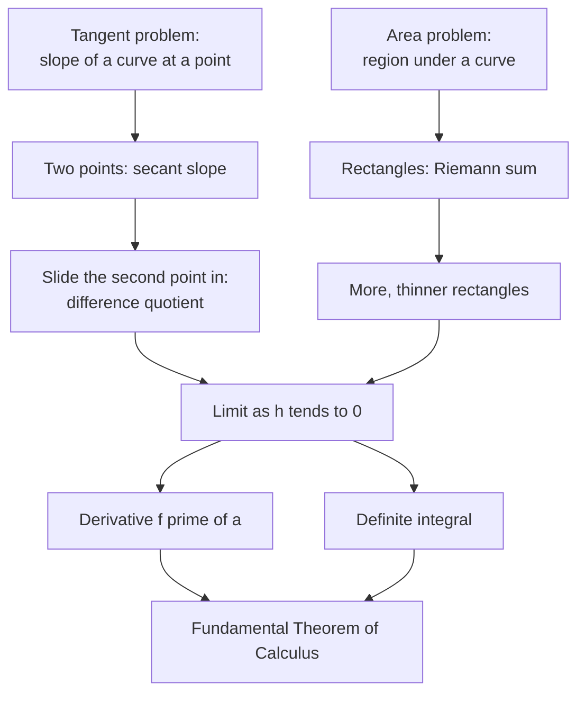

# Introduction to Limits

> [Mathematics](../../README.md) › [Precalculus](../README.md) · Level: Intermediate · Prerequisites: [Functions and Graphs](../01-functions-and-graphs/README.md), [Polynomial and Rational Functions](../02-polynomial-and-rational-functions/README.md), [Factoring](../../03-algebra/07-factoring/README.md), [Radicals and Rational Exponents](../../03-algebra/10-radicals-and-rational-exponents/README.md) · Estimated time: 7 h

## 1. Introduction

Calculus rests on exactly two questions, and both are older than calculus itself.

**The tangent problem.** Given a curve and a point on it, what is the slope of the line that just touches the curve there? A slope needs two points, but "just touches" seems to offer only one.

**The area problem.** Given a shape with a curved boundary, what is its area? Area formulas exist for rectangles and triangles, but a region bounded by a parabola is not made of them.

The two questions look unrelated. They are not: both are answered by the same operation, taken in two different settings. That operation is the **limit**. In the tangent problem one takes the slope between two points and lets the second point slide towards the first; the numbers approach a value, and that value is declared to be the slope of the tangent. In the area problem one fills the region with rectangles, computes the total, and lets the rectangles become thinner; the totals approach a value, and that value is declared to be the area.

What makes this more than wishful thinking is that in each case the *approach* has a definite destination, and the destination can be identified independently: the tangent slope is the slope of the best straight-line approximation near the point, and the area is the number that every reasonable rectangle scheme converges to. Limits are the technology that turns "approach" into a well-defined object.

This topic builds that technology in the form you need before studying calculus: the average rate of change, the difference quotient, the informal limit with tables and graphs, one-sided limits, the ways a limit can fail to exist, continuity, the limit laws, and an honest first look at the $\varepsilon$-$\delta$ definition — stated properly, explained geometrically, and used in two complete proofs. It ends by showing why the derivative and the integral are both limits, which is the bridge into [Calculus](../../07-calculus/README.md).

A word about rigour. Everything in this topic can be made precise, and the last sections show how. But precision is not the point of a first course in limits; *understanding what the symbols mean* is. A student who can read $\lim_{x\to a}f(x) = L$ as "we can force $f(x)$ as close to $L$ as we like by keeping $x$ close enough to $a$, without needing $x=a$" will learn calculus easily. A student who sees only a formal string will not. Both descriptions are given here, in that order.

## 2. Prerequisites

You should be comfortable with:

* **Function notation and graphs** — evaluating $f(a+h)$, sketching $y = f(x)$, and recognising the shapes of $y=x$, $y=x^{2}$, $y=|x|$, $y=1/x$. See [Functions and Graphs](../01-functions-and-graphs/README.md).
* **Straight lines** — slope $m = \dfrac{y_2-y_1}{x_2-x_1}$, including the interpretation of slope as a rate of change and as "rise over run". See [Analytic Geometry](../../04-geometry/07-analytic-geometry/README.md).
* **Polynomials and rational functions** — expanding $(a+h)^{2}$ and $(a+h)^{3}$, and knowing where a rational function is undefined. See [Polynomial and Rational Functions](../02-polynomial-and-rational-functions/README.md).
* **Factoring** — in particular the difference of squares $x^{2}-a^{2} = (x-a)(x+a)$ and the difference of cubes, which are what make $0/0$ limits computable. See [Factoring](../../03-algebra/07-factoring/README.md).
* **Rationalising** — multiplying $\sqrt{x+1}-1$ by its conjugate to remove a square root from a numerator. See [Radicals and Rational Exponents](../../03-algebra/10-radicals-and-rational-exponents/README.md).
* **Sequences and their limits** — the idea that $a_n \to L$ means the terms become arbitrarily close to $L$; and the sums $\sum_{k=1}^{n}k$ and $\sum_{k=1}^{n}k^{2}$, which the area example uses. See [Sequences and Series](../05-sequences-and-series/README.md).
* **Absolute value and inequalities** — $|x-a|<\delta$ means $x$ lies within $\delta$ of $a$. See [Inequalities](../../03-algebra/03-inequalities/README.md).

## 3. Learning Objectives

After working through this topic you will be able to:

1. State the tangent and area problems, and explain why each becomes a limit.
2. Compute average rates of change and interpret them as secant slopes, with units.
3. Write and simplify a difference quotient, and read its limit as an instantaneous rate of change.
4. Evaluate a limit from a table of values and from a graph, and say why a table alone is never a proof.
5. Distinguish the value $f(a)$ from the limit $\lim_{x\to a}f(x)$, and give an example where they differ.
6. Compute one-sided limits and use the criterion "the two-sided limit exists exactly when both one-sided limits exist and agree".
7. Classify the three ways a limit can fail to exist: jump, oscillation, and unboundedness.
8. State the limit laws and use them, including direct substitution, factoring and rationalising.
9. Define continuity at a point in terms of a limit, and identify the three ways continuity can fail.
10. State the $\varepsilon$-$\delta$ definition of a limit, explain the role of the order of the quantifiers, and carry out a complete proof for a linear and a quadratic function.
11. Explain why the derivative is the limit of a difference quotient and why the definite integral is the limit of a Riemann sum.

## 4. Intuition

### 4.1 "Close" is a process, not a place

Ask a friend to name a number close to $2$. They say $2.1$. Closer, you insist: $2.01$. Closer still: $2.000001$. There is no *closest* number to $2$ other than $2$ itself. So "close to $2$" is not a property of a single number; it is a **challenge-and-response**: however close you demand, a suitable number exists.

A limit is the answer to a whole sequence of such challenges. "The limit of $f$ at $2$ is $4$" means: whatever tolerance you name — $f$ within $0.1$ of $4$, within $0.001$, within $10^{-9}$ — there is a way to keep $x$ close enough to $2$ that the tolerance is met. The limit is the number that survives every challenge simultaneously.

This is why a limit cannot be computed at a single point. It is a statement about a *neighbourhood*, a whole interval around the point, crushed smaller and smaller.

### 4.2 The hole in the graph

The function $f(x) = \dfrac{x^{2}-4}{x-2}$ is undefined at $x=2$: substituting gives $0/0$, which is not a number. Yet its graph is a straight line with a single point removed. Near $x=2$ the values are $3.9$, $3.99$, $4.01$, $4.1$ — the hole is at height $4$, and everything around it points there.

The limit is $4$ even though $f(2)$ does not exist. That is the single most important idea in the topic: **the limit is about behaviour near $a$, not at $a$.** A function can be undefined at $a$ and still have a limit there; it can be defined at $a$ and have a limit different from its value; and it can even be defined to be $4$ at $a$ — the limit is $4$ regardless. In all three cases the answer to "what does the function approach?" is the same.

Why should the value at the point be irrelevant? Because the applications demand it. Speed at an instant is not computed by dividing zero distance by zero time; it is the limit of average speeds over shorter and shorter intervals. If limits cared about the value at the single instant, instantaneous speed would be unobtainable — which is precisely the problem calculus was invented to solve.

### 4.3 Zooming in on a curve

Draw $y=x^{2}$ and put a point at $x=1$. The curve bends, so there is no straight line through one point. But now take a second point nearby and draw the line through both — a **secant**. As the second point slides towards the first, the secant rotates, and it settles onto one particular line: the **tangent**. Its slope is the limit of the secant slopes.

The picture to hold in mind is *zoom*. If you magnify the graph repeatedly around the point, the curve looks straighter and straighter, and the tangent is the line it becomes. The limit of the secant slopes is the slope of that line — the same number, approached from either side.

Notice what the limit does *not* say: it does not say the curve *is* a line, and it does not say the tangent touches only at one point (a tangent may cross the curve elsewhere). It says the secant slopes converge, and their common value is a well-defined number we agree to call the slope at the point.

### 4.4 Slicing an area into rectangles

For the area problem the intuition is even more concrete. Put a curve above an interval and fill the region beneath it with thin rectangles. With four rectangles you get a crude estimate; with ten, better; with a thousand, better still. The total area of the rectangles is a finite sum at every stage, and the *shape* of the sum improves as the rectangles narrow.

The limit of these totals is what we mean by the area. There is no circularity: we never assert what the area is and then compute it. We define the area to be the number the rectangle totals approach — and then prove that this number is independent of how the rectangles were chosen (left endpoints, right endpoints, midpoints all give the same limit).

### 4.5 Why "just look at the graph" is not enough

A graph is drawn with finite resolution and by a person or a plotter that may have sampled badly. A table samples finitely many points. Both are evidence; neither is proof. The function $\sin(1/x)$ has a graph that no plotter can render near $0$ — it oscillates infinitely often in every interval — and a table of a thousand values could easily suggest a limit that is not there. This is why the definition in Section 5 exists: to replace "looks like it settles" with a statement that can be checked, or refuted, for every possible tolerance.

## 5. Formal Definition

The informal definition first, because it is what you will actually use.

**Definition 5.1 (Limit, informal).** Let $f$ be defined on some interval around $a$, except possibly at $a$ itself. We say that *the limit of $f(x)$ as $x$ approaches $a$ is $L$*, written

$$\lim_{x\to a}f(x) = L,$$

if $f(x)$ can be made as close to $L$ as we please by taking $x$ sufficiently close to $a$ but not equal to $a$.

**Definition 5.2 (Limit, formal — the $\varepsilon$-$\delta$ definition).** With $f$ as above, $\displaystyle\lim_{x\to a}f(x) = L$ means:

$$\forall \varepsilon>0\ \ \exists \delta>0\ \ \forall x\ \ \bigl(0<|x-a|<\delta \ \Rightarrow\ |f(x)-L|<\varepsilon\bigr).$$

In words: for every tolerance $\varepsilon$ on the output there is a tolerance $\delta$ on the input such that every $x$ within $\delta$ of $a$ (other than $a$ itself) produces an output within $\varepsilon$ of $L$.

Two features of Definition 5.2 are essential and are discussed in Section 7.9.

* **The order of the quantifiers.** $\forall\varepsilon\ \exists\delta$ means $\delta$ may depend on $\varepsilon$. It is a response to a challenge, not a single number that works for all tolerances.
* **The strict inequality $0<|x-a|$.** It excludes $x=a$. The value $f(a)$, if it exists, is irrelevant to the limit.

**Definition 5.3 (One-sided limits).** The *right-hand limit* $\displaystyle\lim_{x\to a^{+}}f(x) = L$ means: for every $\varepsilon>0$ there is $\delta>0$ such that $0<x-a<\delta$ implies $|f(x)-L|<\varepsilon$. The *left-hand limit* $\displaystyle\lim_{x\to a^{-}}f(x) = L$ is the same with $-\delta<x-a<0$. Informally: $x$ approaches $a$ only from above (respectively below).

**Definition 5.4 (Limit fails to exist).** If no real number $L$ satisfies Definition 5.1, the limit *does not exist* (written DNE). By Property 8.7 this happens exactly when the two one-sided limits differ or at least one of them fails to exist. When the values grow without bound we write $\lim_{x\to a}f(x) = +\infty$ as a description of the behaviour, not as an assertion that a limit exists (Definition 5.1 requires $L\in\mathbb{R}$).

**Definition 5.5 (Continuity at a point).** A function $f$ is *continuous at* $a$ if

$$\lim_{x\to a}f(x) = f(a).$$

This single equation contains three requirements: the limit exists, $f(a)$ is defined, and the two agree. A function is *continuous on an interval* if it is continuous at every point of the interval (with one-sided continuity at any endpoints included in the interval).

**Definition 5.6 (Average and instantaneous rate of change).** The *average rate of change* of $f$ on $[a,b]$ is $\dfrac{f(b)-f(a)}{b-a}$, the slope of the secant through $(a,f(a))$ and $(b,f(b))$. The *instantaneous rate of change* at $a$ is the limit of the average rates as $b\to a$, i.e.

$$f'(a) := \lim_{h\to 0}\frac{f(a+h)-f(a)}{h},$$

when the limit exists. The quotient inside the limit is the *difference quotient*.

**Definition 5.7 (Definite integral as a limit).** Partition $[a,b]$ into $n$ subintervals of equal width $\Delta x = (b-a)/n$ with endpoints $x_0=a<x_1<\dots<x_n=b$, and let $x_k^{*}$ be any point in $[x_{k-1},x_k]$. The *Riemann sum* is $S_n = \sum_{k=1}^{n} f(x_k^{*})\,\Delta x$. If the sums approach a number $I$ as $n\to\infty$, uniformly in the choice of the $x_k^{*}$, then $I$ is the *definite integral* and is written $\int_a^b f(x)\,dx$. Section 7.10 shows that for $f(x)=x^{2}$ on $[0,1]$ the number is $1/3$.

## 6. Mathematical Notation

| Symbol | Read as | Meaning |
|---|---|---|
| $\lim_{x\to a}f(x)=L$ | the limit of $f(x)$ as $x$ tends to $a$ is $L$ | Definition 5.1 / 5.2 |
| $x\to a$ | $x$ tends to $a$ | $x$ approaches, never necessarily reaches |
| $x\to a^{+}$ | $x$ tends to $a$ from above | right-hand limit; $x>a$ |
| $x\to a^{-}$ | $x$ tends to $a$ from below | left-hand limit; $x<a$ |
| $x\to\infty$ | $x$ tends to infinity | $x$ grows without bound |
| $\lim_{h\to0}$ | limit as $h$ tends to zero | used in difference quotients |
| DNE | does not exist | no real number satisfies the definition |
| $f(a+h)$ | $f$ of $a$ plus $h$ | the value at a point $h$ away from $a$ |
| $\dfrac{f(a+h)-f(a)}{h}$ | the difference quotient | average rate of change over $[a,a+h]$ |
| $\dfrac{f(b)-f(a)}{b-a}$ | the secant slope | average rate of change over $[a,b]$ |
| $f'(a)$ | $f$ prime of $a$ | the derivative, defined in Definition 5.6 |
| $\Delta x$ | delta $x$ | width of one subinterval |
| $\sum_{k=1}^{n}$ | sum from $k$ equals $1$ to $n$ | Riemann sum notation |
| $\int_a^b f(x)\,dx$ | the integral from $a$ to $b$ of $f$ | the limit of Riemann sums |
| $\varepsilon$ | epsilon | tolerance on the *output* |
| $\delta$ | delta | tolerance on the *input* |
| $\lvert x-a\rvert$ | modulus of $x$ minus $a$ | the distance from $x$ to $a$ |
| $0<\lvert x-a\rvert<\delta$ | $x$ within $\delta$ of $a$, $x\ne a$ | a *punctured* neighbourhood |
| $+\infty$ | plus infinity | a description of growth, not a number |
| $x_k^{*}$ | $x$ sub $k$ star | a sample point in the $k$-th subinterval |

## 7. Core Concepts

### 7.1 Average rate of change and the secant

The average rate of change of $f$ on the interval from $a$ to $a+h$ is the change in output divided by the change in input:

$$\frac{f(a+h)-f(a)}{(a+h)-a} = \frac{f(a+h)-f(a)}{h}.$$

Geometrically this is the slope of the **secant line** through the two points $(a,f(a))$ and $(a+h,f(a+h))$. Numerically it is the answer to "on average, how fast did $f$ change per unit of input?" — and the word *average* is doing real work. Over a longer interval, fast stretches and slow stretches are averaged together; the wider the interval, the coarser the summary.

The units are (units of output) per (unit of input): metres per second, dollars per item, degrees per kilometre. Keeping the units visible is the simplest defence against the error of reporting a rate in the wrong time unit — a mistake that becomes very easy once $h$ is a symbol.

Two properties are worth stating because they are used constantly.

* **The average rate depends on the interval, not just on $a$.** For $f(x)=x^{2}$ on $[1,1+h]$ the average rate is $\frac{(1+h)^{2}-1}{h} = 2+h$, which decreases as $h$ shrinks: $3$ at $h=1$, $2.1$ at $h=0.1$, $2.01$ at $h=0.01$. The values are heading somewhere.
* **A zero average rate does not mean nothing happened.** The average rate of $f(x)=x^{2}$ on $[-1,1]$ is $0$, though the function changed a great deal in between. Averages hide cancellations.

### 7.2 The tangent problem, and the difference quotient

The tangent line to $y=f(x)$ at $x=a$ is the line through $(a,f(a))$ whose slope is the limit of the secant slopes as $h\to 0$:

$$m_{\text{tan}} = \lim_{h\to 0}\frac{f(a+h)-f(a)}{h}.$$

For $f(x)=x^{2}$ at $a=1$ the algebra is short and complete:

$$\frac{(1+h)^{2}-1}{h} = \frac{1+2h+h^{2}-1}{h} = \frac{h(2+h)}{h} = 2+h \quad (h\ne0),$$

and $2+h\to 2$ as $h\to0$. So the tangent slope is $2$, matching the values $2.1, 2.01, 2.001$ computed from $h = 0.1, 0.01, 0.001$.

Three points about that computation deserve attention.

1. **The cancellation is the whole calculation.** The factor $h$ cancelled because the numerator had a factor $h$; this is guaranteed whenever $f$ is a polynomial, which is why polynomials are differentiable everywhere and why factoring is the basic skill behind all of calculus.
2. **$h\ne0$ is required for the cancellation to be legal.** Division by zero is undefined, so the difference quotient only makes sense for $h\ne0$; that is exactly why the limit is needed to define the value at $h=0$.
3. **The result is a function of $a$, not a number.** Doing the same computation at a general $a$ gives $\lim_{h\to0}(2a+h) = 2a$, the derivative $f'(a)=2a$ — the derivative is a new function built from $f$.

### 7.3 The area problem, and why it needs a limit

The area of a region with straight sides is a finite computation. For a region under a curve, the only available operation is to approximate it by rectangles and take a limit. For $f(x)=x^{2}$ on $[0,1]$ with $n$ equal subintervals, using right endpoints:

$$S_n = \sum_{k=1}^{n}\left(\frac{k}{n}\right)^{2}\frac{1}{n} = \frac{1}{n^{3}}\sum_{k=1}^{n}k^{2} = \frac{1}{n^{3}}\cdot\frac{n(n+1)(2n+1)}{6} = \frac{(n+1)(2n+1)}{6n^{2}}.$$

With left endpoints the same computation gives $\frac{(n-1)(2n-1)}{6n^{2}}$. Numerically:

| $n$ | left sum | right sum |
|---|---|---|
| $4$ | $0.21875$ | $0.46875$ |
| $10$ | $0.28500$ | $0.38500$ |
| $100$ | $0.32835$ | $0.33835$ |

Both sequences squeeze towards the same number, and the algebra shows it:

$$S_n = \frac{2n^{2}+3n+1}{6n^{2}} = \frac{1}{3} + \frac{1}{2n} + \frac{1}{6n^{2}} \longrightarrow \frac13.$$

The left sums are $\frac13 - \frac{1}{2n}+\frac{1}{6n^{2}}$, so the gap between the two is exactly $\frac1n$ — the discrepancy shrinks to nothing as the rectangles narrow. That is the whole content of "the area is $1/3$": every rectangle scheme converges to the same number, and the number is computable in closed form because $\sum k^{2}$ is.

The use of the identity $\sum_{k=1}^{n}k^{2} = \frac{n(n+1)(2n+1)}{6}$ is the link to [Sequences and Series](../05-sequences-and-series/README.md); it is proved there by induction.

### 7.4 Informal limits from tables and graphs

A table is the fastest way to *guess* a limit. For $f(x)=\dfrac{\sqrt{x+1}-1}{x}$ near $0$:

| $x$ | $-0.01$ | $-0.001$ | $0$ | $0.001$ | $0.01$ |
|---|---|---|---|---|---|
| $f(x)$ | $0.50126$ | $0.50013$ | undefined | $0.49988$ | $0.49876$ |

The values crowd towards $0.5$ from both sides, and Section 9.5 shows by algebra that the limit is exactly $1/2$.

But a table can mislead in three distinct ways, and each has a real example.

* **Too few points.** The function $\sin(1/x)$ takes the values $0$ at $x = 1/(n\pi)$ and $1$ at $x = 1/(\pi/2+2n\pi)$, both sequences tending to $0$. A table sampled at the first set suggests the limit is $0$; sampled at the second, that it is $1$; in fact there is none.
* **Floating-point collapse.** Computing $\dfrac{\sqrt{x+1}-1}{x}$ in double precision at $x = 10^{-16}$ gives $0$, because $\sqrt{1+10^{-16}}$ rounds to exactly $1$. The true value is essentially $0.5$. The computer is not lying about the formula; it is telling you the formula has lost all its significant digits through cancellation, and the algebra is what recovers the answer.
* **A coincidental pattern.** Any finite list of values is consistent with infinitely many functions. Values agreeing to six decimals near $a$ constrain the limit only if you already know the function is well behaved — which is what the definition is for.

A graph has the same status: excellent evidence, never a proof. What the graph gives you is the qualitative shape — where the function jumps, blows up, or oscillates — and that is genuinely useful for predicting what you should try to prove.

### 7.5 One-sided limits

A one-sided limit restricts the approach to one side. It exists even where the two-sided limit does not:

$$\lim_{x\to0^{+}}\frac{|x|}{x} = 1, \qquad \lim_{x\to0^{-}}\frac{|x|}{x} = -1.$$

Since $|x|/x = 1$ for $x>0$ and $-1$ for $x<0$, both one-sided limits exist and they disagree; by Property 8.7 the two-sided limit does not exist.

One-sided limits are unavoidable at the endpoints of a domain (you cannot approach $0$ from below $\sqrt{x}$), at break points of piecewise functions, and wherever a formula changes. They are also the natural language of continuity on a closed interval.

**A practical advantage.** One-sided limits are *easier* to compute than two-sided ones, because you may use any information valid on one side — for instance, $|x| = x$ when $x>0$ but $|x|=-x$ when $x<0$. Every two-sided problem therefore splits into two easier problems, and Property 8.7 says when you are done.

### 7.6 When a limit fails to exist

There are exactly three mechanisms worth naming, and a fourth that is not a failure at all.

**A jump.** Both one-sided limits exist but differ. Example: $f(x) = \dfrac{|x|}{x}$ at $0$; or a step function that is $0$ for $x<0$ and $1$ for $x\ge0$. The graph has a visible break.

**Oscillation.** The values never settle, because the function oscillates faster and faster. Example: $\sin(1/x)$ at $0$. There is no jump — both one-sided limits fail to exist — and no blow-up: the values are always in $[-1,1]$. To prove non-existence it suffices to exhibit two sequences $x_n\to0$, $y_n\to0$ with $f(x_n)\to0$ and $f(y_n)\to1$ (Section 9.4, and Exercise 30).

**Unboundedness.** The values grow without bound, as $1/x^{2}$ at $0$. We write $\lim_{x\to0}1/x^{2} = +\infty$, which describes the behaviour but is *not* a limit in the sense of Definition 5.1, because $+\infty$ is not a real number. This distinction matters when applying limit laws: the quotient law requires the denominator's limit to be nonzero and finite, so it simply does not apply here.

**A removable discontinuity is not a failure.** In $\dfrac{x^{2}-4}{x-2}$ at $2$ the limit exists (it is $4$); only the *value* is missing. The limit exists; the function is merely undefined there. Confusing "the function has a hole" with "the limit does not exist" is the most common conceptual error in the topic.

### 7.7 Continuity, informally

A function is continuous at $a$ when the graph has no break at $a$, which Definition 5.5 makes precise as $\lim_{x\to a}f(x) = f(a)$. There are exactly three ways for this equation to fail, and they match the three failure modes above:

| Failure | What goes wrong | Example at the bad point |
|---|---|---|
| Removable (hole) | limit exists, $f(a)$ missing or different | $\dfrac{x^{2}-4}{x-2}$ at $2$; or a function redefined at one point |
| Jump | one-sided limits exist but differ | $\dfrac{\lvert x\rvert}{x}$ at $0$ |
| Essential (infinite or oscillatory) | at least one one-sided limit fails | $1/x$ at $0$; $\sin(1/x)$ at $0$ |

Polynomials are continuous everywhere; rational functions are continuous wherever they are defined; $\sqrt{x}$ is continuous on $[0,\infty)$; $|x|$ is continuous everywhere. Continuity is what licenses the most useful computational shortcut in the subject — **direct substitution** — and the limit laws of Section 7.8 say exactly when it applies.

### 7.8 The limit laws, informally

If $\lim_{x\to a}f(x) = L$ and $\lim_{x\to a}g(x) = M$ both exist, then:

$$\lim_{x\to a}\bigl(f\pm g\bigr) = L\pm M, \qquad \lim_{x\to a}\bigl(fg\bigr) = LM, \qquad \lim_{x\to a}\frac{f}{g} = \frac{L}{M}\ \ (M\ne0),$$

together with $\lim_{x\to a}c = c$ for a constant, $\lim_{x\to a}x = a$, and the power and root extensions $\lim_{x\to a}f(x)^{p} = L^{p}$ (with $L>0$ for general real $p$, and the usual care for even roots). Each law says the same thing in a different arithmetical operation: limits pass through sums, products and quotients. The reason is that the operations are continuous functions of their arguments, so a small error in the inputs produces a small error in the output.

Applied repeatedly, the laws give **direct substitution for polynomials and rational functions**: if $p$ is a polynomial then $\lim_{x\to a}p(x) = p(a)$, and if $r = p/q$ with $q(a)\ne0$ then $\lim_{x\to a}r(x) = r(a)$.

The one case the laws say nothing about is $M=0$ with $L=0$: the form $0/0$. It is called an **indeterminate form** because the answer depends on *how* the numerator and denominator approach zero — it might be any number, or none. This is not a defect of the laws; it is the reason the subject has content. Every interesting limit in this topic is an indeterminate form before it is simplified:

* $\dfrac{x^{2}-4}{x-2}$: factor and cancel, giving $x+2\to4$.
* $\dfrac{\sqrt{x+1}-1}{x}$: multiply by the conjugate, giving $\dfrac{1}{\sqrt{x+1}+1}\to\dfrac12$.
* $\dfrac{(1+h)^{2}-1}{h}$: expand and cancel, giving $2+h\to2$.

The three techniques — **factor**, **rationalise**, **expand** — cover almost every limit you will meet before derivatives. All three have the same purpose: to remove the factor that is causing the $0/0$ and leave an expression that is defined at $a$.

### 7.9 Epsilon-delta: the idea, honestly

Definition 5.2 is the definition professionals use, and it is worth understanding once, properly, even at this level. The idea is a game.

> **The game.** An adversary names a tolerance $\varepsilon>0$ on the output — "$f(x)$ must be within $\varepsilon$ of $L$". You must respond with a tolerance $\delta>0$ on the input — "$x$ will be within $\delta$ of $a$" — that guarantees the adversary's demand is met. You win if you have a response for every $\varepsilon$.

$\lim_{x\to a}f(x) = L$ means you have a winning strategy. Two consequences follow immediately, and both are easy to get wrong.

**$\delta$ may depend on $\varepsilon$.** It usually does: for a linear function $\delta = \varepsilon/m$, for $x^{2}$ at $2$ about $\varepsilon/5$. It must *not* depend on $x$ — the inequality has to hold for every $x$ in the punctured interval, not for a favourite one.

**The quantifier order cannot be swapped.** The statement "$\exists\delta\ \forall\varepsilon$" would say that one $\delta$ works for *all* tolerances simultaneously, which is false for any non-constant function: however small $\delta$ is, there are $x$ within $\delta$ of $a$ where $f$ differs from $L$ by a fixed amount. Order matters, and this is the clearest example in elementary mathematics of why.

**Worked proof 1 (linear).** Claim: $\displaystyle\lim_{x\to3}(2x-1) = 5$.

*Scratch work.* We need $|(2x-1)-5|<\varepsilon$, i.e. $|2x-6|<\varepsilon$, i.e. $2|x-3|<\varepsilon$, i.e. $|x-3|<\varepsilon/2$. So $\delta = \varepsilon/2$ should work.

*Proof.* Let $\varepsilon>0$ and set $\delta = \varepsilon/2$. If $0<|x-3|<\delta$ then

$$|(2x-1)-5| = |2x-6| = 2|x-3| < 2\delta = \varepsilon. \qquad \blacksquare$$

**Worked proof 2 (quadratic).** Claim: $\displaystyle\lim_{x\to2}x^{2} = 4$.

*Scratch work.* We need $|x^{2}-4| = |x-2||x+2|<\varepsilon$. The factor $|x-2|$ is controlled by $\delta$, but $|x+2|$ is not — it grows with $x$. The fix is to first restrict $x$ to a fixed neighbourhood, say $|x-2|<1$, where $|x+2| = |(x-2)+4|\le|x-2|+4<5$. Then $|x^{2}-4|<5|x-2|$, so it suffices to have $|x-2|<\varepsilon/5$. Taking the smaller of the two restrictions handles both requirements at once.

*Proof.* Let $\varepsilon>0$ and set $\delta = \min\left(1, \varepsilon/5\right)$. If $0<|x-2|<\delta$ then $|x-2|<1$, so

$$|x+2| = |(x-2)+4| \le |x-2|+4 < 1+4 = 5,$$

and therefore

$$|x^{2}-4| = |x-2|\,|x+2| < \delta\cdot5 \le \frac{\varepsilon}{5}\cdot 5 = \varepsilon. \qquad \blacksquare$$

The $\min(1,\varepsilon/5)$ is not decoration: for large $\varepsilon$ the bound $5$ may fail, so the restriction $|x-2|<1$ is genuinely needed. Dropping it produces a "proof" that is only valid for $\varepsilon \le 5$.

**A non-example.** $\displaystyle\lim_{x\to0}\sin\frac1x$ does not exist. Take $x_n = \dfrac{1}{n\pi}\to0$, where $\sin(1/x_n) = \sin(n\pi) = 0$; and $y_n = \dfrac{1}{\pi/2+2n\pi}\to0$, where $\sin(1/y_n) = \sin\left(\frac\pi2+2n\pi\right) = 1$. If a limit $L$ existed, taking $\varepsilon = \tfrac12$ would force both $0$ and $1$ to be within $\tfrac12$ of $L$, which is impossible. So no $L$ works — and no amount of tabulation could have proved otherwise.

### 7.10 Why the derivative and the integral are both limits

Two limits, from Section 7.2 and Section 7.3, are the subjects of the whole of calculus.

**The derivative is a limit.**

$$f'(a) = \lim_{h\to0}\frac{f(a+h)-f(a)}{h}.$$

Every interpretation of the derivative is an interpretation of this limit: slope of the tangent line, instantaneous velocity, marginal cost, rate of change, sensitivity. The limit is what converts an *average* over an interval into a *value* at an instant — and it is the only way to do so, because a single instant contains no interval to average over.

**The definite integral is a limit.**

$$\int_a^b f(x)\,dx = \lim_{n\to\infty}\sum_{k=1}^{n}f(x_k^{*})\,\Delta x.$$

This converts an *approximation by rectangles* into an exact area, and more generally accumulates a rate into a total: velocity into distance, power into energy, density into mass.

The two limits are inverse to one another, which is the content of the **Fundamental Theorem of Calculus**: differentiating an accumulation recovers the rate, and integrating a rate recovers the accumulation. That theorem is why the whole subject hangs together, and it is the reason both limits are studied in the same course. It is stated, not proved, here; the proof belongs to [Calculus](../../07-calculus/07-fundamental-theorem-of-calculus/README.md).

**A first taste of the connection.** For $f(x)=x^{2}$, the difference quotient at $a$ is $2a+h$, so $f'(a) = 2a$. The area under $x^{2}$ from $0$ to $a$ is (by the computation of Section 7.3, scaled) $a^{3}/3$. Differentiate $a^{3}/3$ with respect to $a$ and you get $a^{2}$ — the original function. The two limit computations of this topic fit together exactly as the Fundamental Theorem says they must, and checking that on one example is the best possible preparation for the theorem itself.

## 8. Formulas and Properties

**Property 8.1 (Average rate of change).** For $f$ on $[a,b]$ with $b\ne a$, the average rate of change is $\dfrac{f(b)-f(a)}{b-a}$; it is the slope of the secant through the two graph points. *Why:* slope is $\frac{\text{change in output}}{\text{change in input}}$ by definition, and this is that quotient.

**Property 8.2 (Difference quotient).** Writing $b = a+h$, the average rate becomes $\dfrac{f(a+h)-f(a)}{h}$, and the instantaneous rate at $a$ is the limit as $h\to0$ (Definition 5.6). The identity
$$\frac{f(a+h)-f(a)}{h} = \frac{f(a+h)-f(a)}{(a+h)-a}$$
shows that the two forms are the same expression. *Why:* $h = (a+h)-a$.

**Property 8.3 (Expansions used constantly).** For all real $a,h$:
$$(a+h)^{2} = a^{2}+2ah+h^{2}, \qquad (a+h)^{3} = a^{3}+3a^{2}h+3ah^{2}+h^{3}.$$
Consequently
$$\frac{(a+h)^{2}-a^{2}}{h} = 2a+h, \qquad \frac{(a+h)^{3}-a^{3}}{h} = 3a^{2}+3ah+h^{2} \quad (h\ne0).$$
*Why:* expand and cancel the $h$ that appears in every remaining term.

**Property 8.4 (Factor and rationalise).** $x^{2}-a^{2} = (x-a)(x+a)$ and $x^{3}-a^{3} = (x-a)(x^{2}+ax+a^{2})$; and $\sqrt{x}-\sqrt{a} = \dfrac{x-a}{\sqrt{x}+\sqrt{a}}$ for $x,a>0$. Each identity removes the factor causing $0/0$. *Why:* expand the right-hand sides; for the third, multiply numerator and denominator by the conjugate $\sqrt x+\sqrt a$.

**Property 8.5 (Limit laws).** If $\lim_{x\to a}f = L$ and $\lim_{x\to a}g = M$ both exist, then $\lim(f\pm g) = L\pm M$, $\lim(fg) = LM$, $\lim(f/g) = L/M$ when $M\ne0$, $\lim c = c$, $\lim x = a$, and $\lim f^{p} = L^{p}$ where defined. *Why (idea):* a limit is a statement that outputs can be forced into any tolerance; the arithmetic operations are continuous, so tolerances propagate.

**Property 8.6 (Direct substitution).** If $p$ is a polynomial, $\lim_{x\to a}p(x) = p(a)$. If $r=p/q$ is rational and $q(a)\ne0$, $\lim_{x\to a}r(x) = r(a)$. *Why:* repeated application of Property 8.5 to the monomials $x^{k}$.

**Property 8.7 (Two-sided criterion).** $\lim_{x\to a}f(x)$ exists if and only if both $\lim_{x\to a^{+}}f(x)$ and $\lim_{x\to a^{-}}f(x)$ exist and are equal, in which case all three are equal. *Why:* if the two-sided limit exists, restricting $x$ to one side still satisfies the definition, so both one-sided limits equal it. Conversely, if both one-sided limits equal $L$, take $\delta$ to be the smaller of the two one-sided tolerances; then $0<|x-a|<\delta$ splits into the two cases and each gives $|f(x)-L|<\varepsilon$.

**Property 8.8 (Uniqueness of the limit).** A function has at most one limit at a point. *Why:* suppose $L\ne M$ both work, and let $\varepsilon = |L-M|/2>0$. Choose $\delta_L,\delta_M$ for this $\varepsilon$; any $x$ with $0<|x-a|<\min(\delta_L,\delta_M)$ gives $|L-M|\le|L-f(x)|+|f(x)-M|<\varepsilon+\varepsilon = |L-M|$, a contradiction.

**Property 8.9 (Limit and value are independent).** $\lim_{x\to a}f(x)$ depends only on the values of $f$ on a punctured neighbourhood of $a$; changing $f(a)$ changes no limit. *Why:* Definition 5.2 quantifies over $x$ with $0<|x-a|$, so $x=a$ is never tested.

**Property 8.10 (Continuity).** $f$ is continuous at $a$ exactly when $\lim_{x\to a}f(x) = f(a)$, i.e. when the limit exists, the value exists, and they agree. Polynomials are continuous everywhere, rational functions wherever defined, and $\sqrt{x}$ on $[0,\infty)$. *Why:* this is Definition 5.5 plus Property 8.6.

**Property 8.11 ($\varepsilon$-$\delta$ templates).** For a linear function: to prove $\lim_{x\to a}(mx+c) = ma+c$, take $\delta = \varepsilon/|m|$ (any $\delta>0$ if $m=0$). For $x^{2}$ at $a$: take $\delta = \min\left(1, \dfrac{\varepsilon}{2|a|+1}\right)$, which gives $|x^{2}-a^{2}| = |x-a||x+a| \le |x-a|(2|a|+1) < \varepsilon$. *Why:* the bound $|x+a|\le|x-a|+2|a|<1+2|a|$ holds whenever $|x-a|<1$.

**Property 8.12 (Sum formulas for Riemann sums).** $\sum_{k=1}^{n}k = \dfrac{n(n+1)}{2}$ and $\sum_{k=1}^{n}k^{2} = \dfrac{n(n+1)(2n+1)}{6}$. For $f(x)=x^{2}$ on $[0,1]$ the right sum is $\frac{(n+1)(2n+1)}{6n^{2}} \to \frac13$ and the left sum is $\frac{(n-1)(2n-1)}{6n^{2}} \to \frac13$. *Why:* expand the numerator and divide by $n^{2}$; both expressions are $\frac13 + O(1/n)$.

## 9. Step-by-Step Examples

### Example 9.1 (easy) — An average rate of change

For $f(x) = x^{2}-2x$, find the average rate of change on $[1,4]$ and interpret it.

**Solution.** Compute the two values first; the difference quotient is a division and both parts must be right.

$$f(1) = 1-2 = -1, \qquad f(4) = 16-8 = 8.$$

$$\text{average rate} = \frac{f(4)-f(1)}{4-1} = \frac{8-(-1)}{3} = \frac{9}{3} = 3.$$

**Answer.** $3$ units of output per unit of input.

**Interpretation.** The secant through $(1,-1)$ and $(4,8)$ has slope $3$. On average, across the whole interval, $f$ grew by $3$ per unit — although it first *decreased* (the vertex is at $x=1$) and then grew faster than $3$. An average rate says nothing about the fine structure, which is exactly the deficiency the derivative repairs.

**Check.** The secant line is $y = 3(x-1)-1 = 3x-4$; at $x=4$ this gives $8$ ✓. And $f(x)-(3x-4) = x^{2}-5x+4 = (x-1)(x-4)$, which vanishes exactly at the two points — as it must, since the line meets the curve there. ✓

### Example 9.2 (easy) — A limit with a hole, by table and by algebra

Evaluate $\displaystyle\lim_{x\to2}\frac{x^{2}-4}{x-2}$.

**Solution.** Substitution gives $\frac{0}{0}$, an indeterminate form, so the quotient law does not apply. But the numerator factors:

$$\frac{x^{2}-4}{x-2} = \frac{(x-2)(x+2)}{x-2} = x+2 \quad \text{for } x\ne2.$$

The cancellation is legal precisely because $x\ne2$ in a limit. So

$$\lim_{x\to2}\frac{x^{2}-4}{x-2} = \lim_{x\to2}(x+2) = 4.$$

**Answer.** $4$.

**Check by table.** At $x = 1.9, 1.99, 2.01, 2.1$ the values are $3.9, 3.99, 4.01, 4.1$ ✓. The function is undefined at $2$ and its graph is the line $y=x+2$ with the point $(2,4)$ removed — the limit exists despite the function not being defined there (Property 8.9).

**A caution.** "Cancel the $x-2$" is not a licence to cancel anything that looks like zero. The cancellation here is an algebraic identity valid for $x\ne2$; that is why the equality $\frac{(x-2)(x+2)}{x-2} = x+2$ must carry the qualification $x\ne2$.

### Example 9.3 (medium) — One-sided limits of a piecewise function

Let

$$f(x) = \begin{cases} x+1, & x<1,\\ 3, & x=1,\\ x^{2}+2, & x>1.\end{cases}$$

Find $\lim_{x\to1^{-}}f(x)$, $\lim_{x\to1^{+}}f(x)$, and $\lim_{x\to1}f(x)$; state whether $f$ is continuous at $1$.

**Solution.** Each piece governs one side, so each one-sided limit is a direct substitution into the relevant formula.

From the left ($x<1$) the formula is $x+1$: $\displaystyle\lim_{x\to1^{-}}f(x) = 1+1 = 2$.

From the right ($x>1$) the formula is $x^{2}+2$: $\displaystyle\lim_{x\to1^{+}}f(x) = 1+2 = 3$.

The two one-sided limits are $2$ and $3$. They differ, so by Property 8.7 the two-sided limit does not exist. The separate value $f(1) = 3$ is irrelevant to both computations — it happens to equal the right-hand limit, but that does not create a two-sided limit.

**Answer.** Left limit $2$; right limit $3$; two-sided limit DNE; $f$ is not continuous at $1$.

**Check.** The graph is the line $y = x+1$ with the point $(1,2)$ removed, the isolated point $(1,3)$, and the parabola $y=x^{2}+2$ drawn for $x>1$ only. The left branch approaches height $2$ while the value at $1$ sits at height $3$: a jump of $1$ at $x=1$ ✓.

**Remark.** Because $f(1)$ equals the right-hand limit, the function is *right-continuous* at $1$ but not left-continuous, hence not continuous. Continuity is a two-sided condition.

### Example 9.4 (medium) — Three ways for a limit to fail

Analyse $\displaystyle\lim_{x\to0}g(x)$ for (a) $g(x) = \dfrac{|x|}{x}$, (b) $g(x) = \sin\dfrac1x$, (c) $g(x) = \dfrac{1}{x^{2}}$.

**Solution.**

(a) *Jump.* For $x>0$, $|x| = x$ so $g(x) = 1$; for $x<0$, $|x| = -x$ so $g(x) = -1$. Both one-sided limits exist ($1$ and $-1$) and differ, so the two-sided limit does not exist.

(b) *Oscillation.* For $x_n = \frac{1}{n\pi}$ we have $g(x_n) = \sin(n\pi) = 0$, and $x_n\to0$; for $y_n = \frac{1}{\pi/2+2n\pi}$ we have $g(y_n) = \sin\left(\frac\pi2+2n\pi\right) = 1$, and $y_n\to0$. Two sequences approaching $0$ along which $g$ has different limits, so no $L$ can satisfy Definition 5.2. Note that $g$ is bounded: $|g(x)|\le1$ everywhere. Boundedness does not save a limit.

(c) *Unbounded.* As $x\to0$, $1/x^{2}$ grows without bound: given any $M>0$, choosing $|x|<1/\sqrt M$ makes $g(x)>M$. So $\lim_{x\to0}g(x) = +\infty$ in the descriptive sense, and no *finite* limit exists.

**Answer.** (a) DNE (jump); (b) DNE (oscillation); (c) no finite limit (unbounded).

**Check.** Evaluate each at $x = \pm0.01$: (a) $\pm1$; (b) $\sin(100) = -0.506$ and $\sin(-100) = 0.506$ — values that change chaotically as $x$ shrinks; (c) $10{,}000$. The numerical behaviour matches the analysis in each case ✓.

### Example 9.5 (medium) — Rationalising

Evaluate $\displaystyle\lim_{x\to0}\frac{\sqrt{x+1}-1}{x}$.

**Solution.** Substitution gives $0/0$. The numerator has a square root, so the right technique is to multiply by the conjugate $\sqrt{x+1}+1$:

$$\frac{\sqrt{x+1}-1}{x}\cdot\frac{\sqrt{x+1}+1}{\sqrt{x+1}+1} = \frac{(x+1)-1}{x\left(\sqrt{x+1}+1\right)} = \frac{x}{x\left(\sqrt{x+1}+1\right)} = \frac{1}{\sqrt{x+1}+1}.$$

The last equality holds for $x\ne0$, which is all the limit needs. Now the denominator is $\sqrt1+1 = 2\ne0$, so the quotient law applies:

$$\lim_{x\to0}\frac{\sqrt{x+1}-1}{x} = \frac{1}{1+1} = \frac12.$$

**Answer.** $\dfrac12$.

**Check by table.** $x = 0.1$: $0.48809$; $x=0.01$: $0.49876$; $x=0.001$: $0.49988$ — approaching $0.5$ from below, as the formula $\frac{1}{\sqrt{1+x}+1}$ predicts, since the denominator decreases towards $2$ from above ✓.

**Remark.** Multiplying by the conjugate is the standard device for any limit of the form $\frac{\sqrt{\ }-\sqrt{\ }}{h}$; it converts a difference of roots into a difference of squares, which then factors.

### Example 9.6 (medium–hard) — Instantaneous velocity

A stone dropped from rest falls $s(t) = 4.9t^{2}$ metres in $t$ seconds. Find its velocity at $t=2$ seconds from the limit of average velocities.

**Solution.** Average velocity over $[2,2+h]$:

$$\frac{s(2+h)-s(2)}{h} = \frac{4.9(2+h)^{2}-4.9(4)}{h} = \frac{4.9\left(4+4h+h^{2}\right)-19.6}{h} = \frac{19.6h+4.9h^{2}}{h} = 4.9(4+h).$$

As $h\to0$, $4.9(4+h)\to19.6$.

**Answer.** $v(2) = 19.6\ \mathrm{m\,s^{-1}}$ downwards.

**Check.** With $h=1$: $\frac{4.9(9)-19.6}{1} = 24.5$; with $h=0.1$: $\frac{4.9(4.41)-19.6}{0.1} = 20.09$; with $h=0.01$: $19.649$. The numbers approach $19.6$ ✓.

**Interpretation.** $19.6$ m/s is about $71$ km/h. The *average* velocity over the first two seconds is $s(2)/2 = 9.8$ m/s, exactly half — a consequence of $s \propto t^{2}$, since the speed grows linearly from $0$ to $19.6$.

**What the limit does not claim.** It does not claim that any finite interval of time had average velocity $19.6$; only the interval $[2,2+h]$ as $h\to0$. The physical statement "the velocity at the instant $t=2$" is *defined* by this limit, which is why the mathematical definition is needed at all.

### Example 9.7 (medium–hard) — The tangent to a cubic

Find the slope of the tangent to $y = x^{3}$ at $x=1$, from the difference quotient.

**Solution.**

$$\frac{(1+h)^{3}-1}{h} = \frac{1+3h+3h^{2}+h^{3}-1}{h} = \frac{3h+3h^{2}+h^{3}}{h} = 3+3h+h^{2}.$$

As $h\to0$, $3+3h+h^{2}\to3$.

**Answer.** The slope is $3$, so the tangent is $y - 1 = 3(x-1)$, i.e. $y = 3x-2$.

**Check.** $h = 1$: $7$; $h = 0.5$: $4.75$; $h = 0.1$: $3.31$; $h=0.01$: $3.0301$ ✓. Geometrically, the slope $3x^{2}$ is $0$ at $x=0$ (a horizontal tangent at the inflection point) and grows without bound as $|x|$ grows; at $x=1$ the tangent has slope $3$ and crosses the curve at the point of tangency — a tangent need not stay on one side.

**Remark.** The same computation at general $a$ gives $3a^{2}+3ah+h^{2}\to 3a^{2}$, so the derivative of $x^{3}$ is $3x^{2}$. The pattern $(x^{n})' = nx^{n-1}$ is visible from the first two terms of the binomial expansion, which is why the binomial theorem and calculus are historically connected.

### Example 9.8 (hard) — A complete epsilon-delta proof

Prove from Definition 5.2 that $\displaystyle\lim_{x\to2}x^{2} = 4$.

**Solution.** Fix $\varepsilon>0$. We must produce $\delta>0$ such that

$$0<|x-2|<\delta \ \Longrightarrow\ |x^{2}-4|<\varepsilon.$$

*Scratch work.* Factor: $|x^{2}-4| = |x-2||x+2|$. The first factor is controlled by $\delta$; the second is not, so bound it by restricting $x$ near $2$. If $|x-2|<1$ then

$$|x+2| = |(x-2)+4| \le |x-2|+|4| < 1+4 = 5.$$

So under the restriction $|x-2|<1$ we get $|x^{2}-4|<5|x-2|$, and $5|x-2|<\varepsilon$ holds if $|x-2|<\varepsilon/5$. Both requirements are met by the smaller of $1$ and $\varepsilon/5$.

*Proof.* Let $\delta = \min\left(1,\dfrac{\varepsilon}{5}\right)$ and suppose $0<|x-2|<\delta$. Then $|x-2|<1$, so

$$|x+2| = |(x-2)+4| \le |x-2| + 4 < 1+4 = 5,$$

and $|x-2|<\delta\le\varepsilon/5$. Multiplying the two inequalities (both sides positive),

$$|x^{2}-4| = |x-2|\cdot|x+2| < \frac{\varepsilon}{5}\cdot 5 = \varepsilon.$$

Since $\varepsilon>0$ was arbitrary, the definition is satisfied. $\blacksquare$

**Check with numbers.** Take $\varepsilon = 0.1$. Then $\delta = \min(1, 0.02) = 0.02$, so $x\in(1.98,2.02)$ should give $x^{2}\in(3.9204, 4.0804)$, i.e. within $0.0804 < 0.1$ of $4$ ✓. At the extreme $x = 2.02$: $2.02^{2} = 4.0804$, and $|4.0804-4| = 0.0804 < 0.1$ ✓.

**Why the $\min(1,\cdot)$ cannot be dropped.** If $\delta = \varepsilon/5$ alone, then for $\varepsilon = 20$ we would get $\delta = 4$, allowing $x$ up to $6$, where $|x^{2}-4| = 32 \not< 20$. The proof would fail for large $\varepsilon$; the $1$ prevents that case. Every $\varepsilon$-$\delta$ proof with an unbounded factor needs such a restriction, and the bound it produces is used in the final line.

### Example 9.9 (hard) — Area as a limit of sums

Compute the area under $y = x^{2}$ from $x=0$ to $x=1$ as the limit of right-endpoint Riemann sums, and verify the left-endpoint sums give the same number.

**Solution.** Divide $[0,1]$ into $n$ equal parts of width $\Delta x = 1/n$; the right endpoints are $x_k = k/n$, $k=1,\dots,n$.

$$S_n = \sum_{k=1}^{n}\left(\frac{k}{n}\right)^{2}\frac1n = \frac{1}{n^{3}}\sum_{k=1}^{n}k^{2}.$$

Using $\sum_{k=1}^{n}k^{2} = \dfrac{n(n+1)(2n+1)}{6}$:

$$S_n = \frac{n(n+1)(2n+1)}{6n^{3}} = \frac{(n+1)(2n+1)}{6n^{2}} = \frac{2n^{2}+3n+1}{6n^{2}} = \frac13 + \frac{1}{2n} + \frac{1}{6n^{2}}.$$

As $n\to\infty$ the last two terms vanish, so $S_n\to\dfrac13$.

Left endpoints are $x_k = (k-1)/n$ for $k=1,\dots,n$, so $\sum_{k=1}^{n}(k-1)^{2} = \sum_{j=0}^{n-1}j^{2} = \frac{(n-1)n(2n-1)}{6}$, giving

$$L_n = \frac{(n-1)(2n-1)}{6n^{2}} = \frac13 - \frac{1}{2n} + \frac{1}{6n^{2}} \longrightarrow \frac13.$$

**Answer.** The area is $\dfrac13$. Both schemes give $\frac13$; indeed $S_n - L_n = \frac1n$.

**Check.** $n=4$: $S_4 = \frac13+\frac18+\frac{1}{96} = 0.46875$ and $L_4 = \frac13-\frac18+\frac{1}{96} = 0.21875$ ✓ — matching the table of Section 7.3. $n=100$: $S_{100} = 0.33835$, $L_{100} = 0.32835$, and the true value $0.33333$ lies between them ✓.

**Remark.** Because every right sum exceeds the area and every left sum falls below it, and the gap is $1/n\to0$, the area is *squeezed* between them. This is the argument used in [Calculus](../../07-calculus/06-integrals/README.md) to establish integrability, and it is the honest justification for the word "area" in Definition 5.7.

## 10. Visual Explanations

### 10.1 How the two problems become one idea

### 10.2 The behaviour of a function near a point: a decision table

| What you observe near $a$ | Limit at $a$ | Name | Example |
|---|---|---|---|
| Values approach one number from both sides | exists | limit exists | $\dfrac{x^{2}-4}{x-2}$ at $2$ |
| Values approach one number, and $f(a)$ equals it | exists and equals $f(a)$ | continuous | $x^{2}$ at $2$ |
| Values approach one number, but $f(a)$ differs or is missing | exists, not continuous | removable discontinuity | $\dfrac{x^{2}-4}{x-2}$ at $2$ (missing) |
| Left and right approach different numbers | DNE | jump discontinuity | $\dfrac{\lvert x\rvert}{x}$ at $0$ |
| No settling, values keep oscillating | DNE | oscillatory | $\sin(1/x)$ at $0$ |
| Values grow without bound | no finite limit | infinite discontinuity | $\dfrac{1}{x^{2}}$ at $0$ |

### 10.3 A table is evidence, not proof

| $x$ | $0.1$ | $0.01$ | $0.001$ | $0.0001$ |
|---|---|---|---|---|
| $\dfrac{\sqrt{x+1}-1}{x}$ | $0.48809$ | $0.49876$ | $0.49988$ | $0.49999$ |
| $\sin(1/x)$ at $x = 1/(n\pi)$ | $0$ | $0$ | $0$ | $0$ |
| $\sin(1/x)$ at $x = 1/(\pi/2+2n\pi)$ | $1$ | $1$ | $1$ | $1$ |

The first row is converging and the algebra confirms the destination. The second and third rows show that *the sampling points decide the answer*: a table can be made to support any conclusion by choosing where to look. That is precisely what the $\varepsilon$-$\delta$ definition rules out.

### 10.4 The epsilon-delta picture

For $\lim_{x\to a}f(x)=L$, the adversary draws a horizontal band of half-width $\varepsilon$ about $L$. You must find a vertical band of half-width $\delta$ about $a$ such that the graph, restricted to that vertical band and with $x=a$ deleted, lies entirely inside the horizontal band. Winning for every $\varepsilon$ — always by choosing $\delta$ small enough — is the definition.

| Step | Who moves | What is chosen |
|---|---|---|
| $1$ | adversary | a tolerance $\varepsilon>0$ on the output |
| $2$ | you | a tolerance $\delta>0$ on the input, possibly depending on $\varepsilon$ |
| $3$ | adversary | any $x$ with $0<\lvert x-a\rvert<\delta$ |
| $4$ | the definition | requires $\vert f(x)-L\vert<\varepsilon$; if it holds for all such $x$, you win |

## 11. Common Mistakes

1. **Believing the limit depends on $f(a)$.** Changing the value at a single point changes no limit (Property 8.9). A function may be undefined at $a$ and still have a limit there; that is the whole point of the punctured neighbourhood.
2. **Concluding a limit exists because a table "looks convergent".** A finite table is compatible with infinitely many functions. It suggests a value; the algebra decides.
3. **Stopping at $0/0$.** $0/0$ is not an answer and not zero; it is a signal that the expression needs factorising, rationalising or expanding. $0/5 = 0$ is fine; $0/0$ is indeterminate; $5/0$ is undefined (and signals unbounded behaviour).
4. **Cancelling factors that may be zero.** $\dfrac{(x-2)(x+2)}{x-2} = x+2$ holds only for $x\ne2$. The limit does not care, but the equality does, and writing it without the qualification is an error.
5. **Assuming $\lim(f+g) = \lim f + \lim g$ when a limit fails to exist.** The law requires both limits to exist. Splitting $\frac{|x|}{x}$ into pieces and applying the quotient law is invalid at $0$ because the denominator's limit is $0$.
6. **Writing $\lim_{x\to a}f(x) = \infty$ and then treating $\infty$ as a number.** The equation is shorthand for unbounded growth. You may not subtract or divide by it, and the limit in the sense of Definition 5.1 does not exist.
7. **Forgetting that one-sided limits must agree.** A function whose left limit is $2$ and right limit is $3$ has *no* two-sided limit at that point, regardless of its value there.
8. **Mixing up the direction of $h$.** The difference quotient uses $f(a+h)-f(a)$ over $h$; writing $f(a)-f(a+h)$ over $h$ gives the negative of the slope. Both $h>0$ and $h<0$ must be allowed, which is why the limit is two-sided.
9. **Swapping the quantifiers in the definition.** "$\exists\delta\ \forall\varepsilon$" is a much stronger and usually false statement. $\delta$ is allowed to depend on $\varepsilon$; it is not allowed to depend on $x$.
10. **Dropping the $\min(1,\cdot)$ in a quadratic $\varepsilon$-$\delta$ proof.** Without it the bound on the unbounded factor is unjustified, and the proof silently assumes $\varepsilon$ is small.
11. **Confusing "continuous" with "has a limit".** Continuity requires the limit *and* the value *and* their equality; a function can have a limit at a hole and still be discontinuous there.
12. **Using the quotient law with a zero denominator limit.** $\lim \frac{f}{g} = \frac{L}{M}$ requires $M\ne0$. If $M = 0$ and $L\ne0$ the function is unbounded near $a$; if both are zero, simplify first.
13. **Trusting a plotter near a singularity.** Software samples finitely many points and joins them with straight lines; near an oscillation or a vertical asymptote the picture is an artefact of the sampling. The mathematics, not the picture, decides.

## 12. Applications

**Physics.** Velocity as the limit of average velocity; acceleration as the limit of average acceleration; instantaneous current as the limit of charge per unit time; the tangent to a trajectory as the direction of motion; the area under a velocity–time graph as distance travelled, and under a force–displacement graph as work. Every one of these is a limit of the form studied here, and the reason the limits exist is that physical quantities vary continuously.

**Engineering and signal processing.** Rates of change in control systems (a controller responds to a derivative, which must be estimated from sampled data); the definition of the response of a circuit at the instant a switch closes; and the sampling theorems, which are statements about limits of sequences of samples.

**Economics and finance.** Marginal cost and marginal revenue are derivatives — limits of average cost per additional unit as the unit shrinks. Elasticity is a ratio of such limits. The continuous-compounding formula $e^{rt}$ of [Exponential and Logarithmic Models](../03-exponential-and-logarithmic-models/README.md) is itself the limit $\lim_{n\to\infty}(1+r/n)^{nt}$, so the whole of continuous-time finance rests on a limit.

**Computer science.** Running time asymptotics: $O(g(n))$ is a statement about the limit of a ratio, and "the algorithm is linear" means the ratio of running time to $n$ has a finite nonzero limit. Numerical differentiation (used in machine learning for gradients) is an approximation of the difference quotient, and its error analysis is a study of how fast the difference quotient approaches the derivative. Zeno-style arguments about infinite processes are resolved by limits.

**Biology and medicine.** Rates of reaction (enzyme kinetics is a limit argument in the Michaelis–Menten derivation), rates of population change, and the definition of "instantaneous" heart rate or drug clearance from discrete measurements. Any quantity reported as "per hour" from measurements taken over intervals is an average rate standing in for an instantaneous one.

**Statistics.** Probability densities are limits of probabilities per unit length as the length shrinks; the continuous distributions are limits of discrete ones. The law of large numbers and the central limit theorem are both limit theorems, in the sense of [Sequences and Series](../05-sequences-and-series/README.md) and beyond.

## 13. Exercises

The problem set is in [exercises.md](exercises.md). It contains 36 problems in four bands.

* **Beginner (1–13)** — average rates of change, secant slopes, limits from tables, one-sided limits, and direct substitution.
* **Intermediate (14–24)** — factoring, rationalising, difference quotients, piecewise functions, classifying non-existent limits, and continuity checks.
* **Advanced (25–31)** — tangent slopes from the definition, $\varepsilon$-$\delta$ proofs for linear and quadratic functions, non-existence proofs, and limit-law arguments.
* **Challenge (32–36)** — a two-sided $\varepsilon$-$\delta$ estimate with a stated bound, Riemann sums with a general upper limit, uniqueness of limits, a proof that a squeeze argument works, and an open-ended modelling question.

Attempt every problem before opening [solutions.md](solutions.md), and check every numerical answer by a second route.

## 14. Solutions

Full worked solutions for all 36 problems are in [solutions.md](solutions.md): strategy first, every algebraic step shown, a numerical check, and — for the $\varepsilon$-$\delta$ problems — the scratch work separated from the proof, because that separation is the skill being taught.

## 15. Summary

* The **tangent problem** and the **area problem** are the two motivating questions of calculus, and both are answered by limits.
* **Average rate of change** $= \dfrac{f(b)-f(a)}{b-a}$ is the slope of a secant; the **difference quotient** $\dfrac{f(a+h)-f(a)}{h}$ is the same thing with $b = a+h$.
* The **instantaneous rate** is $f'(a) = \lim_{h\to0}\dfrac{f(a+h)-f(a)}{h}$ — a limit, because a single instant contains no interval to average over.
* $\lim_{x\to a}f(x) = L$ means $f(x)$ can be forced arbitrarily close to $L$ by keeping $x$ close to $a$ but **not equal to** $a$. The value $f(a)$ is irrelevant.
* **One-sided limits** exist independently; the two-sided limit exists exactly when both exist and agree.
* A limit fails to exist through a **jump**, an **oscillation**, or **unbounded** growth. A removable hole is *not* a failure of the limit.
* **Continuity** at $a$ is $\lim_{x\to a}f(x) = f(a)$ — three requirements in one equation.
* The **limit laws** pass limits through sums, products and quotients; they fail exactly at $0/0$, which is why factoring, rationalising and expanding are the core techniques.
* **$\varepsilon$-$\delta$**: for every tolerance on the output there is a tolerance on the input. $\delta$ may depend on $\varepsilon$, never on $x$; the order of quantifiers is the definition.
* The **area** under $x^{2}$ on $[0,1]$ is the limit of rectangle sums, computed exactly as $\frac13$ using $\sum k^{2}$.
* The **derivative** and the **integral** are both limits — of difference quotients and of Riemann sums — and the Fundamental Theorem of Calculus says they are inverse operations.

## 16. Further Learning

**Next in this discipline.** The natural successor is [Conic Sections](../04-conic-sections/README.md) if you have not covered it, but the direct continuation is [Calculus](../../07-calculus/README.md), beginning with [Limits](../../07-calculus/01-limits/README.md), which treats the same material with more technique (indeterminate forms, limits at infinity, the squeeze theorem) and then [Continuity](../../07-calculus/02-continuity/README.md), which proves the intermediate and extreme value theorems sketched here.

**Later.** [Derivatives](../../07-calculus/03-derivatives/README.md) and [Differentiation Rules](../../07-calculus/04-differentiation-rules/README.md) turn the difference-quotient limit into a calculus; [Integrals](../../07-calculus/06-integrals/README.md) turns Riemann sums into a theory of accumulation; [The Fundamental Theorem of Calculus](../../07-calculus/07-fundamental-theorem-of-calculus/README.md) joins them. For the rigorous treatment, [Real Numbers and Completeness](../../14-real-analysis/01-real-numbers-and-completeness/README.md) and [Continuity and Limits](../../14-real-analysis/03-continuity-and-limits/README.md) prove everything asserted here about $\varepsilon$ and $\delta$, including the theorems that make the limit laws work.

**Alongside.** [Sequences and Series](../05-sequences-and-series/README.md) supplies the summation formulas used in the area computation and the notion of a limit of a sequence, which is the model for the limit of a function. [Exponential and Logarithmic Models](../03-exponential-and-logarithmic-models/README.md) uses the limit $\lim_{n\to\infty}(1+r/n)^{n} = e$, which is a limit of exactly the kind studied here. [Numerical Analysis](../../19-numerical-analysis/README.md) studies how *fast* such limits converge, which is what matters when a computer must approximate them.

**Standard texts.**

* J. Stewart, *Calculus*, Early Transcendentals — chapters 2 (limits and continuity) and the early sections of chapter 3 (derivatives), which this topic prepares.
* M. Spivak, *Calculus* — chapter 5 for the $\varepsilon$-$\delta$ definition done properly, with the same insistence on the order of quantifiers.
* T. M. Apostol, *Calculus*, Volume 1 — for a treatment that begins with the axioms of the real numbers and builds limits on them.
* W. Rudin, *Principles of Mathematical Analysis* — chapter 4, for the definitive treatment of limits and continuity in metric spaces.
* G. Strang, *Calculus* — for a strongly geometric presentation of the tangent and area problems, and of the Fundamental Theorem.

**Practice.** For each new function you meet, compute the difference quotient at a general point $a$, simplify it completely, and only then take the limit — the simplification is where the mathematics is. Whenever you are tempted to say "the limit is obviously …", write down which of the limit laws licenses the step; if none does, you have found the place where the work actually is.
