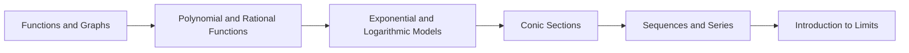

<!-- Generated by tools/build_indexes.py from tools/curriculum.json. Do not edit by hand. -->

# Precalculus

*The functions and tools that calculus needs*

[Mathematics](../README.md) › Precalculus

A focused preparation for calculus: function families, transformations, sequences and series, conics, and an honest first look at limits.

## At a glance

| | |
|---|---|
| Topics | 6 (4 complete, 0 draft, 2 planned) |
| Estimated study time | ~50 hours |
| Prerequisites | [03-algebra](../03-algebra/README.md), [05-trigonometry](../05-trigonometry/README.md) |

## Study order

The numbers are the recommended order. Study a topic only after the ones before it —
the dependency chain below is the shortest safe route through the discipline.

## Topic inventory

| # | Topic | Level | Est. time | Status | Materials |
|---|---|---|---|---|---|
| 1 | [Functions and Graphs](01-functions-and-graphs/README.md) | Intermediate | 9 h | Complete | [Tutorial](01-functions-and-graphs/README.md) · [Exercises](01-functions-and-graphs/exercises.md) · [Solutions](01-functions-and-graphs/solutions.md) |
| 2 | [Polynomial and Rational Functions](02-polynomial-and-rational-functions/README.md) | Intermediate | 9 h | Complete | [Tutorial](02-polynomial-and-rational-functions/README.md) · [Exercises](02-polynomial-and-rational-functions/exercises.md) · [Solutions](02-polynomial-and-rational-functions/solutions.md) |
| 3 | Exponential and Logarithmic Models | Intermediate | 8 h | Planned | — |
| 4 | [Conic Sections](04-conic-sections/README.md) | Intermediate | 8 h | Complete | [Tutorial](04-conic-sections/README.md) · [Exercises](04-conic-sections/exercises.md) · [Solutions](04-conic-sections/solutions.md) |
| 5 | [Sequences and Series](05-sequences-and-series/README.md) | Intermediate | 9 h | Complete | [Tutorial](05-sequences-and-series/README.md) · [Exercises](05-sequences-and-series/exercises.md) · [Solutions](05-sequences-and-series/solutions.md) |
| 6 | Introduction to Limits | Intermediate | 7 h | Planned | — |

### What each topic covers

- **Functions and Graphs** — Function notation, domains, transformations, composition, inverses and rates.
- **Polynomial and Rational Functions** — Roots, multiplicity, asymptotes, end behaviour and inequality sign charts.
- **Exponential and Logarithmic Models** — Growth and decay, half-life, log scales, and fitting exponential data.
- **Conic Sections** — Circles, parabolas, ellipses and hyperbolas as loci and as equations.
- **Sequences and Series** — Arithmetic and geometric sequences, summation notation, induction, convergence.
- **Introduction to Limits** — Average and instantaneous rate of change, limit intuition and the tangent problem.

## Related disciplines

- [07-calculus](../07-calculus/README.md)

## Status key

- **Complete** — tutorial, exercises and full solutions exist and the tutorial meets the
  [authoring standard](../CONTRIBUTING.md).
- **Draft** — some material exists but the topic is not finished.
- **Planned** — identified in the curriculum, not written yet.

Overall progress and the full topic inventory live in [ROADMAP.md](../ROADMAP.md).
