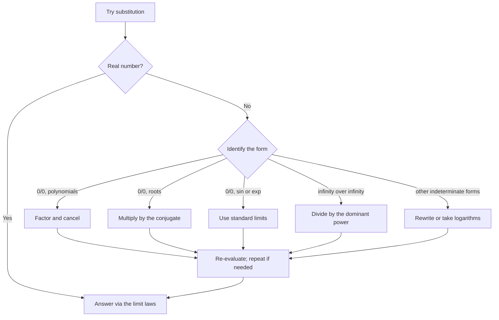

# Limits

> [Mathematics](../../README.md) › [Calculus](../README.md) · Level: Intermediate · Prerequisites: [Functions](../../03-algebra/11-functions/README.md), [Trigonometric Functions](../../05-trigonometry/01-trigonometric-functions/README.md), [Exponential and Logarithmic Functions](../../03-algebra/12-exponential-and-logarithmic-functions/README.md), [Inequalities](../../03-algebra/03-inequalities/README.md) · Estimated time: 600 min

## 1. Introduction

Calculus begins with a question that ordinary arithmetic cannot answer. If a car has travelled $s(t) = t^2$ metres after $t$ seconds, how fast is it going at $t = 1$? Average speed over an interval is easy: distance divided by time. But an *instant* has zero duration, and "distance divided by time" becomes $0/0$. Geometry asks the same question in another form: what is the slope of the tangent to $y = x^2$ at the point $(1,1)$? Two points determine a slope, but a tangent touches at one point only.

Both questions have the same shape. We cannot evaluate a quotient at the point of interest, but we can evaluate it *arbitrarily close* to that point, and the answers settle down:

$$
\frac{(1+h)^2 - 1}{h} = \frac{2h + h^2}{h} = 2 + h \quad (h \neq 0),
$$

and as $h$ shrinks towards $0$ this expression approaches $2$. The number $2$ is not the value at $h = 0$ — that value does not exist — but it is the value the expression is being *drawn towards*. The **limit** is the mathematical object that makes "drawn towards" precise.

This idea is the foundation of everything that follows in calculus. The derivative is a limit of difference quotients; the integral is a limit of sums; continuity, convergence of series, and the behaviour of functions near asymptotes are all limits in disguise. It is also the first place where the language of analysis — "for every $\varepsilon > 0$ there exists $\delta > 0$" — becomes unavoidable. Earlier chapters could get by with algebra and pictures. Limits cannot, because the central claim is about *all* points sufficiently close to $a$, and no finite list of numerical checks can establish a statement about all of them.

The history is instructive. Newton and Leibniz computed derivatives and integrals with "infinitesimals" — quantities smaller than any positive number yet not zero — and obtained correct answers for a century. Bishop Berkeley objected that these were "the ghosts of departed quantities": the same quantity was treated as nonzero while dividing and as zero afterwards. The objection was never answered within the infinitesimal language. Cauchy, Bolzano and finally Weierstrass replaced infinitesimals by inequalities: instead of saying "$h$ is infinitely small", say "for every tolerance $\varepsilon$ there is a distance $\delta$ such that all $h$ with $0 < |h| < \delta$ achieve that tolerance". This tutorial develops that definition and everything that can be proved from it.

Three themes run through the chapter:

1. **Approach, not arrival.** The limit at $a$ ignores the value at $a$. A function may be undefined at $a$ and still have a limit there, or defined at $a$ with a value that has nothing to do with the limit.
2. **Existence is a claim, not an assumption.** Writing $\lim_{x \to a} f(x)$ presumes the limit exists. Many limits do not exist, and proving non-existence is part of the subject. Infinite limits are a precise way of failing to exist.
3. **Techniques rest on theorems.** Factoring, rationalising, the standard limits $\sin x / x \to 1$ and $(e^x-1)/x \to 1$, and L'Hôpital's rule are not tricks; each is a theorem with hypotheses. Dropping a hypothesis — as in most L'Hôpital errors — produces wrong answers.

## 2. Prerequisites

**Functions, domains and composition.** A function is a rule with a domain; $f(x)$ is defined only for $x$ in that domain. We write $f \circ g$ for $x \mapsto f(g(x))$. See [Functions](../../03-algebra/11-functions/README.md).

**Absolute value and inequalities.** The statement $|x - a| < \delta$ means "$x$ lies within distance $\delta$ of $a$", that is, $a - \delta < x < a + \delta$. The triangle inequality $|u + v| \le |u| + |v|$ and its consequence $||u| - |v|| \le |u - v|$ are used constantly in $\varepsilon$-$\delta$ proofs. See [Inequalities](../../03-algebra/03-inequalities/README.md).

**Trigonometry in radians.** $\sin$, $\cos$, $\tan$ defined on the unit circle, with angles measured in radians; the identities $\sin^2 x + \cos^2 x = 1$ and $\sin 2x = 2 \sin x \cos x$. Radians are essential: the limit $\sin x / x \to 1$ is false in degrees, where the limit is $\pi/180$. See [Trigonometric Functions](../../05-trigonometry/01-trigonometric-functions/README.md) and [The Unit Circle](../../05-trigonometry/02-unit-circle/README.md).

**Exponential functions.** For $a > 0$, the function $a^x$ is defined for all real $x$, is positive, satisfies $a^{x+y} = a^x a^y$, and is increasing when $a > 1$. The number $e \approx 2.71828$ is introduced in [Exponential and Logarithmic Functions](../../03-algebra/12-exponential-and-logarithmic-functions/README.md); Section 7.8 explains exactly how $e$ is pinned down by a limit.

**Algebraic manipulation.** Expanding, factoring (including the difference of squares and the factor theorem), and rationalising numerators and denominators with conjugates. See [Factoring](../../03-algebra/07-factoring/README.md) and [Polynomials](../../03-algebra/06-polynomials/README.md).

**Proof language.** Quantifiers, direct proof, proof by contradiction, and the meaning of "for all" and "there exists". The $\varepsilon$-$\delta$ definition cannot be read without them: see [Proof Techniques](../../00-foundations/04-proof-techniques/README.md) and [Logic](../../00-foundations/02-logic/README.md).

## 3. Learning Objectives

By the end of this tutorial you will be able to

1. explain the difference between the value $f(a)$ and the limit $\lim_{x \to a} f(x)$, with examples where one exists and the other does not;
2. state the $\varepsilon$-$\delta$ definition of a limit at a finite point, and the corresponding definitions of one-sided limits, limits at infinity, and infinite limits;
3. read a quantified definition aloud as a game between two players, and negate it correctly to prove that a limit is not $L$;
4. prove the uniqueness of limits, the sum, product and quotient laws, and the squeeze theorem from the definition;
5. use the one-sided criterion: a two-sided limit exists if and only if both one-sided limits exist and agree;
6. evaluate limits by substitution, factoring, rationalising, and by combining the standard limits $\sin x / x \to 1$ and $(e^x - 1)/x \to 1$;
7. prove $\sin x / x \to 1$ from the areas of a triangle and a sector, and explain why the proof requires radians;
8. define $e$ by the condition $\lim_{h \to 0}(e^h - 1)/h = 1$ and explain why exactly one base satisfies it;
9. recognise the seven indeterminate forms, explain why each is "indeterminate" rather than "undefined", and give examples of each with different limits;
10. state L'Hôpital's rule with all its hypotheses and explain, with counterexamples, why each hypothesis is needed;
11. compute limits at infinity, identify horizontal and vertical asymptotes, and compare growth rates of rational functions;
12. define convergence of a sequence, prove the monotone convergence theorem from completeness, and use sequences to show that a limit does not exist.

## 4. Intuition

**Zooming in.** Take the graph of $y = (x^2-1)/(x-1)$, which is the line $y = x+1$ with a single point removed at $x = 1$. If you zoom in on the missing point, the gap shrinks in your field of view, and the curve looks straighter and straighter and closer and closer to height $2$. The limit is the height that the zoomed-in picture converges to, regardless of whether the point itself is drawn.

**The tolerance game.** Imagine an engineer who demands that a manufactured length be within $\varepsilon$ of a target. The machinist must choose a tolerance $\delta$ on the input such that any input within $\delta$ produces an output within $\varepsilon$. A limit statement says: *whatever* tolerance $\varepsilon$ the engineer demands — however small — the machinist can meet it by choosing some $\delta$. The machinist is allowed to choose $\delta$ after seeing $\varepsilon$, and the choice may depend on $\varepsilon$ and on the point $a$. If the engineer can name a tolerance that no $\delta$ can meet, the limit fails.

**Approach from both sides.** On the real line you can walk towards $a$ from the left or from the right. The two-sided limit exists only when both walks lead to the same height. The function $\operatorname{sign}(x)$, which is $-1$ for $x<0$ and $+1$ for $x>0$, has two perfectly well-behaved one-sided limits at $0$ that disagree, so it has no two-sided limit there — even though both one-sided limits exist.

**Oscillation is the hard failure.** A function can fail to have a limit not because it runs away to infinity or jumps, but because it never settles: $\sin(1/x)$ oscillates faster and faster as $x \to 0$, taking every value in $[-1,1]$ in every interval around $0$. No number $L$ can be within $\varepsilon = 1/2$ of all these values. Graphs drawn at finite resolution hide this behaviour; the definition does not, and Section 7.13 turns the intuition into a proof using two sequences that approach $0$ at different rates.

**Why the definition looks the way it does.** The phrase "arbitrarily close" contains an implicit "for all". Saying that $f(x)$ gets arbitrarily close to $L$ means: for every positive distance $\varepsilon$, the values eventually lie closer than $\varepsilon$. "Eventually" is made precise by $\delta$: there is a punctured neighbourhood of $a$ on which this holds. The definition is exactly the translation of two ordinary words, "arbitrarily" and "eventually", into quantifiers. The order matters: $\forall \varepsilon \exists \delta$ is a promise that $\delta$ can be found after $\varepsilon$ is known; the reversed order $\exists \delta \forall \varepsilon$ would demand a single neighbourhood achieving every tolerance at once, which is a far stronger and usually false statement.

## 5. Formal Definition

Throughout, $A \subseteq \mathbb{R}$, $f : A \to \mathbb{R}$ is a real-valued function, and $a \in \mathbb{R}$. Distances are measured by absolute value.

**Definition 5.1 (limit at a finite point).** Let $a$ be a **limit point** of $A$: every open interval containing $a$ contains at least one point of $A$ other than $a$. For $L \in \mathbb{R}$ we say that **the limit of $f$ at $a$ is $L$**, written

$$
\lim_{x \to a} f(x) = L,
$$

when

$$
\forall \varepsilon > 0 \ \exists \delta > 0 \ \forall x \in A : \quad 0 < \lvert x - a \rvert < \delta \ \Rightarrow \ \lvert f(x) - L \rvert < \varepsilon .
$$

In words: for every $\varepsilon > 0$ there is a $\delta > 0$ such that every point $x$ of the domain that is within distance $\delta$ of $a$, but is not $a$ itself, has its value $f(x)$ within distance $\varepsilon$ of $L$.

Three features of the definition deserve to be stated separately, because almost every beginner error violates one of them.

* The hypothesis is $0 < \lvert x-a\rvert$, not $\lvert x-a \rvert < \delta$ alone. The point $x = a$ is excluded. Consequently the value $f(a)$, if it exists, is irrelevant: the limit is determined by the *punctured* neighbourhood $0 < \lvert x-a \rvert < \delta$.
* The condition is required only for $x \in A$. If $f$ is undefined on part of the interval around $a$, those points impose no condition.
* The definition is local. Any open interval around $a$ contains smaller neighbourhoods, so only the behaviour of $f$ arbitrarily near $a$ matters; what $f$ does far away is invisible.

**Definition 5.2 (one-sided limits).** The **right-hand limit** $\lim_{x \to a^+} f(x) = L$ means

$$
\forall \varepsilon > 0 \ \exists \delta > 0 \ \forall x \in A : \quad 0 < x - a < \delta \ \Rightarrow \ \lvert f(x) - L \rvert < \varepsilon ,
$$

and the **left-hand limit** $\lim_{x \to a^-} f(x) = L$ is the same with $0 < a - x < \delta$. The notation $x \to a^+$ means that $x$ approaches $a$ through values larger than $a$.

**Definition 5.3 (limits at infinity).** For $L \in \mathbb{R}$,

$$
\lim_{x \to \infty} f(x) = L \quad :\Longleftrightarrow \quad \forall \varepsilon > 0 \ \exists M \in \mathbb{R} \ \forall x \in A : \quad x > M \ \Rightarrow \ \lvert f(x) - L \rvert < \varepsilon .
$$

The definition of $\lim_{x \to -\infty} f(x) = L$ is the same with $x < M$. Here $\infty$ is a symbol describing a direction of approach, not a number: it is never added, multiplied or substituted. One assumes that $A$ is unbounded above; otherwise the condition is vacuous and the limit would not be unique.

**Definition 5.4 (infinite limits).** We write $\lim_{x \to a} f(x) = +\infty$ when

$$
\forall M \in \mathbb{R} \ \exists \delta > 0 \ \forall x \in A : \quad 0 < \lvert x - a \rvert < \delta \ \Rightarrow \ f(x) > M ,
$$

and $\lim_{x \to a} f(x) = -\infty$ when the same holds with $f(x) < M$. One-sided and at-infinity versions are obtained by changing the approach condition, exactly as above. An infinite limit is a statement about *growth*, not an equation between numbers: $f(x)$ does not get close to a real number called "$+\infty$"; it eventually exceeds every bound.

**Definition 5.5 (existence and non-existence).** The phrase "$\lim_{x \to a} f(x)$ exists" means that there is a real number $L$ satisfying Definition 5.1. If no such $L$ exists, we say the limit **does not exist** (DNE). An infinite limit is a particular, informative way for a limit to fail to exist; many authors write $\lim = +\infty$ and still say the limit does not exist as a real number, and both conventions are in use. In this repository, "converges" always refers to a finite limit; an infinite limit is called **divergence to $+\infty$** or $-\infty$.

The convention that $a$ is a limit point of the domain is not cosmetic.

**Remark 5.6 (why the limit-point hypothesis).** Suppose $A = \{0\} \cup \{2\}$ and $a = 0$. For any $L$ and any $\varepsilon > 0$, the only point of $A$ with $0 < \lvert x - 0 \rvert < \delta$ is $x = 2$; if $\delta < 2$ there are no such points at all, and the implication is vacuously true. Then every real $L$ would satisfy Definition 5.1, and "the limit" would not be unique. Excluding isolated points from the definition removes this pathology: at an isolated point of the domain there is no limit to speak of.

**Theorem 5.7 (uniqueness of the limit).** Let $a$ be a limit point of $A$. If $\lim_{x \to a} f(x) = L$ and $\lim_{x \to a} f(x) = M$, then $L = M$.

*Proof.* Suppose, for contradiction, that $L \neq M$. Then $\varepsilon := \lvert L - M \rvert / 3 > 0$. By the definition applied with this $\varepsilon$, there are $\delta_1, \delta_2 > 0$ such that

$$
0 < \lvert x-a\rvert < \delta_1 \Rightarrow \lvert f(x)-L\rvert < \varepsilon,
\qquad
0 < \lvert x-a\rvert < \delta_2 \Rightarrow \lvert f(x)-M\rvert < \varepsilon .
$$

Let $\delta = \min(\delta_1, \delta_2)$. Because $a$ is a limit point of $A$, there is at least one $x \in A$ with $0 < \lvert x-a\rvert < \delta$. For this $x$, the triangle inequality gives

$$
\lvert L - M \rvert \le \lvert L - f(x) \rvert + \lvert f(x) - M \rvert < 2\varepsilon = \frac{2}{3}\lvert L - M \rvert ,
$$

which forces $\lvert L - M \rvert < \frac{2}{3}\lvert L - M \rvert$. Since $\lvert L-M\rvert > 0$, dividing by it yields $1 < \frac23$, a contradiction. Hence $L = M$. $\blacksquare$

The same argument, verbatim, proves that a limit at infinity and a one-sided limit are unique. It also explains the choice $\varepsilon = \lvert L-M \rvert/3$: any $\varepsilon < \lvert L-M\rvert/2$ works, and $1/3$ leaves room to spare.

## 6. Mathematical Notation

| Notation | Read aloud | Meaning |
|---|---|---|
| $\lim_{x \to a} f(x) = L$ | "the limit of $f$ of $x$ as $x$ tends to $a$ is $L$" | the two-sided limit of Definition 5.1 |
| $x \to a$ | "$x$ tends to $a$" | $x$ approaches $a$; $x = a$ is never required |
| $\lim_{x \to a^+} f(x)$ | "the limit as $x$ tends to $a$ from the right" | $x > a$, $x \to a$ |
| $\lim_{x \to a^-} f(x)$ | "the limit as $x$ tends to $a$ from the left" | $x < a$, $x \to a$ |
| $\lim_{x \to \infty} f(x) = L$ | "the limit as $x$ tends to infinity" | for every $\varepsilon$ there is $M$ with $\lvert f(x)-L\rvert<\varepsilon$ for all $x>M$ |
| $\lim_{x \to a} f(x) = +\infty$ | "the limit is plus infinity" | $f(x)$ eventually exceeds every bound $M$ |
| $\varepsilon$ (epsilon) | "epsilon" | an arbitrary positive tolerance, usually thought of as small |
| $\delta$ (delta) | "delta" | a positive distance, chosen in response to $\varepsilon$ |
| $\forall \varepsilon > 0 \ \exists \delta > 0$ | "for every epsilon greater than zero there exists delta greater than zero" | the quantifier order of the definition |
| $0 < \lvert x - a\rvert < \delta$ | "zero is less than the distance from $x$ to $a$, which is less than delta" | $x$ lies in the punctured $\delta$-neighbourhood of $a$ |
| $\lvert f(x) - L \rvert < \varepsilon$ | "the distance from $f$ of $x$ to $L$ is less than epsilon" | $f(x)$ lies in the $\varepsilon$-neighbourhood of $L$ |

Two pieces of notation are shorthand rather than new mathematics: $\lim_{x \to a} f(x)$ is a noun phrase only when the limit exists, and $\lim_{x \to a} f(x) = \infty$ is an abbreviation for the quantified statement of Definition 5.4. In particular, one never writes $\infty - \infty$, $\infty / \infty$ or $0 \cdot \infty$ as if they were arithmetic; these strings are names for *forms* discussed in Section 7.9.

## 7. Core Concepts

### 7.1 Approach, not arrival

The single most important habit in this chapter is to separate three questions about a point $a$:

1. Is $f(a)$ defined?
2. Does $\lim_{x \to a} f(x)$ exist?
3. If both exist, are they equal?

The definition of the limit answers only the second question, and it deliberately refuses to look at the first. Here are the four possible combinations.

| $f(a)$ | $\lim_{x\to a} f(x)$ | Example at $a=0$ | Behaviour |
|---|---|---|---|
| undefined | exists | $f(x) = \dfrac{\sin x}{x}$ | removable gap; the curve has a hole |
| defined | exists, equal to $f(a)$ | $f(x) = x^2$ | continuous (the subject of the next topic) |
| defined | exists, different | $f(x) = \begin{cases} x^2 & x \neq 0 \\ 7 & x = 0\end{cases}$ | removable discontinuity |
| defined or not | does not exist | $f(x) = \lvert x\rvert / x$ | jump; no two-sided limit |

The first row is the reason the theory is needed at all: the function $x \mapsto (\sin x)/x$ has no value at $0$ in any elementary sense, yet every application — the derivative of sine, the small-angle approximation, the period of a pendulum — requires the number that the values approach.

The third row is the reason the definition insists on $0 < \lvert x-a\rvert$. A function may be perfectly well defined at $a$ and behave bizarrely there while its nearby values converge elsewhere; the limit reports the nearby behaviour and ignores the isolated value. Authors of the subject sometimes say that the limit is "the value the function would have if it were well behaved at $a$"; the formal content of that phrase is Definition 5.1.

**A first computation from the definition.** To see the definition in action, prove $\lim_{x \to 3}(2x - 1) = 5$. Let $\varepsilon > 0$. We need $\lvert (2x-1) - 5 \rvert = 2\lvert x - 3 \rvert < \varepsilon$, which holds whenever $\lvert x - 3 \rvert < \varepsilon/2$. So choose $\delta = \varepsilon/2$: for every $x$ with $0 < \lvert x-3 \rvert < \delta$,

$$
\lvert (2x-1) - 5 \rvert = 2\lvert x-3 \rvert < 2\delta = \varepsilon .
$$

The proof is a recipe: simplify $\lvert f(x) - L \rvert$ until the factor $\lvert x - a \rvert$ appears, then choose $\delta$ to make the whole expression smaller than $\varepsilon$. Section 7.2 explains how to read the definition systematically, and Section 9 works several examples where the simplification is not linear.

### 7.2 Reading an $\varepsilon$-$\delta$ definition

The definition is a sentence with three nested quantifiers. Reading it as a dialogue makes the dependencies obvious.

> **Adversary:** I give you $\varepsilon > 0$.
> **You:** I choose $\delta > 0$, possibly depending on $\varepsilon$ and on $a$.
> **Adversary:** I give you any $x$ in the domain with $0 < \lvert x - a \rvert < \delta$.
> **You:** Then $\lvert f(x) - L \rvert < \varepsilon$.

You win the game if you can always respond, for every $\varepsilon$ the adversary names. The limit statement is exactly the assertion that you have a winning strategy. Three consequences:

* **$\delta$ may depend on $\varepsilon$.** It usually does: in the linear example, $\delta = \varepsilon/2$. It may also depend on $a$; in $f(x) = x^2$ at $a$, one chooses $\delta = \min\left(1, \frac{\varepsilon}{2\lvert a\rvert + 1}\right)$, and the presence of $a$ is legitimate. The next topic, continuity, separates this local notion from uniform continuity, where a single $\delta$ must work at every point at once.
* **Smaller is always safer.** If $\delta$ works, so does every $\delta' \in (0, \delta]$: a smaller punctured neighbourhood is a subset of the larger one, so the implication remains true. This is why estimates may freely replace $\delta$ by $\min(\delta, 1)$ or $\min(\delta, c)$.
* **The implication is one-directional.** Nothing is asserted about points at distance $\ge \delta$. A common error is to check a few points inside the neighbourhood and conclude; the definition demands *all* points inside.

**Negating the definition.** To prove that $\lim_{x \to a} f(x) \neq L$, negate the quantified sentence:

$$
\exists \varepsilon > 0 \ \forall \delta > 0 \ \exists x \in A : \quad 0 < \lvert x - a \rvert < \delta \ \text{ and } \ \lvert f(x) - L \rvert \ge \varepsilon .
$$

In game form: the adversary names an $\varepsilon$ (the challenger becomes the defender of failure), and for every $\delta$ you propose, the adversary finds a point inside the punctured neighbourhood whose value is at least $\varepsilon$ away from $L$. To show that the limit *does not exist at all*, one must show this for every candidate $L$; the cleanest general tool is the sequence criterion of Section 7.13.

**Uniform versus pointwise.** Notice that $\delta$ is allowed to depend on $a$. The function $f(x) = x^2$ needs a smaller $\delta$ at large $a$ than at $a=0$ for the same $\varepsilon$, because the graph is steeper. Uniform continuity, studied in the next topic, is precisely the demand that one $\delta$ serve all $a$ at once.

### 7.3 One-sided limits

Many functions have a clean behaviour on each side of a point but not across it. The two one-sided limits record the two behaviours.

**Theorem 7.1 (two-sided limit criterion).** Let $a$ be a limit point of $A$ from both sides: every interval $(a-\delta, a)$ and every interval $(a, a+\delta)$ contains points of $A$. Then

$$
\lim_{x \to a} f(x) = L \quad \Longleftrightarrow \quad \lim_{x \to a^-} f(x) = L \ \text{ and } \ \lim_{x \to a^+} f(x) = L .
$$

*Proof.* ($\Rightarrow$) Assume the two-sided limit is $L$, and let $\varepsilon > 0$. Choose $\delta > 0$ as in Definition 5.1. If $0 < x - a < \delta$, then certainly $0 < \lvert x-a \rvert < \delta$, so $\lvert f(x) - L \rvert < \varepsilon$; this proves the right-hand limit. The same implication with $0 < a - x < \delta$ proves the left-hand limit.

($\Leftarrow$) Assume both one-sided limits equal $L$. Given $\varepsilon > 0$, choose $\delta_+ > 0$ for the right-hand limit and $\delta_- > 0$ for the left-hand limit, and set $\delta = \min(\delta_+, \delta_-)$. Take any $x \in A$ with $0 < \lvert x-a \rvert < \delta$. Either $x > a$ or $x < a$. In the first case $0 < x - a < \delta \le \delta_+$, so $\lvert f(x)-L \rvert < \varepsilon$. In the second case $0 < a - x < \delta \le \delta_-$, so the same inequality holds. Hence $\lvert f(x)-L\rvert < \varepsilon$ for all such $x$. $\blacksquare$

**Example 7.1.1.** Let $f(x) = \lvert x \rvert / x$ for $x \neq 0$. For $x > 0$, $f(x) = 1$; for $x < 0$, $f(x) = -1$. Hence $\lim_{x \to 0^+} f(x) = 1$ and $\lim_{x \to 0^-} f(x) = -1$. The one-sided limits exist but differ, so by Theorem 7.1 the two-sided limit does not exist. This is a **jump discontinuity**, a notion made precise in the next topic.

**Example 7.1.2.** At $a = 0$, the function $\sqrt{x}$ is defined only for $x \ge 0$. Then $\lim_{x \to 0^+}\sqrt x = 0$, while $\lim_{x \to 0^-}\sqrt x$ is not defined, because there are no domain points to the left of $0$. The two-sided limit is also not defined (there is no two-sided punctured neighbourhood inside the domain), and one says that $\sqrt x$ is *right-continuous* at $0$. The domain matters: a limit is only asserted over points where the function exists.

### 7.4 The limit laws

The definition is designed so that limits behave like numbers under the arithmetic operations. Each law below is a theorem, and each proof is an exercise in choosing $\varepsilon$'s and then taking minima of $\delta$'s.

**Theorem 7.2 (algebra of limits).** Suppose $a$ is a limit point of $A$, that $f, g : A \to \mathbb{R}$, and that

$$
\lim_{x \to a} f(x) = L, \qquad \lim_{x \to a} g(x) = M
$$

with $L, M \in \mathbb{R}$. Then

1. $\displaystyle \lim_{x \to a} \bigl(f(x) + g(x)\bigr) = L + M$;
2. $\displaystyle \lim_{x \to a} \bigl(f(x) - g(x)\bigr) = L - M$;
3. $\displaystyle \lim_{x \to a} \bigl(c\,f(x)\bigr) = cL$ for every constant $c \in \mathbb{R}$;
4. $\displaystyle \lim_{x \to a} \bigl(f(x)g(x)\bigr) = LM$;
5. $\displaystyle \lim_{x \to a} \frac{f(x)}{g(x)} = \frac{L}{M}$, provided $M \neq 0$ and $g(x) \neq 0$ for $x$ near $a$.

*Proof of (1).* Let $\varepsilon > 0$. Apply the definition with $\varepsilon/2$: there are $\delta_1, \delta_2 > 0$ with

$$
0 < \lvert x-a\rvert < \delta_1 \Rightarrow \lvert f(x) - L\rvert < \frac{\varepsilon}{2},
\qquad
0 < \lvert x-a\rvert < \delta_2 \Rightarrow \lvert g(x) - M\rvert < \frac{\varepsilon}{2}.
$$

Let $\delta = \min(\delta_1, \delta_2)$. For $0 < \lvert x-a\rvert < \delta$, both inequalities hold, so by the triangle inequality

$$
\lvert (f(x)+g(x)) - (L+M)\rvert \le \lvert f(x)-L\rvert + \lvert g(x)-M\rvert < \frac{\varepsilon}{2} + \frac{\varepsilon}{2} = \varepsilon .
$$

This proves (1). Part (2) is (1) applied to $f$ and $-g$, using (3) with $c = -1$.

*Proof of (3).* If $c = 0$ the function $cf$ is identically $0$ and the limit is $0 = cL$. Otherwise let $\varepsilon > 0$ and choose $\delta > 0$ with $\lvert f(x)-L\rvert < \varepsilon/\lvert c \rvert$ on the punctured neighbourhood. Then

$$
\lvert c f(x) - cL \rvert = \lvert c \rvert \, \lvert f(x) - L \rvert < \lvert c \rvert \cdot \frac{\varepsilon}{\lvert c \rvert} = \varepsilon .
$$

*Proof of (4).* The key is that $f$ is bounded near $a$. Because $f \to L$, applied with $\varepsilon = 1$ there is $\delta_0 > 0$ such that $0 < \lvert x-a\rvert < \delta_0$ implies $\lvert f(x) - L \rvert < 1$, hence

$$
\lvert f(x) \rvert \le \lvert f(x) - L \rvert + \lvert L \rvert < \lvert L \rvert + 1 .
$$

Now let $\varepsilon > 0$. Choose $\delta_1 > 0$ so that $\lvert g(x) - M \rvert < \dfrac{\varepsilon}{2(\lvert L\rvert + 1)}$ and $\delta_2 > 0$ so that $\lvert f(x) - L \rvert < \dfrac{\varepsilon}{2(\lvert M\rvert + 1)}$ on the respective punctured neighbourhoods; let $\delta = \min(\delta_0, \delta_1, \delta_2)$. For $0 < \lvert x-a\rvert < \delta$, add and subtract $f(x)M$:

$$
\begin{aligned}
\lvert f(x)g(x) - LM \rvert
&= \lvert f(x)(g(x)-M) + M(f(x)-L) \rvert \\
&\le \lvert f(x)\rvert\,\lvert g(x)-M\rvert + \lvert M\rvert\,\lvert f(x)-L\rvert \\
&< (\lvert L\rvert+1)\cdot\frac{\varepsilon}{2(\lvert L\rvert+1)} + \lvert M\rvert \cdot \frac{\varepsilon}{2(\lvert M\rvert+1)} \\
&< \frac{\varepsilon}{2} + \frac{\varepsilon}{2} = \varepsilon .
\end{aligned}
$$

The strict inequality in the last line uses $\lvert M\rvert < \lvert M\rvert + 1$, which also covers the case $M = 0$.

*Proof of (5).* It is enough, by (4), to prove that $1/g \to 1/M$, and then to apply (4) to $f$ and $1/g$. The hypothesis $M \neq 0$ is essential, and the first step is to keep $g$ away from $0$.

**Lemma 7.3 (sign preservation).** If $\lim_{x\to a} g(x) = M \neq 0$, then there is $\delta_0 > 0$ such that

$$
0 < \lvert x-a\rvert < \delta_0 \ \Rightarrow \ \lvert g(x)\rvert > \frac{\lvert M\rvert}{2},
$$

and in particular $g(x) \neq 0$ and $g(x)$ has the same sign as $M$ on that punctured neighbourhood.

*Proof.* Apply the definition with $\varepsilon = \lvert M\rvert/2 > 0$. There is $\delta_0 > 0$ such that $\lvert g(x) - M\rvert < \lvert M\rvert/2$ whenever $0 < \lvert x-a\rvert < \delta_0$. The reverse triangle inequality gives

$$
\lvert g(x) \rvert = \lvert M - (M - g(x)) \rvert \ge \lvert M \rvert - \lvert M - g(x)\rvert > \lvert M\rvert - \frac{\lvert M\rvert}{2} = \frac{\lvert M\rvert}{2} > 0 .
$$

The sign statement follows because $g(x)$ cannot cross $0$ without its distance to $M$ exceeding $\lvert M \rvert$. $\blacksquare$

Returning to (5): let $\varepsilon > 0$ and take $\delta_0$ from Lemma 7.3. For $0 < \lvert x-a\rvert < \delta_0$,

$$
\left\lvert \frac{1}{g(x)} - \frac{1}{M} \right\rvert = \frac{\lvert M - g(x)\rvert}{\lvert g(x)\rvert\,\lvert M\rvert} < \frac{\lvert g(x)-M\rvert}{(\lvert M\rvert/2)\lvert M\rvert} = \frac{2}{\lvert M\rvert^2}\,\lvert g(x)-M\rvert .
$$

Choose $\delta_1 > 0$ with $\lvert g(x)-M\rvert < \varepsilon \lvert M\rvert^2/2$ for $0 < \lvert x-a\rvert < \delta_1$, and set $\delta = \min(\delta_0,\delta_1)$. Then the left side is $< \varepsilon$. Hence $1/g \to 1/M$, and (4) gives $f/g \to L/M$. $\blacksquare$

**Remark 7.4 (the laws are one-directional).** The converse of (1) is false: from the existence of $\lim (f+g)$ one cannot conclude that $\lim f$ and $\lim g$ exist. Take $a = 0$, $f(x) = 1/x$ and $g(x) = -1/x$ for $x \neq 0$. Then $f + g \equiv 0$ has limit $0$, but neither $f$ nor $g$ has a finite limit at $0$. The hypotheses of Theorem 7.2 are that both limits exist *before* the law is applied; using the law to prove existence is circular.

**Lemma 7.5 (root rule).** Let $n \in \mathbb{N}$.

1. If $\lim_{x\to a} g(x) = L > 0$, then $\lim_{x\to a}\sqrt[n]{g(x)} = \sqrt[n]{L}$.
2. If $\lim_{x\to a} g(x) = 0$ and $g(x) \ge 0$ near $a$, then $\lim_{x\to a}\sqrt[n]{g(x)} = 0$.

*Proof.* (1) For $n = 2$ the identity $\sqrt{u} - \sqrt{L} = (u - L)/(\sqrt u + \sqrt L)$ gives, as long as $u \ge 0$,

$$
\lvert \sqrt{u} - \sqrt{L}\rvert = \frac{\lvert u-L\rvert}{\sqrt u + \sqrt L} \le \frac{\lvert u-L\rvert}{\sqrt L},
$$

so choosing $\lvert g(x)-L\rvert < \varepsilon\sqrt L$ makes $\lvert \sqrt{g(x)}-\sqrt L\rvert < \varepsilon$. For general $n$, use the factorisation

$$
u - L = \bigl(\sqrt[n]{u} - \sqrt[n]{L}\bigr)\left(u^{(n-1)/n} + u^{(n-2)/n}L^{1/n} + \cdots + L^{(n-1)/n}\right),
$$

in which the bracket is at least $L^{(n-1)/n} > 0$ when $u$ is near $L$ (all terms are nonnegative and the last is positive). Hence $\lvert \sqrt[n]{u} - \sqrt[n]{L}\rvert \le \lvert u-L\rvert / L^{(n-1)/n}$ near $L$, and the conclusion follows as for $n=2$.

(2) Given $\varepsilon > 0$, choose $\delta > 0$ with $0 \le g(x) < \varepsilon^n$ on the punctured neighbourhood. Then $0 \le \sqrt[n]{g(x)} < \varepsilon$. $\blacksquare$

**Corollary 7.6 (substitution for polynomials and rational functions).** Let $p$ be a polynomial and $a \in \mathbb{R}$. Then

$$
\lim_{x \to a} p(x) = p(a).
$$

If $q$ is a polynomial with $q(a) \neq 0$, then $\lim_{x \to a} p(x)/q(x) = p(a)/q(a)$.

*Proof.* The constant function $x \mapsto c$ has limit $c$, and the identity function $x \mapsto x$ has limit $a$ (given $\varepsilon$, take $\delta = \varepsilon$). A polynomial is built from these by finitely many additions and multiplications, so repeated application of Theorem 7.2 (1), (3), (4) gives the first claim; the quotient claim is Theorem 7.2 (5). $\blacksquare$

Corollary 7.6 is the formal justification of the "plug in the number" method. It applies exactly when the substitution produces a defined real number. When it produces $0/0$, the laws say nothing — the limit may exist, may fail to exist, or may be infinite — and one must transform the expression first. Sections 7.6 and 7.7 develop the transformations.

### 7.5 The squeeze theorem

The limit laws reconstruct a limit from the limits of the pieces. The squeeze theorem works in the opposite direction: it traps an unknown function between two known ones.

**Theorem 7.7 (squeeze theorem).** Suppose that $f, g, h : A \to \mathbb{R}$, that $a$ is a limit point of $A$, and that for all $x \in A$ with $0 < \lvert x-a\rvert < \delta_0$,

$$
f(x) \le g(x) \le h(x).
$$

If

$$
\lim_{x \to a} f(x) = L = \lim_{x \to a} h(x),
$$

then $\lim_{x \to a} g(x) = L$ as well.

*Proof.* Let $\varepsilon > 0$. Choose $\delta_1 > 0$ so that $0 < \lvert x-a\rvert < \delta_1$ implies $\lvert f(x)-L\rvert < \varepsilon$, which in particular gives $f(x) > L - \varepsilon$. Choose $\delta_2 > 0$ so that $0 < \lvert x-a\rvert < \delta_2$ implies $\lvert h(x)-L\rvert < \varepsilon$, hence $h(x) < L + \varepsilon$. Let $\delta = \min(\delta_0,\delta_1,\delta_2)$. For $0 < \lvert x-a\rvert < \delta$,

$$
L - \varepsilon < f(x) \le g(x) \le h(x) < L + \varepsilon,
$$

so $\lvert g(x) - L\rvert < \varepsilon$. $\blacksquare$

**Example 7.5.1.** Show that $\lim_{x\to 0} x\sin(1/x) = 0$ (with the function defined to be $0$ at $x=0$, or simply for $x \neq 0$). Since $\lvert \sin t\rvert \le 1$ for every real $t$,

$$
-\lvert x\rvert \le x\sin(1/x) \le \lvert x\rvert ,
$$

and both outer functions tend to $0$ as $x \to 0$. The squeeze theorem applies with $f(x) = -\lvert x\rvert$, $g(x) = x\sin(1/x)$, $h(x) = \lvert x\rvert$. The oscillation of $\sin(1/x)$ is still present — the graph crosses zero infinitely often near $0$ — but the amplitude $x$ shrinks and forces the values to $0$.

**Variants.** The squeeze theorem holds verbatim for one-sided limits, with $0 < x - a < \delta$ throughout, and for limits at infinity, with $x > M$ in place of the punctured neighbourhood. It also holds for sequences (Theorem 7.18). It does *not* require $g$ to be defined at $a$, and it does not require $f$ or $h$ to be monotone; only the inequalities near $a$ matter.

### 7.6 Evaluating limits: substitution, factoring, rationalising

Four transformations cover most computations.

**Substitution.** If the expression is built from constants, $x$, sums, products, quotients with nonzero denominators and roots of positive quantities, Corollary 7.6 and Lemma 7.5 justify substituting $x=a$. For example, $\lim_{x\to2}(3x^2-x+4)=12-2+4=14$.

**Factoring.** When substitution gives $0/0$ for a quotient of polynomials, the factor theorem supplies a factor $(x-a)$ in both. Cancelling is legitimate because $x\neq a$ throughout the limit:

$$
\lim_{x\to3}\frac{x^2-9}{x^2-5x+6}=\lim_{x\to3}\frac{(x-3)(x+3)}{(x-3)(x-2)}=\lim_{x\to3}\frac{x+3}{x-2}=6 .
$$

The equality of limits is Theorem 8.2; the final value is substitution. The value at $x=3$ never enters.

**Rationalising.** When a square root creates $0/0$, multiply by the conjugate:

$$
\frac{\sqrt{x+4}-2}{x}=\frac{(x+4)-4}{x\left(\sqrt{x+4}+2\right)}=\frac{1}{\sqrt{x+4}+2}\longrightarrow\frac14 .
$$

The manoeuvre replaces a difference of nearly equal roots by a sum, which is neither small nor opaque.

**Combining fractions.** A difference tending to $\infty-\infty$ becomes one fraction:

$$
\frac1x-\frac1{x+1}=\frac{1}{x(x+1)},
$$

which tends to $+\infty$ as $x\to0^+$, to $-\infty$ as $x\to0^-$, and to $0$ as $x\to\infty$.

For limits at infinity of rational functions, divide by the highest power of $x$; for expressions with $\sqrt{x^2}$, remember $\sqrt{x^2}=\lvert x\rvert$. Cancellation is valid only for *factors*: one may cancel $(x-2)$ in $\frac{x^2-4}{x-2}$, but one may not "cancel $x$" in $\frac{x+2}{x+3}$.

### 7.7 The standard limit $\lim_{x\to 0}\dfrac{\sin x}{x} = 1$

This limit is the gateway between trigonometry and calculus: it says the sine curve has slope $1$ at the origin. It cannot be proved by substitution or algebra; the proof uses area.

**Theorem 7.8 (fundamental trigonometric limit).** With angles measured in radians,

$$
\lim_{x\to0}\frac{\sin x}{x}=1 .
$$

*Proof.* Since $\sin(-x)/(-x)=\sin x/x$, the quotient is even; by Theorem 7.1 it suffices to prove the right-hand limit. Let $0<x<\pi/2$ and consider the unit circle with $A=(1,0)$, $P=(\cos x,\sin x)$ on the circle, and $Q=(1,\tan x)$ where the tangent at $A$ meets the ray $OP$. Compare three areas:

* the triangle $OAP$ has base $1$ and height $\sin x$, so area $\frac12\sin x$;
* the sector $OAP$ is the fraction $\frac{x}{2\pi}$ of a disc of area $\pi$, so area $\frac{x}{2}$;
* the triangle $OAQ$ has base $1$ and height $\tan x$, so area $\frac12\tan x$.

The triangle lies inside the sector, which lies inside the larger triangle, so

$$
\frac12\sin x<\frac12 x<\frac12\tan x .
$$

Dividing by $\frac12\sin x>0$ gives $1<\frac{x}{\sin x}<\frac{1}{\cos x}$; taking reciprocals reverses the inequalities:

$$
\cos x<\frac{\sin x}{x}<1 \qquad \left(0<x<\frac{\pi}{2}\right).
$$

Now $\cos x\to1$ as $x\to0^+$, because $\lvert 1-\cos x\rvert=2\sin^2(x/2)\le x^2/2\to0$. The squeeze theorem (Theorem 7.7) gives $\sin x/x\to1$ from the right. For $x<0$, put $u=-x>0$ and use evenness: $\sin x/x=\sin u/u\to1$. By Theorem 7.1 the two-sided limit is $1$. $\blacksquare$

**Why radians.** In degrees the sector has area $\frac{\pi}{180}\cdot\frac{x}{2}$, the sandwich becomes $\cos x<\frac{\pi}{180}\cdot\frac{\sin x}{x}<1$, and the limit is $\frac{180}{\pi}$. Every derivative formula in calculus is calibrated to radians, which is why the subject silently assumes them.

**Corollary 7.9 (consequences).**

$$
\lim_{x\to0}\frac{\tan x}{x}=1,\qquad \lim_{x\to0}\frac{1-\cos x}{x}=0,\qquad \lim_{x\to0}\frac{1-\cos x}{x^2}=\frac12 .
$$

*Proof.* The first follows from $\frac{\tan x}{x}=\frac{\sin x}{x}\cdot\frac{1}{\cos x}$ and the product law, since $\cos x\to1$. For the others use $1-\cos x=2\sin^2(x/2)$:

$$
\frac{1-\cos x}{x}=\sin\frac x2\cdot\frac{\sin(x/2)}{x/2}\longrightarrow0\cdot1=0,
\qquad
\frac{1-\cos x}{x^2}=\frac12\left(\frac{\sin(x/2)}{x/2}\right)^2\longrightarrow\frac12 . \ \blacksquare
$$

**A circularity warning.** L'Hôpital's rule would "compute" this limit as $\lim\cos x/1=1$, but the derivative of $\sin$ is derived *from* $\sin x/x\to1$. Using L'Hôpital here is circular; the area proof is the only non-circular route at this stage.

### 7.8 The standard limit $\lim_{x\to 0}\dfrac{e^x-1}{x} = 1$

The exponential function with base $e$ is characterised, among all exponential functions, by having slope exactly $1$ at the origin. The statement

$$
\lim_{h\to0}\frac{e^h-1}{h}=1
$$

is that characterisation, and it is the cleanest rigorous definition of $e$ before logarithms and integrals are available.

**Why exactly one base qualifies.** For $a>1$ set $S_a(h)=\frac{a^h-1}{h}$ and $L(a)=\lim_{h\to0}S_a(h)$. Three facts pin down $e$.

* *The limit exists.* The function $t\mapsto a^t$ is convex, since weighted AM–GM gives $a^{\lambda u+(1-\lambda)v}\le\lambda a^u+(1-\lambda)a^v$ for $0\le\lambda\le1$. Secant slopes of a convex function increase with the right endpoint, so $S_a$ is nondecreasing on $(0,\infty)$ and, on $(0,1]$, bounded above by $S_a(1)=a-1$; hence $L(a)$ exists and is finite. The left-hand limit agrees because $S_a(-u)=\frac{1-a^{-u}}{u}=\frac{a^u-1}{u\,a^u}=\frac{S_a(u)}{a^u}\to L(a)$.
* *It is additive and strictly increasing.* Since $S_{ab}(h)=S_a(h)b^h+S_b(h)$, we get $L(ab)=L(a)+L(b)$; positivity for $a>1$ gives strict increase, while $L(a^{2^n})=2^nL(a)\to\infty$ and $L(1/a)=-L(a)$ give the full range.
* *One base gives $L(a)=1$.* Fix $b_0>1$ and put $\varphi(t)=L(b_0^t)$. Additivity and monotonicity make $\varphi$ linear: $\varphi(q)=q\varphi(1)$ for rationals $q$, and monotonicity extends this to all real $t$. Since $c:=\varphi(1)=L(b_0)>0$, the base $e:=b_0^{1/c}$ satisfies $L(e)=1$, and it is unique because $L$ is strictly increasing. With this definition $L(e^t)=t$ and $L(a)=\log_e a$, which is continuous and takes each real value once.

**Theorem 7.10 (fundamental exponential limit).** With $e$ defined this way,

$$
\lim_{x\to0}\frac{e^x-1}{x}=1,\qquad \lim_{x\to0}\frac{e^{cx}-1}{x}=c \quad (c\in\mathbb{R}).
$$

*Proof.* The first is the definition $L(e)=1$. For the second with $c\neq0$, put $h=cx$: given $\varepsilon>0$, choose $\delta'>0$ with $\lvert(e^h-1)/h-1\rvert<\varepsilon$ for $0<\lvert h\rvert<\delta'$, and set $\delta=\delta'/\lvert c\rvert$. Then $0<\lvert x\rvert<\delta$ gives $0<\lvert h\rvert<\delta'$ and

$$
\left\lvert\frac{e^{cx}-1}{x}-c\right\rvert=\lvert c\rvert\left\lvert\frac{e^{h}-1}{h}-1\right\rvert<\lvert c\rvert\varepsilon,
$$

so the limit is $c$. For $c=0$ the expression is identically $0$. $\blacksquare$

**Corollary 7.11.** $\displaystyle\lim_{x\to0}\frac{\ln(1+x)}{x}=1$.

*Proof.* Put $y=\ln(1+x)$, so $x=e^y-1$ and $y\to0$ as $x\to0$ because $e^y-1=y\cdot\frac{e^y-1}{y}\to0$. Then

$$
\frac{\ln(1+x)}{x}=\frac{y}{e^y-1}=\frac{1}{(e^y-1)/y}\longrightarrow1 . \ \blacksquare
$$

**Remark 7.12 (two descriptions of $e$).** The base defined by $L(e)=1$ is the same number $e=2.718281828\ldots$ that arises as $\lim(1+1/n)^n$ and as $\sum 1/n!$; the equivalence is proved in the later topic on sequences and series. Only $L(e)=1$ is used here, so nothing is circular.

### 7.9 Indeterminate forms

A limit is often described by the *shape* of its competing parts:

$$
\frac00,\qquad\frac{\infty}{\infty},\qquad0\cdot\infty,\qquad\infty-\infty,\qquad1^\infty,\qquad0^0,\qquad\infty^0 .
$$

The name **indeterminate form** means precisely this: the two limits alone do not determine the limit of the combination. It does not mean that the limit is undefined, and it certainly does not mean that the limit equals $1$.

| Form | Expression | Limit | Expression | Limit |
|---|---|---|---|---|
| $\frac00$ | $\frac{x}{x}$ at $0$ | $1$ | $\frac{x^2}{x}$ at $0$ | $0$ |
| $\frac\infty\infty$ | $\frac{2x+1}{x+3}$ at $\infty$ | $2$ | $\frac{x^2}{x}$ at $\infty$ | $+\infty$ |
| $0\cdot\infty$ | $x\cdot\frac1x$ at $\infty$ | $1$ | $x^2\cdot\frac1x$ at $\infty$ | $+\infty$ |
| $\infty-\infty$ | $(x+1)-x$ at $\infty$ | $1$ | $x^2-x$ at $\infty$ | $+\infty$ |
| $1^\infty$ | $\left(1+\frac1x\right)^x$ at $\infty$ | $e$ | $\left(1+\frac1{x^2}\right)^x$ at $\infty$ | $1$ |
| $0^0$ | $x^x$ at $0^+$ | $1$ | $x^{1/\ln x}$ at $0^+$ | $e$ |
| $\infty^0$ | $x^{1/x}$ at $\infty$ | $1$ | $\left(e^x\right)^{1/x}$ at $\infty$ | $e$ |

Each row can also be made to produce $+\infty$ or to have no limit; the table is a warning, not a classification. The $0^0$ row is instructive: $x^x=e^{x\ln x}\to e^0=1$ because $x\ln x\to0$ (put $x=e^{-t}$: then $x\ln x=-te^{-t}\to0$), yet $x^{1/\ln x}=e$ identically on $(0,1)$.

**Example 7.9.1 ($1^\infty$).** For $x>0$, $(1+1/x)^x=e^{x\ln(1+1/x)}$. With $u=1/x\to0^+$, Corollary 7.11 gives $x\ln(1+1/x)=\frac{\ln(1+u)}{u}\to1$, and $e^y\to e$ as $y\to1$ because $e^y-e=e(e^{y-1}-1)\to0$. Hence the limit is $e$. Replacing the exponent $x$ by $x^2$ makes the exponent limit $+\infty$, so the limit is $+\infty$.

**Strategy.** For $0/0$ and $\infty/\infty$: factor, rationalise, or apply L'Hôpital after checking its hypotheses. For $0\cdot\infty$: rewrite $fg=\frac{f}{1/g}$ or $\frac{g}{1/f}$. For $\infty-\infty$: combine into one fraction, conjugate, or factor out the dominant term. For $1^\infty$, $0^0$, $\infty^0$: take logarithms, which turn the exponent into a $0\cdot\infty$ problem. For anything with $\lvert x\rvert$ or $\sqrt{x^2}$: split into one-sided limits first. Every step must be justified by a theorem; "the form is $0/0$, so the limit is $1$" is not one.

### 7.10 L'Hôpital's rule: statement and hypotheses

**Theorem 7.13 (L'Hôpital's rule).** Let $I$ be an open interval containing $a\in\mathbb{R}$, and let $f,g$ be differentiable on $I\setminus\{a\}$ with $g'(x)\neq0$ there. Suppose that at least one of the following holds:

**(H1)** $\displaystyle\lim_{x\to a}f(x)=0$ and $\displaystyle\lim_{x\to a}g(x)=0$;

**(H2)** $\displaystyle\lim_{x\to a}\lvert g(x)\rvert=+\infty$.

If $\displaystyle\lim_{x\to a}\frac{f'(x)}{g'(x)}=L$ exists as a real number, or equals $+\infty$ or $-\infty$, then

$$
\lim_{x\to a}\frac{f(x)}{g(x)}=L .
$$

The same statement holds for $x\to a^\pm$ and for $a=\pm\infty$ (with $I$ replaced by an interval $(c,\infty)$ or $(-\infty,c)$).

**Why the hypotheses matter.**

* *The form is needed.* For $f(x)=x+1$ and $g(x)=2x+1$ at $a=0$, $f'/g'\equiv\frac12$ but $f/g\to1$. The rule is not a quotient rule.
* *$g'\neq0$ near $a$* keeps the ratio $f'/g'$ defined; without it the third hypothesis is meaningless.
* *The derivative ratio must have a limit.* The converse fails: with $f(x)=x^2\sin(1/x)$, $f(0)=0$, and $g(x)=x$ at $0$, we have $f/g=x\sin(1/x)\to0$ while $f'/g'=2x\sin(1/x)-\cos(1/x)$ has no limit.
* *Differentiability is needed near $a$, not at $a$;* $f$ and $g$ need not even be defined at $a$.

**Using it legitimately.** Each application is a separate theorem application, and the new ratio must be checked again. For $\lim_{x\to0}\frac{e^x-1-x}{x^2}$: the first derivative ratio $\frac{e^x-1}{2x}$ is still $0/0$, the second is $\frac{e^x}{2}\to\frac12$, so the limit is $\frac12$; each step satisfies (H1) with $g'\neq0$.

**A trap.** For $\lim_{x\to\infty}\frac{x+\sin x}{x}$ the derivative ratio $1+\cos x$ has no limit, so the rule does not apply; yet the limit exists and equals $1$ (squeeze). Failure of the derivative ratio proves nothing.

**Circularity.** The derivatives of $\sin$, $\cos$, $e^x$ and $\ln x$ are limits of exactly the type studied here, so L'Hôpital cannot be used to *establish* $\sin x/x\to1$ or $(e^x-1)/x\to1$; that would assume what is to be proved. The proof of the rule belongs with Cauchy's mean value theorem and is given in [Applications of Derivatives](../05-applications-of-derivatives/README.md).
### 7.11 Infinite limits and asymptotes

Infinite limits describe growth without bound. They are defined by the same quantifier pattern, with the roles of $\varepsilon$ and $\delta$ played by an arbitrary bound $M$ and a distance.

**Theorem 7.14 (algebra of infinite limits).** Suppose $a$ is a limit point of $A$ and that $f, g$ are defined near $a$.

1. If $\lim_{x\to a} f(x) = +\infty$ and $g$ is bounded below near $a$, then $\lim_{x\to a}(f(x)+g(x)) = +\infty$.
2. If $\lim_{x\to a} f(x) = +\infty$ and $\lim_{x\to a} g(x) = M > 0$, then $\lim_{x\to a} f(x)g(x) = +\infty$.
3. If $\lim_{x\to a} f(x) = +\infty$ and $f(x) > 0$ near $a$, then $\lim_{x\to a} \dfrac{1}{f(x)} = 0$.
4. If $\lim_{x\to a} f(x) = 0$ and $f(x) > 0$ near $a$, then $\lim_{x\to a}\dfrac{1}{f(x)} = +\infty$.

*Proof.* Let $g$ be bounded below near $a$, say $g(x) \ge c$ on a punctured neighbourhood.

(1) Given $M \in \mathbb{R}$, choose $\delta_1$ so that $f(x) > M - c$ for $0<\lvert x-a\rvert<\delta_1$, and $\delta_2$ so that $g(x) \ge c$ there. For $0 < \lvert x-a\rvert < \min(\delta_1,\delta_2)$ we get $f(x)+g(x) > (M-c)+c = M$, which is the definition of divergence to $+\infty$.

(2) Let $M' \in \mathbb{R}$. Since $g \to M > 0$, there is $\delta_1$ with $g(x) > M/2$ for $0<\lvert x-a\rvert<\delta_1$, by Lemma 7.3. Choose $\delta_2$ with $f(x) > 2M'/M$ there (if $M' \le 0$ any $\delta_2$ works). Then $f(x)g(x) > (2M'/M)(M/2) = M'$.

(3) Given $\varepsilon > 0$, choose $\delta$ with $f(x) > 1/\varepsilon$. Since $f(x)>0$, we get $0 < 1/f(x) < \varepsilon$.

(4) Given $M \in \mathbb{R}$, if $M \le 0$ then $1/f(x) > 0 \ge M$ automatically. If $M > 0$, choose $\delta$ with $0 < f(x) < 1/M$; then $1/f(x) > M$. $\blacksquare$

**Warning 7.15 (the converse of (3) fails).** From $1/f(x) \to 0$ one cannot conclude $f(x)\to+\infty$: take $f(x) = 1/x$ for $x \neq 0$. Then $1/f(x) = x \to 0$, but $f$ does not tend to $+\infty$ at $0$ — its one-sided limits are $+\infty$ on the right and $-\infty$ on the left, so the two-sided limit does not exist. One also cannot add infinities: $f(x) = x$ and $g(x) = -x$ both diverge as $x\to\infty$, but $f+g \equiv 0$. The forms $\infty-\infty$ and $0\cdot\infty$ reappear here in their analytic guise.

**Asymptotes.** The line $x = a$ is a **vertical asymptote** of the graph of $f$ when at least one of the four one-sided limits at $a$ is $+\infty$ or $-\infty$. The line $y = L$ is a **horizontal asymptote** when $\lim_{x\to\infty} f(x) = L$ or $\lim_{x\to-\infty} f(x) = L$. For example, $f(x) = 1/x$ has vertical asymptote $x = 0$ (with opposite signs on the two sides) and horizontal asymptote $y = 0$. The function $f(x) = 1/x^2$ has the same asymptotes but tends to $+\infty$ on both sides of the vertical asymptote; a glance at the formula reveals this, whereas a casual sketch often does not.

Rational functions can also have **slant asymptotes**: if

$$
f(x) - (mx + b) \longrightarrow 0 \quad \text{as } x \to \pm\infty,
$$

then $y = mx+b$ is an asymptote. Polynomial division produces $m$ and $b$: for $f(x) = \dfrac{x^2+1}{x} = x + \dfrac1x$, the line $y = x$ is a slant asymptote as $x\to\pm\infty$. A rational function has a horizontal asymptote exactly when the numerator's degree is at most the denominator's, a slant asymptote when it is exactly one larger, and no linear asymptote when it is larger by two or more.

### 7.12 Sequences and limits at infinity

A **sequence** is a function $a : \mathbb{N} \to \mathbb{R}$, written $(a_n)_{n\ge 1}$. Its limit is defined by the same tolerance idea, with the index playing the role of the variable.

**Definition 7.16.** The sequence $(a_n)$ **converges to** $L \in \mathbb{R}$ when

$$
\forall \varepsilon > 0 \ \exists N \in \mathbb{N} \ \forall n \ge N : \quad \lvert a_n - L \rvert < \varepsilon .
$$

We write $a_n \to L$ or $\lim_{n\to\infty} a_n = L$. Divergence to $+\infty$ means: for every $M \in \mathbb{R}$ there is $N$ such that $a_n > M$ for all $n \ge N$.

**Theorem 7.17 (functions give sequences).** If $\lim_{x\to\infty} f(x) = L$, then the sequence $a_n := f(n)$ converges to $L$.

*Proof.* Given $\varepsilon > 0$, choose $M$ as in Definition 5.3 and let $N$ be any integer with $N > M$. For $n \ge N$ we have $n > M$, hence $\lvert a_n - L \rvert = \lvert f(n)-L\rvert < \varepsilon$. $\blacksquare$

The converse fails: a function may have a limit along the integers and behave badly between them. For instance, $f(x) = \sin(\pi x)$ satisfies $f(n) = 0$ for every integer $n$, so $f(n) \to 0$, but $f$ has no limit as $x\to\infty$.

**Theorem 7.18 (algebra and squeeze for sequences).** If $a_n \to L$ and $b_n \to M$, then $a_n \pm b_n \to L \pm M$, $c a_n \to cL$, $a_n b_n \to LM$, and $a_n/b_n \to L/M$ when $M \neq 0$ and $b_n \neq 0$ eventually. If $a_n \le c_n \le b_n$ eventually and $a_n \to L$, $b_n \to L$, then $c_n \to L$.

*Proof.* Identical to Theorems 7.2 and 7.7, replacing punctured neighbourhoods by tails $\{n : n \ge N\}$ and using that a finite number of initial terms are irrelevant. $\blacksquare$

**Theorem 7.19 (monotone convergence).** Every nondecreasing sequence that is bounded above converges, and its limit is the supremum of its set of values. Every nonincreasing sequence bounded below converges to the infimum.

*Proof.* Let $(a_n)$ be nondecreasing and bounded above, and let $S = \{a_n : n \ge 1\}$, which is nonempty and bounded above. By the completeness axiom of $\mathbb{R}$, $L := \sup S$ exists. Let $\varepsilon > 0$. Since $L - \varepsilon$ is not an upper bound for $S$, there is $N$ with $a_N > L - \varepsilon$. For $n \ge N$, monotonicity gives $a_N \le a_n \le L$, hence $L - \varepsilon < a_n \le L$, so $\lvert a_n - L\rvert < \varepsilon$. $\blacksquare$

Completeness is the axiom that every nonempty subset of $\mathbb{R}$ that is bounded above has a least upper bound; it is what distinguishes $\mathbb{R}$ from $\mathbb{Q}$, and it is precisely the hypothesis used in the proof. Without it (for example in $\mathbb{Q}$) the theorem fails: the sequence $1, 1.4, 1.41, 1.414, \ldots$ of decimal truncations of $\sqrt2$ is increasing and bounded above by $2$, but has no limit in $\mathbb{Q}$.

**Corollary 7.20 (geometric sequences).** For $r \in \mathbb{R}$: if $\lvert r\rvert < 1$ then $r^n \to 0$; if $r = 1$ then $r^n \to 1$; if $r > 1$ then $r^n \to +\infty$; if $r \le -1$ the sequence has no limit (for $r=-1$ it oscillates between $1$ and $-1$).

*Proof.* For $0 < r < 1$, the sequence $r^n$ is decreasing and bounded below by $0$, so by Theorem 7.19 it converges to some $L \ge 0$. Passing to the limit in $r^{n+1} = r\cdot r^n$ using Theorem 7.18 gives $L = rL$, hence $L = 0$. For $-1 < r < 0$, squeeze $- \lvert r\rvert^n \le r^n \le \lvert r\rvert^n$. For $r > 1$, write $r = 1+s$ with $s>0$; Bernoulli's inequality gives $r^n \ge 1+ns \to \infty$. The remaining cases are immediate. $\blacksquare$

**Example 7.12.1.** $\displaystyle\lim_{n\to\infty}\frac{3n^2+2n-1}{n^2+5} = 3$: divide by $n^2$ to get $\frac{3 + 2/n - 1/n^2}{1 + 5/n^2}$, and use $1/n^k \to 0$ together with Theorem 7.18.

**Example 7.12.2.** The sequence $a_n = (1+1/n)^n$ is increasing and bounded above by $3$ (both facts follow from the binomial theorem together with the bound $1/k! \le 1/2^{k-1}$ for $k \ge 2$), so by Theorem 7.19 it converges. Its limit is $e$; this is the compounding characterisation mentioned in Remark 7.12. The proof that this limit coincides with the base defined in Section 7.8 is given in the sequences and series topic.

### 7.13 Limits that do not exist

Three mechanisms account for most failures.

1. **Different one-sided limits.** The jump $\lvert x\rvert/x$ at $0$ is the model; Theorem 7.1 makes the failure automatic.
2. **Unboundedness.** The function may grow without bound, as $1/x^2$ does at $0$, or oscillate with growing amplitude.
3. **Oscillation.** The function stays bounded but never settles, as $\sin(1/x)$ does at $0$.

The third is the one that defeats graphical intuition, and the cleanest proof uses sequences.

**Theorem 7.21 (sequential criterion for non-existence).** Let $a$ be a limit point of $A$. If there are sequences $(x_n)$ and $(y_n)$ in $A \setminus \{a\}$ with $x_n \to a$ and $y_n \to a$, such that $f(x_n) \to L_1$ and $f(y_n) \to L_2$ with $L_1 \neq L_2$, then $\lim_{x\to a} f(x)$ does not exist.

*Proof.* Suppose the limit existed and equalled $L$. Let $\varepsilon>0$ and choose $\delta>0$ as in Definition 5.1. Since $x_n \to a$ and $x_n \neq a$, there is $N_1$ such that $0 < \lvert x_n - a\rvert < \delta$ for all $n \ge N_1$, hence $\lvert f(x_n)-L\rvert < \varepsilon$ for all $n \ge N_1$; therefore $f(x_n) \to L$. The same argument gives $f(y_n) \to L$. Limits of sequences are unique (the proof of Theorem 5.7 applies verbatim to sequences), so $L_1 = L = L_2$, contradicting $L_1 \neq L_2$. $\blacksquare$

**Example 7.13.1.** $f(x) = \sin(1/x)$ has no limit at $0$. Take

$$
x_n = \frac{1}{\pi/2 + 2\pi n}, \qquad y_n = \frac{1}{3\pi/2 + 2\pi n}.
$$

Both tend to $0$ as $n\to\infty$, and $f(x_n) = \sin(\pi/2 + 2\pi n) = 1$ while $f(y_n) = \sin(3\pi/2 + 2\pi n) = -1$. Two constant subsequences with different limits, so by Theorem 7.21 no limit exists. The same computation with sequences tending to $0$ along which $\sin(1/x)$ takes the value $0$ shows that the oscillation is dense in $[-1,1]$: between any two zeros there is a point where the value is $1$ and a point where it is $-1$.

**Example 7.13.2.** $f(x) = x\sin(1/x)$ *does* have limit $0$ at $0$ (Example 7.5.1), even though it oscillates infinitely often. Bounded oscillation with shrinking amplitude is compatible with a limit; bounded oscillation with fixed amplitude is not. The contrast between $\sin(1/x)$ and $x\sin(1/x)$ is the best single illustration of what the definition measures.

**Remark 7.22 (why sequences matter later).** Theorem 7.21 is the prototype of a general principle: continuity, compactness and convergence in more general spaces are all characterised by sequences, and the sequential point of view turns analytic problems into problems about the integers. The next topic uses the sequential criterion to prove that continuity is equivalent to the preservation of limits, and the real analysis discipline builds the whole theory on it.

## 8. Formulas and Properties

This section collects the results of Section 7 for reference. Every entry carries its hypotheses, and Section 11 records what happens when they are ignored.

### 8.1 The limit laws

Let $a$ be a limit point of the common domain of $f$ and $g$, and suppose the limits below exist as real numbers.

| Law | Hypothesis | Conclusion |
|---|---|---|
| Uniqueness | $\lim f = L$ and $\lim f = M$ | $L = M$ |
| Sum | $\lim f = L$, $\lim g = M$ | $\lim(f+g) = L+M$ |
| Difference | $\lim f = L$, $\lim g = M$ | $\lim(f-g) = L-M$ |
| Constant multiple | $\lim f = L$ | $\lim(cf) = cL$ |
| Product | $\lim f = L$, $\lim g = M$ | $\lim(fg) = LM$ |
| Quotient | $\lim f = L$, $\lim g = M \neq 0$ | $\lim(f/g) = L/M$ |
| Power | $\lim f = L$, $n \in \mathbb{N}$ | $\lim f^n = L^n$ |
| Root | $\lim f = L > 0$, $n \in \mathbb{N}$ | $\lim \sqrt[n]{f} = \sqrt[n]{L}$ |

The power law follows from the product law by induction; the root law is Lemma 7.5. The quotient law fails when $M=0$, and then the quotient may diverge, oscillate, or converge (Section 7.9).

### 8.2 Order and locality

**Theorem 8.1 (order preservation).** If $\lim_{x\to a} f(x)=L$, $\lim_{x\to a} g(x)=M$, and $f(x)\le g(x)$ on a punctured neighbourhood of $a$, then $L\le M$.

*Proof.* Suppose $L>M$ and put $\varepsilon=(L-M)/3$. On a sufficiently small punctured neighbourhood, $f(x)>L-\varepsilon$ and $g(x)<M+\varepsilon$, so

$$
f(x)-g(x) > L-M-2\varepsilon = \frac{L-M}{3} > 0,
$$

contradicting $f(x)\le g(x)$. $\blacksquare$

The conclusion is $L\le M$, not $L<M$: strict inequalities are not preserved in the limit ($0<\lvert x\rvert$ for $x\neq0$, but both limits at $0$ are $0$).

**Theorem 8.2 (locality).** If $f(x)=g(x)$ for $0<\lvert x-a\rvert<r$, then the two limits at $a$ exist or fail together, and when they exist they are equal.

*Proof.* Every punctured $\delta$-neighbourhood with $\delta\le r$ lies in the region where $f=g$, so a $\delta$ that works for one function works for the other. $\blacksquare$

Locality licenses cancelling a common factor in a $0/0$ limit: the cancelled expression agrees with the original everywhere except at $a$.

### 8.3 Standard limits

All angles are in radians.

| Limit | Value | Proved in |
|---|---|---|
| $\lim_{x\to0}\frac{\sin x}{x}$ | $1$ | Theorem 7.8 |
| $\lim_{x\to0}\frac{\tan x}{x}$ | $1$ | Corollary 7.9 |
| $\lim_{x\to0}\frac{1-\cos x}{x}$ | $0$ | Corollary 7.9 |
| $\lim_{x\to0}\frac{1-\cos x}{x^2}$ | $\frac12$ | Corollary 7.9 |
| $\lim_{x\to0}\frac{e^x-1}{x}$ | $1$ | Theorem 7.10 |
| $\lim_{x\to0}\frac{e^{cx}-1}{x}$ | $c$ | Theorem 7.10 |
| $\lim_{x\to0}\frac{\ln(1+x)}{x}$ | $1$ | Corollary 7.11 |

## 9. Step-by-Step Examples

The examples run from mechanical to delicate. Each states the method, why it is legitimate, and every algebraic step.

### 9.1 Direct substitution

**Example 9.1.** Compute $\displaystyle\lim_{x\to 2}\left(x^3 - 3x + 4\right)$.

The function is a polynomial, so Corollary 7.6 applies with $a=2$:

$$
\lim_{x\to2}\left(x^3-3x+4\right) = 2^3 - 3\cdot 2 + 4 = 8-6+4 = 6 .
$$

No denominator vanishes, so the limit laws apply directly. A numerical check confirms it: at $x=2.001$ the polynomial is $6.009006\ldots$ and at $x=1.999$ it is $5.991006\ldots$, both within $0.01$ of $6$.

### 9.2 Factoring a removable singularity

**Example 9.2.** Compute $\displaystyle\lim_{x\to 1}\frac{x^3-1}{x^2-1}$.

Substitution gives $0/0$, so Corollary 7.6 does not apply. Factor using the difference of cubes and the difference of squares:

$$
x^3-1 = (x-1)(x^2+x+1), \qquad x^2-1 = (x-1)(x+1).
$$

For $x \neq 1$,

$$
\frac{x^3-1}{x^2-1} = \frac{(x-1)(x^2+x+1)}{(x-1)(x+1)} = \frac{x^2+x+1}{x+1}.
$$

The cancellation is legitimate by Theorem 8.2: the two expressions agree on $0<\lvert x-1\rvert<1$. The right-hand expression is a rational function with nonzero denominator at $1$, so

$$
\lim_{x\to1}\frac{x^2+x+1}{x+1} = \frac{1+1+1}{1+1} = \frac32 .
$$

By locality the original limit is $\frac32$. The function has a hole at $x=1$; the limit gives the height of the hole, not a value of the function.

### 9.3 Rationalising

**Example 9.3.** Compute $\displaystyle\lim_{x\to 0}\frac{\sqrt{1+3x}-1}{x}$.

Substitution gives $0/0$. Multiply by the conjugate $\sqrt{1+3x}+1$, which is positive near $0$:

$$
\frac{\sqrt{1+3x}-1}{x}
= \frac{(1+3x)-1}{x\left(\sqrt{1+3x}+1\right)}
= \frac{3x}{x\left(\sqrt{1+3x}+1\right)} .
$$

For $x \neq 0$ cancel $x$:

$$
\frac{3}{\sqrt{1+3x}+1} \longrightarrow \frac{3}{\sqrt1+1} = \frac32,
$$

by the root law (Lemma 7.5), the sum law, and substitution at $x=0$, where the denominator is $2\neq0$. The limit is $\frac32$.

### 9.4 Trigonometric limits

**Example 9.4.** Compute $\displaystyle\lim_{x\to0}\frac{1-\cos 2x}{x\sin x}$.

Substitution gives $0/0$. Use $1-\cos 2x = 2\sin^2 x$:

$$
\frac{1-\cos 2x}{x\sin x} = \frac{2\sin^2 x}{x\sin x} = \frac{2\sin x}{x} = 2\cdot\frac{\sin x}{x},
$$

where the cancellation of $\sin x$ is legitimate for $0<\lvert x\rvert<\pi$, since $\sin x \neq 0$ there. By Theorem 7.8 and the constant-multiple law, the limit is $2\cdot 1 = 2$.

### 9.5 Limits at infinity and horizontal asymptotes

**Example 9.5.** Compute

$$
\text{(a)}\quad \lim_{x\to\infty}\frac{3x^3-4x+7}{2x^3+x^2}, \qquad
\text{(b)}\quad \lim_{x\to\infty}\left(\sqrt{x^2+3x}-x\right), \qquad
\text{(c)}\quad \lim_{x\to-\infty}\left(\sqrt{x^2+x}+x\right).
$$

**(a)** Divide numerator and denominator by $x^3$:

$$
\frac{3x^3-4x+7}{2x^3+x^2}
= \frac{3 - \dfrac{4}{x^2} + \dfrac{7}{x^3}}{2 + \dfrac1x}
\longrightarrow \frac{3-0+0}{2+0} = \frac32,
$$

using $1/x^k\to0$ and the quotient law (denominator limit $2\neq0$). The line $y=\frac32$ is a horizontal asymptote.

**(b)** This is an $\infty-\infty$ form; rationalise:

$$
\sqrt{x^2+3x}-x = \frac{(x^2+3x)-x^2}{\sqrt{x^2+3x}+x} = \frac{3x}{\sqrt{x^2+3x}+x}.
$$

For $x>0$, divide by $x$ and use $\sqrt{x^2+3x}/x = \sqrt{1+3/x}$:

$$
\frac{3}{\sqrt{1+\dfrac3x}+1} \longrightarrow \frac{3}{1+1} = \frac32 .
$$

**(c)** Here $x<0$, and the sign matters. Rationalise as before:

$$
\sqrt{x^2+x}+x = \frac{(x^2+x)-x^2}{\sqrt{x^2+x}-x} = \frac{x}{\sqrt{x^2+x}-x}.
$$

For $x<0$, $\sqrt{x^2+x}=\lvert x\rvert\sqrt{1+1/x}=-x\sqrt{1+1/x}$, so

$$
\frac{x}{-x\sqrt{1+\dfrac1x}-x} = -\frac{1}{\sqrt{1+\dfrac1x}+1} \longrightarrow -\frac12 .
$$

*The sign trap.* Writing $\sqrt{x^2}=x$ is valid only for $x\ge0$. For $x\to-\infty$ one must use $\sqrt{x^2}=-x$; omitting the minus sign turns $-\frac12$ into $+\frac12$.

### 9.6 Epsilon-delta proofs, linear and quadratic

**Example 9.6.** Prove from Definition 5.1 that (a) $\displaystyle\lim_{x\to2}(5x-3)=7$ and (b) $\displaystyle\lim_{x\to1}x^2=1$.

**(a)** Let $\varepsilon>0$. Since

$$
\lvert (5x-3)-7\rvert = \lvert 5x-10\rvert = 5\lvert x-2\rvert ,
$$

the choice $\delta=\varepsilon/5$ gives $\lvert (5x-3)-7\rvert<5\delta=\varepsilon$ whenever $0<\lvert x-2\rvert<\delta$.

**(b)** Let $\varepsilon>0$. Factor:

$$
\lvert x^2-1\rvert = \lvert x-1\rvert\,\lvert x+1\rvert .
$$

Impose first $\lvert x-1\rvert<1$; then $0<x<2$ and $\lvert x+1\rvert=x+1<3$. Hence $\lvert x^2-1\rvert<3\lvert x-1\rvert$ under that restriction. Take

$$
\delta=\min\left(1,\frac{\varepsilon}{3}\right).
$$

For $0<\lvert x-1\rvert<\delta$ both constraints hold, so $\lvert x^2-1\rvert<3\cdot\frac{\varepsilon}{3}=\varepsilon$. This completes the proof. The two-step choice — restrict to a convenient neighbourhood, then meet the tolerance — is the standard pattern for nonlinear functions.

### 9.7 L'Hôpital's rule with hypothesis checks, and a trap

**Example 9.7.** Compute $\displaystyle\lim_{x\to0}\frac{e^x-1-x}{x^2}$ and discuss $\displaystyle\lim_{x\to\infty}\frac{x+\sin x}{x}$.

*First limit.* Both $f(x)=e^x-1-x$ and $g(x)=x^2$ are differentiable on $\mathbb{R}$, and $g'(x)=2x\neq0$ for $x\neq0$. Also $f(0)=0=g(0)$, so (H1) holds. The derivative ratio is

$$
\frac{f'(x)}{g'(x)} = \frac{e^x-1}{2x},
$$

still $0/0$ at $0$. Apply the rule again: $f_1(x)=e^x-1$ and $g_1(x)=2x$ are differentiable, $g_1'(x)=2\neq0$, and both tend to $0$. The new ratio satisfies

$$
\frac{f_1'(x)}{g_1'(x)} = \frac{e^x}{2} \longrightarrow \frac12 .
$$

Since the second derivative ratio has a finite limit, so does the first, and hence the original limit is $\frac12$. Each application was separately justified.

*The trap.* For $\displaystyle\lim_{x\to\infty}\frac{x+\sin x}{x}$, the derivative ratio is $\dfrac{1+\cos x}{1}$, which has no limit as $x\to\infty$. L'Hôpital's rule does not apply, and the oscillation of $1+\cos x$ says nothing about the original ratio. The limit nevertheless exists:

$$
\frac{x+\sin x}{x} = 1+\frac{\sin x}{x}, \qquad \left\lvert\frac{\sin x}{x}\right\rvert\le\frac1x\longrightarrow0,
$$

so by the squeeze theorem the limit is $1$. L'Hôpital's rule is a sufficient condition, never a necessary one.

## 10. Visual Explanations

### 10.1 The $\varepsilon$-$\delta$ picture

Picture the graph of $f$ near $(a,L)$. Draw the horizontal lines $y=L-\varepsilon$ and $y=L+\varepsilon$: this is the **strip of tolerance**. The definition says that, however narrow this strip, there is a vertical strip $a-\delta<x<a+\delta$ — with the line $x=a$ itself deleted — whose graph lies entirely inside the horizontal strip.

| Component | Symbol | Geometric meaning |
|---|---|---|
| Tolerance on the output | $\varepsilon>0$ | half-width of the horizontal strip around $L$ |
| Tolerance on the input | $\delta>0$ | half-width of the vertical strip around $a$ |
| Excluded point | $0<\lvert x-a\rvert$ | the vertical line $x=a$ is removed |

The picture certifies a candidate $L$ but does not produce one. Computing limits is done with the laws and standard limits; $\varepsilon$-$\delta$ is how the laws are proved and how doubtful cases are settled.

### 10.2 Choosing a method

The loop in the diagram is honest: one transformation does not always resolve the form, and each pass must rest on an identity from Section 7.6 or a theorem from Section 7. The sequence analogue of everything in this chapter is obtained by replacing punctured neighbourhoods with tails $n\ge N$; Section 7.12 develops this correspondence.

## 11. Common Mistakes

**1. "The form is $0/0$, so the limit is $1$."** The form $0/0$ is not a value and not a rule. $x/x \to 1$, $x^2/x \to 0$ and $x/x^2 \to +\infty$ as $x \to 0^+$; all three are $0/0$ shapes. The form tells you that substitution failed, nothing more.

**2. Cancelling terms rather than factors.** From $\dfrac{x+2}{x+3}$ one may not cancel $x$; the expression is not $\frac23$. Cancellation applies only to a common *factor* of numerator and denominator, and the factor must be cancelled as a whole.

**3. Cancelling a factor that is zero at the limit point without saying why.** Cancelling $x-1$ in $\dfrac{(x-1)(x+1)}{x-1}$ is legitimate precisely because $x \neq 1$ in the limit; the cancelled function agrees with the original on the punctured neighbourhood. Writing "$\frac{x-1}{x-1} = 1$ at $x=1$" is false at $x=1$ and conflates the limit with the value.

**4. Stopping at $0/0$ and declaring "the limit does not exist".** A $0/0$ form may have a perfectly good finite limit. The declaration of non-existence requires a proof, usually via two sequences (Theorem 7.21).

**5. Applying the limit laws when one of the limits does not exist.** The sum law requires $\lim f$ and $\lim g$ to exist before it is used. Writing $\lim_{x\to0}\left(\frac1x - \frac1x\right) = \infty - \infty$ is meaningless. Even when the combination has a limit, as with $f = 1/x$ and $g = -1/x$, the individual limits may fail, so the law does not apply.

**6. Treating $\infty$ as a number.** Expressions such as $\infty - \infty$, $0\cdot\infty$ and $\infty/\infty$ have no arithmetic meaning. Only the quantified statements of Definitions 5.3 and 5.4 are meaningful, and they must be verified.

**7. Concluding "the limit is infinite, so it exists".** An infinite limit is divergence; it is a precise description of *how* the limit fails to be a real number. Saying "the limit exists and equals $\infty$" mixes two conventions; the safe statement is "diverges to $+\infty$".

**8. Forgetting the sign of $\sqrt{x^2}$.** For $x<0$, $\sqrt{x^2} = -x$, not $x$. This single sign changes answers at $-\infty$ (Example 9.5(c)). More generally, $\sqrt{x^2} = \lvert x\rvert$ always.

**9. Ignoring one-sided behaviour.** Limits involving $\lvert x\rvert$, $\sqrt{x}$, or piecewise definitions must be split into one-sided limits at the junction. The two-sided limit exists exactly when both sides agree (Theorem 7.1).

**10. Using L'Hôpital without checking its hypotheses.** The rule requires a $0/0$ or $\infty/\infty$ form, differentiability near the point, $g' \neq 0$, and the existence of the limit of $f'/g'$. Applying it to $\frac{x+1}{2x+1}$ at $0$ gives $\frac12$ for a quotient whose limit is $1$; applying it when $f'/g'$ oscillates gives nothing at all (Example 9.7).

**11. Using L'Hôpital to prove the standard limits.** The derivatives of $\sin x$ and $e^x$ are computed from $\lim \sin x/x$ and $\lim (e^x-1)/x$. Using L'Hôpital to compute those limits is circular. The area proof and the definition of $e$ are the non-circular foundations.

**12. Assuming boundedness implies convergence.** The function $\sin(1/x)$ is bounded by $1$ near $0$ and has no limit there; the sequence $(-1)^n$ is bounded and divergent. Boundedness plus monotonicity is enough (Theorem 7.19), but boundedness alone is not.

**13. Choosing $\delta$ after seeing $x$.** In an $\varepsilon$-$\delta$ proof, $\delta$ may depend on $\varepsilon$ and on the point $a$, but never on the particular $x$ that the adversary supplies. A "proof" that picks $\delta = \lvert x-a\rvert$ proves nothing, because the definition demands one $\delta$ that works for all $x$ in the punctured neighbourhood.

## 12. Applications

**Instantaneous velocity and the derivative.** If $s(t)$ is the position of a body at time $t$, the average velocity over $[t_0, t_0+h]$ is $\frac{s(t_0+h)-s(t_0)}{h}$. The instantaneous velocity is the limit as $h \to 0$. Every derivative in the next topics is a limit of this shape, and the limit laws are what make differentiation mechanical.

**Tangent lines and slopes.** The slope of the tangent to $y = f(x)$ at $x=a$ is $\lim_{h\to0}\frac{f(a+h)-f(a)}{h}$. For $f(x)=x^2$ this is $2a$; for $f(x)=\sin x$ it is $\cos a$, and the computation reduces to $\sin h/h \to 1$ and $(1-\cos h)/h \to 0$.

**Asymptotes and graphing.** Limits at infinity determine horizontal asymptotes; infinite limits determine vertical asymptotes. A graphing calculator draws pixels, not limits, and will happily draw a line through a vertical asymptote unless the formula is analysed. Determining the one-sided behaviour at a vertical asymptote is a limit computation, not a plotting exercise.

**Numerical analysis and iteration.** An iterative algorithm produces a sequence $x_0, x_1, x_2, \ldots$; it converges when the sequence has a limit, and the error after $n$ steps is $\lvert x_n - L\rvert$. Newton's method, fixed-point iteration and the bisection method are all analysed by the theorems of Section 7.12, especially monotone convergence and the squeeze theorem.

**Engineering tolerances.** The $\varepsilon$-$\delta$ definition is the formal version of a manufacturing specification: "output within $\varepsilon$ of the target for all inputs within $\delta$ of the nominal". Control theory, signal processing and numerical simulation all quantify error in exactly this way, and the distinction between a tolerance that depends on the operating point and one that does not is the distinction between continuity and uniform continuity.

**Economics and marginal analysis.** Marginal cost is the derivative of total cost, hence a limit of average costs over shrinking production increments. Elasticity, marginal revenue and marginal propensity to consume are all defined by limits of ratios of small changes.

**Computer science.** Asymptotic complexity compares the growth of running time as the input size $n \to \infty$: $O(g)$ and $o(g)$ are statements about limits of ratios. Floating-point arithmetic is a practical lesson in the difference between the value at a point and the limit: catastrophic cancellation occurs precisely when one evaluates a difference of nearly equal quantities instead of its limit form, as in $\sqrt{1+x}-1$ for small $x$ (Example 9.3).

**Physics.** Instantaneous rates — velocity, current, reaction rate, cooling rate — are derivatives and hence limits. The ideal-gas law and the laws of thermodynamics involve limits at infinity and near singularities; the behaviour near a singularity is a one-sided limit statement.

## 13. Exercises

The problem set is in [exercises.md](exercises.md): $36$ problems in four bands. The Beginner band drills substitution, factoring and the standard limits; the Intermediate band adds rationalising, limits at infinity, and the first $\varepsilon$-$\delta$ proofs; the Advanced band contains non-existence proofs, the limit laws, L'Hôpital's rule and infinite limits; the Challenge band asks for full proofs and counterexamples. Attempt each problem before opening [solutions.md](solutions.md).

## 14. Solutions

Complete worked solutions are in [solutions.md](solutions.md), numbered to match the exercises. Each solution names the method, justifies every transformation, and — for $\varepsilon$-$\delta$ problems — exhibits an explicit $\delta$ and verifies the implication. Mistakes that are easy to make in a given problem are flagged where they arise.

## 15. Summary

* A limit $\lim_{x\to a} f(x) = L$ asserts that every tolerance $\varepsilon > 0$ on the output can be met by some tolerance $\delta > 0$ on the input, on the punctured neighbourhood $0 < \lvert x-a\rvert < \delta$.
* The value $f(a)$ is irrelevant. The limit is determined by the behaviour of $f$ arbitrarily close to $a$, on points other than $a$ itself.
* Limits at infinity replace the punctured neighbourhood by a tail $x > M$; infinite limits replace the output tolerance by an arbitrary bound $M$ and describe divergence, not convergence.
* A two-sided limit exists if and only if both one-sided limits exist and agree.
* The limit laws (sum, difference, constant multiple, product, quotient, root) are theorems proved from the definition; each requires its constituent limits to exist, and the quotient law requires a nonzero denominator limit.
* The squeeze theorem traps an unknown function between two functions with a common limit; it is the standard tool for oscillation with shrinking amplitude, such as $x\sin(1/x) \to 0$.
* Substitution is justified for polynomials and rational functions with nonzero denominators; $0/0$ requires factoring, rationalising, or a standard limit.
* $\lim_{x\to0}\frac{\sin x}{x} = 1$ is proved from areas and requires radians; it implies $\tan x/x \to 1$, $(1-\cos x)/x \to 0$ and $(1-\cos x)/x^2 \to \frac12$.
* $e$ is the unique base with $\lim_{h\to0}\frac{e^h-1}{h} = 1$; this is the analytic definition of the exponential function's slope at the origin and the source of $\ln(1+x)/x \to 1$.
* The seven indeterminate forms are shapes, not values. Each requires a transformation, and the same shape can produce any value, infinity, or no limit.
* L'Hôpital's rule requires a $0/0$ or $\infty/\infty$ form, differentiability near the point, nonzero derivative of the denominator, and existence of the limit of the derivative ratio; it is sufficient but not necessary, and it is proved later with the mean value theorem.
* Sequences are functions on $\mathbb{N}$; their limits obey the same algebra, and the monotone convergence theorem rests on the completeness of $\mathbb{R}$. Two sequences approaching $a$ with different value-limits prove that a function limit does not exist.

## 16. Further Learning

* [Continuity](../02-continuity/README.md) — the next topic, where the limit is required to equal the value of the function; the $\varepsilon$-$\delta$ definition is reused, and the sequential criterion proved there completes the tools of this chapter.
* [Applications of Derivatives](../05-applications-of-derivatives/README.md) — the mean value theorem and Cauchy's mean value theorem, from which L'Hôpital's rule is proved, together with the derivative formulas used in Section 9.7.
* [Functions](../../03-algebra/11-functions/README.md) and [Exponential and Logarithmic Functions](../../03-algebra/12-exponential-and-logarithmic-functions/README.md) — the algebraic background for domains, composition, and the number $e$.
* [Trigonometric Functions](../../05-trigonometry/01-trigonometric-functions/README.md) and [The Unit Circle](../../05-trigonometry/02-unit-circle/README.md) — the geometric facts behind the area proof of $\sin x/x \to 1$.
* [Proof Techniques](../../00-foundations/04-proof-techniques/README.md) — quantifier manipulation, which is the grammar of every $\varepsilon$-$\delta$ argument.
* [Real Analysis](../../14-real-analysis/README.md) — the same definitions in the setting of metric spaces, with compactness, uniform continuity and the full theory of convergence.
* Standard texts for further reading: M. Spivak, *Calculus* (chapters on limits and continuity); T. Apostol, *Calculus*, Volume I; W. Rudin, *Principles of Mathematical Analysis*, Chapter 3; J. Stewart, *Calculus*, Chapter 2 for computational drill.