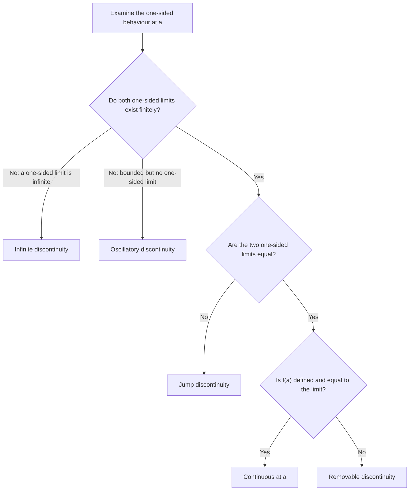

# Continuity

> [Mathematics](../../README.md) › [Calculus](../README.md) · Level: Intermediate · Prerequisites: [Limits](../01-limits/README.md), [Functions](../../03-algebra/11-functions/README.md), [Inequalities](../../03-algebra/03-inequalities/README.md) · Estimated time: 420 min

## 1. Introduction

A limit describes where a function is *going*. Continuity is the condition that the function actually *arrives there*. The distinction sounds small, and for the polynomials and trigonometric functions of elementary mathematics it never shows up: their graphs can be drawn without lifting the pen. But the whole of analysis is built on functions that are not so well behaved, and the precise definition of continuity is what separates the well-behaved from the rest.

Continuity is the hypothesis behind almost every existence theorem in calculus. The intermediate value theorem says that a continuous function on an interval cannot skip values — so a continuous function that is negative at one point and positive at another must vanish somewhere between. The extreme value theorem says that a continuous function on a closed bounded interval attains a largest and a smallest value — so optimisation problems have solutions. Both statements are false without continuity, and both are used constantly: root finding, the mean value theorem, the fundamental theorem of calculus, and the existence of solutions to differential equations all rest on them.

There is also a subtler notion, **uniform continuity**, which asks for a single tolerance $\delta$ that works at every point of the domain at once. Ordinary continuity allows the tolerance to shrink as the graph steepens; uniform continuity forbids that. On a closed bounded interval the two notions coincide — this is Heine's theorem, proved below from the completeness of the real numbers — but on open or unbounded intervals they differ, and the difference matters in numerical analysis and integration theory.

The chapter has three layers. The first is local: continuity at a point, its three conditions, and its equivalence to the limit law $\lim_{x\to a}f(x)=f(a)$. The second is algebraic: sums, products, quotients and compositions of continuous functions are continuous, which is what allows one to *see* that the elementary functions are continuous without checking $\varepsilon$ and $\delta$ every time. The third is global: the intermediate and extreme value theorems, and uniform continuity, all of which depend on completeness and fail on the rationals. Throughout, counterexamples are given equal billing with theorems, because the hypotheses of these theorems are exactly what the counterexamples violate.

## 2. Prerequisites

**Limits.** The $\varepsilon$-$\delta$ definition, one-sided limits, the limit laws, the squeeze theorem, and the standard limits. Continuity is defined by comparing a limit with a function value, so none of this chapter can be read without [Limits](../01-limits/README.md).

**Functions, domains and composition.** Domain, range, restriction, composition $f\circ g$, and the distinction between $f(a)$ existing and $\lim_{x\to a}f(x)$ existing. See [Functions](../../03-algebra/11-functions/README.md).

**Absolute value and inequalities.** $\lvert x-a\rvert<\delta$ as a distance statement, the triangle inequality, and the reverse triangle inequality $\bigl\lvert\lvert u\rvert-\lvert v\rvert\bigr\rvert\le\lvert u-v\rvert$. See [Inequalities](../../03-algebra/03-inequalities/README.md).

**Intervals and suprema.** Open and closed intervals, and the completeness axiom: every nonempty subset of $\mathbb{R}$ bounded above has a least upper bound. The intermediate and extreme value theorems are proved from it. See [Inequalities](../../03-algebra/03-inequalities/README.md) and [Set Theory](../../00-foundations/03-set-theory/README.md).

**Elementary functions.** Polynomials, rational functions, $\lvert x\rvert$, $\sqrt x$, $\sin$, $\cos$, $e^x$ and $\ln x$, together with their domains. See [Functions](../../03-algebra/11-functions/README.md), [Trigonometric Functions](../../05-trigonometry/01-trigonometric-functions/README.md) and [Exponential and Logarithmic Functions](../../03-algebra/12-exponential-and-logarithmic-functions/README.md).

**Proof technique.** Direct proof, proof by contradiction, and the quantifier manipulations needed to negate a $\forall\varepsilon\exists\delta$ statement. See [Proof Techniques](../../00-foundations/04-proof-techniques/README.md).

## 3. Learning Objectives

By the end of this tutorial you will be able to

1. state the $\varepsilon$-$\delta$ definition of continuity at a point, and the three conditions — $f(a)$ defined, the limit exists, the two agree — that it encapsulates;
2. prove the equivalence of the $\varepsilon$-$\delta$, limit and sequential formulations of continuity;
3. distinguish removable, jump, infinite and oscillatory discontinuities, and construct an example of each;
4. prove that sums, products, quotients and compositions of continuous functions are continuous, and use this to justify the continuity of polynomials, rational functions and the elementary functions;
5. prove the intermediate value theorem from the completeness axiom, and use it to locate roots and fixed points;
6. state the extreme value theorem, prove it, and give counterexamples showing that each hypothesis (closedness, boundedness, continuity) is necessary;
7. define uniform continuity, prove that it implies continuity, and give examples of continuous functions that are not uniformly continuous;
8. prove that a continuous function on a closed bounded interval is uniformly continuous, and explain where completeness enters the proof;
9. write $\varepsilon$-$\delta$ proofs of continuity for specific functions, choosing $\delta$ as a function of $\varepsilon$ and of the point;
10. explain why the intermediate value property does not imply continuity, and why continuity alone does not give differentiability.

## 4. Intuition

**The drawn curve.** The informal picture of a continuous function is one whose graph can be drawn without lifting the pen. This captures something real — no gaps, no jumps — but it is not a definition, because it says nothing about functions whose graphs cannot be drawn at all, and because "lifting the pen" is a statement about the draughtsman, not about the function. The formal definition replaces the picture by a local promise: small changes in the input produce arbitrarily small changes in the output.

**Small causes, small effects.** A physical quantity that depends continuously on a parameter is one for which a small error in the parameter produces a small error in the quantity. A thermostat, a bridge under load, a drug concentration as a function of dose: all are modelled by continuous functions, and the modelling assumption is exactly that there is no threshold at which the output leaps. Discontinuities model switches: a light that turns on at a certain voltage, a tax bracket, a phase transition.

**Why the point matters.** Continuity at $a$ is a statement about the value at $a$ *and* the values nearby. A function can be perfectly smooth everywhere else and still fail at one point: $(x^2-1)/(x-1)$ is the line $y=x+1$ with a single hole, and the hole is exactly where the function is undefined. Redefining the function at that point to the height of the hole repairs the discontinuity; no redefinition can repair a jump, where the two sides genuinely disagree.

**The global picture.** Continuity at each point is a local condition, but its consequences are global. If a continuous function starts below a level and ends above it, it must cross the level somewhere: the graph cannot teleport. This is the intermediate value theorem, and its proof is the first place where the completeness of the real line — the absence of gaps in $\mathbb{R}$ itself — is used essentially. Similarly, a continuous function on a closed bounded interval cannot escape to infinity, and it cannot approach a highest value without attaining it; these two facts together are the extreme value theorem.

**Uniformity.** Continuity at each point allows the tolerance $\delta$ to depend on the point. On a steep part of the graph one needs a smaller $\delta$ than on a flat part. Uniform continuity asks whether a single $\delta$ can serve the whole domain. On $[0,1]$ the answer is always yes for continuous functions, essentially because a closed bounded interval has no room for the graph to steepen indefinitely. On $(0,1)$ the function $1/x$ shows that the answer can be no: near $0$ the graph is arbitrarily steep, and no single $\delta$ survives.

## 5. Formal Definition

Throughout, $A\subseteq\mathbb{R}$, $f:A\to\mathbb{R}$, and $a\in A$.

**Definition 5.1 (continuity at a point).** The function $f$ is **continuous at $a$** when

$$
\forall \varepsilon>0\ \exists\delta>0\ \forall x\in A:\quad \lvert x-a\rvert<\delta \ \Rightarrow\ \lvert f(x)-f(a)\rvert<\varepsilon .
$$

The only differences from the definition of a limit are that $\lvert x-a\rvert$ replaces $0<\lvert x-a\rvert$ and that the target value is $f(a)$ rather than an arbitrary $L$. The point $x=a$ is now included, and the inequality is trivially true there; including it costs nothing and makes the statement cleaner.

**Definition 5.2 (three conditions).** Because $\lim_{x\to a}f(x)$ is defined only when $a$ is a limit point of the domain, the definition above is often unpacked as three conditions:

1. $f(a)$ is defined;
2. $\displaystyle\lim_{x\to a}f(x)$ exists (as a real number);
3. $\displaystyle\lim_{x\to a}f(x)=f(a)$.

When $a$ is an isolated point of the domain, every function is continuous at $a$ vacuously; such points play no role in this chapter, and all domains below are intervals.

**Definition 5.3 (one-sided continuity).** $f$ is **continuous from the right at $a$** when $\lim_{x\to a^+}f(x)=f(a)$, and **continuous from the left** when $\lim_{x\to a^-}f(x)=f(a)$. At an endpoint of an interval only the relevant one-sided condition can be imposed.

**Definition 5.4 (continuity on an interval).** Let $I$ be an interval contained in the domain of $f$.

* $f$ is **continuous on $I$** when it is continuous at every point of $I$.
* If $I=[a,b]$ is closed and bounded, this means continuity at every interior point, continuity from the right at $a$, and continuity from the left at $b$.
* $f$ is **continuous** (without qualification) when it is continuous at every point of its domain.

**Definition 5.5 (uniform continuity).** Let $A\subseteq\mathbb{R}$. The function $f:A\to\mathbb{R}$ is **uniformly continuous on $A$** when

$$
\forall \varepsilon>0\ \exists\delta>0\ \forall x,y\in A:\quad \lvert x-y\rvert<\delta \ \Rightarrow\ \lvert f(x)-f(y)\rvert<\varepsilon .
$$

The only difference from Definition 5.1 is the position of the quantifiers: $\delta$ is chosen after $\varepsilon$ but *before* $x$ and $y$, so a single $\delta$ must work for every pair of points. In Definition 5.1, $\delta$ may depend on the point $a$ as well as on $\varepsilon$.

**Definition 5.6 (Lipschitz continuity).** $f:A\to\mathbb{R}$ is **$L$-Lipschitz** when there is a constant $L\ge0$ with

$$
\lvert f(x)-f(y)\rvert\le L\lvert x-y\rvert \qquad \text{for all } x,y\in A .
$$

Every Lipschitz function is uniformly continuous (take $\delta=\varepsilon/L$ when $L>0$), but the converse fails; Section 7.10 gives the standard example.

**Remark 5.7 (continuity is a local property; uniform continuity is not).** Continuity at $a$ depends only on the values of $f$ in an arbitrarily small neighbourhood of $a$: changing $f$ far away cannot destroy continuity at $a$. Uniform continuity depends on the whole domain at once: the function $1/x$ is continuous at every point of $(0,1)$ but not uniformly continuous there, and the failure is caused by the behaviour near the excluded endpoint, not by any single point.

## 6. Mathematical Notation

| Notation | Read aloud | Meaning |
|---|---|---|
| $f$ continuous at $a$ | "$f$ is continuous at $a$" | Definition 5.1 holds at $a$ |
| $\lim_{x\to a}f(x)=f(a)$ | "the limit equals the value" | the limit formulation of continuity |
| $\lim_{x\to a^+}f(x)=f(a)$ | "continuous from the right" | one-sided continuity |
| $C(I)$ | "the continuous functions on $I$" | the set of all continuous $f:I\to\mathbb{R}$ |
| $C[a,b]$ | "continuous on the closed interval" | continuous on $[a,b]$, one-sided at the endpoints |
| $f\circ g$ | "$f$ composed with $g$" | $x\mapsto f(g(x))$ |
| $\varepsilon,\delta$ | "epsilon, delta" | tolerance and distance, as in the limit definition |
| $\forall x,y\in A$ | "for all $x$ and $y$ in $A$" | the uniformity quantifier |
| $L$-Lipschitz | "L-Lipschitz" | $\lvert f(x)-f(y)\rvert\le L\lvert x-y\rvert$ |
| IVT | "intermediate value theorem" | continuous functions on intervals assume intermediate values |
| EVT | "extreme value theorem" | continuous functions on $[a,b]$ attain their extrema |

## 7. Core Concepts

### 7.1 The three conditions, and how each can fail

Continuity at $a$ is the conjunction of three independent conditions. Each can fail while the others hold, and the four combinations of failure produce the standard examples.

| $f(a)$ defined? | $\lim_{x\to a}f(x)$ exists? | Equal? | Name | Example at $a=0$ |
|---|---|---|---|---|
| no | yes | — | removable discontinuity | $\dfrac{\sin x}{x}$ |
| yes | yes | no | removable discontinuity | $f(x)=x^2$ for $x\neq0$, $f(0)=7$ |
| yes | no (one-sided limits differ) | — | jump discontinuity | $\operatorname{sign}(x)$ |
| yes | no (infinite) | — | infinite discontinuity | $\dfrac1{x^2}$ |
| yes | no (oscillation) | — | oscillatory discontinuity | $\sin\dfrac1x$ |

The first two rows are both called removable because the discontinuity disappears after a single redefinition of $f(a)$: in the first row define $f(0)=1$, in the second define $f(0)=0$. A jump cannot be removed by redefinition, because the two sides approach different heights; an infinite or oscillatory discontinuity cannot be removed either.

**Example 7.1.1.** Let $f(x)=\dfrac{x^2-4}{x-2}$ for $x\neq2$. Then $f$ is undefined at $2$, but

$$
\lim_{x\to2}f(x)=\lim_{x\to2}(x+2)=4,
$$

so the discontinuity is removable, and setting $f(2)=4$ produces a function continuous at $2$.

**Example 7.1.2.** Let $f(x)=x$ for $x\neq0$ and $f(0)=5$. The limit at $0$ is $0$, the value is $5$; the discontinuity is removable, and redefining $f(0)=0$ repairs it. The original function is *not* continuous at $0$, no matter how close $f(0)$ is to $0$ — equality is required, not proximity.

### 7.2 Equivalent formulations

The $\varepsilon$-$\delta$ definition is the working definition, but two other formulations are used constantly.

**Theorem 7.2.1 (limit formulation).** If $a$ is a limit point of the domain, then $f$ is continuous at $a$ if and only if $\lim_{x\to a}f(x)=f(a)$.

*Proof.* The definition of $\lim_{x\to a}f(x)=f(a)$ is

$$
\forall\varepsilon>0\ \exists\delta>0\ \forall x\in A:\quad 0<\lvert x-a\rvert<\delta\Rightarrow\lvert f(x)-f(a)\rvert<\varepsilon .
$$

The only difference from Definition 5.1 is the condition $0<\lvert x-a\rvert$. If the continuity condition holds, then it holds in particular for $0<\lvert x-a\rvert<\delta$, so the limit condition holds with the same $\delta$. Conversely, if the limit condition holds with some $\delta$, then for $x=a$ the conclusion $\lvert f(a)-f(a)\rvert=0<\varepsilon$ is automatic, and for $x\neq a$ with $\lvert x-a\rvert<\delta$ the limit condition applies. Hence the two conditions are equivalent. $\blacksquare$

**Theorem 7.2.2 (sequential criterion).** Let $a$ be a limit point of the domain. Then $f$ is continuous at $a$ if and only if, for every sequence $(x_n)$ in the domain with $x_n\to a$, one has $f(x_n)\to f(a)$.

*Proof.* ($\Rightarrow$) Assume continuity at $a$ and let $\varepsilon>0$. Choose $\delta>0$ as in Definition 5.1. Since $x_n\to a$, there is $N$ such that $\lvert x_n-a\rvert<\delta$ for all $n\ge N$; then $\lvert f(x_n)-f(a)\rvert<\varepsilon$ for all $n\ge N$. Hence $f(x_n)\to f(a)$.

($\Leftarrow$) Suppose the sequential condition holds but $f$ is not continuous at $a$. Negating Definition 5.1 gives an $\varepsilon>0$ such that for every $\delta>0$ there is $x\in A$ with $\lvert x-a\rvert<\delta$ and $\lvert f(x)-f(a)\rvert\ge\varepsilon$. Taking $\delta=1/n$ and calling the resulting point $x_n$, we get a sequence with $x_n\to a$ but $\lvert f(x_n)-f(a)\rvert\ge\varepsilon$ for every $n$, contradicting the sequential condition. $\blacksquare$

The sequential criterion is the standard tool for *disproving* continuity: two sequences converging to $a$ with different value-limits show that $f$ is discontinuous at $a$. It is also the bridge between continuity and the convergence of numerical iterations.

**Remark 7.2.3 (preservation of limits).** Continuity at $a$ says precisely that $f$ commutes with the limit operation:

$$
\lim_{x\to a}f\bigl(g(x)\bigr)=f\Bigl(\lim_{x\to a}g(x)\Bigr)
$$

whenever $g(x)$ stays in the domain of $f$ and the inner limit exists. This is the licence to substitute limits into continuous expressions, and it is used silently in almost every computation.

### 7.3 Algebra of continuous functions

**Theorem 7.3.1.** Let $f,g:A\to\mathbb{R}$ be continuous at $a\in A$, and let $c\in\mathbb{R}$. Then $f+g$, $f-g$, $cf$, $fg$ and $f/g$ (the last defined when $g(a)\neq0$) are continuous at $a$.

*Proof.* If $a$ is an isolated point of $A$, all five functions are continuous at $a$ vacuously, so assume that $a$ is a limit point of $A$. In each case the limit exists by the limit laws and equals the value of the resulting function at $a$:

$$
\lim_{x\to a}(f+g)(x)=\lim_{x\to a}f(x)+\lim_{x\to a}g(x)=f(a)+g(a)=(f+g)(a),
$$

and similarly for the difference and the constant multiple. For the product,

$$
\lim_{x\to a}(fg)(x)=\Bigl(\lim_{x\to a}f(x)\Bigr)\Bigl(\lim_{x\to a}g(x)\Bigr)=f(a)g(a)=(fg)(a).
$$

If $g(a)\neq0$, the quotient law gives

$$
\lim_{x\to a}\frac{f(x)}{g(x)}=\frac{f(a)}{g(a)}=\Bigl(\frac fg\Bigr)(a),
$$

and $g$ is nonzero on a neighbourhood of $a$ by sign preservation. In every case the limit exists and equals the value at $a$, which is continuity at $a$. $\blacksquare$

*Direct $\varepsilon$-$\delta$ alternative for the sum.* Given $\varepsilon>0$, choose $\delta_1$ for $f$ with $\varepsilon/2$ and $\delta_2$ for $g$ with $\varepsilon/2$, and let $\delta=\min(\delta_1,\delta_2)$. For $\lvert x-a\rvert<\delta$,

$$
\lvert(f+g)(x)-(f+g)(a)\rvert\le\lvert f(x)-f(a)\rvert+\lvert g(x)-g(a)\rvert<\varepsilon .
$$

This proves continuity directly, without appealing to the limit laws, and it is worth seeing once: the proof is the same proof as the sum law, with $L=f(a)$ and $M=g(a)$.

**Corollary 7.3.2.** Every polynomial is continuous on $\mathbb{R}$. Every rational function is continuous on its domain.

*Proof.* The constant function $x\mapsto c$ is continuous: given $\varepsilon>0$, any $\delta>0$ works, because $\lvert c-c\rvert=0<\varepsilon$. The identity function $x\mapsto x$ is continuous: take $\delta=\varepsilon$. A polynomial is a finite sum of constant multiples and products of the identity, so Theorem 7.3.1 applies repeatedly. A rational function is a quotient of polynomials, and the quotient is continuous wherever its denominator is nonzero. $\blacksquare$

### 7.4 Composition

**Theorem 7.4.1.** Let $g:A\to\mathbb{R}$ be continuous at $a\in A$, and let $f:B\to\mathbb{R}$ satisfy $g(A)\subseteq B$ and be continuous at $g(a)$. Then $f\circ g$ is continuous at $a$.

*Proof.* Let $\varepsilon>0$. Continuity of $f$ at $g(a)$ gives $\eta>0$ such that

$$
y\in B,\ \lvert y-g(a)\rvert<\eta \ \Rightarrow\ \lvert f(y)-f(g(a))\rvert<\varepsilon .
$$

Continuity of $g$ at $a$ gives $\delta>0$ such that

$$
x\in A,\ \lvert x-a\rvert<\delta \ \Rightarrow\ \lvert g(x)-g(a)\rvert<\eta .
$$

For such $x$, put $y=g(x)\in B$. The first implication applies, so

$$
\lvert f(g(x))-f(g(a))\rvert<\varepsilon .
$$

This is continuity of $f\circ g$ at $a$. $\blacksquare$

Both hypotheses are needed. If $f$ is not continuous at $g(a)$, the composition can fail even when $g$ is continuous: take $g(x)=x$ and $f(y)=0$ for $y\neq0$, $f(0)=1$; then $f\circ g=f$, which is discontinuous at $0$. If $g$ is not continuous at $a$, the composition can fail too: take $g(x)=0$ for $x<0$ and $g(x)=1$ for $x\ge0$, and $f(y)=y$; then $f\circ g=g$ is discontinuous at $0$. The theorem is sufficient, not necessary: if $g$ jumps between points where $f$ takes the same value, the composition can still be continuous.

**Example 7.4.2.** $h(x)=\sin(x^2)$ is continuous on $\mathbb{R}$: $x\mapsto x^2$ is a polynomial, hence continuous, and $\sin$ is continuous (Section 7.5). Similarly $x\mapsto\sqrt{1+x^2}$ is continuous because $1+x^2>0$ and $\sqrt{\ }$ is continuous on $[0,\infty)$.

### 7.5 Continuity of the elementary functions

**Theorem 7.5.1.** The following functions are continuous on their domains: $\lvert x\rvert$ on $\mathbb{R}$; $\sqrt x$ on $[0,\infty)$; $\sin x$ and $\cos x$ on $\mathbb{R}$; $\tan x$ where $\cos x\neq0$; $e^x$ on $\mathbb{R}$; and $\ln x$ on $(0,\infty)$.

*Proof.*

*$\lvert x\rvert$.* The reverse triangle inequality gives $\bigl\lvert\lvert x\rvert-\lvert a\rvert\bigr\rvert\le\lvert x-a\rvert$, so $\lvert x\rvert$ is $1$-Lipschitz, hence continuous (take $\delta=\varepsilon$).

*$\sqrt x$.* For $x,a\ge0$,

$$
\lvert\sqrt x-\sqrt a\rvert^2=\lvert x-a\rvert\cdot\frac{\lvert\sqrt x-\sqrt a\rvert}{\sqrt x+\sqrt a}\le\lvert x-a\rvert,
$$

because $\sqrt x+\sqrt a\ge\lvert\sqrt x-\sqrt a\rvert$ (the case $x=a$ is trivial). Hence $\lvert\sqrt x-\sqrt a\rvert\le\sqrt{\lvert x-a\rvert}$, and $\delta=\varepsilon^2$ proves continuity at every $a\ge0$.

*$\sin$ and $\cos$.* For all real $t$, $\lvert\sin t\rvert\le\lvert t\rvert$: for $0<t<\pi/2$ this is the inequality $\sin t<t$ proved while establishing $\sin t/t\to1$; for $\lvert t\rvert\ge1$ it is clear because $\lvert\sin t\rvert\le1\le\lvert t\rvert$; and both sides are even. Then

$$
\lvert\sin x-\sin a\rvert=2\left\lvert\cos\frac{x+a}{2}\right\rvert\left\lvert\sin\frac{x-a}{2}\right\rvert\le 2\cdot1\cdot\frac{\lvert x-a\rvert}{2}=\lvert x-a\rvert,
$$

so $\sin$ is $1$-Lipschitz. The same computation with $\cos u-\cos v=-2\sin\frac{u+v}{2}\sin\frac{u-v}{2}$ gives $\lvert\cos x-\cos a\rvert\le\lvert x-a\rvert$.

*$\tan$.* $\tan x=\sin x/\cos x$ is a quotient of continuous functions, continuous wherever $\cos x\neq0$.

*$e^x$.* For $\lvert h\rvert\le1$, the function $h\mapsto(e^h-1)/h$ is continuous on $[-1,1]\setminus\{0\}$ and tends to $1$ at $0$, so it is bounded there; the explicit bound $2$ suffices. Hence

$$
\lvert e^x-e^a\rvert=e^a\lvert e^{x-a}-1\rvert\le 2e^a\lvert x-a\rvert
$$

for $\lvert x-a\rvert\le1$, so $e^x$ is continuous at $a$ (take $\delta=\min(1,\varepsilon/(2e^a))$).

*$\ln x$.* For $a>0$ and $x>0$, write $x=a(1+u)$ with $u=x/a-1\to0$ as $x\to a$. Then

$$
\lvert\ln x-\ln a\rvert=\lvert\ln(1+u)\rvert=\lvert u\rvert\left\lvert\frac{\ln(1+u)}{u}\right\rvert .
$$

By Corollary 7.11 of [Limits](../01-limits/README.md), $\ln(1+u)/u\to1$ as $u\to0$, so this quotient is bounded by $2$ for $\lvert u\rvert$ small; hence $\lvert\ln x-\ln a\rvert\le2\lvert u\rvert=2\lvert x-a\rvert/a$, which tends to $0$. $\blacksquare$

**Remark 7.5.2.** The continuity of $\sin$ and $\cos$ rests on the inequality $\lvert\sin t\rvert\le\lvert t\rvert$, which is a geometric statement about arc length; the continuity of $e^x$ rests on the standard limit that *defines* $e$; the continuity of $\ln$ rests on the corresponding logarithmic limit. None of these is circular, provided the limits are established first, as they are in [Limits](../01-limits/README.md).

### 7.6 Types of discontinuity

When $f$ is defined at $a$ but not continuous there, the failure has a shape. Four shapes are distinguished in elementary calculus.

**Definition 7.6.1.** Let $f$ be defined on a punctured neighbourhood of $a$ (and possibly at $a$).

* $f$ has a **removable discontinuity** at $a$ when $\lim_{x\to a}f(x)$ exists as a real number but either $f(a)$ is undefined or $f(a)\neq\lim_{x\to a}f(x)$.
* $f$ has a **jump discontinuity** at $a$ when both one-sided limits exist as real numbers and are different.
* $f$ has an **infinite discontinuity** at $a$ when at least one one-sided limit is $+\infty$ or $-\infty$.
* $f$ has an **oscillatory discontinuity** at $a$ when the limit fails to exist and neither of the preceding descriptions applies; the model case is bounded oscillation, such as $\sin(1/x)$, which never settles.

| Type | Behaviour at the point | Example |
|---|---|---|
| removable | the two-sided limit exists but $f(a)$ is absent or different | $\dfrac{x^2-4}{x-2}$ at $2$ (limit $4$, value absent), or $f(x)=x^2$ with $f(0)=5$ (limit $0$, value $5$) |
| jump | left limit $-1$, right limit $1$ | $\operatorname{sign}(x)=\dfrac{\lvert x\rvert}{x}$ |
| infinite | right limit $+\infty$, left limit $+\infty$ | $\dfrac1{x^2}$ |
| oscillatory | values in $[-1,1]$, no limit | $\sin\dfrac1x$ |

**Example 7.6.2 (jump).** The floor function $x\mapsto\lfloor x\rfloor$ is constant on each interval $[n,n+1)$ and jumps at every integer. At $a=n$,

$$
\lim_{x\to n^-}\lfloor x\rfloor=n-1, \qquad \lim_{x\to n^+}\lfloor x\rfloor=n,
$$

so the jump has size $1$ and the discontinuity is a jump discontinuity. It cannot be removed by redefining $f(n)$: whatever value is chosen, one side disagrees.

**Example 7.6.3 (infinite).** $f(x)=1/x^2$ tends to $+\infty$ from both sides at $0$; $1/x$ tends to $+\infty$ from the right and $-\infty$ from the left; $\ln x$ tends to $-\infty$ as $x\to0^+$ but is not defined to the left of $0$. All three have infinite discontinuities, and all three graphs have a vertical asymptote.

**Example 7.6.4 (oscillatory).** $\sin(1/x)$ is bounded by $1$ and has no limit at $0$ (proved in [Limits](../01-limits/README.md), Section 7.13). The graph crosses every horizontal level in $[-1,1]$ infinitely often in every neighbourhood of $0$. Redefining $f(0)$ cannot help: the limit itself does not exist.

**Remark 7.6.5 (what the labels do and do not classify).** The first three labels are precise and mutually exclusive. The fourth is a catch-all: it contains bounded oscillation such as $\sin(1/x)$, but also wilder behaviour. Dirichlet's function, equal to $1$ at rational points and $0$ at irrational points, is discontinuous everywhere; at each point both one-sided limits fail to exist, and the failure is not the oscillation of any single formula. The vocabulary describes the discontinuities of elementary formulas; it is not a classification theorem for all functions.

**Remark 7.6.6 (monotone functions).** If $f$ is monotone on an interval, its one-sided limits exist at every interior point, finite or infinite: they are suprema and infima of bounded monotone families, which exist by completeness. Hence every discontinuity of a monotone function is either a jump or an infinite discontinuity. This is one of the first places where completeness turns an intuitive statement into a theorem.

### 7.7 The intermediate value theorem

**Theorem 7.7.1 (intermediate value theorem, IVT).** Let $f$ be continuous on the closed interval $[a,b]$. If $c$ lies strictly between $f(a)$ and $f(b)$, then there exists $\xi\in(a,b)$ with $f(\xi)=c$.

*Proof.* Suppose first that $f(a)<c<f(b)$; the other case follows by applying the argument to $-f$. Define

$$
S=\{x\in[a,b] : f(x)<c\}.
$$

The set $S$ is nonempty because $a\in S$, and it is bounded above by $b$. By the completeness axiom of $\mathbb{R}$, $\xi:=\sup S$ exists, and $a\le\xi\le b$.

We prove that $f(\xi)=c$ by excluding the two alternatives.

*Suppose $f(\xi)<c$.* Then $\varepsilon:=c-f(\xi)>0$. By continuity at $\xi$, there is $\delta>0$ such that $x\in[a,b]$ and $\lvert x-\xi\rvert<\delta$ imply $f(x)<c$. Since $f(b)>c$, this case forces $\xi<b$, so $x_0:=\xi+\delta/2$ satisfies $x_0\in[a,b]$ and $x_0>\xi$ (replace $\delta$ by $\min(\delta,\,b-\xi)$ if necessary). Then $f(x_0)<c$, so $x_0\in S$, contradicting the fact that $\xi$ is an upper bound for $S$.

*Suppose $f(\xi)>c$.* Then $\varepsilon:=f(\xi)-c>0$. By continuity at $\xi$, there is $\delta>0$ such that $x\in[a,b]$ and $\lvert x-\xi\rvert<\delta$ imply $f(x)>c$. Then no point of $(\xi-\delta,\xi]$ belongs to $S$. Consequently $\xi-\delta/2$ is an upper bound for $S$: any $x\in S$ satisfies $x\le\xi$, and $x>\xi-\delta/2$ would put $x\in(\xi-\delta,\xi]$, where $f(x)>c$, contradicting $x\in S$. But $\xi-\delta/2<\xi$, contradicting the fact that $\xi$ is the *least* upper bound.

Hence $f(\xi)=c$. Since $f(a)<c<f(b)$, the point $\xi$ cannot be $a$ or $b$, so $\xi\in(a,b)$. $\blacksquare$

**Corollary 7.7.2 (root form).** If $f$ is continuous on $[a,b]$ and $f(a)$ and $f(b)$ have opposite signs, then there is $\xi\in(a,b)$ with $f(\xi)=0$.

*Proof.* Apply Theorem 7.7.1 with $c=0$, which lies between $f(a)$ and $f(b)$ when their signs differ. $\blacksquare$

**Remark 7.7.3 (what the theorem does and does not say).** The IVT asserts existence, not uniqueness, and it does not locate the point. A continuous function may cross a level many times: $\sin x$ takes the value $0$ at every multiple of $\pi$. Uniqueness needs an additional argument, usually monotonicity. The theorem is also not constructive in itself — it does not say how to find $\xi$ — but the proof by bisection in Section 7.8 turns it into an algorithm with an explicit error bound.

**Remark 7.7.4 (completeness is essential).** The proof uses the completeness axiom twice: once to produce $\xi=\sup S$, and implicitly in the fact that the supremum lies in $[a,b]$. Over the rationals the theorem fails: the function $f(x)=x^2-2$ is continuous on the rational interval $[1,2]\cap\mathbb{Q}$, satisfies $f(1)<0<f(2)$, but has no rational zero. Section 7.12 develops this point.

**Remark 7.7.5 (the converse is false).** The intermediate value *property* — assuming every value between two values — does not imply continuity. The function

$$
f(x)=\begin{cases}\sin\dfrac1x, & x\neq0,\\ 0, & x=0,\end{cases}
$$

has the intermediate value property on every interval (see Example 9.8) and is discontinuous at $0$. Continuity is sufficient for the IVT, not necessary.

### 7.8 Applications of the IVT: root finding and fixed points

**Root existence.** Corollary 7.7.2 is the standard existence test for equations. For example, $p(x)=x^3+x-1$ satisfies $p(0)=-1<0$ and $p(1)=1>0$, so $p$ has a root in $(0,1)$. Since $x\mapsto x^3$ and $x\mapsto x$ are both strictly increasing, $p$ is strictly increasing, so the root is unique. The same argument shows that every polynomial of odd degree has at least one real root: as $x\to+\infty$ and $x\to-\infty$ the leading term dominates, so the polynomial takes values of opposite signs.

**The bisection method.** Suppose $f$ is continuous on $[a,b]$ and $f(a)f(b)<0$. Set $a_0=a$, $b_0=b$. At step $n$, let $m_n=(a_n+b_n)/2$. If $f(m_n)=0$, a root has been found. If $f(a_n)f(m_n)<0$, set $a_{n+1}=a_n$, $b_{n+1}=m_n$; otherwise set $a_{n+1}=m_n$, $b_{n+1}=b_n$. Then by the IVT each interval $[a_n,b_n]$ contains a root, and

$$
b_n-a_n=\frac{b-a}{2^n}, \qquad \lvert m_n-\xi\rvert\le\frac{b-a}{2^{n+1}}
$$

for any root $\xi\in[a_n,b_n]$. The bisection method is slow but unconditional: continuity is the only hypothesis, and the error bound is known in advance.

**Fixed points.** A **fixed point** of $f$ is a point $x$ with $f(x)=x$. If $f:[0,1]\to[0,1]$ is continuous, then $f$ has a fixed point. Indeed $g(x)=f(x)-x$ is continuous, $g(0)=f(0)-0\ge0$ and $g(1)=f(1)-1\le0$. If either value is $0$ we are done; otherwise $g(0)>0>g(1)$ and the IVT gives $x\in(0,1)$ with $g(x)=0$.

**A qualitative example.** The temperature at dawn is $4^\circ$C and at noon $14^\circ$C. If temperature is a continuous function of time — a modelling assumption, not a theorem — then at some moment between dawn and noon it was exactly $10^\circ$C. The IVT converts a plausible story into a guaranteed conclusion.

### 7.9 The extreme value theorem

**Definition 7.9.1.** $f$ **attains its maximum** on $A$ when there is $c\in A$ with $f(c)\ge f(x)$ for all $x\in A$; $f(c)$ is then the maximum value. Attaining a minimum is defined analogously.

**Lemma 7.9.2 (Bolzano–Weierstrass).** Every sequence $(x_n)$ contained in a closed bounded interval $[a,b]$ has a subsequence converging to some point of $[a,b]$.

*Proof.* If some value occurs infinitely often among the terms, the constant subsequence at that value converges, and the value lies in $[a,b]$. Otherwise, construct nested closed intervals as follows. Start with $I_0=[a,b]$. Given $I_{k-1}=[u,v]$, split it at its midpoint $m=(u+v)/2$. At least one of $[u,m]$ and $[m,v]$ contains $x_n$ for infinitely many $n$; choose such a half as $I_k$. Since $I_k$ contains infinitely many terms, we may choose $n_k>n_{k-1}$ with $x_{n_k}\in I_k$. The lengths satisfy $\lvert I_k\rvert=(b-a)/2^k\to0$.

Let $u_k$ and $v_k$ be the left and right endpoints of $I_k$. The sequence $(u_k)$ is nondecreasing and bounded above by $b$, so $u:=\sup_k u_k$ exists by completeness; similarly $v:=\inf_k v_k$ exists, and $u\le v$. Since $0\le v-u\le v_k-u_k=\lvert I_k\rvert\to0$, we get $u=v=:x$, and $x\in[a,b]$. Finally $x_{n_k}\in I_k$ gives $\lvert x_{n_k}-x\rvert\le\lvert I_k\rvert\to0$, so $x_{n_k}\to x$. $\blacksquare$

**Theorem 7.9.3 (extreme value theorem, EVT).** If $f$ is continuous on the closed bounded interval $[a,b]$, then $f$ is bounded on $[a,b]$ and attains a maximum and a minimum there.

*Proof.* *Boundedness.* Suppose $f$ is unbounded above. Then for each $n$ there is $x_n\in[a,b]$ with $f(x_n)>n$. By Lemma 7.9.2 a subsequence $x_{n_k}$ converges to some $x\in[a,b]$. Continuity at $x$ gives $f(x_{n_k})\to f(x)$, so the sequence $(f(x_{n_k}))$ is bounded; but $f(x_{n_k})>n_k\to\infty$, a contradiction. Hence $f$ is bounded above; the same argument applied to $-f$ shows it is bounded below.

*Attainment.* Let $M=\sup\{f(x):x\in[a,b]\}$, which is finite by boundedness. For each $n$, the number $M-1/n$ is not an upper bound, so there is $x_n\in[a,b]$ with $f(x_n)>M-1/n$. By Lemma 7.9.2 a subsequence $x_{n_k}\to x\in[a,b]$. Continuity gives $f(x_{n_k})\to f(x)$. Since $M-1/n_k<f(x_{n_k})\le M$ and $1/n_k\to0$, the squeeze theorem gives $f(x_{n_k})\to M$; hence $f(x)=M$. Thus the maximum is attained at $x$. Applying the same argument to $-f$ gives a point where the minimum is attained. $\blacksquare$

**Remark 7.9.4 (every hypothesis is necessary).** Each of the three hypotheses — continuity, closedness, boundedness — can fail while the conclusion fails.

| Failure | Function | Interval | What goes wrong |
|---|---|---|---|
| not closed | $f(x)=x$ | $(0,1)$ | bounded, but no maximum or minimum |
| not bounded | $f(x)=x$ | $[0,\infty)$ | unbounded above, no maximum |
| not closed | $f(x)=1/x$ | $(0,1]$ | unbounded above, no maximum |
| not continuous | $f(x)=x$ for $x<1$, $f(1)=0$ | $[0,1]$ | bounded, but the maximum $1$ is not attained |

The fourth row is the subtlest: the supremum exists and equals $1$, but no point of the interval has value $1$. Continuity is what forces the supremum to be achieved, through the compactness of $[a,b]$ encoded in Lemma 7.9.2.

**Remark 7.9.5.** The EVT asserts existence of extrema, not their location. Finding where they occur requires the derivative and is the subject of [Applications of Derivatives](../05-applications-of-derivatives/README.md). The EVT is what guarantees that the search is not in vain.

### 7.10 Uniform continuity

Continuity at each point allows $\delta$ to depend on the point. Uniform continuity demands one $\delta$ for the whole domain.

**Definition 7.10.1 (restated).** $f:A\to\mathbb{R}$ is uniformly continuous on $A$ when

$$
\forall\varepsilon>0\ \exists\delta>0\ \forall x,y\in A:\quad \lvert x-y\rvert<\delta\Rightarrow\lvert f(x)-f(y)\rvert<\varepsilon .
$$

**Theorem 7.10.2.** Every uniformly continuous function is continuous.

*Proof.* Let $a\in A$ and $\varepsilon>0$. Choose $\delta>0$ as in Definition 7.10.1. For $x\in A$ with $\lvert x-a\rvert<\delta$, the definition applied to the pair $(x,a)$ gives $\lvert f(x)-f(a)\rvert<\varepsilon$. $\blacksquare$

The converse fails, as the examples below show. Uniform continuity is a global condition: it can be destroyed by behaviour near a single point or near infinity.

**Theorem 7.10.3 (Lipschitz implies uniform).** If $f$ is $L$-Lipschitz on $A$, then $f$ is uniformly continuous on $A$.

*Proof.* If $L=0$, $f$ is constant and the conclusion is immediate. If $L>0$, given $\varepsilon>0$ take $\delta=\varepsilon/L$; then $\lvert x-y\rvert<\delta$ implies $\lvert f(x)-f(y)\rvert\le L\lvert x-y\rvert<\varepsilon$. $\blacksquare$

**Example 7.10.4 (uniformly continuous functions).**

* $f(x)=3x+2$ on $\mathbb{R}$ is $3$-Lipschitz, hence uniformly continuous, with $\delta=\varepsilon/3$.
* $f(x)=\lvert x\rvert$ on $\mathbb{R}$ is $1$-Lipschitz.
* $f(x)=\sin x$ on $\mathbb{R}$ is $1$-Lipschitz, since $\lvert\sin x-\sin y\rvert\le\lvert x-y\rvert$.
* $f(x)=\sqrt x$ on $[0,\infty)$ is uniformly continuous but not Lipschitz. Uniformity follows from $\lvert\sqrt x-\sqrt y\rvert\le\sqrt{\lvert x-y\rvert}$ (Section 7.5), so $\delta=\varepsilon^2$ works for all $x,y\ge0$. It is not Lipschitz on $[0,1]$ because $\lvert\sqrt x-0\rvert/\lvert x-0\rvert=1/\sqrt x\to\infty$ as $x\to0^+$.
* $f(x)=1/x$ on $[1,\infty)$ is uniformly continuous: for $x,y\ge1$,
  $$
  \left\lvert\frac1x-\frac1y\right\rvert=\frac{\lvert x-y\rvert}{xy}\le\lvert x-y\rvert,
  $$
  so it is $1$-Lipschitz there.

**Example 7.10.5 ($1/x$ is not uniformly continuous on $(0,1)$).** Take $x_n=1/n$ and $y_n=1/(n+1)$. Then

$$
\lvert x_n-y_n\rvert=\frac{1}{n(n+1)}\longrightarrow0,
\qquad
\left\lvert\frac{1}{x_n}-\frac{1}{y_n}\right\rvert=(n+1)-n=1 .
$$

For $\varepsilon=1/2$ no $\delta$ can work: every $\delta$ admits some $n$ with $\lvert x_n-y_n\rvert<\delta$, while the values differ by $1$. The failure is caused by the behaviour near $0$, where the graph becomes arbitrarily steep.

**Example 7.10.6 ($x^2$ is not uniformly continuous on $\mathbb{R}$).** Take $x_n=n$ and $y_n=n+1/n$. Then $\lvert x_n-y_n\rvert=1/n\to0$, while

$$
\lvert y_n^2-x_n^2\rvert=\left(n+\frac1n\right)^2-n^2=2+\frac{1}{n^2}\ge2 .
$$

Again the difference of values stays away from $0$ while the points coalesce. On $[0,1]$, by contrast, $x^2$ is $2$-Lipschitz and hence uniformly continuous.

**Theorem 7.10.7 (Heine–Cantor).** If $f$ is continuous on the closed bounded interval $[a,b]$, then $f$ is uniformly continuous on $[a,b]$.

*Proof.* Suppose not. Then there is $\varepsilon>0$ such that for every $\delta>0$ there are $x,y\in[a,b]$ with $\lvert x-y\rvert<\delta$ and $\lvert f(x)-f(y)\rvert\ge\varepsilon$. Taking $\delta=1/n$, choose such a pair $(x_n,y_n)$ for each $n$. By Lemma 7.9.2, the sequence $(x_n)$ has a subsequence $x_{n_k}\to x\in[a,b]$. Then also $y_{n_k}\to x$, because

$$
\lvert y_{n_k}-x\rvert\le\lvert y_{n_k}-x_{n_k}\rvert+\lvert x_{n_k}-x\rvert<\frac{1}{n_k}+\lvert x_{n_k}-x\rvert\longrightarrow0 .
$$

Continuity at $x$ gives $f(x_{n_k})\to f(x)$ and $f(y_{n_k})\to f(x)$, so

$$
\lvert f(x_{n_k})-f(y_{n_k})\rvert\le\lvert f(x_{n_k})-f(x)\rvert+\lvert f(x)-f(y_{n_k})\rvert\longrightarrow0,
$$

contradicting $\lvert f(x_{n_k})-f(y_{n_k})\rvert\ge\varepsilon$. Hence $f$ is uniformly continuous. $\blacksquare$

**Theorem 7.10.8 (uniform continuity preserves Cauchy sequences).** If $f$ is uniformly continuous on $A$ and $(x_n)$ is a Cauchy sequence in $A$, then $(f(x_n))$ is a Cauchy sequence.

*Proof.* Let $\varepsilon>0$ and choose $\delta>0$ from uniform continuity. Since $(x_n)$ is Cauchy, there is $N$ with $\lvert x_n-x_m\rvert<\delta$ for all $n,m\ge N$. For such $n,m$, uniform continuity gives $\lvert f(x_n)-f(x_m)\rvert<\varepsilon$. $\blacksquare$

**Remark 7.10.9.** The theorem is false for merely continuous functions: $f(x)=1/x$ is continuous on $(0,1)$, and $x_n=1/n$ is Cauchy, but $f(x_n)=n$ is not Cauchy. Uniform continuity is exactly the strength of continuity needed to transfer completeness from the domain to the range.

### 7.11 Epsilon-delta proofs of continuity in practice

Most continuity proofs at a point follow one pattern.

1. Write $\lvert f(x)-f(a)\rvert$ and factor out $\lvert x-a\rvert$.
2. Bound the remaining factor on a preliminary neighbourhood $\lvert x-a\rvert\le1$ (or another convenient radius), obtaining $\lvert f(x)-f(a)\rvert\le K\lvert x-a\rvert$ there.
3. Choose $\delta=\min(1,\varepsilon/K)$ and verify.

**Example 7.11.1.** Prove that $f(x)=x^3$ is continuous at $a=2$. We have

$$
\lvert x^3-8\rvert=\lvert x-2\rvert\,\lvert x^2+2x+4\rvert .
$$

If $\lvert x-2\rvert\le1$, then $1\le x\le3$, so $x^2+2x+4\le9+6+4=19$. Take $\delta=\min(1,\varepsilon/19)$. For $\lvert x-2\rvert<\delta$,

$$
\lvert x^3-8\rvert\le19\lvert x-2\rvert<19\cdot\frac{\varepsilon}{19}=\varepsilon .
$$

The constant $19$ is not sharp — the true bound near $2$ is about $12$ — but sharpness is irrelevant; only a valid bound is needed.

**Example 7.11.2 (the point matters).** For $f(x)=x^2$ at a general $a$, the same computation gives

$$
\lvert x^2-a^2\rvert=\lvert x-a\rvert\,\lvert x+a\rvert\le\lvert x-a\rvert\,(2\lvert a\rvert+1)
$$

provided $\lvert x-a\rvert\le1$. Hence $\delta=\min\left(1,\dfrac{\varepsilon}{2\lvert a\rvert+1}\right)$ works. The dependence on $a$ is genuine: the graph is steeper far from the origin, and a smaller $\delta$ is needed there. Uniform continuity would require a formula for $\delta$ with no $a$ in it, and on $\mathbb{R}$ no such formula exists (Example 7.10.6).

**Remark 7.11.3.** The preliminary restriction $\lvert x-a\rvert\le1$ is a convenience, not a loss of generality: the definition only asks for *some* $\delta$, and a smaller $\delta$ is always acceptable. The same device appears in the $\varepsilon$-$\delta$ proofs of [Limits](../01-limits/README.md).

### 7.12 Why completeness matters

The completeness axiom states that every nonempty subset of $\mathbb{R}$ that is bounded above has a least upper bound in $\mathbb{R}$. It is the only property that distinguishes $\mathbb{R}$ from $\mathbb{Q}$, and every global theorem in this chapter uses it.

**Failure of the IVT over $\mathbb{Q}$.** Let $A=\mathbb{Q}\cap[1,2]$ and $f(x)=x^2-2$, regarded as a function on $A$ with values in $\mathbb{Q}$. It is continuous at every point of $A$ (polynomials are continuous, and the restriction of a continuous function is continuous). Moreover $f(1)=-1<0$ and $f(2)=2>0$. Yet there is no $\xi\in A$ with $f(\xi)=0$, because no rational number squares to $2$. The proof of Theorem 7.7.1 breaks down at the step where $\xi=\sup S$ is asserted to exist: the set $S=\{x\in A:f(x)<0\}$ is bounded above in $\mathbb{Q}$ but has no supremum in $\mathbb{Q}$.

**Failure of the EVT over $\mathbb{Q}$.** The set $\{x\in\mathbb{Q}:x^2<2,\ x\ge0\}$ is bounded above in $\mathbb{Q}$ but has no least upper bound there, and the continuous function $f(x)=x$ on this set attains no maximum. Similarly, the Heine–Cantor theorem fails: $f(x)=1/(x^2-2)$ is continuous on the rational interval $[1,2]\cap\mathbb{Q}$ but is not bounded, because the denominator approaches $0$ at the missing point $\sqrt2$.

**Moral.** Continuity is a local, algebraic notion and makes sense in any ordered field. The intermediate value theorem, the extreme value theorem, and the theorem that continuity on a closed bounded interval implies uniform continuity are *global* theorems: they assert the existence of points with special properties, and existence requires completeness. This is why the next discipline, real analysis, begins with the construction of $\mathbb{R}$ and the completeness axiom.

## 8. Formulas and Properties

### 8.1 The main theorems, with hypotheses

| Theorem | Hypothesis | Conclusion |
|---|---|---|
| Continuity and limits | $a$ is a limit point of the domain | $f$ continuous at $a$ $\iff$ $\lim_{x\to a}f(x)=f(a)$ |
| Sequential criterion | $a$ a limit point | $f$ continuous at $a$ $\iff$ $x_n\to a\Rightarrow f(x_n)\to f(a)$ |
| Algebra | $f,g$ continuous at $a$ | $f\pm g$, $cf$, $fg$, and $f/g$ (if $g(a)\neq0$) continuous at $a$ |
| Composition | $g$ continuous at $a$, $f$ continuous at $g(a)$ | $f\circ g$ continuous at $a$ |
| IVT | $f$ continuous on $[a,b]$, $c$ between $f(a)$ and $f(b)$ | some $\xi\in(a,b)$ has $f(\xi)=c$ |
| EVT | $f$ continuous on the closed bounded $[a,b]$ | $f$ bounded, and attains a max and a min |
| Heine–Cantor | $f$ continuous on the closed bounded $[a,b]$ | $f$ uniformly continuous on $[a,b]$ |
| Lipschitz | $\lvert f(x)-f(y)\rvert\le L\lvert x-y\rvert$ | $f$ uniformly continuous |
| Uniform implies pointwise | $f$ uniformly continuous on $A$ | $f$ continuous on $A$ |
| Cauchy preservation | $f$ uniformly continuous, $(x_n)$ Cauchy | $(f(x_n))$ Cauchy |

### 8.2 The implication diagram

$$
\text{Lipschitz} \ \Longrightarrow\ \text{uniformly continuous} \ \Longrightarrow\ \text{continuous},
$$

and on a closed bounded interval the second arrow reverses:

$$
f \text{ continuous on } [a,b] \ \Longrightarrow\ f \text{ uniformly continuous on } [a,b].
$$

Neither reverse implication holds in general: $\sqrt x$ on $[0,\infty)$ is uniformly continuous but not Lipschitz, and $1/x$ on $(0,1)$ is continuous but not uniformly continuous.

### 8.3 Continuity of the elementary functions

| Function | Domain of continuity | Reason |
|---|---|---|
| polynomials | $\mathbb{R}$ | algebra of continuous functions |
| rational functions | where the denominator is nonzero | quotient of continuous functions |
| $\lvert x\rvert$ | $\mathbb{R}$ | $1$-Lipschitz |
| $\sqrt x$ | $[0,\infty)$ | $\lvert\sqrt x-\sqrt y\rvert\le\sqrt{\lvert x-y\rvert}$ |
| $\sin x,\cos x$ | $\mathbb{R}$ | $1$-Lipschitz |
| $\tan x$ | $\cos x\neq0$ | quotient |
| $e^x$ | $\mathbb{R}$ | standard exponential limit |
| $\ln x$ | $(0,\infty)$ | standard logarithmic limit |

## 9. Step-by-Step Examples

### 9.1 Testing the three conditions

**Example 9.1.** Let $f(x)=\dfrac{x^2-9}{x-3}$ for $x\neq3$. Is $f$ continuous at $3$? Can it be made continuous there?

The function is undefined at $3$, so the first condition fails and $f$ is not continuous at $3$. For $x\neq3$,

$$
\frac{x^2-9}{x-3}=\frac{(x-3)(x+3)}{x-3}=x+3,
$$

so

$$
\lim_{x\to3}f(x)=\lim_{x\to3}(x+3)=6 .
$$

The limit exists; the discontinuity is removable. Defining $f(3)=6$ produces a function that agrees with $x+3$ everywhere and is therefore continuous at $3$ (indeed on $\mathbb{R}$).

*Pitfall:* saying "the limit is $6$, so the function is continuous" omits the third condition. The original function has no value at $3$; only the redefined function is continuous.

### 9.2 Finding parameters to make a piecewise function continuous

**Example 9.2.** Find $a$ and $b$ so that

$$
f(x)=\begin{cases}x+1, & x<1,\\ ax^2+b, & 1\le x\le2,\\ 3x-1, & x>2\end{cases}
$$

is continuous on $\mathbb{R}$.

Continuity is automatic on the open intervals $(1,2)$ and $(2,\infty)$ and on $(-\infty,1)$, because the formulas are polynomials. Only the junctions $x=1$ and $x=2$ need checking.

*At $x=1$:* the left limit is $1+1=2$, and the value and right limit are $a+b$; continuity requires

$$
a+b=2 .
$$

*At $x=2$:* the left limit and value are $4a+b$, and the right limit is $3\cdot2-1=5$; continuity requires

$$
4a+b=5 .
$$

Subtracting the first equation from the second gives $3a=3$, so $a=1$, and then $b=2-a=1$. With $a=b=1$ all three pieces agree at both junctions, so $f$ is continuous on $\mathbb{R}$.

*Check:* at $x=1$, all three expressions give $2$; at $x=2$, the middle gives $4+1=5$ and the right gives $5$. ✓

### 9.3 Continuity of a composition

**Example 9.3.** Show that $h(x)=\sin\sqrt{x+3}$ is continuous on $[-3,\infty)$.

Write $h=f\circ g$ with $g(x)=\sqrt{x+3}$ and $f(y)=\sin y$. The inner function $g$ is a composition of the polynomial $x\mapsto x+3$ (continuous on $\mathbb{R}$) with $\sqrt{\ }$ (continuous on $[0,\infty)$). For $x\ge-3$ we have $x+3\ge0$, so $g$ is continuous on $[-3,\infty)$ by Theorem 7.4.1. The outer function $f=\sin$ is continuous on $\mathbb{R}$ by Theorem 7.5.1, hence in particular at every value $g(x)\in[0,\infty)$. Theorem 7.4.1 now gives continuity of $h$ at every $x\ge-3$.

*Why the domain matters:* on $(-\infty,-3)$ the expression $\sqrt{x+3}$ is not real, so $h$ is not defined there and continuity is not at issue. At the endpoint $-3$ the relevant statement is continuity from the right, and $g(-3)=0$ with $\sqrt{\ }$ continuous from the right at $0$.

### 9.4 The IVT and bisection

**Example 9.4.** Show that $p(x)=x^3+x-1$ has exactly one real root, and locate it to within $1/8$.

*Existence.* $p$ is a polynomial, hence continuous on $[0,1]$. Moreover $p(0)=-1<0$ and $p(1)=1>0$, so by Corollary 7.7.2 there is $\xi\in(0,1)$ with $p(\xi)=0$.

*Uniqueness.* If $x<y$, then $x^3<y^3$ and $x<y$, so $p(x)=x^3+x-1<y^3+y-1=p(y)$. Thus $p$ is strictly increasing and takes the value $0$ at most once. Together with existence, there is exactly one real root.

*Bisection.* The midpoint of $[0,1]$ is $0.5$, and

$$
p(0.5)=0.125+0.5-1=-0.375<0 .
$$

Since $p(0.5)<0<p(1)$, the root lies in $(0.5,1)$. The midpoint of $[0.5,1]$ is $0.75$, and

$$
p(0.75)=0.421875+0.75-1=0.171875>0 .
$$

Since $p(0.5)<0<p(0.75)$, the root lies in $(0.5,0.75)$, an interval of length $0.25$. Its midpoint $0.625$ is therefore within $0.125=1/8$ of the root. After $n$ bisections the interval has length $2^{-n}$, and its midpoint is within $2^{-(n+1)}$ of the root.

### 9.5 Using the EVT to know that extrema exist

**Example 9.5.** Find the maximum and minimum of $f(x)=\dfrac{1}{x^2+1}$ on $[-1,2]$.

The function is a quotient of polynomials with denominator $x^2+1\ge1>0$, so it is continuous on $[-1,2]$. By the EVT it attains a maximum and a minimum there. To find them, use the monotonicity of $x\mapsto x^2$:

* on $[-1,0]$, $x^2$ decreases from $1$ to $0$, so $f$ increases from $\frac12$ to $1$;
* on $[0,2]$, $x^2$ increases from $0$ to $4$, so $f$ decreases from $1$ to $\frac15$.

Therefore the maximum is $f(0)=1$, and the minimum is $f(2)=\frac15$. The endpoint value $f(-1)=\frac12$ is neither extremum. The EVT is what licenses the conclusion that the values just computed are actually attained; without it, one would only have shown that $1$ and $\frac15$ are bounds.

### 9.6 A uniform continuity proof

**Example 9.6.** Prove that $f(x)=\sqrt x$ is uniformly continuous on $[0,\infty)$ but not Lipschitz there.

Let $\varepsilon>0$. For $x,y\ge0$,

$$
\lvert\sqrt x-\sqrt y\rvert\le\sqrt{\lvert x-y\rvert},
$$

as shown in Theorem 7.5.1. Choose $\delta=\varepsilon^2>0$. Then $\lvert x-y\rvert<\delta$ implies

$$
\lvert\sqrt x-\sqrt y\rvert\le\sqrt{\lvert x-y\rvert}<\sqrt{\varepsilon^2}=\varepsilon .
$$

This $\delta$ depends only on $\varepsilon$, not on $x$ or $y$, so $f$ is uniformly continuous.

To see that $f$ is not Lipschitz on $[0,1]$, suppose a constant $L$ satisfied $\lvert\sqrt x-\sqrt y\rvert\le L\lvert x-y\rvert$. Taking $y=0$ gives $\sqrt x\le Lx$, that is, $1/\sqrt x\le L$ for every $x\in(0,1]$. But $1/\sqrt x\to+\infty$ as $x\to0^+$, so no finite $L$ works. Uniform continuity therefore does not imply Lipschitz continuity.

### 9.7 A failure of uniform continuity

**Example 9.7.** Prove that $f(x)=1/x$ is not uniformly continuous on $(0,1)$, although it is continuous there.

Continuity on $(0,1)$ follows from Corollary 7.3.2, since $1/x$ is a rational function with nonzero denominator. For uniform continuity, take

$$
x_n=\frac1n, \qquad y_n=\frac1{n+1}.
$$

Then $x_n,y_n\in(0,1)$, $\lvert x_n-y_n\rvert=\frac{1}{n(n+1)}\to0$, but

$$
\left\lvert\frac{1}{x_n}-\frac{1}{y_n}\right\rvert=(n+1)-n=1 .
$$

Let $\varepsilon=\frac12$. For any $\delta>0$ choose $n>1/\delta$; then $\lvert x_n-y_n\rvert<1/n<\delta$ while $\lvert f(x_n)-f(y_n)\rvert=1\ge\varepsilon$. Hence no $\delta$ works, and $f$ is not uniformly continuous on $(0,1)$.

*Contrast:* on $[1,\infty)$ the same function is $1$-Lipschitz, hence uniformly continuous. The failure is caused by the endpoint $0$, which is not in the domain; on the closed interval $[1,2]$, Heine–Cantor would guarantee uniformity automatically.

### 9.8 The IVT property without continuity

**Example 9.8.** Let $f(x)=\sin(1/x)$ for $x\neq0$ and $f(0)=0$ on $[-1,1]$. Show that $f$ has the intermediate value property, yet is not continuous at $0$.

*The intermediate value property.* Let $a<b$ in $[-1,1]$ and let $v$ lie between $f(a)$ and $f(b)$. Since the range of $f$ is contained in $[-1,1]$, we have $v\in[-1,1]$. If $0\notin[a,b]$, then $f$ is continuous on $[a,b]$ and the IVT applies. If $0\in[a,b]$, choose the side of $0$ that lies in $[a,b]$; say $[a,b]$ contains $(0,\delta)$ for some $\delta>0$. The map $x\mapsto1/x$ sends $(0,\delta)$ onto $(1/\delta,\infty)$, and $\sin$ attains every value in $[-1,1]$ on every interval of length $2\pi$. Hence there is $t>1/\delta$ with $\sin t=v$, and then $x=1/t\in(0,\delta)$ satisfies $f(x)=v$. The case where $[a,b]$ contains a left-neighbourhood of $0$ is identical. Therefore every intermediate value is attained.

*Discontinuity at $0$.* The sequences $x_n=1/(\pi/2+2\pi n)$ and $y_n=1/(2\pi n)$ tend to $0$, but $f(x_n)=1$ and $f(y_n)=0$. By the sequential criterion (Theorem 7.2.2), $f$ is not continuous at $0$.

The example shows that the IVT cannot be used as a *definition* of continuity, and that the converse of Theorem 7.7.1 is false.

## 10. Visual Explanations

### 10.1 Classifying a discontinuity

The diagram is a decision procedure for the four elementary types. Its final branch shows that "undefined at $a$" does not by itself settle the matter: if the two-sided limit exists, the discontinuity is removable, and the function can be repaired by defining $f(a)$ to be that limit.

### 10.2 Continuity versus uniform continuity

| Feature | Continuity on $A$ | Uniform continuity on $A$ |
|---|---|---|
| Quantifiers | $\forall a\in A\ \forall\varepsilon\ \exists\delta\ \forall x$ | $\forall\varepsilon\ \exists\delta\ \forall x,y$ |
| Depends on | $\varepsilon$ and the point $a$ | $\varepsilon$ only |
| Local or global | local at each point | global on the whole domain |
| On a closed bounded interval | equivalent to uniform continuity | equivalent to continuity (Heine–Cantor) |
| On an open interval | weaker than uniform continuity | stronger than continuity |
| Model example | $1/x$ on $(0,1)$ | $\sqrt x$ on $[0,\infty)$ |
| Model failure | $1/x$ on $(0,1)$ | $x^2$ on $\mathbb{R}$ |
| Preserves Cauchy sequences | not in general | yes |

The table can be read as a warning: every statement that quantifies over pairs of points is stronger than the corresponding pointwise statement, and the strength is exactly what fails on open or unbounded domains.

## 11. Common Mistakes

**1. Checking only that the limit exists.** Continuity requires the limit to equal $f(a)$, and requires $f(a)$ to exist. The function $f(x)=x^2$ for $x\neq0$ with $f(0)=7$ has a limit at $0$ and is not continuous there.

**2. Believing that a graph drawn without lifting the pen is a proof.** A plot at finite resolution cannot show the behaviour of $\sin(1/x)$ near $0$; the graph looks like a solid block of ink, yet the function has no limit there.

**3. Thinking that "no jump" means continuous.** Continuity forbids oscillation as well as jumps. $\sin(1/x)$ has no jump and no infinite branch, and is discontinuous at $0$.

**4. Applying the EVT on an open or unbounded interval.** $f(x)=x$ on $(0,1)$ is continuous and has neither a maximum nor a minimum. Closedness and boundedness are hypotheses, not conveniences.

**5. Applying the EVT to a discontinuous function.** $f(x)=x$ for $x<1$ and $f(1)=0$ on $[0,1]$ has supremum $1$ but attains no maximum. The theorem needs continuity on the whole interval.

**6. Concluding uniqueness from the IVT.** The IVT gives existence. Uniqueness requires a separate argument, typically monotonicity. The polynomial $x^3-x$ has three roots in $[-1,1]$, so a sign change on a subinterval guarantees at least one root, never exactly one.

**7. Sign changes without continuity.** The implication "$f(a)<0<f(b)$ $\Rightarrow$ root" needs continuity. The function equal to $-1$ on $[-1,0)$ and $+1$ on $(0,1]$ changes sign on $[-1,1]$ and never vanishes.

**8. Confusing continuity with differentiability.** Continuity is weaker. The function $\lvert x\rvert$ is continuous at $0$ and has no derivative there; the Weierstrass function is continuous everywhere and differentiable nowhere. Differentiability implies continuity (proved in the derivatives topic), never the reverse.

**9. Treating uniform continuity as pointwise continuity with a smaller $\delta$.** Uniformity forbids $\delta$ from depending on the point; replacing $\delta(\varepsilon,a)$ by $\inf_a\delta(\varepsilon,a)$ is not legitimate, since the infimum may be $0$ (as for $1/x$ on $(0,1)$).

**10. Applying the composition theorem with the wrong hypothesis.** Both $g$ continuous at $a$ and $f$ continuous at $g(a)$ are needed. If $f$ is discontinuous at $g(a)$, continuity of $g$ does not save the composition.

**11. Assuming that continuous functions are bounded.** Continuity on $\mathbb{R}$ does not imply boundedness: $f(x)=x$ is continuous and unbounded. Boundedness comes from continuity *plus* a closed bounded interval (EVT).

**12. Assuming the IVT gives a construction.** The theorem asserts existence and says nothing about how to find the point. Bisection provides an algorithm, but only with an explicit error bound and a continuity hypothesis.

**13. Removing a discontinuity by "filling in" the wrong value.** To repair a removable discontinuity at $a$, the new value must equal the limit, and only that value works.

**14. Forgetting one-sided continuity at endpoints.** On $[a,b]$, continuity at $a$ means continuity from the right and at $b$ continuity from the left; the two-sided condition is not defined outside the domain.

## 12. Applications

**Root finding and numerical analysis.** The bisection method is a direct implementation of the IVT, with an error bound that halves at every step. Newton's method and fixed-point iteration are faster but require additional hypotheses (differentiability, contraction); their convergence proofs rest on continuity and completeness, and their failure modes are exactly the ways in which those hypotheses can fail.

**Optimisation.** The EVT is the existence theorem behind every optimisation problem on a closed bounded domain: a continuous objective attains its maximum and minimum. Without it, an algorithm that searches for an optimum might be searching for a value that no point realises. The location of the optimum is then found with derivatives, in [Applications of Derivatives](../05-applications-of-derivatives/README.md).

**Physics and engineering.** Continuity models the absence of jumps: small changes in input produce small changes in output. Stress–strain curves, temperature as a function of position, voltage across a resistor and pressure in a fluid are all modelled as continuous functions. Discontinuities model switches and phase changes, and locating them is part of the modelling.

**Numerical integration and simulation.** The Riemann integral of a continuous function on $[a,b]$ exists, and the proof uses uniform continuity: on a closed bounded interval, a single $\delta$ controls the variation of $f$ over every subinterval of length less than $\delta$, which is exactly what is needed to show that Riemann sums converge. The same uniformity underlies error estimates in quadrature and in the numerical solution of differential equations.

**Fixed-point theorems.** The existence of a fixed point of a continuous map $[0,1]\to[0,1]$ is the one-dimensional case of Brouwer's fixed-point theorem. It is used to prove the existence of equilibria in economics (Nash equilibrium in mixed strategies), solutions of differential equations (Picard–Lindelöf), and stationary distributions of Markov chains.

**Computer graphics and signal processing.** Continuity of a curve (position, tangent, curvature) is classified as $C^0$, $C^1$, $C^2$; spline constructions prescribe the degree of continuity at the joins. Discontinuities in a signal are the events that compression algorithms and edge detectors look for.

**Economics and social science.** Utility functions, demand curves and cost functions are modelled as continuous, which rules out thresholds at which behaviour changes abruptly; discontinuities are used deliberately to model indivisibilities, taxes and tariffs.

## 13. Exercises

The problem set is in [exercises.md](exercises.md): $36$ problems in four bands. The Beginner band tests the three conditions, one-sided continuity and the classification of discontinuities; the Intermediate band covers piecewise functions with parameters, composition, and direct applications of the IVT and EVT; the Advanced band contains proofs of the algebra and composition theorems, root and fixed-point existence, and uniform-continuity arguments; the Challenge band asks for full proofs of the global theorems and for counterexamples. Attempt the problems before opening [solutions.md](solutions.md).

## 14. Solutions

Complete worked solutions are in [solutions.md](solutions.md), numbered to match the exercises. Each solution states which theorem is being used, verifies its hypotheses, and — for existence proofs — constructs the point or the sequence that the theorem promises.

## 15. Summary

* $f$ is continuous at $a$ when $\lvert x-a\rvert<\delta$ forces $\lvert f(x)-f(a)\rvert<\varepsilon$: the limit exists and equals the value, and $f(a)$ is defined.
* Equivalently, $\lim_{x\to a}f(x)=f(a)$, or $x_n\to a$ implies $f(x_n)\to f(a)$ for every sequence.
* Sums, differences, constant multiples, products, quotients (with nonzero denominator) and compositions of continuous functions are continuous; consequently polynomials, rational functions, $\lvert x\rvert$, $\sqrt x$, $\sin$, $\cos$, $\tan$, $e^x$ and $\ln x$ are continuous on their domains.
* Discontinuities are classified as removable, jump, infinite or oscillatory; the classification is descriptive and does not exhaust all discontinuous functions.
* The IVT: a continuous function on an interval attains every value between two of its values. Its proof uses the completeness of $\mathbb{R}$ through the supremum of a set of points, and it is the basis of the bisection method.
* The EVT: a continuous function on a closed bounded interval is bounded and attains its maximum and minimum. Closedness, boundedness and continuity are each necessary, as the standard counterexamples show.
* Uniform continuity demands one $\delta$ for all pairs of points. It implies continuity, is implied by the Lipschitz condition, and is equivalent to continuity on a closed bounded interval (Heine–Cantor).
* Uniform continuity preserves Cauchy sequences; mere continuity does not ($1/x$ on $(0,1)$).
* Over $\mathbb{Q}$ the IVT, the EVT and Heine–Cantor all fail; completeness is the missing ingredient.

## 16. Further Learning

* [Limits](../01-limits/README.md) — the definitions, laws and standard limits on which every proof in this chapter rests.
* [Derivatives](../03-derivatives/README.md) — the next topic, where continuity is the hypothesis that differentiability implies, and where the derivative is defined as a limit of difference quotients.
* [Applications of Derivatives](../05-applications-of-derivatives/README.md) — the mean value theorem, which uses continuity on a closed interval together with differentiability inside, and the tools for locating the extrema whose existence the EVT guarantees.
* [Functions](../../03-algebra/11-functions/README.md) — domains, composition and inverses, the algebraic background for Section 7.5.
* [Proof Techniques](../../00-foundations/04-proof-techniques/README.md) — the quantifier manipulations that make $\varepsilon$-$\delta$ arguments readable.
* [Real Analysis](../../14-real-analysis/README.md) — compactness, the Heine–Borel theorem, and the general form of the theorems proved here.
* Standard texts for further reading: M. Spivak, *Calculus*, Chapters 6–8 and 22; W. Rudin, *Principles of Mathematical Analysis*, Chapter 4; T. Apostol, *Calculus*, Volume I, Chapters 3–4; S. Abbott, *Understanding Analysis*, Chapter 3.

