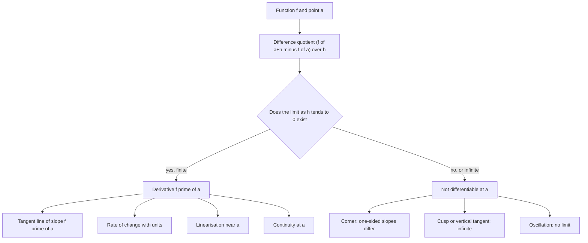

# Derivatives

> [Calculus](../README.md) · Level: Intermediate · Prerequisites: [Relations and Functions](../../00-foundations/05-relations-and-functions/README.md), [Polynomials](../../03-algebra/06-polynomials/README.md), [Rational Expressions](../../03-algebra/09-rational-expressions/README.md), [Exponential and Logarithmic Functions](../../03-algebra/12-exponential-and-logarithmic-functions/README.md), [Trigonometric Functions](../../05-trigonometry/01-trigonometric-functions/README.md), [Trigonometric Identities](../../05-trigonometry/03-trigonometric-identities/README.md), [Proof Techniques](../../00-foundations/04-proof-techniques/README.md) · Estimated time: 10 h

## 1. Introduction

Two classical questions look unrelated and turn out to be the same question.

**The tangent problem.** Given a curve, what is the straight line that touches it at a chosen point — the
line that matches the curve's direction there? For a circle the tangent is perpendicular to the radius; for
a parabola or a sine wave there is no obvious construction, and the Greeks could handle only special curves
by special tricks.

**The velocity problem.** A car covers $100$ km in two hours, so its *average* speed is $50$ km/h. What does
the speedometer show at an instant, when an instant has no duration and therefore no distance to divide by?

Newton (1665–1666) and Leibniz (1670s) answered both with one limit: the limit of a ratio of two small
changes as the changes shrink to nothing. That limit is the **derivative**, the central object of
differential calculus.

Its power is not that it computes slopes. It converts a *global* statement into a *local* one and a
*nonlinear* object into a *linear* one: a curve near a point looks like its tangent, a motion near an
instant looks uniform, a complicated model near an operating point looks linear. Every linearisation in
science — the small oscillation of a pendulum, the gain of an amplifier, the step taken by gradient descent
— is this one idea applied.

This tutorial builds the derivative from the difference quotient, proves that differentiability implies
continuity (and shows why the converse fails), derives the derivatives of the elementary functions from the
definition, explains the notations, and ends with the **linear approximation** and the derivative as a
**linear map**.

## 2. Prerequisites

* **Functions and graphs** — domain, range, composition, reading a slope off a graph. See
  [Relations and Functions](../../00-foundations/05-relations-and-functions/README.md).
* **Polynomial algebra and the binomial theorem** — expanding $(x+h)^n$ and cancelling common factors. See
  [Polynomials](../../03-algebra/06-polynomials/README.md) and
  [Rational Expressions](../../03-algebra/09-rational-expressions/README.md).
* **Inequalities and absolute value** — solving $|x-a| < \delta$. See [Inequalities](../../03-algebra/03-inequalities/README.md).
* **Exponentials and logarithms** — the number $e$, $e^{x+y} = e^xe^y$, $\ln(e^x) = x$. See
  [Exponential and Logarithmic Functions](../../03-algebra/12-exponential-and-logarithmic-functions/README.md).
* **Trigonometry in radians** — the addition formulas. See
  [Trigonometric Functions](../../05-trigonometry/01-trigonometric-functions/README.md) and
  [Trigonometric Identities](../../05-trigonometry/03-trigonometric-identities/README.md).
* **Proof technique**, including $\varepsilon$-$\delta$ statements. See [Proof Techniques](../../00-foundations/04-proof-techniques/README.md).

Limits are recapped from scratch in Section 5.1, so the tutorial is self-contained.

## 3. Learning Objectives

By the end of this tutorial you will be able to:

1. Explain why the derivative must be a limit rather than a quotient of two finite numbers.
2. Write down a difference quotient, simplify it algebraically, and take its limit.
3. State the definition of $f'(a)$ with explicit quantifiers and compute derivatives from first principles.
4. Read and write $f'(x)$, $\dfrac{df}{dx}$, $D_xf$, $\dot y$ and $f^{(n)}(x)$, and say what each denotes.
5. Prove that differentiability at a point implies continuity there, and explain why the converse fails.
6. Derive the derivatives of $x^n$, $\sin x$, $\cos x$, $e^x$ and $\ln x$ from the definition.
7. Compute higher derivatives and interpret the first three derivatives of a position function.
8. Use the derivative as a rate of change in a word problem, with correct units.
9. Write the tangent line and the linearisation at a point, and use the differential to propagate an error.
10. Explain in what sense the derivative is a linear map.

## 4. Intuition

### 4.1 Zooming in on a curve

Put a ruler against the graph of $y = x^2$ near $(1,1)$. The curve bends, so no straight line lies *on* it.
But magnify tenfold, a hundredfold, a thousandfold about $(1,1)$ and the visible piece of curve becomes
straighter and straighter, approaching a definite line: the **tangent**, whose slope is the **derivative**.

Almost every curve is *locally linear* — indistinguishable from a straight line once you look closely
enough. That is why calculus works, and why linear mathematics applies to a nonlinear world.

### 4.2 The speedometer

For a car with position $s(t)$, the average speed between $t_0$ and $t_0+h$ is

$$\frac{s(t_0+h)-s(t_0)}{h},$$

the slope of the **secant** line through two points of the graph. Let $h \to 0$: if the averages settle down,
the limit is the **instantaneous velocity**. So instantaneous speed is not a distance divided by a time; it
is the *limit* of such quotients.

### 4.3 Two questions, one limit

| | Tangent problem | Velocity problem |
|---|---|---|
| Curve | $y = f(x)$ | $s = s(t)$ |
| Two nearby points | $x = a$, $x = a+h$ | $t = t_0$, $t = t_0+h$ |
| Average quantity | $\dfrac{f(a+h)-f(a)}{h}$ | $\dfrac{s(t_0+h)-s(t_0)}{h}$ |
| Limit | slope of tangent $f'(a)$ | velocity $v(t_0)$ |

Every row has the same entries: the tangent problem is the velocity problem with relabelled axes. That is
why one definition serves geometry, physics, economics and everything else — the derivative is a *rate of
change*, and "slope" is its geometric picture.

## 5. Formal Definition

### 5.1 The one tool we borrow: limits

**Definition 5.1 (Limit).** Let $f$ be defined on an open interval containing $a$, except possibly at $a$.
Then $\lim_{x\to a}f(x) = L$ means

$$\forall \varepsilon > 0\ \exists \delta > 0\ \forall x:\quad 0 < |x-a| < \delta \Rightarrow |f(x)-L| < \varepsilon.$$

Read aloud: "for every $\varepsilon>0$ there is a $\delta>0$ such that whenever $x$ is within $\delta$ of $a$
but not equal to $a$, $f(x)$ is within $\varepsilon$ of $L$". Three consequences matter below. The point
$x=a$ is excluded, so a quotient that is $0/0$ at $a$ may still have a limit. **One-sided limits** restrict
the approach to $x<a$ or $x>a$; the two-sided limit exists **iff** both one-sided limits exist and agree. A
limit may fail to exist by running to infinity or by oscillating.

**Theorem 5.2 (Limit laws).** If $\lim_{x\to a}f(x)=L$ and $\lim_{x\to a}g(x)=M$ exist and $c\in\mathbb{R}$,
then

$$\lim_{x\to a}(f+g)=L+M,\qquad \lim_{x\to a}(fg)=LM,\qquad \lim_{x\to a}cf=cL,\qquad \lim_{x\to a}\frac{f}{g}=\frac{L}{M}\ (M\ne 0).$$

Also $\lim f(x)^n = L^n$, and $\lim g(f(x)) = g(L)$ when $g$ is continuous at $L$. These follow from
Definition 5.1 by $\varepsilon$-$\delta$ arguments and are used freely below.

**Definition 5.3 (Continuity).** $f$ is **continuous at $a$** when $\lim_{x\to a}f(x) = f(a)$.

### 5.2 The derivative at a point

**Definition 5.4 (Differentiable, derivative).** Let $f$ be defined on an open interval containing $a$. Then
$f$ is **differentiable at $a$** when

$$f'(a) := \lim_{h\to 0}\frac{f(a+h)-f(a)}{h}$$

exists and is finite; that limit is the **derivative of $f$ at $a$**. If the limit fails to exist, $f$ is not
differentiable at $a$. If it is $+\infty$ or $-\infty$ we say the derivative is infinite (a vertical
tangent), but $f$ is still not differentiable: differentiability requires a real number.

The quotient inside the limit is the **difference quotient**. With $x = a+h$ the same definition reads

$$f'(a) = \lim_{x\to a}\frac{f(x)-f(a)}{x-a}.$$

The second form is usually better for algebra, the first for computation.

**Definition 5.5 (One-sided derivatives).** If they exist,

$$f'_-(a) := \lim_{h\to0^-}\frac{f(a+h)-f(a)}{h}, \qquad f'_+(a) := \lim_{h\to0^+}\frac{f(a+h)-f(a)}{h}$$

are the **left-hand** and **right-hand derivatives**. Then $f'(a)$ exists **iff** both exist and are equal.

### 5.3 The derivative as a function

**Definition 5.6.** If $f$ is differentiable at every point of an open interval $I$, then
$f' : I \to \mathbb{R}$ with $x \mapsto f'(x)$ is the **derivative of $f$ on $I$**. If $f'$ is itself
differentiable, $f'' = (f')'$ is the **second derivative**, and so on.

The three objects $f$, $f'$ and $f'(a)$ differ: $f$ is the function, $f'$ records slopes at all points,
$f'(a)$ is a single number.

### 5.4 The tangent line

**Definition 5.7.** If $f$ is differentiable at $a$, the **tangent line** at $(a, f(a))$ is

$$y = f(a) + f'(a)(x-a).$$

If $f'(a)\ne0$, the **normal line** has slope $-1/f'(a)$.

It is the right line, not merely a line with the right slope, because it is the unique line whose error
divided by the horizontal distance tends to $0$ (Theorem 7.8, with uniqueness in Theorem 7.10).

## 6. Mathematical Notation

### 6.1 The five notations

| Notation | Read aloud | Meaning | Whose |
|---|---|---|---|
| $f'(x)$ | "$f$ prime of $x$" | derivative function at $x$ | Lagrange |
| $\dfrac{df}{dx}$ | "d $f$ d $x$" | derivative of $f$ with respect to $x$ | Leibniz |
| $f'(a)$, $\dfrac{df}{dx}\big\vert_{x=a}$ | "$f$ prime at $a$" | the derivative *number* at $a$ | — |
| $D_xf$, $\dfrac{d}{dx}f$ | "D sub $x$ of $f$" | the operation "differentiate in $x$" | Euler |
| $\dot y$ | "y dot" | derivative with respect to **time** | Newton |

Lagrange's notation stresses that differentiation acts on *functions*; Leibniz's records the variable and
keeps track of dependencies, which becomes essential in
[Differentiation Rules](../04-differentiation-rules/README.md); Newton's is used for time derivatives only.

### 6.2 Symbols used here

| Symbol | Read as | Meaning |
|---|---|---|
| $h$, $\Delta x$ | "h", "delta x" | an increment of the input |
| $f(a+h)-f(a)$, $\Delta y$ | "delta y" | the corresponding change of the output |
| $\dfrac{\Delta y}{\Delta x}$ | "delta y over delta x" | average rate of change; secant slope |
| $\dfrac{dy}{dx}$ | "d y d x" | derivative: the limit of $\Delta y/\Delta x$ |
| $dx$, $dy$ | "d x", "d y" | differentials, related by $dy = f'(x)\,dx$ |
| $f'_-(a)$, $f'_+(a)$ | left / right derivative | one-sided derivatives |
| $f''$, $f^{(n)}$ | "$f$ double prime", "$f$ to the $n$" | second and $n$-th derivatives |
| $L(x)$ | "L of $x$" | linearisation of $f$ at $a$ |
| $o(h)$ | "little-o of $h$" | a quantity whose ratio to $h$ tends to $0$ |

### 6.3 Reading $\dfrac{dy}{dx}$ correctly

In Leibniz's notation $\dfrac{dy}{dx}$ is a **single symbol** for $\lim_{\Delta x\to0}\frac{\Delta y}{\Delta
x}$, not a fraction of two numbers. The same symbols acquire a second, legitimate life as *differentials*
(Section 7.9), where $dy = f'(x)\,dx$; the differential is the linear approximation of the limit. What is
**not** legitimate is cancelling $dx$'s to "prove" the chain rule — that is a mnemonic for a theorem with a
real proof.

Also: write $f'(x)$ rather than $f(x)'$; $\sin^2x = (\sin x)^2$ but $\sin^{-1}x = \arcsin x$
([MATHEMATICAL_NOTATION.md](../../MATHEMATICAL_NOTATION.md), Section 10); $\dfrac{d}{dx}$ alone is an
operator, not a number.

## 7. Core Concepts

### 7.1 From secant to tangent

For $h \ne 0$ the secant through $(a,f(a))$ and $(a+h,f(a+h))$ has slope

$$m_{\text{sec}}(h) = \frac{f(a+h)-f(a)}{h},$$

and the secant has equation $y = f(a) + m_{\text{sec}}(h)(x-a)$. As $h\to0$ either these slopes approach one
number $m$, and the secants approach the line $y = f(a)+m(x-a)$ (the tangent), or they do not, and there is
no tangent. The definition of $f'(a)$ is precisely the first alternative with $m = f'(a)$. No "infinitely
small" quantity is ever introduced: only ordinary quotients and one limit.

### 7.2 A template for differentiating from the definition

Every first-principles computation has four steps: write $f(a+h)$ and $f(a)$; subtract and simplify,
factoring out $h$; divide by $h$ and cancel (legal because $h\ne0$ in the quotient); let $h\to0$.

For $f(x) = x^2$ at a general $a$:

$$\frac{(a+h)^2-a^2}{h} = \frac{a^2+2ah+h^2-a^2}{h} = \frac{h(2a+h)}{h} = 2a+h \longrightarrow 2a.$$

So $f'(x) = 2x$. Sanity checks worth doing every time: **units** (distance over time gives speed), **sign**
(on $y=x^2$ the slope must be negative, zero, positive according as $x<0$, $x=0$, $x>0$ — and $2x$ says
that), and **magnitude** (steep at $x=10$, flat near $0$ — and $2x$ says that too).

### 7.3 Two limit facts the derivations need

**Lemma 7.1.** $\displaystyle\lim_{h\to0}\frac{\sin h}{h} = 1$ (radians).

*Proof.* Let $0<h<\pi/2$ and compare three areas in the unit circle: the triangle with vertices
$O=(0,0)$, $A=(1,0)$, $B=(\cos h,\sin h)$ has area $\tfrac12\sin h$; the sector $OAB$ has area $\tfrac12h$;
the triangle $OAT$ with $T=(1,\tan h)$ has area $\tfrac12\tan h$. Containment gives

$$\tfrac12\sin h < \tfrac12 h < \tfrac12\tan h, \qquad\text{so}\qquad \sin h < h < \tan h.$$

Divide by $\sin h > 0$: $1 < \dfrac{h}{\sin h} < \dfrac{1}{\cos h}$, that is $\cos h < \dfrac{\sin
h}{h} < 1$. Since $\cos h\to1$, the squeeze theorem gives the limit from the right; the quotient is even in
$h$, so the left limit is the same. $\blacksquare$

**Corollary 7.2.** $\displaystyle\lim_{h\to0}\frac{\cos h-1}{h} = 0$.

*Proof.* Multiply by $\frac{\cos h+1}{\cos h+1}$:

$$\frac{\cos h-1}{h} = \frac{\cos^2h-1}{h(1+\cos h)} = \frac{-\sin^2h}{h(1+\cos h)} = -\sin h\cdot\frac{\sin h}{h}\cdot\frac{1}{1+\cos h} \longrightarrow 0\cdot1\cdot\tfrac12 = 0. \quad\blacksquare$$

**Lemma 7.3.** $\displaystyle\lim_{h\to0}\frac{e^h-1}{h} = 1$.

*Proof.* Use $e^h = \lim_{n\to\infty}\left(1+\frac hn\right)^n$ and $e^he^{-h}=1$. Bernoulli's inequality
$(1+u)^n\ge 1+nu$ for $u\ge-1$ gives $\left(1+\frac hn\right)^n \ge 1+h$ for $h>-1$, hence

$$e^h \ge 1+h \quad (h>-1).$$

For $0<h<1$ apply this to $-h$: $e^{-h}\ge 1-h>0$, so $e^h = 1/e^{-h} \le \frac{1}{1-h}$. Therefore

$$1 \le \frac{e^h-1}{h} \le \frac{1}{1-h},$$

and $\frac{1}{1-h}\to1$, so the right-hand limit is $1$. For $h = -k$ with $0<k<1$,

$$\frac{e^h-1}{h} = \frac{1-e^{-k}}{k},$$

and $e^{-k}\ge1-k$ gives an upper bound $1$, while $e^{k}\ge1+k$ gives $e^{-k}\le\frac{1}{1+k}$, hence
$1-e^{-k}\ge\frac{k}{1+k}$ and a lower bound $\frac{1}{1+k}\to1$. Squeeze again. $\blacksquare$

**Lemma 7.4.** $\displaystyle\lim_{u\to0}\frac{\ln(1+u)}{u} = 1$.

*Proof.* Put $w = \ln(1+u)$, so $u = e^w-1$ and $w\to0$ as $u\to0$ (continuity of $\ln$). Then
$\frac{\ln(1+u)}{u} = \frac{w}{e^w-1} = 1\Big/\frac{e^w-1}{w} \to 1$ by Lemma 7.3. $\blacksquare$

### 7.4 Differentiability implies continuity

**Theorem 7.5.** If $f$ is differentiable at $a$, then $f$ is continuous at $a$.

*Proof.* For $x\ne a$,

$$f(x)-f(a) = \frac{f(x)-f(a)}{x-a}\,(x-a).$$

The first factor tends to $f'(a)$ and the second to $0$, so the product tends to $f'(a)\cdot0 = 0$ by the
product law. Hence $\lim_{x\to a}f(x)=f(a)$. $\blacksquare$

The implication is one-way, and the direction matters: differentiability is the stronger hypothesis, so a
discontinuity is a certificate of non-differentiability. The converse fails, in four standard ways.

### 7.5 Continuous but not differentiable

**(a) A corner: $\lvert x\rvert$ at $0$.** Here $f(0+h)-f(0) = |h|$, so the quotient is $+1$ for $h>0$ and
$-1$ for $h<0$. The one-sided derivatives differ, so $f'(0)$ does not exist: the graph has two candidate
tangents and no way to choose.

**(b) A cusp: $x^{2/3}$ at $0$.** Here $\frac{h^{2/3}}{h} = h^{-1/3} \to +\infty$ as $h\to0^+$ and
$\to-\infty$ as $h\to0^-$. Both one-sided derivatives are infinite with opposite signs; the graph comes down
vertically and turns back up.

**(c) Oscillation: $x\sin(1/x)$ at $0$.** Set $f(0)=0$, $f(x)=x\sin(1/x)$ for $x\ne0$. Since $|f(x)|\le|x|$,
$f$ is continuous at $0$, but the difference quotient is $\sin(1/h)$, which oscillates between $-1$ and $1$
and has no limit.

**(d) Everywhere: the Weierstrass function.** In 1872 Weierstrass showed that

$$W(x) = \sum_{n=0}^{\infty}a^n\cos\left(b^n\pi x\right), \qquad 0<a<1,\ b \text{ odd integer},\ ab>1+\tfrac{3\pi}{2},$$

is continuous at every real $x$ and differentiable at none. This forced the $\varepsilon$-$\delta$
foundations of analysis: continuity does not imply differentiability, not even at a single point of the
domain — and here it fails at every point at once.

| Behaviour at $a$ | One-sided derivatives | Example |
|---|---|---|
| jump or hole | at least one quotient unbounded | step function at $0$ |
| corner | finite, unequal | $\lvert x\rvert$ at $0$ |
| cusp / vertical tangent | infinite | $x^{2/3}$ at $0$ |
| oscillation | no limit | $x\sin(1/x)$ at $0$ |
| everywhere | none exist | Weierstrass function |

A function can even be differentiable everywhere with a derivative that is *not continuous*: for $g(0)=0$,
$g(x) = x^2\sin(1/x)$ ($x\ne0$), the quotient at $0$ is $h\sin(1/h)\to0$, so $g'(0)=0$, while for $x\ne0$
one computes $g'(x) = 2x\sin(1/x)-\cos(1/x)$, which has no limit as $x\to0$.

### 7.6 Derivatives of the elementary functions from the definition

**(a) Constant.** $f(x)=c$ gives $\frac{c-c}{h}=0$, so $(c)' = 0$.

**(b) Power $x^n$, $n\in\mathbb{N}$.** By the binomial theorem,

$$(x+h)^n = x^n + nx^{n-1}h + \binom n2 x^{n-2}h^2 + \cdots + h^n.$$

Subtract $x^n$, divide by $h$; one factor of $h$ cancels everywhere:

$$\frac{(x+h)^n-x^n}{h} = nx^{n-1} + \binom n2 x^{n-2}h + \cdots + h^{n-1} \longrightarrow nx^{n-1}.$$

So $\dfrac{d}{dx}x^n = nx^{n-1}$ for $n = 1,2,3,\dots$; the case $n=0$ is the constant case. Negative and
fractional exponents need the quotient and chain rules, and are treated in
[Differentiation Rules](../04-differentiation-rules/README.md), Section 7.10.

**(c) Sine.** From $\sin(x+h) = \sin x\cos h+\cos x\sin h$,

$$\frac{\sin(x+h)-\sin x}{h} = \sin x\cdot\frac{\cos h-1}{h} + \cos x\cdot\frac{\sin h}{h} \longrightarrow \sin x\cdot0+\cos x\cdot1 = \cos x.$$

**(d) Cosine.** From $\cos(x+h) = \cos x\cos h-\sin x\sin h$,

$$\frac{\cos(x+h)-\cos x}{h} = \cos x\cdot\frac{\cos h-1}{h} - \sin x\cdot\frac{\sin h}{h} \longrightarrow -\sin x.$$

The minus sign is geometry, not convention: just after its maximum at $0$ the cosine decreases.

**(e) Exponential.** From $e^{x+h}=e^xe^h$,

$$\frac{e^{x+h}-e^x}{h} = e^x\cdot\frac{e^h-1}{h}\longrightarrow e^x.$$

Among all bases only $e$ has $f'=f$; general bases are handled in
[Differentiation Rules](../04-differentiation-rules/README.md), Section 7.9.

**(f) Natural logarithm.** For $x>0$ and $|h|<x$,

$$\frac{\ln(x+h)-\ln x}{h} = \frac1h\ln\left(1+\frac hx\right) = \frac1x\cdot\frac{\ln(1+u)}{u}, \qquad u = \frac hx \longrightarrow \frac1x,$$

by Lemma 7.4. The domain matters: $\ln x$ exists only for $x>0$.

**(g) Square root.** For $x>0$, rationalise the numerator:

$$\frac{\sqrt{x+h}-\sqrt x}{h} = \frac{(x+h)-x}{h\left(\sqrt{x+h}+\sqrt x\right)} = \frac{1}{\sqrt{x+h}+\sqrt x}\longrightarrow\frac{1}{2\sqrt x}.$$

This agrees with the power rule at $n=\tfrac12$; at $x=0$ the derivative is infinite (vertical tangent).

| $f(x)$ | $f'(x)$ | for |
|---|---|---|
| $c$ | $0$ | all $x$ |
| $x^n$, $n\in\mathbb{N}$ | $nx^{n-1}$ | all $x$ |
| $\sin x$ | $\cos x$ | all $x$ |
| $\cos x$ | $-\sin x$ | all $x$ |
| $e^x$ | $e^x$ | all $x$ |
| $\ln x$ | $\dfrac1x$ | $x>0$ |
| $\sqrt x$ | $\dfrac{1}{2\sqrt x}$ | $x>0$ |

### 7.7 The arithmetic of derivatives

**Theorem 7.6 (Linearity).** If $f,g$ are differentiable at $a$ and $c\in\mathbb{R}$, then

$$(f+g)'(a) = f'(a)+g'(a), \qquad (cf)'(a) = c\,f'(a).$$

*Proof.* For $h\ne0$,

$$\frac{(f+g)(a+h)-(f+g)(a)}{h} = \frac{f(a+h)-f(a)}{h}+\frac{g(a+h)-g(a)}{h} \longrightarrow f'(a)+g'(a),$$

and $\frac{(cf)(a+h)-(cf)(a)}{h} = c\cdot\frac{f(a+h)-f(a)}{h}\to cf'(a)$. $\blacksquare$

Hence every polynomial is differentiable everywhere, with

$$\frac{d}{dx}\left(a_nx^n+\cdots+a_1x+a_0\right) = na_nx^{n-1}+\cdots+a_1.$$

**Warning.** Linearity says nothing about products: $(fg)'\ne f'g'$ in general (take $f=g=x$: $2x \ne 1$).
The product, quotient and chain rules are proved in [Differentiation Rules](../04-differentiation-rules/README.md).

### 7.8 Higher derivatives

**Definition 7.7.** $f'' = (f')'$, and $f^{(n)} = \left(f^{(n-1)}\right)'$ with $f^{(0)} = f$; in Leibniz
notation $\dfrac{d^nf}{dx^n}$. Beyond three or four dashes one writes $f^{(n)}$.

For $f(x)=x^4$: $f'=4x^3$, $f''=12x^2$, $f'''=24x$, $f^{(4)}=24$, $f^{(5)}=0$; a polynomial of degree $n$ has
$f^{(n)}$ constant and $f^{(n+1)}=0$. For $\sin x$ the derivatives cycle with period four:
$\cos$, $-\sin$, $-\cos$, $\sin$. For $e^x$ every derivative equals $e^x$; for $\ln x$,
$f^{(n)}(x) = (-1)^{n-1}(n-1)!\,x^{-n}$.

If $s(t)$ is position, then

| Derivative | Name | Meaning | Unit |
|---|---|---|---|
| $s'$ | velocity | rate of change of position | m/s |
| $s''$ | acceleration | rate of change of velocity | m/s² |
| $s'''$ | jerk | rate of change of acceleration | m/s³ |
| $s^{(4)}$ | snap | rate of change of jerk | m/s⁴ |

Geometrically $f''$ measures how the slope changes: $f''>0$ where the graph bends upward (convex), $f''<0$
where it bends downward. That is the beginning of curve sketching.

### 7.9 Rates of change

A derivative is a quotient of units:

$$f'(a) = \lim_{\Delta x\to0}\frac{\Delta f}{\Delta x} \quad\text{has units}\quad\frac{\text{units of } f}{\text{units of } x}.$$

Three correct readings: the instantaneous rate of change of $f$ with respect to $x$ at $a$; "about $f'(a)$
units of $f$ per unit increase of $x$ near $a$"; the slope of the tangent. The **average rate** on $[a,b]$ is
$\frac{f(b)-f(a)}{b-a}$, a single number for the whole interval, whereas the derivative is local and varies
from point to point.

If $C(q)$ is the cost of producing $q$ units, then $C'(q)$ is the **marginal cost**, and since
$C(q+1)-C(q)\approx C'(q)$ it is approximately the cost of one more unit. That is why economists call
derivatives "marginal" quantities.

### 7.10 Linear approximation and the differential

**Theorem 7.8 (First-order approximation).** If $f$ is differentiable at $a$ and
$E(h) := f(a+h)-f(a)-f'(a)h$, then $\lim_{h\to0}E(h)/h = 0$, i.e. $E(h) = o(h)$.

*Proof.* For $h\ne0$, $E(h)/h = \frac{f(a+h)-f(a)}{h}-f'(a) \to 0$; at $h=0$ both sides vanish. $\blacksquare$

**Definition 7.9.** The **linearisation** of $f$ at $a$ is $L(x) = f(a)+f'(a)(x-a)$, whose graph is the
tangent line. By Theorem 7.8, $f(x) = L(x)+o(x-a)$.

**Theorem 7.10 (Uniqueness).** If $f(a+h) = f(a)+mh+h\,s(h)$ with $s(h)\to0$, then $m = f'(a)$.

*Proof.* Subtract $f(a)$, divide by $h$, let $h\to0$: the left side tends to $f'(a)$, the right to $m$.
$\blacksquare$

So for small $h$,

$$f(a+h)\approx f(a)+f'(a)h.$$

For example $\sqrt{4.1}\approx 2+\frac{1}{2\sqrt4}(0.1) = 2.025$ (true $2.0248457$), $\sin(0.1)\approx0.1$
(true $0.0998334$), $e^{0.1}\approx1.1$ (true $1.1051709$ — worse, because the second derivative of $e^x$ is
larger; the size of the error is governed by $f''$, and the quantitative statement is Taylor's theorem).

**The differential.** For an arbitrary increment $dx$, put $df = f'(x)\,dx$, written $dy = f'(x)\,dx$ when
$y=f(x)$. Then $\Delta y = f(x+dx)-f(x) = dy+o(dx)$: the differential is the linear part of the change, and
in this reading $\frac{dy}{dx} = f'(x)$ really is a quotient of differentials.

**Error propagation.** If $V = x^3$ and the edge carries error $dx$, then $dV = 3x^2dx$ and
$\frac{dV}{V} = 3\frac{dx}{x}$: a $1\%$ error in the edge gives about a $3\%$ error in the volume. In general
a power law multiplies relative errors by the exponent.

### 7.11 Preview: the derivative as a linear map

For fixed $a$, the map $T_a:\mathbb{R}\to\mathbb{R}$, $T_a(h) = f'(a)h$, is **linear**:
$T_a(h_1+h_2) = T_a(h_1)+T_a(h_2)$ and $T_a(ch) = cT_a(h)$. Theorem 7.8 says that near $a$, $f$ is the
constant $f(a)$ plus the linear map $T_a$ plus an error $o(h)$:

> the derivative is the linear map that best approximates $f$ near $a$.

In one variable a linear map is multiplication by a number, so nothing is lost by calling that number "the
derivative". In several variables the linear map is a matrix: $F:\mathbb{R}^n\to\mathbb{R}^m$ is
differentiable at $a$ when $F(a+h) = F(a)+T(h)+o(\lVert h\rVert)$ for some linear $T$, whose matrix is the
**Jacobian**. The chain rule becomes matrix multiplication.

Two consequences. **Differentiation is a linear operator** $D(f) = f'$ on $C^1(I)$, by Theorem 7.6; its
kernel (functions with $Df = 0$) is the set of constants. **Exponentials are eigenfunctions**:
$D(e^{\lambda x}) = \lambda e^{\lambda x}$, which is why they solve linear differential equations.

## 8. Formulas and Properties

**1. Definition.** $f'(a) = \lim_{h\to0}\frac{f(a+h)-f(a)}{h} = \lim_{x\to a}\frac{f(x)-f(a)}{x-a}$, when
the limit is a finite number.

**2. Linearity.** $(f+g)'(a) = f'(a)+g'(a)$ and $(cf)'(a) = cf'(a)$. *Why:* split the difference quotient
and use the limit laws (Theorem 7.6).

**3. Elementary derivatives.** For $x$ in the stated domain,

$$\frac{d}{dx}c = 0,\quad \frac{d}{dx}x^n = nx^{n-1}\ (n\in\mathbb{N}),\quad \frac{d}{dx}\sin x = \cos x,\quad \frac{d}{dx}\cos x = -\sin x,$$
$$\frac{d}{dx}e^x = e^x,\quad \frac{d}{dx}\ln x = \frac1x\ (x>0),\quad \frac{d}{dx}\sqrt x = \frac{1}{2\sqrt x}\ (x>0).$$

*Why:* Section 7.6, each from the definition.

**4. Tangent line.** $y = f(a)+f'(a)(x-a)$. *Why:* it is the limit of the secants, equivalently the unique
line with error $o(x-a)$ (Theorem 7.10).

**5. Linearisation.** $f(a+h)\approx f(a)+f'(a)h$ with error $o(h)$. *Why:* Theorem 7.8.

**6. Differential.** $df = f'(x)dx$ and $\Delta f = df+o(dx)$. *Why:* the differential is the change of the
linearisation.

**7. Differentiability implies continuity.** *Why:* $f(x)-f(a) = \frac{f(x)-f(a)}{x-a}(x-a)\to f'(a)\cdot0$
(Theorem 7.5).

**8. Continuity does not imply differentiability.** $\lvert x\rvert$ at $0$: one-sided quotients $1$ and
$-1$.

**9. Two limits.** $\lim_{h\to0}\frac{\sin h}{h} = 1$ and $\lim_{h\to0}\frac{e^h-1}{h} = 1$. *Why:* areas in
the unit circle; Bernoulli's inequality and a squeeze.

**10. One-sided test.** $f'(a)$ exists **iff** $f'_-(a) = f'_+(a)$ both exist.

**11. Local Lipschitz bound.** If $f$ is differentiable at $a$, then for some $\delta>0$ and $M>0$,
$|f(x)-f(a)|\le M|x-a|$ when $|x-a|<\delta$. *Why:* take $M = |f'(a)|+1$; the quotient is eventually
bounded by $M$ by the definition of limit with $\varepsilon=1$.

**12. Higher derivatives.** $f^{(n)} = \left(f^{(n-1)}\right)'$, with $\dfrac{d^nf}{dx^n}$ in Leibniz
notation.

## 9. Step-by-Step Examples

### Example 1 (easy): a quadratic from the definition

Differentiate $f(x) = x^2-3x$ at $a=2$ and write the tangent line.

$f(2) = 4-6 = -2$ and $f(2+h) = (2+h)^2-3(2+h) = 4+4h+h^2-6-3h$, hence

$$f(2+h)-f(2) = \left(4+4h+h^2-6-3h\right)-(-2) = h+h^2, \qquad \frac{f(2+h)-f(2)}{h} = \frac{h(1+h)}{h} = 1+h.$$

Letting $h\to0$: $f'(2) = 1$. The tangent is $y = -2+1(x-2) = x-4$.

*Check.* The derivative function is $2x-3$, so $f'(2)=1$. ✓ And $x^2-3x = x-4 \iff x^2-4x+4 = (x-2)^2 = 0$: a
double root at $x=2$, the algebraic signature of tangency.

### Example 2 (easy): a reciprocal from the definition

Differentiate $f(x) = 1/x$ at $a = -2$.

$f(-2) = -\tfrac12$ and $f(-2+h) = \frac{1}{h-2}$, so

$$f(-2+h)-f(-2) = \frac{1}{h-2}+\frac12 = \frac{2+(h-2)}{2(h-2)} = \frac{h}{2(h-2)}, \qquad \frac{f(-2+h)-f(-2)}{h} = \frac{1}{2(h-2)}.$$

Letting $h\to0$: $f'(-2) = \dfrac{1}{2(-2)} = -\dfrac14$. The tangent at $\left(-2,-\tfrac12\right)$ is

$$y = -\frac12-\frac14(x+2) = -\frac x4-1.$$

*Check.* The general formula is $\left(\frac1x\right)' = -\frac{1}{x^2}$, giving $-\tfrac14$ at $x=-2$. ✓
The slope is negative because $1/x$ decreases on $(-\infty,0)$.

### Example 3 (easy–medium): the square root and a linear estimate

(a) Differentiate $f(x)=\sqrt x$ at $a=4$. (b) Write the tangent. (c) Estimate $\sqrt{4.1}$ and $\sqrt{4.4}$.

*(a)* Rationalise:

$$\frac{\sqrt{4+h}-2}{h}\cdot\frac{\sqrt{4+h}+2}{\sqrt{4+h}+2} = \frac{(4+h)-4}{h\left(\sqrt{4+h}+2\right)} = \frac{1}{\sqrt{4+h}+2}\longrightarrow\frac14.$$

*(b)* $f(4)=2$, so $L(x) = 2+\frac14(x-4) = \frac x4+1$.

*(c)* $L(4.1) = 2.025$ and $L(4.4) = 2.1$.

| $x$ | $L(x)$ | true $\sqrt x$ | error |
|---|---|---|---|
| $4.1$ | $2.025$ | $2.0248457$ | $+0.000154$ |
| $4.4$ | $2.1$ | $2.0976177$ | $+0.002382$ |

The estimate is too large and worsens with distance from $4$: the tangent lies above the graph, which is
concave down. A linearisation is useful only near its point of tangency.

### Example 4 (medium): a cubic, horizontal tangents, a tangent line

Let $f(x) = x^3-2x+1$.

*(a)* With $(x+h)^3 = x^3+3x^2h+3xh^2+h^3$,

$$\frac{f(x+h)-f(x)}{h} = \frac{3x^2h+3xh^2+h^3-2h}{h} = 3x^2+3xh+h^2-2 \longrightarrow 3x^2-2.$$

The same result follows term by term from the power rule and linearity.

*(b)* Horizontal tangents: $3x^2-2=0$, so $x = \pm\sqrt{2/3}\approx\pm0.8165$. Between these points $f'<0$
(the cubic decreases); outside them $f'>0$.

*(c)* At $x=1$: $f(1) = 0$, $f'(1) = 1$, so $y = x-1$.

*Check.* $x^3-2x+1-(x-1) = x^3-3x+2 = (x-1)^2(x+2)$: a double root at $x=1$ (tangency) and a crossing at
$x=-2$. ✓

### Example 5 (medium): the tangent to a sine curve

Find the tangent to $y=\sin x$ at $x=\pi/6$ and estimate $\sin(0.5)$.

The point is $\left(\pi/6,\tfrac12\right)$ and the slope is $\cos(\pi/6) = \tfrac{\sqrt3}{2}\approx0.8660$, so

$$y = \frac12+\frac{\sqrt3}{2}\left(x-\frac{\pi}{6}\right).$$

At $x = 0.5$, with $\pi/6\approx0.5236$,

$$y(0.5) = 0.5+0.8660\,(0.5-0.5236) = 0.4796,$$

against the true $\sin(0.5) = 0.47943$: too high by $0.0002$, as expected where the graph is concave down.

*Why the slope is $\cos x$.* At $x=0$ the sine rises with slope $1$; at $x=\pi/2$ it is flat, and
$\cos(\pi/2)=0$; at $x=\pi$ it falls with slope $-1$, and $\cos\pi=-1$. The derivative is negative exactly
where the graph descends.

### Example 6 (medium–hard): choosing parameters so that a join is smooth

Let $f(x) = x^2$ for $x\le1$ and $f(x) = ax+b$ for $x>1$. Find $a,b$ so that $f$ is differentiable at $1$.

*Continuity.* Left limit $1^2=1$, right limit $a+b$:

$$a+b = 1.$$

*Slopes.* The left derivative at $1$ is $2x|_{x=1} = 2$; the right derivative is the slope $a$ of the line:

$$a = 2.$$

*Solve.* $a=2$, then $b = 1-2 = -1$.

*Check.* With $a=2$, $b=-1$ the second branch is $2x-1$, which equals $1$ and has slope $2$ at $x=1$,
matching $x^2$ in both value and slope. ✓ Continuity alone would allow any $b = 1-a$; the slope condition
picks out $a=2$, and without it the graph has a corner.

### Example 7 (hard): reading a motion through its derivatives

A particle has position $s(t) = 2t^3-9t^2+12t$ m at time $t\in[0,3]$ s.

$$v(t) = s'(t) = 6t^2-18t+12 = 6(t-1)(t-2), \qquad a(t) = v'(t) = 12t-18.$$

The velocity vanishes at $t=1,2$ and is positive outside $[1,2]$, negative inside it:

| Interval | Sign of $v$ | Motion |
|---|---|---|
| $0<t<1$ | $+$ | forward |
| $1<t<2$ | $-$ | backward |
| $2<t<3$ | $+$ | forward |

Positions: $s(0)=0$, $s(1) = 5$, $s(2) = 4$, $s(3) = 9$. So the particle advances to $5$ m, retreats to $4$ m,
then advances to $9$ m. Accelerations: $a(1) = -6$ m/s², $a(2) = +6$ m/s², and $a(1.5) = 0$ where
$v(1.5) = -1.5$ m/s.

*Average versus instantaneous.* The average velocity on $[0,3]$ is $\frac{9-0}{3} = 3$ m/s. Solving
$6t^2-18t+12 = 3$, i.e. $2t^2-6t+3=0$, gives $t = \frac{3\pm\sqrt3}{2}\approx0.634$ and $2.366$: the velocity
equals its average twice inside the interval (this is the mean value theorem at work). The maximum speed on
the interval is $12$ m/s at $t=0$ and $t=3$.

### Example 8 (hard): where the parabola's tangent meets the axis

Prove that the tangent to $y=x^2$ at $(a,a^2)$, $a\ne0$, meets the $x$-axis exactly at $x = a/2$.

Since $y'=2x$, the tangent is $y = a^2+2a(x-a)$. Setting $y=0$:

$$0 = a^2+2ax-2a^2 = 2ax-a^2 \quad\Longrightarrow\quad x = \frac{a}{2}.$$

*Construction.* Drop the perpendicular from $(a,a^2)$ to $(a,0)$; bisect $[0,a]$ on the axis to obtain
$(a/2,0)$; join it to $(a,a^2)$. That is the tangent — an exact construction using only the geometry of the
parabola, which is how tangents were found before the derivative existed.

*Check.* Substituting the line into the parabola gives
$x^2-\left(a^2+2a(x-a)\right) = x^2-2ax+a^2 = (x-a)^2$, a double root at $x=a$. ✓ This double-root test
verifies any candidate tangent line.

## 10. Visual Explanations

### 10.1 The logical structure of the topic

A function and a point produce a difference quotient; its limit is the derivative, which has three
interpretations. The decision node is the differentiability test.

### 10.2 Watching the limit happen numerically

For $f(x)=x^2$ at $a=1$ the difference quotient is $2+h$:

| $h$ | $0.5$ | $0.1$ | $0.01$ | $0.001$ | $-0.001$ | $-0.01$ | $-0.1$ |
|---|---|---|---|---|---|---|---|
| quotient | $2.5$ | $2.1$ | $2.01$ | $2.001$ | $1.999$ | $1.99$ | $1.9$ |

The values converge to $2$ from both sides, and halving $h$ halves the gap: the convergence is *linear* in
$h$. This is why the secant method of numerical analysis converges linearly, whereas Newton's method, which
uses the derivative, converges quadratically.

### 10.3 Which question calls for which quantity

| Question | Quantity | Where it lives |
|---|---|---|
| slope of the curve at a point | $f'(a)$ | tangent line |
| how fast a quantity changes | $f'(a)$, with units | rate of change |
| approximate a value near a known one | $f(a)+f'(a)h$ | linearisation |
| how the slope itself changes | $f''(a)$ | concavity, acceleration |
| effect of a small input error | $df = f'(x)dx$ | differential |
| does the curve have a direction here | existence of $f'(a)$ | differentiability test |

## 11. Common Mistakes

**1. Substituting $h=0$ before cancelling.** That produces $\frac00$ and then a guess. Simplify, cancel $h$
(legal since $h\ne0$ in the limit process), then let $h\to0$.

**2. Confusing $f$, $f'$ and $f'(a)$.** "$f'(x)=2x$, so $f'(2)=2x$" mixes a function with a number; $f'(2)=4$.
Never leave an $x$ in an answer that must be constant.

**3. Believing continuous implies differentiable.** Continuous forbids jumps and holes; differentiable also
forbids corners, cusps, vertical tangents and infinite oscillation. $\lvert x\rvert$ at $0$ is the standard
counterexample.

**4. Assuming $(fg)' = f'g'$.** With $f=g=x$ this gives $(x^2)'=1$, which is false. Linearity covers sums
and constant multiples only.

**5. Writing $(\cos x)' = \sin x$.** The sign is negative. At $x$ slightly greater than $0$ the cosine graph
descends, so its slope is negative.

**6. Reading $f'(a)>0$ as "increasing near $a$".** It gives only: $f(x)>f(a)$ for $x$ slightly greater than
$a$, and $f(x)<f(a)$ for $x$ slightly less. It does not give monotonicity on any interval. Indeed
$f(x) = x+2x^2\sin(1/x)$ with $f(0)=0$ has $f'(0)=1>0$, yet in every interval around $0$ there are $a<b$
with $f(a)>f(b)$: take $a = 1/(2\pi n+\pi/2)$, where $\sin(1/a)=1$, and $b = 1/(2\pi n-\pi/2)$, where
$\sin(1/b)=-1$; then $f(a)-f(b) = (a-b)+2a^2+2b^2>0$. Monotonicity is a global property.

**7. Using $(\ln x)' = 1/x$ outside the domain.** $\ln x$ exists only for $x>0$. For $\ln\lvert x\rvert$ the
derivative is $1/x$ on both sides, but that is a different statement, and it needs the chain rule.

**8. Treating $\dfrac{dy}{dx}$ as a fraction in a proof.** It is a limit. The identity
$\frac{dy}{dx} = \frac{dy}{du}\frac{du}{dx}$ is true, but not because $du$ cancels.

**9. Trusting a picture.** Plotted coarsely, $\lvert x\rvert$ near $0$ and $x\sin(1/x)$ look smooth.
Differentiability is a statement about a limit; only algebra settles it.

**10. Using the tangent too far away.** $2+\frac14(x-4)$ estimates $\sqrt x$ well at $4.1$ and badly at $9$
(it gives $3.25$, not $3$). The error is governed by $f''$ and grows with distance.

**11. Dropping units.** A derivative carries the ratio of units: "velocity $12$" is incomplete, "velocity
$12$ m/s" is an answer.

**12. Believing every $\frac00$ fails.** Indeterminate forms often have finite limits — that is exactly
Lemmas 7.1 and 7.3. The form is a signal to do algebra, not a verdict.

## 12. Applications

**Physics.** Velocity is $s'$, acceleration $s''$, and Newton's second law $F = ms''$ is a differential
equation: a force law determines motion up to two constants, which is why initial position and velocity must
be given. Jerk, the third derivative, matters in lift and roller-coaster design because the body senses
changes of acceleration.

**Engineering and measurement.** A sensor's calibration curve has a derivative — its **sensitivity**. If
$R(T)$ is a resistance, a temperature uncertainty $dT$ gives $dR = R'(T)dT$. The "D" of a PID controller is a
derivative term, reacting to the rate at which the error changes, and therefore damping oscillation.

**Economics and finance.** Marginal cost, revenue and utility are derivatives; elasticity of demand is the
dimensionless logarithmic derivative $\frac{Q'(p)}{Q(p)}p$. A bond's duration — its sensitivity to the
interest rate — is a derivative, and the "Greeks" of option pricing are partial derivatives.

**Biology and medicine.** Growth rates, enzyme reaction rates with respect to substrate concentration, and
drug clearance rates are derivatives. The model $P' = kP$ is the simplest differential equation in the field
and explains why "doubling time" summarises a growth curve.

**Computing.** Gradient descent steps against the derivative of a loss; Newton's method follows tangent lines
via $x_{n+1} = x_n - f(x_n)/f'(x_n)$; automatic differentiation applies the chain rule to a computational
graph. Finite differences are the fallback when no formula exists, limited by the cancellation of nearly equal
numbers in $f(x+h)-f(x)$.

**Geometry and analysis.** The tangent gives a curve's direction and its rate of turning gives curvature. The
derivative is also the vocabulary of every law of change: heat, waves, fluids, populations and general
relativity are stated as equations in derivatives, the subject of
[Differential Equations](../../16-differential-equations/README.md).

## 13. Exercises

The problem set is in [exercises.md](exercises.md): 36 problems in four levels — **Beginner (1–12)**
difference quotients and first-principles derivatives; **Intermediate (13–24)** algebra, piecewise joins,
higher derivatives, motion, rates, linear approximation; **Advanced (25–31)** proofs from the definition,
one-sided tests, tangency conditions; **Challenge (32–36)** pathological differentiability, the Weierstrass
phenomenon, Newton's method, the symmetric difference quotient. Attempt them before reading the solutions.

## 14. Solutions

Complete worked solutions, with strategy notes and checks, are in [solutions.md](solutions.md). Every solution
shows the algebra that makes the limit computable, not merely the final formula.

## 15. Summary

* The **derivative** is the limit of the difference quotient:
  $f'(a) = \lim_{h\to0}\frac{f(a+h)-f(a)}{h}$, when that limit is a finite number.
* Geometrically it is the **tangent slope**; physically the **instantaneous rate of change**; computationally
  the **best linear approximation** near the point.
* $f$ is the function, $f'$ the derivative function, $f'(a)$ a number.
* **Differentiable $\Rightarrow$ continuous**; the converse fails (corner, cusp, vertical tangent,
  oscillation), and the Weierstrass function is continuous everywhere and differentiable nowhere.
* From the definition: $(c)'=0$, $(x^n)' = nx^{n-1}$, $(\sin x)'=\cos x$, $(\cos x)'=-\sin x$, $(e^x)'=e^x$,
  $(\ln x)'=1/x$ for $x>0$, $(\sqrt x)' = 1/(2\sqrt x)$.
* The trigonometric derivations rest on $\lim_{h\to0}\frac{\sin h}{h}=1$; the exponential and logarithmic ones
  on $\lim_{h\to0}\frac{e^h-1}{h}=1$.
* Differentiation is **linear**, not multiplicative.
* Higher derivatives iterate the operation; for motion they are velocity, acceleration, jerk.
* The **linearisation** $L(x) = f(a)+f'(a)(x-a)$ satisfies $f(x)-L(x) = o(x-a)$, and its slope is uniquely
  determined by that property.
* The **differential** $df = f'(x)dx$ is the linear part of the change; it propagates errors, multiplying
  relative errors by the exponent in a power law.
* The **linear map** $h\mapsto f'(a)h$ is the formulation that generalises to several variables, where the
  matrix is the Jacobian.
* $f'(a)>0$ is a **local** statement and does not by itself make $f$ increasing on any interval.

## 16. Further Learning

**Next in this discipline.** [Differentiation Rules](../04-differentiation-rules/README.md) proves the
product, quotient, chain and inverse-function rules, turning differentiation into a technique. Everything
here — the definition, the notation, the tangent line, the linearisation — is used there without comment.

**Where the ideas deepen.** [Real Analysis](../../14-real-analysis/README.md) gives the full $\varepsilon$-$
\delta treatment, the mean value theorem, Taylor's theorem and the Weierstrass function.
[Differential Equations](../../16-differential-equations/README.md) uses the derivative as the language of
change; multivariable calculus, later in this discipline, replaces $f'(a)$ by a matrix.

**Standard texts.** M. Spivak, *Calculus* (chapters 9–11) proves everything here and more; T. Apostol,
*Calculus, Volume 1* is a more demanding alternative; J. Stewart, *Calculus* supplies large problem sets;
G. H. Hardy, *A Course of Pure Mathematics* gives the classical view of the derivative as a limit.

**Reference.** The elementary derivatives are also collected in
[Formulas](../../reference/formulas/README.md), and every term above is defined in
[GLOSSARY.md](../../GLOSSARY.md).