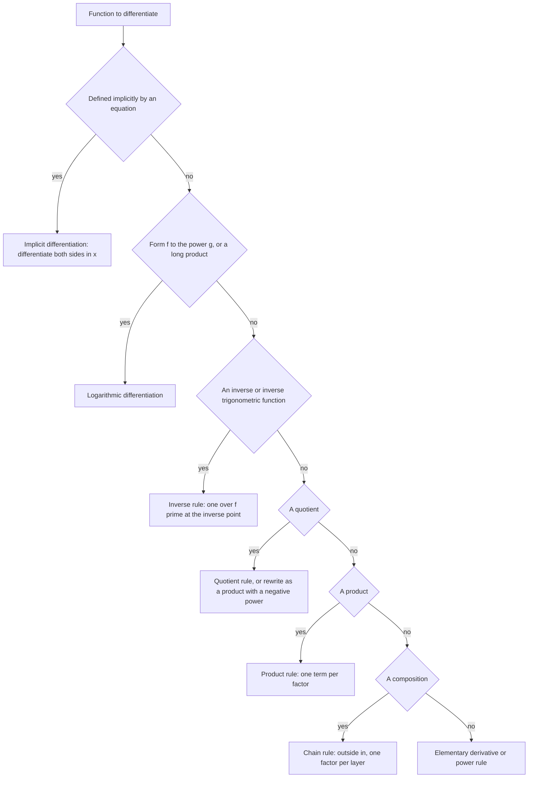

# Differentiation Rules

> [Calculus](../README.md) · Level: Intermediate · Prerequisites: [Derivatives](../03-derivatives/README.md), [Relations and Functions](../../00-foundations/05-relations-and-functions/README.md), [Rational Expressions](../../03-algebra/09-rational-expressions/README.md), [Exponential and Logarithmic Functions](../../03-algebra/12-exponential-and-logarithmic-functions/README.md), [Trigonometric Identities](../../05-trigonometry/03-trigonometric-identities/README.md) · Estimated time: 10 h

## 1. Introduction

In [Derivatives](../03-derivatives/README.md) every derivative was computed from the definition. That is
honest but hopeless as a working method: differentiating $f(x) = \dfrac{x^2\sin(3x)}{\sqrt{1+x^2}}$ from the
difference quotient would take a page of algebra, and a product of ten factors would take a book. The subject becomes usable only when we prove, once and for all, how the derivative behaves
under the operations that build functions out of simpler ones — sums, products, quotients, compositions and
inverses. Those theorems are the **differentiation rules**, and this topic proves all of them from the limit
definition.

There is a deeper reason to care. The rules are not tricks; they are structural facts. They say that
differentiation is a **derivation**: a linear operation satisfying the Leibniz (product) rule. That single
algebraic property is the abstract core of differential algebra, and it is what makes automatic
differentiation of computer programs possible. The chain rule says that differentiation respects
composition, which is why it becomes matrix multiplication in several variables. The inverse rule says that
the derivative of an inverse is the reciprocal, which is the one-dimensional case of the inverse function
theorem, the backbone of topology and geometry.

Two further techniques fall out of the chain rule: **implicit differentiation**, for curves given by an
equation rather than a graph, and **logarithmic differentiation**, which turns awkward products, quotients
and variable exponents into sums. With these, every elementary function becomes differentiable by routine
work, and the derivative stops being a limit and starts being an algorithm.

## 2. Prerequisites

* **The derivative, the difference quotient, the tangent line**, and the elementary derivatives of $x^n$,
  $\sin x$, $\cos x$, $e^x$ and $\ln x$ — all from [Derivatives](../03-derivatives/README.md), Sections 5–7.
* **Continuity and the limit laws**, and the theorem that differentiability implies continuity — same
  tutorial, Sections 5.1 and 7.4.
* **Composition and inverse functions** — $f\circ g$, one-to-one functions and when an inverse exists. See
  [Relations and Functions](../../00-foundations/05-relations-and-functions/README.md).
* **Algebra of fractions** — combining quotients over a common denominator, which is what the quotient-rule
  proof and implicit differentiation need. See
  [Rational Expressions](../../03-algebra/09-rational-expressions/README.md).
* **Exponentials and logarithms** — the laws $\ln(ab) = \ln a+\ln b$, $a^x = e^{x\ln a}$, and $e^{\ln x} = x$
  for $x>0$. See [Exponential and Logarithmic Functions](../../03-algebra/12-exponential-and-logarithmic-functions/README.md).
* **Trigonometric identities** — $\sin^2y+\cos^2y = 1$, $\tan^2y+1 = \sec^2y$, and the ranges of $\arcsin$,
  $\arccos$ and $\arctan$. See [Trigonometric Identities](../../05-trigonometry/03-trigonometric-identities/README.md).

## 3. Learning Objectives

By the end of this tutorial you will be able to:

1. State and prove the constant, sum, product and quotient rules from the limit definition.
2. Prove the chain rule rigorously, and explain precisely why the naive "cancellation" argument is not a proof.
3. Differentiate any composition of elementary functions, however deeply nested.
4. Prove the inverse-function rule and use it to derive the derivatives of all six inverse trigonometric
   functions.
5. Justify implicit differentiation with the chain rule, and apply it to curves, including finding second
   derivatives.
6. Use logarithmic differentiation for products of many factors and for functions of the form
   $f(x)^{g(x)}$.
7. Differentiate $a^x$, $\log_a x$ and $x^r$ for real $r$, stating the correct domain in each case.
8. Choose the appropriate rule for a given function, using a decision procedure rather than trial and error.
9. Recognise and avoid the standard errors: a missing chain factor, a reversed quotient-rule numerator, a
   power rule applied to a variable exponent.
10. Explain how the rules are used in physics, economics, computing and numerical analysis.

## 4. Intuition

### 4.1 Differentiation as a machine with algebraic inputs

Think of a function as a recipe built from ingredients ($x$, constants, $\sin$, $e^x$) by operations (add,
multiply, divide, compose, invert). The rules say how the derivative of a compound recipe is assembled from
the derivatives of its parts. Because every rule is proved once, the derivative of a compounding recipe is
computed in one pass, top-down, without ever returning to a limit.

### 4.2 Why the product rule has two terms

A rectangle has sides $u$ and $v$ and area $A = uv$. Increase $u$ by a small amount $\Delta u$ and $v$ by
$\Delta v$. The new area is

$$(u+\Delta u)(v+\Delta v) = uv + v\,\Delta u + u\,\Delta v + \Delta u\,\Delta v.$$

The area grows in two strips — a vertical strip of area $v\,\Delta u$ and a horizontal strip of area
$u\,\Delta v$ — plus a tiny corner square $\Delta u\,\Delta v$. Divide by $\Delta x$ (the variable driving both
changes) and let $\Delta x\to0$: the corner term is *quadratically* small and disappears, leaving

$$\frac{dA}{dx} = v\frac{du}{dx} + u\frac{dv}{dx}.$$

So the product rule is the statement that the two strips contribute and the corner does not. That is why the
rule has two terms and not one.

### 4.3 Why the chain rule has a factor

A gear train: the first gear turns at $3$ radians per second per unit of input, the second at $5$ radians per
second per radian of the first. Then the second turns at $15$ radians per second. Rates *multiply* through a
chain. In symbols, if $y$ changes $f'$ times as fast as $u$, and $u$ changes $g'$ times as fast as $x$, then
$y$ changes $f'g'$ times as fast as $x$:

$$\frac{dy}{dx} = \frac{dy}{du}\cdot\frac{du}{dx}.$$

The factor is not optional. Forgetting it is the most common error in all of calculus.

### 4.4 Why the quotient rule has a minus sign

Write $u/v = u\cdot v^{-1}$. Differentiating with the product rule and the chain rule gives

$$\left(\frac uv\right)' = u'v^{-1} + u\cdot(-1)v^{-2}v' = \frac{u'v - uv'}{v^2}.$$

The minus sign comes from differentiating $v^{-1}$, which decreases when $v$ increases. The denominator is
squared because that is what the chain rule produces, not for symmetry.

### 4.5 Inverse functions: slopes reciprocate

The graph of $f^{-1}$ is the graph of $f$ reflected in the line $y = x$. Reflection swaps horizontal and
vertical, so a slope $m$ becomes $1/m$. That is the whole geometric content of the inverse-function rule, and
it explains the restriction $f'(a)\ne0$: a horizontal tangent ($m=0$) reflects to a vertical tangent, which
is not a finite slope.

## 5. Formal Definition

### 5.1 What a "rule" is

Each rule below is a **theorem with hypotheses**, not a formula to memorise. The general shape is:

> if $f$ and $g$ are differentiable at $a$ (or on an interval), then the compound function is differentiable
> there, and its derivative is given by the stated expression.

Both halves matter. The conclusion "is differentiable" is what allows the next rule to be applied; the
formula is what you compute with. A proof of a rule must therefore establish differentiability, not only
produce a formula.

Throughout, $f$ and $g$ are real functions of a real variable, and $a$ is an interior point of the domains
involved. All derivatives are limits in the sense of
[Derivatives](../03-derivatives/README.md), Definition 5.4.

### 5.2 The five basic rules

| Rule | Statement (at a point $a$) | Hypotheses |
|---|---|---|
| Constant | $(c)' = 0$ | none |
| Sum | $(f+g)'(a) = f'(a)+g'(a)$ | $f,g$ differentiable at $a$ |
| Product | $(fg)'(a) = f'(a)g(a)+f(a)g'(a)$ | $f,g$ differentiable at $a$ |
| Quotient | $\left(\dfrac fg\right)'(a) = \dfrac{f'(a)g(a)-f(a)g'(a)}{g(a)^2}$ | $f,g$ differentiable at $a$, $g(a)\ne0$ |
| Chain | $(f\circ g)'(a) = f'(g(a))\,g'(a)$ | $g$ differentiable at $a$, $f$ differentiable at $g(a)$ |

### 5.3 The inverse-function rule and its hypotheses

**Theorem (inverse rule, stated precisely in Section 7.5).** Let $f$ be continuous and strictly monotone on
an open interval $I$, differentiable at $a\in I$ with $f'(a)\ne0$. Then $f^{-1}$ is differentiable at
$b = f(a)$ and

$$(f^{-1})'(b) = \frac{1}{f'(a)} = \frac{1}{f'\left(f^{-1}(b)\right)}.$$

Strict monotonicity is needed for $f^{-1}$ to exist at all; continuity of $f^{-1}$ is needed for the proof;
$f'(a)\ne0$ is needed for the reciprocal to be finite.

### 5.4 The tool used for the chain rule

The chain rule is the one rule whose naive proof genuinely fails (Section 7.4.2). The clean proof uses a
reformulation of differentiability, due to Carathéodory, which is worth stating as a definition-level fact.

**Lemma 5.1 (Carathéodory).** Let $f$ be defined on an open interval $J$ containing $b$. Then $f$ is
differentiable at $b$ **if and only if** there is a function $\varphi$, defined on $J$ and continuous at $b$,
such that

$$f(y)-f(b) = \varphi(y)\,(y-b) \qquad\text{for all } y\in J.$$

In that case $\varphi(b) = f'(b)$.

The proof is two lines and is given in Section 7.4.3. The point of the lemma is that it replaces a *limit of a
quotient* by a *continuous factor*, and continuity composes: that is exactly what a proof of the chain rule
needs.

## 6. Mathematical Notation

### 6.1 Symbols

| Symbol | Read as | Meaning |
|---|---|---|
| $u$, $v$, $w$ | "u", "v", "w" | names for the factors of a product or quotient |
| $(uv)' = u'v+uv'$ | "u prime v plus u v prime" | product rule, abbreviated |
| $f\circ g$ | "$f$ composed with $g$" | $(f\circ g)(x) = f(g(x))$; the inner function is $g$ |
| $\dfrac{dy}{du}\cdot\dfrac{du}{dx}$ | "d y d u times d u d x" | chain rule in Leibniz form |
| $f^{-1}$ | "$f$ inverse" | the inverse *function*, not $1/f$ |
| $y'$, $\dfrac{dy}{dx}$ | "y prime", "d y d x" | derivative of $y$ with respect to $x$ |
| $y$ (in implicit work) | — | denotes a differentiable function of $x$ defined near a point |
| $a^x$, $\log_a x$ | "a to the x", "log base a of x" | exponential and logarithm with base $a>0$, $a\ne1$ |
| $\arcsin$, $\arccos$, $\arctan$ | "arc sine", … | inverse trigonometric functions |
| $\sec$, $\csc$, $\cot$ | "secant", "cosecant", "cotangent" | $1/\cos$, $1/\sin$, $1/\tan$ |
| $\lvert x\rvert$ | "absolute value of x" | needed in the derivatives of $\operatorname{arcsec}$ and $\operatorname{arccsc}$ |

### 6.2 Notation traps

* $f^{-1}(x)$ is the inverse function, while $f(x)^{-1} = 1/f(x)$. They are different objects, and
  $(f^{-1})'(x) = 1/f'(f^{-1}(x))$ is not $1/f'(x)$.
* $\sin^{-1}x$ means $\arcsin x$, but $\sin^2x$ means $(\sin x)^2$. This repository writes $\arcsin$ whenever
  the inverse is meant.
* In $\dfrac{dy}{dx} = \dfrac{dy}{du}\dfrac{du}{dx}$ the symbols are not fractions and are not cancelled. The
  equality holds because of a theorem.
* When $y$ is defined implicitly by an equation, $y'$ means the derivative of the function $y(x)$ that solves
  it, and that function must be known to exist and to be differentiable.

## 7. Core Concepts

### 7.1 The constant and sum rules

**Theorem 7.1.** If $f(x) = c$ for all $x$, then $f' = 0$.

*Proof.* $\dfrac{f(x+h)-f(x)}{h} = \dfrac{c-c}{h} = 0$ for every $h\ne0$, so the limit is $0$. $\blacksquare$

**Theorem 7.2 (Sum rule).** If $f$ and $g$ are differentiable at $a$, then so is $f+g$, and

$$(f+g)'(a) = f'(a)+g'(a).$$

*Proof.* For $h\ne0$,

$$\frac{(f+g)(a+h)-(f+g)(a)}{h} = \frac{f(a+h)-f(a)}{h} + \frac{g(a+h)-g(a)}{h}.$$

Each summand has a finite limit, so by the sum law for limits the left side has limit $f'(a)+g'(a)$.
$\blacksquare$

**Corollary 7.3.** $(cf)'(a) = c f'(a)$, and every polynomial is differentiable everywhere with

$$\left(a_nx^n+\cdots+a_1x+a_0\right)' = na_nx^{n-1}+\cdots+a_1.$$

*Proof.* The constant multiple case is $\frac{cf(a+h)-cf(a)}{h} = c\cdot\frac{f(a+h)-f(a)}{h}\to cf'(a)$;
the polynomial case iterates it together with the power rule. $\blacksquare$

### 7.2 The product rule

**Theorem 7.4 (Product rule, Leibniz rule).** If $f$ and $g$ are differentiable at $a$, then $fg$ is
differentiable at $a$ and

$$(fg)'(a) = f'(a)g(a) + f(a)g'(a).$$

*Proof.* The essential step is to insert and subtract the same quantity $f(a)g(a+h)$:

$$f(a+h)g(a+h)-f(a)g(a) = g(a+h)\left[f(a+h)-f(a)\right] + f(a)\left[g(a+h)-g(a)\right].$$

Dividing by $h\ne0$,

$$\frac{(fg)(a+h)-(fg)(a)}{h} = g(a+h)\cdot\frac{f(a+h)-f(a)}{h} + f(a)\cdot\frac{g(a+h)-g(a)}{h}.$$

As $h\to0$, the first factor $g(a+h)\to g(a)$ because $g$ is differentiable at $a$ and hence continuous there
([Derivatives](../03-derivatives/README.md), Theorem 7.5); the second factor tends to $f'(a)$; the third
factor $f(a)$ is constant; and the last factor tends to $g'(a)$. By the product and sum laws for limits, the
right side tends to $g(a)f'(a)+f(a)g'(a)$. Hence $fg$ is differentiable at $a$ with that derivative.
$\blacksquare$

The proof shows exactly why continuity is needed: without $g(a+h)\to g(a)$ the first product would not
converge. Differentiability supplies continuity for free, which is why the hypotheses are as stated.

**Corollary 7.5 (Three or more factors).** If $u,v,w$ are differentiable at $a$, then

$$(uvw)' = u'vw + uv'w + uvw'.$$

*Proof.* Apply Theorem 7.4 twice: $(uvw)' = (uv)'w + (uv)w' = (u'v+uv')w + uvw'$. $\blacksquare$

By induction, the derivative of a product of $n$ factors is the sum of $n$ terms, each obtained by
differentiating exactly one factor and leaving the rest alone:

$$\left(u_1u_2\cdots u_n\right)' = \sum_{k=1}^{n} u_1\cdots u_{k-1}\,u_k'\,u_{k+1}\cdots u_n.$$

**Warning.** $(uvw)' \ne u'v'w'$. With $u=v=w=x$ the correct answer is $3x^2$, while $u'v'w' = 1$.

### 7.3 The quotient rule

**Theorem 7.6 (Quotient rule).** If $f$ and $g$ are differentiable at $a$ and $g(a)\ne0$, then $f/g$ is
differentiable at $a$ and

$$\left(\frac fg\right)'(a) = \frac{f'(a)g(a)-f(a)g'(a)}{g(a)^2}.$$

*Proof.* Since $g$ is continuous at $a$ and $g(a)\ne0$, there is an interval around $a$ on which $g$ does not
vanish, so the quotient is defined there. For $h\ne0$ in that interval,

$$\frac{1}{h}\left[\frac{f(a+h)}{g(a+h)}-\frac{f(a)}{g(a)}\right] = \frac{f(a+h)g(a)-f(a)g(a+h)}{h\,g(a+h)g(a)}.$$

The trick — the same one as in the product rule — is to add and subtract $f(a)g(a)$ in the numerator:

$$f(a+h)g(a)-f(a)g(a+h) = g(a)\left[f(a+h)-f(a)\right] - f(a)\left[g(a+h)-g(a)\right].$$

Hence

$$\frac{1}{h}\left[\frac{f(a+h)}{g(a+h)}-\frac{f(a)}{g(a)}\right] = \frac{g(a)\cdot\dfrac{f(a+h)-f(a)}{h} - f(a)\cdot\dfrac{g(a+h)-g(a)}{h}}{g(a+h)g(a)}.$$

As $h\to0$ the numerator tends to $g(a)f'(a)-f(a)g'(a)$ and the denominator to $g(a)^2\ne0$, so by the
quotient law for limits the expression tends to the stated value. $\blacksquare$

**Corollary 7.7 (Reciprocal rule).** If $g$ is differentiable at $a$ and $g(a)\ne0$, then

$$\left(\frac1g\right)'(a) = -\frac{g'(a)}{g(a)^2}.$$

Take $f\equiv1$ in Theorem 7.6, so $f' = 0$: the numerator becomes $-g'(a)$.

**Two useful sanity checks.** If the numerator of $f/g$ is constant, Corollary 7.7 applies and the sign is
negative — a quotient with a fixed numerator decreases whenever the denominator increases. If the denominator
is constant, the quotient rule reduces to $\left(\frac fc\right)' = \frac{f'}{c}$: there is no need to square
anything.

**Order matters.** The numerator is $f'g - fg'$, not $fg' - f'g$. A quick test: for $f = x$, $g = x^2$ the
correct derivative of $1/x$ is $-1/x^2$, and only the correct order gives a negative result.

### 7.4 The chain rule

#### 7.4.1 Statement

**Theorem 7.8 (Chain rule).** If $g$ is differentiable at $a$ and $f$ is differentiable at $g(a)$, then
$f\circ g$ is differentiable at $a$ and

$$(f\circ g)'(a) = f'(g(a))\,g'(a).$$

In Leibniz notation, with $y = f(u)$ and $u = g(x)$,

$$\frac{dy}{dx} = \frac{dy}{du}\cdot\frac{du}{dx},$$

where $\dfrac{dy}{du}$ is evaluated at $u = g(a)$ and $\dfrac{du}{dx}$ at $x = a$.

#### 7.4.2 Why the naive proof fails

The tempting proof writes

$$\frac{f(g(a+h))-f(g(a))}{h} = \frac{f(g(a+h))-f(g(a))}{g(a+h)-g(a)}\cdot\frac{g(a+h)-g(a)}{h}$$

and lets $h\to0$, hoping the first factor becomes $f'(g(a))$ and the second $g'(a)$. The argument is invalid
whenever $g(a+h) = g(a)$ for some values of $h$ arbitrarily close to $0$, because then the first fraction is
$\frac00$ and is undefined. That is not a pathology: it happens for every constant function, and for
$g(x) = x^2\sin(1/x)$ near $0$ it happens infinitely often in every neighbourhood. The theorem is still true —
the proof must avoid dividing by $g(a+h)-g(a)$, and Carathéodory's lemma is exactly the device that does so.

#### 7.4.3 Proof of the Carathéodory lemma

**Lemma 5.1, restated.** Let $f$ be defined on an open interval $J$ containing $b$. Then $f$ is differentiable
at $b$ if and only if there is $\varphi : J\to\mathbb{R}$, continuous at $b$, with
$f(y)-f(b) = \varphi(y)(y-b)$ for all $y\in J$; then $\varphi(b) = f'(b)$.

*Proof.* (⇒) Suppose $f'(b)$ exists and define

$$\varphi(y) = \begin{cases} \dfrac{f(y)-f(b)}{y-b}, & y \ne b,\\[2mm] f'(b), & y = b.\end{cases}$$

For $y\ne b$ the identity $f(y)-f(b) = \varphi(y)(y-b)$ is a rearrangement of the definition of $\varphi$; for
$y = b$ both sides are $0$. Continuity of $\varphi$ at $b$ is precisely the statement
$\lim_{y\to b}\varphi(y) = f'(b) = \varphi(b)$, which is the definition of $f'(b)$.

(⇐) If such a $\varphi$ exists, then for $y\ne b$ the difference quotient equals $\varphi(y)$, which tends to
$\varphi(b)$ by continuity. So $f'(b)$ exists and equals $\varphi(b)$. $\blacksquare$

#### 7.4.4 Proof of the chain rule

*Proof of Theorem 7.8.* Put $b = g(a)$. By Lemma 5.1 applied to $f$ at $b$, there is $\varphi$, continuous
at $b$, with

$$f(y)-f(b) = \varphi(y)(y-b) \quad\text{for all } y \text{ near } b, \qquad \varphi(b) = f'(b) = f'(g(a)).$$

By Lemma 5.1 applied to $g$ at $a$, there is $\psi$, continuous at $a$, with

$$g(x)-g(a) = \psi(x)(x-a) \quad\text{for } x \text{ near } a, \qquad \psi(a) = g'(a).$$

Substituting $y = g(x)$ in the first identity, and then the second identity:

$$(f\circ g)(x)-(f\circ g)(a) = f(g(x))-f(g(a)) = \varphi(g(x))\,\bigl(g(x)-g(a)\bigr) = \varphi(g(x))\,\psi(x)\,(x-a).$$

Define $\Phi(x) = \varphi(g(x))\psi(x)$. Since $g$ is differentiable at $a$, it is continuous at $a$; since
$\varphi$ is continuous at $g(a)$, the composition $\varphi\circ g$ is continuous at $a$; and $\psi$ is
continuous at $a$. A product of functions continuous at a point is continuous there, so $\Phi$ is continuous
at $a$, with

$$\Phi(a) = \varphi(g(a))\,\psi(a) = f'(g(a))\,g'(a).$$

The identity $(f\circ g)(x)-(f\circ g)(a) = \Phi(x)(x-a)$ with $\Phi$ continuous at $a$ is exactly the
hypothesis of Lemma 5.1 for $f\circ g$ at $a$. Therefore $f\circ g$ is differentiable at $a$ and

$$(f\circ g)'(a) = \Phi(a) = f'(g(a))\,g'(a). \qquad\blacksquare$$

#### 7.4.5 Reading the chain rule in practice

The rule is applied from the outside in: differentiate the outer function, keep the inner function unchanged,
then multiply by the derivative of the inner function. For three layers, apply it twice:

$$\frac{d}{dx}f\bigl(g(h(x))\bigr) = f'\bigl(g(h(x))\bigr)\cdot g'\bigl(h(x)\bigr)\cdot h'(x).$$

Each factor is evaluated at the *output of the layer inside it*. Writing the wrong evaluation point is a
common error: for $\sin(x^2)$ the cosine is evaluated at $x^2$, not at $x$.

For second derivatives the chain rule must itself be differentiated, and a new term appears:

$$(f\circ g)'' = \left(f'(g)\,g'\right)' = f''(g)\,(g')^2 + f'(g)\,g''.$$

The squared factor is the reason linear approximation errors scale like the square of the step.

### 7.5 The derivative of an inverse function

**Theorem 7.9 (Inverse-function rule).** Let $f$ be continuous and strictly monotone on an open interval $I$,
and differentiable at $a\in I$ with $f'(a)\ne0$. Put $b = f(a)$. Then $f^{-1}$ is differentiable at $b$ and

$$(f^{-1})'(b) = \frac{1}{f'(a)} = \frac{1}{f'\left(f^{-1}(b)\right)}.$$

*Proof.* Strict monotonicity makes $f$ one-to-one, so $f^{-1}$ is defined on $f(I)$; and the inverse of a
continuous strictly monotone function on an interval is continuous (a monotone function has one-sided limits,
and the intermediate value theorem forces them to agree with the function values). We use this continuity
only at $b$.

Let $x\in f(I)$ with $x\ne b$, and put $y = f^{-1}(x)$, so $y\in I$, $y\ne a$, and $f(y) = x$. Then

$$\frac{f^{-1}(x)-f^{-1}(b)}{x-b} = \frac{y-a}{f(y)-f(a)} = \frac{1}{\dfrac{f(y)-f(a)}{y-a}}.$$

As $x\to b$ within $f(I)$, continuity of $f^{-1}$ at $b$ gives $y = f^{-1}(x)\to f^{-1}(b) = a$. Therefore the
denominator tends to $f'(a)$, which is nonzero, so by the quotient law for limits the whole expression tends
to $1/f'(a)$. Hence $f^{-1}$ is differentiable at $b$ with that derivative. $\blacksquare$

**Remark 7.10 (the same result from the chain rule).** If one already knows that $f^{-1}$ is differentiable at
$b$, the formula follows in one line from $f(f^{-1}(x)) = x$: differentiating both sides with the chain rule,

$$f'\left(f^{-1}(x)\right)\cdot\left(f^{-1}\right)'(x) = 1.$$

What Theorem 7.9 adds is the *existence* of the derivative of the inverse — the part the chain rule cannot
supply. Note also that the two proofs use the same idea: invert the quotient.

**Geometry.** Reflecting the graph in $y = x$ exchanges run and rise, so a tangent of slope $m\ne0$ becomes a
tangent of slope $1/m$. The hypothesis $f'(a)\ne0$ excludes the case $m = 0$, whose reflection would be a
vertical line.

**When $f'(a) = 0$.** The inverse may exist and still fail to be differentiable. For $f(x) = x^3$ at $a=0$,
$f'(0) = 0$ and $f^{-1}(x) = \sqrt[3]{x}$ has infinite derivative at $0$: its graph has a vertical tangent.
Similarly $\arcsin$ has infinite one-sided derivatives at $\pm1$.

**A cross-check of older formulas.** Since $\ln$ is the inverse of $\exp$, Theorem 7.9 with $f = \exp$,
$a = \ln x$ gives

$$(\ln)'(x) = \frac{1}{e^{\ln x}} = \frac{1}{x},$$

recovering the result derived from the definition in [Derivatives](../03-derivatives/README.md), Section
7.6(f). Likewise $\sqrt{}$ is the inverse of the square on $[0,\infty)$ and
$(\sqrt{})'(x) = \frac{1}{2\sqrt x}$.

### 7.6 The inverse trigonometric functions

Each inverse trigonometric function is the inverse of a trigonometric function restricted to a monotone
branch, so Theorem 7.9 applies directly. The art is in choosing the branch so that the auxiliary cosine, sine
or secant has a known sign.

**(a) $\arcsin$.** Restrict $\sin$ to $\left[-\frac\pi2,\frac\pi2\right]$, where it is strictly increasing from
$-1$ to $1$; the inverse $\arcsin:[-1,1]\to\left[-\frac\pi2,\frac\pi2\right]$ is differentiable on $(-1,1)$.
Put $y = \arcsin x$, so $\sin y = x$ and $\cos y>0$ on the open interval. By Theorem 7.9,

$$(\arcsin)'(x) = \frac{1}{\cos y} = \frac{1}{\sqrt{1-\sin^2y}} = \frac{1}{\sqrt{1-x^2}}, \qquad \lvert x\rvert<1.$$

The positive square root is legitimate because $\cos y>0$ on $\left(-\frac\pi2,\frac\pi2\right)$. At $x=\pm1$
the derivative is infinite: the arcsine graph has vertical tangents at its endpoints.

**(b) $\arccos$.** Restrict $\cos$ to $[0,\pi]$, where it decreases strictly from $1$ to $-1$. With
$y = \arccos x$ we have $\sin y>0$ on $(0,\pi)$, so

$$(\arccos)'(x) = \frac{1}{-\sin y} = -\frac{1}{\sqrt{1-x^2}}, \qquad \lvert x\rvert<1.$$

Since $\arccos x = \frac\pi2-\arcsin x$ for $\lvert x\rvert\le1$, differentiating gives
$(\arccos)' = -(\arcsin)'$ — a consistency check on the two formulas.

**(c) $\arctan$.** Restrict $\tan$ to $\left(-\frac\pi2,\frac\pi2\right)$. With $y = \arctan x$,

$$(\arctan)'(x) = \frac{1}{\sec^2y} = \frac{1}{1+\tan^2y} = \frac{1}{1+x^2}, \qquad x\in\mathbb{R}.$$

This is the cleanest of the six: defined and positive everywhere, and bounded above by $1$.

**(d) $\operatorname{arccot}$.** With the branch $(0,\pi)$, where $\cot$ decreases strictly,

$$(\operatorname{arccot})'(x) = \frac{1}{-\csc^2y} = -\frac{1}{1+\cot^2y} = -\frac{1}{1+x^2}, \qquad x\in\mathbb{R}.$$

**(e) $\operatorname{arcsec}$.** Restrict $\sec$ to $[0,\pi]\setminus\left\{\frac\pi2\right\}$; then
$\operatorname{arcsec}$ is defined for $\lvert x\rvert\ge1$ and differentiable for $\lvert x\rvert>1$. With
$y = \operatorname{arcsec} x$ and $\sec y = x$,

$$(\operatorname{arcsec})'(x) = \frac{1}{\sec y\tan y}.$$

Now $\tan^2y = \sec^2y-1 = x^2-1$, and on both branches the product $\sec y\tan y$ is *positive*: for
$y\in\left(0,\frac\pi2\right)$ both factors are positive; for $y\in\left(\frac\pi2,\pi\right]$ both are
negative. Hence $\sec y\tan y = \lvert x\rvert\sqrt{x^2-1}$, and

$$(\operatorname{arcsec})'(x) = \frac{1}{\lvert x\rvert\sqrt{x^2-1}}, \qquad \lvert x\rvert>1.$$

The absolute value is not decoration: without it the formula would have the wrong sign for $x<-1$. This is
the one formula in the table that is routinely misquoted.

**(f) $\operatorname{arccsc}$.** With $\csc y = x$ and $y$ on the corresponding branch,

$$(\operatorname{arccsc})'(x) = -\frac{1}{\lvert x\rvert\sqrt{x^2-1}}, \qquad \lvert x\rvert>1,$$

because differentiating $\csc$ brings a minus sign. As with $\arccos$, it is minus the derivative of its
"co-" partner.

| $F(x)$ | $F'(x)$ | domain of $F'$ |
|---|---|---|
| $\arcsin x$ | $\dfrac{1}{\sqrt{1-x^2}}$ | $\lvert x\rvert<1$ |
| $\arccos x$ | $-\dfrac{1}{\sqrt{1-x^2}}$ | $\lvert x\rvert<1$ |
| $\arctan x$ | $\dfrac{1}{1+x^2}$ | all $x$ |
| $\operatorname{arccot}x$ | $-\dfrac{1}{1+x^2}$ | all $x$ |
| $\operatorname{arcsec}x$ | $\dfrac{1}{\lvert x\rvert\sqrt{x^2-1}}$ | $\lvert x\rvert>1$ |
| $\operatorname{arccsc}x$ | $-\dfrac{1}{\lvert x\rvert\sqrt{x^2-1}}$ | $\lvert x\rvert>1$ |

### 7.7 Implicit differentiation

**The situation.** A curve is often given by an equation $F(x,y) = 0$ that cannot be solved for $y$ in closed
form — think of $x^3+y^3 = 6xy$ or $x^2+y^2 = 25$ near the point $(3,4)$. To find the slope of the tangent,
we may differentiate the equation itself, regarding $y$ as a differentiable function of $x$. This is
**implicit differentiation**.

**Justification.** The method is the chain rule in disguise. Suppose that on some interval around $a$ there is
a differentiable function $y = y(x)$ with $y(a) = b$ and

$$F\bigl(x, y(x)\bigr) = 0 \qquad\text{for all } x \text{ in that interval}.$$

Differentiating the identity with respect to $x$ — the left side is a composition, so the chain rule applies —
gives

$$\frac{d}{dx}F\bigl(x,y(x)\bigr) = F_x\bigl(x,y(x)\bigr) + F_y\bigl(x,y(x)\bigr)\,y'(x) = 0,$$

where $F_x$ and $F_y$ are the partial derivatives with respect to the first and second slots. Hence

$$y'(x) = -\frac{F_x}{F_y}, \qquad\text{provided } F_y \ne 0.$$

In the one-variable presentation, one does not write $F_x$ and $F_y$ explicitly: one differentiates term by
term, remembering that every occurrence of $y$ is a function of $x$. For instance, by the chain rule with
outer function $u^2$ and inner function $y(x)$,

$$\frac{d}{dx}\left(y^2\right) = 2y\,y', \qquad \frac{d}{dx}\left(y^3\right) = 3y^2y', \qquad \frac{d}{dx}\left(\sin y\right) = \cos y\cdot y'.$$

Every $y$-term therefore contributes a factor $y'$.

**Existence.** The formula presupposes that a differentiable $y(x)$ exists. The **implicit function theorem**
guarantees it: if $F$ has continuous partial derivatives near $(a,b)$, if $F(a,b) = 0$ and if
$F_y(a,b)\ne0$, then a unique differentiable $y(x)$ with $y(a) = b$ and $F(x,y(x))=0$ exists near $a$. The
theorem is proved in real analysis; here it explains why the method is legitimate and why the condition
$F_y\ne0$ appears. Where $F_y = 0$ the curve may have a vertical tangent, and $y'$ genuinely fails to exist —
for the circle $x^2+y^2=25$, this happens at $(\pm5,0)$, where $y' = -x/y$ is undefined and the tangent is
vertical.

**Procedure.** (1) Differentiate both sides with respect to $x$, treating $y$ as $y(x)$ and attaching $y'$ to
every derivative of a $y$-expression. (2) Collect the terms containing $y'$ on one side. (3) Factor out $y'$
and divide. (4) If a numeric slope is wanted, substitute the point.

**Example 7.11.** For $x^2+y^2 = 25$:

$$2x + 2y\,y' = 0 \Longrightarrow y' = -\frac{x}{y} \qquad (y\ne0).$$

At $(3,4)$, $y' = -\frac34$, and the tangent is $y = 4-\frac34(x-3) = -\frac34x+\frac{25}{4}$.

**Example 7.12 (second derivative).** Differentiate $y' = -x/y$ again, remembering that $y$ is a function of
$x$ and using the quotient rule:

$$y'' = -\frac{1\cdot y - x\,y'}{y^2} = -\frac{y - x\left(-\frac xy\right)}{y^2} = -\frac{y+\frac{x^2}{y}}{y^2} = -\frac{x^2+y^2}{y^3} = -\frac{25}{y^3}.$$

So on the circle of radius $5$, $y'' = -25/y^3$: negative where $y>0$ (the upper semicircle is concave down),
positive where $y<0$. The sign agrees with the geometry, which is the check to make.

### 7.8 Logarithmic differentiation

**Justification.** If $y = f(x)>0$ and $f$ is differentiable, then $\ln y$ is defined, and by the chain rule

$$\frac{d}{dx}\ln y = \frac{1}{y}\cdot y' = \frac{y'}{y}, \qquad\text{so}\qquad y' = y\cdot\frac{d}{dx}\ln y.$$

This is not a new rule, only a reorganisation of the chain rule — but a powerful one, because logarithms turn
products into sums, quotients into differences and powers into multiples.

**When to use it.** (i) A product or quotient of several factors, especially with powers: the product rule
gives one term per factor and the algebra quickly becomes unmanageable, whereas the logarithmic derivative
stays a sum of simple fractions. (ii) A function of the form $f(x)^{g(x)}$ with both base and exponent
variable, where neither the power rule nor the exponential rule applies.

**Procedure.** (1) Take $\ln$ of both sides, valid where $y>0$. (2) Expand using the log laws. (3) Differentiate
implicitly. (4) Multiply by $y$.

**Example 7.13.** For $y = x^x$ with $x>0$:

$$\ln y = x\ln x, \qquad \frac{y'}{y} = \ln x + x\cdot\frac1x = \ln x+1, \qquad y' = x^x(\ln x+1).$$

Neither guess works: the "power rule" would give $x\cdot x^{x-1} = x^x$, and the "exponential rule" would give
$x^x\ln x$. The true answer is their sum, and only logarithmic differentiation produces it.

**Example 7.14.** For $y = x^{\sin x}$ with $x>0$:

$$\ln y = \sin x\cdot\ln x, \qquad \frac{y'}{y} = \cos x\ln x + \frac{\sin x}{x},$$

$$y' = x^{\sin x}\left(\cos x\ln x + \frac{\sin x}{x}\right).$$

**Remark.** The same device handles a product of many factors. For
$y = \dfrac{(x+1)^{2/3}(x-2)^{1/2}}{(x^2+1)^{1/4}}$ with $x>2$,

$$\ln y = \tfrac23\ln(x+1)+\tfrac12\ln(x-2)-\tfrac14\ln(x^2+1), \qquad
\frac{y'}{y} = \frac{2}{3(x+1)}+\frac{1}{2(x-2)}-\frac{x}{2(x^2+1)},$$

and multiplying by $y$ finishes the job: no product rule with five factors is needed.

### 7.9 General exponentials and logarithms

**Theorem 7.15.** For $a>0$ and $a\ne1$,

$$\frac{d}{dx}a^x = a^x\ln a, \qquad \frac{d}{dx}\log_a x = \frac{1}{x\ln a} \quad (x>0).$$

*Proof.* Write $a^x = e^{x\ln a}$ and apply the chain rule with inner function $x\ln a$, whose derivative is
the constant $\ln a$:

$$\frac{d}{dx}e^{x\ln a} = e^{x\ln a}\cdot\ln a = a^x\ln a.$$

For the logarithm, write $\log_a x = \dfrac{\ln x}{\ln a}$ and use linearity:

$$\frac{d}{dx}\frac{\ln x}{\ln a} = \frac{1}{\ln a}\cdot\frac1x = \frac{1}{x\ln a}. \qquad\blacksquare$$

The base $e$ is the unique base with $\ln a = 1$, which is what makes $e^x$ its own derivative and $e$ the
natural base. For $0<a<1$, $\ln a<0$, so $a^x$ is decreasing — consistent with the graph.

**The four cases, side by side.** Confusing them is the single most common error with these formulas.

| Form | Example | Rule | Derivative |
|---|---|---|---|
| power, constant exponent | $x^5$ | power rule | $5x^4$ |
| exponential, constant base | $5^x$ | exponential rule | $5^x\ln 5$ |
| both variable | $x^x$ | logarithmic differentiation | $x^x(1+\ln x)$ |
| general $f^g$ | $(\sin x)^x$ | logarithmic differentiation | $(\sin x)^x\left(\ln\sin x+x\cot x\right)$ |

**The general formula.** If $f>0$ and both $f$ and $g$ are differentiable, then $f^g = e^{g\ln f}$ and

$$\left(f^g\right)' = f^g\left(g'\ln f + g\,\frac{f'}{f}\right).$$

*Proof.* Differentiate $e^{g\ln f}$ with the chain rule and then the product rule:
$e^{g\ln f}\left(g'\ln f + g\frac{f'}{f}\right)$. $\blacksquare$ The first term is the "exponential" part and
the second is the "power" part; for constant $g$ only the second survives, and for constant $f$ only the first.

### 7.10 Powers with real exponents

**Theorem 7.16.** For every real $r$ and every $x>0$,

$$\frac{d}{dx}x^r = r x^{r-1}.$$

*Proof.* By definition of a real power, $x^r = e^{r\ln x}$. The chain rule with outer function $e^u$ and inner
$u = r\ln x$ gives

$$\frac{d}{dx}e^{r\ln x} = e^{r\ln x}\cdot\frac{r}{x} = x^r\cdot\frac rx = r x^{r-1}. \qquad\blacksquare$$

Note that this *proves* the power rule for all real exponents, extending the integer case proved by the
binomial theorem in [Derivatives](../03-derivatives/README.md), Section 7.6(b).

**Negative and fractional exponents at negative $x$.** If $r = p/q$ in lowest terms with $q$ odd, then
$x^{p/q}$ is defined for $x<0$ as well. The formula still holds for $x\ne0$: write $y = x^{p/q}$, so that
$y^q = x^p$; differentiating implicitly (Section 7.7) gives $qy^{q-1}y' = px^{p-1}$, hence

$$y' = \frac pq\,x^{p-1}y^{1-q} = \frac pq\,x^{p-1}x^{\frac{p(1-q)}{q}} = \frac pq\,x^{\frac pq-1} = r x^{r-1}.$$

For example $\left(x^{2/3}\right)' = \tfrac23x^{-1/3}$ for all $x\ne0$, which is consistent with the cusp
found in [Derivatives](../03-derivatives/README.md), Section 7.5(b): the derivative blows up at $0$.

**At $x = 0$ the behaviour depends on $r$.** For $r>0$, $f(0)=0$ and the difference quotient at $0$ is
$h^{r-1}$: it tends to $0$ if $r>1$ (so $f'(0)=0$, matching the formula), equals $1$ if $r=1$, and tends to
$+\infty$ if $0<r<1$ (a vertical tangent). For $r<0$ the function is not defined at $0$, and for $r=0$ it is
constant. So $r x^{r-1}$ is valid wherever $x^r$ is differentiable, and the endpoint is exactly where it stops
being valid.

## 8. Formulas and Properties

**1. Constant.** $(c)' = 0$. *Why:* the difference quotient is identically $0$.

**2. Sum and constant multiple.** $(f+g)' = f'+g'$ and $(cf)' = cf'$ wherever both derivatives exist. *Why:*
split the quotient; limit laws.

**3. Product.** $(fg)' = f'g+fg'$. *Why:* add and subtract $f(a)g(a+h)$; Theorem 7.4.

**4. Product of $n$ factors.** $(u_1\cdots u_n)' = \sum_k u_1\cdots u_k'\cdots u_n$. *Why:* induction from the
two-factor rule.

**5. Quotient.** $\left(\dfrac fg\right)' = \dfrac{f'g-fg'}{g^2}$, valid where $g\ne0$. *Why:* common
denominator plus the add-and-subtract trick; Theorem 7.6.

**6. Reciprocal.** $\left(\dfrac1g\right)' = -\dfrac{g'}{g^2}$. *Why:* the quotient rule with $f\equiv1$.

**7. Chain.** $(f\circ g)'(a) = f'(g(a))g'(a)$; in Leibniz form $\dfrac{dy}{dx} = \dfrac{dy}{du}\dfrac{du}{dx}$.
*Why:* Carathéodory's lemma and continuity of the composite multiplier; Theorem 7.8.

**8. Chain, three layers.** $\left(f(g(h(x)))\right)' = f'(g(h(x)))\,g'(h(x))\,h'(x)$. *Why:* apply the
two-layer rule twice.

**9. Inverse function.** $(f^{-1})'(b) = \dfrac{1}{f'(f^{-1}(b))}$, provided $f'(f^{-1}(b))\ne0$. *Why:*
invert the difference quotient; Theorem 7.9.

**10. Inverse trigonometric functions.** The table in Section 7.6. *Why:* Theorem 7.9 plus the sign of the
auxiliary trigonometric function on the chosen branch.

**11. Exponential with base $a$.** $\dfrac{d}{dx}a^x = a^x\ln a$. *Why:* $a^x = e^{x\ln a}$ and the chain rule.

**12. Logarithm with base $a$.** $\dfrac{d}{dx}\log_a x = \dfrac{1}{x\ln a}$ for $x>0$. *Why:*
$\log_a x = \ln x/\ln a$.

**13. Real power.** $\dfrac{d}{dx}x^r = rx^{r-1}$ for $x>0$ (and for $x\ne0$ when $x^r$ is defined there).
*Why:* $x^r = e^{r\ln x}$.

**14. General power.** $\left(f^g\right)' = f^g\left(g'\ln f+g\dfrac{f'}{f}\right)$ for $f>0$. *Why:*
$f^g = e^{g\ln f}$ plus the product and chain rules.

**15. Implicit derivative.** If $F(x,y)=0$ defines $y$ differentiably near a point with $F_y\ne0$, then
$y' = -F_x/F_y$. *Why:* differentiate the identity and use the chain rule.

**16. Chain versions of the elementary rules.** With $u$ a differentiable function of $x$:
$\left(u^n\right)' = nu^{n-1}u'$, $\left(e^u\right)' = e^uu'$, $\left(\ln u\right)' = u'/u$ for $u>0$,
$\left(\sin u\right)' = (\cos u)\,u'$, $\left(\cos u\right)' = -(\sin u)\,u'$ and
$\left(\tan u\right)' = u'/\cos^2u$. Each is the chain rule applied to the table in
[Derivatives](../03-derivatives/README.md), Section 7.6; these are the forms used in practice.

**17. Second derivative of a composite.** $(f\circ g)'' = f''(g)\,(g')^2 + f'(g)\,g''$. *Why:* differentiate
$f'(g)g'$ with the product and chain rules.

## 9. Step-by-Step Examples

### Example 1 (easy): a polynomial by linearity

Differentiate $f(x) = 3x^4-2x^3+5x-7$.

$$\frac{d}{dx}\left(3x^4-2x^3+5x-7\right) = 3\cdot4x^3-2\cdot3x^2+5-0 = 12x^3-6x^2+5.$$

Each term is handled by the power rule and the constant multiple rule; the constant contributes nothing.
*Check at $x=1$:* the formula gives $11$. Numerically, $f(1.001)-f(1) \approx 0.011$, so the slope is about
$11$. ✓

### Example 2 (easy): a product two ways

Differentiate $f(x) = (x^2+3)(2x-5)$ by the product rule, and verify by expanding.

*Product rule.* With $u = x^2+3$, $v = 2x-5$: $u' = 2x$, $v' = 2$, so

$$f'(x) = 2x(2x-5)+(x^2+3)\cdot2 = 4x^2-10x+2x^2+6 = 6x^2-10x+6.$$

*Expansion.* $f(x) = 2x^3-5x^2+6x-15$, whose derivative is $6x^2-10x+6$. ✓ The two methods must agree; if
they do not, the product rule was applied with the wrong factor order or one term was dropped.

### Example 3 (easy–medium): a quotient

Differentiate $f(x) = \dfrac{3x-1}{x^2+1}$.

Here $u = 3x-1$, $u' = 3$, $v = x^2+1$, $v' = 2x$:

$$f'(x) = \frac{3(x^2+1)-(3x-1)(2x)}{(x^2+1)^2} = \frac{3x^2+3-6x^2+2x}{(x^2+1)^2} = \frac{-3x^2+2x+3}{(x^2+1)^2}.$$

*Check at $x=0$:* the formula gives $3$, and indeed the tangent at $(0,-1)$ has slope $3$ — the curve rises
steeply through the $y$-axis. *Check the sign:* the numerator $-3x^2+2x+3$ has roots
$\frac{2\pm\sqrt{40}}{6} = \frac{1\pm\sqrt{10}}{3}$, so the derivative is positive between them and negative
outside, which matches a graph that rises, turns, and falls.

### Example 4 (medium): four chain-rule basics

$$\frac{d}{dx}\sin(3x) = 3\cos(3x), \qquad \frac{d}{dx}e^{x^2} = 2x\,e^{x^2},$$

$$\frac{d}{dx}\ln(\cos x) = \frac{-\sin x}{\cos x} = -\tan x, \qquad \frac{d}{dx}\left(2x^3+1\right)^5 = 5\left(2x^3+1\right)^4\cdot 6x^2 = 30x^2\left(2x^3+1\right)^4.$$

In each case the inner derivative is the factor that a careless answer would omit. For $\ln(\cos x)$ the
answer $-\tan x$ is worth remembering: it also proves that $\ln(\cos x)$ decreases exactly where $\tan x>0$,
i.e. on $\left(0,\frac\pi2\right)$.

### Example 5 (medium): three layers

Differentiate $y = \sqrt{1+\sin^2(3x)}$.

Work from the outside in: the outermost function is the square root, then the square, then the sine, then the
linear function $3x$. With $u = 1+\sin^2(3x)$,

$$y' = \frac{1}{2\sqrt u}\cdot u', \qquad u' = 2\sin(3x)\cos(3x)\cdot3 = 6\sin(3x)\cos(3x).$$

Hence

$$y' = \frac{6\sin(3x)\cos(3x)}{2\sqrt{1+\sin^2(3x)}} = \frac{3\sin(3x)\cos(3x)}{\sqrt{1+\sin^2(3x)}}.$$

*Check.* The derivative vanishes wherever $\sin(3x) = 0$ or $\cos(3x) = 0$, which is where
$1+\sin^2(3x)$ has a maximum or minimum — as it must, since $y$ is an increasing function of the inner
quantity and therefore turns exactly where that quantity turns. ✓

### Example 6 (medium–hard): tangent and normal lines

Find the tangent and normal to $y = \dfrac{2x+1}{x-1}$ at $x = 2$.

*Value.* $y(2) = \frac51 = 5$, so the point is $(2,5)$.

*Slope.* By the quotient rule with $u = 2x+1$, $v = x-1$:

$$y' = \frac{2(x-1)-(2x+1)\cdot1}{(x-1)^2} = \frac{2x-2-2x-1}{(x-1)^2} = -\frac{3}{(x-1)^2}, \qquad y'(2) = -3.$$

*Lines.*

$$y = 5-3(x-2) = -3x+11 \ (\text{tangent}), \qquad y = 5+\frac13(x-2) = \frac x3+\frac{13}{3}\ (\text{normal}).$$

*Check.* The normal slope is $-1/y'(2) = \frac13$, and the product of the slopes is $-1$. ✓ The derivative
$-3/(x-1)^2$ is negative everywhere it is defined, so the curve decreases on each side of the vertical
asymptote $x=1$ — and indeed $y = 2+\frac{3}{x-1}$ is a hyperbola shifted and scaled.

### Example 7 (hard): implicit differentiation on a cubic curve

The folium-like curve $x^3+y^3 = 6xy$ passes through $(3,3)$. Find $y'$ and the tangent there, and find all
points with a horizontal tangent.

*Differentiate both sides in $x$*, remembering $y = y(x)$:

$$3x^2+3y^2y' = 6\left(y+xy'\right).$$

*Collect.* $3y^2y'-6xy' = 6y-3x^2$, so $3\left(y^2-2x\right)y' = 3\left(2y-x^2\right)$ and

$$y' = \frac{2y-x^2}{y^2-2x} \qquad (y^2 \ne 2x).$$

*Tangent at $(3,3)$.* $y' = \frac{6-9}{9-6} = -1$, so $y = 3-(x-3) = 6-x$. Check: the point $(3,3)$
satisfies $27+27 = 54 = 6\cdot9$. ✓

*Horizontal tangents.* Set the numerator to zero: $2y = x^2$, i.e. $y = x^2/2$. Substituting into the curve,

$$x^3+\frac{x^6}{8} = 6x\cdot\frac{x^2}{2} = 3x^3 \Longrightarrow \frac{x^6}{8} = 2x^3 \Longrightarrow x^3 = 16,$$

so $x = 2\sqrt[3]{2}\approx2.520$ and $y = x^2/2 = 2\sqrt[3]{4}\approx3.175$. At that point the denominator is
$y^2-2x \approx 10.08-5.04 \ne 0$, so the tangent is genuinely horizontal. *Numerical check:* $(2.5198)^3 +
(3.1748)^3 \approx 16.00+32.00 = 48.00$ and $6(2.5198)(3.1748)\approx48.00$. ✓

### Example 8 (hard): an inverse-trigonometric identity, differentiated

Show that $f(x) = \arctan\dfrac{1-x}{1+x}$ is constant plus $-\arctan x$ on $(-1,\infty)$, by differentiating.

*Chain rule.* Put $u = \frac{1-x}{1+x}$. Then

$$u' = \frac{-(1+x)-(1-x)}{(1+x)^2} = \frac{-2}{(1+x)^2}, \qquad 1+u^2 = \frac{(1+x)^2+(1-x)^2}{(1+x)^2} = \frac{2(1+x^2)}{(1+x)^2}.$$

Therefore

$$f'(x) = \frac{u'}{1+u^2} = \frac{-2}{(1+x)^2}\cdot\frac{(1+x)^2}{2(1+x^2)} = -\frac{1}{1+x^2}.$$

That is the derivative of $-\arctan x$, so $f(x)+\arctan x$ has derivative $0$; evaluating at $x=0$ gives
$\arctan 1+0 = \frac\pi4$. Hence $f(x) = \frac\pi4-\arctan x$ on $(-1,\infty)$. *Check at $x=1$:* both sides
are $0$. At $x\to\infty$: the left side tends to $\arctan(-1) = -\frac\pi4$, the right to
$\frac\pi4-\frac\pi2 = -\frac\pi4$. ✓

### Example 9 (hard): logarithmic differentiation and an optimum

Differentiate $y = x^{1/x}$ for $x>0$, and find where it is largest.

*Logarithmic differentiation.* $\ln y = \frac{\ln x}{x}$, so

$$\frac{y'}{y} = \frac{\frac1x\cdot x-\ln x\cdot1}{x^2} = \frac{1-\ln x}{x^2}, \qquad y' = x^{1/x}\,\frac{1-\ln x}{x^2}.$$

*Optimum.* Since $x^{1/x}>0$ and $x^2>0$, the sign of $y'$ is the sign of $1-\ln x$. So $y$ increases for
$x<e$ and decreases for $x>e$: the maximum is at $x = e$, with value $e^{1/e}\approx1.4447$. Check:
$y(2) = \sqrt2\approx1.4142$ and $y(4) = 4^{1/4} = \sqrt2$, both below $1.4447$. ✓

## 10. Visual Explanations

### 10.1 Choosing a rule

The diagram is a decision procedure: start at the top and take the first branch that applies. "Rewrite first"
is often the fastest route — a quotient can be turned into a product with a negative exponent, and a nested
root into a fractional power.

Two practical remarks. The branches are not exclusive: differentiating
$\dfrac{\sin(x^2)}{1+x^2}$ uses the quotient rule, the chain rule and the power rule in one calculation. And
rewriting usually beats a heavy rule: $\frac{x^3+1}{x} = x^2+x^{-1}$ is easier by linearity than by the
quotient rule.

### 10.2 The product rule as an area increment

The picture behind Theorem 7.4 is a rectangle $u\times v$. Increasing $u$ adds a strip of area $v\,\Delta u$;
increasing $v$ adds a strip of area $u\,\Delta v$; the corner $\Delta u\,\Delta v$ is of second order in the
increment and disappears in the limit. So the derivative of a product is a sum of two terms, each
differentiating exactly one factor — which is also why the rule for $n$ factors has $n$ terms.

### 10.3 Which rule for which form

The summary table lives in Section 8 and the traps are collected in Section 11; the decision diagram above is
the operational version of both. Read it top to bottom, rewrite the function if a branch suggests it, and check
the answer by differentiating a second way whenever the algebra allows it.

## 11. Common Mistakes

**1. Dropping the chain factor.** $(\sin(x^2))' = \cos(x^2)$ is wrong by a factor $2x$. Whenever the argument
of a function is not the bare variable, there is a factor. The same error appears as
$(e^{3x})' = e^{3x}$ (missing $3$) and $(\ln(5x))' = 1/(5x)$ (missing the $5$, though here the correct answer
$1/x$ shows that constants sometimes cancel).

**2. Reversing the quotient rule.** The numerator is $u'v-uv'$. Test with $u = x$, $v = x^2$: the correct
derivative of $1/x$ is $-1/x^2$, which the reversed order cannot produce. Also the denominator is $v^2$, not
$v$, and when $v$ is constant the whole rule collapses to $(u/c)' = u'/c$.

**3. Assuming $(uv)' = u'v'$.** With $u = v = x$ the left side is $2x$ and the right side is $1$.

**4. Applying the power rule to a variable exponent.** $(x^x)' \ne x\cdot x^{x-1}$ and
$(x^x)' \ne x^x\ln x$. The correct value is $x^x(\ln x+1)$ — the sum of the two "wrong" answers, which is
exactly what the logarithmic derivative produces.

**5. Confusing $a^x$ with $x^a$.** $(2^x)' = 2^x\ln2$, while $(x^2)' = 2x$. The base is a constant in one and
the exponent is a constant in the other.

**6. Using $1/f'(x)$ for the inverse derivative.** The correct statement is
$(f^{-1})'(x) = 1/f'(f^{-1}(x))$: the outer derivative is evaluated at the *input of the inverse*, not at $x$.
For instance $(\arcsin)'(x) = 1/\cos(\arcsin x)$, not $1/\cos x$.

**7. Omitting the absolute value in $\operatorname{arcsec}$.** The derivative is
$1/(\lvert x\rvert\sqrt{x^2-1})$. On $x<-1$ the product $\sec y\tan y$ is positive while $x$ is negative, so
without the absolute value the sign is wrong.

**8. Forgetting the $y'$ in implicit differentiation.** Every derivative of a $y$-expression carries a
factor $y'$ by the chain rule. In $x^3+y^3 = 6xy$ the right-hand side is $6y+6xy'$, not $6y+6x$.

**9. Evaluating a composition's derivative at the wrong point.** For $f(g(x))$ the outer derivative is
evaluated at $g(x)$, not at $x$. Numerically: with $f(u) = u^2$ and $g(x) = 3x$, the derivative at $x=1$ is
$f'(3)\cdot3 = 18$, not $f'(1)\cdot3 = 6$.

## 12. Applications

**Physics and engineering.** Composite rates are the chain rule: if a quantity depends on temperature, and
temperature on time, then its rate of change in time is the product of the two rates. Related-rates problems —
a ladder sliding, a balloon inflating, a shadow lengthening — all reduce to differentiating an identity in
time with the chain rule. In control engineering, cascaded subsystems multiply their transfer functions,
which is the chain rule in the frequency domain.

**Economics.** Elasticity of demand is the logarithmic derivative $\frac{p\,Q'(p)}{Q(p)}$: it measures the
percentage change of demand per percentage change of price, and it is dimensionless precisely because a
logarithmic derivative cancels units. Revenue maximisation uses the product rule on $p\,Q(p)$ and shows that
revenue is stationary exactly where elasticity equals $-1$.

**Computing.** Backpropagation in a neural network is the chain rule applied to a computational graph: each
layer passes the derivative of its output back to its input, and the products of these local derivatives give
the gradient. Automatic differentiation implements exactly that, which is why it can differentiate programs
with loops and branches where symbolic rules would choke.

**Probability and statistics.** If $Y = g(X)$ with $g$ strictly monotone and differentiable, the density of
$Y$ is $f_X(g^{-1}(y))\cdot\lvert (g^{-1})'(y)\rvert$: the inverse-function rule converts a density under a
change of variable. The absolute value of the derivative is the Jacobian factor that keeps probabilities
non-negative.

**Numerical analysis.** Newton's method uses $f/f'$; the error analysis of any numerical scheme uses Taylor
expansions, which are repeated applications of the chain and product rules. Error propagation for a computed
quantity $g(x_1,\dots,x_n)$ is the multivariate chain rule, and the inverse-function rule underlies the
implicit function theorem used in Section 7.7.

## 13. Exercises

The problem set is in [exercises.md](exercises.md): 38 problems in four levels — **Beginner (1–14)** direct
application of each rule; **Intermediate (15–26)** combinations, implicit and logarithmic differentiation;
**Advanced (27–32)** proofs and multi-step computations; **Challenge (33–38)** power towers, inverse-trig
proofs, tangency problems and the logic of the chain rule. Do them with the decision diagram of Section 10.1
open, and stop using it as soon as you no longer need it.

## 14. Solutions

Complete worked solutions are in [solutions.md](solutions.md). Each one names the rule used, shows the
intermediate algebra, and includes a check — often a numerical one — because the rules are easy to misapply
in ways that only a check reveals.

## 15. Summary

* **Constant:** $(c)' = 0$. **Sum:** $(f+g)' = f'+g'$. **Constant multiple:** $(cf)' = cf'$.
* **Product:** $(fg)' = f'g+fg'$, proved by adding and subtracting $f(a)g(a+h)$; for $n$ factors, one term
  per factor.
* **Quotient:** $\left(\frac fg\right)' = \frac{f'g-fg'}{g^2}$, with the minus sign from $v^{-1}$ decreasing
  and the square from the chain rule.
* **Chain:** $(f\circ g)'(a) = f'(g(a))g'(a)$. The proof uses Carathéodory's characterisation of
  differentiability, because the naive quotient argument divides by zero when the inner function is locally
  constant.
* **Inverse:** $(f^{-1})'(b) = 1/f'(f^{-1}(b))$, valid when $f'(f^{-1}(b))\ne0$; geometrically, slopes
  reciprocate under reflection in $y = x$. When $f'=0$ the inverse has a vertical tangent.
* **Inverse trigonometric functions:** $\dfrac{1}{\sqrt{1-x^2}}$, $-\dfrac{1}{\sqrt{1-x^2}}$,
  $\dfrac{1}{1+x^2}$, $-\dfrac{1}{1+x^2}$, $\dfrac{1}{\lvert x\rvert\sqrt{x^2-1}}$,
  $-\dfrac{1}{\lvert x\rvert\sqrt{x^2-1}}$, in the order $\arcsin$, $\arccos$, $\arctan$,
  $\operatorname{arccot}$, $\operatorname{arcsec}$, $\operatorname{arccsc}$.
* **Implicit differentiation** is the chain rule applied to an identity $F(x,y(x))=0$, giving
  $y' = -F_x/F_y$; it requires $F_y\ne0$ and a differentiable solution.
* **Logarithmic differentiation** uses $y' = y(\ln y)'$; it tames long products and handles $f^g$.
* **General bases:** $(a^x)' = a^x\ln a$ and $(\log_a x)' = 1/(x\ln a)$; the base $e$ is the one for which
  the factor is $1$.
* **Real powers:** $(x^r)' = rx^{r-1}$ for $x>0$ and for $x\ne0$ where $x^r$ is defined; at $x=0$ the formula
  applies only for $r\ge1$.
* The two errors that cost the most marks are a missing chain factor and a reversed quotient-rule numerator.

## 16. Further Learning

**Next in this discipline.** The applications of derivatives take these rules for granted: extrema, the mean
value theorem, curve sketching, related rates and optimisation all begin where this topic ends.
[Derivatives](../03-derivatives/README.md) is the prerequisite you may want to revisit for the definitions and
the elementary formulas.

**Where the ideas deepen.** [Real Analysis](../../14-real-analysis/README.md) proves the implicit and inverse
function theorems in full generality. Multivariable calculus replaces $f'(g(a))g'(a)$ by the product of two
matrices — the chain rule in higher dimensions — and [Differential Equations](../../16-differential-equations/README.md)
uses the rules constantly.

**Standard texts.** M. Spivak, *Calculus* (chapters 9–11) proves every rule here, including the
inverse-function theorem; T. Apostol, *Calculus, Volume 1* treats the material more abstractly; J. Stewart,
*Calculus* supplies hundreds of routine exercises. For the Carathéodory approach to the chain rule, see
W. Rudin, *Principles of Mathematical Analysis*, Chapter 5.