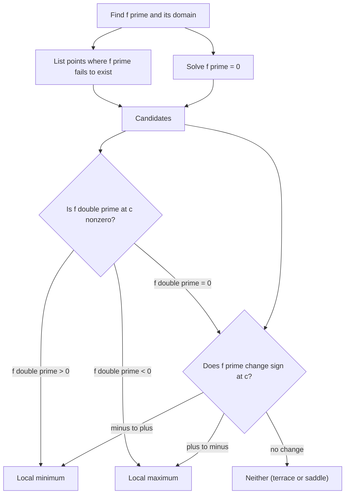

# Applications of Derivatives

> Calculus · Level: Intermediate · Prerequisites: [Functions](../../03-algebra/11-functions/README.md), [Polynomials](../../03-algebra/06-polynomials/README.md), [Trigonometric Functions](../../05-trigonometry/01-trigonometric-functions/README.md), [Precalculus](../../06-precalculus/README.md) · Estimated time: 600 min

## 1. Introduction

The derivative is a local object: it describes the behaviour of a function in an arbitrarily small
neighbourhood of one point. This topic shows that the local information is astonishingly powerful.
From the sign of the derivative we recover where a function rises and falls; from the sign of the
second derivative we recover which way it bends; from a single application of the mean value theorem
we recover global facts — that a function whose derivative vanishes is constant, that a positive
derivative forces strict increase, that two functions with equal derivatives differ by a constant.

The applications fall into three families.

* **Qualitative analysis.** Given a formula, describe its graph: intercepts, asymptotes, monotonicity,
  local extrema, concavity, inflection points. *Curve sketching* turns a function from a string of
  symbols into a shape you can reason about.
* **Exact consequences of the mean value theorem.** Inequalities, uniqueness of solutions,
  monotonicity, and the "constant derivative" principle that underlies integration.
* **Quantitative modelling.** Related rates, optimisation under a constraint, Newton's method for
  zeros, and marginal analysis in economics — the derivative wearing a suit.

Why do the proofs matter here? Many of the rules below look obvious — of course a positive derivative
means the function is increasing — but such facts are frequently false when a hypothesis is dropped,
and this is where the hypotheses are made precise. Every test in Section 7 is justified in Section 8,
and every justification reduces to the mean value theorem, which reduces to Rolle's theorem, which
reduces to the extreme value theorem and ultimately to the completeness of $\mathbb{R}$.

Section 7 develops the working vocabulary and the main theorems, Section 8 collects the statements and
proofs, and Section 9 works nine examples in increasing order of difficulty.

## 2. Prerequisites

* **The derivative as a limit** — the two preceding topics of this discipline,
  [Derivatives](../03-derivatives/README.md) and *Differentiation Rules*. You need the definition
  $f'(a)=\lim_{h\to0}\frac{f(a+h)-f(a)}{h}$, the interpretation as slope of the tangent line and as
  instantaneous rate of change, and fluency with the power, product, quotient and chain rules, with
  the derivatives of $\sin$, $\cos$, $e^x$ and $\ln x$, and with implicit differentiation.
* **Functions and their graphs** — [Functions](../../03-algebra/11-functions/README.md): domain,
  range, composition, inverses, and the shapes of the standard families.
* **Polynomials and factoring** — [Polynomials](../../03-algebra/06-polynomials/README.md) and
  [Factoring](../../03-algebra/07-factoring/README.md): solving polynomial equations by factoring is
  the single most common algebraic step in this topic.
* **Trigonometry** — [Trigonometric Functions](../../05-trigonometry/01-trigonometric-functions/README.md):
  the values of $\sin$ and $\cos$ at the standard angles, the Pythagorean identity, and the graphs of
  the trigonometric functions.
* **Exponentials and logarithms** — [Exponential and Logarithmic Functions](../../03-algebra/12-exponential-and-logarithmic-functions/README.md):
  the laws of logarithms, used constantly to simplify limits before applying L'Hôpital's rule.
* **Continuity and the extreme value theorem** — [Continuity](../02-continuity/README.md). The
  extreme value theorem (a continuous function on a closed bounded interval attains its maximum and
  minimum) is the engine behind Rolle's theorem. It is stated in Section 8 and used as a black box
  here; its proof belongs to real analysis, where it follows from the completeness of $\mathbb{R}$.
* **Solving equations and inequalities** — [Linear Equations](../../03-algebra/02-linear-equations/README.md)
  and [Inequalities](../../03-algebra/03-inequalities/README.md), for sign charts.

## 3. Learning Objectives

After this tutorial and its exercises, you will be able to:

1. Define critical point, local and absolute extremum, distinguish a critical point from an extremum,
   and locate the critical points of a differentiable function.
2. Classify critical points with the first derivative test (with a correct sign chart) and with the
   second derivative test, stating exactly when the latter is inconclusive and falling back in that
   case.
4. Determine the intervals on which a twice differentiable function is concave up or concave down,
   and locate its inflection points.
5. Carry out a complete curve sketch: domain, intercepts, symmetry, asymptotes, monotonicity,
   extrema, concavity, inflection points.
6. Find the absolute extrema of a continuous function on a closed interval and explain why the
   endpoint comparison is not optional.
6. State Rolle's theorem and the mean value theorem with every hypothesis, prove both, and use them
   to prove that zero derivative implies constant, that the sign of $f'$ determines monotonicity, and
   to establish inequalities and uniqueness of solutions.
7. State the hypotheses of L'Hôpital's rule, apply it to the $0/0$ and $\infty/\infty$ forms, convert
   other indeterminate forms to those two, and recognise when the rule does not apply or does not
   help.
8. Solve related-rates problems by a systematic procedure: draw, name, relate, differentiate,
   substitute, interpret.
9. Set up and solve optimisation problems, analysing the constraint and the feasible interval and
   verifying that the candidate found is the global optimum.
10. Explain the derivation of Newton's method, carry out several iterations by hand, and describe
    when the iteration fails.

## 4. Intuition

**Walking a hill.** Imagine walking along a path whose height is the graph of $f$. Your height changes;
the derivative is your slope underfoot. When the slope is positive you are climbing; when it is
negative you are descending. At the top of a hill the ground is momentarily level — the slope is zero
— and the slope changes from positive to negative. That is a local maximum. At the bottom of a valley
the slope is also momentarily zero, but it changes from negative to positive: a local minimum.

The crucial observation is that "slope zero" alone does not tell you which. On a mountain pass the
ground is level too, yet you are neither at the top nor at the bottom: the slope is positive on both
sides, or negative on both sides. This is why the *sign change* is the real criterion and the value
of the derivative at a single point is not.

**Bending.** The second derivative measures how the slope itself is changing. Concave up means the
slope is increasing as you move right: the graph bends upward, like the bowl of a spoon that holds
water. Concave down means the slope is decreasing: the graph bends downward, like a dome. A point
where the bending changes direction is an inflection point — the steering wheel of the tangent line
turns the other way.

**Why the mean value theorem is inevitable.** Drive $120$ km in $2$ hours and your average speed is
$60$ km/h. Whatever the speedometer did — traffic, coffee stops, a burst of 130 — there must have been
an instant at which it read exactly $60$: had it always been above $60$ or always below, the average
could not have been $60$. That is the mean value theorem, and "there must have been an instant" is the
whole content.

**Optimisation as a search.** You cannot check every possibility, but the best cannot be improved
locally. At an interior optimum, moving a little in either direction cannot help, which is exactly the
statement that the derivative vanishes. So the optimum is either a critical point or an endpoint: the
subject reduces to a short list of candidates.

## 5. Formal Definition

Throughout, $I$ is an interval, $f:I\to\mathbb{R}$, and $c\in I$.

**Definition 1 (Local extrema).** $f$ has a *local maximum* at $c$ if there is $\delta>0$ such that
$f(x)\le f(c)$ for all $x\in I$ with $\lvert x-c\rvert<\delta$. It has a *local minimum* at $c$ if
there is $\delta>0$ such that $f(x)\ge f(c)$ for all such $x$. A *local extremum* is either. The
extremum is *strict* if the inequality is strict for $x\ne c$.

**Definition 2 (Absolute extrema).** $f$ has an *absolute maximum* at $c$ if $f(x)\le f(c)$ for all
$x\in I$, and an *absolute minimum* at $c$ if $f(x)\ge f(c)$ for all $x\in I$. The value $f(c)$ is
then the *maximum value* or *minimum value* of $f$ on $I$. An absolute extremum is also called a
*global* extremum.

**Definition 3 (Critical point).** $c$ is a *critical point* of $f$ if $c$ is in the interior of the
domain of $f$ and either $f'(c)=0$ or $f'(c)$ does not exist. The value $f(c)$ is called a *critical
value*. Endpoints of the domain are never critical points, even though they may be extrema.

**Definition 4 (Increasing, decreasing).** $f$ is *increasing* on $I$ if $x_1<x_2$ in $I$ implies
$f(x_1)\le f(x_2)$, and *strictly increasing* if $x_1<x_2$ implies $f(x_1)<f(x_2)$. *Decreasing* and
*strictly decreasing* are defined with the inequalities reversed. A function that is either
increasing or decreasing is *monotone*.

**Definition 5 (Concavity).** Let $f$ be differentiable on an open interval $I$. Then $f$ is
*concave up* on $I$ if $f'$ is increasing on $I$, and *concave down* if $f'$ is decreasing. If $f$
is twice differentiable, this is equivalent (by the monotonicity criterion of Section 8) to $f''\ge0$
respectively $f''\le0$ on $I$.

**Definition 6 (Inflection point).** $c$ is an *inflection point* of $f$ if $f$ is continuous at $c$
and the concavity of $f$ on $(c-\delta,c)$ is opposite to its concavity on $(c,c+\delta)$ for some
$\delta>0$. Equivalently, $f'$ has a local extremum at $c$.

**Definition 7 (Indeterminate form).** A limit $\lim_{x\to a}\frac{f(x)}{g(x)}$ is of *type* $0/0$ if
$f(x)\to0$ and $g(x)\to0$; of type $\infty/\infty$ if $\lvert f(x)\rvert\to\infty$ and
$\lvert g(x)\rvert\to\infty$. In both cases the quotient is called an *indeterminate form*: the
value of the limit is not determined by the two types alone, so further analysis is required.

## 6. Mathematical Notation

| Symbol | Read as | Meaning |
|---|---|---|
| $f'(c)$ | $f$ prime at $c$ | derivative of $f$ at $c$; slope of the tangent line |
| $f''(c)$ | $f$ double prime at $c$ | derivative of $f'$ at $c$; rate of change of the slope |
| $\dfrac{df}{dx}$ | d $f$ by d $x$ | the derivative of $f$ with respect to $x$ |
| $\dfrac{dy}{dt}$ | d $y$ by d $t$ | rate of change of $y$ with respect to time $t$ |
| $\left.\dfrac{df}{dx}\right|_{x=a}$ | d $f$ by d $x$ evaluated at $a$ | the same as $f'(a)$ |
| $c$, $\xi$ | $c$, xi | typical points supplied by Rolle's theorem and the mean value theorem |
| $\max_{[a,b]} f$, $\min_{[a,b]} f$ | max of $f$ on $[a,b]$ | the maximum and minimum values of $f$ on $[a,b]$ |
| $\Delta x$ | delta $x$ | a change in $x$; in related rates, a small increment |
| $h$ | $h$ | the increment in the limit definition of the derivative |
| $O(h^2)$ | big-O of $h$ squared | a quantity bounded by a constant times $h^2$ for small $h$ |
| $\approx$ | approximately equal | used for numerical approximations, never for exact identities |
| $\to$ | tends to | approach in a limit |
| $0/0$, $\infty/\infty$ | zero over zero, infinity over infinity | names of the indeterminate forms |

Read $f'(c)=0$ aloud as "the derivative of $f$ at $c$ is zero", and $f''(c)>0$ as "the second
derivative of $f$ at $c$ is positive". The plural of *extremum* is *extrema*; the plural of *maximum*
is *maxima*.

## 7. Core Concepts

### 7.1 Critical Points and Where Extrema Can Hide

A local extremum of a differentiable function can only occur where the tangent is horizontal. The
reason is visual and can be made rigorous with one-sided difference quotients: if $f$ has a local
maximum at an interior point $c$ and $f'(c)$ exists, then for $h>0$ small,
$\frac{f(c+h)-f(c)}{h}\le0$, while for $h<0$ small the same quotient is $\ge0$; both tend to $f'(c)$
as $h\to0$, so $f'(c)=0$. This is Fermat's theorem, proved in Section 8.

Three cautions follow immediately, and all three are examined in the exercises.

1. **The converse fails.** $f(x)=x^3$ has $f'(0)=0$, but $0$ is neither a maximum nor a minimum.
   A critical point is only a *candidate*.
2. **Non-differentiable points count.** $f(x)=\lvert x\rvert$ has a local minimum at $0$, where $f'$
   does not exist. Such points must be included when listing candidates.
3. **Endpoints are not critical points** but can be absolute extrema, so they are handled separately
   in Section 7.6.

To find the critical points of a differentiable function: compute $f'$, solve $f'(x)=0$, and add
every point of the domain where $f'$ fails to exist.

### 7.2 The First Derivative Test

The first derivative test reads the *sign* of $f'$ on each side of a critical point.

**Procedure.**

1. Find all critical points; these divide the domain into open intervals.
2. Determine the sign of $f'$ on one test point in each interval (a sign chart).
3. Read off the conclusion at each critical point $c$:
   * $f'$ changes from $+$ to $-$: local maximum at $c$;
   * $f'$ changes from $-$ to $+$: local minimum at $c$;
   * no sign change: neither (a saddle or a terrace point).

The test is valid because on an interval where $f'>0$ the function is strictly increasing and where
$f'<0$ it is strictly decreasing — the monotonicity criterion of Section 8, which is a corollary of
the mean value theorem. So a $+$ to $-$ change means $f$ climbs to $f(c)$ and then descends: a local
maximum.

Mechanically, factor $f'$ completely and record the sign of each factor on each interval between
consecutive zeros; the sign of $f'$ is the product of the signs. Example 1 in Section 9 carries out a
complete sign chart, and the table in Section 10.2 records what each combination of signs means for
the shape of the graph.

### 7.3 Concavity and the Second Derivative Test

Concavity describes how the graph bends. $f$ is concave up where $f'$ is increasing, concave down
where $f'$ is decreasing. When $f''$ exists, the sign of $f''$ decides: $f''>0$ concave up, $f''<0$
concave down. The geometric content of concave up is that the graph lies *above* its tangent lines and
*below* its chords; Section 8 proves this from the mean value theorem.

**Second derivative test.** Let $f$ be twice differentiable near a critical point $c$ with $f'(c)=0$.

* If $f''(c)>0$, then $f$ has a local minimum at $c$.
* If $f''(c)<0$, then $f$ has a local maximum at $c$.
* If $f''(c)=0$, the test is inconclusive.

The intuition is a parabola: near a critical point, $f$ behaves like
$f(c)+\tfrac12f''(c)(x-c)^2$. The quadratic term opens upward when $f''(c)>0$ and downward when
$f''(c)<0$. The justification in Section 8 is short: $f''(c)$ is the limit of $f'(c+h)/h$ as $h\to0$,
so for small $h\ne0$ the numbers $f'(c+h)$ and $h$ have the same sign — hence $f'$ is negative just to
the left of $c$ and positive just to the right, and the first derivative test applies.

**Inconclusive means genuinely inconclusive.** All three behaviours occur at a point with
$f'(c)=f''(c)=0$:

| Function | $f'(0)$ | $f''(0)$ | Behaviour at $0$ |
|---|---|---|---|
| $x^4$ | $0$ | $0$ | local minimum |
| $-x^4$ | $0$ | $0$ | local maximum |
| $x^3$ | $0$ | $0$ | neither |

In all three cases the first derivative test still decides, so the fallback is always available.

### 7.4 Inflection Points

An inflection point is where the concavity changes. Because concavity is monotonicity of $f'$, an
inflection point is a local extremum of $f'$. For a twice differentiable function, candidates are the
solutions of $f''(x)=0$ together with points where $f''$ does not exist; as with extrema, a zero of
$f''$ is only a candidate, and the *change of sign* of $f''$ is what confirms an inflection.

Two warnings are worth memorising.

* $f''(c)=0$ does not imply an inflection point: $f(x)=x^4$ has $f''(0)=0$ and is concave up on both
  sides of $0$.
* An inflection point does not require $f''=0$: $f(x)=x^{5/3}$ has an inflection at $0$ where $f''$ is
  undefined. Indeed $f''(x)=\tfrac{10}{9}x^{-1/3}$ is negative for $x<0$ and positive for $x>0$, so the
  concavity changes from down to up at $0$ even though $f''$ never equals $0$ there.

### 7.5 Curve Sketching

A sketch is an argument, not a drawing. The procedure below produces every feature that a reader
needs in order to reconstruct the graph, and each step has a reason.

1. **Domain.** Where is $f$ defined? Exclude points where a denominator vanishes or a radicand is
   negative.
2. **Intercepts.** Set $x=0$ for the $y$-intercept; solve $f(x)=0$ for the $x$-intercepts.
3. **Symmetry and periodicity.** $f(-x)=f(x)$ gives symmetry about the $y$-axis; $f(-x)=-f(x)$ gives
   symmetry about the origin; a period $\omega$ lets you draw one period.
4. **Asymptotes.** Vertical where the denominator vanishes without cancellation; horizontal if
   $\lim_{x\to\pm\infty}f(x)$ exists; oblique if the difference from a line tends to zero.
5. **First derivative.** Critical points and the sign chart: where $f$ rises, falls, and has local
   extrema.
6. **Second derivative.** Concavity intervals and inflection points.
7. **Plot and join.** Plot the special points, draw the asymptotes as dashed lines, and join the
   points respecting monotonicity and concavity. Add one or two extra points for scale.

The order matters: monotonicity and concavity together determine the shape between the special
points, so no guesswork is needed.

### 7.6 Absolute Extrema on a Closed Interval

For a continuous function on a closed interval $[a,b]$, the extreme value theorem guarantees that both
an absolute maximum and an absolute minimum exist. They are found by a finite comparison.

**Closed interval method.**

1. Find all critical points of $f$ in $(a,b)$.
2. Evaluate $f$ at each critical point.
3. Evaluate $f(a)$ and $f(b)$.
4. The largest of these values is the absolute maximum, the smallest is the absolute minimum.

Why the method is complete: an absolute extremum is either at an endpoint, or at an interior point,
and at an interior point it is a local extremum, hence a critical point by Fermat's theorem. The list
in steps 2–3 therefore contains the extremum.

Every hypothesis is needed. On an open interval the maximum may not exist ($f(x)=x$ on $(0,1)$); on a
closed but unbounded interval it may not exist ($f(x)=x$ on $[0,\infty)$); with a discontinuity it may
not exist ($f(x)=1/x$ on $[-1,1]$, or $f(x)=x$ for $x<1$ and $f(1)=0$ on $[0,1]$, whose maximum is not
attained).

### 7.7 Rolle's Theorem and the Mean Value Theorem

**Rolle's theorem.** If $f$ is continuous on $[a,b]$, differentiable on $(a,b)$, and $f(a)=f(b)$,
then there exists $c\in(a,b)$ with $f'(c)=0$.

Geometrically: between two points of equal height there is a point where the tangent is horizontal.
The proof uses the extreme value theorem to find where the function is largest or smallest, and
Fermat's theorem to conclude that the derivative vanishes there. If $f$ is constant, every interior
point works; otherwise at least one of the maximum and minimum differs from the common endpoint value
and is attained in the interior.

**The mean value theorem (MVT).** If $f$ is continuous on $[a,b]$ and differentiable on $(a,b)$, then
there exists $c\in(a,b)$ with

$$\dfrac{f(b)-f(a)}{b-a}=f'(c).$$

Geometrically: somewhere the tangent is parallel to the chord joining the endpoints. The proof tilts
the picture: subtract the chord, so that the tilted function has equal endpoint values, and apply
Rolle's theorem to $g(x)=f(x)-\dfrac{f(b)-f(a)}{b-a}(x-a)$.

Both proofs are given in full in Section 8. Note what is *not* claimed: the theorem does not say where
$c$ is, and $c$ need not be unique. For $f(x)=x^3$ on $[-1,2]$ the equation $3c^2=3$ has the two
solutions $c=\pm1$, both interior.

### 7.8 Two Consequences That Power Everything Else

**Constant derivative implies constant function.** If $f'(x)=0$ for all $x$ in an interval $I$, then
$f$ is constant on $I$. Proof: for any $x_1<x_2$ in $I$, the MVT on $[x_1,x_2]$ gives
$f(x_2)-f(x_1)=f'(c)(x_2-x_1)=0$.

Consequently, if $f'=g'$ on an interval then $f-g$ is constant there. This is the fact that makes
"$+C$" in integration correct, and it is the reason antiderivatives are unique up to a constant.

**Monotonicity criterion.** Let $f$ be continuous on $[a,b]$ and differentiable on $(a,b)$.

* If $f'(x)>0$ for all $x\in(a,b)$, then $f$ is strictly increasing on $[a,b]$.
* If $f'(x)<0$ for all $x\in(a,b)$, then $f$ is strictly decreasing on $[a,b]$.
* If $f'(x)\ge0$ everywhere, then $f$ is increasing (not necessarily strictly).

The proof is one line of MVT: for $x_1<x_2$, $f(x_2)-f(x_1)=f'(c)(x_2-x_1)$ has the sign of $f'(c)$.
Strictness needs care: $f'\ge0$ guarantees only non-strict increase, since a constant function has
$f'=0$ and is not strictly increasing, while $f'>0$ everywhere does force strict increase.

### 7.9 L'Hôpital's Rule

Indeterminate forms arise when a limit cannot be read off from the limits of its parts. The seven
symbols $0/0$, $\infty/\infty$, $0\cdot\infty$, $\infty-\infty$, $0^0$, $1^\infty$, $\infty^0$ all
hide a competition between two tendencies, and the winner is decided by rates of change — which is
exactly what derivatives measure.

**L'Hôpital's rule ($0/0$ and $\infty/\infty$).** Let $f,g$ be differentiable on a punctured
neighbourhood of $a$ (possibly $a=\pm\infty$), with $g(x)\ne0$ and $g'(x)\ne0$ there. Suppose the
quotient is of type $0/0$ or $\infty/\infty$ at $a$. If

$$\lim_{x\to a}\dfrac{f'(x)}{g'(x)}=L$$

exists in $[-\infty,+\infty]$, then $\lim_{x\to a}\dfrac{f(x)}{g(x)}=L$.

**The hypotheses are not decoration.**

* The form must be indeterminate. $\lim_{x\to0}\frac{x+1}{x+2}$ is $1/2$; differentiating gives
  $1/1=1$, which is not the answer.
* The limit of $f'/g'$ must exist. For $f(x)=x+\sin x$, $g(x)=x$ as $x\to\infty$, the quotient
  $f/g\to1$, but $f'/g'=1+\cos x$ has no limit. The rule is silent, not false: it cannot be applied.
* $g'$ must not vanish near $a$, otherwise the ratio $f'/g'$ is undefined on a sequence approaching
  $a$.

**Reducing other forms.** $0\cdot\infty$ becomes $0/0$ or $\infty/\infty$ by writing
$fg=\frac{f}{1/g}$ or $fg=\frac{g}{1/f}$. A difference $\infty-\infty$ is combined into a single
quotient. Forms $0^0,1^\infty,\infty^0$ are handled by taking logarithms: if $y=f^g$ then
$\ln y=g\ln f$, which is a $0\cdot\infty$ form, and $y=e^{\lim\ln y}$ by continuity of the
exponential.

**Practical advice.** Simplify before differentiating, and check after each application whether the new
quotient is still indeterminate. Algebra, the standard limits $\frac{\sin x}{x}\to1$ and
$\frac{e^x-1}{x}\to1$, and (later) Taylor expansions are often faster than a second round of the rule.

### 7.10 Related Rates

In a related-rates problem several quantities change with time and are linked by an equation. The
chain rule converts the link between the quantities into a link between their rates.

**Systematic method.**

1. **Draw and name.** Sketch the configuration and give every varying quantity a symbol. Constants
   get numbers.
2. **Write the relation.** Find an equation connecting the quantities, valid at every instant.
3. **Differentiate.** Differentiate both sides with respect to $t$, using the chain rule; every
   variable is a function of $t$.
4. **Substitute the instant.** Put in the numerical data *after* differentiating, never before.
5. **Solve and interpret.** Solve for the required rate, give units, and check the sign against the
   picture.

Step 4 is where most errors occur: substituting a snapshot before differentiating freezes a quantity
that is supposed to be varying, and produces a rate of zero or a dimensionally impossible answer.

### 7.11 Optimisation

An optimisation problem asks for the largest or smallest value of a quantity that is constrained.

**Method.**

1. **Identify the objective** and write it as a function of the variables in the problem.
2. **Identify the constraint** and use it to eliminate all but one variable. Record the *feasible
   interval* — the values the remaining variable may take, including endpoints forced by the
   geometry.
3. **Differentiate** and solve $f'=0$ on the feasible interval.
4. **Justify the optimum.** Use the first or second derivative test for an interior critical point,
   and compare with the endpoint values. A critical point is not automatically the global optimum; a
   function can have several local extrema, and the best value may sit at an endpoint.
5. **Answer the question asked,** with units. If the problem asks for a dimension, give the dimension,
   not merely the optimal value of the objective.

The constraint is what makes the problem a problem: without it, "maximise the volume of a box" has no
answer. It also determines the feasible interval — a box of volume $V$ with square base $x$ has height
$V/x^2$, so $x>0$. The endpoint behaviour (as $x\to0^+$ or $x\to\infty$ the objective typically blows
up) often promotes a unique critical point to the global optimum, and saying so is part of a complete
solution.

### 7.12 Newton's Method: A Preview

Solving $f(x)=0$ exactly is usually impossible. Newton's method replaces the graph by its tangent line
and solves the linear equation instead. Start with a guess $x_0$. The tangent at $\bigl(x_0,f(x_0)\bigr)$
is $y=f(x_0)+f'(x_0)(x-x_0)$; its zero is

$$x_1=x_0-\dfrac{f(x_0)}{f'(x_0)}.$$

Iterating gives the *Newton iteration*

$$x_{n+1}=x_n-\dfrac{f(x_n)}{f'(x_n)},\qquad n=0,1,2,\dots$$

Each step is one tangent-line approximation. Near a simple zero the errors satisfy
$e_{n+1}\approx\frac{f''(r)}{2f'(r)}e_n^2$, so the number of correct digits roughly doubles at every
step: *quadratic convergence*. The method can fail — if $f'(x_n)=0$ the iteration is undefined, a
distant starting point may diverge or cycle, and a multiple zero degrades convergence to linear — and
its full theory belongs to numerical analysis. Example 9 in Section 9 carries out the iteration for
$\sqrt2$ in detail.

## 8. Formulas and Properties

Every result in this section is stated with its hypotheses. Where a proof is given, it is complete
except for two named inputs: the extreme value theorem (a continuous function on a closed bounded
interval attains its extrema) and the intermediate value theorem, both from the *Continuity* topic
and proved from completeness in real analysis.

### 8.1 Fermat's Theorem

**Theorem 1 (Fermat).** Let $f$ be defined on an interval containing $c$ in its interior. If $f$ has
a local extremum at $c$ and $f'(c)$ exists, then $f'(c)=0$.

*Proof.* Suppose first that $c$ is a local maximum, so $f(c+h)\le f(c)$ for all sufficiently small
$h$. For such $h>0$,

$$\dfrac{f(c+h)-f(c)}{h}\le0,$$

and letting $h\to0^+$ gives $f'(c)\le0$. For $h<0$ the numerator is still $\le0$ but the denominator
is negative, so

$$\dfrac{f(c+h)-f(c)}{h}\ge0,$$

and letting $h\to0^-$ gives $f'(c)\ge0$. Both one-sided limits equal $f'(c)$ because $f$ is
differentiable at $c$; hence $f'(c)=0$. The case of a local minimum is the same argument applied to
$-f$, or directly with the inequalities reversed. $\blacksquare$

The interior hypothesis is essential: $f(x)=x$ on $[0,1]$ has its minimum at $0$ and $f'(0)=1$. The
differentiability hypothesis is essential: $\lvert x\rvert$ has a minimum at $0$ where $f'$ does not
exist.

### 8.2 Rolle's Theorem

**Theorem 2 (Rolle).** If $f$ is continuous on $[a,b]$, differentiable on $(a,b)$, and $f(a)=f(b)$,
then there exists $c\in(a,b)$ with $f'(c)=0$.

*Proof.* By the extreme value theorem $f$ attains a maximum $M$ and a minimum $m$ on $[a,b]$.

If $M=m$ then $f$ is constant on $[a,b]$, so $f'(x)=0$ for every $x\in(a,b)$ and any interior point
serves as $c$.

If $M>m$, then at least one of $M,m$ differs from the common value $f(a)=f(b)$. Suppose $M>f(a)$ and
let $c\in[a,b]$ satisfy $f(c)=M$. Since $f(c)>f(a)=f(b)$, the point $c$ is neither $a$ nor $b$, so
$c\in(a,b)$. Fermat's theorem applied to the local maximum at $c$ gives $f'(c)=0$. The case $m<f(a)$
is identical with the minimum. $\blacksquare$

### 8.3 The Mean Value Theorem

**Theorem 3 (Mean value theorem).** If $f$ is continuous on $[a,b]$ and differentiable on $(a,b)$,
then there exists $c\in(a,b)$ such that

$$f'(c)=\dfrac{f(b)-f(a)}{b-a}.$$

*Proof.* Define the tilted function

$$g(x)=f(x)-f(a)-\dfrac{f(b)-f(a)}{b-a}\,(x-a).$$

Then $g$ is continuous on $[a,b]$ and differentiable on $(a,b)$ with
$g'(x)=f'(x)-\dfrac{f(b)-f(a)}{b-a}$. Moreover

$$g(a)=f(a)-f(a)-0=0,\qquad g(b)=f(b)-f(a)-(f(b)-f(a))=0.$$

By Rolle's theorem there is $c\in(a,b)$ with $g'(c)=0$, that is,
$f'(c)=\dfrac{f(b)-f(a)}{b-a}$. $\blacksquare$

**Interpretation.** The right-hand side is the average rate of change of $f$ on $[a,b]$; the theorem
says the instantaneous rate equals the average rate at some interior instant. The hypotheses cannot be
dropped: $f(x)=1/x$ on $[-1,1]$ fails to be continuous at $0$, and indeed the chord has slope $-1$
while $f'(x)=-1/x^2<0$ takes no value $-1$ on the interval.

**Theorem 4 (Cauchy's mean value theorem).** If $f$ and $g$ are continuous on $[a,b]$ and
differentiable on $(a,b)$ with $g'(x)\ne0$ for all $x\in(a,b)$, then there exists $c\in(a,b)$ with

$$\dfrac{f(b)-f(a)}{g(b)-g(a)}=\dfrac{f'(c)}{g'(c)}.$$

*Proof.* First, $g(b)\ne g(a)$: otherwise Rolle's theorem would supply an interior point with $g'=0$,
so the left-hand side is defined. Set
$h(x)=\bigl(f(b)-f(a)\bigr)g(x)-\bigl(g(b)-g(a)\bigr)f(x)$. Then $h$ is continuous on $[a,b]$,
differentiable on $(a,b)$, and

$$h(a)-h(b)=\bigl(f(b)-f(a)\bigr)\bigl(g(a)-g(b)\bigr)-\bigl(g(b)-g(a)\bigr)\bigl(f(a)-f(b)\bigr)=0.$$

Rolle's theorem gives $c\in(a,b)$ with $h'(c)=0$, that is,
$\bigl(f(b)-f(a)\bigr)g'(c)=\bigl(g(b)-g(a)\bigr)f'(c)$; dividing by $g'(c)$ and $g(b)-g(a)$ finishes
the proof. $\blacksquare$

### 8.4 Consequences for Monotonicity and Constancy

**Theorem 5 (Zero derivative).** If $f$ is continuous on $[a,b]$, differentiable on $(a,b)$, and
$f'(x)=0$ for all $x\in(a,b)$, then $f$ is constant on $[a,b]$.

*Proof.* Let $x_1<x_2$ be any two points of $[a,b]$. The MVT applies on $[x_1,x_2]$ and gives
$f(x_2)-f(x_1)=f'(c)(x_2-x_1)=0$. Hence $f(x_1)=f(x_2)$, and since the two points were arbitrary, $f$
is constant. $\blacksquare$

**Corollary 1.** If $f'=g'$ on an interval, then $f-g$ is constant on that interval.

**Theorem 6 (Monotonicity criterion).** Let $f$ be continuous on $[a,b]$ and differentiable on
$(a,b)$.

1. If $f'(x)>0$ for all $x\in(a,b)$, then $f$ is strictly increasing on $[a,b]$.
2. If $f'(x)<0$ for all $x\in(a,b)$, then $f$ is strictly decreasing on $[a,b]$.
3. If $f'(x)\ge0$ for all $x\in(a,b)$, then $f$ is increasing on $[a,b]$; if $f'\le0$, decreasing.

*Proof.* Take $x_1<x_2$ in $[a,b]$. By the MVT there is $c\in(x_1,x_2)$ with
$f(x_2)-f(x_1)=f'(c)(x_2-x_1)$. Since $x_2-x_1>0$, the sign of the difference equals the sign of
$f'(c)$, which is positive, negative, or non-negative according to the hypothesis. Claims 1–3 follow.
$\blacksquare$

The strictness in claim 1 is genuine; claim 3 cannot be improved, because $f(x)=x^3$ has $f'\ge0$ and
$f'(0)=0$, and $f$ is strictly increasing anyway — so a non-negative derivative does not *prevent*
strict increase, it merely fails to guarantee it.

### 8.5 Justifying the Derivative Tests

**Theorem 7 (First derivative test).** Let $f$ be continuous at $c$ and differentiable on a punctured
neighbourhood $(c-\delta,c)\cup(c,c+\delta)$.

1. If $f'>0$ on $(c-\delta,c)$ and $f'<0$ on $(c,c+\delta)$, then $f$ has a strict local maximum at
   $c$.
2. If $f'<0$ on $(c-\delta,c)$ and $f'>0$ on $(c,c+\delta)$, then $f$ has a strict local minimum at
   $c$.
3. If $f'$ has the same sign on both sides, then $f$ has no local extremum at $c$.

*Proof.* (1) Let $x\in(c-\delta,c)$. The MVT on $[x,c]$ gives $\xi\in(x,c)$ with
$f(c)-f(x)=f'(\xi)(c-x)$. Here $f'(\xi)>0$ and $c-x>0$, so $f(x)<f(c)$. For $x\in(c,c+\delta)$, the
MVT on $[c,x]$ gives $\xi\in(c,x)$ with $f(x)-f(c)=f'(\xi)(x-c)<0$, so again $f(x)<f(c)$. Hence $c$
is a strict local maximum. The proof of (2) is the same with signs reversed.

(3) If $f'>0$ on both sides, then by Theorem 6 the function is strictly increasing across $c$, so
$f(x)<f(c)$ for $x<c$ and $f(x)>f(c)$ for $x>c$: no extremum. The case $f'<0$ is analogous.
$\blacksquare$

Note that the first derivative test does not require $f'(c)$ to exist — only that $f$ be continuous at
$c$ — which is why it also detects cusps and corners such as $\lvert x\rvert$ at $0$.

**Theorem 8 (Second derivative test).** Let $f'(c)=0$ and suppose $f''(c)$ exists.

1. If $f''(c)>0$, then $f$ has a strict local minimum at $c$.
2. If $f''(c)<0$, then $f$ has a strict local maximum at $c$.

*Proof.* (1) By definition of the second derivative at $c$,

$$f''(c)=\lim_{h\to0}\dfrac{f'(c+h)-f'(c)}{h}=\lim_{h\to0}\dfrac{f'(c+h)}{h}>0.$$

For $h$ sufficiently small and nonzero the quotient is positive. If $h>0$ this forces $f'(c+h)>0$; if
$h<0$ it forces $f'(c+h)<0$. So $f'<0$ just to the left of $c$ and $f'>0$ just to the right, and
Theorem 7 gives a strict local minimum. The proof of (2) is identical with the inequality reversed.
$\blacksquare$

**Theorem 9 (Concavity, chords, and tangents).** Let $f$ be twice differentiable on an open interval
$I$ with $f''\ge0$ on $I$. Then for all $a<x<b$ in $I$,

$$\dfrac{f(x)-f(a)}{x-a}\le\dfrac{f(b)-f(x)}{b-x},$$

so the graph lies below every chord; and for all $x,y\in I$,

$$f(y)\ge f(x)+f'(x)(y-x),$$

so the graph lies above every tangent line. If $f''\le0$ the inequalities reverse.

*Proof.* Because $f''\ge0$, the function $f'$ is increasing on $I$ (Theorem 6 applied to $f'$). By the
MVT there are $c_1\in(a,x)$ and $c_2\in(x,b)$ with

$$\dfrac{f(x)-f(a)}{x-a}=f'(c_1),\qquad \dfrac{f(b)-f(x)}{b-x}=f'(c_2).$$

Since $c_1<x<c_2$ and $f'$ is increasing, $f'(c_1)\le f'(c_2)$, which is the chord inequality. For the
tangent inequality take $y>x$; the MVT gives $\xi\in(x,y)$ with
$f(y)-f(x)=f'(\xi)(y-x)\ge f'(x)(y-x)$, because $\xi>x$ and $f'$ is increasing. The case $y<x$ is
identical after swapping the roles of $x$ and $y$ and noting the sign of $y-x$. $\blacksquare$

### 8.6 Extrema on a Closed Interval

**Theorem 10 (Closed interval method).** Let $f$ be continuous on $[a,b]$ and differentiable on
$(a,b)$. Then the absolute maximum and minimum of $f$ on $[a,b]$ exist, and each occurs either at $a$,
at $b$, or at a critical point in $(a,b)$.

*Proof.* Existence is the extreme value theorem. Let $c$ be a point where the maximum is attained. If
$c=a$ or $c=b$ we are done. Otherwise $c\in(a,b)$, and $c$ is a local maximum, so Fermat's theorem
gives $f'(c)=0$; hence $c$ is a critical point. The same argument applies to the minimum.
$\blacksquare$

### 8.7 L'Hôpital's Rule

**Theorem 11 (L'Hôpital, $0/0$ case, one-sided form).** Let $f,g$ be continuous on $[a,a+\delta)$ and
differentiable on $(a,a+\delta)$, with $f(a)=g(a)=0$. Suppose $g(x)\ne0$ and $g'(x)\ne0$ for
$x\in(a,a+\delta)$. If $\lim_{x\to a^+}\dfrac{f'(x)}{g'(x)}=L$ exists in $[-\infty,+\infty]$, then
$\lim_{x\to a^+}\dfrac{f(x)}{g(x)}=L$.

*Proof.* Fix $x\in(a,a+\delta)$. Since $g(a)=0$, if $g(x)$ were $0$ then Rolle's theorem on $[a,x]$
would give an interior zero of $g'$, contrary to hypothesis; hence $g(x)\ne0$. Cauchy's mean value
theorem (Theorem 4) applied on $[a,x]$ supplies $\xi\in(a,x)$ with

$$\dfrac{f(x)-f(a)}{g(x)-g(a)}=\dfrac{f'(\xi)}{g'(\xi)},\qquad\text{that is,}\qquad \dfrac{f(x)}{g(x)}=\dfrac{f'(\xi)}{g'(\xi)}.$$

As $x\to a^+$ we have $a<\xi<x$, so $\xi\to a^+$. Given $\varepsilon>0$, choose $\eta>0$ with
$\lvert f'(t)/g'(t)-L\rvert<\varepsilon$ for $a<t<a+\eta$; then for $a<x<a+\eta$ the corresponding
$\xi$ lies in that range, so $\lvert f(x)/g(x)-L\rvert<\varepsilon$. The case $L=\pm\infty$ needs a
variant of the same estimate, and the left-hand and two-sided versions follow by symmetry.
$\blacksquare$

**Theorem 12 (L'Hôpital, $\infty/\infty$ case).** Let $f,g$ be differentiable on a punctured
neighbourhood of $a$, with $g(x)\ne0$, $g'(x)\ne0$, and $\lvert g(x)\rvert\to\infty$ there. If
$\lim_{x\to a}\dfrac{f'(x)}{g'(x)}=L$, then $\lim_{x\to a}\dfrac{f(x)}{g(x)}=L$.

The proof requires a finer estimate than the $0/0$ case, because there is no common zero to
normalise: one writes

$$\dfrac{f(x)-f(y)}{g(x)-g(y)}=\dfrac{f'(\xi)}{g'(\xi)}$$

for $y$ between $a$ and $x$, then lets $y\to a$ and uses $\lvert g(x)\rvert\to\infty$ to show that
$f(y)/g(x)$ and $g(y)/g(x)$ become negligible. A complete $\varepsilon$-argument is given in
W. Rudin, *Principles of Mathematical Analysis*, Theorem 5.13; it is not reproduced here because it
adds no new idea, only bookkeeping.

### 8.8 The Newton Iteration

The iteration $x_{n+1}=x_n-f(x_n)/f'(x_n)$ is the zero of the tangent line
$y=f(x_n)+f'(x_n)(x-x_n)$, found by solving that linear equation for $x$. If $\lvert f''\rvert\le M$
and $\lvert f'\rvert\ge m>0$ near a zero $r$, the errors satisfy
$\lvert e_{n+1}\rvert\le\dfrac{M}{2m}e_n^2$: two applications of the mean value theorem, carried out in
numerical analysis. Example 9 derives the exact recursion for $f(x)=x^2-2$.

## 9. Step-by-Step Examples

### Example 1 (easy): Critical Points and Their Classification

Classify the critical points of $f(x)=x^3-3x^2+2$.

Differentiating, $f'(x)=3x^2-6x=3x(x-2)$, which vanishes at $x=0$ and $x=2$ and exists everywhere. The
second derivative is $f''(x)=6x-6=6(x-1)$. At $x=0$, $f''(0)=-6<0$, so $f(0)=2$ is a local maximum; at
$x=2$, $f''(2)=6>0$, so $f(2)=8-12+2=-2$ is a local minimum. The sign chart of
$f'=3x(x-2)$ confirms both: $f'>0$ on $(-\infty,0)$, $f'<0$ on $(0,2)$, $f'>0$ on $(2,\infty)$. As a
check, $f(1)=0$ lies between the two extreme values, consistent with $f$ decreasing on $(0,2)$.

### Example 2 (easy–medium): Absolute Extrema on a Closed Interval

Find the absolute extrema of $f(x)=x^3-3x+1$ on $[-2,3]$.

Here $f'(x)=3x^2-3=3(x-1)(x+1)$, so the critical points are $x=\pm1$, both interior. The candidates are
therefore $-2,-1,1,3$, and

| $x$ | $-2$ | $-1$ | $1$ | $3$ |
|---|---|---|---|---|
| $f(x)$ | $-1$ | $3$ | $-1$ | $19$ |

The absolute maximum is $19$, attained at the endpoint $x=3$; the absolute minimum is $-1$, attained at
$x=-2$ and at $x=1$. Two features are typical of examination questions: the maximum sits at an
endpoint, and the minimum is attained twice. Neither would be found from the derivative alone.

### Example 3 (medium): A Complete Curve Sketch

Sketch $f(x)=\dfrac{x}{1+x^2}$.

**Domain and symmetry.** All real $x$ are allowed, and $f(-x)=-f(x)$, so the graph is symmetric about
the origin; it suffices to understand $x\ge0$. The only intercept is $(0,0)$.

**Asymptotes.** There is no vertical asymptote, and
$\lvert f(x)\rvert\le\dfrac{\lvert x\rvert}{x^2}=\dfrac{1}{\lvert x\rvert}\to0$ as
$\lvert x\rvert\to\infty$, so $y=0$ is a horizontal asymptote.

**First derivative.**

$$f'(x)=\dfrac{(1)(1+x^2)-x(2x)}{(1+x^2)^2}=\dfrac{1-x^2}{(1+x^2)^2}.$$

The denominator is positive, so the sign is the sign of $1-x^2$: negative on
$(-\infty,-1)\cup(1,\infty)$, positive on $(-1,1)$. Hence $f$ decreases, increases, then decreases, with
a local minimum $f(-1)=-\tfrac12$ and a local maximum $f(1)=\tfrac12$.

**Second derivative.** From $f'(x)=(1-x^2)(1+x^2)^{-2}$,

$$f''(x)=-2x(1+x^2)^{-2}-4x(1-x^2)(1+x^2)^{-3}=\dfrac{2x(x^2-3)}{(1+x^2)^3},$$

whose sign is the sign of $x(x^2-3)$, with zeros at $0,\pm\sqrt3$:

| Interval | $(-\infty,-\sqrt3)$ | $(-\sqrt3,0)$ | $(0,\sqrt3)$ | $(\sqrt3,\infty)$ |
|---|---|---|---|---|
| $f''$ | $-$ | $+$ | $-$ | $+$ |
| concavity | down | up | down | up |

The inflection points are $(0,0)$, $\left(\sqrt3,\tfrac{\sqrt3}{4}\right)$ and
$\left(-\sqrt3,-\tfrac{\sqrt3}{4}\right)$.

**Sketch.** On $[0,\infty)$ the curve leaves the origin concave down, rises to the peak $\tfrac12$ at
$x=1$, turns concave up after $x=\sqrt3$, and decays to the axis; reflecting through the origin gives
two symmetric bumps. The bound $\lvert f(x)\rvert\le\tfrac12$ follows from
$(1-\lvert x\rvert)^2\ge0$ and confirms that the peaks are the extreme values.

### Example 4 (medium): Verifying and Using the Mean Value Theorem

**(a)** Verify the MVT for $f(x)=x^3$ on $[0,2]$. The function is a polynomial, so the hypotheses hold.
The chord slope is $\dfrac{8-0}{2}=4$, and $f'(c)=3c^2=4$ gives $c=\dfrac{2}{\sqrt3}\approx1.1547$, which
lies in $(0,2)$.

**(b)** Prove that $\sqrt{1+x}<1+\dfrac{x}{2}$ for $x>0$. Apply the MVT to $g(t)=\sqrt{1+t}$ on $[0,x]$,
where $g'(t)=\dfrac{1}{2\sqrt{1+t}}$. There is $c\in(0,x)$ with

$$\sqrt{1+x}-1=\dfrac{x}{2\sqrt{1+c}}.$$

Since $c>0$, the denominator exceeds $2$, so $\sqrt{1+x}-1<\dfrac{x}{2}$.

### Example 5 (medium–hard): A Suite of Indeterminate Forms

**(a)** $\displaystyle\lim_{x\to0}\frac{x-\sin x}{x^3}$. The form is $0/0$; the rule gives
$\displaystyle\lim_{x\to0}\frac{1-\cos x}{3x^2}$, again $0/0$, then
$\displaystyle\lim_{x\to0}\frac{\sin x}{6x}=\frac16$.

**(b)** $\displaystyle\lim_{x\to\infty}\frac{x^2}{e^x}$. The form is $\infty/\infty$. Two applications
give $\displaystyle\lim_{x\to\infty}\frac{2x}{e^x}=\lim_{x\to\infty}\frac{2}{e^x}=0$; after the second
application the form is $2/\infty$, which is not indeterminate.

**(c)** $\displaystyle\lim_{x\to0^+}x\ln x$. The form is $0\cdot(-\infty)$. Writing
$x\ln x=\dfrac{\ln x}{1/x}$ produces $-\infty/\infty$, and the rule gives
$\displaystyle\lim_{x\to0^+}\frac{1/x}{-1/x^2}=\lim_{x\to0^+}(-x)=0$.

**(d)** $\displaystyle\lim_{x\to0}\frac{x+\sin x}{x}$. Simplification is better than differentiation:
$\dfrac{x+\sin x}{x}=1+\dfrac{\sin x}{x}\to2$. The rule would also give $2$ here, but only because the
form is genuinely $0/0$; applying it to a determinate form such as $\frac{x+1}{x+2}$ at $0$ would give
the wrong answer $1$ instead of $\frac12$.

### Example 6 (medium–hard): A Related-Rates Problem

A $5$ m ladder leans against a wall, and its foot is pulled away at $0.5$ m/s. How fast is the top
sliding down when the foot is $3$ m from the wall?

Let $x$ be the distance from the foot to the wall and $y$ the height of the top. Then $x^2+y^2=25$ at
every instant, so differentiating with respect to $t$ gives
$2x\dot x+2y\dot y=0$, that is $\dot y=-\dfrac{x}{y}\dot x$. At the instant in question $x=3$,
$y=\sqrt{25-9}=4$ and $\dot x=0.5$, so $\dot y=-\dfrac34(0.5)=-0.375$ m/s: the top slides down at
$\tfrac38$ m/s. The formula also shows that the speed blows up as $y\to0^+$, which is the geometric
singularity of the configuration rather than an error.

### Example 7 (hard): Optimisation with a Constraint

An open-top box with square base is to hold $4\ \text{m}^3$, and all material costs the same per square
metre. Minimise the cost.

Let $x$ be the base side and $h$ the height. The material area is $A=x^2+4xh$, and the constraint
$x^2h=4$ gives $h=4/x^2$ with $x>0$. Hence

$$A(x)=x^2+\dfrac{16}{x},\qquad A'(x)=2x-\dfrac{16}{x^2}=\dfrac{2x^3-16}{x^2}.$$

$A'=0$ forces $x^3=8$, so $x=2$ and $h=1$. Since $A''=2+32/x^3>0$, this is a local minimum; and since
$A\to+\infty$ as $x\to0^+$ and as $x\to+\infty$, it is the global minimum on $(0,\infty)$. The box is
$2\times2\times1$ m, with area $12\ \text{m}^2$. Note that the optimal open box has height equal to half
the base side.

### Example 8 (hard): Marginal Analysis

A monopolist faces demand $p=100-2q$ (dollars per unit, $0\le q\le50$) and total cost
$C(q)=20q+200$. Maximise profit.

Revenue is $R(q)=qp=100q-2q^2$, so profit is

$$P(q)=R(q)-C(q)=-2q^2+80q-200,\qquad P'(q)=-4q+80,\qquad P''=-4<0.$$

$P'=0$ gives $q=20$, a local maximum because $P''<0$. Comparing the endpoints: $P(0)=-200$,
$P(20)=600$, $P(50)=-1200$, so $q=20$ is optimal, with price $p=60$ and profit $600$ dollars. The
marginal condition illustrates the economics: $R'(q)=100-4q$ equals $C'(q)=20$ exactly at $q=20$, so
the last unit produced adds as much revenue as cost.

### Example 9 (hard): Newton's Method for $\sqrt2$

The number $\sqrt2$ is the positive root of $f(x)=x^2-2$, and Newton's iteration is

$$x_{n+1}=x_n-\dfrac{x_n^2-2}{2x_n}=\dfrac{x_n^2+2}{2x_n}=\dfrac12\left(x_n+\dfrac{2}{x_n}\right).$$

From $x_0=1$: $x_1=\dfrac32=1.5$, then
$x_2=\dfrac12\left(\dfrac32+\dfrac43\right)=\dfrac{17}{12}\approx1.41667$, then
$x_3=\dfrac12\left(\dfrac{17}{12}+\dfrac{24}{17}\right)=\dfrac{577}{408}\approx1.414216$. The errors
$e_n=x_n-\sqrt2$ are approximately $0.0858$, $0.00245$, $2.1\times10^{-6}$: the number of correct digits
roughly doubles each step. The exact recursion explains why: with $r=\sqrt2$,

$$e_{n+1}=\dfrac{x_n^2+2}{2x_n}-r=\dfrac{x_n^2+2-2rx_n}{2x_n}=\dfrac{(x_n-r)^2}{2x_n}=\dfrac{e_n^2}{2x_n},$$

and $x_n\ge\sqrt2$ for $n\ge1$ by the arithmetic–geometric mean inequality, so
$e_{n+1}\le\dfrac{e_n^2}{2\sqrt2}$.

## 10. Visual Explanations

### 10.1 A Decision Procedure for Critical Points

The right-hand branch is the second derivative test; when it returns $f''(c)=0$ it hands the case back
to the first derivative test, which always decides (except when no sign chart is possible, as for
highly oscillatory functions).

### 10.2 The Shape Vocabulary

| $f'$ | $f''$ | Shape | Typical picture |
|---|---|---|---|
| $+$ | $+$ | increasing, concave up | rising and bending upward, like the right half of a parabola |
| $+$ | $-$ | increasing, concave down | rising but flattening, like a logarithm |
| $-$ | $+$ | decreasing, concave up | falling but flattening, like $e^{-x}$ |
| $-$ | $-$ | decreasing, concave down | falling ever more steeply, like $-x^2$ on $x>0$ |

Reading the four combinations is the fastest way to check a sketch: at every marked interval the pair
$(f',f'')$ is one of the four rows.

### 10.3 Reading the MVT Diagrammatically

The theorem is one-directional: hypotheses about $f$ (continuity on $[a,b]$, differentiability on
$(a,b)$) produce a statement about $f'$ at an unspecified interior point $c$. It never identifies $c$
and never runs backwards.

## 11. Common Mistakes

1. **"$f'(c)=0$ means an extremum."** False: $f(x)=x^3$ at $0$. A zero derivative makes $c$ a
   candidate; only a sign change (or a nonzero second derivative) confirms it.
2. **Forgetting points where $f'$ does not exist.** $f(x)=x^{2/3}$ has a minimum at $0$ where $f'$ is
   undefined; a sign chart built only from the zeros of $f'$ misses it.
3. **Forgetting the endpoints.** On $[a,b]$ the largest value may be at $a$ or $b$. Any solution that
   lists only critical points is incomplete.
4. **Confusing local and absolute, or reading $f''$ where $f'$ is needed.** A local maximum need not
   be the largest value overall, and concavity is not monotonicity: a function can be concave up and
   decreasing at once.
5. **"$f''(c)=0$ means an inflection point", or "$f''(c)=0$ so it is neither a maximum nor a
   minimum".** Both wrong: $x^4$ at $0$ is a minimum with $f''(0)=0$, and the second derivative test
   is simply silent in that case.
6. **Misquoting the MVT.** Continuity is needed on the *closed* interval and differentiability on the
   *open* one. Requiring continuity only on the open interval makes the theorem false.
7. **Assuming $c$ is the midpoint or unique.** The MVT is an existence statement; $c$ can be anywhere
   and can be multiple.
8. **Applying L'Hôpital to a determinate form.** $\frac{x+1}{x+2}\to\frac12$ at $x\to0$ is not a
   candidate for the rule; check the form first.
9. **Applying L'Hôpital when $\lim f'/g'$ does not exist.** The rule is a one-way implication. For
   instance $\frac{x+\sin x}{x}\to1$ while $\frac{1+\cos x}{1}$ oscillates.
10. **Substituting numbers before differentiating in a related-rates problem.** Setting $x=3$ in
    $x^2+y^2=25$ gives $25=25$, and differentiating yields $0=0$. Substitute afterwards.
11. **Dropping units and signs in related rates.** "The top moves at $0.375$" is incomplete; "the top
    slides down at $0.375$ m/s" is an answer.
12. **Optimisation without a feasibility check.** A critical point outside the feasible interval is not
    a solution, and a single critical point on an open interval must still be justified as the global
    optimum. Also check that you are optimising the quantity the question asks about.
13. **Sketching without the domain.** $f(x)=\frac{1}{x-1}$ has a vertical asymptote that a sketch
    ignoring the domain will simply pass through.

## 12. Applications

**Physics and engineering.** Velocity is the derivative of position and acceleration the derivative of
velocity, so $v=0$ marks the turning points of a motion and $a=0$ the instants where the force changes
sign. Related rates handle every mechanism in which distances are linked by geometry: pistons, ladders,
balloons, receding lighthouses. Optimisation designs containers of least material and beams of greatest
strength.

**Economics and finance.** Marginal cost, marginal revenue and marginal profit are derivatives; profit
is maximised where marginal revenue equals marginal cost, provided the critical point lies in the
feasible region and beats the endpoints. *Elasticity of demand*,
$E=\left\lvert\dfrac{p}{q}\dfrac{dq}{dp}\right\rvert$, measures the proportional response of demand to
price, and revenue rises with price exactly when $E<1$.

**Statistics and machine learning.** Maximum-likelihood estimation solves $\ell'(\theta)=0$ for the
log-likelihood $\ell$; the second derivative decides whether the stationary point is a maximum and,
through the observed information $-\ell''$, how precise the estimate is. Newton's method on $\ell'$ is
the classical algorithm behind it.

**Computer science, biology and medicine.** Newton's method computes square roots and reciprocals in
hardware and is the prototype of every iterative solver; the mean value theorem converts a bound on a
derivative into a bound on an error, which is how numerical analysis certifies an approximation. Drug
concentrations rise and decay, and the time of the maximum — a critical point — determines dosing;
population models use $N'=0$ for equilibria and $N''$ for their stability.

## 13. Exercises

The problem set is in [exercises.md](exercises.md). It contains 36 problems in four levels:

* **Beginner (1–12):** classification of critical points, monotonicity, concavity, absolute extrema
  on closed intervals, first applications of L'Hôpital's rule, and one related-rates computation.
* **Intermediate (13–22):** curve sketching, the mean value theorem, inequalities and uniqueness of
  roots, trickier limits, related rates in three dimensions, and constrained optimisation.
* **Advanced (23–30):** optimisation with endpoint analysis, proofs of the monotonicity and constancy
  criteria, an inequality from the mean value theorem, and limits that probe L'Hôpital's hypotheses.
* **Challenge (31–36):** counterexamples to the hypotheses of Rolle's theorem, uniqueness arguments, a
  differential-equation argument, a full error analysis of Newton's method, an optimisation problem
  requiring endpoint comparison, and a three-zero argument using Rolle's theorem twice.

Work each problem on paper before consulting [solutions.md](solutions.md). Mark the zeros of $f'$ on a
number line before choosing test points, and write the feasible interval before differentiating.

## 14. Solutions

Complete worked solutions are in [solutions.md](solutions.md). Each names the strategy, shows every
algebraic step, states the hypotheses used, and identifies the trap where a problem has one.

## 15. Summary

* A local extremum of a differentiable function can occur only at a critical point, but a critical
  point need not be an extremum.
* The first derivative test classifies a critical point by the sign change of $f'$; the second
  derivative test classifies it by the sign of $f''$ when $f''(c)\ne0$, and is inconclusive otherwise.
* Concave up means $f'$ increasing (equivalently $f''\ge0$); inflection points are where the concavity
  changes, and $f''(c)=0$ alone does not produce one.
* A complete sketch uses domain, intercepts, symmetry, asymptotes, $f'$ and $f''$, in that order.
* On a closed interval, a continuous function attains its extrema, and the candidates are the critical
  points together with the two endpoints.
* Rolle's theorem is the extreme value theorem plus Fermat's theorem; the MVT is Rolle's theorem
  applied to $f$ minus its chord. From it follow $f'=0\Rightarrow f$ constant and the monotonicity
  criteria, which justify the derivative tests and underlie the $+C$ of integration.
* L'Hôpital's rule applies only to $0/0$ and $\infty/\infty$, requires $g'\ne0$ and the existence of
  $\lim f'/g'$; other indeterminate forms are reduced to these two.
* Related rates differentiate a geometric relation with respect to time, then substitute the data.
* Optimisation is the closed interval method plus a justification that the candidate is the global
  optimum; the constraint determines the feasible interval.
* Newton's method iterates $x_{n+1}=x_n-f(x_n)/f'(x_n)$, converges quadratically near a simple zero,
  and can fail when the derivative vanishes or the initial guess is poor.

## 16. Further Learning

**Earlier in this repository.** [Functions](../../03-algebra/11-functions/README.md) supplies the
vocabulary of domain, range and graph; [Polynomials](../../03-algebra/06-polynomials/README.md) and
[Factoring](../../03-algebra/07-factoring/README.md) supply the algebra behind the sign charts;
[Trigonometric Functions](../../05-trigonometry/01-trigonometric-functions/README.md) supplies the
values used in rate problems.

**Elsewhere in this repository.** [Integrals](../06-integrals/README.md) takes up the thread with
accumulation and area. The catalogue in [Theorem Reference](../../reference/theorems/README.md) lists
Rolle's theorem, the mean value theorem, the extreme value theorem and L'Hôpital's rule with their
hypotheses. [Real Analysis](../../14-real-analysis/README.md) proves the extreme value theorem
and the intermediate value theorem from completeness, and treats differentiability rigorously.
[Optimisation](../../18-optimization/README.md) continues the subject to several variables and to
constraints of equality and inequality type. [Numerical Analysis](../../19-numerical-analysis/README.md)
analyses Newton's method properly, including convergence rates and stopping criteria.
[Differential Equations](../../16-differential-equations/README.md) uses the constancy corollary to
justify the "+C" in every solution formula.

**Books.**

* M. Spivak, *Calculus* — the chapters on the mean value theorem and inverse functions are the standard
  rigorous treatment at this level, with demanding exercises.
* J. Stewart, *Calculus: Early Transcendentals* — the largest supply of routine practice; the sections
  on curve sketching and optimisation are especially systematic.
* W. Rudin, *Principles of Mathematical Analysis* — Theorem 5.13 contains the complete proof of
  L'Hôpital's rule in the $\infty/\infty$ case cited in Section 8.7.
* G. Strang, *Calculus* — emphasises modelling: related rates, optimisation and marginal analysis, with
  many worked examples from economics.

**Practice.** Sketch a member of any function family from its formula alone, then check with a plot.
Invent related-rates questions from pairs of quantities linked by a geometric relation; writing the
relation first is the whole method.

