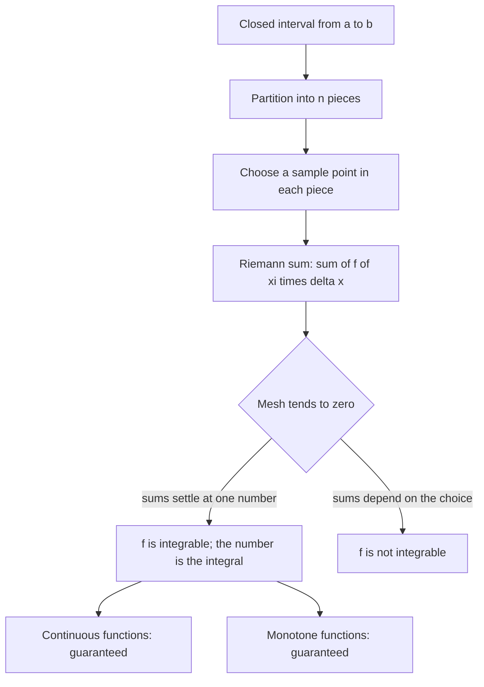

# Integrals

> Calculus · Level: Intermediate · Prerequisites: [Functions](../../03-algebra/11-functions/README.md), [Polynomials](../../03-algebra/06-polynomials/README.md), [Sequences and Series](../../06-precalculus/README.md) · Estimated time: 600 min

## 1. Introduction

The derivative answers the question "how fast is this changing at an instant?". The integral answers a
different question: "how much has accumulated?". The two answers turn out to be inverse to each other,
and that fact — the fundamental theorem of calculus — is the central theorem of the subject and the
subject of the next topic.

This topic builds the integral from nothing but area. The plan is deliberately slow, because the
definition is where all the difficulty lives and where all the theorems come from.

* **Approximate by rectangles.** Cut an interval into small pieces, build a rectangle over each piece,
  and add the areas. A finite sum of this kind is called a *Riemann sum*.
* **Take a limit.** As the pieces become finer, the Riemann sums of a reasonable function approach a
  single number. That number is the *definite integral*.
* **Prove that the limit exists** for the functions that occur in practice — continuous functions and
  monotone functions — and derive the properties of the integral from the definition rather than from
  pictures.
* **Interpret and apply.** The integral measures net signed area, accumulated change, total distance
  travelled from a speed, total cost from a marginal cost, and the area between two curves.
* **Prepare for the shortcut.** At the end of the topic the *antiderivative* appears, and with it the
  promise that the next topic will compute integrals by differentiation in reverse, without summing
  rectangles ever again.

This is also the historical order: Archimedes computed areas by exhaustion, and Cavalieri and Fermat
summed powers of $x$ before Newton and Leibniz recognised the inverse relationship with differentiation.
The Riemann integral is the nineteenth-century formalisation of the same idea, and it is taught here
because every hypothesis is visible in it.

Two warnings. An integral is a *number*, not a function. And the integral is *signed*: area below the
axis counts negatively, which is what makes it the natural bookkeeper of accumulation.

## 2. Prerequisites

* **Limits and continuity** — [Limits](../01-limits/README.md) and [Continuity](../02-continuity/README.md). You
  need the definition of a limit, the limit laws, the notion of a continuous function, the intermediate
  value theorem and the extreme value theorem. Every convergence statement in this topic is a statement
  about limits of finite sums.
* **Functions and their graphs** — [Functions](../../03-algebra/11-functions/README.md): domain, range,
  composition, and the shapes of the standard families. You must be able to evaluate a function at a
  sample point without hesitation, since a Riemann sum is nothing but many such evaluations.
* **Polynomials and factoring** — [Polynomials](../../03-algebra/06-polynomials/README.md): expanding
  and simplifying expressions such as $\frac{(n+1)(2n+1)}{6n^2}$, and solving the quadratic equations
  that arise when two curves are intersected.
* **Sigma notation and finite sums** — [Sequences and Series](../../06-precalculus/README.md) introduces
  the notation; Section 7.2 below develops everything needed, including the sums of powers and their
  proofs by induction.
* **Inequalities and absolute value** — [Inequalities](../../03-algebra/03-inequalities/README.md), for
  the $\varepsilon$-estimates that prove integrability.
* **Trigonometry** — [Trigonometric Functions](../../05-trigonometry/01-trigonometric-functions/README.md),
  used only for examples such as $\int_0^{\pi}\sin x\,dx$ and for the identity
  $\sin^2\theta=\frac{1-\cos2\theta}{2}$ in the exercises.

## 3. Learning Objectives

After this tutorial and its exercises, you will be able to:

1. Express a sum in sigma notation and evaluate sums using the formulas for $\sum k$, $\sum k^2$ and
   $\sum k^3$, proving those formulas by induction.
2. Describe a partition of an interval and compute its mesh, and construct the left, right, midpoint and
   trapezoidal sums for a given function.
3. State the definition of the definite integral as a limit of Riemann sums, with the quantifiers in the
   correct order.
4. Evaluate integrals of simple functions — constants, $x$ and $x^2$ — directly from the definition, by
   summing and passing to the limit.
5. Explain why every continuous function on a closed interval is integrable, and why every monotone
   function is integrable, and reproduce the proof sketches.
6. Derive the basic properties of the integral (linearity, additivity in the limits, monotonicity, the
   triangle inequality, reversal of limits) from the definition.
7. State and prove the mean value theorem for integrals, and interpret the average value of a function.
8. Interpret an integral as accumulated change and as net signed area, and use the interpretation to
   solve word problems about distance, cost and flow.
9. Compute the area between two curves by integrating the difference of the functions over the
   appropriate intervals.
10. Explain what an antiderivative is, exhibit antiderivatives of powers of $x$, and explain why
    antiderivatives are unique up to a constant.
11. Estimate an integral numerically with the trapezoidal rule and bound the error using a bound on the
    second derivative.

## 4. Intuition

**Counting by rectangles.** Suppose you want the area under a curve that bounds a region with one curved
side. You cannot tile it with finitely many rectangles, but you can approximate: slice the region into
vertical strips, replace each strip by a rectangle whose height is the function value somewhere in the
strip, and add. Thinner strips give a better approximation, and the integral is the number that the
approximations approach as the strips become arbitrarily thin.

**Accumulation.** Imagine filling a bath. The flow rate at time $t$ is $r(t)$ litres per minute. In a
very short interval of length $\Delta t$, the amount added is about $r(t)\Delta t$ — rate times time.
Adding over all the short intervals gives a Riemann sum, and the total volume is the integral of the rate.
The same pattern computes distance from speed, mass from density, charge from current, and cost from
marginal cost. *Integral of a rate equals net change of the quantity.*

**Why signed area is the right notion.** If the flow reverses, the bath loses water; a negative rate
should reduce the total. That is exactly what a signed area does: area below the axis is subtracted.
Net signed area is the accumulation of a quantity that can go up and down; ordinary (unsigned) area is
what you get when you ask for the area of a region, and it is computed by integrating $\lvert f\rvert$ or
by splitting at the zeros of $f$.

**Why continuity matters.** A continuous function cannot jump, so on a sufficiently short interval its
values cannot differ much. That is the whole reason continuous functions are integrable: the rectangles
fitted to the top of a strip all have nearly the same height, so it does not matter where in the strip
the sample point is chosen. A function with a jump can be integrated too, but the proof needs a little
more care; a function that is wildly discontinuous — say $1$ on the rationals and $0$ on the irrationals
— cannot be integrated at all, because every strip contains both kinds of points and the sums refuse to
settle down.

**Why monotonicity matters.** A monotone function cannot oscillate, so on each strip the largest and
smallest values occur at the ends. That makes the gap between an overestimate and an underestimate
telescope, and telescoping sums are computable. This is the second, independent route to integrability.

## 5. Formal Definition

**Definition 1 (Partition and mesh).** A *partition* of $[a,b]$ is a finite set
$P=\{x_0,x_1,\dots,x_n\}$ with

$$a=x_0<x_1<x_2<\cdots<x_n=b .$$

The *subintervals* are $[x_{k-1},x_k]$ for $k=1,\dots,n$, their lengths are $\Delta x_k=x_k-x_{k-1}$,
and the *mesh* (or *norm*) of $P$ is $\lVert P\rVert=\max_{1\le k\le n}\Delta x_k$. A partition is
*uniform* (or *regular*) with $n$ parts if every $\Delta x_k=\dfrac{b-a}{n}$.

**Definition 2 (Riemann sum).** Given a function $f$ on $[a,b]$, a partition $P$ of $[a,b]$, and a
*sample point* $\xi_k\in[x_{k-1},x_k]$ for each $k$, the corresponding *Riemann sum* is

$$S(f,P,\xi)=\sum_{k=1}^{n} f(\xi_k)\,\Delta x_k .$$

For a uniform partition the special choices $\xi_k=x_{k-1}$, $\xi_k=x_k$ and
$\xi_k=\tfrac12(x_{k-1}+x_k)$ are called the *left endpoint*, *right endpoint* and *midpoint* sums, and
are written $L_n$, $R_n$ and $M_n$.

**Definition 3 (Definite integral).** Let $f$ be a bounded function on $[a,b]$. We say $f$ is *Riemann
integrable* on $[a,b]$, with *integral* $I$, if for every $\varepsilon>0$ there is $\delta>0$ such that
for every partition $P$ of $[a,b]$ with $\lVert P\rVert<\delta$ and every choice of sample points
$\xi_k$,

$$\left\lvert\sum_{k=1}^{n}f(\xi_k)\Delta x_k-I\right\rvert<\varepsilon .$$

In that case we write $I=\displaystyle\int_a^b f(x)\,dx$. The numbers $a$ and $b$ are the *lower* and
*upper limits of integration*, $f$ is the *integrand*, and $x$ is a *dummy variable*: the value of the
integral does not depend on the letter used for it.

**Definition 4 (Upper and lower sums).** For a bounded $f$ and a partition $P$, put
$M_k=\sup\{f(x):x\in[x_{k-1},x_k]\}$ and $m_k=\inf\{f(x):x\in[x_{k-1},x_k]\}$, and define

$$U(f,P)=\sum_{k=1}^{n}M_k\Delta x_k,\qquad L(f,P)=\sum_{k=1}^{n}m_k\Delta x_k .$$

If $f$ is continuous, these are attained as maximum and minimum on each subinterval by the extreme value
theorem.

**Definition 5 (Average value).** If $f$ is integrable on $[a,b]$, its *average value* there is

$$\bar f=\dfrac{1}{b-a}\int_a^b f(x)\,dx .$$

**Definition 6 (Antiderivative).** A function $F$ is an *antiderivative* of $f$ on an interval $I$ if
$F'(x)=f(x)$ for every $x\in I$.

**Definition 7 (Trapezoidal rule).** For a uniform partition with $h=\dfrac{b-a}{n}$ and
$x_k=a+kh$, the *trapezoidal approximation* is

$$T_n=\dfrac{h}{2}\Bigl[f(x_0)+2f(x_1)+\cdots+2f(x_{n-1})+f(x_n)\Bigr].$$

It is the sum of the areas of trapezia whose top edges join consecutive points of the graph.

## 6. Mathematical Notation

| Symbol | Read as | Meaning |
|---|---|---|
| $\sum_{k=1}^{n}a_k$ | sum from $k=1$ to $n$ of $a_k$ | $a_1+a_2+\cdots+a_n$ |
| $\Delta x_k$ | delta $x$ sub $k$ | length $x_k-x_{k-1}$ of the $k$-th subinterval |
| $\lVert P\rVert$ | norm of $P$ | the mesh, the largest $\Delta x_k$ |
| $\xi_k$ | xi sub $k$ | sample point in the $k$-th subinterval |
| $S(f,P,\xi)$ | Riemann sum | $\sum_k f(\xi_k)\Delta x_k$ |
| $U(f,P)$, $L(f,P)$ | upper, lower sum | sums using suprema and infima |
| $\int_a^b f(x)\,dx$ | integral from $a$ to $b$ of $f$ of $x$ d $x$ | the definite integral, a number |
| $\int f(x)\,dx$ | indefinite integral | the family of antiderivatives; a function, not a number |
| $dx$ | d $x$ | indicates the variable of integration and, informally, the strip width |
| $T_n$, $M_n$, $L_n$, $R_n$ | trapezoid, midpoint, left, right sums | numerical approximations with $n$ strips |
| $\bar f$ | $f$ bar | the average value of $f$ on an interval |
| $[a,b]$ | closed interval from $a$ to $b$ | all $x$ with $a\le x\le b$ |
| $\to$ | tends to | convergence of the sums as the mesh tends to zero |
| $\varepsilon$, $\delta$ | epsilon, delta | the tolerance and the mesh that achieves it |

Read $\int_a^b f(x)\,dx$ aloud as "the integral from $a$ to $b$ of $f$ of $x$, d $x$". The differential
$dx$ is part of the notation; it records which letter is the variable of integration, and it is what
makes the substitution rule (a later topic) work.

## 7. Core Concepts

### 7.1 The Area Problem

Fix a non-negative function $f$ on $[a,b]$ and consider the region $R$ bounded by the graph of $f$, the
$x$-axis, and the vertical lines $x=a$ and $x=b$. What is its area?

For a rectangle the answer is width times height; for a region with one curved boundary there is no
formula, but there are approximations. Cut $[a,b]$ into $n$ equal parts of length $\Delta x=(b-a)/n$.
On the $k$-th part $[x_{k-1},x_k]$, the height of the region varies between $m_k=\inf f$ and
$M_k=\sup f$; the rectangle of height $m_k$ lies inside the region, the rectangle of height $M_k$
contains it. Hence

$$L_n=\sum_{k=1}^n m_k\,\Delta x\ \le\ \operatorname{area}(R)\ \le\ \sum_{k=1}^n M_k\,\Delta x=U_n .$$

If $f$ is continuous, $m_k$ and $M_k$ are attained; if in addition $f$ is monotone, they occur at the two
endpoints of each subinterval, and the two sums are the left and right endpoint sums. For such functions
the gap $U_n-L_n$ telescopes and tends to zero, so the area is squeezed to a single value. That is the
method of exhaustion, and it is the historical root of the integral.

For a general bounded function the same squeeze defines an *upper* and a *lower* integral; when the two
agree, their common value is the integral. The definition in Section 7.5 packages this by requiring that
*every* Riemann sum, not merely the extreme ones, be close to the limit once the mesh is small.

### 7.2 Sigma Notation

The symbol $\sum_{k=m}^{n}a_k$ abbreviates $a_m+a_{m+1}+\cdots+a_n$. The index $k$ is a dummy:
$\sum_{k=1}^{n}k^2=\sum_{j=1}^{n}j^2$. Three rules follow directly from the definition and are used
constantly:

$$\sum_{k=1}^{n}(a_k+b_k)=\sum_{k=1}^{n}a_k+\sum_{k=1}^{n}b_k,\qquad
\sum_{k=1}^{n}c\,a_k=c\sum_{k=1}^{n}a_k,\qquad
\sum_{k=1}^{n}c=nc .$$

A sum whose terms are differences *telescopes*:

$$\sum_{k=1}^{n}\left(\frac{1}{k}-\frac{1}{k+1}\right)=1-\frac{1}{n+1}=\frac{n}{n+1},$$

because every intermediate term cancels with its neighbour. Telescoping is the mechanism behind the
integrability proof for monotone functions, and it is worth recognising early.

### 7.3 Sums of Powers

Three formulas turn every polynomial Riemann sum into a closed expression:

$$\sum_{k=1}^{n}k=\frac{n(n+1)}{2},\qquad
\sum_{k=1}^{n}k^2=\frac{n(n+1)(2n+1)}{6},\qquad
\sum_{k=1}^{n}k^3=\left(\frac{n(n+1)}{2}\right)^2 .$$

Their proofs by induction are in Section 8.1; the first also has the familiar pairing proof, in which
$1+n=2+(n-1)=\cdots=n+1$. A useful consequence of the first formula is

$$\sum_{k=1}^{n}(2k-1)=2\cdot\frac{n(n+1)}{2}-n=n^2,$$

the statement that the sum of the first $n$ odd numbers is $n^2$.

Two habits make these formulas reliable. First, test them at $n=1$ and $n=2$ before using them.
Second, remember that $\sum k^2$ is a *cubic* polynomial in $n$ with leading term $n^3/3$: that leading
term is exactly the value of $\int_0^1x^2\,dx$ that the sums will produce.

### 7.4 Partitions and Riemann Sums

For a uniform partition of $[a,b]$ into $n$ parts, $x_k=a+k\dfrac{b-a}{n}$, so $\Delta x=\dfrac{b-a}{n}$
and the three standard sums are

$$R_n=\sum_{k=1}^{n}f(x_k)\Delta x,\qquad
L_n=\sum_{k=1}^{n}f(x_{k-1})\Delta x,\qquad
M_n=\sum_{k=1}^{n}f\!\left(\tfrac{x_{k-1}+x_k}{2}\right)\Delta x .$$

For $f(x)=x^2$ on $[0,1]$ with $n=4$ the sample points are $0,\tfrac14,\tfrac12,\tfrac34,1$, and

$$L_4=\tfrac14\left(0+\tfrac1{16}+\tfrac14+\tfrac9{16}\right)=\tfrac14\cdot\tfrac{14}{16}=\tfrac{7}{32}=0.21875,$$
$$R_4=\tfrac14\left(\tfrac1{16}+\tfrac14+\tfrac9{16}+1\right)=\tfrac14\cdot\tfrac{30}{16}=\tfrac{15}{32}=0.46875 .$$

Their average is $\tfrac{11}{32}=0.34375$, which is the trapezoidal approximation $T_4$, and the exact
value $1/3\approx0.33333$ lies between $L_4$ and $R_4$: the area is $0.333\ldots$, while the crude
rectangles bracket it.

Because $f$ is increasing here, $L_n\le\int_0^1x^2\,dx\le R_n$ for every $n$, and
$R_n-L_n=\dfrac{f(1)-f(0)}{n}=\dfrac1n$. To force the error below $0.001$ it is therefore enough to take
$n>1000$ — a quantitative statement that the definition alone provides.

### 7.5 The Definite Integral

The integral is the common limit of the Riemann sums. Precisely (Definition 3): $f$ is integrable with
integral $I$ if for every $\varepsilon>0$ there is $\delta>0$ such that every partition of mesh less than
$\delta$ and every choice of sample points satisfy
$\left\lvert S(f,P,\xi)-I\right\rvert<\varepsilon$.

Three points about this definition deserve emphasis.

* The same $\delta$ must work for *all* sample choices. This is what rules out functions whose sums
  depend on whether the sample points are rational or irrational.
* The limit is taken as the mesh tends to zero, not as $n$ tends to infinity. For a uniform partition the
  two are equivalent, because $\lVert P\rVert=(b-a)/n$.
* Integrability is a property of the pair $(f,[a,b])$: the same function may be integrable on one
  interval and not on another (for instance $1/x$ on $[1,2]$ but not on $[-1,1]$, where it is unbounded).

When the integral exists it is unique, since two limits of the same sums must agree. If $f$ happens to be
integrable and we merely want its value, it is legitimate to use one convenient sequence of partitions
and sample points; that is what all the computations in Section 9 do.

### 7.6 Which Functions Are Integrable

**Continuous functions are integrable.** The reason is uniform continuity: on a closed bounded interval a
continuous function has the property that values at points closer than some $\delta$ differ by less than
any prescribed $\varepsilon$. Take a partition of mesh below that $\delta$; on each subinterval the
oscillation $M_k-m_k$ is less than $\varepsilon/(b-a)$, so

$$0\le U(f,P)-L(f,P)=\sum_{k=1}^{n}(M_k-m_k)\Delta x_k<\frac{\varepsilon}{b-a}\sum_{k=1}^{n}\Delta x_k=\varepsilon .$$

The upper and lower sums are trapped together, so the integral exists. Section 8.5 makes this precise.

**Monotone functions are integrable.** For an increasing $f$ and a uniform partition, the supremum on
$[x_{k-1},x_k]$ is $f(x_k)$ and the infimum is $f(x_{k-1})$, so the difference of the two sums
telescopes:

$$U-L=\frac{b-a}{n}\sum_{k=1}^{n}\bigl(f(x_k)-f(x_{k-1})\bigr)=\frac{b-a}{n}\bigl(f(b)-f(a)\bigr)\longrightarrow0 .$$

This proof needs no continuity at all, only monotonicity. It is given in full in Section 8.6.

**Not everything is integrable.** The function equal to $1$ at rational points and $0$ at irrational
points is bounded but not integrable: every subinterval of positive length contains both kinds of points,
so every upper sum equals $b-a$ and every lower sum equals $0$, whatever the partition. The gap never
closes. Unbounded functions are not Riemann integrable either, since the sums can be made arbitrarily
large; they are treated later as improper integrals.

### 7.7 Properties of the Integral

The following properties are proved from the definition in Section 8.4, not assumed from pictures.

| Property | Statement | Why it is true |
|---|---|---|
| Zero length | $\displaystyle\int_a^a f=0$ | every sum is empty |
| Constant | $\displaystyle\int_a^b c\,dx=c(b-a)$ | the sums are $c\sum\Delta x_k=c(b-a)$ |
| Linearity | $\displaystyle\int_a^b(\alpha f+\beta g)=\alpha\int_a^b f+\beta\int_a^b g$ | sums are linear in the values |
| Additivity | $\displaystyle\int_a^b f+\int_b^c f=\int_a^c f$ | a partition of $[a,c]$ splits at $b$ |
| Reversal | $\displaystyle\int_a^b f=-\int_b^a f$ | reversing the partition reverses the order of the terms |
| Monotonicity | $f\le g$ on $[a,b]$ implies $\displaystyle\int_a^b f\le\int_a^b g$ | the inequality holds term by term |
| Triangle inequality | $\displaystyle\left\lvert\int_a^b f\right\rvert\le\int_a^b\lvert f\rvert$ | the triangle inequality for finite sums |

Two consequences are worth stating separately. If $m\le f\le M$ on $[a,b]$, then

$$m(b-a)\le\int_a^b f\le M(b-a),$$

which is monotonicity applied to the constant functions $m$ and $M$. And if $f$ is continuous,
$f\ge0$ and $\int_a^bf=0$, then $f\equiv0$ on $[a,b]$: a positive value somewhere would, by continuity,
stay above $f(c)/2$ on a small interval, and the integral would be positive.

### 7.8 The Mean Value Theorem for Integrals

**Theorem (MVT for integrals).** If $f$ is continuous on $[a,b]$, then there exists $c\in[a,b]$ with

$$f(c)=\frac{1}{b-a}\int_a^b f(x)\,dx .$$

In words: a continuous function attains its average value. The proof is a squeeze and an application of
the intermediate value theorem. Let $m$ and $M$ be the minimum and maximum of $f$ on $[a,b]$, which
exist by the extreme value theorem. Then $m\le f\le M$, so by monotonicity and the constant case,

$$m\le\frac{1}{b-a}\int_a^b f\le M .$$

The average lies between two values of $f$, so the intermediate value theorem supplies a point $c$ where
$f(c)$ equals it.

The theorem is the integral analogue of the mean value theorem for derivatives, and it has the same use:
it converts a statement about an average into a statement about a value at a point. Note that $c$ need
not be unique and need not be interior: for a constant function every $c$ works.

### 7.9 Accumulated Change and Net Signed Area

If $f$ is a rate of change of a quantity $Q$ — that is, $f=Q'$ — then the integral of $f$ over $[a,b]$ is
the net change of $Q$ over that period. In the language of Riemann sums, $f(t_k)\Delta t$ is
approximately the change of $Q$ during the $k$-th short interval, and the sum of the changes is the
total change. Since the next topic proves $Q(b)-Q(a)=\int_a^bQ'$, this statement is exact.

Three standard readings of the same fact:

* **Displacement versus distance.** If $v$ is velocity, $\int_a^b v$ is displacement (signed) while
  $\int_a^b\lvert v\rvert$ is total distance travelled. A particle with $v(t)=t^2-4$ on $[0,3]$ has
  displacement $\int_0^3(t^2-4)\,dt=9-12=-3$ but distance
  $\int_0^2(4-t^2)\,dt+\int_2^3(t^2-4)\,dt=\tfrac{16}{3}+\tfrac{7}{3}=\tfrac{23}{3}$, because it moves
  backwards until $t=2$ and forwards afterwards.
* **Net signed area.** For a general $f$, $\int_a^b f$ is the area above the axis minus the area below
  it. For $f(x)=x^3$ on $[-1,1]$ the two signed areas cancel and the integral is $0$, although the
  region has positive geometric area $\tfrac12$.
* **Totals from rates.** Total cost from marginal cost, total rainfall from a rate of rainfall, total
  charge from current: all are integrals of rates.

### 7.10 Area Between Curves

If $f\ge g$ on $[a,b]$, the area of the region between the two graphs from $a$ to $b$ is

$$A=\int_a^b\bigl(f(x)-g(x)\bigr)\,dx .$$

The reason is that at each $x$ the vertical slice has height $f(x)-g(x)$, and the integral adds the
slices. If the curves cross inside the interval, the formula must be applied separately on each
subinterval on which one curve stays above the other, or equivalently

$$A=\int_a^b\bigl\lvert f(x)-g(x)\bigr\rvert\,dx .$$

For $f(x)=x$ and $g(x)=x^2$ on $[0,1]$ the line lies above the parabola, so the area is
$\int_0^1(x-x^2)\,dx=\tfrac12-\tfrac13=\tfrac16$. On $[0,2]$ the curves cross at $x=1$, and the total
area between them is $\tfrac16+\int_1^2(x^2-x)\,dx=\tfrac16+\tfrac56=1$.

Vertical slices are not compulsory. If it is easier to express the curves as $x=\phi(y)$ and
$x=\psi(y)$, integrate with respect to $y$: the area is $\int_c^d(\psi(y)-\phi(y))\,dy$ over the
appropriate $y$-interval.

### 7.11 Antiderivatives: A First Look

The derivative of $x^3/3$ is $x^2$. So $x^3/3$ is an *antiderivative* of $x^2$, and more generally

$$\frac{d}{dx}\left(\frac{x^{n+1}}{n+1}\right)=x^n\qquad(n\ne-1).$$

Two antiderivatives of the same function on an interval differ by a constant: if $F'=G'=f$, then
$(F-G)'=0$, and a function with zero derivative on an interval is constant — this is the corollary proved
in [Applications of Derivatives](../05-applications-of-derivatives/README.md), Section 8.4. That is why
one writes $\int f(x)\,dx=F(x)+C$ for the *indefinite* integral, which is a family of functions, in
contrast with the definite integral $\int_a^b f$, which is a number.

The coincidence that makes calculus work is visible already in the sums of Section 7.4. For
$f(x)=x^2$ on $[0,b]$ the right-endpoint sums give

$$R_n=\frac{b^3}{n^3}\sum_{k=1}^{n}k^2=\frac{b^3(n+1)(2n+1)}{6n^2}\longrightarrow\frac{b^3}{3},$$

while the antiderivative $F(x)=x^3/3$ gives $F(b)-F(0)=b^3/3$. The two numbers agree.
[The fundamental theorem of calculus](../07-fundamental-theorem-of-calculus/README.md) proves that this
always happens — that $\int_a^bf=F(b)-F(a)$ for any antiderivative $F$ — which is why integrals are
computed by differentiation in reverse.

### 7.12 Numerical Estimation by Trapezoids

The trapezoidal rule joins consecutive sample points by straight lines and adds the areas of the
resulting trapezia:

$$T_n=\frac{h}{2}\Bigl[f(x_0)+2f(x_1)+\cdots+2f(x_{n-1})+f(x_n)\Bigr],\qquad h=\frac{b-a}{n}.$$

It is the average of the left and right sums, $T_n=\tfrac12(L_n+R_n)$, and it is exact for linear
functions. For $f(x)=x^2$ on $[0,1]$ with $n=4$,

$$T_4=\frac{1}{8}\Bigl[0+2\cdot\tfrac1{16}+2\cdot\tfrac14+2\cdot\tfrac9{16}+1\Bigr]
=\frac{1}{8}\Bigl[\tfrac{11}{4}\Bigr]=\frac{11}{32}=0.34375,$$

compared with the exact value $\tfrac13$. The error is $\tfrac{11}{32}-\tfrac13=\tfrac{1}{96}$.

For a twice differentiable $f$ with $\lvert f''\rvert\le M$ on $[a,b]$ the error is bounded by

$$\lvert E_T\rvert=\left\lvert T_n-\int_a^bf\right\rvert\le\frac{M(b-a)^3}{12n^2}.$$

For $f(x)=x^2$ we have $M=2$, $a=0$, $b=1$, $n=4$, and the bound is $\dfrac{2}{12\cdot16}=\dfrac{1}{96}$,
which the error attains exactly. The bound explains the practical rule: doubling $n$ divides the error by
four, so each extra decimal digit costs about a factor of ten in the number of strips. The midpoint rule,
which samples at the centre of each strip, has an error of the opposite sign and about half the size;
Example 7 in Section 9 verifies both statements for $f(x)=x^2$.

## 8. Formulas and Properties

### 8.1 The Sums of Powers

**Proposition 1.** For every $n\ge1$:

$$\sum_{k=1}^{n}k=\frac{n(n+1)}{2},\qquad
\sum_{k=1}^{n}k^2=\frac{n(n+1)(2n+1)}{6},\qquad
\sum_{k=1}^{n}k^3=\left(\frac{n(n+1)}{2}\right)^2 .$$

*Proof of the first formula.* For $n=1$ both sides equal $1$. Assume the formula for $n-1$; then

$$\sum_{k=1}^{n}k=\frac{(n-1)n}{2}+n=\frac{n^2-n+2n}{2}=\frac{n(n+1)}{2}.$$

By induction the formula holds for all $n\ge1$. $\blacksquare$

*Proof of the second formula.* For $n=1$ both sides equal $1$. Assume the formula for $n-1$, so that
$\sum_{k=1}^{n-1}k^2=\dfrac{(n-1)n(2n-1)}{6}$. Then

$$\sum_{k=1}^{n}k^2=\frac{(n-1)n(2n-1)}{6}+n^2=\frac{n\bigl((n-1)(2n-1)+6n\bigr)}{6}
=\frac{n(2n^2-n-2n+1+6n)}{6}=\frac{n(2n^2+3n+1)}{6},$$

and $2n^2+3n+1=(n+1)(2n+1)$, which is the claimed expression. $\blacksquare$

*Proof of the third formula.* For $n=1$ both sides equal $1$. Assume the formula for $n-1$. Then

$$\sum_{k=1}^{n}k^3=\frac{(n-1)^2n^2}{4}+n^3=\frac{n^2\bigl((n-1)^2+4n\bigr)}{4}=\frac{n^2(n^2+2n+1)}{4}
=\frac{n^2(n+1)^2}{4},$$

as required. $\blacksquare$

### 8.2 Three Integrals Computed from the Definition

**Example A (constant).** For $c\in\mathbb{R}$ and any partition,
$\sum_{k=1}^n c\,\Delta x_k=c\sum_k\Delta x_k=c(b-a)$, so every Riemann sum equals $c(b-a)$ and

$$\int_a^b c\,dx=c(b-a).$$

**Example B ($f(x)=x$).** On a uniform partition of $[0,b]$, take right endpoints: $x_k=kb/n$, so

$$R_n=\sum_{k=1}^{n}\frac{kb}{n}\cdot\frac{b}{n}=\frac{b^2}{n^2}\sum_{k=1}^{n}k
=\frac{b^2}{n^2}\cdot\frac{n(n+1)}{2}=\frac{b^2}{2}\left(1+\frac1n\right)\longrightarrow\frac{b^2}{2}.$$

The left-endpoint sums give $\dfrac{b^2}{2}\left(1-\dfrac1n\right)$, with the same limit, and any other
sample choice lies between the two. Hence

$$\int_0^b x\,dx=\frac{b^2}{2},\qquad\text{and by additivity}\qquad\int_a^b x\,dx=\frac{b^2-a^2}{2}.$$

**Example C ($f(x)=x^2$).** With the same partition and right endpoints,

$$R_n=\sum_{k=1}^{n}\frac{k^2b^2}{n^2}\cdot\frac{b}{n}=\frac{b^3}{n^3}\cdot\frac{n(n+1)(2n+1)}{6}
=\frac{b^3}{6}\left(1+\frac1n\right)\left(2+\frac1n\right)\longrightarrow\frac{b^3}{3}.$$

The left sums give $\dfrac{b^3}{6}\left(1-\dfrac1n\right)\left(2-\dfrac1n\right)\to\dfrac{b^3}{3}$ as well,
so

$$\int_0^b x^2\,dx=\frac{b^3}{3}.$$

In each case the limit is independent of the sample points because the upper and lower sums have the same
limit; that is the content of the next subsection.

### 8.3 The Darboux Criterion

**Theorem 1 (Integrability criterion).** A bounded function $f$ on $[a,b]$ is Riemann integrable if and
only if for every $\varepsilon>0$ there is a partition $P$ with

$$U(f,P)-L(f,P)<\varepsilon .$$

*Sketch.* If the criterion holds, the upper and lower sums can be squeezed together; since
$L(f,P)\le S(f,P,\xi)\le U(f,P)$ for every choice of sample points, all sums are trapped in an interval
of length $<\varepsilon$, and a standard nested-interval argument produces the limit $I$. Conversely, if
all sums for partitions of small mesh lie within $\varepsilon$ of $I$, then the upper and lower sums,
being suprema and infima of such sums, lie within $2\varepsilon$ of $I$ and hence within $4\varepsilon$
of each other. The full $\varepsilon/3$ bookkeeping is carried out in real analysis; the idea is exactly
the sandwich displayed here.

The criterion is what makes the proofs below short: it is enough to exhibit, for each $\varepsilon$, one
partition (not every partition) for which upper and lower sums nearly agree.

A useful lemma is that *refining a partition moves the lower sum up and the upper sum down*. If a point
$c$ is inserted into a subinterval $[u,v]$ on which $f\ge m$, then the two new rectangles of heights
$m_1,m_2\ge m$ satisfy $m_1(c-u)+m_2(v-c)\ge m(v-u)$; the other terms are unchanged. Repeating for every
inserted point proves the claim for $L$; the argument for $U$ is the same with suprema.

### 8.4 Properties, Proved from the Definition

Throughout, $f$ and $g$ are integrable on the intervals that occur.

**(i) Zero length and constants.** $\int_a^af=0$ because every sum is empty, and
$\int_a^bc\,dx=c(b-a)$ by Example A.

**(ii) Linearity.** For $\alpha\in\mathbb{R}$ and $\beta\in\mathbb{R}$,
$\int_a^b(\alpha f+\beta g)=\alpha\int_a^bf+\beta\int_a^bg$.

*Proof.* On any subinterval, $\sup(\alpha f)=\alpha\sup f$ and $\inf(\alpha f)=\alpha\inf f$ when
$\alpha\ge0$, while for $\alpha<0$ the two are exchanged. Hence for $\alpha\ge0$,
$U(\alpha f,P)=\alpha U(f,P)$ and $L(\alpha f,P)=\alpha L(f,P)$, so the upper and lower sums are scaled
by $\alpha$ and so is their common limit; for $\alpha<0$ the same computation with the roles of $U$ and
$L$ exchanged gives $U(\alpha f,P)=\alpha L(f,P)$, and again the limit is scaled. For the sum, use
$\sup(f+g)\le\sup f+\sup g$ and $\inf(f+g)\ge\inf f+\inf g$ on each subinterval, which give
$U(f+g,P)\le U(f,P)+U(g,P)$ and $L(f+g,P)\ge L(f,P)+L(g,P)$. Given $\varepsilon>0$, choose partitions
$P_f,P_g$ whose upper and lower sums differ by less than $\varepsilon$, let $P$ be their common
refinement, and combine the inequalities with the refinement lemma. The result is that $f+g$ satisfies
the integrability criterion with integral $\int f+\int g$. $\blacksquare$

**(iii) Additivity in the limits.** For $a<b<c$,
$\int_a^bf+\int_b^cf=\int_a^cf$.

*Proof.* Take partitions $P_1$ of $[a,b]$ and $P_2$ of $[b,c]$; their union is a partition $P$ of $[a,c]$
and, for every choice of sample points, the Riemann sums add exactly:
$S(f,P)=S(f,P_1)+S(f,P_2)$. Letting the mesh tend to zero gives the identity for this restricted class of
partitions. For a general partition $Q$ of $[a,c]$, let $Q'=Q\cup\{b\}$; the two sums differ only in the
single subinterval containing $b$, so
$\lvert S(f,Q)-S(f,Q')\rvert\le2\sup\lvert f\rvert\cdot\lVert Q\rVert\to0$. Hence the general sums have
the same limit as those that include $b$, which proves the claim. $\blacksquare$

**(iv) Reversal.** For $a<b$ one *defines* $\int_b^af=-\int_a^bf$. The convention is forced by
additivity: if it is to hold for any ordering of the three points, then
$\int_a^bf+\int_b^af=\int_a^af=0$. With this convention, additivity holds without the restriction
$a<b<c$.

**(v) Monotonicity.** If $f\le g$ on $[a,b]$ then $\int_a^bf\le\int_a^bg$.

*Proof.* For every partition, $m_k(f)\le m_k(g)$, hence $L(f,P)\le L(g,P)$, and the lower integrals
therefore satisfy $\int f\le\int g$. $\blacksquare$

In particular $m(b-a)\le\int_a^bf\le M(b-a)$ when $m\le f\le M$, and
$\left\lvert\int_a^bf\right\rvert\le\int_a^b\lvert f\rvert$: for any Riemann sum the triangle inequality
for finite sums gives

$$\left\lvert\sum_k f(\xi_k)\Delta x_k\right\rvert\le\sum_k\lvert f(\xi_k)\rvert\Delta x_k,$$

and $\lvert f\rvert$ is integrable whenever $f$ is, because
$\bigl\lvert\lvert f(x)\rvert-\lvert f(y)\rvert\bigr\rvert\le\lvert f(x)-f(y)\rvert$ makes the
oscillation of $\lvert f\rvert$ on each subinterval no larger than that of $f$.

### 8.5 Continuous Functions Are Integrable

**Theorem 2.** If $f$ is continuous on $[a,b]$, then $f$ is Riemann integrable on $[a,b]$.

*Proof.* A continuous function on a closed bounded interval is uniformly continuous: for every
$\eta>0$ there is $\delta>0$ such that $\lvert x-y\rvert<\delta$ implies
$\lvert f(x)-f(y)\rvert<\eta$, with $\delta$ depending only on $\eta$ and not on the points. Given
$\varepsilon>0$, take $\eta=\varepsilon/(b-a)$ and the corresponding $\delta$, and let $P$ be a uniform
partition whose mesh is less than $\delta$. On each subinterval $[x_{k-1},x_k]$, the extreme value theorem
gives points where $f$ attains $M_k$ and $m_k$; those two points are closer than $\delta$, so
$M_k-m_k<\eta$. Therefore

$$U(f,P)-L(f,P)=\sum_{k=1}^{n}(M_k-m_k)\Delta x_k<\eta\sum_{k=1}^{n}\Delta x_k=\eta(b-a)=\varepsilon .$$

By the Darboux criterion $f$ is integrable. $\blacksquare$

The proof also shows *why* continuity is the right hypothesis: what is needed is not continuity at each
point separately, but a single $\delta$ that works uniformly across the whole interval.

### 8.6 Monotone Functions Are Integrable

**Theorem 3.** If $f$ is monotone on $[a,b]$, then $f$ is Riemann integrable there.

*Proof.* Suppose $f$ is increasing (the decreasing case is $-f$). For the uniform partition with
$h=(b-a)/n$, the minimum on $[x_{k-1},x_k]$ is $f(x_{k-1})$ and the maximum is $f(x_k)$. Hence

$$U(f,P)-L(f,P)=h\sum_{k=1}^{n}\bigl(f(x_k)-f(x_{k-1})\bigr)=h\bigl(f(b)-f(a)\bigr)=\frac{(b-a)\bigl(f(b)-f(a)\bigr)}{n}.$$

As $n\to\infty$ this tends to $0$, so for every $\varepsilon$ some partition has $U-L<\varepsilon$ and the
Darboux criterion applies. $\blacksquare$

A monotone function may have infinitely many discontinuities — a step function with jumps at every
rational is monotone — and it is still integrable. Continuity is sufficient, not necessary.

### 8.7 The Mean Value Theorem for Integrals

**Theorem 4.** If $f$ is continuous on $[a,b]$, then there is $c\in[a,b]$ with

$$f(c)=\dfrac{1}{b-a}\int_a^bf(x)\,dx .$$

*Proof.* By the extreme value theorem $f$ attains a minimum $m$ and a maximum $M$ on $[a,b]$. Since
$m\le f(x)\le M$ for all $x$, monotonicity and the constant case give

$$m(b-a)\le\int_a^bf\le M(b-a),\qquad\text{that is}\qquad m\le\frac{1}{b-a}\int_a^bf\le M .$$

The number $\bar f=\frac{1}{b-a}\int_a^bf$ therefore lies between two values of the continuous function
$f$, so the intermediate value theorem supplies $c\in[a,b]$ with $f(c)=\bar f$. $\blacksquare$

### 8.8 The Trapezoidal Error Bound

**Theorem 5.** Let $f$ be twice differentiable on $[a,b]$ with $\lvert f''(x)\rvert\le M$ there. Then for
the uniform partition into $n$ parts,

$$\left\lvert T_n-\int_a^bf\right\rvert\le\frac{M(b-a)^3}{12n^2}.$$

*Derivation sketch.* On a single subinterval $[u,v]$ let $L$ be the chord joining $(u,f(u))$ and
$(v,f(v))$. Two integrations by parts — a technique proved in *Techniques of Integration*, later in this
discipline — give the exact error representation

$$\int_u^vf(x)\,dx-\frac{(v-u)\bigl(f(u)+f(v)\bigr)}{2}=-\frac12\int_u^v(x-u)(v-x)f''(x)\,dx .$$

Bounding $\lvert f''\rvert\le M$ and evaluating
$\int_u^v(x-u)(v-x)\,dx=\dfrac{(v-u)^3}{6}$ gives the error bound $\dfrac{M(v-u)^3}{12}$ on that
subinterval. Summing over the $n$ subintervals, each of length $h=(b-a)/n$, gives

$$\lvert E_T\rvert\le n\cdot\frac{Mh^3}{12}=\frac{M(b-a)h^2}{12}=\frac{M(b-a)^3}{12n^2}.\qquad\blacksquare$$

The formula is exact for linear functions (then $f''=0$), and it predicts that doubling $n$ cuts the
error by a factor of four. Example 7 in Section 9 checks the bound against a computed error.

### 8.9 Antiderivatives and Their Uniqueness

**Theorem 6.** If $F$ and $G$ are antiderivatives of $f$ on an interval $I$, then $F-G$ is constant on
$I$.

*Proof.* $(F-G)'=F'-G'=f-f=0$ on $I$, and a function with zero derivative on an interval is constant (the
corollary of the mean value theorem proved in
[Applications of Derivatives](../05-applications-of-derivatives/README.md), Theorem 5). $\blacksquare$

Consequently the indefinite integral $\int f(x)\,dx$ denotes the whole family $F(x)+C$, and the graph of
every antiderivative is a vertical translate of the graph of any other.

## 9. Step-by-Step Examples

### Example 1 (easy): From a Sum to Sigma Notation and Back

Express $2+5+8+\cdots+62$ in sigma notation and evaluate it.

The terms increase by $3$, so the $k$-th term is $3k-1$. The last term corresponds to $3k-1=62$, that is
$k=21$. Hence

$$\sum_{k=1}^{21}(3k-1)=3\sum_{k=1}^{21}k-\sum_{k=1}^{21}1=3\cdot\frac{21\cdot22}{2}-21=693-21=672 .$$

**Check.** For an arithmetic progression the sum is (number of terms) $\times$ (average of the first and
last), that is $21\cdot\dfrac{2+62}{2}=21\cdot32=672$, in agreement.

### Example 2 (easy–medium): A Riemann Sum for $f(x)=x^3$

Compute the right-endpoint sums for $f(x)=x^3$ on $[0,1]$ and pass to the limit.

With $\Delta x=\dfrac1n$ and $x_k=\dfrac kn$,

$$R_n=\sum_{k=1}^{n}\left(\frac{k}{n}\right)^3\frac1n=\frac{1}{n^4}\sum_{k=1}^{n}k^3
=\frac{1}{n^4}\left(\frac{n(n+1)}{2}\right)^2=\frac{(n+1)^2}{4n^2}.$$

For $n=2$ this gives $\dfrac{9}{16}=0.5625$; directly, the sample points are $\tfrac12$ and $1$, so
$R_2=\tfrac12\left(\tfrac18+1\right)=\tfrac{9}{16}$, in agreement. As $n\to\infty$,

$$R_n=\frac14\left(1+\frac1n\right)^2\longrightarrow\frac14 .$$

The left-endpoint sums give $\dfrac{(n-1)^2}{4n^2}\to\dfrac14$ as well, and every other choice of sample
points lies between the two; hence $\displaystyle\int_0^1x^3\,dx=\frac14$.

### Example 3 (medium): An Integral Computed from the Definition

Compute $\displaystyle\int_0^2(3x^2+1)\,dx$ from the definition.

Take the uniform partition with $\Delta x=\dfrac2n$ and $x_k=\dfrac{2k}{n}$, and use right endpoints:

$$S_n=\sum_{k=1}^{n}\left(3\cdot\frac{4k^2}{n^2}+1\right)\frac2n
=\frac{2}{n}\left(\frac{12}{n^2}\sum_{k=1}^{n}k^2+n\right).$$

Substituting $\sum k^2=\dfrac{n(n+1)(2n+1)}{6}$,

$$S_n=\frac{2}{n}\left(\frac{12}{n^2}\cdot\frac{n(n+1)(2n+1)}{6}+n\right)
=\frac{4(n+1)(2n+1)}{n^2}+2=\frac{8n^2+12n+4}{n^2}+2 .$$

Hence $\displaystyle\lim_{n\to\infty}S_n=8+0+2=10$. The integral is $10$; the same value is obtained from
the left sums, so the function is integrable and
$\int_0^2(3x^2+1)\,dx=10$. (The next topic will confirm this in one line, since $x^3+x$ is an
antiderivative and $8+2=10$.)

### Example 4 (medium): Area Between a Line and a Parabola

Find the area between $y=2x$ and $y=x^2$ for $0\le x\le2$.

The curves meet where $2x=x^2$, that is $x=0$ or $x=2$. On $(0,2)$ the line is above the parabola, since
$2x-x^2=x(2-x)>0$. Hence

$$A=\int_0^2(2x-x^2)\,dx=2\int_0^2x\,dx-\int_0^2x^2\,dx=2\cdot\frac{4}{2}-\frac{8}{3}=4-\frac83=\frac43 .$$

The two integrals are the ones computed from the definition in Section 8.2; linearity lets us subtract
them. The area is $\tfrac43$, a little more than a third of the enclosing $2\times4$ rectangle, which is
plausible from a sketch: the parabola cuts the rectangle into a region of area $\tfrac83$ below it and
$\tfrac43$ above it.

### Example 5 (medium–hard): The Average Value of a Function

Find the average value of $f(x)=x^2$ on $[0,3]$ and the point where it is attained.

By definition and Example C of Section 8.2,

$$\bar f=\frac{1}{3-0}\int_0^3x^2\,dx=\frac13\cdot\frac{27}{3}=3 .$$

The mean value theorem for integrals promises a point $c\in[0,3]$ with $f(c)=3$, that is $c^2=3$, so
$c=\sqrt3\approx1.732$ (the negative root lies outside the interval). The average is not the value at the
midpoint: $f(1.5)=2.25\ne3$. The graph rises, so the average is pulled towards the higher values, and
the point where it is attained sits to the right of the midpoint.

### Example 6 (medium–hard): A Rate of Flow

Water flows into a tank at $r(t)=6t-t^2$ litres per minute for $0\le t\le6$. How much water enters?

The total is the integral of the rate:

$$V=\int_0^6(6t-t^2)\,dt=6\int_0^6t\,dt-\int_0^6t^2\,dt=6\cdot\frac{36}{2}-\frac{216}{3}=108-72=36\ \text{litres}.$$

The rate is positive on $(0,6)$ (since $t(6-t)>0$ there), so the integral is an ordinary area and the
tank gains $36$ litres. The maximum rate occurs at $t=3$, where $r=9$ L/min; had the flow been constant
at that rate the tank would have received $54$ litres, so the actual $36$ reflects the triangular shape
of the rate graph. This is the pattern "integral of a rate is the accumulated change".

### Example 7 (hard): Trapezoids, Midpoints, and Their Errors

Estimate $\displaystyle\int_0^1x^2\,dx$ with $T_4$ and $M_4$, and compare both errors with the bound of
Theorem 5.

The sample points for $T_4$ are $0,\tfrac14,\tfrac12,\tfrac34,1$, and

$$T_4=\frac{1}{8}\left[0+2\cdot\frac1{16}+2\cdot\frac14+2\cdot\frac{9}{16}+1\right]
=\frac18\cdot\frac{11}{4}=\frac{11}{32}=0.34375 .$$

The midpoints are $\tfrac18,\tfrac38,\tfrac58,\tfrac78$, so

$$M_4=\frac14\left[\frac{1}{64}+\frac{9}{64}+\frac{25}{64}+\frac{49}{64}\right]
=\frac14\cdot\frac{84}{64}=\frac{21}{64}=0.328125 .$$

The exact value is $\tfrac13=0.333333\ldots$, so $T_4$ overestimates by
$\tfrac{11}{32}-\tfrac13=\tfrac{1}{96}\approx0.010417$ and $M_4$ underestimates by
$\tfrac13-\tfrac{21}{64}=\tfrac{1}{192}\approx0.005208$. The midpoint error is exactly half the trapezoid
error, with the opposite sign. The bound with $M=2$, $b-a=1$ and $n=4$ is
$\dfrac{2}{12\cdot16}=\dfrac{1}{96}$, which the trapezoid error attains: the estimate is sharp for this
function. Both methods converge like $1/n^2$, so $n=40$ would give errors around $10^{-5}$.

### Example 8 (hard): Area Between Curves That Cross

Find the total area enclosed by $y=x^3$ and $y=x$.

The curves meet where $x^3=x$, that is $x(x-1)(x+1)=0$, so at $x=-1,0,1$. On $(-1,0)$ we have
$x^3-x=x(x^2-1)>0$, so the cubic is above the line; on $(0,1)$ the line is above. Hence the enclosed area
is

$$A=\int_{-1}^{0}(x^3-x)\,dx+\int_{0}^{1}(x-x^3)\,dx .$$

Using the oddness of $x^3-x$, the two integrals are equal, and

$$\int_0^1(x-x^3)\,dx=\frac12-\frac14=\frac14,\qquad\text{so}\qquad A=2\cdot\frac14=\frac12 .$$

Note what goes wrong if the curves are subtracted in a fixed order: $\int_{-1}^{1}(x^3-x)\,dx=0$ because
the integrand is odd, which is the *signed* area, not the geometric area. The correct geometric area is
$\tfrac12$.

### Example 9 (hard): Displacement, Distance, and the Shape of the Antiderivative

A particle moves along a line with velocity $v(t)=3t^2-6t$ metres per second, $0\le t\le3$. Find its
displacement and the total distance travelled.

The displacement is the integral of the velocity:

$$\int_0^3(3t^2-6t)\,dt=3\int_0^3t^2\,dt-6\int_0^3t\,dt=3\cdot9-6\cdot\frac92=27-27=0 .$$

The particle returns to its starting point. For the distance, note $v(t)=3t(t-2)$: negative on $(0,2)$
and positive on $(2,3)$. Hence

$$\text{distance}=\int_0^2(6t-3t^2)\,dt+\int_2^3(3t^2-6t)\,dt=(12-8)+(27-27)-(8-12)=4+0+4=8 .$$

So the particle travels $8$ metres while ending where it began.

Notice also that $F(t)=t^3-3t^2$ satisfies $F'=v$ and $F(3)-F(0)=27-27=0$, which equals the
displacement; similarly $F(2)-F(0)=8-12=-4$ equals the signed displacement over $[0,2]$, whose absolute
value $4$ is the distance covered in that phase. This is the fundamental theorem of calculus appearing
before it has been proved, and it is the subject of the next topic.

## 10. Visual Explanations

### 10.1 From Partition to Integral

The two boxes on the right are the two independent sufficient conditions proved in Sections 8.5 and 8.6.
Neither is necessary: a function with finitely many jumps is integrable without being continuous or
monotone, and the exercises exploit that.

### 10.2 How Fast the Approximations Converge

The table records the four standard approximations for $\displaystyle\int_0^1x^2\,dx=\frac13$:

| $n$ | $L_n$ | $R_n$ | $M_n$ | $T_n$ |
|---|---|---|---|---|
| $1$ | $0$ | $1$ | $0.25$ | $0.5$ |
| $2$ | $0.125$ | $0.625$ | $0.3125$ | $0.375$ |
| $4$ | $0.21875$ | $0.46875$ | $0.328125$ | $0.34375$ |
| $8$ | $0.2734375$ | $0.3984375$ | $0.331771$ | $0.3359375$ |

Two patterns are visible and both are general. First, $L_n$ and $R_n$ converge like $1/n$, because
$R_n-L_n=\frac1n$ for this function; they are first-order methods. Second, $M_n$ and $T_n$ converge like
$1/n^2$, and their errors have opposite signs with $T$'s twice as large: for $f(x)=x^2$,
$T_n=\frac13+\frac{1}{6n^2}$ and $M_n=\frac13-\frac{1}{12n^2}$, exactly as Theorem 5 predicts.

## 11. Common Mistakes

1. **Confusing the definite and indefinite integrals.** $\int_a^b f$ is a number; $\int f$ is a family of
   functions differing by constants. Writing $\int_a^bf=F(b)-F(a)+C$ is meaningless — the constant
   cancels.
2. **Using the fundamental theorem before it is proved.** In this topic integrals are computed from the
   definition. The shortcut $\int_a^bf=F(b)-F(a)$ is justified in the next topic, and relying on it early
   hides the content of the definition.
3. **Dropping or misplacing $dx$.** It records the variable of integration. Also, the variable is dummy:
   $\int_0^1x^2\,dx=\int_0^1t^2\,dt$, but writing $\int_0^1x^2\,dt$ means something else entirely (the
   integrand is constant in $t$).
4. **Assuming $\int fg=\int f\cdot\int g$.** False in general; integration is linear, not multiplicative.
   For example $\int_0^1x\cdot x\,dx=\frac13$ while $\left(\int_0^1x\,dx\right)^2=\frac14$.
5. **Skipping the limit.** A single Riemann sum is an approximation; the integral is the limit. Reporting
   $R_4=0.46875$ as the value of $\int_0^1x^2\,dx$ is an error of $40\%$.
6. **Ignoring sample-point independence.** The definition quantifies over *all* choices. A function whose
   sums depend on whether sample points are rational or irrational is not integrable.
7. **Confusing signed area with geometric area.** $\int_{-1}^1x^3\,dx=0$, but the region between the graph
   and the axis has area $\frac12$. For geometric area integrate $\lvert f\rvert$ or split at the zeros.
8. **Subtracting curves in the wrong order, or forgetting to split where they cross.** Use
   $\int\lvert f-g\rvert$, or find the intersections and treat each subinterval separately.
9. **Mishandling the trapezoidal rule.** The end values are counted once and the interior values twice,
   and the whole bracket is multiplied by $h/2$, not $h$. Writing $h\sum f(x_k)$ is the right sum, not the
   trapezoidal rule.
10. **Using a bound on $\lvert f''\rvert$ that holds at one point only.** The error bound needs
    $\lvert f''(x)\rvert\le M$ for every $x$ in $[a,b]$.
11. **Assuming monotone means continuous.** A monotone function can jump, and it is still integrable; the
    proof of Theorem 3 never uses continuity.
12. **Algebra slips in the sums of powers.** $\sum k^2$ is cubic in $n$ with leading term $n^3/3$, not
    quadratic; and $\left(\sum k\right)^2$ is $\sum k^3$, not $\sum k^2$.

## 12. Applications

**Physics.** Work done by a variable force along a line is the integral of the force with respect to
displacement, because each short displacement multiplies the force acting over it. Total distance from a
speed, charge from a current, mass from a linear density, and the position of a centre of mass are all
accumulations of this kind. The integral also turns the discrete sums of mechanics — many small masses,
many small charges — into continuous totals.

**Probability and statistics.** A probability density $f$ has $\int_{-\infty}^{\infty}f=1$, and
probabilities are integrals of the density over intervals; the expected value of a continuous random
variable is $\int x f(x)\,dx$. The mean value theorem for integrals then explains why the "average" of a
density behaves as one expects.

**Economics.** Consumer surplus is the area between the demand curve and the price line, producer surplus
the area between the price line and the supply curve; total cost is the integral of marginal cost. These
are exactly areas between curves, and they are the reason integrals appear in every economics textbook
alongside the derivatives of the previous topic.

**Engineering and computer science.** Numerical quadrature — the trapezoidal rule, Simpson's rule, and
Gaussian quadrature — is how computers evaluate integrals of functions known only at sample points:
measured data, simulations, or signals. The error analysis of Theorem 5 is the prototype of every
convergence-rate estimate in scientific computing.

**Geometry.** Areas of curved regions, volumes of solids of revolution, arc lengths and surface areas are
all limits of sums and hence integrals, developed in the later topics of this discipline.

## 13. Exercises

The problem set is in [exercises.md](exercises.md). It contains 36 problems in four levels:

* **Beginner (1–12):** sigma notation, sums of powers, partitions and mesh, the four standard sums for
  small $n$, and integrals of linear functions from the definition.
* **Intermediate (13–22):** integrals of polynomials from the definition, odd functions, area between
  curves, the mean value theorem for integrals, and trapezoidal estimates.
* **Advanced (23–30):** proofs of linearity, additivity, monotonicity and the triangle inequality from the
  definition, integrability of monotone functions, reversal of the limits, and a non-integrable function.
* **Challenge (31–36):** an integral of a quadratic computed from the definition, boundedness as a
  necessary condition, a vanishing-integral argument, the trapezoidal error bound, upper and lower sums
  for $x^2$ with an explicit gap, and a comparison of midpoint and trapezoidal errors.

Work each problem on paper before consulting [solutions.md](solutions.md). Write the partition explicitly
before writing any sum: nearly every error in this topic comes from an incorrect $\Delta x$ or an
incorrect expression for $x_k$.

## 14. Solutions

Complete worked solutions are in [solutions.md](solutions.md). Each names the strategy, shows every
algebraic step, states which property or theorem is being used, and flags the pitfall where a problem has
one.

## 15. Summary

* A Riemann sum is $\sum_k f(\xi_k)\Delta x_k$; it approximates the area under a graph and the accumulated
  change of a rate.
* The definite integral is the limit of Riemann sums as the mesh tends to zero, and the limit must be
  independent of the sample points.
* Sigma notation is linear, and the sums of $k$, $k^2$ and $k^3$ have closed forms that turn polynomial
  Riemann sums into rational expressions in $n$.
* Continuous functions and monotone functions are integrable; the proofs use uniform continuity and a
  telescoping sum respectively.
* Linearity, additivity, reversal, monotonicity and the triangle inequality follow from the definition,
  not from pictures.
* The average value of a continuous function on $[a,b]$ is attained somewhere in $[a,b]$ — the mean value
  theorem for integrals.
* The integral of a rate is the net change of the quantity, and the integral of a function is net signed
  area; geometric area requires $\lvert f\rvert$ or a split at the zeros.
* The area between two curves is the integral of the difference (in absolute value, or with a split at the
  intersections).
* An antiderivative of $x^n$ is $x^{n+1}/(n+1)$ for $n\ne-1$, and antiderivatives are unique up to an
  additive constant.
* The fundamental theorem of calculus, proved in the next topic, will identify $\int_a^bf$ with
  $F(b)-F(a)$; this topic already exhibits the identity in every example.
* The trapezoidal rule has error of order $1/n^2$, bounded by $M(b-a)^3/(12n^2)$ when
  $\lvert f''\rvert\le M$.

## 16. Further Learning

**Earlier and sideways in this repository.** [Applications of Derivatives](../05-applications-of-derivatives/README.md)
supplies the zero-derivative theorem that makes antiderivatives unique up to a constant.
[Functions](../../03-algebra/11-functions/README.md) and [Polynomials](../../03-algebra/06-polynomials/README.md)
supply the algebra used in every Riemann sum; [Sequences and Series](../../06-precalculus/README.md)
introduces summation notation.

**Elsewhere in this repository.** [Real Analysis](../../14-real-analysis/README.md) gives the full theory
of Riemann integration: the Darboux criterion, the algebra of integrable functions, and the equivalence of
the two definitions. [Numerical Analysis](../../19-numerical-analysis/README.md) studies quadrature
systematically, including Simpson's rule, Gaussian quadrature and adaptive methods.
[Differential Equations](../../16-differential-equations/README.md) uses integrals to write solutions of
$y'=f(t,y)$ as accumulated change. The [Theorem Reference](../../reference/theorems/README.md) lists the
mean value theorem for integrals with its hypotheses.

**Books.**

* M. Spivak, *Calculus* — the chapters on integration develop the Darboux criterion and the integrability
  of continuous functions with full rigour; the exercises are excellent and hard.
* J. Stewart, *Calculus: Early Transcendentals* — the standard supply of Riemann-sum and trapezoidal-rule
  exercises, with many applications.
* T. M. Apostol, *Calculus, Volume 1* — careful treatment of the integral as a limit of sums, with the
  properties proved rather than assumed.
* W. Rudin, *Principles of Mathematical Analysis* — Chapter 6 is the reference treatment of Riemann
  integration and the mean value theorem for integrals.
* D. Hughes-Hallett et al., *Calculus* — unusually good on the interpretation of the integral as
  accumulation, with "reconstructing a function from its derivative" problems.

**Practice.** Estimate an integral you can compute exactly by three methods with $n=4$ and compare the
errors; the pattern of signs and rates is more instructive than any table. Then take a physical quantity
you can measure at intervals — a flow rate, a speed — and compute its integral by the trapezoidal rule.

