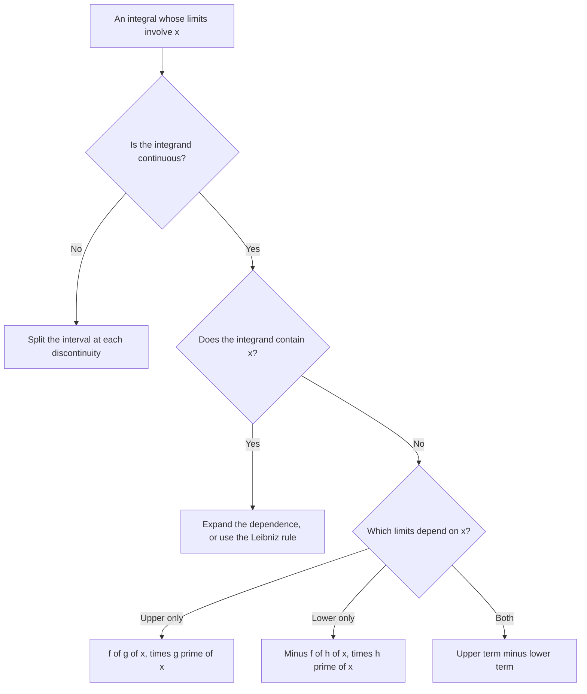

# The Fundamental Theorem of Calculus

> [Calculus](../README.md) · Level: Intermediate · Prerequisites: [Precalculus](../../06-precalculus/README.md), [Algebra](../../03-algebra/README.md), [Trigonometry](../../05-trigonometry/README.md), and calculus topics 1–6 in the [discipline index](../README.md) · Estimated time: 8 h

## 1. Introduction

Two questions dominate the first half of calculus. The **tangent question** asks for the slope of the
line tangent to a curve at a point — a *local*, instantaneous rate. The **area question** asks for the
area under a curve over an interval — a *global* total. They look unrelated.

The **Fundamental Theorem of Calculus** (FTC) says they are exact inverses. It has two parts.

* **Part 1 (the derivative of an integral).** With the *accumulation function*
  $F(x) = \int_a^x f(t)\,dt$, if $f$ is continuous then $F$ is differentiable and $F'(x) = f(x)$: the
  rate at which area accumulates is the height of the curve.
* **Part 2 (the integral of a derivative).** If $G$ is any antiderivative of $f$ on $[a,b]$, then
  $\int_a^b f(x)\,dx = G(b) - G(a)$: a total accumulation is a difference of two values of an
  antiderivative.

Part 1 is what makes Part 2 possible, because it guarantees that a continuous function *has* an
antiderivative, namely its own accumulation function. The logical order matters and is respected
below: Part 1 is proved first, and Part 2 is deduced from it with the Mean Value Theorem.

The geometric content was known to Isaac Barrow in the 1660s and became the engine of the calculus of
Newton and Leibniz in the 1670s and 1680s. The modern formulation, with continuity hypotheses and a
precise definition of the integral, is due to Cauchy (1823) and Riemann (1854): the theorem is older
than the definitions that make it rigorous.

**Why it matters.** Every computation of a total from a rate uses Part 2 — distance from speed, cost
from marginal cost, charge from current, probability from a density. Every function *defined* by an
integral and then differentiated uses Part 1 — the error function, the logarithm defined as an
integral, the cumulative distribution function. Without the pair, every integral would be a limit of
Riemann sums.

## 2. Prerequisites

**From algebra and precalculus**

* Expanding, factoring, and simplifying rational expressions, including polynomial division.
* Solving equations such as $x^2 = 3$ (two roots) and $x^3 = 3$ (one root).
* Function notation, composition, and the chain rule's bookkeeping:
  $\frac{d}{dx}F(g(x)) = F'(g(x))g'(x)$.
* Graphs of powers, exponentials, logarithms, sine and cosine, and the identity
  $\sin^2\theta + \cos^2\theta = 1$. See [Trigonometry](../../05-trigonometry/README.md).

**From the calculus topics that precede this one** (topics 1–6 of the [discipline index](../README.md))

* **Limits**: the $\varepsilon$–$\delta$ definition and limit laws. The proof of Part 1 is an
  $\varepsilon$–$\delta$ argument.
* **Continuity**: continuity at a point and on an interval; the **Extreme Value Theorem** (a continuous
  function on $[a,b]$ attains a maximum and a minimum) and the **Intermediate Value Theorem** (it takes
  every value between its endpoint values). Both are used in §7.2.
* **Derivatives and differentiation rules**, including the product rule and the chain rule.
* **The Mean Value Theorem**: if $g$ is continuous on $[a,b]$ and differentiable on $(a,b)$, there is
  $c \in (a,b)$ with $g(b)-g(a) = g'(c)(b-a)$. It is quoted precisely in §8.1 and used in §7.4, §7.6,
  §7.8.
* **The Riemann integral**: Riemann sums, linearity, additivity, monotonicity, and
  $\left|\int_a^b f\right| \le \int_a^b |f|$. These are recalled in §5.1 and used throughout.

## 3. Learning Objectives

After working through this tutorial you will be able to:

1. Define the accumulation function and prove that $F'(x) = f(x)$ when $f$ is continuous.
2. State both parts of the FTC with all hypotheses and reproduce their proofs.
3. Evaluate definite integrals using antiderivatives and explain why the constant cancels.
4. Distinguish $\int_a^b f$, a number, from $\int f(x)\,dx$, a family of functions.
5. State and prove the Mean Value Theorem for Integrals and compute average values.
6. Use the Net Change Theorem, and distinguish displacement from distance.
7. Differentiate integrals with variable limits, including $\frac{d}{dx}\int_{h(x)}^{g(x)} f$.
8. Recognise when the theorem does **not** apply: discontinuous integrands, improper integrals, and
   antiderivatives that are not defined on the whole interval.

## 4. Intuition

### 4.1 The odometer and the speedometer

A car's **speedometer** shows the speed $v(t)$; its **odometer** shows the distance $s(t)$. They carry
the same information.

* From the odometer to the speedometer: $v(t) = s'(t)$. This is differentiation.
* From the speedometer to the odometer: $s(T) - s(0) = \int_0^T v(t)\,dt$. This is integration.

Neither statement is surprising in these words. What needs proof is that both survive wild variation,
that "accumulated" is a limit of sums of infinitely many tiny contributions, and that the identities
are exact rather than approximate. The practical payoff is enormous: instead of measuring $v$
continuously and adding up $v(t)\Delta t$, you can read the odometer twice. **An antiderivative
replaces a limit of sums by two function evaluations.**

### 4.2 Why the area function has slope equal to the height

Let $F(x)$ be the signed area under $y = f(t)$ from $t = a$ to $t = x$. Increase $x$ by a small $h$:
the area grows by the sliver between $x$ and $x+h$. If $h$ is small and $f$ is continuous, the sliver
is nearly a rectangle of width $h$ and height $f(x)$, so

$$\frac{F(x+h) - F(x)}{h} \approx \frac{f(x)\,h}{h} = f(x).$$

Letting $h \to 0$ gives $F'(x) = f(x)$. Only a *jump* in $f$ inside the sliver can spoil this, because
then "the height" is ambiguous — and indeed the theorem fails there (§7.9). Continuity is exactly what
keeps the sliver rectangular in the limit.

### 4.3 Why the total is a difference of endpoint values

Read the same fact backwards. Suppose $G' = f$. The function $G(x) - G(a)$ starts at $0$ when $x = a$
and grows at rate $f$. But $\int_a^x f$ is the *unique* function that starts at $0$ at $x = a$ and
grows at rate $f$ (§7.6). Two functions with the same starting value and the same rate are equal, so
$\int_a^x f = G(x) - G(a)$; at $x = b$ this is Part 2. The constant of integration cancels in the
subtraction, which is why it is irrelevant in a definite integral.

## 5. Formal Definition

Everything rests on the Riemann integral, recalled in 5.1. The new definitions are 5.3–5.7.

### 5.1 The Riemann integral

Let $f$ be bounded on $[a,b]$ with $a < b$. A **partition** is a finite set
$P = \{x_0, x_1, \dots, x_n\}$ with $a = x_0 < x_1 < \dots < x_n = b$; the $k$-th subinterval is
$[x_{k-1}, x_k]$, its length is $\Delta x_k = x_k - x_{k-1}$, and the **mesh** is
$\lVert P\rVert = \max_k \Delta x_k$. A **tagged partition** chooses a tag $\xi_k \in [x_{k-1},x_k]$
for each $k$, and its **Riemann sum** is

$$S(P,f) = \sum_{k=1}^{n} f(\xi_k)\,\Delta x_k .$$

**Definition.** $f$ is **Riemann integrable** on $[a,b]$ if there is a real number $L$ such that for
every $\varepsilon > 0$ there is $\delta > 0$ with $|S(P,f) - L| < \varepsilon$ for every tagged
partition of mesh $< \delta$. The number $L$ is unique and is written

$$\int_a^b f(x)\,dx := L .$$

Two facts are quoted, not reproved: every continuous function on $[a,b]$ is Riemann integrable; and if
$f,g$ are integrable and $\alpha,\beta \in \mathbb{R}$, then $\alpha f + \beta g$ is integrable with
$\int_a^b(\alpha f + \beta g) = \alpha\int_a^b f + \beta\int_a^b g$, while $f \le g$ implies
$\int_a^b f \le \int_a^b g$ and in particular $\left|\int_a^b f\right| \le \int_a^b |f|$.

### 5.2 Conventions for degenerate and reversed intervals

For any $f$ and any $a$, set $\int_a^a f := 0$; for $a < b$, set
$\int_b^a f := -\int_a^b f$. With these conventions
$\int_a^b f + \int_b^c f = \int_a^c f$ holds for *all* orderings of $a,b,c$, and every result below
survives reversed limits with the sign carried along.

### 5.3 Continuity on a closed interval

$f$ is **continuous at $x_0$** if for every $\varepsilon > 0$ there is $\delta > 0$ such that
$|x - x_0| < \delta$ implies $|f(x) - f(x_0)| < \varepsilon$. It is **continuous on $[a,b]$** if it is
continuous at every point of $(a,b)$, right-continuous at $a$, and left-continuous at $b$. Such a
function attains a maximum $M$ and a minimum $m$ (Extreme Value Theorem) and takes every value between
$f(a)$ and $f(b)$ (Intermediate Value Theorem); both facts are used in §7.2.

### 5.4 The accumulation function

For $f$ Riemann integrable on $[a,b]$, the **accumulation function** with base point $a$ is

$$F(x) := \int_a^x f(t)\,dt, \qquad x \in [a,b].$$

The variable $t$ is a **dummy variable**, bound by the integral sign; $x$ is free and is the argument
of $F$. Using one letter for both, as in $\int_a^x f(x)\,dx$, is a common abuse that causes real
confusion in §7.8, and it is avoided here. The geometric reading is *signed* area: above the axis is
positive, below is negative, so $F$ is the geometric area only when $f \ge 0$.

### 5.5 Antiderivatives

Let $f$ be defined on an interval $I$ with more than one point. A function $F$ is an
**antiderivative** (or **primitive**) of $f$ on $I$ if $F'(x) = f(x)$ at every interior point of $I$;
if $I = [a,b]$, then $F$ must be continuous on $[a,b]$ and differentiable with $F'=f$ on $(a,b)$.

Two points matter. The requirement is on an **interval**: a function satisfying $F' = f$ on two
separate intervals is not an antiderivative on their union (§7.6). And antiderivatives are not unique:
if $F$ is one then so is $F + C$, and Theorem 8.6 says these are all of them on an interval.

### 5.6 Indefinite integrals

The symbol $\int f(x)\,dx$ denotes the **family of all antiderivatives** of $f$ on the interval under
discussion:

$$\int f(x)\,dx = F(x) + C, \qquad \text{where } F' = f .$$

It is a set of functions, not a number and not a single function. The same letter $C$ is used across a
computation by convention; on a disconnected domain the constants may differ (§7.6).

### 5.7 Average value and smoothness

For $f$ integrable on $[a,b]$ with $a<b$, the **average value** is
$f_{\mathrm{avg}} := \frac{1}{b-a}\int_a^b f(x)\,dx$. The factor $\frac{1}{b-a}$ is the length of the
interval; §7.2 shows that a continuous $f$ attains this value.

$F$ is **continuously differentiable** on $[a,b]$, written $F \in C^1([a,b])$, if $F$ is continuous on
$[a,b]$, differentiable on $(a,b)$, and $F'$ extends to a continuous function on $[a,b]$. This is
exactly the hypothesis under which the Net Change Theorem (§7.7) needs no further qualification.

## 6. Mathematical Notation

| Symbol | Read as | Meaning |
|---|---|---|
| $\int_a^b f(x)\,dx$ | the integral of $f$ from $a$ to $b$ | a real number: limit of Riemann sums, signed area |
| $\int f(x)\,dx$ | the indefinite integral of $f$ | the family $F + C$ of all antiderivatives |
| $F(x)\big\rvert_a^b$, $\left[F(x)\right]_a^b$ | $F$ evaluated from $a$ to $b$ | the number $F(b) - F(a)$ |
| $F'(x)$, $\dfrac{dF}{dx}$ | the derivative of $F$ | the rate of change of $F$ |
| $\dfrac{d}{dx}\displaystyle\int_a^x f(t)\,dt$ | $d$ by $dx$ of the integral | differentiate the accumulation function in its upper limit |
| $f_{\mathrm{avg}}$ | the average value of $f$ | $\frac{1}{b-a}\int_a^b f$ |
| $\Delta x_k$, $\lVert P\rVert$ | delta $x$ sub $k$; the mesh of $P$ | subinterval length; largest subinterval length |
| $\xi_k$ | xi sub $k$ | the tag (sample point) in the $k$-th subinterval |
| $C$ | the constant of integration | an arbitrary constant, constant on each interval of the domain |
| $C^1([a,b])$ | see one on the closed interval | continuously differentiable on $[a,b]$ |
| $\varepsilon, \delta$ | epsilon, delta | arbitrarily small positive numbers, as in §5.3 |

Read $\int_a^b f(x)\,dx$ aloud as "the integral from $a$ to $b$ of $f$ of $x$, $dx$". The $dx$ names
the variable of integration and records the infinitesimal width in the Riemann sum; writing
$\int_a^b f$ is acceptable shorthand when the variable is clear, and
$\frac{d}{dx}\int_a^x f(t)\,dt$ reads as "the derivative with respect to $x$ of the integral from $a$ to
$x$ of $f$ of $t$", where the dummy $t$ and the free $x$ are deliberately different.

## 7. Core Concepts

### 7.1 The accumulation function

Fix $f$ integrable on $[a,b]$ and let $F(x) = \int_a^x f(t)\,dt$.

**Lemma 7.1.1 (changing the base point).** For $a,c,x \in [a,b]$,
$\int_a^x f = \int_a^c f + \int_c^x f$. Hence, for two base points $a$ and $c$, the accumulation
functions $F(x) = \int_a^x f$ and $G(x) = \int_c^x f$ differ by the constant $\int_a^c f$.

*Proof.* Additivity of the integral, with the conventions of §5.2 that make it valid for every
ordering of $a,c,x$. $\blacksquare$

This is why *any* antiderivative may be used in a definite integral: changing the base point changes
$F$ by a constant, and constants cancel in a difference of values.

**Lemma 7.1.2 (the accumulation function is continuous).** If $|f(t)| \le M$ on $[a,b]$, then
$|F(y) - F(x)| \le M|y-x|$ for all $x,y \in [a,b]$.

*Proof.* For $x < y$, $F(y)-F(x) = \int_x^y f$, so
$|F(y)-F(x)| \le \int_x^y |f| \le M(y-x)$; the case $y<x$ is the same after swapping. $\blacksquare$

A function satisfying such an inequality is **Lipschitz** with constant $M$, hence continuous. So the
accumulation function of an integrable function is always continuous, however badly discontinuous $f$
itself is; only *differentiability* of $F$ needs continuity of $f$, and that is Part 1.

Also $F(a) = 0$; if $f \ge 0$ then $F$ is nondecreasing; and $F$ is *signed* accumulation, so for
$f(t) = \sin t$ and $a = 0$ we get $F(\pi) = 2$ but $F(2\pi) = 0$.

### 7.2 The Mean Value Theorem for integrals

The average of finitely many numbers lies between their smallest and largest values. The integral is a
limit of such averages, so the average value of a continuous function should also lie between $\min f$
and $\max f$ — and, since a continuous function has no gaps in its range, it should be attained.

**Theorem 7.2.1 (Mean Value Theorem for Integrals, first form).** Let $f$ be continuous on $[a,b]$ with
$a<b$. Then there is $c \in [a,b]$ with

$$\int_a^b f(x)\,dx = f(c)\,(b-a), \qquad \text{equivalently} \qquad f(c) = f_{\mathrm{avg}} .$$

*Proof.* By the Extreme Value Theorem, $f$ attains a minimum $m$ and a maximum $M$ on $[a,b]$, so
$m \le f \le M$ pointwise. Integrating the constants and using monotonicity,

$$m(b-a) = \int_a^b m \le \int_a^b f \le \int_a^b M = M(b-a), \qquad\text{hence}\qquad
m \le \mu := \frac{1}{b-a}\int_a^b f \le M .$$

If $\mu = m$ then $f \equiv m$: otherwise $f - m > 0$ somewhere, and continuity makes $f - m > \delta > 0$
on an interval of positive length, forcing $\int_a^b(f-m) > 0$; then any $c$ works. Likewise if $\mu = M$.
Otherwise $m < \mu < M$, and since $m$ and $M$ are values of $f$, the Intermediate Value
Theorem on the interval joining the points where they are attained gives $c$ with $f(c) = \mu$. Then
$\int_a^b f = \mu(b-a) = f(c)(b-a)$. $\blacksquare$

Geometrically: the signed area under the curve equals $b-a$ times some height the curve attains.

**Theorem 7.2.2 (second form).** Let $f$ be continuous on $[a,b]$ and $g$ integrable with $g \ge 0$
there. Then there is $c \in [a,b]$ with $\int_a^b fg = f(c)\int_a^b g$. The same holds for $g \le 0$.

*Proof.* With $m \le f \le M$ and $g \ge 0$ we have $mg \le fg \le Mg$; integrating gives
$m\int g \le \int fg \le M\int g$. If $\int g = 0$ then $\int fg = 0$ and any $c$ works; otherwise the
quotient $\int fg / \int g$ lies in $[m,M]$ and the Intermediate Value Theorem applies. For $g \le 0$
apply the result to $-g$. $\blacksquare$

Theorem 7.2.1 is the case $g \equiv 1$.

**Warning 7.2.3 (continuity cannot be dropped).** Let $f = 0$ on $[0,1)$ and $f = 1$ on $[1,2]$. Then
$\int_0^2 f = 1$, so $f_{\mathrm{avg}} = \frac12$, but no $c$ has $f(c) = \frac12$. Continuity is what
excludes jumps; it is not a technical decoration.

**Remark 7.2.4 (a second proof, and the order of the argument).** Once Part 1 is known, the ordinary
Mean Value Theorem applied to $F(x) = \int_a^x f$ gives $F(b)-F(a) = F'(c)(b-a) = f(c)(b-a)$. This is
shorter but uses Part 1, which is why Theorem 7.2.1 was proved above from the Extreme Value and
Intermediate Value Theorems alone. There is no circularity as long as the order is respected.

The point $c$ need not be unique or interior: for $f \equiv 1$ every $c$ works, and the theorem asserts
existence, not a procedure.

### 7.3 Part 1: the derivative of an integral

**Theorem 7.3.1 (Fundamental Theorem of Calculus, Part 1).** Let $f$ be continuous on $[a,b]$ and let
$F(x) = \int_a^x f(t)\,dt$. Then $F$ is differentiable on $(a,b)$ and $F'(x) = f(x)$ there; at the
endpoints the one-sided derivatives equal $f(a)$ and $f(b)$ respectively.

*Proof.* Fix $x \in (a,b)$ and let $h \ne 0$ with $x+h \in [a,b]$. By additivity,

$$F(x+h) - F(x) = \int_x^{x+h} f(t)\,dt, \qquad
\frac{F(x+h) - F(x)}{h} = \frac{1}{h}\int_x^{x+h} f(t)\,dt .$$

Write $f(x)$ as the average of the constant $f(x)$ over the same interval: since
$\int_x^{x+h} f(x)\,dt = f(x)h$ (an identity that keeps its sign when $h<0$),

$$\frac{F(x+h) - F(x)}{h} - f(x) = \frac{1}{h}\int_x^{x+h}\big(f(t) - f(x)\big)\,dt .$$

Let $\varepsilon > 0$. Continuity of $f$ at $x$ gives $\delta > 0$ such that $|t - x| < \delta$ implies
$|f(t) - f(x)| < \varepsilon$. Take $0 < |h| < \delta$; every $t$ between $x$ and $x+h$ satisfies
$|t-x| \le |h| < \delta$, so the integrand is bounded by $\varepsilon$ throughout. Using the triangle
inequality and monotonicity,

$$\left|\frac{F(x+h)-F(x)}{h} - f(x)\right|
\le \frac{1}{|h|}\left|\int_x^{x+h}\varepsilon\,dt\right| = \frac{\varepsilon|h|}{|h|} = \varepsilon .$$

Since $\varepsilon$ was arbitrary, the difference quotient tends to $f(x)$ as $h \to 0$, which is the
definition of $F'(x) = f(x)$. The endpoint statements are the same argument restricted to one-sided
$h$. $\blacksquare$

**Theorem 7.3.2 (the hypothesis is local).** If $f$ is Riemann integrable on $[a,b]$ and continuous at
$x_0 \in (a,b)$, then $F$ is differentiable at $x_0$ with $F'(x_0) = f(x_0)$.

*Proof.* The computation above uses continuity only at $x_0$: the estimate
$|f(t)-f(x_0)| < \varepsilon$ is needed only for $t$ between $x_0$ and $x_0+h$. $\blacksquare$

So the accumulation function differentiates back to the integrand *at every continuity point of the
integrand*. At a discontinuity the conclusion may fail, and it fails visibly: $F$ acquires a corner.

**Example 7.3.3 (a corner).** Let $f(t) = 0$ for $t<0$ and $f(t) = 1$ for $t \ge 0$, on $[-1,1]$. Then

$$F(x) = \int_{-1}^x f(t)\,dt = \begin{cases} 0, & -1 \le x \le 0,\\ x, & 0 < x \le 1.\end{cases}$$

The left derivative at $0$ is $0 = f(0^-)$ and the right derivative is $1 = f(0^+)$, so $F'(0)$ does not
exist: the formula $F' = f$ holds on $(-1,0)$ and $(0,1)$ and fails exactly at the jump.

**Remark 7.3.4 (existence of antiderivatives).** Theorem 7.3.1 is a genuine existence theorem: every
continuous function on an interval has an antiderivative. It does not produce a formula — most
continuous functions have no elementary antiderivative (see
[Techniques of Integration](../08-techniques-of-integration/README.md)) — but it guarantees that the
object Part 2 needs is always available.

### 7.4 Part 2: the integral of a derivative

**Theorem 7.4.1 (Fundamental Theorem of Calculus, Part 2).** Let $f$ be continuous on $[a,b]$ and let
$G$ be any antiderivative of $f$ on $[a,b]$. Then

$$\int_a^b f(x)\,dx = G(b) - G(a) = G(x)\Big|_a^b .$$

*Proof.* Let $F(x) = \int_a^x f(t)\,dt$; by Theorem 7.3.1, $F' = f$ on $(a,b)$, and by Lemma 7.1.2, $F$
is continuous on $[a,b]$. Put $H = G - F$. Then $H$ is continuous on $[a,b]$, differentiable on
$(a,b)$, and $H' = G' - F' = 0$ there. We show $H$ is constant: for any $u < v$ in $[a,b]$, the Mean
Value Theorem gives $c \in (u,v)$ with $H(v)-H(u) = H'(c)(v-u) = 0$, so $H(u) = H(v)$. Hence
$G(b) - F(b) = G(a) - F(a)$, and since $F(a) = \int_a^a f = 0$,

$$G(b) - \int_a^b f = G(a), \qquad\text{that is,}\qquad \int_a^b f = G(b) - G(a). \;\blacksquare$$

**Theorem 7.4.2 (Part 2 with a weaker hypothesis).** Let $f$ be Riemann integrable on $[a,b]$ and let
$G$ be continuous on $[a,b]$, differentiable on $(a,b)$, with $G' = f$ there. Then
$\int_a^b f = G(b) - G(a)$.

*Proof.* For any partition $P = \{x_0,\dots,x_n\}$, the Mean Value Theorem on $[x_{k-1},x_k]$ gives
$\xi_k \in (x_{k-1},x_k)$ with $G(x_k) - G(x_{k-1}) = f(\xi_k)\Delta x_k$. Summing and telescoping,

$$G(b) - G(a) = \sum_{k=1}^{n}\big(G(x_k) - G(x_{k-1})\big) = \sum_{k=1}^{n} f(\xi_k)\,\Delta x_k .$$

The right side is a Riemann sum for $f$, with tags chosen by the Mean Value Theorem. Since $f$ is
integrable, every tagged sum of small enough mesh is within $\varepsilon$ of $\int_a^b f$; letting the
mesh tend to zero gives $G(b)-G(a) = \int_a^b f$. $\blacksquare$

This proof also explains *why* the formula holds: the increment of $G$ over a tiny interval is the
derivative at some interior point times the width, which is precisely a Riemann sum.

**Remark 7.4.3 (which functions are derivatives?).** Not every integrable function has an
antiderivative. Derivatives have the intermediate value property (Darboux's theorem), so no derivative
can jump; the step function of Example 7.3.3 is integrable but is nobody's derivative. For such a
function the integral exists and Part 2 simply cannot be applied.

**Remark 7.4.4 (the constant is invisible).** If $G$ is an antiderivative then so is $G+C$, and
$(G+C)(b) - (G+C)(a) = G(b)-G(a)$. The constant cancels, so the definite integral is well defined even
though antiderivatives are determined only up to a constant.

### 7.5 Why differentiation and integration are inverse processes

**Theorem 7.5.1 (the two round trips).** For $a<b$:

1. if $f$ is continuous on $[a,b]$, then $\frac{d}{dx}\int_a^x f(t)\,dt = f(x)$ for $x \in (a,b)$;
2. if $F \in C^1([a,b])$, then $\int_a^x F'(t)\,dt = F(x) - F(a)$ for $x \in [a,b]$.

*Proof.* (1) is Theorem 7.3.1. (2) is Theorem 7.7.1, which is Theorem 7.4.1 applied to the continuous
function $F'$. $\blacksquare$

Part (1) returns the original function *exactly*; part (2) returns it *up to the constant $F(a)$*, which
is zero exactly when $F(a) = 0$. In the language of maps, let $\mathcal{C}([a,b])$ be the continuous
functions and let $\mathcal{Z}([a,b])$ be the $C^1$ functions with $F(a) = 0$. Then

$$T : \mathcal{C}([a,b]) \to \mathcal{Z}([a,b]), \qquad T(f)(x) = \int_a^x f(t)\,dt$$

is a bijection with inverse $D(F) = F'$. Injectivity: if $T(f) = 0$ then $f = (Tf)' = 0$ by Part 1.
Surjectivity: if $F \in \mathcal{Z}([a,b])$ then $T(F')(x) = F(x) - F(a) = F(x)$ by Part 2. So the FTC
is exactly the statement that *integration from a fixed base point and differentiation are mutually
inverse bijections between these two spaces*; everything else in the topic is a corollary, a
computation, or a warning about hypotheses.

### 7.6 Indefinite integrals and the constant of integration

**Theorem 7.6.1 (antiderivatives differ by a constant).** Let $F$ and $G$ be antiderivatives of $f$ on
an interval $I$. Then $G = F + C$ for some constant $C$.

*Proof.* $H = G - F$ satisfies $H' = 0$ on the interior of $I$. For $u<v$ in $I$, the Mean Value
Theorem gives $H(v)-H(u) = H'(c)(v-u) = 0$, so $H$ is constant. $\blacksquare$

The interval hypothesis is essential.

**Example 7.6.2 (a disconnected domain).** For $f(x) = 1/x$ on $\mathbb{R}\setminus\{0\}$, the function
$\ln|x|$ satisfies $\frac{d}{dx}\ln|x| = 1/x$ on each side of $0$ (for $x<0$,
$\frac{d}{dx}\ln(-x) = \frac{1}{-x}\cdot(-1) = \frac1x$). Hence

$$\int\frac{dx}{x} = \begin{cases}\ln x + C_1, & x>0,\\ \ln(-x) + C_2, & x<0,\end{cases}$$

with **independent** constants. The function equal to $\ln x$ for $x>0$ and $\ln(-x)+1$ for $x<0$ is an
antiderivative, and it is not $\ln|x| + C$ for a single $C$. A single constant is a statement about an
interval, and $\mathbb{R}\setminus\{0\}$ is not one.

**Theorem 7.6.3 (the general indefinite integral).** On an interval, if $F$ is one antiderivative of
$f$ then the antiderivatives are exactly $F + C$, $C \in \mathbb{R}$.

*Proof.* Every $F+C$ is an antiderivative since constants differentiate to $0$; conversely Theorem
7.6.1 gives the form. $\blacksquare$

**Table 7.6.4 (elementary antiderivatives).** Each line is proved by differentiating the right-hand
side; that verification should be performed at least once per line. Domains are intervals on which the
integrand is continuous.

| $f(x)$ | $\int f(x)\,dx$ | Check |
|---|---|---|
| $x^n$, $n \ne -1$ | $\dfrac{x^{n+1}}{n+1} + C$ | $(n+1)x^n/(n+1) = x^n$ |
| $1/x$ | $\ln\lvert x\rvert + C$ | $1/x$ on each side of $0$ |
| $e^x$ | $e^x + C$ | $e^x$ |
| $a^x$ | $\dfrac{a^x}{\ln a} + C$ | $a^x\ln a/\ln a = a^x$ |
| $\sin x$ | $-\cos x + C$ | $\sin x$ |
| $\cos x$ | $\sin x + C$ | $\cos x$ |
| $\sec^2 x$ | $\tan x + C$ | $\sec^2 x$ |
| $\sec x\tan x$ | $\sec x + C$ | $\sec x\tan x$ |
| $\csc^2 x$ | $-\cot x + C$ | $\csc^2 x$ |
| $\csc x\cot x$ | $-\csc x + C$ | $\csc x\cot x$ |
| $\dfrac{1}{1+x^2}$ | $\arctan x + C$ | $1/(1+x^2)$ |
| $\dfrac{1}{\sqrt{1-x^2}}$ | $\arcsin x + C$ | $1/\sqrt{1-x^2}$ |
| $\cosh x$ | $\sinh x + C$ | $\cosh x$ |
| $\sinh x$ | $\cosh x + C$ | $\sinh x$ |

**Initial value problems.** Theorem 7.6.3 turns an antiderivative into a one-parameter family, and one
extra condition selects a member: if $F' = f$ and $F(x_0) = y_0$, then $F(x) = y_0 + \int_{x_0}^x f$ by
Theorem 7.7.1. This is the simplest differential equation, and it shows that "general solution plus one
initial condition" is "indefinite integral plus one constant".

### 7.7 The Net Change Theorem

**Theorem 7.7.1 (Net Change Theorem).** If $F \in C^1([a,b])$, then
$\int_a^b F'(t)\,dt = F(b) - F(a)$.

*Proof.* $F'$ is continuous, hence integrable, and $F$ is an antiderivative of $F'$; apply Theorem
7.4.1 with $f = F'$ and $G = F$. $\blacksquare$

This is Part 2 read in the other direction: instead of integrating $f$ by finding an antiderivative, it
integrates a derivative and recovers a net change. Its content is a dictionary between rates and
totals:

| If $F(t)$ is … | then $F'(t)$ is … | and $\int_a^b F'$ is … |
|---|---|---|
| position | velocity | displacement |
| velocity | acceleration | change in velocity |
| population | growth rate | net population change |
| volume of water | flow rate | net volume added |
| cost | marginal cost | total additional cost |
| charge | current | net charge transferred |

Two warnings about *net*. First, a quantity that rises and falls back contributes zero. Second, the
**total variation** — the total of all increases, ignoring decreases — is $\int_a^b |F'|$, which is
generally larger. The displacement-versus-distance distinction of §9.7 is exactly this distinction.

### 7.8 Differentiating an integral with variable limits

**Theorem 7.8.1 (variable upper limit).** Let $f$ be continuous on an open interval $J$, and let $g$ be
differentiable with $g(x) \in J$. Then

$$\frac{d}{dx}\int_a^{g(x)} f(t)\,dt = f\big(g(x)\big)\,g'(x).$$

*Proof.* With $F(u) = \int_a^u f$, Theorem 7.3.1 gives $F' = f$, and the left side is $(F \circ g)'$;
the chain rule gives $F'(g(x))g'(x) = f(g(x))g'(x)$. $\blacksquare$

**Theorem 7.8.2 (both limits variable).** If $h$ is also differentiable, then

$$\frac{d}{dx}\int_{h(x)}^{g(x)} f(t)\,dt = f\big(g(x)\big)\,g'(x) - f\big(h(x)\big)\,h'(x).$$

*Proof.* Choose a constant $a \in J$ and split:
$\int_{h(x)}^{g(x)} f = \int_a^{g(x)} f - \int_a^{h(x)} f$; apply Theorem 7.8.1 to each term. $\blacksquare$

The lower limit enters with a **minus sign**, because increasing it *removes* area. This sign is the
most common error in the section (§11.2).

**Theorem 7.8.3 (integrand depending on the limit).** If $f$ and $\partial f/\partial x$ are continuous
on a rectangle, then the **Leibniz integral rule** holds:

$$\frac{d}{dx}\int_a^b f(x,t)\,dt = \int_a^b \frac{\partial f}{\partial x}(x,t)\,dt,
\qquad\text{and}\qquad
\frac{d}{dx}\int_a^x f(x,t)\,dt = f(x,x) + \int_a^x \frac{\partial f}{\partial x}(x,t)\,dt .$$

The second formula follows from the first on $[a,x]$ together with Part 1 applied to $f(x,\cdot)$. The
proof of the first uses the Mean Value Theorem in $x$ and uniform continuity of $\partial f/\partial x$
on the rectangle. When the dependence has the special form $f(x,t) = (x-t)^k\varphi(t)$, it is simpler
to expand and use Theorem 7.8.1 term by term (Exercise 15).

### 7.9 Where the theorem does not apply

**(a) A discontinuity in the integrand.** By Theorem 7.3.2, $F' = f$ at every continuity point of $f$.
At a jump, $F$ has a corner (Example 7.3.3). It is not enough that one-sided limits exist, nor that $f$
be continuous almost everywhere: split the interval at each discontinuity and apply the theorem on each
piece.

**(b) An "antiderivative" that is invalid at an interior point.** The integrand $1/(1+x^2)$ is
continuous everywhere, so

$$\int_{-1}^{1}\frac{dx}{1+x^2} = \left[\arctan x\right]_{-1}^{1} = \frac{\pi}{4} - \left(-\frac{\pi}{4}\right) = \frac{\pi}{2} .$$

The function $G(x) = \arctan(1/x)$ is defined only for $x \ne 0$, and for $x \ne 0$,
$G'(x) = \frac{1}{1+(1/x)^2}\cdot\left(-\frac{1}{x^2}\right) = -\frac{1}{1+x^2}$. Since $G$ is not
defined at $0$, it is **not** an antiderivative on $[-1,1]$ and Theorem 7.4.1 does not apply. Using it
blindly gives $G(1)-G(-1) = \frac{\pi}{4} + \frac{\pi}{4} = \frac{\pi}{2}$ — the right number by
accident, because the two jumps cancel. Take the antiderivative $-\arctan(1/x)$ instead and the error
appears: the formula gives $-\arctan 1 + \arctan(-1) = -\frac{\pi}{2}$, the negative of the true value.
**An antiderivative must be defined and continuous on all of $[a,b]$.**

**(c) A derivative that is not integrable.** The Net Change Theorem needs $F'$ integrable. Let
$F(x) = x^2\sin(1/x^2)$ for $x \ne 0$ and $F(0) = 0$. Then $F$ is differentiable everywhere and, for
$x \ne 0$,

$$F'(x) = 2x\sin\left(\frac{1}{x^2}\right) - \frac{2}{x}\cos\left(\frac{1}{x^2}\right),$$

which is unbounded near $0$. An unbounded function is not Riemann integrable, so $\int_0^1 F'$ does not
exist and cannot equal $F(1)-F(0)$. Even bounded derivatives can fail: Volterra (1881) constructed a
differentiable function whose derivative is bounded but discontinuous on a set of positive measure. The
Lebesgue theory repairs this: $\int_a^x F' = F(x)-F(a)$ holds precisely for **absolutely continuous**
$F$. In a first course, "$F \in C^1$" is the honest hypothesis that stays inside the Riemann theory.

**(d) An unbounded interval or integrand.** Definition 5.1 requires a bounded $f$ on a bounded $[a,b]$.
Integrals such as $\int_0^1 x^{-1/2}dx$ are **improper**, defined as limits:

$$\int_0^1 \frac{dx}{\sqrt{x}} := \lim_{\varepsilon\to 0^+}\int_\varepsilon^1 x^{-1/2}dx
= \lim_{\varepsilon\to 0^+}\left[2\sqrt{x}\right]_\varepsilon^1 = 2 .$$

Each step uses the ordinary theorem on $[\varepsilon,1]$, where the integrand is continuous; the FTC is
applied on smaller and smaller intervals and then a limit is taken, not applied once on $[0,1]$. The
same care is needed at an interior vertical asymptote.

**(e) The Mean Value Theorem without continuity.** Warning 7.2.3 gives a step function whose average
value is never attained. Any appeal to "the point where $f$ equals its average" needs continuity.

### 7.10 Average value and cumulative quantities

For $f$ integrable on $[a,b]$, $f_{\mathrm{avg}} = \frac{1}{b-a}\int_a^b f$, and a continuous $f$
attains it on $[a,b]$ by Theorem 7.2.1. Three readings are useful: it is the height of the rectangle
with the same signed area and the same base; it is the limit of arithmetic means of equally spaced
samples; and, if $F' = f$, it equals $\frac{F(b)-F(a)}{b-a}$, the average rate of change of $F$. The
third reading is the Mean Value Theorem's statement that some instant achieves the overall rate.

If $r(t)$ is the rate at which a quantity $Q$ changes, then $Q(b) - Q(a) = \int_a^b r$ by Theorem
7.7.1, and conversely $Q(x) = Q(a) + \int_a^x r$ has $Q' = r$ by Part 1. So "the total is the integral
of the rate" and "the rate is the derivative of the total" are the same statement, available in both
directions — which is why applied work uses the FTC twice: to build a cumulative model from a rate, and
to recover a rate from data on a total.

## 8. Formulas and Properties

Every result of the tutorial in one place, with exact hypotheses and a proof reference. Nothing here is
new; the numbering is for reference from the exercises.

### 8.1 The Mean Value Theorem (quoted)

If $g$ is continuous on $[a,b]$ and differentiable on $(a,b)$, there is $c \in (a,b)$ with
$g(b)-g(a) = g'(c)(b-a)$. Proved in the calculus topic on applications of derivatives, from Rolle's
theorem and the Extreme Value Theorem; quoted here and used in §7.4 and §7.6. Geometrically: some
tangent is parallel to the chord.

### 8.2 Part 1

If $f$ is continuous on $[a,b]$ and $F(x) = \int_a^x f(t)\,dt$, then $F$ is differentiable on $(a,b)$
with $F'(x) = f(x)$, and the one-sided derivatives at the endpoints are $f(a)$ and $f(b)$. *Why:*
$F(x+h)-F(x)$ is the area of a sliver of width $h$ whose height is within $\varepsilon$ of $f(x)$.
Proof: §7.3.

**Sharper form.** If $f$ is Riemann integrable and continuous at $x_0 \in (a,b)$, then
$F'(x_0) = f(x_0)$. Proof: §7.3.

### 8.3 Part 2

If $f$ is continuous on $[a,b]$ and $G$ is an antiderivative of $f$ on $[a,b]$, then
$\int_a^b f(x)\,dx = G(b)-G(a)$. *Why:* the accumulation function and $G$ have the same derivative, so
they differ by a constant (8.6), and $F(a) = 0$ fixes it. Proof: §7.4.

**Sharper form.** It suffices that $f$ be Riemann integrable and possess an antiderivative on $[a,b]$;
the proof tags each subinterval using the Mean Value Theorem, making $G(b)-G(a)$ a Riemann sum. Proof:
§7.4.

### 8.4 Mean Value Theorem for Integrals

**First form.** If $f$ is continuous on $[a,b]$, $a<b$, there is $c \in [a,b]$ with
$\int_a^b f = f(c)(b-a)$. *Why:* the average lies between the minimum and the maximum, and a continuous
function attains every intermediate value. Proof: §7.2.

**Second form.** If $f$ is continuous and $g$ is integrable with $g \ge 0$ on $[a,b]$, there is
$c \in [a,b]$ with $\int_a^b fg = f(c)\int_a^b g$; the same holds for $g \le 0$. Proof: §7.2.

**Failure without continuity.** $f = \mathbf{1}_{[1,2]}$ on $[0,2]$ has average $\frac12$, which $f$
never attains.

### 8.5 Net Change Theorem

If $F \in C^1([a,b])$ then $\int_a^b F'(t)\,dt = F(b)-F(a)$, equivalently
$F(b) = F(a) + \int_a^b F'$: final value equals initial value plus accumulated rate. *Why:* apply 8.3
to the continuous function $F'$, whose antiderivative is $F$. Proof: §7.7.

**Total variation.** The total of increases and decreases without cancellation is $\int_a^b |F'|$, which
is $\ge \left|\int_a^b F'\right|$, with equality exactly when $F'$ does not change sign.

### 8.6 Antiderivatives differ by a constant

On an **interval**, any two antiderivatives of $f$ differ by a constant. *Why:* their difference has
zero derivative, and such a function is constant by the Mean Value Theorem. Proof: §7.6. The interval
hypothesis is essential: on $\mathbb{R}\setminus\{0\}$ the antiderivatives of $1/x$ carry two
independent constants.

### 8.7 Differentiation of integrals with variable limits

$$\frac{d}{dx}\int_a^{g(x)} f(t)\,dt = f(g(x))g'(x), \qquad
\frac{d}{dx}\int_{h(x)}^{g(x)} f(t)\,dt = f(g(x))g'(x) - f(h(x))h'(x).$$

*Why:* compose the accumulation function with $g$ and use the chain rule; for two limits, split the
integral at a constant and subtract. Proof: §7.8. The lower limit contributes with a minus sign.

**Leibniz's rule.** If $f$ and $\partial f/\partial x$ are continuous on a rectangle, then
$\frac{d}{dx}\int_a^b f(x,t)\,dt = \int_a^b \frac{\partial f}{\partial x}(x,t)\,dt$ and
$\frac{d}{dx}\int_a^x f(x,t)\,dt = f(x,x) + \int_a^x \frac{\partial f}{\partial x}(x,t)\,dt$. See §7.8.

### 8.8 Linearity and additivity

For integrable $f,g$ and constants $\alpha,\beta$,
$\int_a^b(\alpha f + \beta g) = \alpha\int_a^b f + \beta\int_a^b g$ and
$\int_a^b f + \int_b^c f = \int_a^c f$. *Why:* the identities hold for finite Riemann sums and pass to
limits. These make the integral a linear functional and an additive set function, and every computation
in §9 uses them.

### 8.9 Monotonicity, the basic estimate, and the triangle inequality

If $f \le g$ on $[a,b]$ then $\int_a^b f \le \int_a^b g$. If $m \le f \le M$ on $[a,b]$ then

$$m(b-a) \le \int_a^b f \le M(b-a), \qquad
\left|\int_a^b f\right| \le \int_a^b|f| \le M(b-a).$$

*Why:* each Riemann sum satisfies the same inequality and limits preserve non-strict inequalities. The
first estimate drives Theorem 7.2.1; the last drives Theorem 7.3.1.

### 8.10 Continuity of the accumulation function

If $|f| \le M$ on $[a,b]$ then $|F(y)-F(x)| \le M|y-x|$, so $F$ is Lipschitz and hence continuous.
*Why:* $F(y)-F(x) = \int_x^y f$ is bounded by $M$ times the length. Proof: §7.1.

### 8.11 The two round trips

$$\frac{d}{dx}\int_a^x f(t)\,dt = f(x)\ (f \text{ continuous}), \qquad
\int_a^x F'(t)\,dt = F(x)-F(a)\ (F \in C^1).$$

*Why:* 8.2 and 8.5. Together they say that $T(f)(x) = \int_a^x f$ is a bijection from continuous
functions to $C^1$ functions vanishing at $a$, with inverse $F \mapsto F'$ (§7.5).

### 8.12 Hypothesis checklist

| Statement | Needs | Fails without it |
|---|---|---|
| $F' = f$ | $f$ continuous at the point | corner at a jump (Example 7.3.3) |
| $\int_a^b f = G(b)-G(a)$ | $G$ an antiderivative on all of $[a,b]$ | §7.9(b) |
| $\int_a^b F' = F(b)-F(a)$ | $F \in C^1([a,b])$ | §7.9(c) |
| $f(c) = f_{\mathrm{avg}}$ for some $c$ | $f$ continuous on $[a,b]$ | Warning 7.2.3 |
| $\int_a^b f$ exists | $f$ bounded and integrable, $[a,b]$ bounded | improper integrals, §7.9(d) |
| antiderivatives differ by a constant | the domain is an interval | Example 7.6.2 |

## 9. Step-by-Step Examples

Every evaluation is checked by differentiating the antiderivative; the check is not decoration, it is
the only reliable way to know the antiderivative is right.

### 9.1 A polynomial, with the check

Evaluate $\displaystyle\int_1^2\left(6x^2 - 4x + 1\right)dx$.

*Step 1: antiderivative.* By linearity and the power rule,
$G(x) = 2x^3 - 2x^2 + x$.

*Step 2: check.* $G'(x) = 6x^2 - 4x + 1$, the integrand. ✓

*Step 3: endpoints.* $G(2) = 16 - 8 + 2 = 10$ and $G(1) = 2 - 2 + 1 = 1$, so the integral is
$10 - 1 = 9$.

*Step 4: sanity check.* On $[1,2]$ the integrand rises from $3$ to $17$, so the integral lies between
$3$ and $17$; $9$ does. ✓

### 9.2 The simplest differentiation, and the irrelevance of the base point

Let $F(x) = \int_1^x \frac{t^2+1}{t^4+3}\,dt$. The denominator is at least $3$, so the integrand is
continuous on $\mathbb{R}$ and Part 1 gives

$$F'(x) = \frac{x^2+1}{x^4+3}, \qquad F'(1) = \frac{2}{4} = \frac12 .$$

The lower limit does not appear. Changing it to $0$ changes $F$ by the constant
$\int_0^1\frac{t^2+1}{t^4+3}dt$ (Lemma 7.1.1) and leaves $F'$ unchanged. **Only the variable limit
differentiates.**

### 9.3 The chain rule in the upper limit

Differentiate $F(x) = \int_0^{x^2}\sqrt{1+t^3}\,dt$.

*Step 1: composition.* Let $G(u) = \int_0^u\sqrt{1+t^3}\,dt$, so $F(x) = G(x^2)$.

*Step 2: outer derivative.* The integrand is continuous on $[-1,\infty)$ and $x^2 \ge 0$, so
$G'(u) = \sqrt{1+u^3}$.

*Step 3: chain rule.*
$F'(x) = G'(x^2)\cdot 2x = 2x\sqrt{1+(x^2)^3} = 2x\sqrt{1+x^6}$.

*Step 4: numerical check.* At $x=1$ this is $2\sqrt2 \approx 2.828$; for small $h$ the integral from
$0$ to $(1+h)^2 \approx 1+2h$ is about $\sqrt2\cdot 2h$, so the quotient is about $2\sqrt2$. ✓

The error to avoid is writing $\sqrt{1+x^3}$ and losing the factor $2x$: the upper limit is $x^2$, and
the derivative of the limit is part of the answer (§11.1).

### 9.4 Both limits variable

Differentiate $F(x) = \int_{\sin x}^{x^2} e^{-t^2}dt$. Split at $0$:

$$F(x) = \int_0^{x^2} e^{-t^2}dt - \int_0^{\sin x} e^{-t^2}dt .$$

The integrand is continuous everywhere, so

$$F'(x) = 2x\,e^{-x^4} - \cos x\,e^{-\sin^2 x} .$$

Check the signs: at $x=0$ the answer is $0 - 1 = -1$, which is plausible because near $0$ the interval
$[\sin x, x^2]$ runs from about $x$ down to $0$, of length $-x$, over which the integrand is about $1$,
giving $F(x) \approx -x$.

### 9.5 Analysing a function defined by an integral

Let $F(x) = \int_0^x \frac{t^2-1}{t^2+1}\,dt$. Find the intervals of increase and decrease, the local
extrema, and the concavity.

*Step 1: derivative.* The integrand is continuous on $\mathbb{R}$, so $F'(x) = \frac{x^2-1}{x^2+1}$.

*Step 2: sign.* The denominator is positive, so the sign of $F'$ is the sign of $(x-1)(x+1)$.

| Interval | $F'$ | behaviour |
|---|---|---|
| $(-\infty,-1)$ | $+$ | increasing |
| $(-1,1)$ | $-$ | decreasing |
| $(1,\infty)$ | $+$ | increasing |

*Step 3: extrema.* $F$ turns from increasing to decreasing at $x=-1$ (local maximum) and from
decreasing to increasing at $x=1$ (local minimum).

*Step 4: values.* Since $\frac{t^2-1}{t^2+1} = 1 - \frac{2}{t^2+1}$, an antiderivative is
$x - 2\arctan x$, so $F(-1) = -1 + \frac{\pi}{2} \approx 0.5708$ and
$F(1) = 1 - \frac{\pi}{2} \approx -0.5708$.

*Step 5: concavity.* By the quotient rule,
$F''(x) = \frac{2x(x^2+1) - (x^2-1)2x}{(x^2+1)^2} = \frac{4x}{(x^2+1)^2}$, so $F$ is concave down for
$x<0$, concave up for $x>0$, with an inflection point at $0$.

### 9.6 The Mean Value Theorem for integrals, twice

**(a)** For $f(x) = x^2$ on $[0,3]$:
$f_{\mathrm{avg}} = \frac13\int_0^3 x^2dx = \frac13\cdot 9 = 3$. Solving $c^2 = 3$ with $c \in [0,3]$
gives $c = \sqrt3 \approx 1.732$; the negative root is rejected because of the interval.

**(b)** For $f(x) = 1/x$ on $[1,e]$:
$f_{\mathrm{avg}} = \frac{1}{e-1}\int_1^e\frac{dx}{x} = \frac{1}{e-1}$. Solving $1/c = 1/(e-1)$ gives
$c = e-1 \approx 1.718 \in [1,e]$. ✓ The point is neither the midpoint nor the maximum point; it is the
point where the height equals the average height.

### 9.7 Displacement versus distance travelled

A particle has velocity $v(t) = t^2 - 4t + 3$ m/s on $0 \le t \le 4$. Find the displacement and the
distance travelled.

*Step 1: sign of $v$.* $v(t) = (t-1)(t-3)$, so $v>0$ on $[0,1)$, $v<0$ on $(1,3)$, $v>0$ on $(3,4]$.

*Step 2: displacement.* With $s(t) = \frac{t^3}{3} - 2t^2 + 3t$,

$$\int_0^4 v(t)\,dt = s(4)-s(0) = \left(\frac{64}{3} - 32 + 12\right) - 0 = \frac{4}{3} \text{ m} .$$

*Step 3: break at the sign changes.* $s(0) = 0$, $s(1) = \frac43$, $s(3) = 0$, $s(4) = \frac43$.

| Interval | $v$ | distance |
|---|---|---|
| $[0,1]$ | $+$ | $s(1)-s(0) = \frac43$ |
| $[1,3]$ | $-$ | $s(1)-s(3) = \frac43$ |
| $[3,4]$ | $+$ | $s(4)-s(3) = \frac43$ |

*Step 4: total distance.* $\frac43 + \frac43 + \frac43 = 4$ m, that is, $\int_0^4|v| = 4$.

Displacement $\frac43$ m, distance $4$ m: the particle ends $1.33$ m from the start but travelled $4$ m.
**Displacement integrates velocity; distance integrates speed.**

### 9.8 Net change from a marginal cost

A factory has marginal cost $C'(x) = 0.6x + 2$ dollars per unit. Find the extra cost of raising
production from $0$ to $10$ units, and the average marginal cost.

*Step 1: Net Change Theorem.* $C$ is continuously differentiable with $C' = 0.6x+2$, so

$$C(10) - C(0) = \int_0^{10}(0.6x+2)\,dx = \left[0.3x^2 + 2x\right]_0^{10} = 30 + 20 = 50 .$$

The extra cost is $\$50$; only the *change* in cost is determined, which is why the constant of
integration is irrelevant here.

*Step 2: average.* $\frac{1}{10}\int_0^{10}(0.6x+2)dx = 5$ dollars per unit.

*Step 3: interpretation.* By Theorem 7.2.1 some level $c \in [0,10]$ has marginal cost $5$; indeed
$0.6c+2 = 5$ gives $c = 5$. At that level the cost of one more unit equals the average cost of the ten.

## 10. Visual Explanations

### 10.1 The two round trips

The theorem is best remembered as a pair of inverse operations between two function spaces.

Composing in either order returns the identity: differentiating an integral gives back $f$ exactly
(Part 1); integrating a derivative gives back $F$ minus its value at $a$, which is $F$ itself when
$F(a) = 0$ (Part 2).

### 10.2 Deciding how to differentiate an integral

### 10.3 The two parts compared

| | Part 1 | Part 2 |
|---|---|---|
| Statement | $\frac{d}{dx}\int_a^x f = f(x)$ | $\int_a^b f = G(b)-G(a)$ |
| Object | a function defined by an integral | an antiderivative of the integrand |
| Hypothesis | $f$ continuous, or continuous at the point | $f$ continuous and $G$ an antiderivative on $[a,b]$ |
| Conclusion | a function identity | a numerical identity |
| Typical use | analyse $F$, differentiate a model | compute a definite integral |
| Fails when | $f$ jumps at the point | no antiderivative on the whole interval, or $f$ not integrable |

**Signed versus geometric area.** For sign-changing $f$,
$\int_a^b f = (\text{area above}) - (\text{area below})$ while
$\int_a^b|f| = (\text{area above}) + (\text{area below})$; the two agree exactly when $f$ has constant
sign.

## 11. Common Mistakes

1. **Forgetting the chain factor in the upper limit.** $\frac{d}{dx}\int_0^{x^2}f(t)dt = 2x\,f(x^2)$,
   not $f(x^2)$. The upper limit is a function of $x$; differentiate it and multiply.

2. **Losing the sign of the lower limit.** For $\int_{h(x)}^{g(x)}f$ the lower term is
   $-f(h(x))h'(x)$. Check with $g = h$: the integral is identically $0$ and the formula cancels.

3. **Differentiating across a discontinuity.** If $f$ jumps at $x_0$, then $F$ has a corner and
   $F'(x_0)$ does not exist (Example 7.3.3). Split the interval; "continuous except at one point" is
   not a licence to differentiate through that point.

4. **Confusing the two parts.** $\int_a^b f = f(b)-f(a)$ confuses the integrand with its
   antiderivative. Check with $f \equiv 1$ on $[0,5]$: the integral is $5$, while $f(5)-f(0) = 0$.

5. **Omitting the constant of integration.** $\int 2x\,dx = x^2 + C$. The constant makes the answer a
   family and allows initial conditions to be met; it cancels in a definite integral only because of
   the subtraction.

6. **Using one constant on a disconnected domain.** $\int\frac{dx}{x} = \ln|x| + C$ with a single $C$
   is wrong on $\mathbb{R}\setminus\{0\}$ (Example 7.6.2).

7. **Treating an indefinite integral as a number.** $\int f(x)dx$ is a family of functions;
   $\int_a^b f$ is a number. Expressions such as $\left[\int f\right]_a^b$ are meaningless.

8. **Assuming continuity gives a formula.** Continuous functions always have an antiderivative
   (Theorem 7.3.1), but not always an elementary one: $\int e^{-x^2}dx$ is not elementary. See
   [Techniques of Integration](../08-techniques-of-integration/README.md).

9. **Believing the mean value point is the midpoint.** $c$ solves $f(c) = f_{\mathrm{avg}}$ and is
   usually not $\frac{a+b}{2}$, nor unique (§9.6). The average of $f(x)=x^2$ on $[0,1]$ is $\frac13$,
   not $\frac{f(0)+f(1)}{2} = \frac12$.

10. **Using an antiderivative with an interior singularity.** A formula undefined at a point of $[a,b]$
    is not an antiderivative there, however correct its derivative is elsewhere; §7.9(b) produces a
    sign error this way. Split the integral instead of substituting across the singularity.

11. **Dropping the absolute value in $\ln|x|$.** On an interval where $x<0$,
    $\int\frac{dx}{x} = \ln(-x)+C$, and $\ln x$ is undefined.

12. **Confusing displacement with distance.** $\int_a^b v$ is displacement and $\int_a^b|v|$ is
    distance; they agree only when $v$ has constant sign (§9.7). The same distinction separates net
    change from total variation.

## 12. Applications

**Motion.** With position $s$, velocity $v = s'$ and acceleration $a = v'$, we have
$s(b)-s(a) = \int_a^b v$ and $v(b)-v(a) = \int_a^b a$. Multiplying the second by the mass gives
$mv(b)-mv(a) = \int_a^b F$, the impulse–momentum relation. Distance is $\int|v|$.

**Work and energy.** A force $F(x)$ along a line does work $W = \int_a^b F(x)\,dx$. For a spring with
$F = -kx$, the work against it is $\int_0^d kx\,dx = \frac12kd^2$, the elastic potential energy. In
power form, $P = dW/dt$ is a Net Change Theorem statement.

**Cumulative engineering quantities.** Charge is the integral of current, volume delivered is the
integral of flow rate, and the mass of a rod is the integral of linear density. Each model has two
equivalent forms — differentiate the total to get the rate, integrate the rate to get the total — and
the FTC converts between them.

**Economics.** Total cost is the integral of marginal cost, total revenue the integral of marginal
revenue, and consumer surplus is an integral of demand price minus market price. The average cost per
unit is the average value of the marginal cost, equal at some level to the marginal cost itself
(§9.8).

**Probability and statistics.** For a continuous random variable with density $f_X$, the cumulative
distribution function is $F_X(x) = \int_{-\infty}^x f_X(t)\,dt$, and Part 1 gives $F_X' = f_X$ at every
continuity point. Interval probabilities are $\int_a^b f_X$ and the mean is
$\int_{-\infty}^{\infty} t f_X(t)\,dt$. See [Probability](../../10-probability/README.md).

**Differential equations.** The solution of $y' = r(t)$, $y(0) = y_0$ is
$y(t) = y_0 + \int_0^t r(s)\,ds$: the FTC is the existence theorem for the simplest differential
equation and the model for integrating factors. See
[Differential Equations](../../16-differential-equations/README.md).

**Numerical work and data.** When a rate is known only from measurements, the integral is approximated
by a Riemann sum or a quadrature rule, and the mean value theorems of §7.2 relate the sum of samples to
the integral. Physics engines and renderers do the same in real time: each update is a discrete version
of $F(b)-F(a) = \int_a^b f$, and the stability of a simulation depends on its accuracy. See
[Numerical Analysis](../../19-numerical-analysis/README.md).

## 13. Exercises

The problem set is in [exercises.md](exercises.md): **36 problems** in four levels — **Beginner** (12:
direct evaluation, simple differentiation, basic averages), **Intermediate** (12: chain rule in the
limits, analysis of accumulation functions, mean value theorem, displacement), **Advanced** (8: proofs
and integral identities) and **Challenge** (4: uniqueness, failure of hypotheses, periodic functions, a
construction). Each problem cites the section it draws on; numbering runs continuously from 1 to 36.

## 14. Solutions

Full worked solutions are in [solutions.md](solutions.md), with the same numbering. Every integral is
checked by differentiation, every proof is complete, and the traps built into the problems are flagged.

## 15. Summary

* The **accumulation function** $F(x) = \int_a^x f(t)\,dt$ is always continuous (Lipschitz when $f$ is
  bounded), and $F(a) = 0$.
* **Part 1:** if $f$ is continuous on $[a,b]$, then $F' = f$ on $(a,b)$; at the endpoints the one-sided
  derivatives equal the one-sided values of $f$.
* **Part 2:** if $f$ is continuous and $G$ is an antiderivative on $[a,b]$, then
  $\int_a^b f = G(b)-G(a)$.
* The two parts say **differentiation and integration are inverse processes**, and they exhibit the
  bijection $T(f)(x) = \int_a^x f$ with inverse $F \mapsto F'$.
* **Antiderivatives differ by a constant on an interval**; the indefinite integral is a family $F+C$,
  and the constant cancels in a definite integral.
* The **Mean Value Theorem for integrals** says a continuous function attains its average:
  $\int_a^b f = f(c)(b-a)$ for some $c \in [a,b]$.
* The **Net Change Theorem** says $\int_a^b F' = F(b)-F(a)$; displacement is $\int v$, distance is
  $\int|v|$.
* For **variable limits**, multiply each limit's derivative by the integrand at that limit, with a plus
  sign for the upper limit and a minus sign for the lower.
* The theorem needs **continuity of the integrand** and an **antiderivative defined on the whole
  interval**; otherwise split the interval or treat the integral as improper. Continuity guarantees
  that an antiderivative **exists**, not that it has an elementary formula.

## 16. Further Learning

* [Techniques of Integration](../08-techniques-of-integration/README.md) — finding the antiderivatives
  Part 2 requires: substitution, parts, trigonometric methods, partial fractions, numerical quadrature,
  and the limits of elementary integration.
* [Calculus](../README.md) — the discipline index and the surrounding topics.
* [Differential Equations](../../16-differential-equations/README.md) — the FTC as the existence
  theorem for $y' = f(t)$ and the start of first-order theory.
* [Real Analysis](../../14-real-analysis/README.md) — the Riemann integral constructed rigorously, the
  fundamental theorem under Lebesgue's hypotheses, and absolute continuity.
* [Numerical Analysis](../../19-numerical-analysis/README.md) — quadrature rules and their error terms.

**Standard references.** Michael Spivak, *Calculus*, 4th ed., Chapters 13–14 and 19–20 (the most careful
elementary treatment). Tom M. Apostol, *Calculus, Volume I*, 2nd ed., Chapters 1–2 and 5. Walter Rudin,
*Principles of Mathematical Analysis*, 3rd ed., Chapter 6. James Stewart, *Calculus: Early
Transcendentals*, 8th ed., Chapter 5. Terence Tao, *Analysis I*, 3rd ed., Chapters 11–14.
