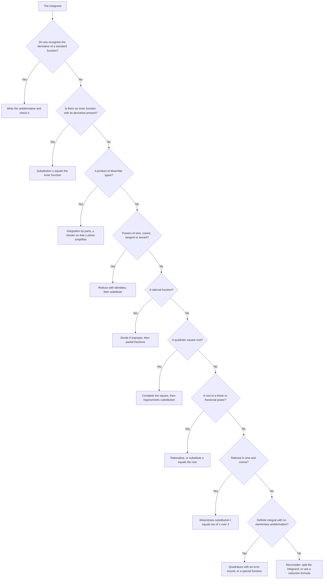

# Techniques of Integration

> [Calculus](../README.md) · Level: Advanced · Prerequisites: [The Fundamental Theorem of Calculus](../07-fundamental-theorem-of-calculus/README.md), [Trigonometry](../../05-trigonometry/README.md), [Algebra](../../03-algebra/README.md), and calculus topics 1–6 in the [discipline index](../README.md) · Estimated time: 12 h

## 1. Introduction

The Fundamental Theorem of Calculus reduces the evaluation of $\int_a^b f$ to a search: find an
antiderivative $F$ with $F' = f$, then subtract. Differentiation is a mechanical procedure — a finite
list of rules applied to a formula. **Integration is not.** There is no chain rule for integrals, no
product rule, no quotient rule. There is a small collection of transformations that turn one integral
into another, and the art of integration is choosing the transformation that leads to an integral you
already know.

This topic is that collection, organised as a decision procedure rather than a list.

* **Substitution** reverses the chain rule (§7.1).
* **Integration by parts** reverses the product rule (§7.2).
* **Trigonometric identities and substitutions** convert products of trigonometric functions, and
  expressions involving $\sqrt{a^2-x^2}$, into polynomials or into known forms (§7.3, §7.4).
* **Partial fractions** reduces any rational function to a sum of terms that can be integrated (§7.5).
* **Rationalising substitutions** removes square roots (§7.6).
* **Numerical integration** computes a definite integral when no formula is available, with an error
  term that says how good the answer is (§7.7).

The last section is the honest one: **most elementary functions have no elementary antiderivative**.
$e^{-x^2}$, $\sin x/x$, $1/\ln x$ and $\sqrt{1+x^3}$ are perfectly continuous, yet none of their
integrals can be written with the standard functions. Liouville proved this in the 1830s; the Risch
algorithm decides the question mechanically for a large class. Recognising the boundary is part of
knowing the subject: a practitioner who knows that $\int e^{-x^2}dx$ is not elementary stops searching
and computes a definite integral numerically, or names the special function.

Two habits make the whole topic tractable. First, **differentiate every answer**: an antiderivative is
correct precisely when its derivative is the integrand, and the check takes a line. Second, **look at the
integrand before choosing a method**: the form of the integrand — a product, a composite, a rational
function, a square root — dictates the method far more reliably than any slogan.

## 2. Prerequisites

**From algebra**

* Expanding and factoring polynomials; the difference of squares and the sum and difference of cubes.
* Polynomial long division, and the statement that a real polynomial factors into linear and irreducible
  quadratic factors.
* Solving small linear systems, and the method of partial fractions at the level of *algebra* (writing a
  rational expression as a sum of simpler ones) — this topic develops the integration side.
* Completing the square.

**From trigonometry** ([Trigonometry](../../05-trigonometry/README.md))

* The Pythagorean identity, the double-angle formulas
  $\sin^2x = \frac{1-\cos 2x}{2}$, $\cos^2x = \frac{1+\cos 2x}{2}$, $\sin 2x = 2\sin x\cos x$, and the
  product-to-sum formulas.
* The derivatives of $\sin,\cos,\tan,\sec$, and the ranges of $\arcsin$, $\arctan$ and $\operatorname{arcsec}$.

**From calculus** (topics 1–6 of the [discipline index](../README.md), and
[The Fundamental Theorem of Calculus](../07-fundamental-theorem-of-calculus/README.md))

* The chain rule and the product rule, in both directions.
* The FTC in both parts, and the fact that every continuous function has an antiderivative.
* The Mean Value Theorem and the Mean Value Theorem for integrals (used in the error analysis of §7.7).
* Riemann sums and the definition of the definite integral.

## 3. Learning Objectives

After working through this tutorial you will be able to:

1. Prove the substitution rule from the chain rule and apply it to indefinite and definite integrals,
   including the change of limits.
2. Derive integration by parts from the product rule and use it, including repeated and cyclic cases,
   while recognising LIATE as a heuristic.
3. Integrate products of powers of sine and cosine, and of tangent and secant, by the standard reductions.
4. Use the three trigonometric substitutions with their domain restrictions, and convert back with a
   triangle.
5. Decompose any rational function into partial fractions in all four cases, and integrate each term.
6. Remove square roots with rationalising substitutions, including the Weierstrass substitution.
7. Apply the trapezoid and Simpson rules with their error terms, and bound the error of an approximation.
8. State precisely what it means for an antiderivative to be non-elementary, and name the standard
   examples and the special functions that replace them.

## 4. Intuition

**Differentiation is a machine; integration is a search.** Give the machine $x^2\sin(3x+e^x)$ and it
produces a derivative in a few lines, however ugly. Give the reverse problem — find $F$ with
$F'(x) = x^2\sin(3x+e^x)$ — and no finite set of rules applies. Every technique in this topic is a way of
*rewriting* the problem until it matches something in a short table.

**Substitution is a change of units.** If $u = x^2+1$, the conversion factor between $dx$ and $du$ is the
derivative $2x$. The formula $\int f(u)\,du = \int f(u(x))u'(x)\,dx$ says that an integral is a sum of
$f \times$ (small change), and small changes convert by the chain rule: the integral is the same number
written in different coordinates.

**Parts is a transfer of difficulty.** The product rule says $(uv)' = u'v + uv'$, so $uv' = (uv)' - u'v$.
Integrating, $\int uv' = uv - \int u'v$: the derivative has moved from $v$ to $u$. Choose $u$ so that
differentiating it makes it simpler (a logarithm becomes a reciprocal; a polynomial loses a degree), and
$v$ so that integrating it is possible. The whole method is one sentence: *move the derivative onto the
part that improves when differentiated.*

**Trigonometric substitution is a Pythagorean change of variable.** The identity
$\cos^2\theta = 1-\sin^2\theta$ turns $a^2 - a^2\sin^2\theta$ into $a^2\cos^2\theta$, and the square root
disappears. The restrictions on $\theta$ are not pedantry: they are what make the square root equal
$a\cos\theta$ rather than $a|\cos\theta|$, and what make the substitution invertible.

**Partial fractions is the reverse of putting over a common denominator.** Everyone can add
$\frac{3}{x-1} - \frac{2x}{x^2+1}$; partial fractions asks for the sum given the result. Each term then
integrates to a logarithm or an arctangent, so every rational function can be integrated.

**Numerical integration is sampling.** If $f$ is known only at a few points, approximate the area by
trapezoids (straight lines between samples) or by parabola arcs (Simpson). Trapezoid error shrinks like
$n^{-2}$ and Simpson error like $n^{-4}$, which is why Simpson with eight intervals often beats the
trapezoid with a thousand.

## 5. Formal Definition

### 5.1 Elementary functions

The **elementary functions** are those obtained from the constants, the identity function $x$, and the
functions $e^x$, $\ln x$, $\sin x$, $\cos x$, $\arcsin x$, $\arctan x$ by finitely many operations of
addition, multiplication, division, and composition. Equivalently, one may start from the constants and
$x$ and allow $+,-,\times,\div$, roots, exponentials, logarithms, and trigonometric and inverse
trigonometric functions. Polynomials, rational functions, $\sqrt{1+x^3}$, $\tan x$ and
$\ln(\sec x+\tan x)$ are elementary.

An elementary function is **continuous on an interval** when it is defined there; the functions in this
topic are continuous on the intervals on which the integrals are taken, and discontinuities are handled
by splitting the interval.

### 5.2 Elementary antiderivatives

Let $f$ be defined on an interval $I$. An **elementary antiderivative** of $f$ on $I$ is an elementary
function $F$ with $F'(x) = f(x)$ for all interior $x \in I$. If no such $F$ exists, $f$ has **no
elementary antiderivative**; this is a theorem about a class of functions, not a statement about the
ingenuity of the integrator (§7.8). By the FTC, every continuous $f$ has *some* antiderivative — the
accumulation function — so the question is never existence, only expressibility.

### 5.3 Substitution

Let $\varphi$ be continuously differentiable on $[a,b]$ and let $f$ be continuous on an interval
containing $\varphi([a,b])$. The **substitution rule** is the pair of identities

$$\int f\big(\varphi(x)\big)\,\varphi'(x)\,dx = \int f(u)\,du\Big|_{u=\varphi(x)}, \qquad
\int_a^b f\big(\varphi(x)\big)\varphi'(x)\,dx = \int_{\varphi(a)}^{\varphi(b)} f(u)\,du .$$

The first is read "substitute $u = \varphi(x)$, $du = \varphi'(x)dx$"; the second changes the limits from
$x$-values to $u$-values. Theorem 7.1.1 proves both from the chain rule.

### 5.4 Integration by parts

For continuously differentiable $u,v$ on an interval,

$$\int u(x)\,v'(x)\,dx = u(x)v(x) - \int u'(x)\,v(x)\,dx, \qquad
\int_a^b u\,v'\,dx = \Big[u\,v\Big]_a^b - \int_a^b u'\,v\,dx .$$

Theorem 7.2.1 derives this from the product rule. In the differential notation $du = u'\,dx$,
$dv = v'\,dx$, the identity reads $\int u\,dv = uv - \int v\,du$.

### 5.5 Rational functions and partial fractions

A **rational function** is a quotient $R = P/Q$ of polynomials. It is **proper** if
$\deg P < \deg Q$ and **improper** otherwise. Every improper rational function is the sum of a polynomial
and a proper rational function, by polynomial division.

**Theorem (partial fraction decomposition).** Let $P/Q$ be proper with real coefficients, and factor
$Q$ over $\mathbb{R}$ as

$$Q(x) = c\,(x-r_1)^{m_1}\cdots(x-r_s)^{m_s}\,(x^2+p_1x+q_1)^{n_1}\cdots(x^2+p_tx+q_t)^{n_t},$$

where the $r_i$ are the distinct real roots, the quadratics are distinct and irreducible
($p_j^2 - 4q_j < 0$), and $c \ne 0$. Then $P/Q$ is a sum of the following **partial fractions**.

* For each simple real root $r_i$ ($m_i = 1$): a term $\dfrac{A}{x-r_i}$.
* For each repeated real root $r_i$ with $m_i \ge 2$: terms $\dfrac{A_1}{x-r_i} + \cdots + \dfrac{A_{m_i}}{(x-r_i)^{m_i}}$.
* For each simple irreducible quadratic: a term $\dfrac{Bx+C}{x^2+p_jx+q_j}$.
* For each repeated irreducible quadratic with $n_j \ge 2$: terms
  $\dfrac{B_1x+C_1}{x^2+p_jx+q_j} + \cdots + \dfrac{B_{n_j}x+C_{n_j}}{(x^2+p_jx+q_j)^{n_j}}$.

The constants are uniquely determined; §7.5 shows how to compute them efficiently.

### 5.6 Quadrature rules

Let $f$ be defined on $[a,b]$, let $n \ge 1$, put $h = (b-a)/n$ and $x_k = a + kh$ for
$k = 0,1,\dots,n$.

The **composite trapezoid rule** is
$$T_n = h\left[\frac{f(x_0)}{2} + f(x_1) + \cdots + f(x_{n-1}) + \frac{f(x_n)}{2}\right],$$
and, if $n$ is even, the **composite Simpson rule** is
$$S_n = \frac{h}{3}\left[f(x_0) + 4f(x_1) + 2f(x_2) + 4f(x_3) + \cdots + 4f(x_{n-1}) + f(x_n)\right],$$
with the coefficient pattern $1,4,2,4,2,\dots,4,1$.

Both approximate $\int_a^b f$; their error terms are stated precisely in §7.7.

### 5.7 The Weierstrass substitution

For $t = \tan(x/2)$, defined when $x$ is not an odd multiple of $\pi$,

$$\sin x = \frac{2t}{1+t^2}, \qquad \cos x = \frac{1-t^2}{1+t^2}, \qquad dx = \frac{2\,dt}{1+t^2} .$$

These identities follow from the double-angle formulas and $\sec^2(x/2) = 1+t^2$; they turn any rational
function of $\sin x$ and $\cos x$ into a rational function of $t$ (§7.6).

## 6. Mathematical Notation

| Symbol | Read as | Meaning |
|---|---|---|
| $\int f(x)\,dx$ | the indefinite integral of $f$ | the family $F+C$ of antiderivatives |
| $\int_a^b f(x)\,dx$ | the definite integral | a number |
| $u = \varphi(x)$, $du = \varphi'(x)\,dx$ | the substitution | new variable and its differential |
| $\int u\,dv = uv - \int v\,du$ | integration by parts | the product rule integrated |
| $R(x) = P(x)/Q(x)$ | a rational function | quotient of polynomials |
| $\dfrac{A}{x-r}$, $\dfrac{Bx+C}{x^2+px+q}$ | partial fractions | the building blocks of §7.5 |
| $T_n$, $S_n$ | the $n$-interval trapezoid and Simpson approximations | quadrature sums of §5.6 |
| $E_T$, $E_S$ | the quadrature errors | $\int_a^b f - T_n$ and $\int_a^b f - S_n$ |
| $\operatorname{erf}$, $\operatorname{Si}$, $\operatorname{li}$ | the error function, sine integral, logarithmic integral | special functions defined by non-elementary integrals |
| $t = \tan(x/2)$ | the Weierstrass substitution | rational parametrisation of the circle |
| $\operatorname{arcsec} x$ | arc secant | the inverse of $\sec$ on $[0,\pi/2)\cup[\pi/2,\pi)$ |
| $\lvert x\rvert$ | absolute value | needed in $\ln\lvert x\rvert$ and in $\sqrt{x^2} = \lvert x\rvert$ |

Read $\int u\,dv$ as "the integral of $u$ dee $v$", and $\int_a^b f(\varphi(x))\varphi'(x)dx$ as "the
integral from $a$ to $b$ of $f$ of phi of $x$, phi prime of $x$, dee $x$".

## 7. Core Concepts

### 7.1 Substitution: reversing the chain rule

**Theorem 7.1.1 (substitution).** Let $\varphi$ be continuously differentiable on $[a,b]$ and let $f$ be
continuous on an interval containing $\varphi([a,b])$. Then

$$\int_a^b f\big(\varphi(x)\big)\varphi'(x)\,dx = \int_{\varphi(a)}^{\varphi(b)} f(u)\,du .$$

For indefinite integrals, with $F' = f$,
$\int f(\varphi(x))\varphi'(x)dx = F(\varphi(x)) + C$.

*Proof.* Since $f$ is continuous, it has an antiderivative $F$ (FTC, Part 1). By the chain rule,

$$\frac{d}{dx}F\big(\varphi(x)\big) = F'\big(\varphi(x)\big)\varphi'(x) = f\big(\varphi(x)\big)\varphi'(x),$$

so $x \mapsto F(\varphi(x))$ is an antiderivative of the integrand on the left. Therefore, by FTC Part 2,

$$\int_a^b f(\varphi(x))\varphi'(x)\,dx = F\big(\varphi(b)\big) - F\big(\varphi(a)\big).$$

On the other hand, $F$ is an antiderivative of $f$, so FTC Part 2 applied to $f$ on the interval between
$\varphi(a)$ and $\varphi(b)$ gives $\int_{\varphi(a)}^{\varphi(b)}f(u)\,du = F(\varphi(b))-F(\varphi(a))$.
The two numbers are equal. $\blacksquare$

Three consequences deserve emphasis.

* **The derivative must be present.** The integrand must contain $\varphi'(x)dx$ as a factor. In
  $\int 2x\cos(x^2)dx$ the factor $2x$ is exactly the derivative of $x^2$; in $\int \cos(x^2)dx$ it is
  absent, and the substitution is useless.
* **The limits change with the variable.** In a definite integral, either change the limits to
  $u$-values (and never return to $x$), or find an antiderivative in $x$ and evaluate at the original
  limits. Mixing the two — changing the limits and then substituting back — is the commonest error in
  the topic.
* **$\varphi$ need not be injective.** The formula is valid for any $C^1$ map: if $\varphi$ runs forward
  and back, the integral counts the signed contributions, which is precisely what the right-hand side
  does.

**How to choose $u$.** In order of reliability:

1. the inside of a composite function whose derivative (up to a constant) multiplies the integrand;
2. a denominator, or a power of a denominator;
3. an exponent, or the argument of a logarithm;
4. a square root (then $u^2$ is the radicand);
5. after completing the square, the shifted variable.

**Standard substitutions.** $u = ax+b$; $u = \sqrt{ax+b}$; $u = x^n$; $u = \ln x$ (with $dx/x$ present);
$u = e^x$; $u = \sin x$ or $\cos x$; $u = \tan(x/2)$ (§7.6).

### 7.2 Integration by parts: reversing the product rule

**Theorem 7.2.1 (integration by parts).** If $u,v$ are continuously differentiable on $[a,b]$, then

$$\int_a^b u(x)v'(x)\,dx = u(b)v(b) - u(a)v(a) - \int_a^b u'(x)v(x)\,dx .$$

*Proof.* The product rule gives $(uv)' = u'v + uv'$, hence $uv' = (uv)' - u'v$. Both sides are
continuous, so both are integrable, and integrating gives

$$\int_a^b uv' = \Big[uv\Big]_a^b - \int_a^b u'v,$$

which is the statement. $\blacksquare$

**The LIATE heuristic.** Choose $u$ to be the first type that occurs in the list

$$\textbf{L}\text{ogarithmic},\quad \textbf{I}\text{nverse trigonometric},\quad \textbf{A}\text{lgebraic},\quad
\textbf{T}\text{rigonometric},\quad \textbf{E}\text{xponential},$$

and $dv$ to be everything else. The rationale is that differentiating a logarithm or an inverse
trigonometric function turns it into an algebraic function, while integrating an exponential or a sine
costs nothing. For $\int x^2\ln x\,dx$ take $u = \ln x$; for $\int x e^x dx$ take $u = x$; for
$\int \arctan x\,dx$ take $u = \arctan x$ and $dv = dx$.

**LIATE is a heuristic, not a theorem.** It is a summary of what usually works, and it can fail in both
directions.

* Sometimes the "wrong" choice also works, and the "right" one is harder.
* Sometimes no choice in the list helps: $\int x^3e^{x^2}dx$ suggests $u = x^3$, but
  $v = \int e^{x^2}dx$ is not elementary; substituting $w = x^2$ first is the correct move.
* Sometimes the choice is forced by something outside the list: for $\int \sec^3x\,dx$ one takes
  $u = \sec x$, $dv = \sec^2x\,dx$, and the integral returns to itself.

The only reliable criterion is this: **choose $u$ so that $u'$ is simpler than $u$, and $v$ so that $v$
is no worse than $dv$; then check that $\int v\,du$ is easier than the integral you started with.**

**Repeated parts and the tabular method.** For $\int x^n e^{ax}dx$ or $\int x^n\sin ax\,dx$, apply parts
$n$ times, differentiating the polynomial each time. The bookkeeping is mechanical: list the successive
derivatives of $u$ with alternating signs and the successive antiderivatives of $dv$, then multiply
diagonally and add. For $\int x^2e^x dx$ the table gives

$$\int x^2e^x dx = x^2e^x - 2xe^x + 2e^x + C = e^x\left(x^2-2x+2\right) + C,$$

which is verified by differentiating: $e^x(x^2-2x+2) + e^x(2x-2) = x^2e^x$. ✓

**Cyclic integrals.** Sometimes parts returns the original integral with a coefficient, and the equation
can be solved. For $I = \int e^x\cos x\,dx$, taking $u = e^x$, $dv = \cos x\,dx$ gives
$I = e^x\sin x - \int e^x\sin x\,dx$; applying parts again to the second integral gives
$\int e^x\sin x\,dx = -e^x\cos x + I$. Substituting,

$$I = e^x\sin x + e^x\cos x - I, \qquad\text{so}\qquad I = \frac{e^x(\sin x+\cos x)}{2} + C,$$

which differentiates back to $e^x\cos x$. ✓

### 7.3 Trigonometric integrals

**Products of powers of sine and cosine.** For $\int\sin^m x\cos^n x\,dx$ with $m,n$ non-negative
integers:

* if $n$ is odd, save one factor of $\cos x$ for $du$ and convert the remaining even power with
  $\cos^2x = 1-\sin^2x$, then substitute $u = \sin x$;
* if $m$ is odd, save one factor of $\sin x$ and substitute $u = \cos x$;
* if both are even, use the power-reduction identities
  $$\sin^2x = \frac{1-\cos 2x}{2}, \qquad \cos^2x = \frac{1+\cos 2x}{2}, \qquad \sin x\cos x = \frac{\sin 2x}{2},$$
  repeatedly until only first powers remain.

**Products of different frequencies.** The product-to-sum identities turn products into sums:

$$\sin A\cos B = \frac{\sin(A+B)+\sin(A-B)}{2}, \quad
\sin A\sin B = \frac{\cos(A-B)-\cos(A+B)}{2}, \quad
\cos A\cos B = \frac{\cos(A-B)+\cos(A+B)}{2}.$$

**Powers of tangent and secant.** For $\int\tan^m x\sec^n x\,dx$:

* if $n$ is even and $n \ge 2$, save $\sec^2x\,dx$ and convert the rest with $\sec^2x = 1+\tan^2x$, then
  substitute $u = \tan x$;
* if $m$ is odd, save $\sec x\tan x\,dx$ and convert the remaining even power of $\tan$ with
  $\tan^2x = \sec^2x-1$, then substitute $u = \sec x$;
* if $m$ is even and $n$ is odd, rewrite everything in powers of $\sec x$ and use the reduction formula
  for $\int\sec^n x\,dx$ (§8.4).

**The two integrals that need parts.** Multiplying $\sec x$ by $(\sec x+\tan x)/(\sec x+\tan x)$ and
substituting $u = \sec x+\tan x$ gives

$$\int\sec x\,dx = \ln\left|\sec x+\tan x\right| + C .$$

For $\int\sec^3x\,dx$, parts with $u = \sec x$, $dv = \sec^2x\,dx$ gives
$\int\sec^3 = \sec x\tan x - \int\sec x\tan^2x\,dx = \sec x\tan x - \int\sec^3 + \int\sec x$, so

$$\int\sec^3x\,dx = \frac12\left(\sec x\tan x + \ln\left|\sec x+\tan x\right|\right) + C .$$

### 7.4 Trigonometric substitution

The three substitutions remove the three quadratic square roots. In each case the restriction on $\theta$
is chosen so that **(i)** the map $\theta \mapsto x$ is a bijection onto the required $x$-domain, so the
substitution can be inverted, and **(ii)** the trigonometric function appearing in the square root has a
known sign, so $|{\cdot}|$ can be dropped.

| Root | Substitution | Range of $\theta$ | Root becomes |
|---|---|---|---|
| $\sqrt{a^2-x^2}$ | $x = a\sin\theta$ | $-\frac{\pi}{2}\le\theta\le\frac{\pi}{2}$ | $a\cos\theta$ |
| $\sqrt{a^2+x^2}$ | $x = a\tan\theta$ | $-\frac{\pi}{2}<\theta<\frac{\pi}{2}$ | $a\sec\theta$ |
| $\sqrt{x^2-a^2}$ | $x = a\sec\theta$ | $0\le\theta<\frac{\pi}{2}$ (for $x\ge a$) | $a\tan\theta$ |

*Why the ranges.* On $[-\pi/2,\pi/2]$ the sine increases from $-1$ to $1$, so $x = a\sin\theta$ runs over
$[-a,a]$ exactly once; and $\cos\theta \ge 0$ there, so
$\sqrt{a^2-x^2} = \sqrt{a^2\cos^2\theta} = a|\cos\theta| = a\cos\theta$. On $(-\pi/2,\pi/2)$ the tangent
runs over all of $\mathbb{R}$ and $\sec\theta>0$; on $[0,\pi/2)$ the secant runs over $[1,\infty)$ and
$\tan\theta\ge0$. Any other range would make the inverse ambiguous or the sign wrong.

*After integrating.* Convert back with a right triangle: label the sides so that the substitution is read
off, compute the third side by Pythagoras, and read off the required functions; or use identities, e.g.
$\sin\theta = x/a$ implies $\cos\theta = \sqrt{a^2-x^2}/a$.

*Completing the square first.* A root $\sqrt{ax^2+bx+c}$ with $a \ne 0$ is first written as
$\sqrt{a\left((x+\frac{b}{2a})^2 + \frac{4ac-b^2}{4a^2}\right)}$, which is one of the three forms in a
shifted variable.

### 7.5 Partial fractions

The method has two stages: an algebraic decomposition, then term-by-term integration.

**Stage 0: make it proper.** If $\deg P \ge \deg Q$, divide: $P = SQ + R$ with $\deg R<\deg Q$, so
$P/Q = S + R/Q$. The polynomial $S$ integrates directly.

**Stage 1: factor the denominator** over $\mathbb{R}$ into distinct linear factors $(x-r)^m$ and
distinct irreducible quadratics $(x^2+px+q)^n$.

**Stage 2: write the form of the decomposition** as in §5.5, with unknown constants. The number of
unknowns equals $\deg Q$, which is a useful check.

**Stage 3: determine the constants.** Three tools, in order of efficiency.

* *Cover-up for a simple linear factor.* If $Q(x) = (x-r)S(x)$ with $S(r)\ne0$, then multiplying by
  $x-r$ and setting $x = r$ gives $A = P(r)/S(r)$.
* *Substitution of convenient $x$-values.* Multiply the identity by $Q(x)$; the result is a polynomial
  identity, so any value of $x$ may be substituted.
* *Comparing coefficients.* Multiply out and equate the coefficients of each power of $x$; this always
  works and produces a linear system.

For a repeated factor $(x-r)^m$, the coefficient of $(x-r)^{-m}$ is obtained by multiplying by
$(x-r)^m$ and setting $x=r$; the remaining coefficients are found by subtracting that term and
repeating, or by differentiating the multiplied identity $m-1$ times at $x=r$ (the "derivative trick"):
if $Q = (x-r)^mS$ with $S(r)\ne0$ and $H(x) = P(x)/S(x)$, then the expansion
$H(x) = A_m + A_{m-1}(x-r) + \cdots$ has $A_{m-k} = H^{(k)}(r)/k!$.

**Stage 4: integrate each term.** Four antiderivatives cover every case:

$$\int\frac{A\,dx}{x-r} = A\ln|x-r|, \qquad
\int\frac{A\,dx}{(x-r)^k} = \frac{A}{(1-k)(x-r)^{k-1}} \ (k\ge2),$$

and, completing the square $x^2+px+q = \left(x+\frac p2\right)^2 + c^2$ with $c^2 = q - \frac{p^2}{4}>0$,

$$\int\frac{Bx+C}{x^2+px+q}\,dx = \frac{B}{2}\ln\left(x^2+px+q\right)
+ \frac{C-\frac{Bp}{2}}{c}\arctan\frac{x+\frac p2}{c} .$$

The first step in the quadratic case is always the same: split the numerator into a multiple of the
derivative $2x+p$ of the denominator plus a constant. Repeated quadratics need the reduction formula of
§8.4 or a substitution $u = x+\frac p2$ followed by a reduction in $u$.

### 7.6 Rationalising substitutions

A **rationalising substitution** turns an integrand containing roots of the variable into a rational
function, to which §7.5 applies.

* **$\sqrt{ax+b}$.** Put $u = \sqrt{ax+b}$, so $x = (u^2-b)/a$ and $dx = (2u/a)\,du$.
* **$\sqrt{x}$ (or $x^{1/n}$).** Put $u = x^{1/n}$, so $x = u^n$ and $dx = nu^{n-1}du$.
* **$\sqrt{x^2+a}$.** The **Euler substitution** $u = x+\sqrt{x^2+a}$ gives
  $x = \dfrac{u^2-a}{2u}$, $dx = \dfrac{u^2+a}{2u^2}du$ and $\sqrt{x^2+a} = \dfrac{u^2+a}{2u}$.
* **Rational functions of $\sin x$ and $\cos x$.** The **Weierstrass substitution** $t = \tan(x/2)$ of
  §5.7 gives a rational function of $t$. It is undefined where $x$ is an odd multiple of $\pi$; on an
  interval avoiding those points it is valid, and the resulting antiderivative usually extends by
  continuity across them.

The Weierstrass identities are worth deriving once. From $t = \tan(x/2)$,
$\sin x = 2\sin(x/2)\cos(x/2) = \frac{2t}{1+t^2}$ and
$\cos x = \cos^2(x/2)-\sin^2(x/2) = \frac{1-t^2}{1+t^2}$, dividing numerator and denominator by
$\cos^2(x/2)$; and $dx = \frac{2\,dt}{1+t^2}$ because $x = 2\arctan t$.

### 7.7 Numerical integration

When no elementary antiderivative exists, or when $f$ is known only at sample points, the definite
integral is approximated. The two rules of §5.6 come with error terms that make the approximation
honest.

**Theorem 7.7.1 (trapezoid error).** Let $f \in C^2([a,b])$, $n\ge1$, $h = (b-a)/n$. Then there is
$\xi \in (a,b)$ with

$$\int_a^b f(x)\,dx - T_n = -\frac{(b-a)^3}{12n^2}\,f''(\xi) = -\frac{(b-a)h^2}{12}f''(\xi).$$

*Derivation.* On one panel $[x_{k-1},x_k]$ the linear interpolant $p_1$ satisfies
$f(x)-p_1(x) = \frac{f''(\eta_x)}{2}(x-x_{k-1})(x-x_k)$ for some $\eta_x$ in the panel (the
interpolation error formula), and $\int_{x_{k-1}}^{x_k}(x-x_{k-1})(x-x_k)dx = -h^3/6$. By the Mean Value
Theorem for integrals, since $(x-x_{k-1})(x-x_k)\le0$ on the panel,

$$\int_{x_{k-1}}^{x_k}\left(f-p_1\right)dx = -\frac{h^3}{12}f''(\xi_k)$$

for some $\xi_k$. Summing over the $n$ panels and applying the Mean Value Theorem to the average of the
values $f''(\xi_k)$ (using continuity of $f''$) gives a single $\xi$ and the stated formula. $\blacksquare$

**Theorem 7.7.2 (Simpson error).** Let $f \in C^4([a,b])$ and let $n$ be even. Then there is
$\xi \in (a,b)$ with

$$\int_a^b f(x)\,dx - S_n = -\frac{(b-a)^5}{180n^4}\,f^{(4)}(\xi).$$

*Why the fourth power.* Simpson integrates the parabola through three consecutive nodes, and a parabola
reproduces cubics exactly. The first term that a parabola cannot capture is the quartic, whose
contribution is of order $h^5$ per double panel; summing $n/2$ panels gives order $h^4$. The constant
$1/180$ is the result of integrating the Hermite interpolation error over one double panel.

**Simpson is exact for cubics.** On a double panel $[-h,h]$ the rule is
$\frac{h}{3}\left[f(-h)+4f(0)+f(h)\right]$. For $f = 1$ it gives $2h = \int_{-h}^{h}1$; for $f = x$ it
gives $0 = \int_{-h}^{h}x$; for $f = x^2$ it gives $\frac{h}{3}(2h^2) = \frac{2h^3}{3} = \int_{-h}^{h}x^2$;
for $f = x^3$ it gives $0 = \int_{-h}^{h}x^3$. Both sides are linear in $f$, and $1,x,x^2,x^3$ span the
cubics, so the rule is exact for every cubic. $\blacksquare$

**Remarks.** The error formulas require the stated smoothness; they do not apply to integrands with an
interior singularity, where the integral is improper and the convergence is usually algebraic rather than
$n^{-2}$ or $n^{-4}$. The **midpoint rule** has error $+\frac{(b-a)^3}{24n^2}f''(\xi)$, half the
trapezoid error with the opposite sign. The signs matter when extrapolating (Romberg integration uses
them), but for a bound only the absolute value is needed.

### 7.8 When no elementary antiderivative exists

Every continuous function has an antiderivative, but most do not have an **elementary** one. The
standard examples are worth memorising, because recognising them saves hours:

$$\int e^{-x^2}dx, \qquad \int\frac{\sin x}{x}dx, \qquad \int\frac{dx}{\ln x}, \qquad
\int\sqrt{1+x^3}\,dx, \qquad \int\frac{e^x}{x}dx .$$

None of these can be written with finitely many constants, powers, roots, exponentials, logarithms and
trigonometric functions composed in any way.

**Liouville's theorem (1835).** Liouville gave a criterion that decides the question for large classes of
integrands. One useful form: if $f$ and $g$ are elementary and $g$ is non-constant, then
$\int f(x)e^{g(x)}dx$ is elementary if and only if there is an elementary $h$ with
$h' + g'h = f$. Applying this with $g = -x^2$ and $f = 1$ shows that $\int e^{-x^2}dx$ is not
elementary. A related theorem of Chebyshev settles $\int x^p(1+x)^q dx$: it is elementary exactly in the
three cases $p\in\mathbb{Z}$, $q\in\mathbb{Z}$, or $p+q\in\mathbb{Z}$. The Risch algorithm (1969)
turns the criterion into a decision procedure for a large class of elementary integrands, and it is what
computer algebra systems use before giving up.

**The definite integral is a different question.** A function may have no elementary antiderivative while
its definite integral has a closed value. Two celebrated examples:

$$\int_{-\infty}^{\infty}e^{-x^2}dx = \sqrt{\pi}, \qquad \int_0^{\infty}\frac{\sin x}{x}\,dx = \frac{\pi}{2}.$$

The first is computed by squaring the integral and using polar coordinates, the second by contour
integration or by differentiating a parameter integral. Neither computation produces an elementary
antiderivative; both produce a number.

**Special functions.** When an integral cannot be evaluated elementarily, it is often *named*: the
**error function** $\operatorname{erf}(x) = \frac{2}{\sqrt\pi}\int_0^x e^{-t^2}dt$, the **sine and cosine
integrals** $\operatorname{Si}(x) = \int_0^x\frac{\sin t}{t}dt$ and
$\operatorname{Ci}(x) = -\int_x^\infty\frac{\cos t}{t}dt$, the **logarithmic integral**
$\operatorname{li}(x) = \int_0^x\frac{dt}{\ln t}$ of the prime number theorem, and the **exponential
integral** $\operatorname{Ei}(x) = -\int_{-x}^{\infty}\frac{e^{-t}}{t}dt$. These are not evasions: they
are well-studied functions with their own series, asymptotics and tables, as legitimate as $\sin$ or
$\ln$. What matters is to know which integrals are elementary, which are not, and how to get a reliable
number when the answer must be numeric (§7.7).

## 8. Formulas and Properties

Every formula used in the tutorial, with its hypotheses. Every antiderivative line is verified by
differentiating the right-hand side; that verification is the proof, and it should be done once per
line.

### 8.1 Substitution

If $\varphi \in C^1([a,b])$ and $f$ is continuous on an interval containing $\varphi([a,b])$:

$$\int f(\varphi(x))\varphi'(x)\,dx = F(\varphi(x)) + C \ (F'=f), \qquad
\int_a^b f(\varphi(x))\varphi'(x)\,dx = \int_{\varphi(a)}^{\varphi(b)}f(u)\,du .$$

*Why:* the chain rule applied to $F\circ\varphi$, then FTC Part 2. Proof: §7.1.

### 8.2 Integration by parts

If $u,v \in C^1([a,b])$:

$$\int u\,dv = uv - \int v\,du, \qquad
\int_a^b u\,v'\,dx = \Big[uv\Big]_a^b - \int_a^b u'v\,dx .$$

*Why:* integrate the product rule $(uv)' = u'v + uv'$. Proof: §7.2. **LIATE** is a heuristic for choosing
$u$; it is not a theorem, and §7.2 gives cases where it misleads.

### 8.3 Standard antiderivatives

| $f(x)$ | $\int f(x)\,dx$ | Domain |
|---|---|---|
| $\tan x$ | $\ln\lvert\sec x\rvert + C$ | $\cos x \ne 0$ |
| $\cot x$ | $\ln\lvert\sin x\rvert + C$ | $\sin x \ne 0$ |
| $\sec x$ | $\ln\lvert\sec x+\tan x\rvert + C$ | $\cos x \ne 0$ |
| $\csc x$ | $\ln\lvert\csc x-\cot x\rvert + C$ | $\sin x \ne 0$ |
| $\sec^3x$ | $\frac12\left(\sec x\tan x+\ln\lvert\sec x+\tan x\rvert\right)+C$ | $\cos x \ne 0$ |
| $\dfrac{1}{x^2+a^2}$ | $\dfrac1a\arctan\dfrac xa + C$ | $a>0$ |
| $\dfrac{1}{a^2-x^2}$ | $\dfrac{1}{2a}\ln\left\lvert\dfrac{a+x}{a-x}\right\rvert + C$ | $\lvert x\rvert \ne a$ |
| $\dfrac{1}{\sqrt{a^2-x^2}}$ | $\arcsin\dfrac xa + C$ | $\lvert x\rvert<a$ |
| $\dfrac{1}{\sqrt{x^2\pm a^2}}$ | $\ln\left\lvert x+\sqrt{x^2\pm a^2}\right\rvert + C$ | $x^2\pm a^2>0$ |
| $\sqrt{a^2-x^2}$ | $\dfrac x2\sqrt{a^2-x^2}+\dfrac{a^2}{2}\arcsin\dfrac xa + C$ | $\lvert x\rvert\le a$ |
| $\ln x$ | $x\ln x - x + C$ | $x>0$ |
| $\arctan x$ | $x\arctan x-\frac12\ln(1+x^2)+C$ | all $x$ |
| $\arcsin x$ | $x\arcsin x+\sqrt{1-x^2}+C$ | $\lvert x\rvert<1$ |
| $e^{ax}\sin bx$ | $\dfrac{e^{ax}(a\sin bx-b\cos bx)}{a^2+b^2}+C$ | all $x$ |
| $e^{ax}\cos bx$ | $\dfrac{e^{ax}(a\cos bx+b\sin bx)}{a^2+b^2}+C$ | all $x$ |

*Check of the last line:* the derivative is $\frac{e^{ax}}{a^2+b^2}\left[(a^2+b^2)\cos bx\right] = e^{ax}\cos bx$. ✓

### 8.4 Reduction formulas

For $n\ge2$:

$$\int\sin^n x\,dx = -\frac{\sin^{n-1}x\cos x}{n} + \frac{n-1}{n}\int\sin^{n-2}x\,dx,$$

$$\int\cos^n x\,dx = \frac{\cos^{n-1}x\sin x}{n} + \frac{n-1}{n}\int\cos^{n-2}x\,dx,$$

$$\int\tan^n x\,dx = \frac{\tan^{n-1}x}{n-1} - \int\tan^{n-2}x\,dx,$$

$$\int\sec^n x\,dx = \frac{\sec^{n-2}x\tan x}{n-1} + \frac{n-2}{n-1}\int\sec^{n-2}x\,dx .$$

*Derivations.* For the sine formula, parts with $u = \sin^{n-1}x$, $dv = \sin x\,dx$ give
$v = -\cos x$ and
$\int\sin^n = -\sin^{n-1}x\cos x + (n-1)\int\sin^{n-2}x\cos^2x\,dx$. Writing
$\cos^2 = 1-\sin^2$ and solving for $\int\sin^n$ gives the formula. The cosine formula is the same with
$u = \cos^{n-1}x$. For the tangent formula, write
$\tan^n = \tan^{n-2}(\sec^2-1)$ and integrate the first term with $u = \tan x$. The secant formula comes
from parts with $u = \sec^{n-2}x$, $dv = \sec^2x\,dx$. ✓

*Example.* From $\int\tan^2 = \tan x - x$ and the tangent formula with $n=4$:
$\int\tan^4x\,dx = \frac{\tan^3x}{3} - \int\tan^2x\,dx = \frac{\tan^3x}{3} - \tan x + x + C$, which
differentiates to $\tan^2x(\tan^2x+1) - (\tan^2x+1) + 1 = \tan^4x$. ✓

### 8.5 Trigonometric identities used

$$\sin^2x+\cos^2x = 1, \qquad 1+\tan^2x = \sec^2x, \qquad
\sin^2x = \frac{1-\cos2x}{2}, \qquad \cos^2x = \frac{1+\cos2x}{2},$$

$$\sin2x = 2\sin x\cos x, \qquad \sin A\cos B = \frac{\sin(A+B)+\sin(A-B)}{2},$$

$$\sin A\sin B = \frac{\cos(A-B)-\cos(A+B)}{2}, \qquad
\cos A\cos B = \frac{\cos(A-B)+\cos(A+B)}{2} .$$

The product-to-sum formulas are derived from the addition formulas; they are what turn a product of
trigonometric functions into a sum that integrates term by term.

### 8.6 Partial fractions: the four cases

| Factor in $Q$ | Terms in the decomposition | Integral of each term |
|---|---|---|
| $x-r$ simple | $\dfrac{A}{x-r}$ | $A\ln\lvert x-r\rvert$ |
| $(x-r)^m$ | $\dfrac{A_1}{x-r}+\cdots+\dfrac{A_m}{(x-r)^m}$ | $A_1\ln\lvert x-r\rvert - \dfrac{A_k}{(k-1)(x-r)^{k-1}}$ for $k\ge2$ |
| $x^2+px+q$ simple | $\dfrac{Bx+C}{x^2+px+q}$ | $\frac B2\ln(x^2+px+q)+\frac{C-Bp/2}{c}\arctan\frac{x+p/2}{c}$ |
| $(x^2+px+q)^n$ | $\dfrac{B_1x+C_1}{x^2+px+q}+\cdots+\dfrac{B_nx+C_n}{(x^2+px+q)^n}$ | reduction, or $u = x+\frac p2$ |

Here $c^2 = q - p^2/4 > 0$. The cover-up formula for a simple root $r$, with $Q = (x-r)S$ and $S(r)\ne0$,
is $A = P(r)/S(r)$.

### 8.7 Elementary versus non-elementary

| Integral | Status | Replacement |
|---|---|---|
| $\int e^{-x^2}dx$ | not elementary | $\frac{\sqrt\pi}{2}\operatorname{erf}(x)$ |
| $\int \frac{\sin x}{x}dx$ | not elementary | $\operatorname{Si}(x)$ |
| $\int \frac{\cos x}{x}dx$ | not elementary | $\operatorname{Ci}(x)$ |
| $\int \frac{dx}{\ln x}$ | not elementary | $\operatorname{li}(x)$ |
| $\int \frac{e^x}{x}dx$ | not elementary | $\operatorname{Ei}(x)$ |
| $\int\sqrt{1+x^3}\,dx$ | not elementary | elliptic functions |
| every rational function | elementary (always) | partial fractions |
| $\int p(x)e^{q(x)}dx$ with $p,q$ polynomial | elementary only in special cases | Liouville's criterion |

### 8.8 Decision checklist

Check a table of standard forms; look for an inner function whose derivative is present (substitution);
look for a product of dissimilar types (parts); examine powers of sine, cosine, tangent and secant
(§7.3); look for a quadratic square root (trigonometric substitution after completing the square); look
for a rational function (division, then partial fractions); look for a root of a linear expression
(rationalise); look for a rational function of $\sin$ and $\cos$ (Weierstrass). For a definite integral
with no elementary antiderivative, use quadrature with an error bound or a special function. §10.1 shows
the same procedure as a diagram.

## 9. Step-by-Step Examples

As in all integration, each answer is checked by differentiating it. The examples are ordered by
difficulty and illustrate one technique each.

### 9.1 Substitution with a change of limits

Evaluate $\displaystyle\int_0^{\pi/2}\sin^3x\cos^2x\,dx$.

*Step 1: choose the substitution.* The power of cosine is even and the power of sine is odd, so save one
$\sin x$ for $du$ and put $u = \cos x$. Then $du = -\sin x\,dx$ and
$\sin^3x = \sin x\,(1-\cos^2x) = (1-u^2)\sin x$.

*Step 2: change the limits.* $x = 0 \Rightarrow u = 1$; $x = \frac{\pi}{2} \Rightarrow u = 0$.

*Step 3: transform.*

$$\int_0^{\pi/2}\sin^3x\cos^2x\,dx = \int_{1}^{0}(1-u^2)u^2\,(-du) = \int_0^1\left(u^2-u^4\right)du .$$

*Step 4: evaluate.* $\left[\frac{u^3}{3}-\frac{u^5}{5}\right]_0^1 = \frac13 - \frac15 = \frac{2}{15}$.

*Check.* The derivative of $\frac{\cos^5x}{5}-\frac{\cos^3x}{3}$ is
$-\cos^4x\sin x+\cos^2x\sin x = -\sin x\cos^2x\left(1-\cos^2x\right) = -\sin^3x\cos^2x$, so this is the
antiderivative, and $F\left(\frac{\pi}{2}\right)-F(0) = 0-\left(\frac15-\frac13\right) = \frac{2}{15}$. ✓

### 9.2 Integration by parts twice

Evaluate $\displaystyle\int x^2\sin x\,dx$.

*Step 1: choose $u$.* A polynomial times a trigonometric function: LIATE suggests $u = x^2$ (algebraic
before trigonometric), $dv = \sin x\,dx$, so $du = 2x\,dx$ and $v = -\cos x$.

*Step 2: first application.*

$$\int x^2\sin x\,dx = -x^2\cos x + 2\int x\cos x\,dx .$$

*Step 3: second application.* For $\int x\cos x\,dx$ take $u = x$, $dv = \cos x\,dx$: $du = dx$,
$v = \sin x$, so $\int x\cos x\,dx = x\sin x - \int\sin x\,dx = x\sin x+\cos x$.

*Step 4: assemble.*

$$\int x^2\sin x\,dx = -x^2\cos x + 2x\sin x + 2\cos x + C .$$

*Check:* differentiating gives
$-2x\cos x + x^2\sin x + 2\sin x + 2x\cos x - 2\sin x = x^2\sin x$. ✓

*Pitfall:* the sign of the second term. Each application flips the sign of the remaining integral; the
tabular layout of §7.2 makes the alternation automatic.

### 9.3 A trigonometric integral with an odd power

Evaluate $\displaystyle\int\cos^5x\,dx$.

*Step 1: split off one cosine.* $5$ is odd, so write $\cos^5x = \cos^4x\cos x = \left(1-\sin^2x\right)^2\cos x$.

*Step 2: substitute.* $u = \sin x$, $du = \cos x\,dx$:

$$\int\cos^5x\,dx = \int\left(1-u^2\right)^2du = \int\left(1-2u^2+u^4\right)du
= u - \frac{2u^3}{3} + \frac{u^5}{5} + C .$$

*Step 3: return to $x$.* $\displaystyle\int\cos^5x\,dx = \sin x - \frac{2\sin^3x}{3} + \frac{\sin^5x}{5} + C$.

*Check:* differentiating gives
$\cos x - 2\sin^2x\cos x + \sin^4x\cos x = \cos x\left(1-\sin^2x\right)^2 = \cos^5x$. ✓

*Pitfall:* a substitution $u = \cos x$ would also work but produces the antiderivative in cosines; either
form is correct, and they differ by a constant (Exercise 3).

### 9.4 Partial fractions: a simple linear factor and an irreducible quadratic

Evaluate $\displaystyle\int\frac{x^2+2x+3}{(x-1)(x^2+1)}\,dx$.

*Step 1: the fraction is proper* (degree $2$ over degree $3$), so decompose:

$$\frac{x^2+2x+3}{(x-1)(x^2+1)} = \frac{A}{x-1} + \frac{Bx+C}{x^2+1} .$$

*Step 2: clear denominators.* $x^2+2x+3 = A(x^2+1) + (Bx+C)(x-1)$.

*Step 3: cover-up for $A$.* Set $x = 1$: $1+2+3 = 6 = 2A$, so $A = 3$.

*Step 4: compare coefficients.* Expanding,
$x^2+2x+3 = (A+B)x^2 + (C-B)x + (A-C)$. With $A=3$: $3+B = 1$ gives $B = -2$, and $A-C = 3$ gives
$C = 0$; the middle coefficient is $C-B = 2$, which matches. So

$$\frac{x^2+2x+3}{(x-1)(x^2+1)} = \frac{3}{x-1} - \frac{2x}{x^2+1} .$$

*Check by recombination:* $3(x^2+1) - 2x(x-1) = 3x^2+3-2x^2+2x = x^2+2x+3$. ✓

*Step 5: integrate.*

$$\int\frac{x^2+2x+3}{(x-1)(x^2+1)}\,dx = 3\ln|x-1| - \ln\left(x^2+1\right) + C ,$$

the second term because the numerator $-2x$ is exactly the derivative of $x^2+1$.

*Check:* $\frac{3}{x-1} - \frac{2x}{x^2+1}$ is the integrand. ✓

### 9.5 Trigonometric substitution after completing the square

Evaluate $\displaystyle\int\frac{dx}{\sqrt{x^2+6x+13}}$.

*Step 1: complete the square.* $x^2+6x+13 = (x+3)^2+4$.

*Step 2: substitute.* Put $u = x+3$, so $du = dx$ and the integral is
$\int du/\sqrt{u^2+4}$. Now put $u = 2\tan\theta$ with $-\frac{\pi}{2}<\theta<\frac{\pi}{2}$; then
$du = 2\sec^2\theta\,d\theta$ and $\sqrt{u^2+4} = 2\sec\theta$ (positive on the chosen range).

*Step 3: transform.*

$$\int\frac{du}{\sqrt{u^2+4}} = \int\frac{2\sec^2\theta}{2\sec\theta}d\theta = \int\sec\theta\,d\theta
= \ln\left|\sec\theta+\tan\theta\right| + C .$$

*Step 4: back-substitute.* From $\tan\theta = u/2$ and $\sec\theta = \sqrt{u^2+4}/2$,

$$\ln\left|\frac{\sqrt{u^2+4}}{2}+\frac{u}{2}\right| + C
= \ln\left|\sqrt{x^2+6x+13}+x+3\right| + C' ,$$

where $C' = C - \ln 2$ absorbs the constant.

*Check:* differentiating $\ln\left|\sqrt{x^2+6x+13}+x+3\right|$ gives
$\frac{(2x+6)/(2\sqrt{x^2+6x+13})+1}{\sqrt{x^2+6x+13}+x+3} = \frac{1}{\sqrt{x^2+6x+13}}$. ✓

### 9.6 A rationalising substitution

Evaluate $\displaystyle\int\frac{\sqrt x}{1+x}\,dx$.

*Step 1: remove the root.* Put $u = \sqrt x$, so $x = u^2$ and $dx = 2u\,du$.

*Step 2: transform.* $\displaystyle\int\frac{u}{1+u^2}\cdot 2u\,du = 2\int\frac{u^2}{1+u^2}du$.

*Step 3: divide.* $\frac{u^2}{1+u^2} = 1 - \frac{1}{1+u^2}$, so

$$2\int\left(1-\frac{1}{1+u^2}\right)du = 2u - 2\arctan u + C .$$

*Step 4: return to $x$.* $\displaystyle\int\frac{\sqrt x}{1+x}dx = 2\sqrt x - 2\arctan\sqrt x + C$.

*Check:* differentiating gives
$\frac{1}{\sqrt x} - \frac{1}{(1+x)\sqrt x} = \frac{x}{(1+x)\sqrt x} = \frac{\sqrt x}{1+x}$. ✓

### 9.7 Quadrature with an error bound

Approximate $\displaystyle\int_0^1\frac{4}{1+x^2}dx$ (whose exact value is $\pi$) by the trapezoid and
Simpson rules with $n = 4$, and bound the errors.

*Step 1: the sample values.* With $h = \frac14$:

| $x$ | $0$ | $0.25$ | $0.5$ | $0.75$ | $1$ |
|---|---|---|---|---|---|
| $f(x)$ | $4$ | $3.764706$ | $3.2$ | $2.56$ | $2$ |

*Step 2: trapezoid.*

$$T_4 = \frac{0.25}{2}\left[4 + 2(3.764706+3.2+2.56) + 2\right] = 0.125\left[6+19.049412\right]
= 3.131176 .$$

*Step 3: Simpson.*

$$S_4 = \frac{0.25}{3}\left[4 + 4(3.764706) + 2(3.2) + 4(2.56) + 2\right]
= \frac{1}{12}\left[4+15.058824+6.4+10.24+2\right] = 3.141569 .$$

*Step 4: compare.* $\pi = 3.141593$ (six decimals). The trapezoid error is $-0.010416$ and the Simpson
error is $-0.000024$.

*Step 5: bound the errors.* Here $f(x) = 4(1+x^2)^{-1}$,
$f''(x) = \frac{8(3x^2-1)}{(1+x^2)^3}$ and
$f^{(4)}(x) = \frac{96(1-10x^2+5x^4)}{(1+x^2)^5}$. On $[0,1]$, $|f''|\le 8$ and $|f^{(4)}|\le 96$, so

$$|E_T| \le \frac{1}{12\cdot4^2}\cdot 8 = \frac{1}{24} \approx 0.0417, \qquad
|E_S| \le \frac{1}{180\cdot4^4}\cdot 96 = \frac{1}{480} \approx 0.00208 .$$

Both actual errors lie inside the bounds. ✓

*Remark:* the bounds are pessimistic by factors of $4$ and $90$, because they use a global bound on a
derivative rather than its actual size. The point of a bound is certainty, not sharpness.

## 10. Visual Explanations

### 10.1 The decision strategy

The single most useful diagram in the topic: read the *form* of the integrand, follow the first branch
that applies, and remember that a failed attempt is information — it usually means the substitution needs
adjusting, not that the integral is impossible.

### 10.2 Form to method

| Form of the integrand | First method to try | Typical obstruction |
|---|---|---|
| $f(g(x))g'(x)$ | substitution $u = g(x)$ | $g'$ absent, or $g$ not injective |
| $x^n e^{ax}$, $x^n\sin ax$, $x^n\ln x$ | parts, repeatedly | the degree of the polynomial is large |
| $\sin^m x\cos^n x$ | odd power → substitute; both even → halve angles | both powers large and even: tedious but mechanical |
| $\tan^m x\sec^n x$ | even secant power → $u=\tan x$; odd tangent power → $u=\sec x$ | even tangent, odd secant: needs $\int\sec^n$ |
| $\sqrt{a^2\pm x^2}$, $\sqrt{x^2-a^2}$ | trigonometric substitution | the domain restrictions must be respected |
| $P(x)/Q(x)$ | division, then partial fractions | a repeated irreducible quadratic |
| $\sqrt{ax+b}$, $x^{1/n}$ | rationalise | the resulting rational function may be large |
| $R(\sin x,\cos x)$ | Weierstrass substitution | intervals containing odd multiples of $\pi$ |
| non-elementary definite integral | Simpson with $n$ even, or the trapezoid | singularities, unbounded derivatives |

## 11. Common Mistakes

1. **Forgetting the differential.** Writing $\int 2x\cos(x^2)dx = \sin(x^2)+C$ is right, but writing
   $\int\cos(x^2)dx = \sin(x^2)+C$ is wrong: the factor $2x$ is missing. The substitution $u = x^2$ has
   $du = 2x\,dx$, and without that factor the rule does not apply.

2. **Changing limits and then substituting back.** In a definite integral, either change the limits to
   $u$-values and never return to $x$, or keep the $x$-limits and substitute back before evaluating.
   Mixing the two gives a plausible-looking wrong number.

3. **Dropping the minus sign in a substitution.** For $u = \cos x$, $du = -\sin x\,dx$; the minus sign is
   part of the conversion. It is the most frequent sign error in §9.1.

4. **Using LIATE as a law.** For $\int x^3e^{x^2}dx$ it points to $u = x^3$, but
   $\int e^{x^2}dx$ is not elementary. Substitute $w = x^2$ first. LIATE is a summary of experience, not
   a theorem (§7.2).

5. **Losing the sign in parts.** The formula is $\int u\,dv = uv-\int v\,du$ with a minus. A sign error
   here survives every later step, so check the final answer by differentiating.

6. **Forgetting the second application of parts.** For $\int x^2e^x dx$ one application leaves
   $\int xe^x dx$, which needs a second. The tabular method prevents the omission.

7. **Not solving the cyclic equation.** In $\int e^x\cos x\,dx$ the integral reappears; writing
   "$I = \cdots - I$" and stopping leaves the problem unsolved. Collect the terms and divide by $2$.

8. **Wrong partial-fraction form.** A repeated factor needs *all* powers, and an irreducible quadratic
   needs a linear numerator:
   $$\frac{P}{(x-1)^2(x^2+1)} = \frac{A}{x-1}+\frac{B}{(x-1)^2}+\frac{Cx+D}{x^2+1}.$$
   Writing $\frac{C}{x^2+1}$ instead of $\frac{Cx+D}{x^2+1}$ loses solutions.

9. **Forgetting to divide an improper rational function.** If $\deg P \ge \deg Q$, divide first;
   otherwise the decomposition has no solution for the constants.

10. **Dropping the absolute value in logarithms.** $\int\frac{dx}{x-1} = \ln|x-1|+C$, not $\ln(x-1)+C$
    on an interval where $x<1$.

11. **Using the wrong range in a trigonometric substitution.** The range is what determines the sign of
    the square root. On $[-\pi/2,\pi/2]$, $\sqrt{a^2-x^2} = a\cos\theta$; using a range where
    $\cos\theta<0$ introduces a sign error. Also $\sqrt{x^2} = |x|$, not $x$.

12. **Simpson with an odd number of intervals.** The rule pairs intervals; $n$ must be even, otherwise the
    pattern of coefficients does not close. Likewise the error terms of §7.7 assume $f \in C^2$ or $C^4$
    on $[a,b]$ and do not apply to a singular integrand such as $x^{-1/2}$ on $[0,1]$.

13. **Hunting for an elementary antiderivative that does not exist.** Hours are lost on
    $\int e^{-x^2}dx$. Recognise the standard non-elementary integrals of §7.8, and switch to a special
    function or to quadrature. Relatedly, $t = \tan(x/2)$ is undefined at odd multiples of $\pi$, so an
    integral spanning such a point must be split or the antiderivative extended by continuity.

## 12. Applications

**Physics and engineering.** Work is $\int F\,dx$; the motion of a damped oscillator involves
$\int e^{-at}\cos\omega t\,dt$; the field of a charged rod involves $\int dx/(x^2+a^2)^{3/2}$, a
trigonometric substitution. Every one of these is a case of the techniques in this topic applied to a
model, and the constants are chosen so that the integral converges or the formula simplifies.

**Probability and statistics.** The normal density $\frac{1}{\sqrt{2\pi}\sigma}e^{-(x-\mu)^2/(2\sigma^2)}$
has no elementary antiderivative, so normal probabilities are expressed with $\operatorname{erf}$ or
computed numerically. The exponential and Cauchy distributions, by contrast, integrate elementarily. The
distinction between the two is exactly the distinction of §7.8.

**Computer algebra.** Systems such as SymPy, Mathematica and Maple implement the Risch algorithm for
elementary integrands, and fall back on special functions, on definite-integration algorithms, or on
numerical quadrature when no elementary form exists. Knowing which case you are in determines whether to
trust a "no result" answer.

**Numerical software and simulation.** Quadrature with an error term is the basis of numerical libraries;
adaptive Simpson and Gauss–Kronrod rules refine the intervals where the integrand varies most. The error
terms of §7.7 are what make an adaptive algorithm able to stop with a guarantee.

**Fourier analysis and geometry.** Fourier coefficients are integrals of products such as
$f(t)\cos(nt)$, which the product-to-sum identities of §7.3 make computable in closed form; arc length
$\int\sqrt{1+f'(x)^2}\,dx$ and surface area $\int2\pi f(x)\sqrt{1+f'(x)^2}\,dx$ produce the quadratic
square roots of §7.4, which is why trigonometric substitution is the standard tool of classical
differential geometry.

**Economics and finance.** Present value $\int_0^T e^{-rt}C(t)\,dt$ and consumer surplus are integrals of
products of exponentials and polynomials, integrated by parts. Continuous compounding makes exponential
integrals ubiquitous.

## 13. Exercises

The problem set is in [exercises.md](exercises.md): **36 problems** in four levels — **Beginner** (12:
direct substitutions, first parts, standard forms), **Intermediate** (12: trigonometric integrals,
partial fractions, trig substitutions, numerical rules), **Advanced** (8: reduction formulas,
rationalising substitutions, weighted identities) and **Challenge** (4: proofs of the substitution rule
and Simpson's error, a Weierstrass integral, a non-elementary integral). Each problem cites its section;
numbering runs continuously from 1 to 36.

## 14. Solutions

Full worked solutions are in [solutions.md](solutions.md), with the same numbering. Every antiderivative is
checked by differentiation, every approximation is compared with an exact value or a bound, and the
pitfalls built into the problems are flagged.

## 15. Summary

* **Substitution** reverses the chain rule: $\int f(\varphi(x))\varphi'(x)dx = \int f(u)du$. In a
  definite integral, change the limits.
* **Integration by parts** reverses the product rule: $\int u\,dv = uv-\int v\,du$. Choose $u$ so that
  $u'$ simplifies; LIATE is a heuristic, not a rule.
* **Trigonometric integrals** are reduced with the Pythagorean identity, power reduction, and
  product-to-sum formulas; odd powers always yield to a substitution.
* **Trigonometric substitution** removes quadratic square roots, and the ranges of $\theta$ are what
  determine the signs: $\sin$ on $[-\pi/2,\pi/2]$, $\tan$ on $(-\pi/2,\pi/2)$, $\sec$ on $[0,\pi/2)$.
* **Partial fractions** integrates every rational function: divide if improper, factor the denominator,
  write all the terms of §5.5, solve for the constants, integrate term by term.
* **Rationalising substitutions** remove roots, and the Weierstrass substitution handles rational functions
  of $\sin x$ and $\cos x$. **Numerical integration** with an error term is the honest answer when no
  formula exists: trapezoid error is $O(n^{-2})$, Simpson error $O(n^{-4})$, and Simpson is exact for
  cubics.
* **Not every continuous function has an elementary antiderivative.** $e^{-x^2}$, $\sin x/x$, $1/\ln x$ and
  $\sqrt{1+x^3}$ are the standard examples; Liouville's criterion and the Risch algorithm decide the
  question, and special functions or quadrature provide the values. Every antiderivative should be
  **checked by differentiating it**, a check that catches nearly every error in this topic.

## 16. Further Learning

* [The Fundamental Theorem of Calculus](../07-fundamental-theorem-of-calculus/README.md) — why
  antiderivatives compute integrals, and when the theorem applies.
* [Calculus](../README.md) — the discipline index, including applications of integration, improper
  integrals and series.
* [Numerical Analysis](../../19-numerical-analysis/README.md) — Gaussian quadrature, adaptive methods and
  a systematic treatment of error.
* [Differential Equations](../../16-differential-equations/README.md) — integrating factors and variation
  of constants, where the integrals of this topic appear as the solution formulas.
* [Complex Analysis](../../15-complex-analysis/README.md) — contour integration, which evaluates many
  definite integrals with no elementary antiderivative, such as $\int_0^\infty\sin x/x\,dx$.

**Standard references.** Michael Spivak, *Calculus*, 4th ed., Part III (techniques and elementary
integrability). Tom M. Apostol, *Calculus, Volume I*, 2nd ed., Chapters 6–8. James Stewart, *Calculus: Early
Transcendentals*, 8th ed., Chapter 7. For the non-elementary results: Liouville's 1835 memoir and Joel
Moses, *Symbolic Integration: The Stormy Decade* (Communications of the ACM, 1971).
