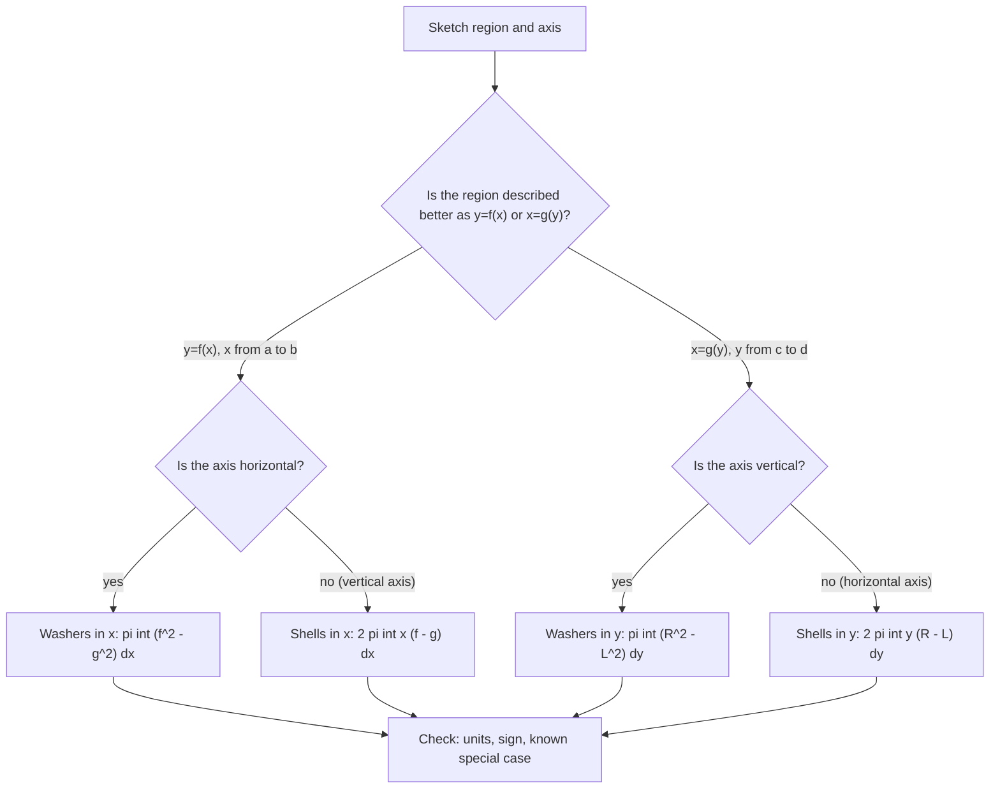

# Applications of Integration

> [Calculus](../README.md) · Level: Advanced · Prerequisites: [The Fundamental Theorem of Calculus](../07-fundamental-theorem-of-calculus/README.md), [Techniques of Integration](../08-techniques-of-integration/README.md), [Applications of Derivatives](../05-applications-of-derivatives/README.md), [Trigonometry](../../05-trigonometry/README.md) · Estimated time: 9 h

## 1. Introduction

Integration is a machine for adding up infinitely many small contributions. In [Integrals](../06-integrals/README.md) the contributions were rectangles under a
graph and the machine produced signed area. In this topic the same machine produces lengths, volumes, masses, forces, work, centres of mass, moments of inertia
and probabilities. The integrand changes; the architecture does not.

Every application in this topic is built from four decisions:

1. **What is the small quantity?** A thin strip of area, a flat slice of volume, a lamina of mass, a
   horizontal strip of a submerged plate, a slice of time, a small interval of probability.
2. **Which variable indexes it?** The variable of integration is chosen so that the slice is described by
   one formula. Sometimes that is $x$, sometimes $y$, sometimes $t$, sometimes the depth $h$.
3. **What is the element?** The small quantity expressed as (a density) $\times$ (a differential):
   $dA=(f-g)\,dx$, $dV=A(x)\,dx$, $dW=F(x)\,dx$, $dF=\rho g h\,w(h)\,dh$, $dP=f(x)\,dx$.
4. **What are the limits?** They come from the geometry — the intersections of the curves, the endpoints
   of the plate, the depth of the tank — and they are values of the *chosen* variable.

Almost every error students make in this topic happens in steps 2–4, not in the integration. The integral $\int_0^1(x-x^2)\,dx=\frac16$ takes ten seconds;
deciding that the limits are $0$ and $1$, that the top curve is $y=x$, and that the variable is $x$ takes the thought. This tutorial therefore spends most of
its space on **setting up** integrals, and treats the evaluation as the routine step it is.

The unity behind the formulas is worth stating at the outset. Area, volume, mass, work, hydrostatic force, probability and expectation are all of the form

$$Q=\int_a^b q(x)\,dx,$$

where $q(x)$ is a *density*: quantity per unit of the variable $x$. Area has density $f-g$ (height per unit width), volume has density $A(x)$ (area per unit
length), mass has density $\rho A(x)$, probability has density $f_X(x)$, and so on. The only thing that changes from section to section is what the density is
and which variable it is measured in.

This topic assumes that definite integrals exist and that the Fundamental Theorem computes them. It does not assume any physics beyond $F=ma$, $W=Fd$, $p=F/A$
and "mass $=$ density $\times$ volume"; each physical formula used is stated and explained where it first appears.

## 2. Prerequisites

**From the integral** ([Integrals](../06-integrals/README.md)): Riemann sums and the definite integral; linearity, additivity and monotonicity; the estimate $m(b-a)\le\int_a^bf\le M(b-a)$; the Mean Value Theorem for integrals; area between curves.

**From the Fundamental Theorem** ([The Fundamental Theorem of Calculus](../07-fundamental-theorem-of-calculus/README.md)): both parts, the net change theorem, and differentiation of integrals with variable limits.

**From differentiation** ([Applications of Derivatives](../05-applications-of-derivatives/README.md)): the Mean Value Theorem, the engine of the arc-length formula, and the derivative as a slope.

**From techniques of integration** ([Techniques of Integration](../08-techniques-of-integration/README.md)): substitution, parts, trigonometric integrals and substitutions, partial fractions, and the standard antiderivatives.

**From geometry and trigonometry**: areas and volumes of elementary figures ([Solid Geometry](../../04-geometry/05-solid-geometry/README.md)); similar triangles; the identities $\cos^2\theta+\sin^2\theta=1$, $\sec^2\theta=1+\tan^2\theta$, and the half-angle formulas ([Trigonometric Identities](../../05-trigonometry/03-trigonometric-identities/README.md)).

**From algebra**: solving polynomial equations for intersection points, completing the square, and exponential manipulation ([Exponential and Logarithmic Functions](../../03-algebra/12-exponential-and-logarithmic-functions/README.md)).

No prior knowledge of physics, probability or economics is assumed: the definitions needed are in §5 and are repeated where they are used.

## 3. Learning Objectives

After working through this tutorial you will be able to:

1. State the slice principle precisely and use it to justify every formula in the topic as a limit of
   Riemann sums.
2. Set up and evaluate the area between two curves, choosing vertical or horizontal strips according to
   which description gives a single integral.
3. Derive and apply the disk and washer formulas for volumes of revolution, including about axes other
   than the coordinate axes.
4. Derive the cylindrical-shell formula from the exact volume of a thin shell, and choose between shells
   and washers on the basis of the region, not on habit.
5. Derive the arc-length formula from the distance formula and the Mean Value Theorem, and compute arc
   lengths of graphs and simple parametric curves.
6. State the surface-of-revolution formulas, derive them from the frustum area, and explain why the
   factor $\sqrt{1+(f')^2}$ must not be omitted.
7. Compute average values, and distinguish the arithmetic mean of a function from the mean of its
   values at finitely many sample points.
8. Set up work integrals for variable forces, springs, pumping fluids and lifting cables, with correct
   limits and distances.
9. Compute the centroid of a lamina or region by the moment formulas, and use Pappus's theorem as a
   consistency check.
10. Define moments of inertia and compute them for rods, laminae and solids of revolution, using the
    parallel-axis theorem.
11. Compute the hydrostatic force on a vertical plate as an integral of pressure over depth.
12. Use a probability density to compute probabilities and expectations as integrals, interpret expectation as a centroid, and compute consumer and producer surplus.

## 4. Intuition

**The loaf.** A loaf is not uniform: its cross-section changes along its length. Cut it into thin slices perpendicular to its length. Each slice is almost a flat slab of area $A(x)$ and thickness $\Delta x$, so its volume is almost $A(x)\Delta x$. The total volume is the sum of the slab volumes, and refining the slices makes the approximation exact. The integral is the instruction "add $A(x)\,dx$ from one end to the other".

**The onion.** The same solid can be peeled. A thin cylindrical shell at radius $r$ has circumference $2\pi r$, height $h(r)$ and thickness $\Delta r$, so its volume is almost $2\pi rh(r)\Delta r$. Summing over radii gives the shell formula. Slicing and peeling are two ways of chopping the same solid; choosing the cheaper chop is the art.

**The surveyor.** A surveyor measures the width of a river at many positions along its bank. The area is the sum of widths times spacings — a Riemann sum. Replacing the spacings by $dx$ and the sum by an integral is exactly the passage from a table of measurements to a formula.

**The choice of variable.** A region can be described by vertical strips or by horizontal strips, and a solid can be sliced or peeled. The quantity is the same; one description may take one integral and the other two. Choose the variable that makes the slice a single formula.

**Probability as area.** A probability density is a curve whose total area is $1$. The probability that $X$ lies between $a$ and $b$ is the area under the density over $[a,b]$. The mean is the $x$-coordinate of the centroid of that area, so §7.10 and §7.13 are the same calculation in different language.

## 5. Formal Definition

### 5.1 The slice principle

Let $[a,b]$ be an interval and let $Q$ be a quantity accumulated over it. Suppose that for every subinterval $[u,v]\subseteq[a,b]$ the contribution can be written

$$\Delta Q=q(\xi)(v-u)+e(u,v),$$

where $\xi\in[u,v]$, $q$ is continuous on $[a,b]$, and the errors satisfy
$\sum_{k=1}^{n}\lvert e(x_{k-1},x_k)\rvert\to0$ as the mesh $\max_k(x_k-x_{k-1})\to0$. Then
$Q=\displaystyle\int_a^b q(x)\,dx$.

*Proof.* For a partition $a=x_0<\cdots<x_n=b$ with sample points $\xi_k$, the total is
$Q=\sum_k q(\xi_k)\Delta x_k+\sum_k e(x_{k-1},x_k)$. The first sum is a Riemann sum for the continuous function $q$, hence converges to $\int_a^b q$; the second tends to $0$ by hypothesis. $\blacksquare$

In practice the error is $O((\Delta x)^2)$ per slice, so the total error is $O(\Delta x)$ and vanishes. Every formula in this topic is obtained by identifying $q$. The notation $dQ=q(x)\,dx$ is shorthand for this limiting statement, not a licence to treat $dx$ as a number.

### 5.2 Volume by slicing

Let a solid lie between the planes $x=a$ and $x=b$, and let $A(x)$ be the area of its cross-section by the plane perpendicular to the $x$-axis at $x$. If $A$ is continuous, the **volume** is defined to be

$$V=\int_a^b A(x)\,dx.$$

For a solid of revolution about the $x$-axis generated by $0\le g\le f$, the cross-section is the annulus with outer radius $f(x)$ and inner radius $g(x)$, so $A(x)=\pi(f(x)^2-g(x)^2)$; this is the washer formula, and it reduces to the disk formula when $g=0$. The definition is the slice principle applied to a slab of thickness $\Delta x$: its volume is $A(x)\Delta x$ plus a negligible error.

### 5.3 Mass, centre of mass and centroid

Let a lamina occupy a region $R$ with continuous area density $\rho(x,y)$. Its **mass** and **moments** are

$$M=\iint_R\rho\,dA,\qquad M_y=\iint_Rx\rho\,dA,\qquad M_x=\iint_Ry\rho\,dA,$$

and its **centre of mass** is $(\bar x,\bar y)=(M_y/M,M_x/M)$. When $\rho$ is constant, the centre of mass depends only on the shape and is called the **centroid**. For a rod on $[a,b]$ with linear density $\lambda(x)$,

$$M=\int_a^b\lambda(x)\,dx,\qquad \bar x=\frac1M\int_a^b x\lambda(x)\,dx.$$

The double integrals are always evaluated here as iterated single integrals by slicing (§7.10).

### 5.4 Other accumulated quantities

**Average value.** For continuous $f$ on $[a,b]$,
$\bar f=\dfrac{1}{b-a}\displaystyle\int_a^bf(x)\,dx$; a continuous $f$ attains $\bar f$ somewhere by the Mean Value Theorem for integrals.

**Work.** For a force $F(x)$ along a line,
$W=\displaystyle\int_a^bF(x)\,dx$; the element is force times displacement.

**Hydrostatic force.** At depth $h$ the gauge pressure is $p=\rho gh$. On a vertical plate of width $w(h)$ at depth $h$,
$dF=\rho gh\,w(h)\,dh$ and $F=\rho g\displaystyle\int_{h_1}^{h_2}h\,w(h)\,dh$.

**Probability density.** A density is a function $f_X\ge0$ with
$\displaystyle\int_{-\infty}^{\infty}f_X=1$; then
$\Pr(a\le X\le b)=\displaystyle\int_a^bf_X$ and
$\mathbb{E}[g(X)]=\displaystyle\int_{-\infty}^{\infty}g(x)f_X(x)\,dx$. Such integrals are improper and are evaluated as limits here; see [Improper Integrals](../10-improper-integrals/README.md).

**Surplus.** With inverse demand $D$ and supply $S$, equilibrium $D(q^*)=S(q^*)=p^*$,
$CS=\displaystyle\int_0^{q^*}(D(q)-p^*)\,dq$ and
$PS=\displaystyle\int_0^{q^*}(p^*-S(q))\,dq$.

## 6. Mathematical Notation

| Symbol | Read as | Meaning in this topic |
|---|---|---|
| $dA$ | element of area | area of a thin strip or patch |
| $dV$ | element of volume | volume of a thin slice or shell |
| $dm$ | element of mass | $\rho\,dV$ |
| $dW$ | element of work | $F\,dx$ |
| $dF$ | element of force | $p\,dA$ for a fluid |
| $dP$ | element of probability | $f_X(x)\,dx$ |
| $A(x)$ | cross-sectional area | area of the slice at $x$ |
| $S$ | surface area | area of a surface of revolution |
| $L$ | arc length | length of a curve |
| $\bar f$ | average value of $f$ | $\frac{1}{b-a}\int_a^b f$ |
| $\bar x,\bar y$ | centroid coordinates | $M_y/M$, $M_x/M$ |
| $M_x,M_y$ | moments about the axes | $\int y\,dm$, $\int x\,dm$ |
| $I_x,I_y$ | moments of inertia | $\int y^2\,dm$, $\int x^2\,dm$ |
| $\rho$ | rho | mass density (mass per volume or area) |
| $\gamma$ | gamma | weight density $\rho g$ (weight per volume) |
| $\lambda$ | lambda | linear density (mass per length); also an exponential rate |
| $p$ | pressure | force per unit area; also a price |
| $h$ | depth | distance below the fluid surface |
| $f_X$ | density of $X$ | probability density function |
| $\mathbb{E}[X]$ | expectation of $X$ | $\int x f_X(x)\,dx$ |
| $\operatorname{Var}(X)$ | variance of $X$ | $\mathbb{E}[X^2]-\mu^2$ |
| $D(q),S(q)$ | demand, supply | inverse demand and supply curves |
| $CS,PS$ | consumer, producer surplus | areas defined in §5.4 |

**Reading aloud.** "$V=\int_a^b A(x)\,dx$" is read "the volume is the integral from $a$ to $b$ of the
cross-sectional area at $x$ with respect to $x$". "$dF=\rho g h\,w(h)\,dh$" is read "the element of force is rho times g times the depth times the width at that
depth, times the element of depth". The symbol
$\rho g$ is often written $\gamma$ and called the *weight density*; for water,
$\gamma\approx9800\ \mathrm{N/m^3}$ in SI.

## 7. Core Concepts

### 7.1 The set-up ritual

Every problem in this topic is solved in the same five steps; doing them in this order prevents most errors.

1. **Draw.** Sketch the curves, shade the region or draw the solid, and mark the axis of revolution or the fluid surface. Label the intersection points with their coordinates.
2. **Choose the variable.** Decide the direction in which you slice. A slice must have *one* formula for its size across the whole range; if it does not, split the integral.
3. **Write the element.** Express the size of a typical slice as (a density) $\times$ (a differential): $(f-g)\,dx$, $A(x)\,dx$, $F(x)\,dx$, $\rho gh\,w(h)\,dh$, $f_X(x)\,dx$.
4. **Find the limits.** Solve for intersections, read off endpoints, or project the solid onto the axis. The limits are values of the chosen variable; if you change the variable, change the limits too.
5. **Integrate and sanity-check.** Check the sign, the dimensions, and one limiting case (a radius going to zero, a height going to zero, a constant density). Compare with a known formula — a cone, a sphere, a rectangle — when one is available.

The symbols $dx$ and $dy$ are bookkeeping devices for the slice thickness, not numbers. Their precise meaning is the slice principle of §5.1, and each formula below comes with the limiting argument that justifies it.

### 7.2 Area between curves

Let $f$ and $g$ be continuous on $[a,b]$ with $f(x)\ge g(x)$ there. Partition $[a,b]$ and erect on the
$k$-th subinterval a rectangle of height $f(\xi_k)-g(\xi_k)$ and width $\Delta x_k$. Its area is
$(f(\xi_k)-g(\xi_k))\Delta x_k$. The union of the rectangles approximates the region between the graphs,
and the sum is a Riemann sum for $f-g$. Therefore

$$A=\int_a^b\bigl(f(x)-g(x)\bigr)\,dx.$$

If the curves cross, $f-g$ changes sign and the integral gives *net* area. The geometric area is
$\int_a^b\lvert f-g\rvert\,dx$, computed by splitting at the crossing points. If the region is described
more naturally by horizontal strips, with $x=R(y)$ on the right and $x=L(y)$ on the left for
$c\le y\le d$, then

$$A=\int_c^d\bigl(R(y)-L(y)\bigr)\,dy.$$

**Choosing the variable.** Vertical strips require the top and bottom to be single functions of $x$;
horizontal strips require the right and left to be single functions of $y$. For the region between
$x=y^2$ and $x=2-y^2$, vertical strips need two integrals (the "top" changes at the intersections), while
horizontal strips need one. The area is the same; the work differs.

### 7.3 Volumes by slicing

Let a solid lie between $x=a$ and $x=b$, and let $A(x)$ be the area of its cross-section by the plane perpendicular to the $x$-axis at $x$. The slab between $x$
and $x+\Delta x$ is almost a prism of base
$A(x)$ and thickness $\Delta x$, so its volume is $A(x)\Delta x$ up to an error that is smaller than
(constant)$\times(\Delta x)^2$. Summing and passing to the limit,

$$V=\int_a^b A(x)\,dx.$$

This is the most general volume formula in the topic; the disk, washer and shell formulas are special cases. It also handles solids that are not surfaces of
revolution: if the base is a region in the
$xy$-plane and the cross-sections perpendicular to the $x$-axis are squares of side $s(x)$, then
$A(x)=s(x)^2$; if they are equilateral triangles, $A(x)=\frac{\sqrt3}{4}s(x)^2$; if they are semicircles
with diameter $s(x)$, $A(x)=\frac{\pi}{8}s(x)^2$. The hard part is always expressing $s(x)$ from the base.

### 7.4 Disks and washers

Let $0\le g(x)\le f(x)$ on $[a,b]$, and revolve the region between the graphs about the $x$-axis. The cross-section at $x$ is an annulus (a washer) with outer
radius $f(x)$ and inner radius $g(x)$, so

$$A(x)=\pi f(x)^2-\pi g(x)^2,$$

and therefore

$$V=\pi\int_a^b\Bigl(f(x)^2-g(x)^2\Bigr)\,dx.$$

When $g=0$ the washer is a disk and $V=\pi\int_a^b f(x)^2\,dx$. When the axis of revolution is the horizontal line $y=k$, the radii are the *distances* to the axis, $\lvert f(x)-k\rvert$ and $\lvert g(x)-k\rvert$. The outer radius is the larger of the two, so in general

$$V=\pi\int_a^b\left[\max\bigl(\lvert f-k\rvert,\lvert g-k\rvert\bigr)^2-\min\bigl(\lvert f-k\rvert,\lvert g-k\rvert\bigr)^2\right]dx.$$

In the common case $k\le g(x)\le f(x)$, the outer radius is $f-k$ and the inner radius is $g-k$, and the formula reduces to
$V=\pi\int_a^b[(f-k)^2-(g-k)^2]dx$. If the region straddles the axis, split it at the crossing or use shells.

If the region is described as $L(y)\le x\le R(y)$ for $c\le y\le d$ and is revolved about the $y$-axis, the same argument with horizontal slices gives

$$V=\pi\int_c^d\Bigl(R(y)^2-L(y)^2\Bigr)\,dy.$$

**Derivation of the washer formula.** The cross-section is the set of points at distance between $g(x)$ and $f(x)$
from the axis, which is an annulus of area $\pi f(x)^2-\pi g(x)^2$. Substituting in the slicing formula gives the washer formula. $\blacksquare$

### 7.5 Cylindrical shells

Let $0\le a\le x\le b$ and $0\le g(x)\le f(x)$, and revolve the region between the graphs about the
$y$-axis. Write $h(x)=f(x)-g(x)$ for the height of the region at $x$. The part of the solid between radii
$x$ and $x+\Delta x$ is a cylindrical shell of thickness $\Delta x$ and height varying between $h(x)$ and
$h(x+\Delta x)$. Its exact volume is the integral of $2\pi r\,h(r)$ over the radii, and the Mean Value Theorem for integrals applied to the continuous function $2\pi r\,h(r)$ gives a point $\xi\in[x,x+\Delta x]$ with

$$\Delta V=2\pi\int_x^{x+\Delta x}r\,h(r)\,dr
=2\pi\xi\,h(\xi)\,\Delta x
=2\pi x\,h(\xi)\,\Delta x+2\pi(\xi-x)h(\xi)\,\Delta x .$$

The first term is a Riemann-sum term for $2\pi xh(x)$; the second is at most $2\pi(\Delta x)^2\max\lvert h\rvert$ per slice and contributes $O(\Delta x)$ in total. Hence

$$V=2\pi\int_a^b x\,h(x)\,dx
=2\pi\int_a^b x\bigl(f(x)-g(x)\bigr)\,dx.$$

The factor $x$ is the **radius** of the shell, not a height and not an area. It must be the distance from the slice to the axis of revolution. About the
vertical line $x=c$, provided the region lies entirely on one side of the axis,

$$V=2\pi\int_a^b\lvert x-c\rvert\,h(x)\,dx.$$

For revolution about the $x$-axis with the region described as $L(y)\le x\le R(y)$, the horizontal slice at height $y$ has radius $y$ and height $R(y)-L(y)$, so

$$V=2\pi\int_c^d y\bigl(R(y)-L(y)\bigr)\,dy.$$

**Choosing between washers and shells.** The two methods compute the same volume; choose the one whose
slice is easier to describe.

| Region given as | Axis of revolution | Convenient method |
|---|---|---|
| $y=f(x)$ over $x\in[a,b]$ | horizontal ($y=0$ or $y=k$) | washers, integrate in $x$ |
| $y=f(x)$ over $x\in[a,b]$ | vertical ($x=0$ or $x=c$) | shells, integrate in $x$ |
| $x=R(y)$ over $y\in[c,d]$ | vertical | washers, integrate in $y$ |
| $x=R(y)$ over $y\in[c,d]$ | horizontal | shells, integrate in $y$ |

If the region touches the axis, the washer has no hole; if the region is far from the axis, shells often give a simpler integrand.

### 7.6 Arc length

Let $f$ be continuously differentiable on $[a,b]$. Partition $[a,b]$ at
$a=x_0<x_1<\cdots<x_n=b$ and join consecutive points on the graph by straight segments. The $k$-th chord
has length

$$\sqrt{(\Delta x_k)^2+(\Delta y_k)^2}
=\sqrt{1+\left(\frac{\Delta y_k}{\Delta x_k}\right)^2}\Delta x_k .$$

By the Mean Value Theorem applied to $f$ on $[x_{k-1},x_k]$, there is $\xi_k\in(x_{k-1},x_k)$ with
$\Delta y_k/\Delta x_k=f'(\xi_k)$. Hence the polygonal length is

$$\sum_{k=1}^n\sqrt{1+f'(\xi_k)^2}\,\Delta x_k,$$

which is a Riemann sum for the continuous function $\sqrt{1+f'^2}$. Therefore

$$L=\int_a^b\sqrt{1+f'(x)^2}\,dx.$$

If the curve is given as $x=g(y)$ for $c\le y\le d$, the same argument with the roles of $x$ and $y$ exchanged gives

$$L=\int_c^d\sqrt{1+g'(y)^2}\,dy.$$

For a parametric curve $(x(t),y(t))$ with continuous derivatives on $[\alpha,\beta]$, the chord between
$t$ and $t+\Delta t$ has length approximately
$\sqrt{x'(t)^2+y'(t)^2}\,\Delta t$, so

$$L=\int_\alpha^\beta\sqrt{x'(t)^2+y'(t)^2}\,dt.$$

The parametric formula is stated here for reference; its derivation is the same distance-formula argument, with the Mean Value Theorem applied to each coordinate. The
hypothesis that the derivative be continuous (or at least that the curve be rectifiable with the integral finite) matters: the formula can fail for pathological
curves, which is a theme of real analysis.

### 7.7 Area of a surface of revolution

Let $f\ge0$ be continuously differentiable on $[a,b]$, and revolve its graph about the $x$-axis. On the subinterval $[x_{k-1},x_k]$, the surface is approximated
by the frustum of a cone with slant height
$\ell_k=\sqrt{(\Delta x_k)^2+(\Delta y_k)^2}$ and radii $f(x_{k-1})$ and $f(x_k)$. The lateral area of a
frustum is $\pi(r_1+r_2)\ell$ (the average circumference $2\pi\frac{r_1+r_2}{2}$ times the slant height). By the Mean Value Theorem,
$\ell_k=\sqrt{1+f'(\xi_k)^2}\,\Delta x_k$, and by continuity
$f(x_{k-1})+f(x_k)\to2f(x)$. Summing gives

$$S=2\pi\int_a^b f(x)\sqrt{1+f'(x)^2}\,dx.$$

For revolution about the $y$-axis, the radius of the typical band is $x$ rather than $f(x)$:

$$S=2\pi\int_a^b x\sqrt{1+f'(x)^2}\,dx.$$

**Derivation sketch of the frustum formula.** A cone of base radius $r$ and slant height $\ell$ has lateral
area $\pi r\ell$; a frustum is the difference of two similar cones, and the similar-triangle ratio gives lateral area $\pi(r_1+r_2)\ell$ where $\ell$ is the
slant height of the frustum. Substituting the first-order approximations $r_1+r_2\approx2f(x)$ and
$\ell\approx\sqrt{1+f'(x)^2}\,\Delta x$, then summing and passing to the limit, gives the surface-area formula.
$\blacksquare$

**The classic error.** The area is **not** $\int2\pi f(x)\,dx$. The latter omits the tilt factor $\sqrt{1+f'(x)^2}\ge1$ and computes the area of the projection onto a cylinder. The two agree only when $f$ is constant (a line parallel to the axis); they disagree for a cone and for a sphere, which are the tests to remember.

### 7.8 Average value

The average of $n$ numbers is their sum divided by $n$. For a continuous function on an interval, the analogue is the integral divided by the length:

$$\bar f=\frac{1}{b-a}\int_a^b f(x)\,dx.$$

The interpretation: the horizontal line $y=\bar f$ has the same area under it over $[a,b]$ as $f$ does. A continuous $f$ attains $\bar f$ somewhere (Mean Value
Theorem for integrals), so the average is a genuine value of the function.

Two refinements are common. The **root-mean-square** value is

$$f_{\mathrm{rms}}=\sqrt{\frac{1}{b-a}\int_a^b f(x)^2\,dx},$$

which is the average value of $f^2$ followed by a square root; it is the quantity that appears in the power of an alternating current. The **weighted average**
with weight $w>0$ is

$$\bar f_w=\frac{\int_a^b f(x)w(x)\,dx}{\int_a^b w(x)\,dx}.$$

When $w$ is a probability density, this is the expectation of $f(X)$.

### 7.9 Work

Work is force times displacement when the force is constant. When the force varies along the path, slice the path: over a displacement $dx$ the force is
approximately $F(x)$, so the element of work is
$dW=F(x)\,dx$ and

$$W=\int_a^b F(x)\,dx.$$

**Springs.** Hooke's law says that the force needed to hold a spring stretched $x$ beyond its natural
length is $F(x)=kx$, with $k$ the spring constant. The work to stretch it from $x=a$ to $x=b$ is therefore

$$W=\int_a^b kx\,dx=\frac{k}{2}\left(b^2-a^2\right).$$

Stretching from rest ($a=0$) to $b$ costs $\frac12kb^2$; doubling the stretch costs four times the work.

**Pumping fluids.** Consider a tank whose horizontal cross-section at height $y$ has area $A(y)$, filled
with a fluid of weight density $\gamma=\rho g$ to height $H$, and emptied over the top. The slice of fluid between $y$ and $y+dy$ has weight $\gamma A(y)\,dy$
and must be lifted a distance $H-y$, so

$$W=\int_0^H\gamma A(y)(H-y)\,dy.$$

If the fluid is pumped to a point at height $H_0$ above the top, replace $H-y$ by $H_0-y$. If the tank is only filled to height $h<H$, the upper limit is $h$.
The most common error is to use the depth of the slice below the *surface* in one term and its height above the *bottom* in another; choose one coordinate
system and stay in it.

**Lifting a hanging rope.** A rope of length $L$ and linear weight density $\lambda g$ hangs vertically
from a support, with its lower end at height $0$ and its top at height $L$. It is wound up at the top.
When a length $y$ has been wound up, the length still hanging is $L-y$ and its weight is
$\lambda g(L-y)$; the work needed to wind up the next $dy$ is $\lambda g(L-y)\,dy$. Hence

$$W=\int_0^L\lambda g(L-y)\,dy=\frac{\lambda gL^2}{2}.$$

Equivalently, the element of rope at distance $z$ below the top is lifted through $z$, and
$\int_0^L\lambda g z\,dz=\lambda gL^2/2$. The two descriptions agree.

**Gravitation.** The force between masses $M$ and $m$ separated by $r$ is $GMm/r^2$. The work needed to
move $m$ from the surface of a body of radius $R$ to infinity is

$$W=\int_R^{\infty}\frac{GMm}{r^2}\,dr=\frac{GMm}{R},$$

the escape energy. This is an improper integral, a preview of [Improper Integrals](../10-improper-integrals/README.md).

### 7.10 Centres of mass and centroids

**Discrete case.** For masses $m_1,\dots,m_n$ at positions $x_1,\dots,x_n$ on a line, the centre of mass
is $\bar x=\sum m_ix_i/\sum m_i$. It is the point at which the system balances: the total moment
$\sum m_i(x_i-\bar x)$ is zero.

**Rod.** For a rod on $[a,b]$ with linear density $\lambda(x)$, the element of mass is
$dm=\lambda(x)\,dx$ and the element of moment about the origin is $x\,dm$. Hence

$$M=\int_a^b\lambda(x)\,dx,\qquad
\bar x=\frac{1}{M}\int_a^b x\lambda(x)\,dx.$$

**Lamina between two curves.** Let $0\le g(x)\le f(x)$ on $[a,b]$ and let the area density be a constant
$\rho$. The vertical strip at $x$ has area $(f-g)\,dx$, so its mass is $\rho(f-g)\,dx$ and its moment
about the $y$-axis is $x\rho(f-g)\,dx$. The strip's own centroid has $y$-coordinate
$\frac12(f+g)$, so its moment about the $x$-axis is $\frac12(f+g)\rho(f-g)\,dx$. Therefore

$$A=\int_a^b(f-g)\,dx,$$
$$\bar x=\frac{1}{A}\int_a^b x\bigl(f(x)-g(x)\bigr)\,dx,$$
$$\bar y=\frac{1}{A}\int_a^b\frac{f(x)^2-g(x)^2}{2}\,dx
=\frac{1}{2A}\int_a^b\bigl(f(x)^2-g(x)^2\bigr)\,dx.$$

The density $\rho$ cancels throughout; that is why the centroid depends only on the shape. For a region described by horizontal strips, $L(y)\le x\le R(y)$,

$$A=\int_c^d(R-L)\,dy,\qquad
\bar x=\frac{1}{2A}\int_c^d\bigl(R^2-L^2\bigr)\,dy,\qquad \bar y=\frac{1}{A}\int_c^d y(R-L)\,dy.$$

**Checks.** For the rectangle $[0,a]\times[0,b]$, the centroid formulas give
$A=ab$, $\bar x=a/2$, $\bar y=b/2$, as expected. For a region symmetric about the line $x=c$, the
formula must give $\bar x=c$; this is a quick check on the algebra.

**Pappus's first theorem.** If a plane region of area $A$ is revolved about an external axis in its plane
(an axis that does not cross the region), the volume of the solid is

$$V=2\pi dA,$$

where $d$ is the distance from the centroid to the axis. Pappus's second theorem says the area of the surface generated by a plane curve of length $L$ is
$S=2\pi dL$. Both follow from the slice formulas: for revolution about the $y$-axis, $V=2\pi\int xh\,dx=2\pi A\bar x$. They are excellent consistency checks,
and they turn some difficult integrals into arithmetic.

### 7.11 Moments of inertia

The **moment of inertia** of a mass distribution about an axis is

$$I=\int r^2\,dm,$$

where $r$ is the distance from the element $dm$ to the axis. It is the rotational analogue of mass: the kinetic energy of rotation is $\frac12I\omega^2$, and
the equation of motion is $I\alpha=\tau$.

**Lamina.** For a uniform lamina of unit area density between $y=g(x)$ and $y=f(x)$ on $[a,b]$ (multiply by the density $\rho$ for a general uniform lamina):

* about the $y$-axis, the strip at $x$ is at distance $x$, so
  $$I_y=\int_a^b x^2\bigl(f(x)-g(x)\bigr)\,dx;$$
* about the $x$-axis, the strip is a vertical segment from $g(x)$ to $f(x)$, and
  $$dI_x=\int_{g(x)}^{f(x)}y^2\,dy\,dx
  =\frac13\Bigl(f(x)^3-g(x)^3\Bigr)dx,$$
  so
  $$I_x=\frac13\int_a^b\Bigl(f(x)^3-g(x)^3\Bigr)dx.$$

**Solid of revolution about the $x$-axis.** The disk at $x$ has radius $f(x)$, thickness $dx$, mass
$dm=\rho\pi f(x)^2dx$, and moment of inertia about its central axis (the $x$-axis) equal to
$\frac12dm\,f(x)^2$. Hence

$$I_x=\frac{\pi\rho}{2}\int_a^b f(x)^4\,dx.$$

**Theorems.** The **parallel-axis theorem** says that for an axis parallel to an axis through the centre
of mass at distance $d$,

$$I=I_{\mathrm{cm}}+Md^2.$$

The **perpendicular-axis theorem** says that for a thin lamina in the $xy$-plane,

$$I_z=I_x+I_y.$$

The **radius of gyration** is $k=\sqrt{I/M}$, the distance at which a point mass $M$ would have the same moment of inertia.

**Example checks.** A uniform rod of length $L$ and mass $M$ about one end:
$I=\int_0^L(M/L)x^2dx=ML^2/3$. About its centre: $ML^2/12$. The parallel-axis theorem gives
$ML^2/12+M(L/2)^2=ML^2/3$, consistent.

### 7.12 Hydrostatic force

At depth $h$ in a fluid at rest, the pressure is $p=\rho gh$. On a vertical plate, consider a horizontal strip at depth $h$ of width $w(h)$ and height $dh$. Its
area is $w(h)\,dh$, the pressure is essentially constant across it, and the force on it is

$$dF=p\,dA=\rho g h\,w(h)\,dh.$$

Therefore

$$F=\rho g\int_{h_1}^{h_2}h\,w(h)\,dh,$$

where $h_1$ and $h_2$ are the shallowest and deepest depths of the plate. The width $w(h)$ must be the width *at that depth*, which is where the geometry of the
plate enters.

**The centroid shortcut.** Since $\int h\,w(h)\,dh=A\bar h$, where $A$ is the plate area and $\bar h$ the
depth of its centroid,

$$F=\rho gA\bar h.$$

The force on a submerged plane region equals the pressure at its centroid times its area. This is a theorem, not an approximation, and it is a useful check on
an integral. It does **not** say the force acts at the centroid: the centre of pressure is generally deeper, and for a rectangle with its top at the surface it
is at $\frac23$ of the height.

### 7.13 Probability density functions and expectation

A probability density $f_X$ is a non-negative function whose total integral is $1$. The probability of an interval is the area under the density over that
interval. In this topic we use densities on bounded intervals (where the integrals are proper) and on half-lines (where they are limits).

**Uniform density on $[a,b]$.** $f_X(x)=1/(b-a)$ there and $0$ elsewhere. Then
$\Pr(c\le X\le d)=(d-c)/(b-a)$ for $a\le c\le d\le b$, and

$$\mathbb{E}[X]=\frac{1}{b-a}\int_a^b x\,dx=\frac{a+b}{2}.$$

The expectation is the midpoint, which is also the centroid of the rectangle under the density.

**Exponential density.** For $\lambda>0$, $f_X(x)=\lambda e^{-\lambda x}$ for $x\ge0$ and $0$ otherwise.
The normalization is

$$\int_0^{\infty}\lambda e^{-\lambda x}dx=\lim_{R\to\infty}\left[-e^{-\lambda x}\right]_0^R
=\lim_{R\to\infty}\left(1-e^{-\lambda R}\right)=1.$$

The mean is

$$\mathbb{E}[X]=\int_0^{\infty}x\lambda e^{-\lambda x}dx
=\lim_{R\to\infty}\left[-xe^{-\lambda x}-\frac1\lambda e^{-\lambda x}\right]_0^R=\frac1\lambda,$$

where the antiderivative is checked by differentiating:
$\frac{d}{dx}\left(-xe^{-\lambda x}-\frac1\lambda e^{-\lambda x}\right) =\lambda xe^{-\lambda x}$. The second moment is
$\mathbb{E}[X^2]=2/\lambda^2$ (two integrations by parts, or the gamma-function formula of
[Improper Integrals](../10-improper-integrals/README.md)), so
$\operatorname{Var}(X)=2/\lambda^2-1/\lambda^2=1/\lambda^2$.

**General facts.** For any density, $\mathbb{E}[aX+b]=a\mathbb{E}[X]+b$ and
$\operatorname{Var}(aX+b)=a^2\operatorname{Var}(X)$, both immediate from the integral. The expectation of
$g(X)$ is $\int g(x)f_X(x)\,dx$; this is not a definition to be memorised separately, but the same slice
principle: group the values of $X$ near $x$, each group having probability $f_X(x)\,dx$.

**Geometric interpretation.** The expectation is the $x$-coordinate of the centroid of the region between
the density curve and the $x$-axis. Indeed, the region has area $1$, and
$\bar x=\int x f_X(x)\,dx/\int f_X(x)\,dx=\mathbb{E}[X]$. This is why the centroid formulas of §7.10 and
the expectation formulas here are the same formulas.

### 7.14 Consumer and producer surplus

A demand curve $p=D(q)$ gives the price consumers are willing to pay for the $q$-th unit (more precisely, the marginal willingness to pay). If the market clears
at quantity $q^*$ and price $p^*$, consumers pay
$p^*$ for every unit, but they would have paid more for the earlier units. The gain on the unit at
quantity $q$ is $D(q)-p^*$, and summing over $q\in[0,q^*]$ gives

$$CS=\int_0^{q^*}\bigl(D(q)-p^*\bigr)\,dq.$$

Similarly, producers would have supplied earlier units at prices below $p^*$, so their gain is

$$PS=\int_0^{q^*}\bigl(p^*-S(q)\bigr)\,dq.$$

The sum $CS+PS$ is the total surplus, the area between the demand and supply curves up to the intersection.

**Present value.** A payment stream $C(t)$ (currency per unit time) discounted at a continuous rate $r$
has present value

$$PV=\int_0^T e^{-rt}C(t)\,dt.$$

The element $C(t)\,dt$ is the payment in a short interval, and $e^{-rt}$ is its discount factor. If the stream continues forever, the integral is improper; for
constant $C$,
$PV=C/r$, a formula every finance course uses.

## 8. Formulas and Properties

Every formula in this topic is an instance of the slice principle of §5.1. The table collects the formulas with their hypotheses; the subsections prove the ones whose derivation is not already complete in §7.

### 8.1 Summary of formulas

| Quantity | Formula | Hypotheses | Element |
|---|---|---|---|
| Area, vertical strips | $\displaystyle\int_a^b(f-g)\,dx$ | $f,g$ continuous, $f\ge g$ | $(f-g)\,dx$ |
| Area, horizontal strips | $\displaystyle\int_c^d(R-L)\,dy$ | $R\ge L$ continuous | $(R-L)\,dy$ |
| Volume, slicing | $\displaystyle\int_a^b A(x)\,dx$ | $A$ continuous | $A(x)\,dx$ |
| Washers about $x$-axis | $\displaystyle\pi\int_a^b(f^2-g^2)\,dx$ | $0\le g\le f$ | $\pi(f^2-g^2)\,dx$ |
| Washers about $y$-axis | $\displaystyle\pi\int_c^d(R^2-L^2)\,dy$ | $0\le L\le R$ | $\pi(R^2-L^2)\,dy$ |
| Shells about $y$-axis | $\displaystyle2\pi\int_a^b x(f-g)\,dx$ | $x\ge0$, $f\ge g$ | $2\pi x(f-g)\,dx$ |
| Shells about $x$-axis | $\displaystyle2\pi\int_c^d y(R-L)\,dy$ | $y\ge0$, $R\ge L$ | $2\pi y(R-L)\,dy$ |
| Arc length | $\displaystyle\int_a^b\sqrt{1+f'^2}\,dx$ | $f\in C^1$ | $\sqrt{1+f'^2}\,dx$ |
| Surface about $x$-axis | $\displaystyle2\pi\int_a^b f\sqrt{1+f'^2}\,dx$ | $f\in C^1$, $f\ge0$ | $2\pi f\,ds$ |
| Surface about $y$-axis | $\displaystyle2\pi\int_a^b x\sqrt{1+f'^2}\,dx$ | $f\in C^1$, $x\ge0$ | $2\pi x\,ds$ |
| Average value | $\displaystyle\frac{1}{b-a}\int_a^b f\,dx$ | $f$ continuous | — |
| Work, variable force | $\displaystyle\int_a^b F(x)\,dx$ | $F$ continuous | $F\,dx$ |
| Work, pumping | $\displaystyle\gamma\int_0^H A(y)(H-y)\,dy$ | $A$ continuous | $\gamma A(y)(H-y)\,dy$ |
| Centroid $\bar x$ | $\displaystyle\frac{1}{A}\int_a^b x(f-g)\,dx$ | uniform density | $x\,dA$ |
| Centroid $\bar y$ | $\displaystyle\frac{1}{2A}\int_a^b(f^2-g^2)\,dx$ | uniform density | $\tfrac12(f+g)\,dA$ |
| Moment of inertia $I_y$ | $\displaystyle\int_a^b x^2(f-g)\,dx$ | uniform lamina, density $1$ | $x^2\,dA$ |
| Moment of inertia $I_x$ | $\displaystyle\frac13\int_a^b(f^3-g^3)\,dx$ | uniform lamina, density $1$ | $y^2\,dA$ |
| Hydrostatic force | $\displaystyle\rho g\int_{h_1}^{h_2}h\,w(h)\,dh$ | fluid at rest | $\rho gh\,w\,dh$ |
| Expectation | $\displaystyle\int x f_X(x)\,dx$ | $\int f_X=1$ | $x\,f_X\,dx$ |
| Consumer surplus | $\displaystyle\int_0^{q^*}(D(q)-p^*)\,dq$ | equilibrium | $(D-p^*)\,dq$ |

### 8.2 Area and the crossing case

**Proposition 1.** If $f,g$ are continuous on $[a,b]$, the area between their graphs is $\int_a^b\lvert f-g\rvert\,dx$.

*Proof.* On a partition, the strip at $\xi_k$ has height $\lvert f(\xi_k)-g(\xi_k)\rvert$, so the rectangle area is $\lvert f(\xi_k)-g(\xi_k)\rvert\Delta x_k$. These are Riemann sums for the continuous function $\lvert f-g\rvert$, hence converge to its integral. $\blacksquare$

Consequently, if the curves cross, split at the zeros of $f-g$ and integrate top minus bottom on each piece. Integrating $f-g$ across a crossing gives net signed area, not geometric area.

### 8.3 Shells

**Lemma 2 (exact shell volume).** Let $h$ be continuous on $[x,x+\Delta x]$. The shell obtained by revolving $x\le r\le x+\Delta x$, $0\le z\le h(r)$ about the vertical axis $r=0$ has volume $2\pi\xi h(\xi)\,\Delta x$ for some $\xi\in[x,x+\Delta x]$.

*Proof.* The volume is $\int_x^{x+\Delta x}2\pi r\,h(r)\,dr$. The integrand $2\pi r\,h(r)$ is continuous, so the Mean Value Theorem for integrals gives a point $\xi\in[x,x+\Delta x]$ at which the value equals the average, that is, the integral equals $2\pi\xi h(\xi)\Delta x$. $\blacksquare$

**Theorem 3 (shells).** If $0\le g\le f$ on $[a,b]$, the volume of the solid obtained by revolving the region between the graphs about the $y$-axis is

$$V=2\pi\int_a^b x\bigl(f(x)-g(x)\bigr)dx.$$

*Proof.* Put $h=f-g$ and let $x_k=a+k\Delta x$. By Lemma 2, the $k$-th shell has volume
$\Delta V_k=2\pi\xi_kh(\xi_k)\Delta x=2\pi x_kh(\xi_k)\Delta x+2\pi(\xi_k-x_k)h(\xi_k)\Delta x$. The first terms form a Riemann sum for $2\pi xh(x)$ up to $O(\Delta x)$ (because $\lvert\xi_k-x_k\rvert\le\Delta x$ and $xh$ is uniformly continuous); the second terms are at most $2\pi(\Delta x)^2\max\lvert h\rvert$ each, so they sum to $O(\Delta x)$. Both errors vanish, so $V=2\pi\int_a^bxh(x)\,dx$. $\blacksquare$

### 8.4 Arc length

**Theorem 4.** Let $f\in C^1[a,b]$. The length of $y=f(x)$, $a\le x\le b$, is $L=\int_a^b\sqrt{1+f'(x)^2}\,dx$.

*Proof.* The inscribed polygonal line through the partition points has length
$L(P)=\sum_k\sqrt{(\Delta x_k)^2+(\Delta y_k)^2}$. The Mean Value Theorem gives $\xi_k$ with $\Delta y_k=f'(\xi_k)\Delta x_k$, so
$L(P)=\sum_k\sqrt{1+f'(\xi_k)^2}\,\Delta x_k$. Since $f'$ is continuous, this is a Riemann sum for $\sqrt{1+f'^2}$ and converges to the integral as the mesh tends to $0$. The arc length is the supremum of such polygonal lengths over all partitions, which for a $C^1$ curve equals this limit. $\blacksquare$

*Remark.* The hypothesis can be weakened to absolute continuity of $f$, in which case $f'$ exists almost everywhere; a merely continuous curve can have infinite length.

### 8.5 Surface of revolution

**Lemma 5 (frustum area).** The lateral area of a right circular frustum with radii $r_1,r_2$ and slant height $\ell$ is $\pi(r_1+r_2)\ell$.

*Proof.* Complete the frustum to a cone with smaller slant height $\ell_1$. Similarity gives $\ell_1/r_1=(\ell_1+\ell)/r_2$, so $\ell_1=\ell r_1/(r_2-r_1)$. The lateral area is $\pi r_2(\ell_1+\ell)-\pi r_1\ell_1=\pi(r_1+r_2)\ell$. $\blacksquare$

**Theorem 6.** Let $f\ge0$ be $C^1$ on $[a,b]$. The area of the surface obtained by revolving the graph about the $x$-axis is

$$S=2\pi\int_a^b f(x)\sqrt{1+f'(x)^2}\,dx.$$

*Derivation sketch.* Approximate the surface over $[x_{k-1},x_k]$ by a frustum with $r_1=f(x_{k-1})$, $r_2=f(x_k)$ and slant height $\ell_k=\sqrt{1+f'(\xi_k)^2}\Delta x_k$. Its area is $\pi(f(x_{k-1})+f(x_k))\sqrt{1+f'(\xi_k)^2}\Delta x_k$; since $f$ is continuous, this is a Riemann sum for $2\pi f\sqrt{1+f'^2}$ plus a uniformly small error. Passing to the limit gives the formula. $\blacksquare$

The word "sketch" is honest: surface area is being defined as a limit of frustum areas, and a complete treatment belongs to the theory of surfaces. The formula is exact for $C^1$ functions.

### 8.6 Centroids, Pappus and hydrostatic force

**Theorem 7.** For a uniform region $0\le g\le f$ on $[a,b]$, the centroid is given by the formulas in §7.10.

*Proof.* The strip at $\xi_k$ has area $(f-g)\Delta x$ and centroid $(\xi_k,\frac12(f+g))$, so its moments are $\xi_k(f-g)\Delta x$ and $\frac12(f^2-g^2)\Delta x$. Summing gives Riemann sums for the integrals in the centroid formulas; dividing by the area gives the centroid. $\blacksquare$

**Corollary 8 (Pappus).** If a region of area $A$ is revolved about an external vertical axis at distance $d$ from its centroid, the volume is $V=2\pi dA$.

*Proof.* With the axis $x=c$ and the region to its right, $V=2\pi\int(x-c)h\,dx=2\pi(A\bar x-cA)=2\pi dA$. $\blacksquare$

**Theorem 9.** The force on a fully submerged vertical plate of area $A$ whose centroid is at depth $\bar h$ is $F=\rho gA\bar h$.

*Proof.* $F=\rho g\int h\,w(h)\,dh=\rho gA\cdot\frac1A\int h\,w\,dh=\rho gA\bar h$, using the centroid formula with the roles of $x$ and $y$ exchanged. $\blacksquare$

### 8.7 Standard integrals and units

The antiderivatives needed in the examples and exercises are those of [Techniques of Integration](../08-techniques-of-integration/README.md). The ones that recur here are $\int e^{ax}dx=e^{ax}/a+C$, $\int xe^{ax}dx=e^{ax}(x/a-1/a^2)+C$, $\int\ln x\,dx=x\ln x-x+C$, $\int\frac{dx}{x^2+a^2}=\frac1a\arctan\frac xa+C$, $\int\sec x\,dx=\ln\lvert\sec x+\tan x\rvert+C$, and $\int\sqrt{x^2+a^2}\,dx=\frac x2\sqrt{x^2+a^2}+\frac{a^2}{2}\ln(x+\sqrt{x^2+a^2})+C$.

A dimension check catches set-up errors that no amount of correct integration can repair: an integrand for a volume must have dimension $\mathsf{L}^2$ (multiplied by a length $dx$), one for a force must have dimension $\mathsf{M}\mathsf{L}\mathsf{T}^{-2}$, and one for a probability density must have dimension $1/\mathsf{L}$ if $x$ is a length.

## 9. Step-by-Step Examples

The examples are ordered by difficulty. In each one, the set-up is written out before the integration, because the set-up is the part that requires thought.

### Example 1 (easy): Area between a line and a parabola

Find the area of the region bounded by $y=x$ and $y=x^2$.

*Set-up.* Solve $x=x^2$: $x(1-x)=0$, so the intersections are $(0,0)$ and $(1,1)$. On $(0,1)$ the line
is above the parabola because $x-x^2=x(1-x)>0$. The region is described by vertical strips with top
$f(x)=x$ and bottom $g(x)=x^2$, and the limits are $x=0$ to $x=1$. Hence

$$A=\int_0^1(x-x^2)\,dx=\left[\frac{x^2}{2}-\frac{x^3}{3}\right]_0^1=\frac12-\frac13=\frac16 .$$

*Check.* The triangle under $y=x$ on $[0,1]$ has area $\frac12$, and the parabolic segment under $y=x^2$
has area $\frac13$; the difference $\frac12-\frac13=\frac16$ is the area between them. If the integrand had been written as $x^2-x$, the answer would be
$-\frac16$: the order top-minus-bottom matters.

### Example 2 (easy–medium): Area by horizontal strips

Find the area of the region bounded by $x=y^2$ and $x=2-y^2$.

*Set-up.* The curves open in opposite directions. Solve $y^2=2-y^2$: $2y^2=2$, so $y=\pm1$ and $x=1$. At
$y=0$ the point $(2,0)$ is on the second curve and $(0,0)$ on the first, so the right boundary is
$x=2-y^2$ and the left boundary is $x=y^2$. Horizontal strips therefore give a single integral:

$$A=\int_{-1}^{1}\bigl[(2-y^2)-y^2\bigr]\,dy=\int_{-1}^{1}(2-2y^2)\,dy
=\left[2y-\frac{2y^3}{3}\right]_{-1}^{1}.$$

Evaluating, $A=\left(2-\frac23\right)-\left(-2+\frac23\right)=\frac43+\frac43=\frac83$.

*Check by vertical strips.* For $0\le x\le1$ the height is $2\sqrt x$; for $1\le x\le2$ it is
$2\sqrt{2-x}$. Then

$$\int_0^1 2\sqrt x\,dx=\frac43,\qquad \int_1^2 2\sqrt{2-x}\,dx=\frac43,$$

so the total is $\frac83$, in agreement. The horizontal description is shorter, which is the point of choosing the variable.

### Example 3 (medium): A washer volume, checked by shells

The region between $y=\sqrt x$ and $y=x^2$ is revolved about the $x$-axis. Find the volume.

*Set-up.* Solve $\sqrt x=x^2$: squaring gives $x=x^4$, so $x(x^3-1)=0$ and $x=0$ or $x=1$. On $(0,1)$,
$\sqrt x>x^2$. The washer at $x$ has outer radius $\sqrt x$ and inner radius $x^2$, so

$$V=\pi\int_0^1\left[(\sqrt x)^2-(x^2)^2\right]dx
=\pi\int_0^1(x-x^4)\,dx=\pi\left(\frac12-\frac15\right)=\frac{3\pi}{10}.$$

*Check by shells.* Solve for $x$: the curves are $x=y^2$ (left) and $x=\sqrt y$ (right) for
$0\le y\le1$. The shell at height $y$ has radius $y$ and height $\sqrt y-y^2$, so

$$V=2\pi\int_0^1y\left(\sqrt y-y^2\right)dy
=2\pi\left(\frac25-\frac14\right)=2\pi\cdot\frac{3}{20}=\frac{3\pi}{10}.$$

Both methods agree. The washer integral is slightly shorter here; the shell integral is a useful check.

### Example 4 (medium): A shell volume, checked by washers

Revolve the region bounded by $y=2x-x^2$ and $y=0$ about the $y$-axis. Find the volume.

*Set-up.* The parabola meets the $x$-axis at $x=0$ and $x=2$. Vertical slices have height
$h(x)=2x-x^2$ and radius $x$ from the $y$-axis, so shells give

$$V=2\pi\int_0^2x(2x-x^2)\,dx=2\pi\int_0^2(2x^2-x^3)\,dx
=2\pi\left[\frac{2x^3}{3}-\frac{x^4}{4}\right]_0^2 =2\pi\left(\frac{16}{3}-4\right)=\frac{8\pi}{3}.$$

*Check by washers.* Complete the square: $y=1-(x-1)^2$, so $x=1\pm\sqrt{1-y}$ for $0\le y\le1$. The
washer at height $y$ has outer radius $1+\sqrt{1-y}$ and inner radius $1-\sqrt{1-y}$. The difference of squares is $4\sqrt{1-y}$, hence

$$V=\pi\int_0^14\sqrt{1-y}\,dy=4\pi\left[-\frac23(1-y)^{3/2}\right]_0^1=4\pi\cdot\frac23=\frac{8\pi}{3}.$$

The agreement is a check on both the algebra and the radii.

### Example 5 (medium): Arc length

Find the length of the curve $y=\frac23x^{3/2}$ from $x=0$ to $x=3$.

*Set-up.* Here $f'(x)=x^{1/2}$, so $1+f'(x)^2=1+x$ and

$$L=\int_0^3\sqrt{1+x}\,dx=\left[\frac23(1+x)^{3/2}\right]_0^3
=\frac23\left(8-1\right)=\frac{14}{3}.$$

*Check.* The straight chord from $(0,0)$ to $\left(3,2\sqrt3\right)$ has length
$\sqrt{9+12}=\sqrt{21}\approx4.583$, and the arc length $14/3\approx4.667$ is slightly larger, as it must
be. The antiderivative is verified by differentiating:
$\frac{d}{dx}\frac23(1+x)^{3/2}=\sqrt{1+x}$.

### Example 6 (medium): Surface area of a paraboloid

Revolve $y=x^2$, $0\le x\le1$, about the $y$-axis. Find the surface area.

*Set-up.* The radius of the band at $x$ is $x$, and $f'(x)=2x$, so

$$S=2\pi\int_0^1x\sqrt{1+4x^2}\,dx.$$

Substitute $u=1+4x^2$, $du=8x\,dx$, so $x\,dx=du/8$; when $x=0$, $u=1$, and when $x=1$, $u=5$:

$$S=\frac{2\pi}{8}\int_1^5u^{1/2}du
=\frac{\pi}{4}\cdot\frac23\left[u^{3/2}\right]_1^5 =\frac{\pi}{6}\left(5\sqrt5-1\right)\approx5.330 .$$

*Check.* The surface lies outside the cone generated by the chord $(0,0)$ to $(1,1)$, of area $\pi\sqrt2\approx4.443$, and inside the cylinder of radius $1$ and height $1$, of area $2\pi\approx6.283$; indeed $4.443<5.330<6.283$. Differentiating the antiderivative gives back $2\pi x\sqrt{1+4x^2}$, and the dimension is a length squared.

*Remark: the sphere.* For $f(x)=\sqrt{R^2-x^2}$ on $[-R,R]$, $f'(x)=-x/f(x)$ and
$1+f'^2=R^2/f^2$, so $f\sqrt{1+f'^2}=R$ and $S=2\pi\int_{-R}^R R\,dx=4\pi R^2$, the standard sphere
formula. This is the check that the slant factor is right.

### Example 7 (medium–hard): Pumping water out of a tank

A cylindrical tank of radius $3$ m and height $10$ m is full of water and is emptied over its top. Find the work done. Use $\rho=1000\ \mathrm{kg/m^3}$ and
$g=9.8\ \mathrm{m/s^2}$.

*Set-up.* Measure height $y$ from the bottom, so the top is $y=10$. The slice at height $y$ of thickness
$dy$ has volume $\pi\cdot3^2\,dy=9\pi\,dy$, mass $\rho\cdot9\pi\,dy$ and weight
$\gamma\cdot9\pi\,dy$ with $\gamma=\rho g$. It must be lifted $10-y$ metres. Therefore

$$W=\int_0^{10}9\pi\gamma(10-y)\,dy
=9\pi\gamma\left[10y-\frac{y^2}{2}\right]_0^{10} =9\pi\gamma(100-50)=450\pi\gamma .$$

Numerically, $W=450\pi(9800)=4{,}410{,}000\pi\approx1.385\times10^7$ J.

*Check by centre of mass.* The water has mass $M=\rho\cdot9\pi\cdot10=90{,}000\pi$ kg and its centre of
mass is at height $5$ m. Emptying over the top raises every drop by $5$ m on average, so
$W=Mg\cdot5=90{,}000\pi(9.8)(5)=4{,}410{,}000\pi$ J, in agreement. The centre-of-mass shortcut works
because the lift distance is linear in $y$; it is a consequence of the centroid formula, not a coincidence.

### Example 8 (hard): Centroid of a parabolic region

Find the centroid of the region bounded by $y=x$ and $y=x^2$.

*Set-up.* From Example 1, $A=\frac16$. The moments are

$$M_y=\int_0^1x(x-x^2)\,dx=\int_0^1(x^2-x^3)\,dx=\frac13-\frac14=\frac1{12},$$

$$M_x=\int_0^1\frac{x^2-(x^2)^2}{2}\,dx
=\frac12\int_0^1(x^2-x^4)\,dx=\frac12\left(\frac13-\frac15\right)=\frac1{15}.$$

Therefore

$$\bar x=\frac{M_y}{A}=\frac{1/12}{1/6}=\frac12,\qquad
\bar y=\frac{M_x}{A}=\frac{1/15}{1/6}=\frac{2}{5}.$$

*Check.* The region is symmetric about $x=\frac12$ (the substitution $x\mapsto1-x$ exchanges $x$ and
$x^2$), so $\bar x=\frac12$ is forced. For $\bar y$, the region lies between $y=0$ and $y=1$, and the
centroid at $\frac25$ is below the midpoint $\frac12$, as it must be because the region is thicker near the vertex of the parabola.

*Check by Pappus.* Revolve the region about the $x$-axis. Pappus gives
$V=2\pi\bar yA=2\pi\cdot\frac25\cdot\frac16=\frac{2\pi}{15}$. Directly, the washer volume is
$\pi\int_0^1(x^2-x^4)\,dx=\pi\cdot\frac{2}{15}$, in agreement.

### Example 9 (hard): Hydrostatic force on a semicircular plate

A vertical plate in the shape of a semicircle of radius $2$ m has its diameter along the surface of the water. Find the force on one side.

*Set-up.* Measure depth $h$ downward from the surface, $0\le h\le2$. At depth $h$ the horizontal width of
the circle $x^2+h^2\le4$ is $w(h)=2\sqrt{4-h^2}$. The strip of thickness $dh$ at depth $h$ has area
$w(h)\,dh$, and the pressure there is $\rho gh$. Hence

$$F=\rho g\int_0^2h\cdot2\sqrt{4-h^2}\,dh.$$

*Evaluate.* Substitute $u=4-h^2$, $du=-2h\,dh$:

$$\int_0^2 2h\sqrt{4-h^2}\,dh
=\left[-\frac23(4-h^2)^{3/2}\right]_0^2 =0-\left(-\frac23\cdot8\right)=\frac{16}{3}.$$

Therefore $F=\frac{16}{3}\rho g$. With $\rho g=9800\ \mathrm{N/m^3}$,
$F\approx5.23\times10^4$ N.

*Check by the centroid shortcut.* The area is $A=\frac12\pi(2)^2=2\pi$. The centroid of a semicircle is
at distance $\frac{4R}{3\pi}=\frac{8}{3\pi}$ from the diameter, so its depth is
$\bar h=\frac{8}{3\pi}$. Then
$F=\rho gA\bar h=\rho g(2\pi)\left(\frac{8}{3\pi}\right)=\frac{16}{3}\rho g$, in agreement.

### Example 10 (hard): An exponential distribution

Let $X$ have density $f(x)=\lambda e^{-\lambda x}$ for $x\ge0$ (and $0$ for $x<0$), with $\lambda>0$. Verify that $f$ is a density, and compute
$\Pr(X\le1/\lambda)$, $\mathbb{E}[X]$ and
$\operatorname{Var}(X)$.

*Normalization.* For $R>0$,

$$\int_0^R\lambda e^{-\lambda x}dx=\left[-e^{-\lambda x}\right]_0^R=1-e^{-\lambda R}
\longrightarrow1\quad(R\to\infty).$$

*Probability.*

$$\Pr\left(X\le\frac1\lambda\right)=\int_0^{1/\lambda}\lambda e^{-\lambda x}dx
=1-e^{-1}\approx0.6321 .$$

*Mean.* Integrate by parts with $u=x$, $dv=\lambda e^{-\lambda x}dx$: $du=dx$,
$v=-e^{-\lambda x}$, so

$$\int_0^Rx\lambda e^{-\lambda x}dx
=\left[-xe^{-\lambda x}\right]_0^R+\int_0^Re^{-\lambda x}dx =-Re^{-\lambda R}+\frac{1-e^{-\lambda R}}{\lambda}\longrightarrow\frac1\lambda .$$

*Second moment.* Integrate by parts with $u=x^2$, $dv=\lambda e^{-\lambda x}dx$:

$$\int_0^Rx^2\lambda e^{-\lambda x}dx
=\left[-x^2e^{-\lambda x}\right]_0^R+2\int_0^Rxe^{-\lambda x}dx \longrightarrow0+2\cdot\frac{1}{\lambda^2}=\frac{2}{\lambda^2},$$

where the last integral is $\int_0^\infty xe^{-\lambda x}dx=1/\lambda^2$, a special case of the mean computation. Hence
$\operatorname{Var}(X)=\frac{2}{\lambda^2}-\frac{1}{\lambda^2}=\frac{1}{\lambda^2}$.

*Checks.* The mean and standard deviation are both $1/\lambda$, so the coefficient of variation is $1$; the median $\ln2/\lambda\approx0.693/\lambda$ is less than the mean, as it must be for a right-skewed distribution.

### Example 11 (hard): Consumer and producer surplus

Demand is $D(q)=100-q^2$ and supply is $S(q)=20+2q$, with price in dollars and quantity in thousands of units. Find the equilibrium, the consumer surplus and
the producer surplus.

*Equilibrium.* Set $100-q^2=20+2q$: $q^2+2q-80=0$, so $(q+10)(q-8)=0$ and $q^*=8$ (the negative root is
not economically meaningful). Then $p^*=D(8)=100-64=36$; check $S(8)=20+16=36$.

*Consumer surplus.*

$$CS=\int_0^8(100-q^2)\,dq-8\cdot36
=\left[100q-\frac{q^3}{3}\right]_0^8-288 =800-\frac{512}{3}-288=\frac{1024}{3}\approx341.33 .$$

*Producer surplus.*

$$PS=8\cdot36-\int_0^8(20+2q)\,dq
=288-\left[20q+q^2\right]_0^8 =288-160-64=64 .$$

*Check.* The total surplus is the area between the two curves:
$\int_0^8\bigl[(100-q^2)-(20+2q)\bigr]dq=\int_0^8(80-2q-q^2)dq =640-64-\frac{512}{3}=\frac{1216}{3}$, and
$CS+PS=\frac{1024}{3}+64=\frac{1024+192}{3}=\frac{1216}{3}$, in agreement.

## 10. Visual Explanations

The single decision that determines the difficulty of a volume problem is the choice of slice. The flowchart below is the one to follow at the set-up stage.

The next table is a dictionary from a quantity to its slice. It is the table to consult before starting any problem in this topic.

| Quantity | What is one slice? | Its size |
|---|---|---|
| Area between curves | a vertical rectangle | height $\times\,dx$ |
| Volume, slicing | a flat slab | cross-sectional area $\times\,dx$ |
| Volume, washers | a washer | $\pi(R^2-r^2)\,dx$ |
| Volume, shells | a thin cylinder | $2\pi r h\,dr$ |
| Arc length | a short chord | $\sqrt{dx^2+dy^2}$ |
| Surface area | a thin frustum | $2\pi r\,ds$ |
| Work | a short displacement | force $\times\,dx$ |
| Hydrostatic force | a horizontal strip | pressure $\times$ width $\times\,dh$ |
| Probability | a thin interval | density $\times\,dx$ |
| Expectation | a value weighted by probability | $x f(x)\,dx$ |

## 11. Common Mistakes

1. **Limits of the wrong variable.** The limits $x=0$ and $x=2$ cannot be used in a $dy$ integral; convert them to $y$-values, or substitute back before evaluating.
2. **Reversing top and bottom.** Write the integrand as top minus bottom at a sample point. A negative answer for an area means the curves were ordered wrongly.
3. **Forgetting to split at a crossing.** $\int_{-1}^1(x-x^3)\,dx=0$ is the net signed area, not the geometric area, because the curves cross at $0$.
4. **Using the function value instead of the distance to the axis.** For revolution about $y=k$, the washer radius is $\lvert f(x)-k\rvert$, not $f(x)$.
5. **Forgetting the hole.** A region between two curves produces a washer, not a disk; omitting the inner radius overcounts the volume.
6. **Wrong shell radius.** For an axis $x=c$ the radius is $\lvert x-c\rvert$; the height is the length of the slice, not the distance to the axis.
7. **Omitting the slant factor in surface area.** The area is $\int2\pi r\,ds$, not $\int2\pi r\,dx$; the two differ by $\sqrt{1+(f')^2}$.
8. **Centroid without dividing by the area.** The moments $M_x,M_y$ are not the centroid; divide by $A$. The $y$-moment of a strip is $\frac12(f^2-g^2)\,dx$, not $\frac12(f-g)^2dx$.
9. **Hydrostatic force with mixed coordinates.** If $y$ is measured upward from the bottom of a tank of depth $H$, the depth is $H-y$; convert every quantity to the same coordinate before integrating.
10. **A constant lift distance where the distance varies.** For a fluid or a rope, each slice moves a different distance; the distance must stay inside the integral.
11. **Treating a density as a probability.** A density can exceed $1$; only its integral is a probability. Also $\mathbb{E}[X]=\int xf(x)\,dx$, not $\int f^2dx$ or $\int x^2f\,dx$ (the latter is the second moment).
12. **Reporting an improper integral without the limit.** Writing $\int_{-1}^1x^{-2}dx=\left[-1/x\right]_{-1}^1=-2$ is wrong: the integrand is positive and the integral diverges. See [Improper Integrals](../10-improper-integrals/README.md).

## 12. Applications

**Engineering and physics.** Volumes of revolution give the displacement of hulls and the capacity of tanks; work integrals size pumps and winches; hydrostatic force determines the thickness of dam walls; moments of inertia appear in the equations of rotating machinery. The solid cylinder, hollow cylinder and sphere have $I=\frac12MR^2$, $MR^2$ and $\frac25MR^2$ about their axes, all obtainable from the moment-of-inertia formula in §7.11 and its analogues.

**Probability and statistics.** Every continuous distribution is a density, every probability is an area, and every expectation is a centroid. The exponential distribution of Example 10 models waiting times in a Poisson process; the normal density, whose tails are handled in [Improper Integrals](../10-improper-integrals/README.md), is the limit of sums of independent fluctuations.

**Economics and finance.** Consumer and producer surplus are areas between curves; the deadweight loss of a tax is an area between the old and new equilibria. The present-value formula in §7.14 integrates a discounted cash flow, and the duration of a bond is a centroid of payment times.

**Biology, graphics and simulation.** Poiseuille's law integrates a parabolic velocity profile over a tube cross-section, giving $Q=\pi R^4\Delta p/(8\eta L)$. Volume rendering integrates density along rays, and the volume of a voxelised object is a Riemann sum of cross-sectional areas — the slicing formula in computational form.

## 13. Exercises

The problem set is in [exercises.md](exercises.md): **36 problems** in four levels — **Beginner** (12: areas, basic volumes, average value, arc length, a spring, a plate, centroids, a density, consumer surplus and a cylinder), **Intermediate** (10: a crossing, square cross-sections, washers and shells, arc length, surface area, pumping, a centroid, hydrostatic force and surplus), **Advanced** (9: RMS, moments of inertia of a lamina and a cone, a triangular plate, a quadratic density, a spherical cap, a conical tank and a sine arch) and **Challenge** (5: a proof of Pappus, a torus, a variable-density lamina, the Gini coefficient and the derivation of the $y$-axis surface formula). Each problem cites the section of this tutorial it draws on, and the numbering runs continuously from 1 to 36.

## 14. Solutions

Full worked solutions are in [solutions.md](solutions.md), with the same numbering. Each solution states the set-up before integrating, checks the answer by
differentiating or by an independent method where one is available, and flags the pitfall the problem is designed to expose.

## 15. Summary

* Every application is the slice principle: identify the element $dQ=q(x)\,dx$ and the limits, then integrate.
* **Area:** $\int(\text{top}-\text{bot})\,dx$ or $\int(\text{right}-\text{left})\,dy$; split at crossings.
* **Volume:** slicing $V=\int A(x)\,dx$; washers $V=\pi\int(R^2-r^2)$; shells $V=2\pi\int rh$; choose the description in which each slice has one formula.
* **Arc length:** $L=\int\sqrt{1+(f')^2}\,dx$, from the distance formula and the Mean Value Theorem.
* **Surface area:** $S=2\pi\int r\,ds$ with $ds=\sqrt{1+(f')^2}\,dx$; the slant factor is essential.
* **Average value** $\bar f=\frac{1}{b-a}\int f$; **work** $W=\int F\,dx$, with the lift distance inside the integral.
* **Centroid:** $\bar x=M_y/A$, $\bar y=M_x/A$ with $M_x=\frac12\int(f^2-g^2)dx$; Pappus is a check.
* **Moment of inertia:** $I=\int r^2dm$; parallel and perpendicular axis theorems; radius of gyration $\sqrt{I/M}$.
* **Hydrostatic force:** $F=\rho g\int h\,w(h)\,dh=\rho gA\bar h$.
* **Probability:** $\Pr(a\le X\le b)=\int_a^bf$, $\mathbb{E}[X]=\int xf$; expectation is a centroid.
* **Economics:** $CS=\int_0^{q^*}(D-p^*)\,dq$, $PS=\int_0^{q^*}(p^*-S)\,dq$.
* Always check the units, the sign, and one special case.

## 16. Further Learning

* [Improper Integrals](../10-improper-integrals/README.md) — the next topic: unbounded intervals and integrands, convergence tests, the gamma function and the Laplace transform.
* [Techniques of Integration](../08-techniques-of-integration/README.md) — the evaluation methods used throughout this topic.
* [The Fundamental Theorem of Calculus](../07-fundamental-theorem-of-calculus/README.md) — why these integrals compute the quantities they claim to.
* [Solid Geometry](../../04-geometry/05-solid-geometry/README.md) — the classical volume formulas that the integrals reproduce.
* [Probability](../../10-probability/README.md) and [Expectation and Variance](../../10-probability/05-expectation-and-variance/README.md) — the probabilistic side of §7.13.
* [Applied Mathematics](../../23-applied-mathematics/README.md), [Mathematical Modeling](../../22-mathematical-modeling/README.md), [Differential Equations](../../16-differential-equations/README.md) and [Numerical Analysis](../../19-numerical-analysis/README.md) — where these integrals become models, solution formulas and quadrature rules.

**Standard references.** Tom M. Apostol, *Calculus, Volume I*, 2nd ed., Chapters 11–14 (areas, volumes, work, centroids, hydrostatics). Michael Spivak, *Calculus*, 4th ed., Part III. James Stewart, *Calculus: Early Transcendentals*, 8th ed., Chapters 8–9. Richard P. Feynman, *The Feynman Lectures on Physics*, Vol. I, Chapters 4 and 38, for the physical intuition behind work and pressure.
