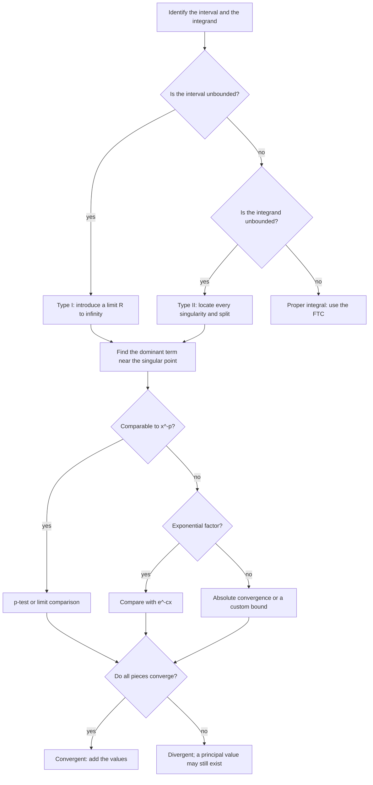

# Improper Integrals

> [Calculus](../README.md) · Level: Advanced · Prerequisites: [The Fundamental Theorem of Calculus](../07-fundamental-theorem-of-calculus/README.md), [Techniques of Integration](../08-techniques-of-integration/README.md), [Applications of Integration](../09-applications-of-integration/README.md), [Limits](../01-limits/README.md) · Estimated time: 7 h

## 1. Introduction

The Riemann integral was built for a bounded function on a closed bounded interval. Two things can go
wrong with that setting: the interval can be unbounded, or the function can be unbounded. **Improper
integrals** extend the definition to these cases by taking limits. There is no new integration technique;
there is a new *interpretation* of the integral sign, and a new question — does the limit exist?

$$\int_a^{\infty}f(x)\,dx:=\lim_{R\to\infty}\int_a^Rf(x)\,dx,
\qquad
\int_a^b f(x)\,dx:=\lim_{t\to b^-}\int_a^t f(x)\,dx .$$

The first is an **improper integral of the first kind** (unbounded interval); the second is of the
**second kind** (unbounded integrand). A single problem can be of both kinds, and then it is split.

Two ideas organise the whole topic.

* **Convergence is a property of the tail (or of the blow-up), not of the whole integrand.** Changing a
  function on a bounded interval, or changing the lower limit, cannot turn a convergent improper integral
  into a divergent one. What matters is how fast the integrand decays at infinity, or how fast it grows at
  a singularity.
* **Comparison replaces computation.** Most improper integrals that arise in practice cannot be evaluated
  in closed form — $\int e^{-x^2}dx$ has no elementary antiderivative — but their convergence can be
  decided by comparing them with a small library of benchmark integrals, above all
  $\int_1^\infty x^{-p}dx$ and $\int_0^1x^{-p}dx$.

The benchmark integrals are the **$p$-test**, and its answer is a clean dichotomy:

$$\int_1^{\infty}\frac{dx}{x^p}\ \text{converges}\iff p>1,
\qquad
\int_0^1\frac{dx}{x^p}\ \text{converges}\iff p<1 .$$

The exponent flips because the two integrals look at opposite ends of the same substitution $x=1/t$. The
boundary case $p=1$ diverges logarithmically in both settings: $\int_1^R dx/x=\ln R$, and
$\int_\varepsilon^1 dx/x=-\ln\varepsilon$.

Improper integrals are where calculus meets analysis. The definitions are limits, the theorems are
comparison theorems, and the interesting examples are often functions whose antiderivatives do not exist in
closed form. The **gamma function** $\Gamma(s)=\int_0^\infty x^{s-1}e^{-x}dx$ is the canonical example of an
improper integral that defines a new function; the **Gaussian integral** $\int_{-\infty}^{\infty}e^{-x^2}dx$
is the canonical example of an integral that converges although no elementary antiderivative exists; and
the **Laplace transform** $\mathcal{L}\{f\}(s)=\int_0^\infty e^{-st}f(t)\,dt$ is the canonical example of a
family of improper integrals indexed by a parameter.

## 2. Prerequisites

**From the integral** ([Integrals](../06-integrals/README.md)): Riemann sums and the definite integral;
integrability of continuous and monotone functions; linearity, additivity and monotonicity; the estimate
$m(b-a)\le\int_a^bf\le M(b-a)$; area as an integral.

**From the Fundamental Theorem** ([The Fundamental Theorem of Calculus](../07-fundamental-theorem-of-calculus/README.md)):
both parts, and the fact that the FTC applies only on a closed bounded interval on which the integrand is
defined and continuous. The whole point of this topic is what happens when those hypotheses fail.

**From techniques** ([Techniques of Integration](../08-techniques-of-integration/README.md)): substitution,
integration by parts, partial fractions, trigonometric integrals, and the standard antiderivatives. In
particular, $\int x^{s-1}dx=x^s/s$ for $s\ne0$ and $\int dx/x=\ln\lvert x\rvert$ are used constantly.

**From limits** ([Limits](../01-limits/README.md)): limits at infinity, one-sided limits, the algebra of
limits, and the fact that a monotone increasing function bounded above has a finite limit. L'Hôpital's rule
and the growth comparison $x^n\ll e^{cx}$ as $x\to\infty$ ([Applications of Derivatives](../05-applications-of-derivatives/README.md))
are used to justify convergence at infinity.

**From the real numbers** ([Real Analysis](../../14-real-analysis/README.md)): completeness, in the form
"every non-empty set of real numbers bounded above has a least upper bound", which is what guarantees that
a bounded monotone function has a limit. This topic uses it but does not prove it.

**From applications of integration** ([Applications of Integration](../09-applications-of-integration/README.md)):
densities and expectation, work to escape to infinity, and present value of a perpetual stream. Those
formulas are the reason improper integrals are not a curiosity.

## 3. Learning Objectives

After working through this tutorial you will be able to:

1. Define improper integrals of the first and second kind as limits, and distinguish convergence from
   divergence and from the value of the integral.
2. Split an improper integral at every singularity and at a convenient interior point, and explain why a
   single limit across a singularity is not the definition.
3. Prove the $p$-test on $[1,\infty)$ and on $(0,1]$, including the boundary case $p=1$.
4. State and prove the comparison test for non-negative integrands, and use it to decide convergence
   without computing an antiderivative.
5. State and prove the limit-comparison test in its three cases, and recognise the cases in which it gives
   no information.
6. Define absolute and conditional convergence, prove that absolute convergence implies convergence, and
   show that $\int_1^\infty\sin x/x\,dx$ converges conditionally.
7. Define the gamma function as an improper integral, prove its convergence for $s>0$, derive
   $\Gamma(s+1)=s\Gamma(s)$, and deduce $\Gamma(n)=(n-1)!$ and $\Gamma(1/2)=\sqrt\pi$.
8. Explain why $\int_0^\infty e^{-x^2}dx$ converges even though $e^{-x^2}$ has no elementary
   antiderivative, and outline how its value $\sqrt\pi/2$ is obtained.
9. Define the Laplace transform, compute it for $1$, $e^{at}$, $t$ and $\sin\omega t$, and state a
   sufficient condition for its existence.
10. Identify and avoid the standard errors: treating $\infty$ as a number, missing an interior singularity,
    confusing a Cauchy principal value with an improper integral, and using comparison in the wrong
    direction.

## 4. Intuition

**The tail as a sequence of areas.** For $f\ge0$ on $[a,\infty)$, define
$F(R)=\int_a^Rf(x)\,dx$. As $R$ increases, $F(R)$ increases. The improper integral is the limit of this
increasing sequence of areas. It converges exactly when the areas are bounded above. There are only two
possibilities for a non-decreasing quantity: it tends to a finite limit, or it tends to $+\infty$. There is
no oscillation for a non-negative integrand, which is why the comparison test is so powerful.

**Two ways to fail to be bounded.** At infinity, $\int_1^\infty x^{-p}dx$ accumulates area from
ever-farther-out pieces. If $p>1$ the pieces shrink fast enough that the total is finite; if $p\le1$ they do
not. Near zero, $\int_0^1x^{-p}dx$ accumulates area from ever-taller spikes. If $p<1$ the spikes are
integrable; if $p\ge1$ they are not. The harmonic integral $p=1$ sits exactly on the boundary and diverges
in both cases, but for different reasons: $\ln R\to\infty$ at infinity, and $-\ln\varepsilon\to\infty$ at
zero.

**The ruler.** The $p$-integrals are the ruler against which other integrands are measured. Polynomials,
rational functions and logarithms are all comparable to some $x^{-p}$; exponentials decay faster than every
$x^{-p}$, so they always converge at infinity; logarithms grow slower than every positive power, so they
usually do not affect convergence. The hierarchy
$\ln x\ll x^\varepsilon\ll x^p\ll e^{cx}$ (for $0<\varepsilon<p$ and $c>0$) is the working summary.

**A finite area under an infinite spike.** The integral $\int_0^1x^{-1/2}dx=2$ is finite although the integrand tends to $+\infty$ at $0$. The spike is narrow enough: the part above height $y$ is the interval $0<x<1/y^2$, whose area is $\int_0^{1/y^2}x^{-1/2}dx=2/y$, which tends to $0$ as $y\to\infty$. For $\int_0^1x^{-1}dx$ the part above height $y$ is $0<x<1/y$, whose area $\int_0^{1/y}dx/x$ is already infinite for every $y>0$; the spike is too fat, and the integral diverges logarithmically.

**Convergence is not computability.** A convergent improper integral is a number; it need not be a number
you can write with elementary functions. The Gaussian integral converges because its tail is bounded by
$e^{-x}$, not because someone found an antiderivative. The gamma function is defined by an integral precisely
because its values are not elementary for general $s$.

**The principal value is a different question.** The symmetric limit
$\lim_{R\to\infty}\int_{-R}^Rf$ can exist when the two-sided improper integral does not: the positive and
negative parts can cancel. That symmetric limit is the **Cauchy principal value**, and it is a useful
regularisation, but it is not the integral. The integral $\int_{-\infty}^{\infty}x\,dx$ diverges; its
principal value is $0$.

## 5. Formal Definition

### 5.1 Improper integrals of the first kind

Let $f$ be defined on $[a,\infty)$ and Riemann integrable on $[a,R]$ for every $R>a$. The **improper
integral** is

$$\int_a^{\infty}f(x)\,dx:=\lim_{R\to\infty}\int_a^Rf(x)\,dx,$$

provided the limit exists and is finite; then the integral **converges**. If the limit is $+\infty$,
$-\infty$, or does not exist, the integral **diverges**. Similarly,

$$\int_{-\infty}^{b}f(x)\,dx:=\lim_{R\to-\infty}\int_R^bf(x)\,dx,$$

and for a two-sided integral, choose any $c\in\mathbb{R}$ and define

$$\int_{-\infty}^{\infty}f(x)\,dx:=\int_{-\infty}^{c}f(x)\,dx+\int_c^{\infty}f(x)\,dx,$$

with the integral converging only if **both** integrals on the right converge. If both converge, the sum is
independent of $c$ (additivity of the proper integral).

The definition is exactly the $\varepsilon$-$\delta$ statement of the limit: $\int_a^\infty f=L$ means that
for every $\varepsilon>0$ there is $R_0$ such that $\left\lvert\int_a^Rf-L\right\rvert<\varepsilon$ for all
$R>R_0$.

### 5.2 Improper integrals of the second kind

Let $f$ be defined on $[a,b)$ and Riemann integrable on $[a,t]$ for every $t\in(a,b)$. If $f$ is unbounded
near $b$, define

$$\int_a^bf(x)\,dx:=\lim_{t\to b^-}\int_a^tf(x)\,dx,$$

provided the limit exists and is finite. Similarly, if $f$ is unbounded near $a$,

$$\int_a^bf(x)\,dx:=\lim_{t\to a^+}\int_t^bf(x)\,dx.$$

If $f$ has a singularity at an interior point $c\in(a,b)$, the definition is

$$\int_a^bf(x)\,dx:=\int_a^cf(x)\,dx+\int_c^bf(x)\,dx,$$

with each summand defined by a one-sided limit; the integral converges only if **both** converge.

The singular point is often a vertical asymptote, but it need not be: a function can be unbounded on every
neighbourhood of a point without being undefined there (for example, a function with increasingly tall
spikes). The definition only requires that $f$ be unbounded near the point.

### 5.3 Mixed integrals and splitting

An integral can be improper at both ends, or improper at an endpoint and at infinity. The procedure is
always the same: **split at every singular point and at a convenient interior point, and require every
piece to converge.** For example,

$$\int_0^{\infty}\frac{dx}{\sqrt x\,(1+x)}
=\int_0^{1}\frac{dx}{\sqrt x\,(1+x)}+\int_1^{\infty}\frac{dx}{\sqrt x\,(1+x)},$$

where the first piece is of the second kind at $0$ and the second is of the first kind at infinity. The
original integral converges only if both pieces do.

Splitting is not a technicality. The limit $\lim_{R\to\infty}\int_{-R}^R f$ is **not** the definition of
$\int_{-\infty}^{\infty}f$; see §5.4. A single limit that crosses a singularity is also not the definition:
$\lim_{\varepsilon\to0^+}\left(\int_{-1}^{-\varepsilon}+\int_{\varepsilon}^{1}\right)$ is a principal value,
not the integral.

### 5.4 The Cauchy principal value

When the symmetric limit exists but the improper integral does not, it is called the **Cauchy principal
value**:

$$\operatorname{PV}\int_{-\infty}^{\infty}f(x)\,dx:=\lim_{R\to\infty}\int_{-R}^{R}f(x)\,dx,$$

$$\operatorname{PV}\int_a^bf(x)\,dx:=\lim_{\varepsilon\to0^+}\left(\int_a^{c-\varepsilon}f+\int_{c+\varepsilon}^bf\right)
\quad(c\in(a,b)).$$

The principal value is a different object. It is useful in contour integration and in Hilbert-transform
theory, but it does not make a divergent integral convergent. The standard example is
$f(x)=1/x$: $\operatorname{PV}\int_{-1}^1dx/x=0$, while $\int_{-1}^1dx/x$ diverges because
$\int_0^1dx/x=\infty$ and $\int_{-1}^0dx/x=-\infty$.

## 6. Mathematical Notation

| Symbol | Read as | Meaning |
|---|---|---|
| $\displaystyle\int_a^{\infty}f$ | integral from $a$ to infinity | $\lim_{R\to\infty}\int_a^Rf$ |
| $\displaystyle\int_{-\infty}^{b}f$ | integral from minus infinity to $b$ | $\lim_{R\to-\infty}\int_R^bf$ |
| $\displaystyle\int_a^b f$ with $f$ unbounded at $b$ | improper integral | $\lim_{t\to b^-}\int_a^tf$ |
| $R\to\infty$ | $R$ tends to infinity | the limit is taken over all large $R$ |
| $t\to b^-$ | $t$ tends to $b$ from below | one-sided limit |
| converges | the limit exists and is finite | a number is assigned |
| diverges | the limit is infinite or does not exist | no number is assigned |
| $\operatorname{PV}$ | Cauchy principal value | symmetric limit, not the integral |
| $\Gamma(s)$ | gamma of $s$ | $\int_0^\infty x^{s-1}e^{-x}dx$ |
| $\mathcal{L}\{f\}(s)$ | Laplace transform of $f$ | $\int_0^\infty e^{-st}f(t)\,dt$ |
| $f\sim g$ | asymptotic equivalence | $f/g\to1$ |
| $f=O(g)$ | big-O | $\lvert f\rvert\le C\lvert g\rvert$ eventually |
| $f=o(g)$ | little-o | $f/g\to0$ |
| $p$-test | the benchmark test | convergence of $\int x^{-p}$ |
| $\int_a^\infty f<\infty$ | the integral converges | shorthand for convergence, not an inequality of numbers |

**Reading aloud.** "$\int_1^\infty dx/x^p$ converges if and only if $p>1$" is read "the integral from one
to infinity of $x$ to the minus $p$ converges exactly when $p$ is greater than one". The symbol $\infty$ in
the limit is not a number and is never substituted; it is a shorthand for "as $R$ becomes arbitrarily
large".

## 7. Core Concepts

### 7.1 Why a limit is unavoidable

The FTC computes $\int_a^bf=F(b)-F(a)$ when $F'=f$ on $[a,b]$ and everything is finite. It says nothing about $\int_a^\infty f$, because there is no endpoint at which to evaluate $F$. The only available definition is the limit of proper integrals. For example,

$$\int_1^R\frac{dx}{x^2}=\left[-\frac1x\right]_1^R=1-\frac1R,$$

and the limit as $R\to\infty$ is $1$. The computation of the definite integral is routine; the new step is the limit, and it is the step that decides convergence.

### 7.2 Improper integrals of the first kind

For $f$ integrable on $[a,R]$ for every $R>a$, the definition is in §5.1. The tail is what matters:

**Proposition 1.** For any $c>a$, the integral $\int_a^\infty f$ converges if and only if $\int_c^\infty f$ converges, and then
$\int_a^\infty f=\int_a^cf+\int_c^\infty f$.

*Proof.* For $R>c$, additivity of the proper integral gives
$\int_a^Rf=\int_a^cf+\int_c^Rf$. The first term is a constant; hence the left side has a finite limit as $R\to\infty$ exactly when the second term does, and the limits add. $\blacksquare$

Consequently, changing $f$ on a bounded interval, or changing the lower limit, cannot affect convergence. It changes the value but not the question. This is why convergence tests only examine the behaviour "near infinity".

### 7.3 Improper integrals of the second kind

For a singularity at $b$, the definition is in §5.2. Two examples set the pattern:

$$\int_\varepsilon^1\frac{dx}{\sqrt x}=\left[2\sqrt x\right]_\varepsilon^1=2-2\sqrt\varepsilon\longrightarrow2,$$

so $\int_0^1x^{-1/2}dx$ converges to $2$, although the integrand is unbounded. But

$$\int_\varepsilon^1\frac{dx}{x}=\left[\ln x\right]_\varepsilon^1=-\ln\varepsilon\longrightarrow+\infty,$$

so $\int_0^1x^{-1}dx$ diverges. The difference is the exponent: $x^{-1/2}$ has a narrow enough spike, $x^{-1}$ does not. The $p$-test of §7.6 makes this precise.

### 7.4 Splitting at every singularity

A single limit that crosses a singularity is not the definition. The standard illustration is

$$\int_{-1}^1\frac{dx}{x^2}.$$

Formally applying the FTC gives $\left[-1/x\right]_{-1}^1=-1-1=-2$, which is impossible because the integrand is positive. The FTC does not apply: $1/x^2$ is not defined at $0$, which lies inside the interval. The correct computation splits at $0$:

$$\int_\varepsilon^1\frac{dx}{x^2}=\frac1\varepsilon-1\longrightarrow\infty,$$

and similarly on $[-1,-\varepsilon]$; both pieces diverge, so the integral diverges. The number $-2$ is an artefact of ignoring a singularity.

The same happens with $\int_0^\pi\sec^2x\,dx$: the integrand blows up at $\pi/2$, and
$\int_0^{\pi/2-\varepsilon}\sec^2x\,dx=\tan(\pi/2-\varepsilon)\to\infty$. The "value" $\tan\pi-\tan0=0$ is meaningless.

**Principal values.** For $f=1/x$ on $[-1,1]$, each side diverges logarithmically, yet the symmetric limit is
$\operatorname{PV}\int_{-1}^1dx/x=\lim_{\varepsilon\to0^+}(\int_{-1}^{-\varepsilon}+\int_\varepsilon^1)=0$.
The cancellation is real but it is not the integral: the positive and negative areas are both infinite. A divergent integral has no value, and a principal value is not a substitute.

### 7.5 The $p$-test on $[1,\infty)$

**Theorem 2.** For real $p$,
$$\int_1^{\infty}\frac{dx}{x^p}\ \text{converges}\iff p>1,$$
and when $p>1$ the value is $\dfrac{1}{p-1}$.

*Proof.* For $p\ne1$,

$$\int_1^R\frac{dx}{x^p}=\left[\frac{x^{1-p}}{1-p}\right]_1^R=\frac{R^{1-p}-1}{1-p}.$$

If $p>1$, then $1-p<0$, so $R^{1-p}=1/R^{p-1}\to0$, and the limit is $\frac{-1}{1-p}=\frac{1}{p-1}$, finite. If $p<1$, then $1-p>0$, so $R^{1-p}\to+\infty$ and the integral diverges to $+\infty$. If $p=1$,

$$\int_1^R\frac{dx}{x}=\ln R\longrightarrow+\infty,$$

so the integral diverges. Hence convergence exactly for $p>1$. $\blacksquare$

The boundary case is worth memorising separately: $p=1$ diverges like $\ln R$, not like a power. The series analogue, $\sum1/n^p$ converges iff $p>1$, is the integral test, and the same computation proves it.

### 7.6 The $p$-test on $(0,1]$

**Theorem 3.** For real $p$,
$$\int_0^1\frac{dx}{x^p}\ \text{converges}\iff p<1,$$
and when $p<1$ the value is $\dfrac{1}{1-p}$.

*Proof.* For $p\ne1$ and $0<\varepsilon<1$,

$$\int_\varepsilon^1\frac{dx}{x^p}=\left[\frac{x^{1-p}}{1-p}\right]_\varepsilon^1=\frac{1-\varepsilon^{1-p}}{1-p}.$$

If $p<1$, then $1-p>0$, so $\varepsilon^{1-p}\to0$ and the limit is $\frac{1}{1-p}$, finite. If $p>1$, then $1-p<0$, so $\varepsilon^{1-p}=\varepsilon^{-(p-1)}\to+\infty$ and the integral diverges. If $p=1$,

$$\int_\varepsilon^1\frac{dx}{x}=-\ln\varepsilon\longrightarrow+\infty,$$

so it diverges. Hence convergence exactly for $p<1$. $\blacksquare$

**Duality.** The substitution $x=1/t$ maps $\int_1^\infty x^{-p}dx$ to $\int_0^1t^{p-2}dt$. Writing the integrand as $t^{-q}$ with $q=2-p$, the $p$-test at zero gives convergence exactly when $q<1$, which is $p>1$. The two $p$-tests are therefore the same statement seen through the substitution; this is why the inequality reverses.

### 7.7 The comparison test

**Theorem 4 (comparison).** Let $f,g$ be integrable on $[a,R]$ for every $R>a$, and suppose
$0\le f(x)\le g(x)$ for all $x\ge a$. Then
(i) if $\int_a^\infty g$ converges, then $\int_a^\infty f$ converges and
$0\le\int_a^\infty f\le\int_a^\infty g$;
(ii) if $\int_a^\infty f$ diverges, then $\int_a^\infty g$ diverges.

*Proof.* Let $F(R)=\int_a^Rf$ and $G(R)=\int_a^Rg$. Both are non-decreasing because their integrands are non-negative. Since $f\le g$, $F(R)\le G(R)$ for every $R$. If $\int g=G<\infty$, then $F(R)\le G(R)\le G$ for all $R$; a non-decreasing function bounded above has a finite limit (completeness of $\mathbb{R}$). Hence $\int f$ converges, and taking limits in $F(R)\le G(R)$ gives the inequality. Part (ii) is the contrapositive of (i): if $\int g$ converged, (i) would make $\int f$ converge. $\blacksquare$

**Direction matters.** The usable implications are: a convergent integral of the *larger* function forces convergence of the smaller; a divergent integral of the *smaller* function forces divergence of the larger. The other two combinations — the larger function diverging, or the smaller function converging — tell you nothing. Formally, from $f\le g$ and $\int g<\infty$ conclude $\int f<\infty$; from $f\le g$ and $\int f=\infty$ conclude $\int g=\infty$.

*Examples.* Since $e^{-x^2}\le e^{-x}$ for $x\ge1$ and $\int_1^\infty e^{-x}dx=e^{-1}$, the Gaussian integral converges on $[1,\infty)$. Since $\frac{1}{2x}\le\frac{1}{x+1}$ for $x\ge1$ and $\int_1^\infty\frac{dx}{2x}$ diverges, $\int_1^\infty\frac{dx}{x+1}$ diverges.

### 7.8 The limit-comparison test

The comparison test requires an inequality. The next test replaces it by a limit, which is usually easier to check.

**Theorem 5 (limit comparison).** Let $f,g>0$ on $[a,\infty)$ and integrable on $[a,R]$ for every $R>a$. Suppose $\lim_{x\to\infty}f(x)/g(x)=L$.

1. If $0<L<\infty$, then $\int_a^\infty f$ and $\int_a^\infty g$ either both converge or both diverge.
2. If $L=0$ and $\int_a^\infty g$ converges, then $\int_a^\infty f$ converges.
3. If $L=\infty$ and $\int_a^\infty g$ diverges, then $\int_a^\infty f$ diverges.

*Proof.* (1) Take $\varepsilon=L/2>0$. There is $X$ such that for $x\ge X$,
$\left\lvert f/g-L\right\rvert<L/2$, hence $\frac{L}{2}g(x)<f(x)<\frac{3L}{2}g(x)$. Apply the comparison test on $[X,\infty)$ in both directions: if $\int g$ converges then $\int f$ converges by the upper bound; if $\int f$ converges then $\int g$ converges by the lower bound. Since convergence is unaffected by the finite piece on $[a,X]$ (Proposition 1), the claim follows.
(2) For $\varepsilon=1$ there is $X$ with $f(x)<g(x)$ for $x\ge X$; comparison gives convergence.
(3) For $M=1$ there is $X$ with $f(x)>g(x)$ for $x\ge X$; since $\int g$ diverges, comparison gives divergence of $\int f$. $\blacksquare$

*Examples.* $\dfrac{x+1}{x^3+2}\sim\dfrac{1}{x^2}$ as $x\to\infty$, so its integral on $[1,\infty)$ converges. $\dfrac{1}{x+\sqrt x}\sim\dfrac1x$, so its integral diverges. The test also has one-sided versions at a finite singularity, with $x\to b^-$ in place of $x\to\infty$.

**No information cases.** If $L=0$ and $\int g$ diverges, nothing follows: $f=1/x^2$ and $g=1/x$ have $f/g=1/x\to0$, $\int g$ diverges, but $\int f$ converges. If $L=\infty$ and $\int g$ converges, nothing follows either. The test is a tool for the two endpoints of the comparison, not a universal decision procedure.

### 7.9 Absolute convergence

**Definition.** The improper integral $\int_a^\infty f$ **converges absolutely** if $\int_a^\infty\lvert f\rvert$ converges. It **converges conditionally** if $\int_a^\infty f$ converges but $\int_a^\infty\lvert f\rvert$ diverges.

**Theorem 6.** If $\int_a^\infty\lvert f\rvert$ converges, then $\int_a^\infty f$ converges, and
$\left\lvert\int_a^\infty f\right\rvert\le\int_a^\infty\lvert f\rvert$.

*Proof.* Define $f^+=\max(f,0)$ and $f^-=\max(-f,0)$. Then $f=f^+-f^-$, $\lvert f\rvert=f^++f^-$, and $0\le f^\pm\le\lvert f\rvert$. By the comparison test, both $\int f^+$ and $\int f^-$ converge. Hence $\int f=\int f^+-\int f^-$ converges. For the inequality, the triangle inequality for proper integrals gives
$\left\lvert\int_a^Rf\right\rvert\le\int_a^R\lvert f\rvert\le\int_a^\infty\lvert f\rvert$; letting $R\to\infty$ gives the result. $\blacksquare$

The converse is false, and the standard counterexample is important.

**Theorem 7.** $\displaystyle\int_1^{\infty}\frac{\sin x}{x}\,dx$ converges conditionally.

*Proof.* Integrate by parts with $u=1/x$, $dv=\sin x\,dx$, so $du=-dx/x^2$ and $v=-\cos x$:

$$\int_1^R\frac{\sin x}{x}dx
=\left[-\frac{\cos x}{x}\right]_1^R-\int_1^R\frac{\cos x}{x^2}dx
=-\frac{\cos R}{R}+\cos1-\int_1^R\frac{\cos x}{x^2}dx .$$

As $R\to\infty$, $\cos R/R\to0$, and the last integral converges absolutely because $\lvert\cos x/x^2\rvert\le1/x^2$ and $\int_1^\infty x^{-2}dx$ converges. Therefore the limit exists, so the integral converges.

For absolute divergence, use $\lvert\sin x\rvert\ge\sin^2x$ and $\sin^2x=(1-\cos2x)/2$:

$$\frac{\lvert\sin x\rvert}{x}\ge\frac{\sin^2x}{x}=\frac{1}{2x}-\frac{\cos2x}{2x}.$$

Now $\int_1^R\frac{dx}{2x}=\frac12\ln R\to\infty$, while $\int_1^\infty\frac{\cos2x}{2x}dx$ converges by the same integration-by-parts argument as above (with $2x$ in place of $x$). A divergent term minus a convergent term diverges, so $\int_1^\infty\lvert\sin x\rvert/x\,dx$ diverges. Hence the original integral converges but not absolutely. $\blacksquare$

The mechanism is cancellation: the positive and negative humps of $\sin x$ almost cancel, and the leftover is summable. Absolute convergence forbids this; conditional convergence exploits it.

### 7.10 The gamma function

**Definition.** For $s>0$,
$$\Gamma(s):=\int_0^{\infty}x^{s-1}e^{-x}dx.$$

**Theorem 8 (convergence).** The integral converges exactly for $s>0$.

*Proof.* Split at $1$. On $(0,1]$, $e^{-x}\le1$, so $0\le x^{s-1}e^{-x}\le x^{s-1}$; the integral $\int_0^1x^{s-1}dx$ converges exactly when $s-1>-1$, that is $s>0$, by the $p$-test with $p=1-s<1$. If $s\le0$, the integrand is $\ge x^{s-1}e^{-1}$ near $0$ (since $e^{-x}\ge e^{-1}$ there), and $\int_0^1x^{s-1}dx$ diverges, so the gamma integral diverges near $0$.

On $[1,\infty)$, polynomial growth is dominated by exponential decay: there is a constant $C$ with $x^{s-1}\le Ce^{x/2}$ for $x\ge1$ (because $e^{x/2}/x^{s-1}\to\infty$). Hence
$0\le x^{s-1}e^{-x}\le Ce^{-x/2}$, and $\int_1^\infty e^{-x/2}dx=2e^{-1/2}$ converges. Comparison gives convergence. Therefore the integral converges exactly for $s>0$. $\blacksquare$

**Theorem 9 (recurrence).** For $s>0$, $\Gamma(s+1)=s\Gamma(s)$.

*Proof.* Integrate by parts with $u=x^s$, $dv=e^{-x}dx$:

$$\int_0^Rx^se^{-x}dx=\left[-x^se^{-x}\right]_0^R+s\int_0^Rx^{s-1}e^{-x}dx .$$

The boundary term is $-R^se^{-R}\to0$ as $R\to\infty$ (exponential beats polynomial) and is $0$ at the lower limit because $s>0$. Letting $R\to\infty$ gives $\Gamma(s+1)=s\Gamma(s)$. $\blacksquare$

**Corollary 10 (factorial).** For every integer $n\ge1$, $\Gamma(n)=(n-1)!$.

*Proof.* $\Gamma(1)=\int_0^\infty e^{-x}dx=1=0!$. If $\Gamma(n)=(n-1)!$, then $\Gamma(n+1)=n\Gamma(n)=n!$. Induction. $\blacksquare$

**Corollary 11.** $\Gamma(1/2)=\sqrt\pi$.

*Proof.* Substitute $x=t^2$, $dx=2t\,dt$:

$$\Gamma(1/2)=\int_0^\infty x^{-1/2}e^{-x}dx
=\int_0^\infty\frac{1}{t}e^{-t^2}2t\,dt
=2\int_0^\infty e^{-t^2}dt=\sqrt\pi,$$

using the Gaussian value $\int_0^\infty e^{-t^2}dt=\sqrt\pi/2$ derived in §7.11. $\blacksquare$

Then $\Gamma(3/2)=\frac12\Gamma(1/2)=\sqrt\pi/2$, $\Gamma(5/2)=\frac32\cdot\frac12\sqrt\pi=\frac34\sqrt\pi$, and in general
$\Gamma(n+\frac12)=\frac{(2n)!}{4^nn!}\sqrt\pi$ for $n\ge0$. The gamma function interpolates the factorial: $\Gamma(n)=(n-1)!$ for integers but $\Gamma$ is defined for all $s>0$, and it is the standard extension of the factorial to non-integers.

### 7.11 The Gaussian integral

**Theorem 12 (convergence).** $\displaystyle\int_0^{\infty}e^{-x^2}dx$ converges, and
$\displaystyle\int_0^{\infty}e^{-x^2}dx=\frac{\sqrt\pi}{2}$.

*Proof of convergence.* On $[0,1]$ the integrand is continuous, so the integral is proper. On $[1,\infty)$, $x^2\ge x$, hence $e^{-x^2}\le e^{-x}$, and
$\int_1^\infty e^{-x}dx=e^{-1}<\infty$. Comparison gives convergence. $\blacksquare$

**No elementary antiderivative.** The function $e^{-x^2}$ is continuous and elementary, but it has no elementary antiderivative: there is no finite expression built from polynomials, exponentials, logarithms, trigonometric functions and their inverses whose derivative is $e^{-x^2}$. This is a theorem of Liouville (1835), decided algorithmically by the Risch algorithm. The definite integral nevertheless exists, because convergence is a statement about the limit of $\int_0^Re^{-x^2}dx$, not about a formula for the antiderivative. Numerical quadrature computes it: $\int_0^1e^{-x^2}dx\approx0.746824$.

**The value.** The classical derivation squares the integral and uses polar coordinates:

$$I^2=\left(\int_0^\infty e^{-x^2}dx\right)\left(\int_0^\infty e^{-y^2}dy\right)
=\int_0^\infty\int_0^\infty e^{-(x^2+y^2)}dx\,dy
=\int_0^{\pi/2}\int_0^\infty e^{-r^2}r\,dr\,d\theta
=\frac{\pi}{2}\cdot\frac12=\frac{\pi}{4}.$$

Hence $I=\sqrt\pi/2$. The step from the iterated integral to polar coordinates is Fubini's theorem plus the change-of-variables formula for double integrals, treated in multivariable calculus. For non-negative integrands the interchange is justified by Tonelli's theorem, so the derivation is rigorous once those tools are available; the convergence itself needs none of them.

**Tail bound.** For $R>0$ and $x\ge R$, $x^2\ge Rx$, so
$\int_R^\infty e^{-x^2}dx\le\int_R^\infty e^{-Rx}dx=e^{-R^2}/R$. This is the standard estimate for the normal tail.

### 7.12 The Laplace transform preview

**Definition.** For a function $f$ on $[0,\infty)$ and a real parameter $s$, the **Laplace transform** is

$$\mathcal{L}\{f\}(s):=\int_0^{\infty}e^{-st}f(t)\,dt,$$

an improper integral for each $s$. It converges for those $s$ for which the limit exists.

**Existence criterion.** If there are constants $M,c$ with $\lvert f(t)\rvert\le Me^{ct}$ for all $t\ge0$ (that is, $f$ has **exponential order** $c$), then for $s>c$,
$\lvert e^{-st}f(t)\rvert\le Me^{-(s-c)t}$, and $\int_0^\infty Me^{-(s-c)t}dt=M/(s-c)<\infty$. Absolute convergence follows by comparison. The set of $s$ for which the transform converges is a half-line of the form $(s_0,\infty)$ or $[s_0,\infty)$ (or all of $\mathbb{R}$), called the **region of convergence**; the endpoint may require a separate (conditional) check.

**Basic transforms.** For $s>0$,

$$\mathcal{L}\{1\}(s)=\int_0^\infty e^{-st}dt=\frac1s,$$
$$\mathcal{L}\{t\}(s)=\int_0^\infty te^{-st}dt=\frac{1}{s^2},$$
$$\mathcal{L}\{e^{at}\}(s)=\int_0^\infty e^{-(s-a)t}dt=\frac{1}{s-a}\quad(s>a),$$
$$\mathcal{L}\{\sin\omega t\}(s)=\frac{\omega}{s^2+\omega^2}\quad(s>0).$$

For the sine, integrate by parts twice: with $I=\int_0^\infty e^{-st}\sin\omega t\,dt$ and
$J=\int_0^\infty e^{-st}\cos\omega t\,dt$, one obtains $I=(\omega/s)J$ and $J=1/s-(\omega/s)I$; eliminating $J$ gives $I(1+\omega^2/s^2)=\omega/s^2$, hence $I=\omega/(s^2+\omega^2)$.

**Linearity and the derivative rule.** For functions of exponential order and constants $a,b$,
$\mathcal{L}\{af+bg\}=a\mathcal{L}\{f\}+b\mathcal{L}\{g\}$. If $f$ is continuously differentiable and both $f$ and $f'$ are of exponential order, integration by parts gives

$$\mathcal{L}\{f'\}(s)=\int_0^\infty e^{-st}f'(t)dt
=\left[e^{-st}f(t)\right]_0^\infty+s\int_0^\infty e^{-st}f(t)dt
=s\mathcal{L}\{f\}(s)-f(0).$$

The boundary term at infinity vanishes for $s$ in the region of convergence; at $0$ it is $-f(0)$. This rule is why the Laplace transform turns linear differential equations into algebraic equations, a subject developed in [Differential Equations](../../16-differential-equations/README.md). The **inverse problem** — recovering $f$ from $\mathcal{L}\{f\}$ — requires complex analysis, and the **Fourier transform** is the analogue with $s$ imaginary; see [Complex Analysis](../../15-complex-analysis/README.md).

## 8. Formulas and Properties

### 8.1 The definitions and the tests at a glance

| Object | Definition | Convergence criterion |
|---|---|---|
| $\int_a^\infty f$ | $\lim_{R\to\infty}\int_a^Rf$ | the limit exists and is finite |
| $\int_{-\infty}^b f$ | $\lim_{R\to-\infty}\int_R^bf$ | the limit exists and is finite |
| $\int_{-\infty}^\infty f$ | $\int_{-\infty}^cf+\int_c^\infty f$ | both pieces converge |
| $\int_a^b f$, singularity at $b$ | $\lim_{t\to b^-}\int_a^tf$ | the limit exists and is finite |
| $\int_a^b f$, singularity at $c\in(a,b)$ | $\int_a^cf+\int_c^bf$ | both pieces converge |
| $p$-test at infinity | $\int_1^\infty x^{-p}dx$ | converges iff $p>1$ |
| $p$-test at zero | $\int_0^1x^{-p}dx$ | converges iff $p<1$ |
| Comparison | $0\le f\le g$ | $\int g<\infty\Rightarrow\int f<\infty$ |
| Limit comparison | $f/g\to L\in(0,\infty)$ | both converge or both diverge |
| Absolute convergence | $\int\lvert f\rvert<\infty$ | implies $\int f$ converges |

### 8.2 The $p$-test as a table

| Integral | $p>1$ | $p=1$ | $p<1$ |
|---|---|---|---|
| $\int_1^\infty x^{-p}dx$ | converges, value $\frac{1}{p-1}$ | diverges ($\ln R$) | diverges |
| $\int_0^1x^{-p}dx$ | diverges | diverges ($-\ln\varepsilon$) | converges, value $\frac{1}{1-p}$ |

The two rows are dual under $x\mapsto1/x$; the boundary $p=1$ is logarithmic in both.

### 8.3 The growth hierarchy

For $x\to\infty$, and for any exponents $q\in\mathbb{R}$, $\varepsilon>0$, $p>0$ and constant $c>0$,

$$(\ln x)^q=o(x^\varepsilon),\qquad x^\varepsilon=o(e^{cx}),\qquad e^{-cx}=o(x^{-p}).$$

In words: logarithms grow slower than every positive power, powers grow slower than every exponential, and every exponential decay beats every power decay. Consequences:

* An exponential factor $e^{-cx}$ with $c>0$ makes any polynomial or power factor integrable at infinity: $\int_1^\infty x^ne^{-cx}dx<\infty$ for every $n$.
* A logarithmic factor is decided by its own exponent: $\int_2^\infty\frac{dx}{x(\ln x)^q}$ converges iff $q>1$, by the substitution $u=\ln x$; this is a $p$-test in $u$, not in $x$.
* A logarithmic factor can create a singularity at a finite point: $\int_1^2\frac{dx}{x\ln x}$ diverges because $\ln x\to0$ at $x=1$, even though the integrand is perfectly finite at $x=2$.

### 8.4 Standard improper integrals

All formulas are for the stated ranges of the parameters; $C$ is not needed because the integrals are definite.

| Integral | Value or behaviour |
|---|---|
| $\int_1^\infty x^{-p}dx$ | $1/(p-1)$ for $p>1$; diverges for $p\le1$ |
| $\int_0^1x^{-p}dx$ | $1/(1-p)$ for $p<1$; diverges for $p\ge1$ |
| $\int_0^\infty e^{-ax}dx$ | $1/a$ for $a>0$ |
| $\int_0^\infty x^ne^{-ax}dx$ | $n!/a^{n+1}$ for $a>0$, $n\in\mathbb{N}_0$ |
| $\int_0^\infty e^{-x^2}dx$ | $\sqrt\pi/2$ |
| $\int_{-\infty}^\infty e^{-x^2}dx$ | $\sqrt\pi$ |
| $\int_0^\infty x^{s-1}e^{-x}dx$ | $\Gamma(s)$ for $s>0$ |
| $\int_0^\infty\frac{dx}{x^2+a^2}$ | $\frac{\pi}{2a}$ for $a>0$ |
| $\int_0^\infty\frac{dx}{1+x^p}$ | $\frac{\pi}{p\sin(\pi/p)}$ for $p>1$ |
| $\int_2^\infty\frac{dx}{x(\ln x)^q}$ | $1/((q-1)(\ln2)^{q-1})$ for $q>1$; diverges for $q\le1$ |
| $\int_0^1\ln x\,dx$ | $-1$ |
| $\int_0^1x^a\ln x\,dx$ | $-1/(a+1)^2$ for $a>-1$ |
| $\int_0^\infty\frac{\sin x}{x}dx$ | $\pi/2$ (conditionally convergent) |

The formula for $\int_0^\infty dx/(1+x^p)$ follows from the beta integral
$\int_0^\infty u^{a-1}/(1+u)du=\pi/\sin(\pi a)$ for $0<a<1$ after $x=u^{1/p}$; the value for $p=2$ is $\pi/2$, consistent with the arctangent formula. The Dirichlet integral $\int_0^\infty\sin x/x\,dx=\pi/2$ is not elementary; it is proved by contour integration or by a Laplace-transform argument, both treated in [Complex Analysis](../../15-complex-analysis/README.md).

### 8.5 Operations on improper integrals

**Linearity.** If $\int_a^\infty f$ and $\int_a^\infty g$ both converge, then for constants $\alpha,\beta$,
$\int_a^\infty(\alpha f+\beta g)=\alpha\int_a^\infty f+\beta\int_a^\infty g$. This follows by taking limits in the linearity of proper integrals. Linearity can fail when the two integrals diverge: for $f=1/x$ and $g=1/(x+1)$ on $[1,\infty)$, both $\int f$ and $\int g$ diverge, yet $\int_1^\infty(f-g)dx=\int_1^\infty dx/(x(x+1))=\ln2$ converges. Writing $\int(f-g)=\int f-\int g$ would give the undefined expression $\infty-\infty$.

**Additivity.** If $a<c<\infty$ and $\int_a^\infty f$ converges, then
$\int_a^\infty f=\int_a^cf+\int_c^\infty f$, and conversely convergence of the right side implies convergence of the left. This is Proposition 1.

**Substitution.** Let $\varphi:[\alpha,\beta)\to[a,b)$ be strictly increasing and continuously differentiable, with $\varphi(\alpha)=a$ and $\varphi(u)\to b$ as $u\to\beta$ (where $\beta$ may be $+\infty$). Then
$\int_a^bf(x)\,dx=\int_\alpha^\beta f(\varphi(u))\varphi'(u)\,du$, and one side converges if and only if the other does. The proof takes $t=\varphi(s)$ in the proper integral and lets $s\to\beta$; the monotonicity makes the limits correspond.

**Integration by parts.** If $u,v$ are continuously differentiable on $[a,\infty)$ and the boundary term $\lim_{R\to\infty}u(R)v(R)$ exists, then
$\int_a^\infty u\,dv=\left[uv\right]_{x=a}^{x=\infty}-\int_a^\infty v\,du$, provided two of the three terms converge; then the third does too. The proof applies the proper parts formula on $[a,R]$ and passes to the limit.

**Absolute convergence.** If $\int_a^\infty\lvert f\rvert$ converges, then $\int_a^\infty f$ converges and the triangle inequality holds (Theorem 6). The converse fails (Theorem 7).

### 8.6 Cauchy principal value versus improper integral

| Expression | Improper integral | Cauchy principal value |
|---|---|---|
| $\int_{-1}^1\frac{dx}{x}$ | diverges | $0$ |
| $\int_{-1}^1\frac{dx}{x^2}$ | diverges ($+\infty$) | does not exist (both sides $+\infty$) |
| $\int_{-\infty}^\infty x\,dx$ | diverges | $0$ |
| $\int_{-\infty}^\infty\frac{dx}{1+x^2}$ | $\pi$ | $\pi$ (agrees because convergent) |

The principal value is the symmetric limit defined in §5.4. It agrees with the improper integral whenever the improper integral converges, because then both one-sided limits exist and the symmetric limit is their sum. It can exist when the improper integral does not, and then it is not the integral.

### 8.7 A decision procedure

To decide whether an improper integral converges:

1. **Find all singularities.** Mark every finite endpoint at which the integrand is unbounded, and every unbounded end of the interval.
2. **Split** at each one, and at a convenient interior point if the interval is doubly infinite.
3. **On each piece, identify the behaviour** as $x\to$ the singular point: what is the dominant term? Compute the limit comparison ratio with a benchmark $x^{-p}$, $e^{-cx}$, $\ln x$, and so on.
4. **Apply the appropriate test**: $p$-test, comparison, limit comparison, absolute convergence.
5. **If a piece diverges, the whole integral diverges.** If all pieces converge, add the values.
6. **Distinguish value from convergence.** A convergent integral may have no elementary value; a divergent integral may have a finite Cauchy principal value.

## 9. Step-by-Step Examples

### Example 1 (easy): A convergent $p$-integral at infinity

Evaluate $\displaystyle\int_1^{\infty}\frac{dx}{x^2}$.

*Set-up.* By definition,

$$\int_1^{\infty}\frac{dx}{x^2}=\lim_{R\to\infty}\int_1^R x^{-2}dx
=\lim_{R\to\infty}\left[-\frac1x\right]_1^R
=\lim_{R\to\infty}\left(1-\frac1R\right)=1 .$$

*Check.* The $p$-test with $p=2>1$ predicts convergence and value $1/(p-1)=1$, in agreement. The tail
$\int_R^\infty x^{-2}dx=1/R$ tends to $0$, which is why the total is finite.

### Example 2 (easy): A convergent $p$-integral at zero

Evaluate $\displaystyle\int_0^1\frac{dx}{\sqrt x}$.

*Set-up.* The integrand is unbounded at $0$, so

$$\int_0^1x^{-1/2}dx=\lim_{\varepsilon\to0^+}\int_\varepsilon^1x^{-1/2}dx
=\lim_{\varepsilon\to0^+}\left[2\sqrt x\right]_\varepsilon^1
=\lim_{\varepsilon\to0^+}\left(2-2\sqrt\varepsilon\right)=2 .$$

*Check.* The $p$-test at zero with $p=1/2<1$ predicts convergence and value $1/(1-p)=2$, in agreement.
The spike at $0$ has finite area: the part of the region above height $y$ is $0<x<1/y^2$, whose area is
$\int_0^{1/y^2}x^{-1/2}dx=2/y\to0$ as $y\to\infty$. More simply, the substitution $x=t^2$ turns the
integral into $\int_0^12\,dt=2$.

### Example 3 (medium): A two-sided integral

Evaluate $\displaystyle\int_{-\infty}^{\infty}\frac{dx}{1+x^2}$.

*Set-up.* Split at $0$:

$$\int_{-\infty}^{\infty}\frac{dx}{1+x^2}
=\int_{-\infty}^{0}\frac{dx}{1+x^2}+\int_0^{\infty}\frac{dx}{1+x^2}.$$

For the second,

$$\int_0^R\frac{dx}{1+x^2}=\left[\arctan x\right]_0^R=\arctan R\longrightarrow\frac{\pi}{2}.$$

For the first, substitute $x=-u$:
$\int_{-R}^0\frac{dx}{1+x^2}=\int_0^R\frac{du}{1+u^2}\to\frac{\pi}{2}$. Therefore the integral converges
and equals $\pi$.

*Check.* The integrand is even, so the two halves must be equal; each is $\pi/2$, and the total is
$\pi\approx3.1416$. The area under the bell-shaped curve $1/(1+x^2)$ is finite even though the curve has a
long tail, because the tail behaves like $1/x^2$.

### Example 4 (medium): Integration by parts with a limit

Evaluate $\displaystyle\int_0^{\infty}xe^{-x}dx$.

*Set-up.* For $R>0$, integrate by parts with $u=x$, $dv=e^{-x}dx$: $du=dx$, $v=-e^{-x}$,

$$\int_0^Rxe^{-x}dx=\left[-xe^{-x}\right]_0^R+\int_0^Re^{-x}dx
=-Re^{-R}+\left[-e^{-x}\right]_0^R
=-Re^{-R}+1-e^{-R}.$$

As $R\to\infty$, $Re^{-R}\to0$ and $e^{-R}\to0$, so the limit is $1$.

*Check.* Differentiate the antiderivative $-(x+1)e^{-x}$:
$\frac{d}{dx}[-(x+1)e^{-x}]=-e^{-x}+(x+1)e^{-x}=xe^{-x}$. ✓ The result also matches $\Gamma(2)=1!=1$.

### Example 5 (medium): When a logarithm changes the answer

Decide whether $\displaystyle\int_2^{\infty}\frac{dx}{x\ln x}$ and
$\displaystyle\int_2^{\infty}\frac{dx}{x(\ln x)^2}$ converge, and evaluate the second if it does.

*Set-up.* Substitute $u=\ln x$, $du=dx/x$. When $x=2$, $u=\ln2$; as $x\to\infty$, $u\to\infty$. Hence

$$\int_2^R\frac{dx}{x\ln x}=\int_{\ln2}^{\ln R}\frac{du}{u}
=\ln\ln R-\ln\ln2\longrightarrow+\infty,$$

so the first integral diverges. For the second,

$$\int_2^R\frac{dx}{x(\ln x)^2}=\int_{\ln2}^{\ln R}\frac{du}{u^2}
=\left[-\frac1u\right]_{\ln2}^{\ln R}
=\frac{1}{\ln2}-\frac{1}{\ln R}\longrightarrow\frac{1}{\ln2}.$$

*Check.* Differentiate $-1/\ln x$:
$\frac{d}{dx}(-1/\ln x)=1/(x(\ln x)^2)$. ✓ The two integrals differ only by one power of $\ln x$, yet one
diverges logarithmically in $\ln x$ and the other converges. This is the $p$-test in the variable
$u=\ln x$: convergence iff the exponent of $u$ exceeds $1$.

### Example 6 (medium): A logarithmic singularity at zero

Evaluate $\displaystyle\int_0^1\ln x\,dx$.

*Set-up.* The integrand tends to $-\infty$ at $0$, so

$$\int_0^1\ln x\,dx=\lim_{\varepsilon\to0^+}\int_\varepsilon^1\ln x\,dx
=\lim_{\varepsilon\to0^+}\left[x\ln x-x\right]_\varepsilon^1
=\lim_{\varepsilon\to0^+}\left(-1-\varepsilon\ln\varepsilon+\varepsilon\right).$$

Since $\varepsilon\ln\varepsilon\to0$ as $\varepsilon\to0^+$ (a standard limit, proved by L'Hôpital:
$\ln\varepsilon/(1/\varepsilon)\to0$), the value is $-1$.

*Check.* The result is negative, as it must be because $\ln x<0$ on $(0,1)$; the area between the curve and
the axis is $1$. The antiderivative is verified by differentiating $x\ln x-x$: $\ln x+1-1=\ln x$. ✓

### Example 7 (medium): Completing the square

Evaluate $\displaystyle\int_0^{\infty}\frac{dx}{x^2+2x+2}$.

*Set-up.* Complete the square: $x^2+2x+2=(x+1)^2+1$. Then

$$\int_0^R\frac{dx}{(x+1)^2+1}=\left[\arctan(x+1)\right]_0^R
=\arctan(R+1)-\frac{\pi}{4}\longrightarrow\frac{\pi}{2}-\frac{\pi}{4}=\frac{\pi}{4}.$$

*Check.* The integrand is positive and behaves like $1/x^2$ at infinity, so convergence is guaranteed by
the $p$-test; the value $\pi/4\approx0.785$ is plausible because the integrand is below $1/(1+x^2)$ but of
the same order. Differentiating $\arctan(x+1)$ gives $1/((x+1)^2+1)$, as required.

### Example 8 (medium): Comparison without an antiderivative

Show that $\displaystyle\int_1^{\infty}\frac{x+1}{x^3+2}\,dx$ converges.

*Set-up.* For $x\ge1$, $x+1\le2x$ and $x^3+2\ge x^3$, so

$$0\le\frac{x+1}{x^3+2}\le\frac{2x}{x^3}=\frac{2}{x^2}.$$

Since $\int_1^\infty2x^{-2}dx=2$ converges, the comparison test gives convergence. No antiderivative is
needed.

*Check by limit comparison.* The ratio of the integrand to $1/x^2$ is
$\frac{x^2(x+1)}{x^3+2}=\frac{x^3+x^2}{x^3+2}\to1$, so the limit-comparison test with $L=1$ also gives
convergence. A partial-fraction decomposition would give the exact value, but it is not necessary for the
question asked.

### Example 9 (medium): A gamma value

Compute $\Gamma(5/2)$.

*Set-up.* By the recurrence $\Gamma(s+1)=s\Gamma(s)$,

$$\Gamma\left(\frac52\right)=\frac32\Gamma\left(\frac32\right)
=\frac32\cdot\frac12\Gamma\left(\frac12\right)
=\frac34\sqrt\pi .$$

*Check.* The integral definition gives
$\Gamma(5/2)=\int_0^\infty x^{3/2}e^{-x}dx$; the integrand is positive and behaves like $x^{3/2}$ near $0$
(integrable) and decays exponentially at infinity, so the value is finite. Numerically,
$\frac34\sqrt\pi\approx1.3293$.

### Example 10 (hard): The Gaussian integral

Show that $\displaystyle\int_0^{\infty}e^{-x^2}dx$ converges, and outline why its value is $\sqrt\pi/2$.

*Convergence.* On $[0,1]$ the integrand is continuous. On $[1,\infty)$, $x^2\ge x$, so
$0<e^{-x^2}\le e^{-x}$, and $\int_1^\infty e^{-x}dx=e^{-1}$. Comparison gives convergence. Hence the
integral converges.

*Value.* Let $I=\int_0^\infty e^{-x^2}dx$. Then

$$I^2=\int_0^\infty\int_0^\infty e^{-(x^2+y^2)}dx\,dy
=\int_0^{\pi/2}\int_0^\infty e^{-r^2}r\,dr\,d\theta
=\frac{\pi}{2}\cdot\frac12=\frac{\pi}{4},$$

so $I=\sqrt\pi/2$. The middle step is the polar-coordinate change of variables; the integrand is
non-negative, so the interchange of integrals is justified (Tonelli). The antiderivative of $e^{-x^2}$ is
not elementary, but the definite integral is a perfectly well-defined number.

*Check.* Numerically, $\sqrt\pi/2\approx0.8862269$, and $\int_0^1e^{-x^2}dx\approx0.746824$ (a proper
integral). The tail bound $\int_R^\infty e^{-x^2}dx\le e^{-R^2}/R$ controls the truncation error in any
numerical evaluation. ✓

### Example 11 (hard): Two Laplace transforms

For $s>0$, compute $\mathcal{L}\{t\}(s)$ and $\mathcal{L}\{\sin\omega t\}(s)$.

*For $t$.* Integrate by parts with $u=t$, $dv=e^{-st}dt$: $du=dt$, $v=-e^{-st}/s$,

$$\int_0^Rte^{-st}dt=\left[-\frac{te^{-st}}{s}\right]_0^R+\frac1s\int_0^Re^{-st}dt
=-\frac{Re^{-sR}}{s}-\frac{e^{-sR}}{s^2}+\frac{1}{s^2}\longrightarrow\frac{1}{s^2}.$$

*For the sine.* Let $I=\int_0^\infty e^{-st}\sin\omega t\,dt$ and
$J=\int_0^\infty e^{-st}\cos\omega t\,dt$. Integrate by parts twice. First,
$I=\frac{\omega}{s}J$ (the boundary term vanishes at both ends for $s>0$). Second,
$J=\frac1s-\frac{\omega}{s}I$. Substituting,

$$I=\frac{\omega}{s}\left(\frac1s-\frac{\omega}{s}I\right)
=\frac{\omega}{s^2}-\frac{\omega^2}{s^2}I,$$

so $I\left(1+\frac{\omega^2}{s^2}\right)=\frac{\omega}{s^2}$ and
$I=\frac{\omega}{s^2+\omega^2}$.

*Check.* Setting $\omega=0$ gives $0$, as it should; as $s\to\infty$, $I\to0$. Since $s$ has dimension of inverse time, the transform has dimension of time, consistent with $\omega/(s^2+\omega^2)$. For $s=0$ the integral $\int_0^\infty\sin\omega t\,dt$ diverges, which is why $s>0$ is required.

## 10. Visual Explanations

The decision tree below is the order in which to ask the questions. The first two questions are about the
*type* of the integral; the rest are about the *test*.

The table summarises which benchmark matches which singularity.

| Behaviour near the singular point | Benchmark | Convergence condition |
|---|---|---|
| power $x^{-p}$ at $\infty$ | $\int_1^\infty x^{-p}dx$ | $p>1$ |
| power $x^{-p}$ at $0$ | $\int_0^1x^{-p}dx$ | $p<1$ |
| exponential $e^{-cx}$, $c>0$ at $\infty$ | $\int_1^\infty e^{-cx}dx$ | always |
| $1/(x(\ln x)^q)$ at $\infty$ | $u=\ln x$ | $q>1$ |
| $1/(x(\ln x)^q)$ at $x=1$ | $u=\ln x$ | $q<1$ |
| $\lvert\ln x\rvert^q$ at $0$ | $\int_0^1\lvert\ln x\rvert^qdx$ | $q>-1$ |
| oscillatory $\sin x/x$ at $\infty$ | integration by parts | conditional |

## 11. Common Mistakes

1. **Treating $\infty$ as a number.** Writing $\left[\ln x\right]_1^\infty=\ln\infty-0$ is meaningless. Write $\lim_{R\to\infty}\ln R=+\infty$ and conclude divergence.
2. **Missing an interior singularity.** $\int_{-1}^1x^{-2}dx$ is not $\left[-1/x\right]_{-1}^1=-2$; the integrand is positive, and the integral diverges. Split at $0$ before applying the FTC.
3. **Using one limit across a singularity.** $\lim_{\varepsilon\to0^+}(\int_{-1}^{-\varepsilon}+\int_\varepsilon^1)$ is a Cauchy principal value, not the improper integral. The integral requires the two one-sided limits separately.
4. **Assuming symmetry gives zero.** $\int_{-\infty}^{\infty}x\,dx$ diverges; its principal value is $0$. A convergent two-sided integral is the sum of two convergent one-sided integrals, not a symmetric limit.
5. **Applying the FTC on an interval where the integrand is not continuous.** $\int_0^\pi\sec^2x\,dx$ has a singularity at $\pi/2$; $\tan\pi-\tan0=0$ is not the value (the integral diverges).
6. **Comparison in the wrong direction.** From $0\le f\le g$ and $\int g$ divergent, nothing follows about $\int f$; from $0\le f\le g$ and $\int f$ convergent, nothing follows about $\int g$. The usable implications are $\int g<\infty\Rightarrow\int f<\infty$ and $\int f=\infty\Rightarrow\int g=\infty$.
7. **Misusing limit comparison at the endpoints.** $L=0$ with $\int g$ divergent, or $L=\infty$ with $\int g$ convergent, gives no information. The example $f=1/x^2$, $g=1/x$ has $L=0$ and opposite behaviours.
8. **Forgetting the boundary case $p=1$.** Both $\int_1^\infty dx/x$ and $\int_0^1dx/x$ diverge, logarithmically. The strict inequalities $p>1$ and $p<1$ are not cosmetic.
9. **Concluding divergence from a failure to integrate.** $e^{-x^2}$ has no elementary antiderivative, but $\int_0^\infty e^{-x^2}dx$ converges. Convergence is a property of the limit, not of a formula.
10. **Confusing $\int f$ with $\int\lvert f\rvert$.** Absolute convergence implies convergence, not conversely; $\int_1^\infty\sin x/x\,dx$ is the standard counterexample.
11. **Requiring only one piece of a split integral to converge.** A split integral converges only if *every* piece converges; one divergent piece makes the whole divergent.
12. **Arithmetic with divergent integrals.** $\int(f-g)=\int f-\int g$ requires both integrals to converge. On $[1,\infty)$, $\int dx/x$ and $\int dx/(x+1)$ both diverge, while $\int(1/x-1/(x+1))dx=\int dx/(x(x+1))=\ln2$ converges; writing $\infty-\infty$ is meaningless.

## 12. Applications

**Probability and statistics.** Every continuous distribution with unbounded support is normalised by an improper integral. The normal tail is bounded by $\int_R^\infty e^{-x^2}dx\le e^{-R^2}/R$; the exponential density integrates exactly; the Pareto density $f(x)=(\alpha/x^{\alpha+1})$ on $[1,\infty)$ has a finite mean exactly when $\alpha>1$, a direct instance of the $p$-test. The gamma and beta functions are improper integrals, and they normalise the gamma, chi-squared, beta and $t$ distributions.

**Differential equations and transforms.** The Laplace transform is an improper integral in the parameter $s$; its region of convergence and its derivative rule in §7.12 turns linear ODEs into algebra. The Fourier transform is the same idea on the imaginary axis, and the Fourier inversion formula is itself an improper integral. Solutions of the heat and wave equations are written as such integrals.

**Physics.** The work to escape a gravitational field is $\int_R^\infty GMm/r^2\,dr=GMm/R$, a convergent improper integral; the electrostatic energy of a charge distribution involves $1/r$ tails, and the convergence of the total energy is exactly a $p$-test question. In quantum mechanics, normalisation of a wave function is an integral of $\lvert\psi\rvert^2$ over all space, and the Gaussian ground state is normalised by the Gaussian integral.

**Economics and finance.** A perpetuity paying $C$ per unit time discounted at rate $r$ has present value $\int_0^\infty Ce^{-rt}dt=C/r$; the convergence condition $r>0$ is exactly the condition that the discount rate be positive. If the payment grows at rate $g<r$, the value is $C/(r-g)$; if $g\ge r$, the integral diverges, which is the mathematical statement that the present value is infinite.

**Numerical analysis.** Truncating an improper integral at $R$ leaves a tail error; the estimates of §8 (for example $e^{-R^2}/R$ for the Gaussian) are what make a numerical answer trustworthy. Adaptive quadrature routines switch to a transformation or an asymptotic expansion when the integrand has an endpoint singularity.

**Series.** The integral test for $\sum a_n$ compares the series with $\int_1^\infty f(x)dx$ when $f$ is positive, decreasing and $f(n)=a_n$; the $p$-test for series is the $p$-test of this topic. The error of the approximation is bounded by the tail integral, which is an improper integral even when the series is elementary.

## 13. Exercises

The problem set is in [exercises.md](exercises.md): **36 problems** in four levels — **Beginner** (12: direct $p$-integrals, exponentials, a divergent comparison and basic two-sided integrals), **Intermediate** (10: arctangent and logarithmic integrals, integration by parts, comparison and limit comparison), **Advanced** (9: convergence with parameters, the conditional integral $\cos x/x$, logarithmic singularities, a Laplace transform and a substitution) and **Challenge** (5: a proof of the limit-comparison test, $\Gamma(1/2)$, a spike construction, uniform continuity at infinity and a beta-type integral). Each problem cites its section, and the numbering is continuous from 1 to 36.

## 14. Solutions

Full worked solutions are in [solutions.md](solutions.md), with the same numbering. Every convergence claim is justified by a named test, every value is checked by differentiation or by an independent method, and the exercises that are designed to trap a common error say so explicitly.

## 15. Summary

* An improper integral is a limit of proper integrals: over $[a,R]$ as $R\to\infty$, or over $[a,t]$ as $t\to b^-$.
* **Split at every singularity** and at a convenient interior point; the integral converges only if every piece converges.
* **$p$-test at infinity:** $\int_1^\infty x^{-p}dx$ converges iff $p>1$, with value $1/(p-1)$.
* **$p$-test at zero:** $\int_0^1x^{-p}dx$ converges iff $p<1$, with value $1/(1-p)$.
* **Comparison:** $0\le f\le g$ and $\int g<\infty$ imply $\int f<\infty$; dually, $\int f=\infty$ and $f\le g$ imply $\int g=\infty$.
* **Limit comparison:** if $f/g\to L\in(0,\infty)$, the integrals share their convergence behaviour; the cases $L=0$ and $L=\infty$ are one-sided.
* **Absolute convergence implies convergence**, and $\lvert\int f\rvert\le\int\lvert f\rvert$; the converse fails for $\int_1^\infty\sin x/x\,dx$.
* **Gamma:** $\Gamma(s)=\int_0^\infty x^{s-1}e^{-x}dx$ converges for $s>0$, satisfies $\Gamma(s+1)=s\Gamma(s)$, and $\Gamma(n)=(n-1)!$, $\Gamma(1/2)=\sqrt\pi$.
* **Gaussian:** $\int_0^\infty e^{-x^2}dx=\sqrt\pi/2$; convergence follows by comparison with $e^{-x}$, even though no elementary antiderivative exists.
* **Laplace:** $\mathcal{L}\{f\}(s)=\int_0^\infty e^{-st}f(t)dt$ converges for $s$ above the exponential order of $f$, and $\mathcal{L}\{f'\}=s\mathcal{L}\{f\}-f(0)$.
* **Principal values are not integrals.** A finite symmetric limit does not make a divergent integral convergent.
* Always check the type, the singularities, the comparison direction and the boundary exponent.

## 16. Further Learning

* [Applications of Integration](../09-applications-of-integration/README.md) — where densities, work and centroids first produce improper integrals.
* [Techniques of Integration](../08-techniques-of-integration/README.md) — substitution and parts, used on every page of this topic.
* [The Fundamental Theorem of Calculus](../07-fundamental-theorem-of-calculus/README.md) — why the FTC stops at a singularity, and what replaces it.
* [Real Analysis](../../14-real-analysis/README.md) — completeness, monotone limits, uniform convergence and the rigorous theory of the Riemann integral.
* [Probability](../../10-probability/README.md) — densities, tails, expectation and the normal distribution.
* [Differential Equations](../../16-differential-equations/README.md) — the Laplace transform as a solution method.
* [Complex Analysis](../../15-complex-analysis/README.md) — contour integration, principal values and the inverse Laplace transform.
* [Numerical Analysis](../../19-numerical-analysis/README.md) — quadrature for improper integrals and tail-error estimates.

**Standard references.** Tom M. Apostol, *Calculus, Volume I*, 2nd ed., Chapters 10–11. Michael Spivak, *Calculus*, 4th ed., Part III (improper integrals and the gamma function). James Stewart, *Calculus: Early Transcendentals*, 8th ed., Chapter 7 (improper integrals). Walter Rudin, *Principles of Mathematical Analysis*, 3rd ed., Chapter 6, for the rigorous treatment. For the gamma and beta functions: Emil Artin, *The Gamma Function* (Holt, Rinehart and Winston, 1964).
