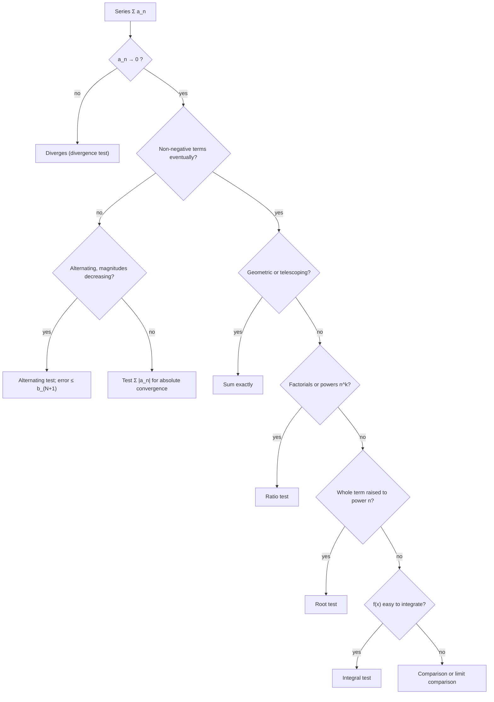

# Sequences and Series

> [Mathematics](../../README.md) › [Calculus](../README.md) · Level: Advanced · Prerequisites: [Limits](../01-limits/README.md), [Derivatives](../03-derivatives/README.md), [Differentiation Rules](../04-differentiation-rules/README.md), [Integrals](../06-integrals/README.md), [The Fundamental Theorem of Calculus](../07-fundamental-theorem-of-calculus/README.md), [Techniques of Integration](../08-techniques-of-integration/README.md), [Sequences and Series (elementary)](../../06-precalculus/05-sequences-and-series/README.md) · Estimated time: 12 h

## 1. Introduction

The [elementary treatment of sequences and series](../../06-precalculus/05-sequences-and-series/README.md)
answers one question exactly — when does a geometric series converge, and to what — and supplies the
machinery of sigma notation, telescoping sums and the binomial theorem. That is the *arithmetic* of
infinite sums. This topic is the *analysis* of infinite sums: deciding convergence in general, estimating
the error of a truncation, and turning sums of numbers into sums of functions.

Two limit processes are at work, and confusing them is the most common source of error. A **sequence**
$(a_n)$ has a limit $L$ when its terms eventually stay close to $L$. A **series** $\sum a_n$ has a sum $S$
when the sequence of **partial sums** $S_N = a_1 + \cdots + a_N$ converges to $S$. Every test below is a
device for answering the second question without computing the first: typical series such as
$\sum 1/n^3$ have no elementary closed form, but whether they converge is usually decidable.

Sections 7.1–7.2 treat sequences, culminating in the **monotone convergence theorem**, the engine behind
almost every convergence proof. Sections 7.3–7.8 treat numerical series: the divergence test, the integral
test and $p$-series, comparison and limit comparison, the ratio and root tests, and the alternating series
test together with absolute convergence. Sections 7.9–7.11 pass to power series, term-by-term calculus and
Taylor's theorem with the Lagrange remainder. Section 7.12 derives the standard series and records their
intervals of validity, and §7.13 introduces Fourier series as an expansion in a *different basis*.

The subject is not a list of tests to memorise. Each test compares the unknown series with something known —
a geometric series, an integral, or a bounded monotone sequence — and the shape of the coefficients
predicts the test: factorials point to ratios, $n$-th powers to roots, denominators with a decreasing factor
to integrals, and alternating signs to the Leibniz test.

## 2. Prerequisites

**Sequences and limits** — the $\varepsilon$–$N$ definition, limit laws, the squeeze theorem and the limits
$\lim(1+1/n)^n = e$, $\lim n^{1/n} = 1$, from [Limits](../01-limits/README.md). Sigma notation, the finite
and infinite geometric series, telescoping and the binomial theorem from
[Sequences and Series (elementary)](../../06-precalculus/05-sequences-and-series/README.md).

**Differentiation** — derivatives of $e^x$, $\sin x$, $\cos x$, $\ln x$, $\arctan x$, $(1+x)^\alpha$; the
product, quotient and chain rules; the mean value theorem, from [Derivatives](../03-derivatives/README.md)
and [Differentiation Rules](../04-differentiation-rules/README.md).

**Integration** — the definite integral, its monotonicity in the integrand, and the fundamental theorem in
both directions, from [Integrals](../06-integrals/README.md) and
[The Fundamental Theorem of Calculus](../07-fundamental-theorem-of-calculus/README.md); partial fractions
and substitution from [Techniques of Integration](../08-techniques-of-integration/README.md).

**Algebra and proof** — inequalities, induction, and the **completeness axiom**: every non-empty set of
reals bounded above has a least upper bound. This axiom is the source of the monotone convergence theorem,
hence of the whole subject.

## 3. Learning Objectives

1. Decide whether a sequence converges, using limit laws, the squeeze theorem or the monotone convergence
   theorem, and prove convergence of recursively defined sequences.
2. Compute partial sums, and evaluate geometric and telescoping series exactly.
3. Use the divergence test in the correct direction and explain with a counterexample why its converse fails.
4. Apply the integral test, the $p$-series test, comparison and limit comparison, checking every hypothesis.
5. Prove and apply the ratio and root tests, and explain why $L=1$ is inconclusive and why the root test is
   stronger.
6. Prove the alternating series test, bound the error by $b_{N+1}$, and distinguish absolute from
   conditional convergence.
7. Compute a power series' radius of convergence and its full interval, **including endpoints**.
8. Differentiate and integrate power series term by term and justify the operations by uniform convergence.
9. Derive the Maclaurin series of $e^x$, $\sin x$, $\cos x$, $\ln(1+x)$, $1/(1-x)$, $\arctan x$ and
   $(1+x)^\alpha$, with intervals of validity.
10. Write Taylor's theorem with the Lagrange remainder and use it to bound approximation errors.
11. Evaluate limits and solve simple ODEs by series.

## 4. Intuition

**A series is a journey with a destination.** The partial sums are the positions of a traveller taking step
$a_1$, then $a_2$, and so on. The series converges when the positions settle down; what must become small is
the *remaining journey*, not the individual steps. This is why convergence is a statement about tails.

**The divergence test is a speed check.** If the steps do not shrink to nothing, the traveller cannot settle.
But tiny steps are not enough: the harmonic series takes steps $1/n$ and still travels forever, because
$\sum 1/n$ grows like $\ln N$.

**Comparisons are measurements against a ruler.** For non-negative terms the partial sums only increase, so
convergence is boundedness. Dominating the series by a convergent one proves convergence; being dominated by
a divergent one proves divergence. The integral test uses $\int f$ as the ruler, the ratio test uses a
geometric series with ratio $L<1$, and the root test extracts that ratio directly with an $n$-th root.

**Power series are polynomials of infinite degree, and they are rigid.** They converge on an interval about
the centre and diverge outside it; inside, they may be differentiated and integrated term by term, and their
coefficients are locked to the function: $c_n = f^{(n)}(a)/n!$. Rigidity cuts both ways — one formula
determines the function locally, but a function can be infinitely differentiable and still differ from its
Taylor series everywhere except at the centre.

**Signs change everything.** Cancellation can rescue a series whose absolute values diverge, but it depends
on the order of the terms. Rearranging a conditionally convergent series can change its sum; rearranging an
absolutely convergent one cannot.

## 5. Formal Definition

### 5.1 Sequences

**Definition 5.1.** A *sequence* is a function $a:\mathbb{N}\to\mathbb{R}$, written $(a_n)_{n\ge1}$.

**Definition 5.2.** $(a_n)$ *converges* to $L\in\mathbb{R}$ if
$\forall\varepsilon>0\ \exists N\ \forall n\ge N:\ |a_n-L|<\varepsilon$; then $L=\lim_{n\to\infty}a_n$.
It *diverges to $+\infty$* if $\forall M\ \exists N\ \forall n\ge N:\ a_n>M$.

**Definition 5.3.** $(a_n)$ is *bounded* if some $M$ satisfies $|a_n|\le M$ for all $n$; *increasing* if
$a_{n+1}\ge a_n$ for all $n$; *decreasing* if $a_{n+1}\le a_n$; *monotone* if it is one of these. A property
holds *eventually* if it holds for all $n\ge N$ for some $N$.

### 5.2 Series

**Definition 5.4.** The *partial sums* of $(a_n)$ are $S_N=\sum_{n=1}^{N}a_n$. The series $\sum_{n\ge1}a_n$
*converges* if $(S_N)$ converges, and its *sum* is $S=\lim S_N$. Otherwise it *diverges*. When it converges,
the *remainder* is $R_N = S-S_N=\sum_{n>N}a_n$, and $R_N\to0$.

**Definition 5.5.** $\sum a_n$ *converges absolutely* if $\sum|a_n|$ converges; it *converges conditionally*
if $\sum a_n$ converges but $\sum|a_n|$ diverges.

**Definition 5.6.** A *power series about $a$* is $\sum_{n\ge0}c_n(x-a)^n$. Its *interval of convergence* is
the set of $x$ where it converges; its *radius of convergence* is the number $R\in[0,+\infty]$ such that the
interval is $(a-R,a+R)$ possibly together with endpoints. That this shape always occurs is Theorem 7.23.

**Definition 5.7.** The *Taylor polynomial of degree $n$ of $f$ at $a$* is
$T_n(x)=\sum_{k=0}^{n}\frac{f^{(k)}(a)}{k!}(x-a)^k$. The *Taylor series* is the infinite version, and a
*Maclaurin series* is the case $a=0$. The function is *analytic at $a$* if it equals its Taylor series on
some interval around $a$.

## 6. Mathematical Notation

| Symbol | Read aloud | Meaning |
|---|---|---|
| $(a_n)_{n\ge1}$ | "the sequence a-n" | $a_1,a_2,a_3,\dots$ |
| $a_n\to L$ | "a-n tends to L" | convergence of the sequence |
| $\sum_{n=1}^{\infty}a_n$ | "sum from n equals one to infinity" | the series, i.e. the limit of partial sums |
| $S_N,\ R_N$ | "S-sub-N", "R-sub-N" | $N$-th partial sum, remainder after $N$ terms |
| $\varepsilon,\ N$ | "epsilon", "capital N" | tolerance, and the threshold depending on it |
| $\limsup_{n\to\infty}$ | "limit superior" | largest subsequential limit; used in root test and Hadamard's formula |
| $R$ | "radius" | radius of convergence |
| $c_n$ | "c-sub-n" | coefficient of a power series |
| $n!$ | "n factorial" | $n(n-1)\cdots1$, with $0!=1$ |
| $\binom{\alpha}{n}$ | "alpha choose n" | $\alpha(\alpha-1)\cdots(\alpha-n+1)/n!$ |
| $f^{(n)},\ T_n$ | "n-th derivative", "T-sub-n" | derivative, Taylor polynomial |
| $o(1)$, $O(g)$ | "little-oh", "big-oh" | tends to $0$; bounded by a multiple of $g$ |
| $\lvert a\rvert$, $\delta_{nm}$ | "absolute value", "Kronecker delta" | magnitude; $1$ if $n=m$, else $0$ |

Two conventions matter. First, $\mathbb{N}=\{1,2,3,\dots\}$, so series starting at $0$ are written with
explicit limits. Second, changing finitely many terms never changes convergence, only the sum, so tests only
need their hypotheses *eventually* — but error bounds depend on the starting index, which is always stated.

## 7. Core Concepts

### 7.1 Sequences and their limits

**Theorem 7.1 (limit laws).** If $a_n\to A$ and $b_n\to B$, then $a_n+b_n\to A+B$, $a_nb_n\to AB$, and
$a_n/b_n\to A/B$ provided $B\ne0$ and $b_n\ne0$.

*Proof.* For the sum, $|(a_n+b_n)-(A+B)|\le|a_n-A|+|b_n-B|$, and each term can be made $<\varepsilon/2$
beyond a threshold. For the product, write $a_nb_n-AB=(a_n-A)b_n+A(b_n-B)$ and use that $(b_n)$ is bounded
(Proposition 7.3). For the quotient, eventually $|b_n|\ge|B|/2$, so
$|1/b_n-1/B|=|B-b_n|/(|b_n||B|)\le2|b_n-B|/B^2$, and the product rule applies. $\blacksquare$

**Theorem 7.2 (squeeze).** If $a_n\le c_n\le b_n$ eventually and $a_n\to L$, $b_n\to L$, then $c_n\to L$.

*Proof.* Given $\varepsilon>0$, beyond some $N$ both $|a_n-L|<\varepsilon$ and $|b_n-L|<\varepsilon$, hence
$L-\varepsilon<a_n\le c_n\le b_n<L+\varepsilon$. $\blacksquare$

**Proposition 7.3.** Every convergent sequence is bounded. The converse fails: $(-1)^n$ is bounded and
divergent.

*Proof.* If $a_n\to L$, take $\varepsilon=1$ and $N$ with $|a_n-L|<1$ for $n\ge N$. Then
$|a_n|\le\max\{|a_1|,\dots,|a_{N-1}|,|L|+1\}$ for all $n$. The alternating sequence cannot stay within
$\tfrac12$ of any single number. $\blacksquare$

**Theorem 7.4 (monotone convergence).** An increasing sequence bounded above converges to its supremum; a
decreasing sequence bounded below converges to its infimum.

*Proof.* Let $(a_n)$ increase and let $L=\sup\{a_n\}$, which exists by completeness. Given $\varepsilon>0$,
the number $L-\varepsilon$ is not an upper bound, so $a_N>L-\varepsilon$ for some $N$; for $n\ge N$,
$L-\varepsilon<a_N\le a_n\le L$. The decreasing case follows by applying this to $(-a_n)$. $\blacksquare$

This theorem converts boundedness — a statement about all $n$ at once — into convergence, with no need to
guess the limit. It is where completeness of $\mathbb{R}$ enters the subject.

**Example 7.5.** $\lim_{n\to\infty}n^{1/n}=1$.

*Proof.* Write $n^{1/n}=1+h_n$ with $h_n\ge0$. For $n\ge2$, the binomial theorem gives
$n=(1+h_n)^n\ge1+\binom{n}{2}h_n^2$, so $n-1\ge\frac{n(n-1)}{2}h_n^2$ and hence
$h_n^2\le\frac{2(n-1)}{n(n-1)}=\frac2n$; by the squeeze theorem $h_n\to0$. $\blacksquare$

**Example 7.6 (the number $e$).** The sequence $a_n=(1+1/n)^n$ increases and is bounded by $3$, so it
converges; its limit is $e\approx2.71828$. Expanding,
$a_n=\sum_{k=0}^{n}\frac{1}{k!}\prod_{j=1}^{k-1}(1-\frac jn)$; each factor increases with $n$ and a new
positive term appears, so $(a_n)$ increases, while
$a_n\le\sum_{k=0}^{n}1/k!<1+1+\sum_{k\ge2}2^{-k+1}=3$ (strict from $k=3$ onward). Theorem 7.4 applies.

**Example 7.7 (recursive sequence).** If $a_1=1$ and $a_{n+1}=\sqrt{2+a_n}$, then $a_n\to2$. Indeed
$1\le a_n\le2$ by induction; $a_{n+1}\ge a_n\iff2+a_n\ge a_n^2\iff(a_n-2)(a_n+1)\le0$, so $(a_n)$ increases
and $L=\lim a_n$ exists. Continuity gives $L=\sqrt{2+L}$, hence $(L-2)(L+1)=0$ and $L=2$.

### 7.2 Series, geometric series, and telescoping

**Proposition 7.8 (linearity).** If $\sum a_n$ and $\sum b_n$ converge, then
$\sum(\alpha a_n+\beta b_n)=\alpha\sum a_n+\beta\sum b_n$.

*Proof.* Partial sums are linear; apply Theorem 7.1. $\blacksquare$

Linearity says nothing when a series diverges: the sum of a convergent and a divergent series diverges,
because subtracting the convergent part would otherwise make the divergent part converge.

**Theorem 7.9 (geometric series).** For $a\ne0$,
$\sum_{n\ge0}ar^n=a/(1-r)$ if $|r|<1$, and the series diverges if $|r|\ge1$.

*Proof.* $\sum_{n=0}^{N-1}ar^n=a(1-r^N)/(1-r)$ for $r\ne1$. If $|r|<1$, $r^N\to0$. If $r=1$, partial sums
are $Na$; if $r=-1$, they alternate between $a$ and $0$; if $|r|>1$, $|ar^n|\to\infty$, so Theorem 7.10
applies. $\blacksquare$

**Theorem 7.10 (divergence test).** If $\sum a_n$ converges then $a_n\to0$; equivalently, if $a_n\not\to0$
then $\sum a_n$ diverges.

*Proof.* $a_N=S_N-S_{N-1}\to S-S=0$ by Theorem 7.1. $\blacksquare$

The test is one-directional; its converse is the harmonic series.

**Theorem 7.11 (harmonic series).** $\sum_{n\ge1}1/n=\infty$.

*Proof (grouping).* The block from $2^{k-1}+1$ to $2^k$ has $2^{k-1}$ terms, each at least $1/2^k$, so its sum
is at least $1/2$. Hence $S_{2^m}\ge1+m/2\to\infty$, and the increasing partial sums are unbounded.
$\blacksquare$

**Theorem 7.12 (telescoping).** If $b_n\to b$, then $\sum_{n\ge1}(b_n-b_{n+1})=b_1-b$; if $b_n\to\pm\infty$
the series diverges to $\mp\infty$.

*Proof.* $S_N=b_1-b_{N+1}$ by cancellation. $\blacksquare$

**Proposition 7.13 (tails).** $\sum_{n\ge1}a_n$ converges iff $\sum_{n>N_0}a_n$ converges for some (hence
every) $N_0$, and then $\sum_{n\ge1}a_n=S_{N_0}+\sum_{n>N_0}a_n$.

*Proof.* The partial sums of the tail equal $S_N-S_{N_0}$. $\blacksquare$

Thus every test below needs its hypotheses only *eventually*.

### 7.3 Series with non-negative terms

**Theorem 7.14.** If $a_n\ge0$ for all $n$, then $\sum a_n$ converges if and only if $(S_N)$ is bounded above,
and then $\sum a_n=\sup_N S_N$.

*Proof.* $S_{N+1}=S_N+a_{N+1}\ge S_N$, so $(S_N)$ increases; apply Theorem 7.4. $\blacksquare$

So a non-negative series either converges or diverges to $+\infty$: no oscillation, no conditional
convergence. Every test in §7.4–7.7 decides boundedness of $(S_N)$ without computing $S_N$.

### 7.4 The integral test and $p$-series

**Theorem 7.15 (integral test).** Let $f:[1,\infty)\to\mathbb{R}$ be continuous, positive and decreasing,
and put $a_n=f(n)$. Then $\sum a_n$ converges if and only if
$\lim_{R\to\infty}\int_1^R f(x)\,dx$ exists and is finite.

*Proof.* For $x\in[k,k+1]$, monotonicity gives $f(k+1)\le f(x)\le f(k)$; integrating over an interval of
length $1$,

$$f(k+1)\ \le\ \int_k^{k+1}f(x)\,dx\ \le\ f(k).$$

Summing for $k=1,\dots,N-1$ gives $A_N-a_1\le I_N\le A_{N-1}$, where $A_N=S_N$ and $I_N=\int_1^Nf$. Both
sequences are non-decreasing because $f>0$. If $I_N\to I<\infty$, then $A_N\le a_1+I$, so the partial sums
are bounded and $\sum a_n$ converges by Theorem 7.14. If $I_N\to\infty$, then $A_{N-1}\ge I_N\to\infty$ and
the series diverges. $\blacksquare$

**Corollary 7.15.1 ($p$-series).** $\sum_{n\ge1}n^{-p}$ converges if and only if $p>1$.

*Proof.* For $p\le0$ the terms do not tend to $0$. For $p>0$, apply Theorem 7.15 to $f(x)=x^{-p}$: if
$p\ne1$, $\int_1^R x^{-p}dx=(R^{1-p}-1)/(1-p)$, finite in the limit iff $p>1$; if $p=1$, the integral is
$\ln R\to\infty$. $\blacksquare$

The two boundary cases are the reference series of the whole topic: $\sum1/n$ diverges, $\sum1/n^2$
converges.

**Example 7.15.2.** $\sum_{n\ge2}\frac{1}{n\ln n}$ diverges and
$\sum_{n\ge2}\frac{1}{n(\ln n)^2}$ converges.

*Solution.* With $u=\ln x$, $\int_2^R\frac{dx}{x(\ln x)^p}=\int_{\ln2}^{\ln R}u^{-p}du$, which is
$\ln\ln R-\ln\ln2\to\infty$ for $p=1$ and $\frac{1}{\ln2}-\frac{1}{\ln R}\to\frac{1}{\ln2}$ for $p=2$. The
integrands are positive and decreasing for $x\ge2$, so Theorem 7.15 decides both. Note that the sum of the
second series is *not* $1/\ln2\approx1.4427$: the value is about $1.94$, between the integral $1.4427$ and
$f(2)+\int_2^\infty f\approx2.48$, exactly as the proof's inequalities predict.

### 7.5 Comparison and limit comparison

**Theorem 7.16 (comparison test).** If $0\le a_n\le b_n$ eventually, then $\sum b_n$ converges implies
$\sum a_n$ converges, and $\sum a_n$ diverges implies $\sum b_n$ diverges.

*Proof.* Both series have non-negative terms, so convergence is boundedness of partial sums (Theorem 7.14).
For $N$ large, $S_N^{(a)}\le S_{N_0}^{(a)}+\sum_{n\ge1}b_n<\infty$; the second statement is the
contrapositive. $\blacksquare$

The hypothesis $a_n\ge0$ is essential: $a_n=-1$, $b_n=0$ satisfy $a_n\le b_n$, $\sum b_n$ converges and
$\sum a_n$ diverges, because monotonicity of the partial sums is what the proof uses.

**Theorem 7.17 (limit comparison test).** Let $a_n>0$, $b_n>0$ eventually and $a_n/b_n\to c\in[0,\infty]$.

* If $0<c<\infty$, then $\sum a_n$ and $\sum b_n$ both converge or both diverge.
* If $c=0$ and $\sum b_n$ converges, then $\sum a_n$ converges.
* If $c=\infty$ and $\sum b_n$ diverges, then $\sum a_n$ diverges.

*Proof.* (i) With $\varepsilon=c/2$, eventually $\frac c2b_n\le a_n\le\frac{3c}2b_n$; apply Theorem 7.16 in
each direction. (ii) Eventually $a_n\le b_n$. (iii) Eventually $a_n\ge b_n$. $\blacksquare$

The asymmetric cases give nothing when the hypothesis on $\sum b_n$ is reversed: $1/n^2$ versus $1/n$ has
$c=0$ with both converging, and $1/n$ versus $1/n^2$ has $c=\infty$ with both diverging.

**Example 7.17.1.** $\sum\frac{2n+5}{n^3-n+4}$ converges: with $b_n=1/n^2$,

$$\frac{a_n}{b_n}=\frac{n^2(2n+5)}{n^3-n+4}=\frac{2+5/n}{1-1/n^2+4/n^3}\longrightarrow2\in(0,\infty),$$

and $\sum1/n^2$ converges. The leading terms $2n/n^3=2/n^2$ dictate both the comparison series and the limit
$c=2$.

### 7.6 The ratio test

**Theorem 7.18 (ratio test).** Let $a_n\ne0$ eventually and
$L=\lim_{n\to\infty}|a_{n+1}/a_n|\in[0,\infty]$.

* If $L<1$, then $\sum a_n$ converges absolutely.
* If $L>1$ (including $L=\infty$), then $\sum a_n$ diverges.
* If $L=1$, the test is inconclusive.

*Proof.* If $L<1$, choose $r$ with $L<r<1$. Eventually $|a_{n+1}/a_n|\le r$, so for $k\ge0$
$|a_{N+k}|\le r^k|a_N|$. Then $\sum_{k\ge0}|a_{N+k}|\le|a_N|\sum_k r^k=|a_N|/(1-r)<\infty$, so $\sum|a_n|$
converges by comparison with a geometric series, and $\sum a_n$ converges by Theorem 7.21.

If $L>1$, choose $r$ with $1<r<L$. Eventually $|a_{n+1}|\ge r|a_n|$, hence
$|a_n|\ge r^{n-N}|a_N|\to\infty$; the terms do not tend to $0$, so Theorem 7.10 gives divergence.

For $L=1$ both outcomes occur: $\sum1/n$ diverges and $\sum1/n^2$ converges, while in both cases
$a_{n+1}/a_n=(n/(n+1))^p\to1$. $\blacksquare$

**Remark 7.18.1.** The proof uses only inequalities on the ratios, so the convergence statement holds with
$\limsup$ and the divergence statement with $\liminf$. If those differ, the test says nothing.

**Example 7.18.2.** $\sum n^3/5^n$ converges, since
$\frac{a_{n+1}}{a_n}=\frac15(1+\frac1n)^3\to\frac15<1$. Exponential decay beats every polynomial growth; a
factorial in the numerator beats every exponential (see Example 4 in §9).

### 7.7 The root test

**Theorem 7.19 (root test).** Let $\Lambda=\limsup_{n\to\infty}|a_n|^{1/n}$.

* If $\Lambda<1$, then $\sum a_n$ converges absolutely.
* If $\Lambda>1$, then $\sum a_n$ diverges.
* If $\Lambda=1$, the test is inconclusive.

*Proof.* If $\Lambda<1$, choose $r$ with $\Lambda<r<1$. Then eventually $|a_n|^{1/n}<r$ — otherwise
$|a_n|^{1/n}\ge r$ for infinitely many $n$, producing a subsequential limit at least $r$ — so $|a_n|<r^n$
eventually, and comparison with $\sum r^n$ gives absolute convergence.

If $\Lambda>1$, choose $r$ with $1<r<\Lambda$. Infinitely many $n$ satisfy $|a_n|^{1/n}>r$, hence
$|a_n|>r^n>1$; the terms do not tend to $0$ and Theorem 7.10 gives divergence.

For $\Lambda=1$, $\sum1/n$ and $\sum1/n^2$ both have $|a_n|^{1/n}=(n^{1/n})^{-p}\to1$ yet behave
differently. $\blacksquare$

**Remark 7.19.1 (root test is stronger).** If $a_n>0$ and $a_{n+1}/a_n\to L$, then $a_n^{1/n}\to L$ as well
(Advanced exercise 29), so the root test decides whenever the ratio test does, with the same threshold. The
converse fails: for $a_{2k}=4^{-k}$ and $a_{2k-1}=2\cdot4^{-k}$ the ratios oscillate between $1$ and
$4^{-n}$, while $a_n^{1/n}\to1/2$; the root test proves convergence and the ratio test is inconclusive.

**Example 7.19.2.** $\sum\left(\frac{3n+2}{4n+1}\right)^n$ converges, because the $n$-th root is
$\frac{3n+2}{4n+1}\to\frac34<1$. When the whole term is an $n$-th power, take the $n$-th root.

### 7.8 Alternating series and absolute convergence

**Theorem 7.20 (alternating series test).** Let $b_n\ge0$ eventually, $b_{n+1}\le b_n$ eventually, and
$b_n\to0$. Then $\sum_{n\ge1}(-1)^{n+1}b_n$ converges, and for every $N$

$$|S-S_N|\le b_{N+1},$$

with $S$ lying between $S_N$ and $S_{N+1}$.

*Proof.* The even partial sums increase, since $S_{2N+2}-S_{2N}=b_{2N+1}-b_{2N+2}\ge0$; the odd partial sums
decrease, since $S_{2N+1}-S_{2N-1}=-b_{2N}+b_{2N+1}\le0$; and $S_{2N}\le S_{2N+1}$ because
$S_{2N+1}-S_{2N}=b_{2N+1}\ge0$. So $(S_{2N})$ increases and is bounded above by $S_1$, while $(S_{2N+1})$
decreases and is bounded below by $S_0$; both converge by Theorem 7.4. Their limits agree because
$S_{2N+1}-S_{2N}=b_{2N+1}\to0$. Hence $(S_N)$ converges, and since $S$ lies between $S_N$ and $S_{N+1}$,
$|S-S_N|\le|S_{N+1}-S_N|=b_{N+1}$. $\blacksquare$

All three hypotheses are needed; §11.4 exhibits a divergent series with $b_n\ge0$, $b_n\to0$ and alternating
signs but non-monotone $b_n$.

**Example 7.20.1.** With $b_n=1/n$ the theorem gives convergence of $1-\frac12+\frac13-\cdots$; its sum is
$\ln2$ (Example 5 in §9).

**Theorem 7.21 (absolute convergence implies convergence).** If $\sum|a_n|$ converges, then $\sum a_n$
converges and $|\sum a_n|\le\sum|a_n|$.

*Proof.* Since $0\le a_n+|a_n|\le2|a_n|$, comparison gives convergence of $\sum(a_n+|a_n|)$; by linearity
$\sum a_n=\sum(a_n+|a_n|)-\sum|a_n|$ converges. The inequality is the triangle inequality for partial sums,
passed to the limit. $\blacksquare$

The converse fails: $\sum(-1)^{n+1}/n$ converges while $\sum1/n$ diverges. Such series are *conditionally
convergent*.

**Theorem 7.22 (rearrangement; Riemann).** If $\sum a_n$ converges absolutely, every rearrangement converges
to the same sum. If $\sum a_n$ converges conditionally, then for every $\alpha\in\mathbb{R}$ (and also
$\alpha=\pm\infty$) there is a bijection $\sigma:\mathbb{N}\to\mathbb{N}$ with $\sum a_{\sigma(n)}=\alpha$.

The mechanism: for a conditionally convergent series both the positive terms and the absolute values of the
negative terms have divergent sums, so the partial sums can be steered up and down at will. Concrete
instance: the rearrangement $1+\frac13-\frac12+\frac15+\frac17-\frac14+\cdots$ (two positive terms, then one
negative) converges to $\frac32\ln2$, not $\ln2$ (Challenge exercise 37).

### 7.9 Power series: radius and interval of convergence

**Theorem 7.23 (radius of convergence).** For $\sum_{n\ge0}c_n(x-a)^n$ exactly one of the following holds:
it converges only at $x=a$ ($R=0$); there is $R\in(0,\infty)$ with absolute convergence for $|x-a|<R$ and
divergence for $|x-a|>R$; or it converges for all $x$ ($R=\infty$). In every case

$$R=\frac{1}{\displaystyle\limsup_{n\to\infty}|c_n|^{1/n}},$$

with the conventions $1/0=+\infty$ and $1/\infty=0$ (Hadamard's formula).

*Proof.* Fix $x\ne a$ and apply the root test to $\sum|c_n||x-a|^n$, whose $n$-th root has limit superior
$\Lambda=|x-a|/R$. If $|x-a|<R$ then $\Lambda<1$ and the series converges absolutely; if $|x-a|>R$ then
$\Lambda>1$ and it diverges; $R=0$ gives $\Lambda=\infty$ for every $x\ne a$, and $R=\infty$ gives
$\Lambda=0$. $\blacksquare$

**Corollary 7.23.1 (ratio formula).** If $c_n\ne0$ eventually and $|c_{n+1}/c_n|\to L$, then $R=1/L$ with
the same conventions.

*Proof.* By Advanced exercise 29, $|c_n|^{1/n}\to L$; apply Hadamard. $\blacksquare$

**Theorem 7.24 (uniqueness of coefficients).** If two power series about $a$ agree on an interval containing
$a$ in its interior, their coefficients are equal.

*Proof.* Let $e_n$ be the difference of the coefficients, so $\sum e_n(x-a)^n=0$ on the interval. Setting
$x=a$ gives $e_0=0$. Dividing by $x-a$ and letting $x\to a$ gives $e_1=0$ (power series are continuous
inside their interval). Repeating gives every $e_n=0$. $\blacksquare$

**Example 7.23.2 (endpoints are extra work).** For $\sum x^n/n$ Hadamard gives $R=1$. At $x=1$ the series is
harmonic and diverges; at $x=-1$ it converges. The interval of convergence is $[-1,1)$, strictly larger than
$(-1,1)$. The radius says nothing about the endpoints: there the series is numerical and must be tested with
the tools of §7.5–7.8.

### 7.10 Differentiation and integration term by term

**Theorem 7.25 (term-by-term differentiation).** If $f(x)=\sum c_n(x-a)^n$ has radius $R>0$, then $f$ is
differentiable on $(a-R,a+R)$,

$$f'(x)=\sum_{n=1}^{\infty}nc_n(x-a)^{n-1},$$

and the differentiated series has the same radius $R$.

*Proof.* The new coefficients are $nc_n$, and $\limsup|nc_n|^{1/n}=\limsup|c_n|^{1/n}$ because
$n^{1/n}\to1$ (Example 7.5); so the radius is unchanged by Theorem 7.23. For $0<\rho<R$ both series
converge uniformly on $[a-\rho,a+\rho]$ by the Weierstrass $M$-test, since $\sum|c_n|\rho^n$ and
$\sum n|c_n|\rho^n$ converge. The standard theorem on term-by-term differentiation of series (if $\sum f_n$
converges at one point and $\sum f_n'$ converges uniformly, then $\sum f_n$ may be differentiated) applies to
$f_n(x)=c_n(x-a)^n$. $\blacksquare$

**Theorem 7.26 (term-by-term integration).** With $f$ and $R$ as above, for $|x-a|<R$

$$\int_a^xf(t)\,dt=\sum_{n=0}^{\infty}\frac{c_n}{n+1}(x-a)^{n+1},$$

the integrated series has radius $R$, and if it converges at an endpoint then the identity holds there too.

*Proof.* The coefficients $c_n/(n+1)$ give the same limit superior because $(n+1)^{1/n}\to1$. Uniform
convergence on $[a-\rho,a+\rho]$ allows term-by-term integration of continuous functions. The endpoint claim
is Abel's limit theorem, proved in [Real Analysis](../../14-real-analysis/README.md). $\blacksquare$

**Warning 7.26.1.** Differentiation can destroy endpoint convergence and integration can create it:
$\sum x^n/n^2$ converges at both endpoints but its derivative $\sum x^{n-1}/n$ diverges at $x=1$; $\sum x^n$
diverges at both endpoints while $\sum x^{n+1}/(n+1)$ converges at $x=-1$. Inside $(a-R,a+R)$ every
operation is safe.

**Example 7.26.2.** From $\frac{1}{1-x}=\sum_{n\ge0}x^n$ on $(-1,1)$,

$$\sum_{n\ge1}nx^n=\frac{x}{(1-x)^2},\qquad
\sum_{n\ge1}n^2x^n=\frac{x(1+x)}{(1-x)^3},$$

obtained by differentiating once and twice (using $n^2=n(n-1)+n$). At $x=\frac12$ these give
$\sum n/2^n=2$ and $\sum n^2/2^n=6$; ten terms already give $1.9883$ and $5.8574$.

### 7.11 Taylor and Maclaurin series

**Theorem 7.27 (Taylor's theorem with Lagrange remainder).** Let $f$ be $(n+1)$ times differentiable on an
open interval containing $a$ and $x$, with $f^{(n+1)}$ continuous on the closed interval between them. Then
for some $\xi$ strictly between $a$ and $x$,

$$f(x)=\sum_{k=0}^{n}\frac{f^{(k)}(a)}{k!}(x-a)^k+\frac{f^{(n+1)}(\xi)}{(n+1)!}(x-a)^{n+1}.$$

*Proof.* Assume $x\ne a$ and let $P_n$ be the Taylor polynomial. Choose $M$ with
$f(x)-P_n(x)=M(x-a)^{n+1}$ and set $g(t)=f(t)-P_n(t)-M(t-a)^{n+1}$. Then $g(a)=g(x)=0$, and
$g^{(j)}(a)=0$ for $j=0,\dots,n$ because $P_n$ matches $f$ and its first $n$ derivatives at $a$ while
$(t-a)^{n+1}$ has vanishing derivatives there up to order $n$. Rolle's theorem gives $\xi_1$ with
$g'(\xi_1)=0$; since also $g'(a)=0$, Rolle gives $\xi_2$ with $g''(\xi_2)=0$; continuing,
$g^{(n+1)}(\xi)=0$ for some $\xi$ between $a$ and $x$. But $P_n^{(n+1)}=0$ and
$\frac{d^{n+1}}{dt^{n+1}}(t-a)^{n+1}=(n+1)!$, so $0=g^{(n+1)}(\xi)=f^{(n+1)}(\xi)-M(n+1)!$, which
determines $M$ and proves the formula. $\blacksquare$

**Corollary 7.27.1.** If $|f^{(n+1)}(t)|\le M_{n+1}$ between $a$ and $x$, then
$|f(x)-T_n(x)|\le\frac{M_{n+1}}{(n+1)!}|x-a|^{n+1}$.

**Corollary 7.27.2.** If $|f^{(n)}(t)|\le M$ for all $n$ and all $t$ in an interval containing $a$, then $f$
equals its Taylor series on that interval.

*Proof.* The remainder is at most $M|x-a|^{n+1}/(n+1)!\to0$, since $|x-a|/(n+2)\to0$. $\blacksquare$

**Warning 7.27.3 (smooth but not analytic).** The function $f(x)=e^{-1/x^2}$ for $x\ne0$, $f(0)=0$, is
infinitely differentiable with $f^{(n)}(0)=0$ for every $n$; its Maclaurin series is identically $0$, yet
$f(x)>0$ for $x\ne0$. Taylor series must be *proved* to represent the function, and the remainder estimates
are exactly that proof.

**Remark 7.27.4 (where the radius comes from).** The Taylor series of $1/(1+x^2)$ at $0$ has radius $1$
although the function is smooth on $\mathbb{R}$: over $\mathbb{C}$ it has poles at $\pm i$, at distance $1$
from the origin. In general the radius is the distance to the nearest complex singularity; see
[Complex Analysis](../../15-complex-analysis/README.md).

### 7.12 The standard series, derived

**Geometric series.** $\dfrac{1}{1-x}=\sum_{n\ge0}x^n$ for $|x|<1$, and it diverges at both endpoints
(Theorem 7.9). Interval $(-1,1)$.

**Exponential.** $e^x=\sum_{n\ge0}\frac{x^n}{n!}$ for all $x$. Every derivative of $e^x$ is $e^x$, so
$f^{(n)}(0)=1$; on the interval between $0$ and $x$ the $(n+1)$-st derivative is bounded by $e^{|x|}$, so
$|R_n(x)|\le e^{|x|}|x|^{n+1}/(n+1)!\to0$ and Corollary 7.27.2 applies. The radius is
$\lim(n+1)=\infty$.

**Sine and cosine.** For all $x$,

$$\sin x=\sum_{n=0}^{\infty}\frac{(-1)^nx^{2n+1}}{(2n+1)!},\qquad
\cos x=\sum_{n=0}^{\infty}\frac{(-1)^nx^{2n}}{(2n)!}.$$

The derivatives of $\sin$ at $0$ cycle through $0,1,0,-1$, so only odd powers appear; $|f^{(n)}|\le1$, so
the remainder is at most $|x|^{n+1}/(n+1)!\to0$. The radius is $\infty$ because consecutive nonzero
coefficients satisfy $|c_{n+1}/c_n|=1/((2n+3)(2n+2))\to0$ under the ratio formula. The derivation for $\cos$
is identical, starting from $1,0,-1,0$.

**Logarithm.** $\ln(1+x)=\sum_{n\ge1}\frac{(-1)^{n-1}x^n}{n}$ for $-1<x\le1$. For $|t|<1$,
$\frac{1}{1+t}=\sum_{n\ge0}(-t)^n$; integrating from $0$ to $x$ term by term (Theorem 7.26) and using
$\ln(1+x)=\int_0^x\frac{dt}{1+t}$ gives the formula for $|x|<1$. At $x=1$: for $0\le x<1$ the alternating
remainder satisfies $|R_N(x)|\le x^{N+1}/(N+1)\le1/(N+1)$ uniformly, so letting $x\to1^-$ in
$\ln(1+x)=\sum_{n\le N}(-1)^{n-1}x^n/n+R_N(x)$ gives
$|\ln2-\sum_{n\le N}(-1)^{n-1}/n|\le1/(N+1)\to0$. At $x=-1$ the series is $-\sum1/n$ and diverges. Interval
$(-1,1]$.

**Arctangent.** $\arctan x=\sum_{n\ge0}\frac{(-1)^nx^{2n+1}}{2n+1}$ for $-1\le x\le1$. Integrate
$\frac{1}{1+t^2}=\sum_{n\ge0}(-t^2)^n$ and use $\arctan x=\int_0^x\frac{dt}{1+t^2}$; at $x=\pm1$ the
remainder bound $|R_N(x)|\le|x|^{2N+3}/(2N+3)\le1/(2N+3)$ and continuity extend the identity. In particular
$\frac{\pi}{4}=1-\frac13+\frac15-\cdots$, a correct but very slowly converging formula.

**Theorem 7.28 (binomial series).** For $\alpha\in\mathbb{R}$ and $|x|<1$,

$$(1+x)^\alpha=\sum_{n=0}^{\infty}\binom{\alpha}{n}x^n,
\qquad\binom{\alpha}{n}=\frac{\alpha(\alpha-1)\cdots(\alpha-n+1)}{n!}.$$

If $\alpha\in\mathbb{N}_0$ the series terminates (the binomial theorem, valid for all $x$); otherwise the
radius is $1$.

*Proof.* The coefficients satisfy $(n+1)\binom{\alpha}{n+1}=(\alpha-n)\binom{\alpha}{n}$. Let
$g(x)=\sum\binom{\alpha}{n}x^n$. The coefficient of $x^n$ in $(1+x)g'$ is
$(n+1)\binom{\alpha}{n+1}+n\binom{\alpha}{n}=(\alpha-n)\binom{\alpha}{n}+n\binom{\alpha}{n}
=\alpha\binom{\alpha}{n}$, so $(1+x)g'(x)=\alpha g(x)$ on $(-1,1)$. Then $h(x)=g(x)(1+x)^{-\alpha}$ has
$h'=(1+x)^{-\alpha-1}\bigl[(1+x)g'-\alpha g\bigr]=0$, so $h$ is constant; $h(0)=1$ gives $g=(1+x)^\alpha$.
The radius is $1$ when the series does not terminate because
$|\binom{\alpha}{n+1}/\binom{\alpha}{n}|=|\alpha-n|/(n+1)\to1$. $\blacksquare$

**Endpoint behaviour.** If $\alpha>0$ the binomial series converges absolutely at both endpoints; if
$-1<\alpha<0$ it converges conditionally at $x=1$ and diverges at $x=-1$; if $\alpha\le-1$ it diverges at both.
Indeed $|\binom{\alpha}{n}|$ behaves like a constant times $n^{-\alpha-1}$, so at $x=\pm1$ the terms behave
like $n^{-\alpha-1}$ up to sign, and a $p$-series with $p=\alpha+1$ decides. The signs alternate exactly when
$-1<\alpha<0$.

**Special cases.** $\sqrt{1+x}=1+\frac x2-\frac{x^2}8+\frac{x^3}{16}-\frac{5x^4}{128}+\cdots$ and
$\frac{1}{1+x}=1-x+x^2-\cdots$, both with $\alpha$ specialised in the binomial formula.

### 7.13 Fourier series: a different basis

A Taylor series expands in the powers $1,x,x^2,\dots$; a **Fourier series** expands a $2\pi$-periodic
function in the orthogonal system $1,\cos x,\sin x,\cos2x,\sin2x,\dots$:

$$f(x)\sim\frac{a_0}{2}+\sum_{n=1}^{\infty}\bigl(a_n\cos nx+b_n\sin nx\bigr),\qquad
a_n=\frac1\pi\int_{-\pi}^{\pi}f(x)\cos nx\,dx,\quad b_n=\frac1\pi\int_{-\pi}^{\pi}f(x)\sin nx\,dx.$$

The coefficients come from integrals instead of derivatives because the trigonometric system is orthogonal:
$\int_{-\pi}^{\pi}\cos nx\cos mx\,dx=\pi\delta_{nm}$, and similarly for sines, with all mixed integrals
zero. Multiplying by $\cos mx$ and integrating picks out $a_m$ — the same "expand in a basis and extract with
an inner product" idea as $c_n=f^{(n)}(a)/n!$.

The behaviour differs sharply. A Taylor series is *local*: its coefficients see only the behaviour near $a$,
and its radius is fixed by the nearest complex singularity. A Fourier series is *global and periodic*: for a
piecewise smooth $2\pi$-periodic $f$ it converges at every $x$ to $\frac12(f(x^+)+f(x^-))$ (Dirichlet's
theorem), and it converges in mean square for every square-integrable $f$. Near a jump the partial sums
overshoot by about $9\%$ of the jump (the Gibbs phenomenon) however many terms are used — impossible for a
Taylor series of an analytic function, which converges uniformly on compact subsets of its disc. Fourier
series underlie signal processing, acoustics and spectral theory; they are developed in
[Real Analysis](../../14-real-analysis/README.md). Their role here is to show that "power series" is a
choice of basis, not the definition of a series.

## 8. Formulas and Properties

### 8.1 Convergence tests

| Test | Hypotheses (all required) | Conclusion |
|---|---|---|
| Divergence | $a_n\not\to0$ | diverges |
| Geometric | — | $\sum ar^n$ converges iff $\lvert r\rvert<1$, sum $a/(1-r)$ |
| $p$-series | — | $\sum n^{-p}$ converges iff $p>1$ |
| Integral | $f$ continuous, positive, decreasing | $\sum f(n)$ converges iff $\int_N^\infty f$ does |
| Comparison | $0\le a_n\le b_n$ eventually | $\sum b_n<\infty\Rightarrow\sum a_n<\infty$; $\sum a_n=\infty\Rightarrow\sum b_n=\infty$ |
| Limit comparison | $a_n,b_n>0$, $a_n/b_n\to c$ | $c\in(0,\infty)$: same behaviour; $c=0$: $\sum b_n<\infty\Rightarrow\sum a_n<\infty$; $c=\infty$: $\sum b_n=\infty\Rightarrow\sum a_n=\infty$ |
| Ratio | $a_n\ne0$ eventually, $\lvert a_{n+1}/a_n\rvert\to L$ | $L<1$: absolute convergence; $L>1$: divergence; $L=1$: nothing |
| Root | $\lvert a_n\rvert^{1/n}\to L$ (or $\limsup$) | $L<1$: absolute convergence; $L>1$: divergence; $L=1$: nothing |
| Alternating | $b_n\ge0$, decreasing, $b_n\to0$ | converges; $\lvert R_N\rvert\le b_{N+1}$ |

The hypotheses most often dropped are monotonicity in the alternating test, positivity in the comparison
tests, and $a_n\ne0$ in the ratio test.

### 8.2 Standard Maclaurin series and intervals

| Function | Series | Valid for |
|---|---|---|
| $1/(1-x)$ | $\sum_{n\ge0}x^n$ | $-1<x<1$ |
| $e^x$ | $\sum_{n\ge0}x^n/n!$ | all $x$ |
| $\sin x$ | $\sum_{n\ge0}(-1)^nx^{2n+1}/(2n+1)!$ | all $x$ |
| $\cos x$ | $\sum_{n\ge0}(-1)^nx^{2n}/(2n)!$ | all $x$ |
| $\ln(1+x)$ | $\sum_{n\ge1}(-1)^{n-1}x^n/n$ | $-1<x\le1$ |
| $\arctan x$ | $\sum_{n\ge0}(-1)^nx^{2n+1}/(2n+1)$ | $-1\le x\le1$ |
| $(1+x)^\alpha$ | $\sum_{n\ge0}\binom{\alpha}{n}x^n$ | $-1<x<1$ if $\alpha\notin\mathbb{N}_0$; all $x$ if $\alpha\in\mathbb{N}_0$ |

The geometric series is the ancestor of the last two: integrating it with $x$ replaced by $-x$ or $-x^2$
produces the logarithm and arctangent series. Inside the common interval of convergence, power series add,
multiply by the Cauchy product, differentiate and integrate term by term, and compose; their coefficients are
unique (Theorem 7.24). Error bounds are $|R_N|\le b_{N+1}$ for alternating series and
$|R_n(x)|\le M_{n+1}|x-a|^{n+1}/(n+1)!$ for Taylor polynomials.

## 9. Step-by-Step Examples

### Example 1 (easy): a telescoping series

Evaluate $\sum_{n\ge1}\frac{3}{4n^2-1}$.

*Strategy: factor the denominator and split into partial fractions with a constant difference.*

Since $4n^2-1=(2n-1)(2n+1)$, write $\frac{3}{(2n-1)(2n+1)}=\frac{A}{2n-1}+\frac{B}{2n+1}$. Then
$3=A(2n+1)+B(2n-1)$, so $2A+2B=0$ and $A-B=3$, giving $A=\frac32$, $B=-\frac32$. Hence

$$S_N=\frac32\sum_{n=1}^{N}\left(\frac{1}{2n-1}-\frac{1}{2n+1}\right)
=\frac32\left(1-\frac{1}{2N+1}\right)\longrightarrow\frac32 .$$

Check: $S_{10}=\frac32\cdot\frac{20}{21}=\frac{10}{7}\approx1.4286$, approaching $1.5$. ✓

### Example 2 (easy–medium): limit comparison

Decide whether $\sum_{n\ge1}\frac{5n^2+7}{2n^4-n}$ converges.

*Strategy: the numerator is $\sim5n^2$ and the denominator $\sim2n^4$, so compare with $1/n^2$.*

With $a_n=\frac{5n^2+7}{2n^4-n}>0$ and $b_n=1/n^2$,

$$\frac{a_n}{b_n}=\frac{5n^4+7n^2}{2n^4-n}=\frac{5+7/n^2}{2-1/n^3}\longrightarrow\frac52\in(0,\infty).$$

Since $\sum1/n^2$ converges ($p=2>1$), the series converges by Theorem 7.17. Direct comparison also works:
$5n^2+7\le12n^2$ and $2n^4-n\ge n^4$ give $a_n\le12/n^2$.

### Example 3 (medium): the integral test on a logarithmic family

For which $p>0$ does $\sum_{n\ge2}\frac{1}{n(\ln n)^p}$ converge?

Let $f(x)=1/(x(\ln x)^p)$ on $[2,\infty)$: continuous, positive, and

$$f'(x)=-\frac{\ln x+p}{x^2(\ln x)^{p+1}}<0\quad(x\ge2),$$

so $f$ is decreasing. With $u=\ln x$, $du=dx/x$,

$$\int_2^R\frac{dx}{x(\ln x)^p}=\int_{\ln2}^{\ln R}u^{-p}du
=\begin{cases}\dfrac{(\ln R)^{1-p}-(\ln2)^{1-p}}{1-p}, & p\ne1,\\[2mm] \ln\ln R-\ln\ln2, & p=1.\end{cases}$$

The first tends to a finite limit iff $p>1$; the second diverges. Hence the series converges iff $p>1$.

*Check.* For $p=2$ the sum is about $1.94$, the integral is $1/\ln2\approx1.4427$, and the proof guarantees
$1.4427<\sum<1.4427+f(2)\approx2.48$ ✓. For $p=1$ the partial sum to $10^6$ is about $3.4$ and grows like
$\ln\ln N$ ✓.

### Example 4 (medium): the ratio test with a factorial

Decide whether $\sum_{n\ge1}\frac{2^nn!}{n^n}$ converges.

*Strategy: factorials and $n$-th powers collapse under ratios.*

With $a_n=\frac{2^nn!}{n^n}>0$,

$$\frac{a_{n+1}}{a_n}=\frac{2^{n+1}(n+1)!}{(n+1)^{n+1}}\cdot\frac{n^n}{2^nn!}
=2\cdot\frac{n^n}{(n+1)^n}=2\left(\frac{n}{n+1}\right)^n.$$

Since $(1+1/n)^n\to e$, the ratio tends to $2/e\approx0.7358<1$, so the series converges absolutely.

*Check.* $S_5\approx8.51$, $S_{10}\approx11.74$, $S_{20}\approx12.88$, $S_{50}\approx12.95$: increasing and
levelling off, as convergence requires. Convergence is slow because the ratio is close to $1$.

### Example 5 (medium–hard): the alternating harmonic series

Show $\sum_{n\ge1}\frac{(-1)^{n+1}}{n}=\ln2$, bound the error of $S_{10}$, and decide absolute convergence.

*Convergence.* $b_n=1/n\ge0$ decreases to $0$, so Theorem 7.20 applies with $|S-S_N|\le1/(N+1)$.

*Sum.* For $0\le x<1$, $\frac{1}{1+t}=\sum_{n=0}^{N-1}(-t)^n+\frac{(-t)^N}{1+t}$; integrating from $0$ to
$x$,

$$\ln(1+x)=\sum_{n=1}^{N}\frac{(-1)^{n-1}x^n}{n}+R_N(x),\qquad
|R_N(x)|\le\int_0^xt^Ndt=\frac{x^{N+1}}{N+1}\le\frac{1}{N+1}.$$

Letting $x\to1^-$ gives $|\ln2-\sum_{n\le N}(-1)^{n-1}/n|\le1/(N+1)\to0$, hence the sum is $\ln2$.

*Error at $N=10$.* The bound is $1/11\approx0.0909$; indeed $S_{10}=0.645635\ldots$ and
$\ln2=0.693147\ldots$, an actual error of $0.047512\ldots$ ✓.

*Absolute convergence.* $\sum|a_n|=\sum1/n$ diverges, so the convergence is conditional. By Theorem 7.22 the
terms can be rearranged to converge to any prescribed number.

### Example 6 (hard): radius, endpoints, and interval

Find the interval of convergence of $\sum_{n\ge1}\frac{(x-4)^n}{n^2\,3^n}$.

*Radius.* With $c_n=1/(n^23^n)$,

$$R=\lim\left|\frac{c_n}{c_{n+1}}\right|=\lim\frac{(n+1)^23^{n+1}}{n^23^n}
=3\lim\left(\frac{n+1}{n}\right)^2=3.$$

So the series converges absolutely for $|x-4|<3$, i.e. $1<x<7$, and diverges outside.

*Endpoint $x=7$.* The series is $\sum\frac{3^n}{n^23^n}=\sum\frac1{n^2}$, convergent.

*Endpoint $x=1$.* The series is $\sum\frac{(-3)^n}{n^23^n}=\sum\frac{(-1)^n}{n^2}$, absolutely convergent.

*Conclusion.* The interval of convergence is $[1,7]$. Both endpoints happen to converge, so the interval is
closed; this is not the default (compare Example 7.23.2). A quick check: at $x=5$ the series is
$\sum1/(n^23^n)$, clearly convergent; at $x=7.1$ the terms grow like $(1.033)^n/n^2$, so divergence is
expected — and Theorem 7.23 confirms it.

### Example 7 (hard): differentiation and integration of a power series

Starting from $\frac{1}{1-x}=\sum_{n\ge0}x^n$ on $(-1,1)$, find $\sum nx^n$ and $\sum n^2x^n$, evaluate at
$x=\frac12$, and derive the series for $\ln\frac{1}{1-x}$.

*First derivative.* Term-by-term differentiation (Theorem 7.25) gives
$\frac{1}{(1-x)^2}=\sum_{n\ge1}nx^{n-1}$, and multiplying by $x$ gives

$$\sum_{n\ge1}nx^n=\frac{x}{(1-x)^2}.$$

At $x=\frac12$: $\sum n/2^n=\frac{1/2}{1/4}=2$.

*Second derivative.* Differentiating again gives $\sum_{n\ge2}n(n-1)x^{n-2}=\frac{2}{(1-x)^3}$, so
$\sum n(n-1)x^n=\frac{2x^2}{(1-x)^3}$. Using $n^2=n(n-1)+n$,

$$\sum_{n\ge1}n^2x^n=\frac{2x^2}{(1-x)^3}+\frac{x}{(1-x)^2}
=\frac{2x^2+x(1-x)}{(1-x)^3}=\frac{x(1+x)}{(1-x)^3}.$$

At $x=\frac12$: $\sum n^2/2^n=\frac{3/4}{1/8}=6$.

*Integration.* Term-by-term integration gives
$\sum_{n\ge0}\frac{x^{n+1}}{n+1}=\int_0^x\frac{dt}{1-t}=-\ln(1-x)$, valid on $(-1,1)$.

*Checks.* $S_{10}=\sum_{n\le10}n/2^n=1.98828\ldots\to2$ and $S_{10}=\sum_{n\le10}n^2/2^n=5.85742\ldots\to6$ ✓.

### Example 8 (hard): Lagrange remainder and a series solution of an ODE

**(a)** Approximate $e^{0.5}$ by $T_4(0.5)$ with an error bound. **(b)** Solve $y'=2xy$, $y(0)=1$ by a power
series.

*(a)* For $f(x)=e^x$ and $a=0$, $f^{(5)}=e^x$, so by Theorem 7.27

$$e^{0.5}=1+0.5+\frac{0.5^2}{2}+\frac{0.5^3}{6}+\frac{0.5^4}{24}+\frac{e^{\xi}}{120}(0.5)^5$$

for some $\xi\in(0,0.5)$. Since $e^{\xi}<e^{0.5}<2$ (as $e<4$), the error is at most
$\frac{2\cdot(0.5)^5}{120}=\frac{1}{1920}\approx5.2\times10^{-4}$. The polynomial equals
$1+0.5+0.125+0.0208333+0.0026042=1.6484375$, and the true value is $1.6487213\ldots$; the actual error
$2.84\times10^{-4}$ is inside the bound ✓. (The alternating bound does not apply: all terms are positive.)

*(b)* Let $y=\sum a_nx^n$. Then $y'=\sum(n+1)a_{n+1}x^n$ and $2xy=\sum_{n\ge1}2a_{n-1}x^n$, so by Theorem
7.24

$$a_1=0,\qquad (n+1)a_{n+1}=2a_{n-1}\ (n\ge1).$$

With $a_0=1$: $a_1=0$, $a_2=\frac{2}{2}=1$, $a_3=0$, $a_4=\frac{2}{4}=\frac12$, $a_5=0$, $a_6=\frac{2}{6}=\frac16$,
and in general $a_{2k}=\frac{1}{k!}$, $a_{2k+1}=0$. Hence

$$y(x)=\sum_{k=0}^{\infty}\frac{x^{2k}}{k!}=e^{x^2},$$

which satisfies $y'=2xe^{x^2}=2xy$ and $y(0)=1$, with radius $\infty$ by the ratio test. Uniqueness of
coefficients (Theorem 7.24) makes this the only power-series solution.

## 10. Visual Explanations

### 10.1 Choosing a test

The questions are ordered by cost: one limit, then an estimate, then an antiderivative, then algebra.

### 10.2 What the alternating test proves

The even partial sums of $\sum(-1)^{n+1}/n$ increase, the odd ones decrease, and both converge to
$\ln2=0.693147\ldots$; the bracket width at step $N$ is $1/(N+1)$.

| $N$ | 1 | 2 | 3 | 4 | 5 | 6 | 7 | 8 | 9 | 10 |
|---|---|---|---|---|---|---|---|---|---|---|
| $S_N$ | $1.0000$ | $0.5000$ | $0.8333$ | $0.5833$ | $0.7833$ | $0.6167$ | $0.7595$ | $0.6345$ | $0.7456$ | $0.6456$ |

Odd $N$ lie above the limit, even $N$ below, and each pair straddles it. At $N=10$ the bound gives
$0.0909$, while the true error is $0.0475$.

## 11. Common Mistakes

**11.1 Using the divergence test backwards.** $a_n\not\to0$ implies divergence, but $a_n\to0$ implies
nothing: $\sum1/n$ diverges with $1/n\to0$. "The terms go to zero, so the series converges" is never a proof.

**11.2 Forgetting the endpoints.** Ratio or root gives $|x-a|<R$ and says nothing at $x=a\pm R$. Each
endpoint must be substituted and the resulting *numerical* series tested. Both, one, or neither may
converge. Testing an endpoint with the ratio test in $n$ often returns $1$ and settles nothing, which is why
endpoints must be recognised as harmonic, alternating or $p$-series.

**11.3 Treating conditionally convergent series like finite sums.** For $\sum(-1)^{n+1}/n$, writing
$(1+\frac13+\cdots)-(\frac12+\frac14+\cdots)$ is meaningless: both parentheses diverge. The sum $\ln2$
belongs to one specific order; rearrangement can produce any value (Theorem 7.22). Only absolute
convergence licenses reordering.

**11.4 Dropping monotonicity in the alternating test.** Let $b_n=1/n$ for odd $n$ and $b_n=1/n^2$ for even
$n$. The terms of $\sum(-1)^nb_n$ alternate and tend to $0$, but the positive part
$\sum_{\text{even}}1/n^2$ converges while the negative part $-\sum_{\text{odd}}1/n$ diverges, so the partial
sums tend to $-\infty$. The decreasing hypothesis is essential.

**11.5 Applying comparison to signed series.** Direct comparison needs $0\le a_n\le b_n$. Signed terms break
the argument: $-1\le1/n^2$ and $\sum1/n^2$ converges, yet $\sum(-1)$ diverges. With signs, test absolute
convergence first, then use the alternating test.

**11.6 Concluding from $L=1$.** In the ratio or root test, $L=1$ is no information, not a hint:
$\sum1/n$ and $\sum1/n^2$ both have $L=1$. Switch to comparison, the integral test, or (with signs) the
alternating test.

**11.7 Misusing the integral test.** It requires $f$ continuous, positive and decreasing. For
$\sum(2+\sin n)/n^2$ the integrand is not monotone, so the test does not apply — but the comparison
$0\le(2+\sin n)/n^2\le3/n^2$ settles it. The integral test also does not give the sum:
$\int_1^\infty x^{-2}dx=1$ while $\sum1/n^2=\pi^2/6$.

**11.8 Believing small terms mean a small tail.** In the harmonic series the terms tend to $0$ but
$\sum_{n>N}1/n=\infty$ for every $N$. Convergence is about the sum of the tail, not the size of its terms.

**11.9 Assuming $\sum a_nb_n=(\sum a_n)(\sum b_n)$.** The product is the Cauchy product
$\sum_n\bigl(\sum_{k\le n}a_kb_{n-k}\bigr)$, and even that equals the product of the sums only when one
factor converges absolutely.

**11.10 Mishandling the Lagrange remainder.** The point $\xi$ is unknown, so the bound must use a *uniform*
estimate of $|f^{(n+1)}|$ on the whole interval. Evaluating at $x$ instead of bounding on the interval, or
assuming $(n+1)!$ alone forces convergence when the derivatives grow faster than factorials, is invalid. And
at endpoints of a power series, differentiating or integrating term by term needs separate justification
(Warning 7.26.1).

## 12. Applications

**Approximation.** Series compute transcendental values to any accuracy: $e^{0.5}$, $\sin(1)$,
$\int_0^1e^{-t^2}dt$ (Example 8, Advanced exercise 32). Alternating series give the error for free; Taylor's
theorem gives it after a derivative bound. Machin's formula
$\frac{\pi}{4}=4\arctan\frac15-\arctan\frac1{239}$ combines fast arctangent series.

**Limits.** Series expose cancellation: $\lim_{x\to0}\frac{e^x-1-x}{x^2}=\frac12$,
$\lim_{x\to0}\frac{x-\sin x}{x^3}=\frac16$, $\lim_{x\to0}\frac{1-\cos x}{x^2}=\frac12$.

**Differential equations.** A power-series ansatz converts a linear ODE into a recursion for the coefficients,
with radius equal to the distance to the nearest singular point. The Airy equation $y''=xy$, Bessel's and
Legendre's equations are solved this way (§9 Example 8(b), Challenge exercise 39); see
[Differential Equations](../../16-differential-equations/README.md).

**Physics.** Small-angle motion uses $\sin\theta\approx\theta-\theta^3/6$; relativity expands
$(1-v^2/c^2)^{-1/2}=1+\frac12v^2/c^2+\frac38v^4/c^4+\cdots$, so Newtonian kinetic energy is the first term.

**Probability and finance.** Geometric sums give $\sum_{n\ge0}p(1-p)^n=1$ for the success time, and the
present value of a perpetuity $\sum_{n\ge1}C/(1+r)^n=C/r$. Generating functions are power series whose
coefficients are probabilities.

**Signals and computation.** Fourier series (and the Gibbs phenomenon) underlie signal processing and
compression. Truncation error is a remainder estimate, and series acceleration (Euler's transformation,
Richardson extrapolation) speeds slowly convergent expansions; see
[Numerical Analysis](../../19-numerical-analysis/README.md). Algorithm analysis uses sums such as
$\sum_{k\le n}k/2^k\to2$ and $\sum_{k\le n}1/k=\ln n+O(1)$.

## 13. Exercises

[exercises.md](exercises.md) contains **40 problems**: Beginner 1–12 (definitions and elementary tests),
Intermediate 13–24 (choosing a test, endpoints, Taylor), Advanced 25–33 (proofs, error estimates, series
solutions), Challenge 34–40 (irrationality of $e$, rearrangement, arcsin series, Airy equation, uniqueness
of coefficients). Each problem cites the section it draws on.

## 14. Solutions

[solutions.md](solutions.md) gives a complete worked solution for every problem, with the strategy, all
steps, a numerical sanity check where relevant, and pitfalls flagged.

## 15. Summary

* A series converges when its **partial sums** converge; the **tail** must shrink, not merely the terms.
* **Monotone convergence** (increasing + bounded above) is the engine behind every test; it rests on
  completeness of $\mathbb{R}$.
* The **divergence test** is one-directional; $a_n\to0$ is necessary, not sufficient.
* **Geometric** series converge iff $|r|<1$; **$p$-series** iff $p>1$. These are the reference rulers.
* **Integral test**: continuous, positive, decreasing $f$ — the series converges iff $\int f$ does.
* **Comparison** and **limit comparison** ($0<c<\infty$) transfer convergence; positivity is required.
* **Ratio test** ($L<1$ converge, $L>1$ diverge, $L=1$ nothing); **root test** is the same with the stronger
  $\limsup|a_n|^{1/n}$.
* **Alternating test**: $b_n$ decreasing to $0$ gives convergence with $|R_N|\le b_{N+1}$; all three
  hypotheses are necessary.
* **Absolute convergence implies convergence**; conditional convergence permits rearrangement to any sum.
* **Power series** converge on $(a-R,a+R)$ with $R=1/\limsup|c_n|^{1/n}$, absolutely inside; **endpoints are
  tested separately**.
* Inside the interval, power series are **differentiated and integrated term by term**, with the same $R$.
* **Taylor's theorem with Lagrange remainder** turns approximation into a bound; the series equals the
  function only if the remainder tends to $0$.
* The **standard series** come with specific intervals; the binomial series generalises them all.
* **Fourier series** expand in a different orthogonal basis, with integral coefficients and a global
  convergence theory.

## 16. Further Learning

Within this discipline, the natural successors are [Multivariable Calculus](../12-multivariable-calculus/README.md)
and [Vector Calculus](../13-vector-calculus/README.md), which use Taylor expansions in several variables. For
rigorous proofs of the theorems used here — completeness, monotone convergence, uniform convergence, Abel's
theorem — see [Real Analysis](../../14-real-analysis/README.md), especially
[Sequences and Series of Real Numbers](../../14-real-analysis/02-sequences-and-series/README.md); for the
meaning of the radius of convergence as distance to a singularity, see
[Complex Analysis](../../15-complex-analysis/README.md). The series method for ODEs is developed
systematically in [Differential Equations](../../16-differential-equations/README.md), and the computational
side in [Numerical Analysis](../../19-numerical-analysis/README.md).

Standard references: Walter Rudin, *Principles of Mathematical Analysis*, chapters 3 and 8; Tom Apostol,
*Calculus*, volume 1, chapters 10–11; Michael Spivak, *Calculus*, chapters 22–24; Konrad Knopp, *Theory and
Application of Infinite Series*, for the classical theory and many examples.

