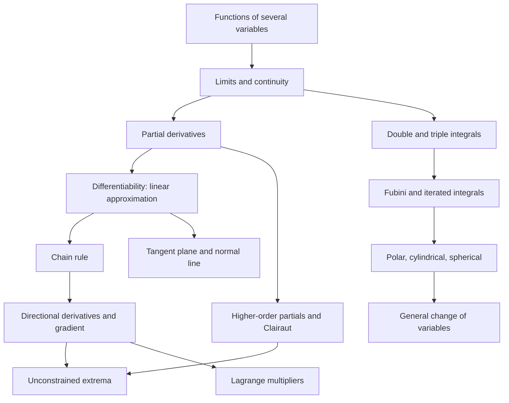

# Multivariable Calculus

> [Calculus](../README.md) · Level: Advanced · Prerequisites: [Derivatives](../03-derivatives/README.md), [Differentiation Rules](../04-differentiation-rules/README.md), [Integrals](../06-integrals/README.md), [Techniques of Integration](../08-techniques-of-integration/README.md), [Functions](../../03-algebra/11-functions/README.md), [Vectors](../../08-linear-algebra/01-vectors/README.md) · Estimated time: 840 min

## 1. Introduction

A function of one variable answers the question "how does one quantity depend on one other
quantity?". Almost nothing in the world is that simple. The temperature in a room depends on three
spatial coordinates and on time. The pressure of a gas depends on volume and temperature. The profit
of a factory depends on dozens of input quantities, all of which can be varied only within a budget.
The height of a landscape depends on two coordinates, and a hiker wants to know which way is uphill.

Multivariable calculus is the extension of differentiation and integration to such functions. The
extension is not a mechanical rewriting of one-variable formulas: several genuinely new phenomena
appear, and the whole subject is organised around one idea — **the derivative is the best linear
approximation of a function near a point**. In one variable a linear map is multiplication by a
number, so this idea is invisible; in several variables it is the whole story, and it explains why
the gradient, the tangent plane, the Jacobian matrix and the chain rule are all the same theorem
wearing different clothes.

The second organising idea is that **integrals add up contributions over sets that are no longer
intervals**. A double integral adds values over a planar region, a triple integral over a solid. The
practical difficulty is almost never the integrand; it is the description of the region and the
choice of coordinates that make the region simple. That is why polar, cylindrical and spherical
coordinates, and the Jacobian factor that accompanies every change of variables, occupy so much of
this topic.

| One variable | Several variables |
|---|---|
| domain is an interval | domain is a subset of $\mathbb{R}^n$, typically with a curved boundary |
| $x \to a$ from two sides | $(x,y) \to (a,b)$ from infinitely many directions and along infinitely many curves |
| derivative is a number $f'(a)$ | derivative is a vector $\nabla f(a)$ (or a matrix, for vector-valued maps) |
| second derivative test uses one number | second derivative test uses the Hessian matrix, a quadratic form |
| integral over $[a,b]$ | double and triple integrals; Fubini reduces them to iterated one-variable integrals |

## 2. Prerequisites

* **Derivatives as limits** — [Derivatives](../03-derivatives/README.md). You must know
  $f'(a) = \lim_{h \to 0}\frac{f(a+h)-f(a)}{h}$, the interpretation as slope of the tangent line and
  as instantaneous rate of change, and the fact that differentiability implies continuity. Partial
  derivatives are defined by exactly this limit with the other variables frozen, so fluency here is
  not optional.
* **Differentiation rules** — [Differentiation Rules](../04-differentiation-rules/README.md). The
  product, quotient and chain rules, the derivatives of $\sin$, $\cos$, $\tan$, $e^x$, $\ln x$ and
  the inverse trigonometric functions, and implicit differentiation. Every partial derivative you
  compute in this topic is an ordinary derivative of a one-variable function.
* **Integration and the fundamental theorem** — [Integrals](../06-integrals/README.md). Riemann sums,
  the definite integral, the fundamental theorem of calculus, and the interpretation of the integral
  as accumulated quantity. Double and triple integrals are defined as limits of Riemann sums, and
  Fubini's theorem computes them with one-variable antiderivatives.
* **Techniques of integration** — [Techniques of Integration](../08-techniques-of-integration/README.md).
  Substitution, integration by parts, and trigonometric integrals. Substitution in one variable is the
  shadow of the change-of-variables formula in several variables, and the exercises use
  $u$-substitution constantly.
* **Trigonometry** — [Trigonometric Functions](../../05-trigonometry/01-trigonometric-functions/README.md).
  The Pythagorean identity, the values of $\sin$ and $\cos$ at multiples of $\pi/6$ and $\pi/4$, the
  addition formulas, and the graphs of $\sin$ and $\cos$. Polar, cylindrical and spherical
  coordinates are trigonometric parametrisations, and the standard integrals
  $\int_0^{\pi}\sin^2\theta\,d\theta = \pi/2$ and
  $\int_0^{\pi/2}\sin\varphi\cos\varphi\,d\varphi = 1/2$ appear repeatedly.
* **Vectors and the dot product** — [Vectors](../../08-linear-algebra/01-vectors/README.md). Length
  $\lVert \mathbf{v}\rVert$, the dot product $\mathbf{u}\cdot\mathbf{v}$, orthogonality
  $\mathbf{u}\cdot\mathbf{v}=0$, projection, and the Cauchy–Schwarz inequality
  $\lvert\mathbf{u}\cdot\mathbf{v}\rvert \le \lVert\mathbf{u}\rVert\,\lVert\mathbf{v}\rVert$. The
  gradient is a vector, and the identity $D_{\mathbf{u}}f = \nabla f\cdot\mathbf{u}$ is a dot product.
* **Matrices and determinants** — [Matrices](../../08-linear-algebra/02-matrices/README.md) and
  [Linear Transformations](../../08-linear-algebra/05-linear-transformations/README.md). Matrix
  multiplication, the determinant as a signed area/volume scale factor, and the idea of a linear map
  as the matrix acting on a vector. The Jacobian is the matrix of the derivative of a vector-valued
  map, and its determinant is exactly the local volume-distortion factor.

## 3. Learning Objectives

After working through this tutorial and its exercises, you will be able to:

1. Determine and sketch the domain of a function of two or three variables, describe its graph as a
   surface, and sketch the level curves (two variables) or level surfaces (three variables) of a
   given function.
2. Compute limits in $\mathbb{R}^n$ from the definition and with the squeeze theorem, and prove that
   a limit does not exist by exhibiting two paths with different limits.
3. Compute first and higher partial derivatives, and explain the geometric meaning of
   $\partial f/\partial x$ as the slope of a trace curve.
4. State the definition of differentiability as a linear approximation, use the total differential
   $df = f_x\,dx + f_y\,dy$ to estimate changes, and distinguish differentiability from the mere
   existence of partial derivatives, quoting the standard counterexamples.
5. Apply the chain rule in its tree form for a function of several variables whose arguments depend
   on one or several parameters, derive the chain rule from the definition, and use it for implicit
   differentiation.
6. Compute directional derivatives, identify the direction of steepest ascent and descent, relate the
   gradient to level sets, and prove that the gradient is orthogonal to the level set through a point.
7. Write down the tangent plane and normal line to a graph and to a level surface, and use the
   tangent plane as a linear approximation.
8. Compute mixed partial derivatives, state Clairaut's theorem with its continuity hypothesis, and
   reproduce the counterexample showing that the hypothesis cannot be dropped.
9. Locate and classify the critical points of a function of two variables with the second-derivative
    test, including the degenerate case, and find absolute extrema on a compact region by checking
    the interior and the boundary.
10. Solve constrained optimisation problems by Lagrange multipliers, with one or several constraints,
    explain the geometric meaning of the multiplier condition, and recognise the degenerate cases in
    which the method can fail.
11. Set up and evaluate double and triple integrals over elementary regions, change the order of
    integration, and convert integrals to polar, cylindrical and spherical coordinates with the
    correct Jacobian factor $r$ or $\rho^2\sin\varphi$.
12. State the change-of-variables formula in the plane and use it with a non-linear substitution.

## 4. Intuition

**A function of two variables is a landscape.** Imagine standing in a hilly country. Your position is
a pair $(x,y)$; the height of the ground beneath you is $f(x,y)$. The domain is the part of the map
you are allowed to walk on; the graph $z = f(x,y)$ is the surface of the country itself, floating in
three-dimensional space. Everything in the differential calculus of two variables is a question a
hiker might ask.

* *How steep is it if I walk due east?* That is $\partial f/\partial x$.
* *How steep is it if I walk north-east?* That is a directional derivative.
* *Which way is straight uphill, and how steep is it?* That is the gradient: a vector pointing uphill,
  whose length is the maximal slope.
* *Where is the ground level?* That is a level curve — a contour line of the map.
* *If I take one small step, how much higher do I get?* That is the total differential, the linear
  approximation.

**Level curves are contour lines.** A topographic map does not draw the surface; it draws the curves
$f(x,y) = c$ for a few values of $c$. From the spacing of the contours you can read the steepness: the
closer the contours, the steeper the ground, because you gain the same height in less horizontal
distance. The gradient at a point is perpendicular to the contour through that point — if it were not,
walking along the contour would change your height, which by definition it does not. This single
geometric fact is the source of the whole method of Lagrange multipliers.

**The derivative is a zoom lens.** In one variable, if you magnify the graph of a differentiable
function at a point, the curve straightens out and looks like a line. The same happens in two
variables: if you magnify the graph of a differentiable function at a point, the surface flattens into
a plane — the tangent plane. "Differentiable" means precisely that the surface is *flat enough* that
one plane approximates it to first order: the error is smaller than the distance you moved, not merely
bounded by some constant times the distance. A cone is not differentiable at its tip although through
that tip run straight lines in every direction: no single plane hugs the cone.

**Multiple integrals add up over shapes.** A double integral is the continuous analogue of a
spreadsheet: divide the region into tiny cells, multiply the value of the function in each cell by the
area of the cell, and add. If $f$ is a density (mass per unit area), the double integral is the total
mass. If $f = 1$, it is the area. A triple integral does the same with volume cells: with $f=1$ it is
the volume of a solid, with $f$ a density it is the mass, with $f$ the square of the distance from an
axis it is a moment of inertia.

## 5. Formal Definition

Throughout, $n \ge 1$ and points of $\mathbb{R}^n$ are written in bold or as tuples:
$\mathbf{x} = (x_1,\dots,x_n)$. The Euclidean norm is
$\lVert\mathbf{x}\rVert = \sqrt{x_1^2+\cdots+x_n^2}$, and the open ball of radius $r$ about
$\mathbf{a}$ is $B_r(\mathbf{a}) = \{\mathbf{x} : \lVert\mathbf{x}-\mathbf{a}\rVert < r\}$. A point
$\mathbf{a}$ is a *cluster point* (or limit point) of a set $D$ if every ball $B_r(\mathbf{a})$
contains a point of $D$ different from $\mathbf{a}$; only cluster points can be approached by limits.

**Definition 5.1 (Function of several variables).** A *function of $n$ variables* is a rule $f$ that
assigns to each point $\mathbf{x}$ of a set $D \subseteq \mathbb{R}^n$ exactly one real number
$f(\mathbf{x})$. The set $D$ is the *domain* of $f$; the *range* is
$f[D] = \{f(\mathbf{x}) : \mathbf{x} \in D\}$. Unless a domain is stated explicitly, the domain is the
largest set on which the formula produces a real number. For $n=2$ we write $z = f(x,y)$; the *graph*
is
$$\{(x,y,z) \in \mathbb{R}^3 : (x,y) \in D,\ z = f(x,y)\}.$$

**Definition 5.2 (Level set).** Let $c \in \mathbb{R}$. The *level set* of $f$ at level $c$ is
$L_c = \{\mathbf{x} \in D : f(\mathbf{x}) = c\}$. For $n=2$ a level set is a *level curve* (or contour
line); for $n=3$ it is a *level surface*. Level sets of a function of three variables are usually
surfaces, and the graph of a function of three variables would live in $\mathbb{R}^4$, which is why
level surfaces replace graphs in three dimensions.

**Definition 5.3 (Limit).** Let $f : D \subseteq \mathbb{R}^n \to \mathbb{R}$ and let $\mathbf{a}$ be a
cluster point of $D$. We say that $f$ *tends to* $L$ as $\mathbf{x} \to \mathbf{a}$, written
$\lim_{\mathbf{x}\to\mathbf{a}} f(\mathbf{x}) = L$, if
$$\forall \varepsilon > 0\ \exists \delta > 0\ \forall \mathbf{x} \in D:\quad
0 < \lVert \mathbf{x}-\mathbf{a}\rVert < \delta \ \Rightarrow\ \lvert f(\mathbf{x}) - L\rvert <
\varepsilon.$$
Equivalently (sequential criterion), $f(\mathbf{x}_k) \to L$ for **every** sequence
$(\mathbf{x}_k)$ in $D \setminus \{\mathbf{a}\}$ with $\mathbf{x}_k \to \mathbf{a}$.

**Definition 5.4 (Continuity).** $f$ is *continuous at* $\mathbf{a} \in D$ if
$\lim_{\mathbf{x}\to\mathbf{a}} f(\mathbf{x}) = f(\mathbf{a})$, that is, if
$$\forall \varepsilon > 0\ \exists \delta > 0\ \forall \mathbf{x} \in D:\quad
\lVert \mathbf{x}-\mathbf{a}\rVert < \delta \ \Rightarrow\ \lvert f(\mathbf{x}) - f(\mathbf{a})\rvert
< \varepsilon.$$
$f$ is continuous on a set if it is continuous at every point of it.

**Definition 5.5 (Partial derivative).** Let $f$ be defined on a neighbourhood of
$\mathbf{a} = (a_1,\dots,a_n)$. The *partial derivative of $f$ with respect to $x_i$ at $\mathbf{a}$*
is the ordinary derivative of the one-variable function obtained by freezing all other coordinates:
$$\frac{\partial f}{\partial x_i}(\mathbf{a})
= \lim_{h \to 0} \frac{f(a_1,\dots,a_i+h,\dots,a_n) - f(a_1,\dots,a_n)}{h},$$
provided the limit exists. For $f(x,y)$ we write $f_x = \partial f/\partial x$ and
$f_y = \partial f/\partial y$.

**Definition 5.6 (Higher-order partial derivatives).** Partial derivatives of partial derivatives are
defined inductively, wherever the limits exist:
$$f_{xx} = \frac{\partial}{\partial x}\left(\frac{\partial f}{\partial x}\right),
\qquad
f_{xy} = \frac{\partial}{\partial y}\left(\frac{\partial f}{\partial x}\right),
\qquad
f_{yx} = \frac{\partial}{\partial x}\left(\frac{\partial f}{\partial y}\right).$$
This repository uses the convention $f_{xy} = (f_x)_y$: the differentiation written *closest* to $f$
is performed first. Some texts attach the opposite meaning to the symbol
$\partial^2 f/\partial y\,\partial x$; the written-out form $(f_x)_y$ is unambiguous and is preferred
in this tutorial.

**Definition 5.7 (Differentiability — the linear approximation definition).** Let $U$ be an open set
containing $\mathbf{a}$, and let $f : U \to \mathbb{R}^m$. Then $f$ is *differentiable at*
$\mathbf{a}$ if there exists a linear map $L : \mathbb{R}^n \to \mathbb{R}^m$ such that
$$\lim_{\mathbf{h} \to \mathbf{0}} \frac{\lVert f(\mathbf{a}+\mathbf{h}) - f(\mathbf{a}) -
L(\mathbf{h})\rVert}{\lVert \mathbf{h}\rVert} = 0.$$
The map $L$, when it exists, is unique; it is denoted $Df(\mathbf{a})$ and called the *derivative* (or
*differential*) of $f$ at $\mathbf{a}$. For a scalar function $f : U \subseteq \mathbb{R}^n \to \mathbb{R}$, $L$ has the form
$L(\mathbf{h}) = \nabla f(\mathbf{a})\cdot\mathbf{h}$ for a unique vector $\nabla f(\mathbf{a})$, and
the condition becomes
$$f(\mathbf{a}+\mathbf{h}) = f(\mathbf{a}) + \nabla f(\mathbf{a})\cdot\mathbf{h} + o(\lVert
\mathbf{h}\rVert).$$
For a vector-valued map the matrix of $L$ in the standard bases is the *Jacobian matrix*
$Df(\mathbf{a}) = \left[\partial f_i/\partial x_j(\mathbf{a})\right]$, an $m \times n$ matrix.

**Definition 5.8 (Total differential).** For a differentiable $f(x,y)$, the *total differential* is
$$df = \frac{\partial f}{\partial x}\,dx + \frac{\partial f}{\partial y}\,dy .$$
It is the linear part of the change of $f$: if $(x,y)$ changes by $(dx,dy)$, then
$\Delta f \approx df$, with an error that is $o\!\left(\sqrt{dx^2+dy^2}\right)$. Equivalently,
$df$ is the value of the differential $Df$ on the displacement vector $(dx,dy)$.

**Definition 5.9 (Gradient and directional derivative).** Let $f$ be differentiable at $\mathbf{a}$.
The *gradient* is the vector of partial derivatives,
$$\nabla f(\mathbf{a}) = \left(\frac{\partial f}{\partial x_1}(\mathbf{a}),\dots,
\frac{\partial f}{\partial x_n}(\mathbf{a})\right).$$
For a unit vector $\mathbf{u}$ ($\lVert\mathbf{u}\rVert = 1$), the *directional derivative of $f$ at
$\mathbf{a}$ in the direction $\mathbf{u}$* is
$$D_{\mathbf{u}}f(\mathbf{a}) = \lim_{h \to 0}\frac{f(\mathbf{a}+h\mathbf{u}) -
f(\mathbf{a})}{h},$$
whenever the limit exists. It is the rate of change of $f$ per unit distance travelled in the
direction $\mathbf{u}$.

**Definition 5.10 (Tangent plane).** Let $f$ be differentiable at $(a,b)$. The *tangent plane to the
graph* $z = f(x,y)$ at the point $(a,b,f(a,b))$ is
$$z = f(a,b) + f_x(a,b)\,(x-a) + f_y(a,b)\,(y-b).$$
If instead a surface is given implicitly by $F(x,y,z) = c$ with $\nabla F \ne \mathbf{0}$ at a point
$P$ of the surface, the *tangent plane at $P$* is
$$\nabla F(P)\cdot\big((x,y,z) - P\big) = 0,$$
and the *normal line* through $P$ has direction $\nabla F(P)$.

**Definition 5.11 (Extrema and critical points).** Let $f : D \subseteq \mathbb{R}^n \to \mathbb{R}$
and $\mathbf{a} \in D$.

* $f(\mathbf{a})$ is a *global maximum* (resp. *global minimum*) of $f$ on $D$ if
  $f(\mathbf{x}) \le f(\mathbf{a})$ (resp. $f(\mathbf{x}) \ge f(\mathbf{a})$) for all
  $\mathbf{x} \in D$.
* $f(\mathbf{a})$ is a *local maximum* (resp. *local minimum*) if the inequality holds for all
  $\mathbf{x} \in D \cap B_r(\mathbf{a})$ for some $r > 0$.
* $\mathbf{a}$ is a *critical point* of $f$ if $f$ is differentiable at $\mathbf{a}$ and
  $\nabla f(\mathbf{a}) = \mathbf{0}$, or if $f$ is not differentiable at $\mathbf{a}$.

**Definition 5.12 (Multiple integrals).** Let $R = [a,b]\times[c,d]$ and let $f$ be bounded on $R$.
Partition $R$ into subrectangles using $a = x_0 < \cdots < x_m = b$ and $c = y_0 < \cdots < y_n = d$,
choose a sample point $(x_{ij}^*,y_{ij}^*)$ in each, and form the Riemann sum
$\sum_{i,j} f(x_{ij}^*,y_{ij}^*)\,\Delta A_{ij}$ with $\Delta A_{ij} = \Delta x_i\,\Delta y_j$. If these
sums tend to a single limit as the mesh tends to $0$, that limit is the *double integral*
$\iint_R f\,dA$. For a bounded region $D$, extend $f$ by $0$ outside $D$ and set
$\iint_D f\,dA = \iint_R \tilde f\,dA$; the *area* of $D$ is $\iint_D 1\,dA$, and for $f\ge0$ the
integral is the volume under the graph. Replacing rectangles by boxes and areas by volumes gives the
*triple integral* $\iiint_E f\,dV$ over a solid $E$, equal to the volume of $E$ when $f=1$ and to the
total mass when $f$ is a mass density.

**Definition 5.13 (Jacobian matrix and Jacobian determinant).** Let
$T : U \subseteq \mathbb{R}^n \to \mathbb{R}^n$ be differentiable, written
$T(\mathbf{u}) = (x_1(\mathbf{u}),\dots,x_n(\mathbf{u}))$. Its *Jacobian matrix* at $\mathbf{u}$ is
$DT(\mathbf{u}) = \left[\partial x_i/\partial u_j\right]$, and its *Jacobian determinant* is
$$J_T(\mathbf{u}) = \frac{\partial(x_1,\dots,x_n)}{\partial(u_1,\dots,u_n)}
= \det\left[\frac{\partial x_i}{\partial u_j}\right].$$
The number $\lvert J_T\rvert$ is the local factor by which $T$ multiplies $n$-dimensional volume near
$\mathbf{u}$; the sign records orientation.

**Definition 5.14 (Polar, cylindrical and spherical coordinates).** *Polar* coordinates in the plane:
$$x = r\cos\theta,\qquad y = r\sin\theta,\qquad r \ge 0,\quad 0 \le \theta < 2\pi .$$
*Cylindrical* coordinates in space: $(r,\theta,z)$ with $x = r\cos\theta$, $y = r\sin\theta$ and $z$
unchanged. *Spherical* coordinates: $(\rho,\varphi,\theta)$ with
$$x = \rho\sin\varphi\cos\theta,\qquad y = \rho\sin\varphi\sin\theta,\qquad z = \rho\cos\varphi,$$
where $\rho \ge 0$ is the distance to the origin, $\varphi \in [0,\pi]$ is the angle from the positive
$z$-axis, and $\theta \in [0,2\pi)$ is the longitude. Note that $\varphi$ is measured from the
$z$-axis, not from the $xy$-plane; this is the standard convention in mathematics and physics.

## 6. Mathematical Notation

| Symbol | Read as | Meaning |
|---|---|---|
| $\mathbb{R}^n$ | "R n" | the set of ordered $n$-tuples of real numbers |
| $\mathbf{x} = (x_1,\dots,x_n)$ | "the point x" | a point, identified with the vector from the origin |
| $\lVert \mathbf{x}\rVert$ | "norm of x" | $\sqrt{x_1^2+\cdots+x_n^2}$, the Euclidean length |
| $B_r(\mathbf{a})$ | "ball of radius r about a" | $\{\mathbf{x} : \lVert\mathbf{x}-\mathbf{a}\rVert < r\}$ |
| $D$, $U$ | "dee", "you" | a domain (often open) in $\mathbb{R}^n$ |
| $f : D \to \mathbb{R}$ | "f from D to R" | a real-valued function on $D$ |
| $f_x$, $\partial f/\partial x$ | "f sub x", "partial f partial x" | derivative in $x$ with $y$ held fixed |
| $f_{xy}$ | "f x y" | $(f_x)_y$: differentiate in $x$, then in $y$ |
| $\nabla f$ | "grad f" or "del f" | the gradient vector $(f_x, f_y)$ or $(f_x,f_y,f_z)$ |
| $\nabla f(\mathbf{a})\cdot\mathbf{h}$ | "grad f at a dot h" | the directional change of $f$ in direction $\mathbf{h}$ |
| $D_{\mathbf{u}}f$ | "D sub u of f" | directional derivative in the unit direction $\mathbf{u}$ |
| $df$ | "d f" | total differential $f_x\,dx + f_y\,dy$ |
| $D$ (in the second-derivative test) | "the discriminant" | $f_{xx}f_{yy}-f_{xy}^2$ |
| $\iint_D f\,dA$ | "double integral over D of f d A" | integral over a planar region; $dA = dx\,dy$ |
| $\iiint_E f\,dV$ | "triple integral over E of f d V" | integral over a solid; $dV = dx\,dy\,dz$ |
| $\int_a^b\int_c^d f\,dy\,dx$ | "integral dy dx" | iterated integral: inner in $y$, then outer in $x$ |
| $\partial(x,y)/\partial(u,v)$ | "Jacobian of x y with respect to u v" | determinant of the $2\times2$ Jacobian matrix |
| $r$, $\theta$ | "r", "theta" | polar radius and polar angle |
| $\rho$, $\varphi$, $\theta$ | "rho", "phi", "theta" | spherical radius, polar angle from the $z$-axis, azimuth |
| $\lambda$, $\mu$ | "lambda", "mu" | Lagrange multipliers |

Two conventions deserve emphasis because they cause errors. First, $f_{xy}$ means *differentiate in
$x$ first*: $f_{xy} = (f_x)_y$. Second, in spherical coordinates $\varphi$ is the angle from the
positive $z$-axis; a point on the $xy$-plane has $\varphi = \pi/2$, and the negative $z$-axis has
$\varphi = \pi$.

## 7. Core Concepts

### 7.1 Domains, Graphs and Level Sets

**Finding the domain.** The domain of a formula is the set of points at which every operation in it is
defined: denominators must be non-zero, even roots must have non-negative arguments, logarithms must
have positive arguments, and $\arcsin$ and $\arccos$ must have arguments in $[-1,1]$. The domain is
therefore described by a system of equations and inequalities, and the work is in solving that system
geometrically.

* $f(x,y) = \sqrt{9-x^2-y^2}$: need $x^2+y^2 \le 9$, a closed disk of radius $3$.
* $g(x,y) = \ln(x^2+y^2-1) + \sqrt{4-x^2-y^2}$: need $1 < x^2+y^2 \le 4$, a closed annulus whose inner
  boundary circle is excluded (the logarithm is not defined on it).
* $F(x,y,z) = \sqrt{1-x^2-y^2-z^2} + \ln(x+y)$: the ball $x^2+y^2+z^2 \le 1$ intersected with the
  open half-space $x+y>0$.

The domain of a function of several variables is typically *not* an interval, and its boundary is
typically a curve (in the plane) or a surface (in space). Boundaries matter: extrema often occur
there, and a domain that includes its boundary behaves differently from one that does not.

**Graphs.** The graph of $f(x,y)$ is a surface in $\mathbb{R}^3$; a surface is the graph of a function
of two variables exactly when every vertical line meets it at most once. The graph of
$f(x,y) = x^2+y^2$ is an *elliptic paraboloid*; the graph of $f(x,y) = x^2-y^2$ is a *hyperbolic
paraboloid* (a saddle); the graph of $f(x,y) = \sqrt{1-x^2-y^2}$ is the upper unit hemisphere.

**Level sets.** Level curves are the two-dimensional substitute for a graph: they live in the domain
and can be drawn on paper. For $z = f(x,y)$ the level curve at height $c$ is the projection to the
$xy$-plane of the intersection of the graph with the horizontal plane $z=c$. Recognising the
equation of a level curve is therefore the main skill:

| Function | Level curves $f = c$ | Shape |
|---|---|---|
| $x^2+y^2$ | $x^2+y^2=c$ | circles (a point if $c=0$, empty if $c<0$) |
| $x^2+9y^2$ | $x^2/\!c + y^2/\!(c/9) = 1$ | ellipses with semi-axes $\sqrt{c}$ and $\sqrt{c}/3$ |
| $x^2-y^2$ | $x^2-y^2=c$ | hyperbolas, crossing lines when $c=0$ |
| $xy$ | $xy=c$ | rectangular hyperbolas, the two axes when $c=0$ |
| $y-x^2$ | $y = x^2+c$ | parabolas shifted vertically |

For a function of three variables the level sets are surfaces: $x^2+y^2+z^2$ has spheres,
$x^2+y^2-z^2$ has hyperboloids of one sheet (for $c>0$) and of two sheets (for $c<0$), and
$x^2+y^2-z^2 = 0$ is a cone. A level surface carries the same information as a contour map: the
gradient is normal to it, and the spacing of two nearby level surfaces at levels $c$ and $c+\Delta c$
is inversely proportional to $\lVert\nabla F\rVert$.

### 7.2 Limits and Continuity in $\mathbb{R}^n$

The definition of a limit in $\mathbb{R}^n$ is the same $\varepsilon$–$\delta$ statement as in one
variable, with $\lvert x-a\rvert$ replaced by $\lVert\mathbf{x}-\mathbf{a}\rVert$. What changes is the
geometry of "$\mathbf{x}$ near $\mathbf{a}$": there are now infinitely many directions and infinitely
many curves through $\mathbf{a}$, and a limit exists only if **all** of them agree.

**Direct verification.** For $f(x,y) = x^2+y^2$ at the origin: given $\varepsilon>0$, take
$\delta = \sqrt{\varepsilon}$. Then $0<\lVert(x,y)\rVert<\delta$ implies
$\lvert f(x,y)-0\rvert = x^2+y^2 = \lVert(x,y)\rVert^2<\varepsilon$. This is the model for all
"obvious" limits: bound the difference by a function of $\lVert\mathbf{x}-\mathbf{a}\rVert$.

**The squeeze theorem.** If $0 \le \lvert f(\mathbf{x})-L\rvert \le g(\mathbf{x})$ near $\mathbf{a}$
and $g(\mathbf{x})\to 0$, then $f(\mathbf{x})\to L$. Two standard inequalities do most of the work:
$$\lvert x_i\rvert \le \lVert\mathbf{x}\rVert, \qquad \lvert x_i x_j\rvert \le \tfrac12(x_i^2+x_j^2)
\le \tfrac12\lVert\mathbf{x}\rVert^2 .$$
For example,
$$0 \le \left\lvert \frac{xy}{\sqrt{x^2+y^2}}\right\rvert
\le \frac{\tfrac12(x^2+y^2)}{\sqrt{x^2+y^2}} = \tfrac12\sqrt{x^2+y^2} \longrightarrow 0 .$$

**Polar coordinates.** Writing $x = r\cos\theta$, $y = r\sin\theta$ turns a two-variable limit at the
origin into a one-variable limit in $r$ with a bounded angular factor. If
$f(r\cos\theta, r\sin\theta) = r^{k}\,g(\theta)$ with $k>0$ and $\lvert g(\theta)\rvert \le M$ for all
$\theta$, then $\lvert f\rvert \le M r^{k} \to 0$. For instance
$$\frac{x^3+y^3}{x^2+y^2} = r\left(\cos^3\theta+\sin^3\theta\right),
\qquad \lvert\cos^3\theta+\sin^3\theta\rvert \le 2,$$
so the limit at the origin is $0$. The boundedness of $g$ is essential: the expression
$\frac{x^2y}{x^4+y^2}$ in polar form is $\frac{r\cos^2\theta\sin\theta}{r^2\cos^4\theta+\sin^2\theta}$,
which does not factor as $r^k g(\theta)$ with $g$ bounded — and indeed it has no limit.

**Proving that a limit does not exist.** It suffices to exhibit two paths in the domain along which
$f$ tends to different values. The paths may be lines, parabolas, spirals, or sequences of points.

* $f(x,y) = \dfrac{x^2-y^2}{x^2+y^2}$ at the origin: along $y=0$, $f = x^2/x^2 = 1$; along $x=0$,
  $f = -y^2/y^2 = -1$. No limit (and no continuous extension).
* $f(x,y) = \dfrac{xy}{x^2+y^2}$: along $y = mx$, $f = m/(1+m^2)$, which depends on $m$; along the
  axes it is $0$. No limit.
* $f(x,y) = \dfrac{x^2y}{x^4+y^2}$: along every line $y = mx$,
  $f = mx^3/(x^4+m^2x^2) = mx/(x^2+m^2) \to 0$; along the parabola $y=x^2$,
  $f = x^4/(x^4+x^4) = 1/2$. **Checking all lines is not enough.** A limit may exist along every line
  through $\mathbf{a}$ and still fail to exist.

The last example is the most instructive in the whole theory of limits: the family of lines is only a
one-parameter family, and a function of two variables has a two-parameter family of approach curves.
The correct general tool is either an inequality valid in a whole neighbourhood (squeeze) or the
sequential criterion with an arbitrary sequence.

**Continuity.** Sums, products, quotients (where the denominator is non-zero) and compositions of
continuous functions are continuous, and polynomials in several variables are continuous everywhere.
Hence rational functions are continuous on their domains, and so are $\sin$, $\cos$, $\exp$, $\ln$
and roots composed with them. The interesting question is *extendability*: can a function defined on
a punctured neighbourhood be given a value at the missing point that makes it continuous?

* $\dfrac{x^2y}{x^2+y^2}$ extended by $f(0,0)=0$ is continuous at the origin, because
  $\lvert x^2y/(x^2+y^2)\rvert \le \lvert y\rvert \to 0$.
* $\dfrac{xy}{x^2+y^2}$ cannot be extended continuously, because the limit fails to exist.
* $\dfrac{\sin(x^2+y^2)}{x^2+y^2}$ extends by $1$, because with $t = x^2+y^2$ it is
  $\sin t/t \to 1$ as $t \to 0^+$.

The extreme value theorem holds in $\mathbb{R}^n$: a continuous function on a closed and bounded set
attains a maximum and a minimum there. This is what guarantees that the optimisation problems of
Sections 7.9–7.10 have solutions; the proof belongs to real analysis.

### 7.3 Partial Derivatives and Their Geometric Meaning

To differentiate $f(x,y)$ with respect to $x$, freeze $y=b$ and differentiate the one-variable
function $g(x) = f(x,b)$. Geometrically, the plane $y=b$ cuts the graph in a curve — the *trace* — and
$f_x(a,b)$ is the slope of the tangent to that trace at the point $(a,b,f(a,b))$. Similarly $f_y(a,b)$
is the slope of the trace in the plane $x=a$. The two slopes describe the surface along two
perpendicular directions; they do not, by themselves, determine a plane through the point, and that
is the geometric content of the failure of differentiability.

**Computation.** All the one-variable rules apply, with the other variables treated as constants:

* $f(x,y) = x^3y^2 - 2xy + 5y$ gives $f_x = 3x^2y^2 - 2y$ and $f_y = 2x^3y - 2x + 5$. The term $5y$
  is a constant with respect to $x$, so it disappears from $f_x$; it has derivative $5$ with respect to
  $y$.
* $f(x,y) = e^{x^2y}$ gives $f_x = 2xy\,e^{x^2y}$ (chain rule in $x$) and $f_y = x^2e^{x^2y}$.
* $f(x,y) = \sin(x/y)$ gives $f_x = \cos(x/y)\cdot\frac1y$ and
  $f_y = \cos(x/y)\cdot\left(-\frac{x}{y^2}\right)$.

**Partial derivatives need not be continuous, or even exist everywhere.** $f(x,y)=\sqrt{x^2+y^2}$ has
no partial derivative at the origin (the cone has a corner there); $f(x,y)=|x|+y$ has $f_x$ undefined
along the whole line $x=0$. At such points the graph has a crease, and no tangent plane exists.

### 7.4 Differentiability and the Total Differential

**The definition, unpacked.** Differentiability at $\mathbf{a}$ asks for a linear map $L$ such that
$$f(\mathbf{a}+\mathbf{h}) = f(\mathbf{a}) + L(\mathbf{h}) + \varepsilon(\mathbf{h})\,\lVert\mathbf{h}\rVert,
\qquad \varepsilon(\mathbf{h}) \to 0 \text{ as } \mathbf{h}\to\mathbf{0}.$$
The error must be *superlinear*: it must vanish faster than the displacement. A function with a corner
or a crease may have tangent lines in many directions, but no single linear map has superlinear error,
and that is exactly what "not differentiable" means.

**Partial derivatives are the coefficients.** If $f$ is differentiable at $\mathbf{a}$ with
differential $L(\mathbf{h}) = \sum_i c_i h_i$, then taking $\mathbf{h} = t\mathbf{e}_i$ gives
$$f(\mathbf{a}+t\mathbf{e}_i) = f(\mathbf{a}) + c_i t + \varepsilon(t\mathbf{e}_i)\lvert t\rvert,
\qquad \frac{f(\mathbf{a}+t\mathbf{e}_i)-f(\mathbf{a})}{t} = c_i + \varepsilon(t\mathbf{e}_i)\frac{\lvert t\rvert}{t}
\longrightarrow c_i ,$$
so $c_i = \partial f/\partial x_i(\mathbf{a})$. Hence $L(\mathbf{h}) = \nabla f(\mathbf{a})\cdot\mathbf{h}$
and the differential is unique. In particular, *differentiability implies that all partial derivatives
exist* — but not conversely.

**Differentiability implies continuity.** Put $\mathbf{h} = \mathbf{x}-\mathbf{a}$:
$$\lvert f(\mathbf{x})-f(\mathbf{a})\rvert \le \lVert\nabla f(\mathbf{a})\rVert\,\lVert\mathbf{h}\rVert
+ \lvert\varepsilon(\mathbf{h})\rvert\,\lVert\mathbf{h}\rVert \longrightarrow 0 .$$
So a discontinuous function is automatically non-differentiable.

**A discontinuous example with both partials.** Let
$$f(x,y) = \frac{xy}{x^2+y^2}\ \text{ for } (x,y)\ne(0,0), \qquad f(0,0)=0 .$$
Then $f(x,0)=0$ for $x\ne0$ and $f(0,y)=0$ for $y\ne0$, so
$$f_x(0,0) = \lim_{h\to0}\frac{f(h,0)-f(0,0)}{h}=0, \qquad
f_y(0,0) = \lim_{h\to0}\frac{f(0,h)-f(0,0)}{h}=0 .$$
Yet along $y=x$ the function equals $1/2$ for every $x\ne0$, so it is not continuous at the origin and
therefore not differentiable there. The linear approximation would have to be the constant $0$, whose
error along $y=x$ is $1/2$, which is not $o(\lVert\mathbf{h}\rVert)$.

**A continuous example that is still not differentiable.** Let
$$f(x,y) = \frac{x^2y}{x^2+y^2}\ \text{ for } (x,y)\ne(0,0), \qquad f(0,0)=0 .$$
As noted in Section 7.2, $\lvert f\rvert \le \lvert y\rvert$, so $f$ is continuous at the origin. Both
partials at the origin vanish, by the same computation as above. But
$$\frac{\lvert f(h,h) - 0\rvert}{\lVert(h,h)\rVert}
= \frac{\lvert h^3/(2h^2)\rvert}{\sqrt2\,\lvert h\rvert}
= \frac{1}{2\sqrt2} \not\longrightarrow 0 ,$$
while along $y=0$ the ratio is $0$. The error does not have the required superlinear decay, so $f$ is
not differentiable at the origin. This example shows that differentiability is strictly stronger than
"continuous + both partials exist".

**The total differential and linear approximation.** For a differentiable $f(x,y)$, a finite
displacement $(dx,dy)$ produces
$$\Delta f = f(x+dx,y+dy)-f(x,y) \approx df = f_x(x,y)\,dx + f_y(x,y)\,dy .$$
For example, $f(x,y)=x^2y$ at $(1,2)$ with $dx=0.05$ and $dy=-0.02$:
$$df = 2xy\,dx + x^2\,dy = 4(0.05) + 1(-0.02) = 0.18,$$
so $f(1.05,1.98) \approx f(1,2)+0.18 = 2.18$; the exact value is $1.1025 \times 1.98 = 2.18295$, an
error of about $0.003$. The approximation is good because $f$ is a polynomial and the displacement is
small. The *relative* error is governed by the second derivatives, which is the content of Taylor's
theorem in several variables.

The differential form $df = f_x\,dx + f_y\,dy$ is also the object that makes the differentiability
definition coordinate-free. In three variables $df = F_x\,dx+F_y\,dy+F_z\,dz$, and in thermodynamics
the test for an "exact differential" is exactly the Clairaut condition $F_{xy}=F_{yx}$,
$F_{xz}=F_{zx}$, $F_{yz}=F_{zy}$ on a simply connected domain.

### 7.5 The Chain Rule for Several Variables

**One parameter.** Let $z = f(x,y)$ be differentiable at $(x(t),y(t))$, and let $x,y$ be
differentiable at $t$. Then
$$\frac{dz}{dt} = \frac{\partial f}{\partial x}\frac{dx}{dt}
+ \frac{\partial f}{\partial y}\frac{dy}{dt}.$$
The picture is a dependency tree: $z$ depends on $x$ and $y$, and each of them depends on $t$. Every
path from $z$ down to $t$ contributes one product of derivatives, and the contributions are added.

**Derivation.** Write $\Delta x = x(t+\Delta t)-x(t)$, $\Delta y = y(t+\Delta t)-y(t)$ and
$\Delta z = f(x+\Delta x, y+\Delta y) - f(x,y)$. Differentiability of $f$ at $(x,y)$ means
$$\Delta z = f_x\,\Delta x + f_y\,\Delta y + \varepsilon_1\Delta x + \varepsilon_2\Delta y,$$
where $\varepsilon_1,\varepsilon_2 \to 0$ as $(\Delta x,\Delta y)\to(0,0)$. Divide by $\Delta t \ne 0$:
$$\frac{\Delta z}{\Delta t}
= f_x\frac{\Delta x}{\Delta t} + f_y\frac{\Delta y}{\Delta t}
+ \varepsilon_1\frac{\Delta x}{\Delta t} + \varepsilon_2\frac{\Delta y}{\Delta t}.$$
As $\Delta t\to0$ we have $\Delta x\to0$ and $\Delta y\to0$ (differentiability of $x,y$ implies
continuity), so $\varepsilon_1,\varepsilon_2\to0$; also $\Delta x/\Delta t \to x'(t)$ and
$\Delta y/\Delta t \to y'(t)$, which are finite. Hence the last two terms tend to $0$ and the formula
follows. The hypothesis that $f$ is differentiable — not merely that its partials exist — is used
exactly here, in the two error terms.

**Several parameters.** If $z = f(x_1,\dots,x_n)$ and each $x_i = x_i(t_1,\dots,t_m)$, then for each
$j$
$$\frac{\partial z}{\partial t_j} = \sum_{i=1}^{n}\frac{\partial f}{\partial x_i}\,
\frac{\partial x_i}{\partial t_j}.$$
In matrix form this is the product of Jacobians:
$D(f\circ\mathbf{x})(\mathbf{t}) = Df(\mathbf{x}(\mathbf{t}))\,D\mathbf{x}(\mathbf{t})$, an identity
between a $1\times n$ matrix, an $n\times m$ matrix and a $1\times m$ matrix. The general chain rule
for vector-valued maps has exactly this form, and it is the reason matrix multiplication is defined
the way it is.

**Implicit differentiation.** Suppose $F(x,y) = 0$ defines $y$ as a differentiable function of $x$ near
a point where $F_y \ne 0$. Differentiate the identity $F(x,y(x)) = 0$ with respect to $x$ by the chain
rule:
$$F_x + F_y\,y'(x) = 0 \quad\Longrightarrow\quad y'(x) = -\frac{F_x}{F_y}.$$
Similarly, if $F(x,y,z)=0$ defines $z = z(x,y)$ near a point where $F_z \ne 0$, then
$$\frac{\partial z}{\partial x} = -\frac{F_x}{F_z}, \qquad
\frac{\partial z}{\partial y} = -\frac{F_y}{F_z}.$$
The hypothesis $F_z \ne 0$ is not decorative: it is what allows the equation to be solved for $z$, and
it is the hypothesis of the implicit function theorem. When $F_z = 0$ the level surface may be
vertical above the point, and $z$ need not be a function of $(x,y)$ there.

### 7.6 Directional Derivatives and the Gradient

**From partials to all directions.** A partial derivative measures the rate of change along a
coordinate axis. The directional derivative measures it along an arbitrary unit direction
$\mathbf{u}$:
$$D_{\mathbf{u}}f(\mathbf{a}) = \left.\frac{d}{dt}\right|_{t=0} f(\mathbf{a}+t\mathbf{u}).$$
If $f$ is differentiable at $\mathbf{a}$, apply the chain rule to $\gamma(t) = \mathbf{a}+t\mathbf{u}$
(so $\gamma'(t) = \mathbf{u}$):
$$D_{\mathbf{u}}f(\mathbf{a}) = \nabla f(\mathbf{a})\cdot\mathbf{u}.$$
Thus the directional derivative is the dot product of the gradient with the direction — a fact that
fails for non-differentiable functions (Section 7.4) but holds whenever the linear approximation
exists.

**Steepest ascent.** By Cauchy–Schwarz,
$$\lvert D_{\mathbf{u}}f(\mathbf{a})\rvert = \lvert\nabla f(\mathbf{a})\cdot\mathbf{u}\rvert
\le \lVert\nabla f(\mathbf{a})\rVert\,\lVert\mathbf{u}\rVert = \lVert\nabla f(\mathbf{a})\rVert,$$
with equality exactly when $\mathbf{u}$ is a positive multiple of $\nabla f(\mathbf{a})$. Hence:

* the maximum rate of increase is $\lVert\nabla f(\mathbf{a})\rVert$, attained in the direction
  $\mathbf{u} = \nabla f(\mathbf{a})/\lVert\nabla f(\mathbf{a})\rVert$;
* the maximum rate of decrease is $-\lVert\nabla f(\mathbf{a})\rVert$, attained in the opposite
  direction;
* the rate of change is zero in every direction orthogonal to the gradient.

If $\nabla f(\mathbf{a}) = \mathbf{0}$, every directional derivative is zero and the point is a
candidate extremum (or a saddle, or a flat spot such as the origin for $x^3$).

**Orthogonality to level sets.** Let $\gamma(t)$ be a differentiable curve lying in the level set
$f = c$, with $\gamma(0) = \mathbf{a}$ and $\gamma'(0)\ne\mathbf{0}$. Since $f(\gamma(t)) = c$ for all
$t$, differentiating gives
$$0 = \left.\frac{d}{dt}\right|_{t=0} f(\gamma(t)) = \nabla f(\mathbf{a})\cdot\gamma'(0).$$
So $\nabla f(\mathbf{a})$ is orthogonal to the tangent vector of every curve in the level set through
$\mathbf{a}$: the gradient is normal to the level set. This is the geometric fact behind tangent
planes to level surfaces (Section 7.7) and behind Lagrange multipliers (Section 7.10).

**Example.** For $f(x,y) = x^2+4y^2$ at $(2,1)$: $\nabla f = (2x,8y) = (4,8)$. The direction of
steepest ascent is $(1,2)/\sqrt5$, the maximal slope is $\sqrt{16+64} = 4\sqrt5$, and the level curve
$x^2+4y^2 = 8$ through $(2,1)$ has tangent direction $(2,-1)$, which is indeed orthogonal to $(4,8)$.

### 7.7 Tangent Planes and Normal Lines

**The tangent plane to a graph.** Suppose $f$ is differentiable at $(a,b)$. The plane $y=b$ cuts the
graph in the trace curve $x\mapsto (x,b,f(x,b))$, whose tangent vector at $x=a$ is
$(1,0,f_x(a,b))$. The plane $x=a$ cuts the graph in the trace $y\mapsto(a,y,f(a,y))$, with tangent
vector $(0,1,f_y(a,b))$. A plane through $P = (a,b,f(a,b))$ containing both directions has normal
$$\mathbf{n} = (1,0,f_x)\times(0,1,f_y) = (-f_x,\,-f_y,\,1),$$
where the cross product is computed in $\mathbb{R}^3$. The plane is therefore
$$-f_x(a,b)(x-a) - f_y(a,b)(y-b) + (z - f(a,b)) = 0,$$
that is,
$$z = f(a,b) + f_x(a,b)(x-a) + f_y(a,b)(y-b).$$
This is precisely the graph of the linear approximation. Conversely, if a plane
$z = f(a,b)+A(x-a)+B(y-b)$ approximates $f$ with error $o(\lVert(x-a,y-b)\rVert)$, then $A = f_x(a,b)$
and $B = f_y(a,b)$ (take displacements along the axes), so the tangent plane exists exactly when $f$
is differentiable at $(a,b)$ and it is unique. The normal vector $(-f_x,-f_y,1)$ has positive
$z$-component, which is the convention for an *upward* normal.

**The tangent plane to a level surface.** Let $S$ be given by $F(x,y,z)=c$, with $F$ continuously
differentiable and $\nabla F(P)\ne\mathbf{0}$ at $P\in S$. For any curve $\gamma$ in $S$ through $P$,
the computation of Section 7.6 gives $\nabla F(P)\cdot\gamma'(0) = 0$, so $\nabla F(P)$ is normal to
$S$ at $P$. The tangent plane is
$$\nabla F(P)\cdot\big((x,y,z)-P\big) = 0,$$
and the *normal line* is
$$(x,y,z) = P + t\,\nabla F(P), \qquad t \in \mathbb{R}.$$
The hypothesis $\nabla F(P)\ne\mathbf{0}$ is necessary for a tangent plane to exist: at the vertex of
the cone $z^2 = x^2+y^2$ the gradient of $F = x^2+y^2-z^2$ vanishes, and the cone has no tangent plane
there.

**Example.** The ellipsoid $x^2+2y^2+3z^2=6$ at $P=(1,1,1)$ (indeed $1+2+3=6$). With
$F = x^2+2y^2+3z^2$ we have $\nabla F = (2x,4y,6z)$, so $\nabla F(P) = (2,4,6)$, parallel to
$(1,2,3)$. The tangent plane is
$$1(x-1)+2(y-1)+3(z-1)=0, \quad\text{i.e.}\quad x+2y+3z = 6,$$
and the normal line is $(1+t,\,1+2t,\,1+3t)$.

### 7.8 Higher-Order Partial Derivatives and Clairaut's Theorem

Differentiating $n$ times in various directions produces the higher-order partials. If all partials
up to order $k$ exist and are continuous on a set, we say $f$ is of class $C^k$ there; $C^\infty$ means
all orders. The notation $f_{x_ix_j\cdots}$ records the variables in the order in which the
differentiations are performed, from left to right (closest to $f$ first). For a $C^2$ function of two
variables there are four second partials: $f_{xx}$, $f_{xy}$, $f_{yx}$, $f_{yy}$; for three variables
there are nine.

**Theorem (Clairaut / Schwarz).** If $f$ is defined on an open set containing $(a,b)$, if $f_x$, $f_y$,
$f_{xy}$ and $f_{yx}$ all exist on a neighbourhood of $(a,b)$, and if $f_{xy}$ and $f_{yx}$ are both
continuous at $(a,b)$, then
$$f_{xy}(a,b) = f_{yx}(a,b).$$
In particular, a $C^2$ function has equal mixed partials at every point of its domain. The proof is a
double application of the mean value theorem to the "second difference"
$$f(a+h,b+k)-f(a+h,b)-f(a,b+k)+f(a,b),$$
computed once by differencing in $x$ and then in $y$, and once in the opposite order; dividing by $hk$
and letting $h,k\to0$ gives the two mixed partials, and continuity lets the limits be taken. See
Exercise 29 for the standard counterexample.

**Why continuity is needed.** The function
$$f(x,y) = \begin{cases} xy\,\dfrac{x^2-y^2}{x^2+y^2}, & (x,y)\ne(0,0),\\[4pt] 0, & (x,y)=(0,0)\end{cases}$$
has both mixed partials at the origin, but they differ. To compute, first find the partials along the
axes. For $y \ne 0$,
$$f_x(0,y) = \lim_{h\to0}\frac{f(h,y)-f(0,y)}{h}
= \lim_{h\to0}\frac{hy(h^2-y^2)}{h(h^2+y^2)}
= \lim_{h\to0}\frac{y(h^2-y^2)}{h^2+y^2} = -y .$$
Hence $f_{xy}(0,0) = \dfrac{d}{dy}\big(-y\big)\Big|_{y=0} = -1$. Interchanging the roles of $x$ and
$y$, for $x\ne0$,
$$f_y(x,0) = \lim_{k\to0}\frac{f(x,k)-f(x,0)}{k}
= \lim_{k\to0}\frac{xk(x^2-k^2)}{k(x^2+k^2)} = x,$$
so $f_{yx}(0,0) = \dfrac{d}{dx}\big(x\big)\Big|_{x=0} = 1$. Therefore
$f_{xy}(0,0) = -1 \ne 1 = f_{yx}(0,0)$. Indeed $f_{xy}$ has no limit at the origin: it equals $1$ along the $x$-axis (for $x\ne0$,
$f_{xy}(x,0)=1$) while it equals $-1$ along the $y$-axis, so it is discontinuous at the origin and
Clairaut's hypothesis fails; there is no contradiction.

### 7.9 Extrema and the Second-Derivative Test

**Critical points.** By Fermat's theorem in one variable applied to each line through an interior
local extremum, a differentiable $f$ has $\nabla f(\mathbf{a}) = \mathbf{0}$ at every interior local
extremum. Points where $\nabla f = \mathbf{0}$ are *stationary*; together with points where $f$ is not
differentiable they form the set of critical points, the only candidates for interior extrema.

**The second-derivative test in two variables.** Let $f$ be $C^2$ on a neighbourhood of a critical
point $(a,b)$, and set
$$A = f_{xx}(a,b), \qquad B = f_{xy}(a,b), \qquad C = f_{yy}(a,b), \qquad D = AC-B^2 .$$
Then:

| Condition | Conclusion |
|---|---|
| $D>0$ and $A>0$ | strict local minimum at $(a,b)$ |
| $D>0$ and $A<0$ | strict local maximum at $(a,b)$ |
| $D<0$ | saddle point: no local extremum |
| $D=0$ | the test is inconclusive |

Note that when $D>0$, $A$ and $C$ have the same sign (their product is $B^2+D>0$), so the sign of $A$
alone decides between minimum and maximum.

**Why the test works.** Taylor's theorem gives
$f(a+h,b+k)-f(a,b)=\tfrac12(Ah^2+2Bhk+Ck^2)+o(h^2+k^2)$, and
$Ah^2+2Bhk+Ck^2=\frac1A\left[(Ah+Bk)^2+Dk^2\right]$ when $A\ne0$. If $D>0$ and $A>0$ the form is
positive definite, so the quadratic term dominates the error and the point is a strict minimum; applying
the same argument to $-f$ handles $A<0$. If $D<0$ the form is indefinite and the point is a saddle.
If $D=0$ the quadratic term is degenerate, the error term decides, and the test is inconclusive.

**Absolute extrema on a compact region.** A continuous function on a closed and bounded region $R$
attains its maximum and minimum (extreme value theorem). To find them:

1. Find all critical points of $f$ in the interior of $R$ and evaluate $f$ there.
2. Analyse the boundary: on each smooth piece, parametrise the piece, reduce to a one-variable problem
   on a closed interval, and include the endpoints (corners) of the pieces.
3. Compare all the values obtained. The largest is the maximum, the smallest the minimum.

Omitting the boundary is the most common error in this topic: the maximum of a function on a disk is
frequently attained on the circle, where $\nabla f \ne \mathbf{0}$.

### 7.10 Constrained Optimisation and Lagrange Multipliers

**The problem.** Maximise or minimise $f(\mathbf{x})$ subject to one or more constraints
$g(\mathbf{x}) = 0$. The constraint set $S$ is a level set of $g$; in $\mathbb{R}^2$ it is typically a
curve, in $\mathbb{R}^3$ typically a surface (one constraint) or a curve (two constraints).

**The multiplier condition (one constraint).** Suppose $f$ and $g$ are $C^1$ on an open set
containing $\mathbf{a}$, that $\mathbf{a}$ is a constrained local extremum of $f$ on the level set
$g = 0$, and that $\nabla g(\mathbf{a}) \ne \mathbf{0}$. Then there is a real number $\lambda$ with
$$\nabla f(\mathbf{a}) = \lambda\,\nabla g(\mathbf{a}).$$
If the extremum is on a set with two constraints $g=0$, $h=0$ and $\nabla g(\mathbf{a})$,
$\nabla h(\mathbf{a})$ are linearly independent, then there are $\lambda,\mu$ with
$$\nabla f(\mathbf{a}) = \lambda\,\nabla g(\mathbf{a}) + \mu\,\nabla h(\mathbf{a}).$$

**The geometric argument.** Think of the level curves of $f$ and the constraint curve $S$. At a
constrained extremum $\mathbf{a}$, the level curve of $f$ through $\mathbf{a}$ must be *tangent* to
$S$: if it crossed $S$ transversally, then walking a little way along $S$ in one direction would
increase $f$ and in the other would decrease it, so $\mathbf{a}$ would not be an extremum. Tangency
means that the two curves have the same tangent line at $\mathbf{a}$. Since $\nabla f(\mathbf{a})$ is
normal to the level curve of $f$ and $\nabla g(\mathbf{a})$ is normal to $S$, two curves with the same
tangent line have parallel normals: $\nabla f(\mathbf{a}) = \lambda\nabla g(\mathbf{a})$.

**The analytic proof.** Because $\nabla g(\mathbf{a})\ne\mathbf{0}$, one of the partials of $g$ —
say $g_y$ — is non-zero at $\mathbf{a}$, and the implicit function theorem (Section 7.5) says that
near $\mathbf{a}$ the constraint set is a smooth curve that can be parametrised as
$\gamma(t) = (x(t),y(t))$ with $\gamma(0) = \mathbf{a}$ and $\gamma'(0) \ne \mathbf{0}$. (In
$\mathbb{R}^3$ with one constraint, it is a surface, and the argument is applied to every curve in that
surface.) The function $t\mapsto f(\gamma(t))$ has a local extremum at $t=0$, so by the one-variable
Fermat theorem and the chain rule
$$0 = \left.\frac{d}{dt}\right|_{t=0} f(\gamma(t)) = \nabla f(\mathbf{a})\cdot\gamma'(0).$$
Hence $\nabla f(\mathbf{a})$ is orthogonal to $\gamma'(0)$, the tangent to $S$. Also
$\nabla g(\mathbf{a})\cdot\gamma'(0) = 0$, because $g(\gamma(t)) = 0$ is constant along the curve. In
the plane, both vectors are orthogonal to the same non-zero vector $\gamma'(0)$, so they are parallel,
which is the multiplier equation. In space, the same argument with all curves through $\mathbf{a}$ in
$S$ shows that $\nabla f(\mathbf{a})$ is orthogonal to the whole tangent plane of $S$, hence lies in
the one-dimensional span of the normal $\nabla g(\mathbf{a})$. With two constraints, the tangent plane
of $S$ is the intersection of the two tangent planes, and $\nabla f$ lies in the span of the two
normals.

**The method.** To find the constrained extrema of $f$ subject to $g=0$:

1. Write down the system $\nabla f = \lambda\nabla g$ together with $g=0$. In the plane this is three
   equations in $x,y,\lambda$; in space it is four equations in $x,y,z,\lambda$.
2. Solve the system. Do not divide by quantities that may vanish without treating that case
   separately: the solutions with $x=0$, or $\lambda = 0$, or a zero denominator, are often exactly
   the extrema.
3. Evaluate $f$ at every candidate. If the constraint set is closed and bounded, the extreme value
   theorem guarantees that the maximum and minimum are among the candidates, so comparison settles
   the problem. If the set is unbounded, compare limits at infinity separately.
4. Check the constraint qualification $\nabla g \ne \mathbf{0}$ on the constraint set. If it fails at a
   point, examine that point by hand; the method is not applicable there.

**Where the method fails.** The condition $\nabla g(\mathbf{a}) \ne \mathbf{0}$ is essential.
Minimise $f(x,y)=x$ subject to $g(x,y) = x^3-y^2 = 0$. The constraint curve is the cusp $y^2=x^3$,
which lies in $x\ge0$ and has its leftmost point at the origin, so the minimum is $0$ at $(0,0)$. But
$\nabla g = (3x^2,-2y)$ vanishes at the origin, and $\nabla f = (1,0)$ is not a multiple of
$\mathbf{0}$: no $\lambda$ exists. The geometric reason is that the constraint curve has a cusp, not a
tangent line, at the extremum. A second warning: the multiplier condition is *necessary*, not
sufficient. Solving $\nabla f = \lambda\nabla g$ produces candidates, and each must be tested by
comparison or by a separate argument.

### 7.11 Double Integrals and Fubini's Theorem

**The integral as a limit of sums.** Partition a rectangle $R = [a,b]\times[c,d]$ into $mn$
subrectangles, choose a sample point in each, and add $f(\text{sample})\times(\text{area of cell})$.
For a continuous $f$ these sums converge as the mesh tends to zero; the common limit is
$\iint_R f\,dA$. The definition extends to bounded regions by setting $f=0$ outside the region, and to
unbounded functions or regions by an improper limit, exactly as in one variable. A bounded function
that is discontinuous only on a curve (for instance, a function that jumps across the boundary of a
region) is still integrable; a function unbounded near an interior point may not be.

**Fubini's theorem.** If $f$ is continuous on $R = [a,b]\times[c,d]$, then
$$\iint_R f(x,y)\,dA = \int_a^b\left(\int_c^d f(x,y)\,dy\right)dx
= \int_c^d\left(\int_a^b f(x,y)\,dx\right)dy .$$
More generally, if $f$ is integrable on $R$ and the iterated integral $\int_a^b\int_c^d \lvert f\rvert\,dy\,dx$
is finite, then both iterated integrals exist, are equal, and equal the double integral. The
hypothesis cannot be dropped silently: Exercise 30 gives an unbounded integrand on the unit square for
which the two iterated integrals are $-\pi/4$ and $+\pi/4$. The failure is possible precisely because
the integral of $\lvert f\rvert$ is infinite; the function is not integrable in the sense of the
definition, so Fubini does not apply.

**Regions of type I and type II.** A region is *vertically simple* (type I) if
$$D = \{(x,y) : a \le x \le b,\ \varphi_1(x) \le y \le \varphi_2(x)\},$$
and *horizontally simple* (type II) if
$$D = \{(x,y) : c \le y \le d,\ \psi_1(y) \le x \le \psi_2(y)\}.$$
For a type I region,
$$\iint_D f\,dA = \int_a^b\int_{\varphi_1(x)}^{\varphi_2(x)} f(x,y)\,dy\,dx,$$
and for a type II region the order is reversed. Many regions are both; then either order works, and
choosing the order that makes the inner antiderivative possible is a standard skill (Exercise 20 and
Exercise 40).

**Geometric meaning.** $\iint_D 1\,dA$ is the area of $D$; $\iint_D f\,dA$ for $f\ge0$ is the volume
of the solid between the graph and $D$; for a signed $f$ it is the signed volume; for a density it is
the total mass; and $\frac{1}{\operatorname{area}(D)}\iint_D f$ is the average of $f$ over $D$.

### 7.12 Triple Integrals; Cylindrical and Spherical Coordinates

**Definition and Fubini.** A triple integral is the limit of sums
$\sum f(x_i^*,y_j^*,z_k^*)\,\Delta V_{ijk}$ over boxes. For a continuous $f$ on a box
$[a,b]\times[c,d]\times[e,g]$, Fubini's theorem gives six possible orders of integration, for
example
$$\iiint_B f\,dV = \int_a^b\int_c^d\int_e^g f(x,y,z)\,dz\,dy\,dx .$$
For a general solid $E$, describe it by inequalities and integrate in the order adapted to them: for a
solid between two graphs over a planar region $D$,
$$\iiint_E f\,dV = \iint_D\left(\int_{z_{\min}(x,y)}^{z_{\max}(x,y)} f(x,y,z)\,dz\right)dA .$$
The volume of $E$ is $\iiint_E 1\,dV$; with density $\rho$ the mass is $\iiint_E \rho\,dV$, and the
$z$-coordinate of the centre of mass is $\bar z = \iiint_E z\rho\,dV \big/ \iiint_E \rho\,dV$.

**Cylindrical coordinates.** With $x = r\cos\theta$, $y = r\sin\theta$, $z=z$, the Jacobian is
$$\frac{\partial(x,y,z)}{\partial(r,\theta,z)} =
\det\begin{pmatrix}\cos\theta & -r\sin\theta & 0\\ \sin\theta & r\cos\theta & 0\\ 0&0&1\end{pmatrix} = r,$$
so $dV = r\,dz\,dr\,d\theta$. A solid that is a surface of revolution about the $z$-axis, or whose
description involves $x^2+y^2$, is usually simplest in cylindrical coordinates. Example: the cone
$z \ge \sqrt{x^2+y^2}$, $z\le1$, has volume
$$\int_0^{2\pi}\int_0^1\int_r^1 r\,dz\,dr\,d\theta
= 2\pi\int_0^1 r(1-r)\,dr = 2\pi\left(\tfrac12-\tfrac13\right) = \frac{\pi}{3},$$
which agrees with $\tfrac13\pi r^2h$ for a cone.

**Spherical coordinates.** With
$$x = \rho\sin\varphi\cos\theta,\quad y = \rho\sin\varphi\sin\theta,\quad z = \rho\cos\varphi,$$
the Jacobian matrix is
$$\begin{pmatrix}
\sin\varphi\cos\theta & \rho\cos\varphi\cos\theta & -\rho\sin\varphi\sin\theta\\
\sin\varphi\sin\theta & \rho\cos\varphi\sin\theta & \rho\sin\varphi\cos\theta\\
\cos\varphi & -\rho\sin\varphi & 0
\end{pmatrix},$$
and expanding the determinant along the last row gives
$$\frac{\partial(x,y,z)}{\partial(\rho,\varphi,\theta)}
= \rho^2\sin\varphi .$$
Hence $dV = \rho^2\sin\varphi\,d\rho\,d\varphi\,d\theta$. The factor can be read geometrically: a
small "spherical box" with sides $\Delta\rho$, $\rho\,\Delta\varphi$ and
$\rho\sin\varphi\,\Delta\theta$ has volume approximately $\rho^2\sin\varphi\,\Delta\rho\,\Delta\varphi\,\Delta\theta$.
The ranges are $\rho \ge 0$, $0 \le \varphi \le \pi$, $0\le\theta<2\pi$; the factor
$\sin\varphi$ is non-negative on this range, which is one reason for measuring $\varphi$ from the
positive $z$-axis.

### 7.13 A Preview of Change of Variables

The three coordinate systems above are special cases of one theorem. Let $T : U \to \mathbb{R}^2$,
$T(u,v) = (x(u,v),y(u,v))$, be continuously differentiable and injective on the interior of $U$ except
possibly on a curve, and let $D = T(U)$. Then, for an integrable $f$ on $D$,
$$\iint_D f(x,y)\,dx\,dy = \iint_U f(x(u,v),y(u,v))\,\left\lvert\frac{\partial(x,y)}{\partial(u,v)}\right\rvert\,du\,dv .$$
In three dimensions the same statement holds with the $3\times3$ Jacobian determinant and $dV$.
The absolute value is essential: the determinant may be negative, and area and volume are positive. If
the map is not injective, the formula counts some points more than once; if the Jacobian vanishes on
a set of positive area, the map collapses dimensions and the formula does not apply.

**Why the Jacobian appears.** Linearise $T$ near $(u_0,v_0)$:
$T(u_0+\Delta u, v_0+\Delta v) \approx T(u_0,v_0) + DT\,(\Delta u,\Delta v)$. A small rectangle of
area $\Delta u\,\Delta v$ is mapped approximately to the parallelogram spanned by the columns of $DT$
multiplied by $\Delta u$ and $\Delta v$, whose area is
$\lvert\det DT\rvert\,\Delta u\,\Delta v$. The total area is the sum of the areas of the images, and
the local distortion factor is $\lvert J_T\rvert$. This is the same mechanism that makes the
substitution rule $\int f(g(x))g'(x)\,dx = \int f(u)\,du$ work in one variable, where the "Jacobian" is
$g'(x)$ and its absolute value appears because the integral is oriented.

**A linear example.** $T(u,v) = (u+v,\,u-v)$ has
$\partial(x,y)/\partial(u,v) = \det\begin{pmatrix}1&1\\1&-1\end{pmatrix} = -2$, so areas are doubled.
The square $0\le u\le1$, $0\le v\le1$ maps to the parallelogram with vertices $(0,0)$, $(1,1)$,
$(2,0)$, $(1,-1)$, whose area is $2$, as predicted.

## 8. Formulas and Properties

**Theorem 8.1 (Differentiable implies continuous).** If $f$ is differentiable at $\mathbf{a}$, it is
continuous at $\mathbf{a}$. *Why:* the triangle inequality gives
$\lvert f(\mathbf{a}+\mathbf{h})-f(\mathbf{a})\rvert \le \lVert\nabla f(\mathbf{a})\rVert\lVert\mathbf{h}\rVert + o(\lVert\mathbf{h}\rVert)$,
which tends to $0$ as $\mathbf{h}\to\mathbf{0}$.

**Theorem 8.2 ($C^1$ implies differentiable).** If $f$ is defined on an open set containing
$\mathbf{a}$, if $f_x$ and $f_y$ exist on a neighbourhood of $\mathbf{a}$ and are continuous at
$\mathbf{a}$, then $f$ is differentiable at $\mathbf{a}$. *Why:* write the increment as a sum of two
one-variable increments and apply the mean value theorem to each,
$$f(a+h,b+k)-f(a,b) = \underbrace{f(a+h,b+k)-f(a,b+k)}_{f_x(\xi,b+k)\,h}
+ \underbrace{f(a,b+k)-f(a,b)}_{f_y(a,\eta)\,k},$$
with $\xi$ between $a$ and $a+h$ and $\eta$ between $b$ and $b+k$. Continuity of the partials at
$(a,b)$ makes the coefficients equal to $f_x(a,b)+o(1)$ and $f_y(a,b)+o(1)$, and
$\lvert h\rvert,\lvert k\rvert \le \lVert(h,k)\rVert$, so the error is $o(\lVert(h,k)\rVert)$.

**Theorem 8.3 (Chain rule).** If $\mathbf{x}(t)$ is differentiable at $t_0$ and $f$ is differentiable
at $\mathbf{x}(t_0)$, then $t\mapsto f(\mathbf{x}(t))$ is differentiable at $t_0$ and
$$\frac{d}{dt}f(\mathbf{x}(t_0)) = \nabla f(\mathbf{x}(t_0))\cdot\mathbf{x}'(t_0).$$
For several parameters, $D(f\circ\mathbf{x}) = Df\cdot D\mathbf{x}$ as a matrix product. *Why:* the
derivation in Section 7.5; the differentiability of $f$ supplies the two error terms that vanish
after division by $\Delta t$.

**Theorem 8.4 (Clairaut–Schwarz).** If $f_{xy}$ and $f_{yx}$ exist on a neighbourhood of $(a,b)$ and
are continuous at $(a,b)$, then $f_{xy}(a,b)=f_{yx}(a,b)$. In particular $C^2$ functions have
symmetric Hessians. *Why:* apply the mean value theorem twice to the second difference
$f(a+h,b+k)-f(a+h,b)-f(a,b+k)+f(a,b)$; the two orders of differencing give $f_{xy}(\xi_1,\eta_1)$
and $f_{yx}(\xi_2,\eta_2)$ with $(\xi_i,\eta_i)\to(a,b)$, and continuity makes the limits equal. The
hypothesis is necessary: the counterexample of Section 7.8 has $f_{xy}(0,0)=-1$ and $f_{yx}(0,0)=1$.

**Theorem 8.5 (Second-derivative test).** Let $f$ be $C^2$ near a critical point $(a,b)$, and let
$A=f_{xx}$, $B=f_{xy}$, $C=f_{yy}$, $D=AC-B^2$ at $(a,b)$. If $D>0$ and $A>0$, $(a,b)$ is a strict
local minimum; if $D>0$ and $A<0$, a strict local maximum; if $D<0$, a saddle point; if $D=0$ the test
is inconclusive. *Why:* Taylor's theorem gives
$f(a+h,b+k)-f(a,b) = \frac12(Ah^2+2Bhk+Ck^2)+o(h^2+k^2)$, and
$Ah^2+2Bhk+Ck^2 = \frac{1}{A}\left[(Ah+Bk)^2+Dk^2\right]$ when $A\ne0$; the sign of the quadratic form
is decided by $D$ and $A$ (Section 7.9).

**Theorem 8.6 (Lagrange multipliers).** Let $f,g$ be $C^1$ near $\mathbf{a}$, let $\mathbf{a}$ be a
local extremum of $f$ subject to $g(\mathbf{x})=0$, and suppose $\nabla g(\mathbf{a})\ne\mathbf{0}$.
Then $\nabla f(\mathbf{a}) = \lambda\nabla g(\mathbf{a})$ for some $\lambda\in\mathbb{R}$. With two
constraints $g=h=0$ and $\nabla g(\mathbf{a}),\nabla h(\mathbf{a})$ linearly independent,
$\nabla f(\mathbf{a}) = \lambda\nabla g(\mathbf{a})+\mu\nabla h(\mathbf{a})$. *Why:* the level set is
a smooth curve (or surface) near $\mathbf{a}$ by the implicit function theorem; along any curve in it,
$\frac{d}{dt}f(\gamma(t)) = \nabla f\cdot\gamma' = 0$, so $\nabla f$ is normal to the level set, as is
$\nabla g$; in the plane two normals to the same line are parallel. The condition is necessary, not
sufficient, and it fails when $\nabla g(\mathbf{a})=\mathbf{0}$ (Section 7.10).

**Theorem 8.7 (Fubini).** If $f$ is continuous on $R=[a,b]\times[c,d]$, then
$$\iint_R f\,dA = \int_a^b\!\!\int_c^d f\,dy\,dx = \int_c^d\!\!\int_a^b f\,dx\,dy .$$
More generally, if $f$ is integrable on $R$ and $\int_a^b\int_c^d\lvert f\rvert\,dy\,dx<\infty$, then
both iterated integrals exist and equal the double integral. *Why:* both sides are limits of the same
two-dimensional Riemann sums; continuity makes the upper and lower sums converge to the integral, and
the inner integral is itself a limit of one-dimensional sums. Without the integrability hypothesis the
conclusion can fail (Exercise 30).

**Theorem 8.8 (Change of variables).** Let $T:U\to\mathbb{R}^2$ be $C^1$ and injective on the
interior of $U$ except on a curve, with $J = \partial(x,y)/\partial(u,v)$ non-zero except on a curve.
Then, for integrable $f$ on $T(U)$,
$$\iint_{T(U)} f(x,y)\,dx\,dy = \iint_U f(T(u,v))\,\lvert J(u,v)\rvert\,du\,dv .$$
The same formula holds in $\mathbb{R}^3$ with the $3\times3$ Jacobian determinant. *Why:* $T$ maps a
small rectangle of area $\Delta u\Delta v$ to a parallelogram of area $\lvert J\rvert\Delta u\Delta v$
to first order, so Riemann sums in the $(u,v)$-plane with weights $\lvert J\rvert$ coincide with
Riemann sums for $f$ over $T(U)$.

## 9. Step-by-Step Examples

**Example 9.1 (Domain, graph and level curves — easy).** Describe the domain, range, graph and level
curves of $f(x,y)=\sqrt{9-x^2-y^2}$.

*Domain.* The square root requires $9-x^2-y^2\ge0$, so $x^2+y^2\le9$: the closed disk of radius $3$
centred at the origin.

*Range.* On the disk, $0\le 9-x^2-y^2\le9$, so $0\le f\le3$. Every value in $[0,3]$ is attained
(take $y=0$, $x=\sqrt{9-c^2}$ for $c\in[0,3]$), so the range is $[0,3]$.

*Level curves.* For $0\le c\le3$, $\sqrt{9-x^2-y^2}=c$ gives $x^2+y^2 = 9-c^2$: circles of radius
$\sqrt{9-c^2}$. The level $c=0$ is the boundary circle $x^2+y^2=9$; the level $c=3$ degenerates to the
single point $(0,0)$; levels outside $[0,3]$ are empty. The circles crowd together as $c\to3$, which
is the contour-map signature of the vertical tangent at the top of the sphere.

**Example 9.2 (A limit in two variables).** Compute
$\displaystyle\lim_{(x,y)\to(0,0)}\frac{x^3+y^3}{x^2+y^2}$.

Since $\lvert x\rvert^3 \le (x^2+y^2)^{3/2}$ and $\lvert y\rvert^3\le(x^2+y^2)^{3/2}$,
$$0 \le \left\lvert\frac{x^3+y^3}{x^2+y^2}\right\rvert
\le \frac{2(x^2+y^2)^{3/2}}{x^2+y^2} = 2\sqrt{x^2+y^2}\longrightarrow0 .$$
By the squeeze theorem the limit is $0$. In polar coordinates the same computation reads
$f = r(\cos^3\theta+\sin^3\theta)$, and $\lvert\cos^3\theta+\sin^3\theta\rvert\le2$ gives
$\lvert f\rvert\le2r\to0$. Note that $\cos^3\theta+\sin^3\theta$ does depend on $\theta$; the bound is
what matters, not constancy.

**Example 9.3 (Chain rule with two parameters).** Let $z = x^2-xy+y^2$ with $x=s+t$, $y=s-t$. Find
$\partial z/\partial s$ and $\partial z/\partial t$, and check by direct substitution.

The partials of $z$ are $z_x = 2x-y$ and $z_y = -x+2y$; the coordinate derivatives are $x_s=1$,
$y_s=1$, $x_t=1$, $y_t=-1$. The chain rule gives
$$\frac{\partial z}{\partial s} = (2x-y)(1)+(-x+2y)(1) = x+y, \qquad
\frac{\partial z}{\partial t} = (2x-y)(1)+(-x+2y)(-1) = 3x-3y .$$
Substituting $x=s+t$, $y=s-t$ gives $\partial z/\partial s = 2s$ and $\partial z/\partial t = 6t$.
*Direct check:* $z = (s+t)^2-(s+t)(s-t)+(s-t)^2 = s^2+3t^2$, whose partials are $2s$ and $6t$. Both
routes agree, which is a useful habit: the substitution check catches most chain-rule slips.

**Example 9.4 (Gradient, steepest ascent and the level curve).** For $f(x,y)=x^2+4y^2$ at
$P=(2,1)$, find the direction and rate of steepest ascent, the directional derivative in the direction
of $(1,-1)$, and the tangent to the level curve through $P$.

$\nabla f = (2x,8y)$, so $\nabla f(P) = (4,8)$. The steepest-ascent direction is
$(4,8)/\lVert(4,8)\rVert = (1,2)/\sqrt5$, and the maximal slope is
$\lVert(4,8)\rVert = \sqrt{80} = 4\sqrt5$. The unit vector in the direction $(1,-1)$ is
$(1,-1)/\sqrt2$, so
$$D_{\mathbf{u}}f(P) = (4,8)\cdot\frac{(1,-1)}{\sqrt2} = \frac{4-8}{\sqrt2} = -2\sqrt2 .$$
The level curve through $P$ is $x^2+4y^2=8$; differentiating implicitly, $2x+8y\,y'=0$, so at $P$
$y' = -2x/(8y) = -4/8 = -1/2$. A tangent direction is therefore $(2,-1)$, and indeed
$(4,8)\cdot(2,-1) = 8-8 = 0$: the gradient is orthogonal to the level curve.

**Example 9.5 (Differentiability at a pieced-together point).** Decide whether
$$f(x,y)=\begin{cases}\dfrac{x^2y}{x^2+y^2}, & (x,y)\ne(0,0),\\[4pt] 0, & (x,y)=(0,0)\end{cases}$$
is continuous and differentiable at the origin.

*Continuity:* $\lvert x^2y/(x^2+y^2)\rvert \le \lvert y\rvert\to0 = f(0,0)$, so $f$ is continuous.

*Partials:* $f(h,0)=0$ and $f(0,h)=0$ for $h\ne0$, so both partials at the origin are $0$. If $f$ were
differentiable, the derivative would be the zero map.

*Differentiability:* test the definition with $\mathbf{h}=(h,k)$:
$$\frac{\lvert f(h,k)-0-0\rvert}{\sqrt{h^2+k^2}} = \frac{\lvert h^2k\rvert}{(h^2+k^2)^{3/2}} .$$
Along $k=h$ this equals $\dfrac{\lvert h\rvert^3}{2\sqrt2\,\lvert h\rvert^3} = \dfrac{1}{2\sqrt2}$, which
does not tend to $0$ as $h\to0$; along $k=0$ it is $0$. Since the quotient has different limits along
different paths, the limit is not $0$ and $f$ is **not differentiable** at the origin. The linear
approximation fails even though the function is continuous and both partials exist. (Compare Section 7.4, where the same function is analysed and the ratio
$\lvert f(h,k)\rvert/(h^2+k^2)^{1/2}$ is shown to be bounded but not small.)

**Example 9.6 (Extrema of a cubic — medium).** Find and classify the critical points of
$f(x,y)=x^3+y^3-3xy$.

*Critical points.* $f_x = 3x^2-3y$ and $f_y = 3y^2-3x$. Setting both to zero gives $y=x^2$ and $x=y^2$,
hence $x = x^4$, that is $x(x^3-1)=0$. The real solutions are $x=0$ (then $y=0$) and $x=1$ (then
$y=1$). So the critical points are $(0,0)$ and $(1,1)$.

*Second derivatives.* $f_{xx}=6x$, $f_{yy}=6y$, $f_{xy}=-3$, so $D = 36xy-9$.

*Classification.* At $(0,0)$: $D = -9<0$, a saddle point. At $(1,1)$: $D = 36-9 = 27>0$ and
$f_{xx}=6>0$, a strict local minimum, with value $f(1,1) = 1+1-3 = -1$.

*Remarks.* The function is unbounded above and below (take $y=0$, $x\to\pm\infty$), so the local
minimum is not global. The saddle at the origin is visible from the curves through it: on $y=x$,
$f = 2x^3-3x^2 = x^2(2x-3)$, which is negative for $0<x<\frac32$; on $y=-x$,
$f = 3x^2\ge0$. Different curves through the origin give different signs, which is exactly what
"saddle" means.

**Example 9.7 (Lagrange multipliers — medium).** Find the maximum and minimum of
$f(x,y,z)=x+2y+3z$ on the sphere $x^2+y^2+z^2=14$.

*Set-up.* Let $g = x^2+y^2+z^2-14$. The constraint set is closed and bounded, so both extrema exist.
The multiplier equations are
$$1 = 2\lambda x, \qquad 2 = 2\lambda y, \qquad 3 = 2\lambda z, \qquad x^2+y^2+z^2 = 14 .$$
*Solve.* The first three equations give $x = 1/(2\lambda)$, $y = 1/\lambda$, $z = 3/(2\lambda)$, so
$(x,y,z) = \frac{1}{2\lambda}(1,2,3)$. Substituting into the constraint:
$\frac{1}{4\lambda^2}(1+4+9) = \frac{14}{4\lambda^2} = 14$, hence $\lambda^2 = 1/4$ and
$\lambda = \pm1/2$. The candidates are $(1,2,3)$ (for $\lambda = 1/2$) and $(-1,-2,-3)$ (for
$\lambda = -1/2$), with values $1+4+9 = 14$ and $-14$.

*Conclusion.* The maximum is $14$ at $(1,2,3)$, the minimum is $-14$ at $(-1,-2,-3)$. Note that
$\nabla g = (2x,2y,2z)\ne\mathbf{0}$ on the sphere, so the constraint qualification holds and no
candidate is lost. The answer is also geometrically obvious: the extreme points of a linear function
on a sphere lie on the line through the origin in the direction of the coefficient vector $(1,2,3)$.

**Example 9.8 (Double integral over a region between two curves — harder).** Evaluate
$\displaystyle\iint_D (x+y)\,dA$ where $D$ is bounded by $y=x^2$ and $y=x$.

*Describe the region.* The curves meet where $x^2=x$, i.e. $x=0$ and $x=1$; between them
$x^2\le x$. So $D = \{(x,y): 0\le x\le1,\ x^2\le y\le x\}$, a vertically simple region.

*Integrate.*
$$\iint_D (x+y)\,dA = \int_0^1\!\!\int_{x^2}^{x}(x+y)\,dy\,dx
= \int_0^1\left[xy+\frac{y^2}{2}\right]_{y=x^2}^{y=x}dx .$$
At $y=x$ the bracket is $x^2+\frac{x^2}{2} = \frac32x^2$; at $y=x^2$ it is $x^3+\frac{x^4}{2}$. Hence
$$\int_0^1\left(\frac32x^2-x^3-\frac12x^4\right)dx
= \frac12-\frac14-\frac{1}{10} = \frac{10-5-2}{20} = \frac{3}{20}.$$
*Check by the other order.* The region is also horizontally simple:
$0\le y\le1$ with $y\le x\le\sqrt y$. Then
$$\int_0^1\!\!\int_y^{\sqrt y}(x+y)\,dx\,dy
= \int_0^1\left[\frac{x^2}{2}+xy\right]_{x=y}^{x=\sqrt y}dy
= \int_0^1\left(\frac y2+y^{3/2}-\frac{3y^2}{2}\right)dy
= \frac14+\frac25-\frac12 = \frac{3}{20},$$
which confirms the value. Reversing the order is the standard way to catch a mistake in the limits.

## 10. Visual Explanations

The logical dependencies of the topic form a single chain from limits to integration, with the
gradient as the hinge between the differential and the integral parts.

## 11. Common Mistakes

1. **"Partial derivatives exist, therefore the function is differentiable."** False, and false even
   with continuity added: $x^2y/(x^2+y^2)$ is continuous at the origin with both partials zero and is
   not differentiable there (Section 7.4). Differentiability is the superlinear-error condition.
2. **"A limit exists if it is the same along every line."** False. $x^2y/(x^4+y^2)$ tends to $0$ along
   every line through the origin and to $1/2$ along the parabola $y=x^2$ (Section 7.2). Use a global
   inequality or polar coordinates with a bounded angular factor, or test curves.
3. **Forgetting to normalise the direction.** The directional derivative is defined with a *unit*
   vector. For $\mathbf{v}=(3,4)$ the unit vector is $(3,4)/5$, not $(3,4)$; using the unnormalised
   vector multiplies the answer by $5$.
4. **Treating $\partial f/\partial x$ as a quotient of differentials.** Identities such as
   $\frac{\partial z}{\partial x}\frac{\partial x}{\partial y}\frac{\partial y}{\partial z} = -1$
   for implicit functions are delicate; naive cancellation of partials is wrong. The chain rule is the
   only reliable tool.
5. **Cancelling partials in the chain rule.** $\partial z/\partial s$ is not $\partial z/\partial x$
   times $\partial x/\partial s$ alone when $z$ also depends on $y$; every route in the dependency
   tree contributes.
6. **Assuming $f_{xy}=f_{yx}$ always.** It holds for $C^2$ functions, and the counterexample
   $xy(x^2-y^2)/(x^2+y^2)$ has $f_{xy}(0,0)=-1$, $f_{yx}(0,0)=1$ (Section 7.8).
7. **Using only the sign of $f_{xx}$ in the second-derivative test.** $f_{xx}>0$ alone does not imply a
   minimum; $D>0$ is needed. For $f = x^2-y^2$, $f_{xx}=2>0$ but the origin is a saddle because
   $D=-4<0$.
8. **Forgetting the boundary in an absolute-extremum problem.** On a disk, the maximum of $f$ may lie
   on the circle, where $\nabla f\neq\mathbf{0}$. Check the interior critical points, then the
   boundary, then compare.
9. **Dropping the constraint qualification in Lagrange multipliers.** If $\nabla g = \mathbf{0}$ at the
   extremum, no multiplier exists; the cusp example of Section 7.10 has its minimum exactly there.
   Also, the multiplier condition gives candidates only — compare values, and do not divide by a
   variable that may vanish without treating that case separately.
10. **Wrong Jacobian or wrong order.** Polar area is $r\,dr\,d\theta$, not $dr\,d\theta$; spherical
    volume is $\rho^2\sin\varphi\,d\rho\,d\varphi\,d\theta$, not $\rho^2\sin\theta$; and in spherical
    coordinates $\varphi$ is measured from the $z$-axis. In iterated integrals the inner limits may
    depend on the outer variables, but never the other way round.

## 12. Applications

**Physics and thermodynamics.** State functions such as internal energy $U(S,V)$ have partial
derivatives that are measurable quantities: $(\partial U/\partial S)_V = T$ and
$(\partial U/\partial V)_S = -p$. The equality of mixed partials applied to $U$ produces the Maxwell
relations, and the test for an exact differential decides whether a proposed infinitesimal change
$P\,dV + Q\,dT$ is the differential of a state function.

**Optimisation in engineering and economics.** Lagrange multipliers are the standard tool for
allocating a fixed budget among competing inputs: maximising a production function subject to a cost
constraint gives the condition that marginal product per unit cost is equal across inputs, and the
multiplier is the shadow price of the budget. The same computation underlies portfolio optimisation
with a risk constraint and the design of structures of minimal weight subject to stress constraints.

**Machine learning.** Training a model means minimising a loss function of many variables. Gradient
descent iterates $\mathbf{x}_{k+1} = \mathbf{x}_k - \eta\nabla L(\mathbf{x}_k)$; the chain rule is the
backpropagation algorithm, written as a product of Jacobians through the layers; and the Hessian
determines whether a critical point is a minimum and how fast the iteration converges.

**Probability and statistics.** A joint density $f(x,y)$ is integrated over regions to give
probabilities, marginal densities are iterated integrals, and the normalising constant of the
multivariate normal distribution follows from the Gaussian integral
$\int_{-\infty}^{\infty}e^{-x^2}dx = \sqrt{\pi}$, which is computed in polar coordinates. The
transformation formula for densities is the change-of-variables theorem with the Jacobian.

**Geometry, graphics and geodesy.** Spherical coordinates describe the Earth, the celestial sphere and
every rendering pipeline that shades a sphere; triple integrals give volumes, centroids and moments of
inertia; and the tangent plane is the local linear model used for surface normals in computer graphics
and for Newton's method in numerical analysis.

## 13. Exercises

[Exercises](exercises.md) contains 40 problems in four groups — Beginner (fluency with domains, limits,
partials, tangent planes and simple integrals), Intermediate (chain rule, implicit differentiation,
classification of extrema, Lagrange multipliers, coordinate changes), Advanced (proofs of the main
theorems and substantial computations) and Challenge (a counterexample with unbounded partials, the
weighted AM–GM inequality, the Gaussian integral, and an integral computed by reversing the order).
Attempt them before opening the solutions.

## 14. Solutions

[Solutions](solutions.md) gives a complete worked solution for every exercise, with the strategy
stated first and every algebraic step shown; where a second approach exists, it is indicated.

## 15. Summary

* A function of several variables is studied through its domain, its graph and its level sets;
  level curves are contour lines and level surfaces are the three-dimensional analogue.
* Limits in $\mathbb{R}^n$ require agreement along *every* path; a limit fails if two paths disagree,
  and agreement along all lines is not enough. Polar coordinates help when the angular factor is
  bounded.
* Partial derivatives freeze all but one variable and measure slopes of traces; they are ordinary
  one-variable derivatives.
* Differentiability is the linear approximation condition
  $f(\mathbf{a}+\mathbf{h}) = f(\mathbf{a})+\nabla f(\mathbf{a})\cdot\mathbf{h}+o(\lVert\mathbf{h}\rVert)$.
  It implies continuity and the existence of all partial and directional derivatives; none of the
  converse implications holds. Continuous partials suffice.
* The chain rule multiplies the derivatives along the dependency tree; in matrix form it is
  $D(f\circ g) = Df\cdot Dg$, and it yields implicit differentiation
  $z_x = -F_x/F_z$.
* The gradient points in the direction of steepest ascent with length equal to the maximal slope, and
  it is orthogonal to the level set.
* The tangent plane to a graph is $z = f(a,b)+f_x(x-a)+f_y(y-b)$; to a level surface $F=c$ it is
  $\nabla F\cdot(\mathbf{x}-P)=0$, with $\nabla F$ as normal.
* The second-derivative test classifies critical points by the signs of $D=f_{xx}f_{yy}-f_{xy}^2$ and
  $f_{xx}$; $D=0$ is inconclusive and requires a separate argument.
* Mixed partial derivatives commute when they are continuous (Clairaut's theorem); the
  counterexample $xy(x^2-y^2)/(x^2+y^2)$ shows that the hypothesis cannot be dropped.
* Double and triple integrals are limits of Riemann sums, evaluated by Fubini as iterated
  integrals; polar, cylindrical and spherical coordinates contribute the Jacobian factors $r$,
  $r$ and $\rho^2\sin\varphi$, and the change-of-variables formula generalises this to any smooth
  substitution via $\lvert\partial(x,y)/\partial(u,v)\rvert$.
* Lagrange multipliers state that at a constrained extremum $\nabla f = \lambda\nabla g$ (plus
  $\mu\nabla h$ for a second constraint), because the level sets are tangent; the constraint
  qualification $\nabla g\ne\mathbf{0}$ is required, and the condition is necessary but not sufficient.

## 16. Further Learning

Within this repository:

* [Real Analysis](../../14-real-analysis/README.md) for the proofs of the theorems stated here — the
  implicit function theorem, Fubini's theorem, the change-of-variables formula and the equality of
  mixed partials.
* [Differential Equations](../../16-differential-equations/README.md) for partial differential
  equations, where the chain rule and the gradient become the language of the whole subject.

Standard texts, in increasing order of difficulty: James Stewart, *Calculus: Early Transcendentals*
(chapters on partial derivatives and multiple integrals) for computation and applications; Robert
A. Adams and Christopher Essex, *Calculus: A Complete Course*; Michael Spivak, *Calculus on
Manifolds*, for the linear-algebraic viewpoint on differentiability and the change-of-variables
theorem; Walter Rudin, *Principles of Mathematical Analysis*, chapters 9 and 10, for complete proofs;
and John H. Hubbard and Barbara Burke Hubbard, *Vector Calculus, Linear Algebra, and Differential
Forms*, for the modern geometric treatment that leads naturally into the next topic.
