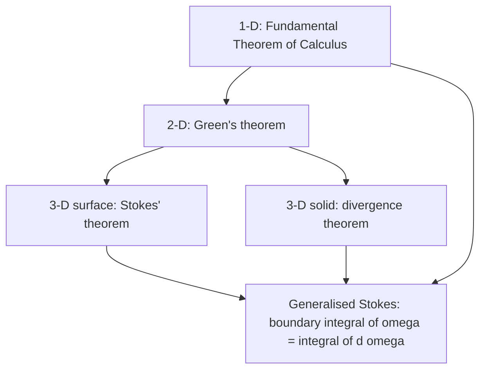

# Vector Calculus

> [Calculus](../README.md) · Level: Advanced · Prerequisites: [Differentiation Rules](../04-differentiation-rules/README.md), [Integrals](../06-integrals/README.md), [The Fundamental Theorem of Calculus](../07-fundamental-theorem-of-calculus/README.md), [Techniques of Integration](../08-techniques-of-integration/README.md), [Linear Algebra](../../08-linear-algebra/README.md), and the partial-derivative and multiple-integral material listed in the [Calculus index](../README.md) · Estimated time: 12 h

## 1. Introduction

Single-variable calculus integrates a function over an interval, and the Fundamental Theorem of Calculus
says that this integral equals a difference of values at the two endpoints:

$$\int_a^b f'(x)\,dx = f(b)-f(a).$$

Read geometrically, the interval $[a,b]$ is a one-dimensional region whose boundary is the two-point set
$\{a,b\}$, and the theorem says *the integral of a derivative over the region equals a sum of the field
over the boundary*. Vector calculus is what happens when the interval is replaced by a curve, a surface,
or a solid body. The derivative is replaced by the gradient, the curl, or the divergence; the integral by
a line, surface, or volume integral; and the one theorem becomes four:

* the **fundamental theorem for line integrals**, for a curve and its two endpoints;
* **Green's theorem**, for a plane region and its boundary curve;
* **Stokes' theorem**, for a surface and its boundary curve;
* the **divergence theorem**, for a solid and its boundary surface.

Each has exactly the shape above: an integral of a derivative over a region equals an integral of the
original field over the boundary. The last section of the theory (§7.12) shows that they are not four
theorems but one — the generalised Stokes theorem $\int_{\partial M}\omega = \int_M d\omega$ — seen in four
languages.

The subject exists because nature is written in fields. The velocity of a fluid assigns a vector to every
point; the electric and magnetic fields do the same; temperature and pressure assign a *number* to every
point. Three questions recur, and each has a name:

* **How much work does a field do along a path?** — the line integral of the field along the path.
* **How much fluid crosses a surface?** — the flux, the surface integral of the field's normal component.
* **Is the flow locally a source, a sink, or a swirl?** — divergence and curl measure exactly these.

The computational content is a small set of recipes (parametrise, substitute, integrate) and four
identities that convert a hard integral into an easy one. The conceptual content is **orientation**. Every
theorem in this topic compares two integrals whose signs depend on a choice — the direction of a curve,
the side of a surface, the outside of a solid — and the theorems are true only when the two choices are
made *consistently*. Choosing the wrong normal, or traversing the boundary backwards, produces a correct
computation of the negative of the right answer. That is why §11 begins with orientation, and why every
worked example states its orientation explicitly.

A second theme is **hypothesis tracking**. Each theorem needs a field that is continuously differentiable,
a region of a certain shape, and a boundary with a certain regularity. The two most important hypotheses
are *simple connectivity*, which decides whether a curl-free field is a gradient, and *the absence of
singularities inside the region*, which decides whether the divergence theorem may be applied at all.

## 2. Prerequisites

**From single-variable calculus**

* All differentiation rules, especially the chain rule, and the ability to differentiate an expression
  such as $\phi(x(t),y(t),z(t))$ in $t$.
* The Fundamental Theorem of Calculus in both parts
  ([The Fundamental Theorem of Calculus](../07-fundamental-theorem-of-calculus/README.md)).
* Substitution in definite integrals, and the standard trigonometric integrals
  ([Techniques of Integration](../08-techniques-of-integration/README.md)).

**From multivariable calculus** (the planned *Multivariable Calculus* topic of the
[Calculus index](../README.md); every fact used below is restated here)

* Partial derivatives, the gradient $\nabla f = (f_x,f_y,f_z)$, and the chain rule for a composite
  $t\mapsto f(\mathbf r(t))$:
  $\dfrac{d}{dt}f(\mathbf r(t)) = \nabla f(\mathbf r(t))\cdot\mathbf r'(t)$.
* Level sets $f = c$ and the fact that $\nabla f$ is orthogonal to them.
* Double and triple integrals, and the area and volume elements in polar and spherical coordinates:
  $dA = r\,dr\,d\theta$ and $dV = \rho^2\sin\phi\,d\rho\,d\phi\,d\theta$.
* Parametrised curves: the circle $\mathbf r(t) = (a\cos t, a\sin t)$, the helix, and the line segment
  $\mathbf r(t) = \mathbf a + t(\mathbf b-\mathbf a)$.

**From linear algebra** ([Linear Algebra](../../08-linear-algebra/README.md))

* The dot product $\mathbf u\cdot\mathbf v = u_1v_1+u_2v_2+u_3v_3$, its bilinearity, and the identity
  $\mathbf u\cdot\mathbf v = \lVert\mathbf u\rVert\,\lVert\mathbf v\rVert\cos\theta$.
* The cross product $\mathbf u\times\mathbf v$: it is orthogonal to both factors, its direction obeys the
  right-hand rule, and $\lVert\mathbf u\times\mathbf v\rVert$ is the area of the parallelogram spanned by
  $\mathbf u$ and $\mathbf v$.
* Determinants, including the $3\times3$ determinant used as a mnemonic for the curl.

**From trigonometry** ([Trigonometry](../../05-trigonometry/README.md)): $\sin^2\theta+\cos^2\theta=1$,
the double-angle formulas, and the standard parametrisations of the circle, the sphere, the cylinder, the
cone and the torus.

**Notation warning.** This topic uses $\mathbf F$ for a field, $\mathbf r$ for a position vector, $C$ for a
curve, $S$ for a surface, $D$ for a plane region, $V$ for a solid, and $\partial$ for "boundary of". The
symbol $\partial$ is also used for partial derivatives; context — $\partial D$ versus $\partial P/\partial x$
— always disambiguates.

## 3. Learning Objectives

After working through this tutorial you will be able to:

1. Recognise a vector field in a formula, a picture, or a physical description, and sketch its field
   lines by solving $\mathbf r'(t) = \mathbf F(\mathbf r(t))$ in simple cases.
2. Decide whether a field is conservative, find a potential by integration, and use the fundamental
   theorem for line integrals to replace a line integral by a difference of potentials.
3. State and prove that a conservative field is path independent, and explain why the converse needs a
   hypothesis on the shape of the domain.
4. Set up and evaluate line integrals of scalar fields (mass, arc length, average) and of vector fields
   (work, circulation), choosing and tracking the orientation correctly.
5. Compute curl and divergence, state their geometric meanings as circulation density and flux density,
   and use the identities $\nabla\times\nabla f = \mathbf 0$ and $\nabla\cdot(\nabla\times\mathbf F)=0$.
6. State Green's theorem with its hypotheses and orientation, prove it for a simple region, and use both
   its circulation form and its flux form, including the area formula.
7. Parametrise a surface, compute its area element $\lVert\mathbf r_u\times\mathbf r_v\rVert\,du\,dv$, and evaluate
   surface integrals of scalar functions.
8. Orient a surface, compute flux, and apply Stokes' theorem and the divergence theorem, including
   problems where a surface must be completed before the divergence theorem applies.
9. Explain in what sense Green, Stokes, the divergence theorem and the Fundamental Theorem of Calculus are
   one theorem, translate to differential forms, and apply the results to fluid flow and electromagnetism.

## 4. Intuition

**A field is a vector attached to every point.** In a river, every point of the water has a velocity — a
speed and a direction. A leaf dropped on the surface is carried along a **field line** (streamline): closed
circles if the water swirls, radiating lines if it flows from a spring, converging lines if it drains into a
hole. A picture of arrows already carries the information.

**Work is "push times displacement", accumulated.** To move a particle along a path, pay at every instant
the component of the force along the direction of motion times the small displacement. The sum is a line
integral. For a gradient force — gravity, electrostatics — the total depends only on the starting and
ending heights, not on the route: this is the fundamental theorem for line integrals, and it is why
gravitational work is $mgh$.

**Circulation measures swirl.** Walk once around a closed loop, adding the component of the field along
your direction of travel. A swirl gives a large sum; a gradient gives zero, because you return to the same
height. Circulation per unit area, in the limit of a tiny loop, is the component of the **curl** about the
loop's normal; a paddle wheel spins fastest about the axis of the curl, at half its magnitude.

**Flux measures through-flow.** The volume of water crossing a small net per second is the component of
velocity perpendicular to the net, summed over it — the **flux**. For a tiny closed box the net outflow per
unit volume is the **divergence**: positive at a source, negative at a sink, zero in an incompressible fluid.

**The boundary knows the interior.** All four theorems say *the total of a derivative over a region is what
the field does at the boundary*. The reason is cancellation: cut the region into tiny cells, and on every
internal face two neighbours contribute equal and opposite amounts, so only the outer boundary survives.
The derivative is precisely the quantity whose cell-by-cell sum telescopes. This is the generalised Stokes
theorem, and it is why the same proof pattern — cut, cancel, sum — appears in every dimension.

**Orientation is bookkeeping for "which side".** A curve has two directions, a surface two sides, a solid an
inside and an outside. The theorems are equalities between *oriented* integrals: reverse the walk or the
normal and every term changes sign. Consistent boundary orientation is what makes the cancellation above
work.

## 5. Formal Definition

### 5.1 Domains, curves and regions

A set $D\subseteq\mathbb{R}^n$ is **open** if each point has a ball $B_r(\mathbf x)\subseteq D$; it is
**connected** if it is not the union of two disjoint non-empty open sets, which for open sets is equivalent to
**path-connected** (any two points joined by a curve in $D$). It is **star-shaped** if for some
$\mathbf x_0\in D$ every segment $[\mathbf x_0,\mathbf x]$ lies in $D$, and a plane domain is **simply
connected** if every simple closed curve in it encloses only points of it.

A **curve** is a piecewise $C^1$ regular map $\mathbf r:[a,b]\to\mathbb{R}^n$, regular meaning
$\mathbf r'\ne\mathbf 0$ wherever the derivative exists. It is **simple** if injective on $[a,b]$,
**closed** if $\mathbf r(a)=\mathbf r(b)$, and **simple closed** if closed and injective on $[a,b)$.
Reparametrisations with $\varphi'>0$ preserve orientation, those with $\varphi'<0$ reverse it, and the reversed
curve is $-C$. A plane region is **$x$-simple** (type II) if
$D = \{(x,y): c\le y\le d,\ g_1(y)\le x\le g_2(y)\}$ and **$y$-simple** (type I) if
$D = \{(x,y): a\le x\le b,\ f_1(x)\le y\le f_2(x)\}$; it is **simple** if both hold. Squares, disks and
triangles are simple; an annulus is not, but becomes a union of simple regions after a cut.

### 5.2 Vector fields

Let $D\subseteq\mathbb{R}^n$ be open. A **vector field** is a map $\mathbf F:D\to\mathbb{R}^n$, written
$\mathbf F = (P,Q,R) = P\,\mathbf i+Q\,\mathbf j+R\,\mathbf k$, of class $C^k$ when all its components are.
A **scalar field** is a map $D\to\mathbb{R}$. Examples: the velocity of a fluid, an electric field,
$\nabla f$, the position field $\mathbf x$, and the vortex field $(-y,x)/(x^2+y^2)$ on
$\mathbb{R}^2\setminus\{\mathbf 0\}$.

### 5.3 Field lines

A **field line** (streamline) of $\mathbf F$ is a $C^1$ curve with $\mathbf r'(t) = \mathbf F(\mathbf r(t))$
on an interval. If $\mathbf F$ is $C^1$ and $\mathbf F(\mathbf x_0)\ne\mathbf 0$, the ODE existence and
uniqueness theorem gives a unique maximal field line through $\mathbf x_0$; distinct field lines are disjoint
and can meet only at **critical points**, where $\mathbf F = \mathbf 0$. A field line is a set, and any
increasing reparametrisation of a field line is again a field line.

### 5.4 Conservative fields and potentials

A field $\mathbf F$ on an open connected $D$ is **conservative** if $\mathbf F = \nabla\phi$ for some $C^1$
scalar field $\phi$, called a **potential**. On a connected domain two potentials differ by a constant, because
a $C^1$ function with zero gradient on a connected open set is constant.

> **Sign convention.** Physicists write $\mathbf F = -\nabla U$, so $U=-\phi$; for gravitation
> $\mathbf F = -GMm\,\mathbf r/\lVert\mathbf r\rVert^3$. This topic uses $\mathbf F=\nabla\phi$; replace
> $\phi$ by $-U$ to translate.

Examples: constant fields; $(2xy,x^2) = \nabla(x^2y)$; every central field $f(r)\mathbf x$, whose potential is
$\int_0^r f(s)s\,ds$; in particular $\mathbf r/\lVert\mathbf r\rVert^3 = -\nabla(1/\lVert\mathbf r\rVert)$.

### 5.5 Line integrals

Let $C$ have regular parametrisation $\mathbf r:[a,b]\to\mathbb{R}^n$ and let $f$ be continuous on $C$.
Partitioning $[a,b]$ and summing $f(\mathbf r(t_i^*))\,\Delta s_i$, where $\Delta s_i$ is the arc length of
the subarc, gives the **line integral of a scalar field**

$$\int_C f\,ds = \int_a^b f\bigl(\mathbf r(t)\bigr)\,\lVert\mathbf r'(t)\rVert\,dt ,$$

where $ds = \lVert\mathbf r'(t)\rVert\,dt$ is the **arc length element**; $\int_C1\,ds$ is the length of
$C$.

For a continuous vector field the analogous limit of $\sum_i\mathbf F(\mathbf r(t_i^*))\cdot
(\mathbf r(t_i)-\mathbf r(t_{i-1}))$ is the **line integral of a vector field** (or **circulation
integral**):

$$\int_C \mathbf F\cdot d\mathbf r = \int_a^b \mathbf F\bigl(\mathbf r(t)\bigr)\cdot\mathbf r'(t)\,dt
= \int_C (P\,dx + Q\,dy + R\,dz).$$

With $\mathbf T = \mathbf r'/\lVert\mathbf r'\rVert$ this is $\int_C(\mathbf F\cdot\mathbf T)\,ds$, a
scalar line integral of the tangential component. Both definitions extend to piecewise $C^1$ curves by summing
over the pieces. For a closed curve one writes $\oint_C$ and speaks of the **circulation**.

### 5.6 Curl and divergence

For a $C^1$ field $\mathbf F = (P,Q,R)$ on an open set in $\mathbb{R}^3$, the **curl** is the vector field

$$\nabla\times\mathbf F
= \left(\frac{\partial R}{\partial y}-\frac{\partial Q}{\partial z}\right)\mathbf i
+ \left(\frac{\partial P}{\partial z}-\frac{\partial R}{\partial x}\right)\mathbf j
+ \left(\frac{\partial Q}{\partial x}-\frac{\partial P}{\partial y}\right)\mathbf k ,$$

and the **divergence** is the scalar field
$\nabla\cdot\mathbf F = P_x+Q_y+R_z$. For a plane field $(P,Q)$ one takes $R=0$ and gets
$\nabla\times\mathbf F = (0,0,Q_x-P_y)$ and $\nabla\cdot\mathbf F = P_x+Q_y$. The curl is remembered as the
determinant with rows $(\mathbf i,\mathbf j,\mathbf k)$, $(\partial_x,\partial_y,\partial_z)$ and
$(P,Q,R)$, expanded along the first row with the middle term negated.

### 5.7 Parametrised surfaces

A **parametrised surface** is a $C^1$ map $\mathbf r:D\to\mathbb{R}^3$, $\mathbf r(u,v) =
(x(u,v),y(u,v),z(u,v))$, with image $S$. It is **regular** at $(u,v)$ if
$\mathbf r_u\times\mathbf r_v\ne\mathbf 0$; then $\mathbf r_u$ and $\mathbf r_v$ span the **tangent
plane** and $\mathbf n = (\mathbf r_u\times\mathbf r_v)/\lVert\mathbf r_u\times\mathbf r_v\rVert$ is a
unit normal. The surface is **smooth** if it has a regular parametrisation and **piecewise smooth** if it is a
finite union of smooth pieces. A **graph** $z=g(x,y)$ has
$\mathbf r(x,y) = (x,y,g(x,y))$ and $\mathbf r_x\times\mathbf r_y = (-g_x,-g_y,1)$.

An **orientation** is a continuous choice of unit normal; a surface admitting one is **orientable**, and then
it admits exactly two, $\mathbf n$ and $-\mathbf n$. A **closed surface** bounds a solid, and its **outward
orientation** points away from the solid.

### 5.8 Surface integrals

For continuous $f$ on a piecewise smooth surface $S$ with regular parametrisation $\mathbf r:D\to\mathbb{R}^3$,

$$\iint_S f\,dS = \iint_D f\bigl(\mathbf r(u,v)\bigr)\,\lVert\mathbf r_u\times\mathbf r_v\rVert\,du\,dv ,$$

so $\iint_S1\,dS$ is the **surface area**, and $dS = \lVert\mathbf r_u\times\mathbf r_v\rVert\,du\,dv$ is
the **area element**. For an oriented surface with unit normal $\mathbf n$, the **flux** is

$$\iint_S \mathbf F\cdot d\mathbf S
= \iint_S \mathbf F\cdot\mathbf n\,dS
= \iint_D \mathbf F\bigl(\mathbf r(u,v)\bigr)\cdot\bigl(\mathbf r_u\times\mathbf r_v\bigr)\,du\,dv ,$$

with the orientation induced by the parametrisation; reversing the normal or swapping $u,v$ changes the sign.
The vector area element $d\mathbf S = \mathbf n\,dS = (\mathbf r_u\times\mathbf r_v)\,du\,dv$ is **not** a
unit vector. For a graph with the upward orientation $d\mathbf S = (-g_x,-g_y,1)\,dx\,dy$; for a closed
surface the default is the outward normal.

## 6. Mathematical Notation

| Symbol | Read as | Meaning |
|---|---|---|
| $\mathbf F$, $\mathbf G$ | field $F$ | vector field, usually $C^1$ |
| $\mathbf r(t)$ | position vector | parametrisation of a curve |
| $C$, $-C$ | curve $C$, reversed curve | oriented curve and its reverse |
| $\partial D$ | boundary of $D$ | the boundary curve of a plane region |
| $\partial S$ | boundary of $S$ | the boundary curve of a surface |
| $\partial V$ | boundary of $V$ | the boundary surface of a solid |
| $ds$ | arc length element | $\lVert\mathbf r'(t)\rVert\,dt$ |
| $d\mathbf r$ | vector line element | $\mathbf r'(t)\,dt$ |
| $dS$ | area element | $\lVert\mathbf r_u\times\mathbf r_v\rVert\,du\,dv$ |
| $d\mathbf S$ | vector area element | $\mathbf n\,dS$, not a unit vector |
| $\mathbf T$ | unit tangent | $\mathbf r'/\lVert\mathbf r'\rVert$ |
| $\mathbf n$ | unit normal | chosen orientation of a surface |
| $\int_C f\,ds$ | integral of $f$ over $C$ with respect to arc length | scalar line integral |
| $\int_C \mathbf F\cdot d\mathbf r$ | line integral of $\mathbf F$ along $C$ | work or circulation |
| $\oint_C$ | integral around a closed curve | circulation |
| $\iint_S \mathbf F\cdot d\mathbf S$ | flux of $\mathbf F$ through $S$ | vector surface integral |
| $\nabla f$ | gradient of $f$ | $(f_x,f_y,f_z)$ |
| $\nabla\cdot\mathbf F$ | divergence of $\mathbf F$ | scalar, $P_x+Q_y+R_z$ |
| $\nabla\times\mathbf F$ | curl of $\mathbf F$ | vector, $(\nabla\times\mathbf F)$ above |
| $\nabla^2 f$ | Laplacian | $\nabla\cdot\nabla f = f_{xx}+f_{yy}+f_{zz}$ |
| $P_x$, $P_y$, $P_z$ | partial derivatives | $\partial P/\partial x$, etc. |
| $D$ | plane region | integration domain for double integrals |
| $V$ | solid region | integration domain for triple integrals |
| $r$ | distance from the origin | $r=\lVert\mathbf x\rVert$ in $\mathbb{R}^3$ |
| $d\omega$ | exterior derivative | differential-form generalisation of grad, curl, div |

## 7. Core Concepts

### 7.1 Vector fields and field lines

A vector field is best read as a picture. At each point draw the vector based there; the resulting arrow
plot is the field. Three features are worth training the eye to see: the *length* of the arrows (the
magnitude), the *direction pattern* (is the flow rotational, radial, sheared?), and the *critical points*
where the field vanishes.

Field lines are obtained by solving the ODE system of §5.3. In two dimensions the equation
$dy/dx = Q(x,y)/P(x,y)$ is often enough; in general one looks for a conserved quantity, a function that is
constant along the flow.

| Field | Field lines | Why |
|---|---|---|
| $(1,0)$ | horizontal lines $y=c$ | $x'=1$, $y'=0$ |
| $(x,y)$ | rays from the origin | $x'=x$, $y'=y$ give $y/x$ constant |
| $(-y,x)$ | circles centred at the origin, counterclockwise | $x'=-y$, $y'=x$ give $x^2+y^2$ constant |
| $(x,-y)$ | hyperbolas $xy=c$ | $x'=x$, $y'=-y$ give $xy$ constant |
| $(-y,x)/(x^2+y^2)$ | the same circles, traversed at constant angular speed | positive scalar multiple of the previous field |
| $(x^2,0)$ | horizontal lines, traversed with $x(t) = x_0/(1-x_0t)$ | the flow reaches infinity in finite time |

**Derivation for the rotation field.** For $\mathbf F = (-y,x)$ the system is $x'=-y$, $y'=x$.
Differentiating the first equation and substituting the second gives $x'' = -y' = -x$, so
$x(t) = A\cos t + B\sin t$ and $y(t) = -x'(t) = A\sin t - B\cos t$. Since $\cos^2t+\sin^2t=1$, the
two cross terms cancel and $x(t)^2+y(t)^2 = A^2+B^2$, so every field line is contained in a circle.
Conversely every circle about the origin, traversed counterclockwise, satisfies the equation, so the field
lines are exactly those circles.

**Field lines of a gradient are orthogonal to level sets.** Suppose $\mathbf F = \nabla\phi$ and let
$\mathbf r(t)$ be a field line. Then, by the chain rule,

$$\frac{d}{dt}\,\phi\bigl(\mathbf r(t)\bigr) = \nabla\phi\bigl(\mathbf r(t)\bigr)\cdot\mathbf r'(t)
= \bigl\lVert\nabla\phi\bigl(\mathbf r(t)\bigr)\bigr\rVert^2 \ \ge 0 ,$$

with equality only where $\nabla\phi = \mathbf 0$. Hence $\phi$ increases strictly along the field line
wherever the gradient does not vanish: gradient field lines are the curves of **steepest ascent**. If
$\mathbf c(s)$ is any curve inside a level set $\phi = c$, then
$\nabla\phi\cdot\mathbf c' = \frac{d}{ds}\phi(\mathbf c(s)) = 0$, so the gradient is orthogonal to the level
set. Therefore the field lines cross every level set at right angles. This is why the field lines of
$\nabla f$ look like the "contour lines rotated by $90^\circ$" in every contour plot.

### 7.2 Conservative fields and the gradient

A conservative field is a gradient, so the whole computational problem is *finding a potential*. In
components, $\mathbf F = (P,Q,R) = (\phi_x,\phi_y,\phi_z)$ means that $P$ is the derivative of $\phi$ in
$x$, and so on. The recipe is:

1. Integrate $P$ with respect to $x$, treating $y$ and $z$ as constants:
   $\phi(x,y,z) = \int P(x,y,z)\,dx + g(y,z)$. The "constant" of integration is an arbitrary function of
   the other two variables.
2. Differentiate the result with respect to $y$ and set it equal to $Q$; this determines $g_y(y,z)$.
3. Integrate in $y$ to get $g$ up to a function $h(z)$, then differentiate in $z$ and compare with $R$.
4. Check the answer by computing $\nabla\phi$ and comparing all three components with $\mathbf F$.

**Necessary condition (the curl test).** If $\mathbf F = \nabla\phi$ with $\phi$ of class $C^2$ on an open
set, then by equality of mixed partial derivatives,

$$P_y = \phi_{xy} = \phi_{yx} = Q_x, \qquad P_z = \phi_{xz} = \phi_{zx} = R_x, \qquad
Q_z = \phi_{yz} = \phi_{zy} = R_y ,$$

which is exactly $\nabla\times\mathbf F = \mathbf 0$. So *a conservative $C^1$ field whose potential is
$C^2$ is curl-free*, and in the plane the single test is $P_y = Q_x$. The converse is **false in
general**: the vortex field

$$\mathbf F(x,y) = \left(\frac{-y}{x^2+y^2},\ \frac{x}{x^2+y^2}\right), \qquad (x,y)\ne(0,0),$$

satisfies $P_y = Q_x$ on its whole domain (verify: both equal $(y^2-x^2)/(x^2+y^2)^2$), yet its
circulation around the unit circle is $2\pi\ne0$, so it cannot be a gradient (by the fundamental theorem
for line integrals, a gradient has zero circulation around every closed curve). The domain has a hole, and
the hole is exactly what allows the obstruction.

**Sufficient condition.** If $D$ is **star-shaped** (in particular if $D$ is convex or all of
$\mathbb{R}^3$) and $\mathbf F$ is $C^1$ on $D$ with $\nabla\times\mathbf F = \mathbf 0$, then $\mathbf F$ is
conservative. The proof is a construction: after translating so that the centre of the star is the origin,
define for $\mathbf x\in D$

$$\phi(\mathbf x) = \int_0^1 \mathbf F(t\mathbf x)\cdot\mathbf x\,dt ,$$

and differentiate under the integral sign; the curl-free condition makes $\nabla\phi = \mathbf F$. Exercise
35 carries out the differentiation in full. The same conclusion holds on any simply connected plane domain,
by a different argument (cut the domain into polygons and apply Green's theorem).

### 7.3 Line integrals of scalar fields

The definition in §5.5 partitions the curve and uses arc lengths $\Delta s_i$. To see why the formula
$ds = \lVert\mathbf r'(t)\rVert\,dt$ is right, approximate the subarc between $t_{i-1}$ and $t_i$ by the
chord $\mathbf r(t_i)-\mathbf r(t_{i-1})$, whose length is

$$\bigl\lVert\mathbf r(t_i)-\mathbf r(t_{i-1})\bigr\rVert
= \Bigl\lVert\int_{t_{i-1}}^{t_i}\mathbf r'(t)\,dt\Bigr\rVert
\approx \bigl\lVert\mathbf r'(t_i^*)\bigr\rVert\,(t_i-t_{i-1}) ,$$

and the error is $o(t_i-t_{i-1})$ because $\mathbf r'$ is continuous. Summing and refining the partition
gives the formula. (The rigorous statement is that the arc length of a $C^1$ curve is
$\int_a^b\lVert\mathbf r'\rVert\,dt$; it follows from the mean value theorem applied to the components with
a compactness argument.)

**Basic properties.** $ds$ is **independent of orientation**, because reversing the parametrisation changes
$dt$ to $-dt$ and also reverses the limits; the integral is **independent of the parametrisation** by the
substitution rule; and it is linear in $f$ and additive over concatenated curves.

**Special formulas.** For a graph $y=g(x)$ the arc length element is $ds = \sqrt{1+g'(x)^2}\,dx$; in polar
coordinates $r = r(\theta)$ it is $ds = \sqrt{r^2+(dr/d\theta)^2}\,d\theta$. For a straight segment,
$ds = \lVert\mathbf b-\mathbf a\rVert\,dt$ with $t\in[0,1]$, so the integral of a linear function is the length
times the average of the endpoint values.

### 7.4 Line integrals of vector fields

The vector line integral accumulates the component of the field along the direction of motion. The
Riemann sum in §5.5 uses $\mathbf F(\mathbf r(t_i^*))\cdot(\mathbf r(t_i)-\mathbf r(t_{i-1}))$, which is
approximately $\mathbf F\cdot\mathbf r'(t_i^*)\,\Delta t$; the limit is therefore the integral of
$\mathbf F(\mathbf r(t))\cdot\mathbf r'(t)$.

**Work.** If $\mathbf F$ is a force, $\int_C\mathbf F\cdot d\mathbf r$ is the work done by the force along
$C$. The sign is part of the definition: if the path is traversed against the force, the integrand is
negative and the integral is negative.

**Circulation.** If $C$ is closed and $\mathbf F$ is a velocity field, $\oint_C\mathbf F\cdot d\mathbf r$ is
the **circulation** of the field around $C$: a signed measure of how much the field pushes along the loop.
The units are (field) $\times$ (length). A field with nonzero circulation around some loop is definitely not
conservative.

**Orientation reversal.** Let $\mathbf r_2(t) = \mathbf r_1(a+b-t)$ parametrise $-C$. Then
$\mathbf r_2'(t) = -\mathbf r_1'(a+b-t)$, and the substitution $s = a+b-t$, $dt = -ds$ gives

$$\int_{-C}\mathbf F\cdot d\mathbf r
= \int_a^b \mathbf F\bigl(\mathbf r_1(a+b-t)\bigr)\cdot\bigl(-\mathbf r_1'(a+b-t)\bigr)\,dt
= -\int_a^b\mathbf F(\mathbf r_1(s))\cdot\mathbf r_1'(s)\,ds ,$$

so $\int_{-C}\mathbf F\cdot d\mathbf r = -\int_C\mathbf F\cdot d\mathbf r$. The scalar line integral, by
contrast, is unchanged. This asymmetry is the first place where orientation matters, and it recurs in every
theorem of the topic.

**Evaluation recipe.** (i) Parametrise the curve, including the direction. (ii) Compute $\mathbf r'$. (iii)
Substitute everything to obtain a single-variable integral in $t$, with the correct limits. (iv) Integrate.
(v) Check the sign: for a closed curve in a conservative field the answer must be $0$; for a path against a
force it must be negative.

### 7.5 The fundamental theorem for line integrals

> **Theorem (fundamental theorem for line integrals).** Let $D\subseteq\mathbb{R}^n$ be open and connected,
> let $\phi$ be a $C^1$ scalar field on $D$, and let $C$ be a piecewise $C^1$ curve in $D$ from $A$ to $B$
> (so $C$ has a parametrisation $\mathbf r:[a,b]\to D$ with $\mathbf r(a)=A$ and $\mathbf r(b)=B$). Then
>
> $$\int_C \nabla\phi\cdot d\mathbf r = \phi(B)-\phi(A).$$

**Proof.** Take a parametrisation $\mathbf r$ of $C$. On each smooth piece, the chain rule gives

$$\frac{d}{dt}\,\phi\bigl(\mathbf r(t)\bigr)
= \nabla\phi\bigl(\mathbf r(t)\bigr)\cdot\mathbf r'(t),$$

and the Fundamental Theorem of Calculus gives

$$\int_a^b \nabla\phi(\mathbf r(t))\cdot\mathbf r'(t)\,dt
= \int_a^b \frac{d}{dt}\phi(\mathbf r(t))\,dt = \phi(\mathbf r(b))-\phi(\mathbf r(a)) = \phi(B)-\phi(A).$$

For a piecewise $C^1$ curve, apply the argument to each smooth piece and add; the values at the
intermediate vertices cancel. $\blacksquare$

Two immediate corollaries:

1. **Closed loops.** If $A=B$ then $\oint_C\nabla\phi\cdot d\mathbf r = 0$. A gradient field has zero
   circulation around every closed curve.
2. **Path independence.** The value of the integral depends only on the endpoints, not on the route.

**Path independence.** Say that $\mathbf F$ is **path independent** on $D$ if for any two points
$A,B\in D$ the integral $\int_C\mathbf F\cdot d\mathbf r$ is the same for every piecewise $C^1$ curve in $D$
from $A$ to $B$. On an open connected domain the following are equivalent:

* (a) $\mathbf F$ is conservative;
* (b) $\mathbf F$ is path independent;
* (c) $\oint_C\mathbf F\cdot d\mathbf r = 0$ for every piecewise $C^1$ closed curve $C$ in $D$.

We have proved (a) $\Rightarrow$ (b) (the theorem) and (b) $\Rightarrow$ (c) (a closed curve starts and ends
at the same point, so the integral equals $\phi(A)-\phi(A)=0$). For (c) $\Rightarrow$ (b), given two curves
$C_1$ from $A$ to $B$ and $C_2$ from $A$ to $B$, the concatenation $C_1\cup(-C_2)$ is closed, so
$0 = \int_{C_1}\mathbf F\cdot d\mathbf r - \int_{C_2}\mathbf F\cdot d\mathbf r$. It remains to prove
(b) $\Rightarrow$ (a), which is the converse that requires the construction of a potential.

> **Theorem (path independence implies conservative).** Let $D\subseteq\mathbb{R}^n$ be open and connected,
> and let $\mathbf F$ be continuous on $D$. If $\mathbf F$ is path independent, then $\mathbf F$ is
> conservative.

**Proof.** Fix a base point $\mathbf x_0\in D$ and define

$$\phi(\mathbf x) = \int_{\mathbf x_0}^{\mathbf x}\mathbf F\cdot d\mathbf r ,$$

which is well defined because the integral does not depend on the path. We show that
$\partial\phi/\partial x_j = F_j$ for each $j$; it suffices to treat $j=1$ and write
$\mathbf x = (x,y,z)$ in $\mathbb{R}^3$, the other cases being identical.

Because $D$ is open, there is $\delta>0$ such that the horizontal segment from $(x,y,z)$ to
$(x+h,y,z)$ lies in $D$ for every $|h|<\delta$. By path independence, going from $\mathbf x_0$ to
$(x+h,y,z)$ may be done by going first to $(x,y,z)$ and then along that segment. Hence, for $h\ne0$,

$$\frac{\phi(x+h,y,z)-\phi(x,y,z)}{h}
= \frac{1}{h}\int_0^h P(x+s,y,z)\,ds .$$

As $h\to0$ the right-hand side tends to $P(x,y,z)$, because $P$ is continuous and the average of a
continuous function over an interval of length $h$ tends to its value at the base point. The left-hand side
tends to $\partial\phi/\partial x$ by definition of the partial derivative. Therefore
$\partial\phi/\partial x = P$. The same argument in the other coordinates gives $\nabla\phi = \mathbf F$,
so $\mathbf F$ is conservative. $\blacksquare$

**Remark on hypotheses.** Openness places the little segment inside $D$; connectedness lets the base point
reach every point; continuity of $\mathbf F$ is used in the limit, and none of the three can be dropped. The
proof also produces a formula for the potential. Note that "curl-free $\Rightarrow$ conservative" needs a
hypothesis on the shape of $D$ (the vortex field is the counterexample), whereas the three equivalences
above hold on every open connected domain.

### 7.6 Curl and divergence

Curl and divergence are derivatives of a vector field, and like all derivatives they are defined by a limit
of a quotient. The coordinate formulas of §5.6 are compact, but they hide the meaning, which is best
recovered by computing two small integrals.

**Circulation density is $Q_x-P_y$.** Take the rectangle $R$ with vertices $(0,0)$, $(h,0)$, $(h,k)$,
$(0,k)$, traversed counterclockwise, and a $C^1$ field $\mathbf F=(P,Q)$. The circulation is

$$\Gamma = \int_0^h P(x,0)\,dx + \int_0^k Q(h,y)\,dy - \int_0^h P(x,k)\,dx - \int_0^k Q(0,y)\,dy .$$

To first order in $h$ and $k$, using $P(x,0)\approx P(0,0)+xP_x(0,0)$ and
$Q(h,y)\approx Q(0,0)+hQ_x(0,0)$, and similarly on the other two sides,

$$\Gamma \approx hP(0,0) + k\bigl(Q(0,0)+hQ_x\bigr) - h\bigl(P(0,0)+kP_y\bigr) - kQ(0,0)
= hk\,(Q_x-P_y) + o(hk).$$

Dividing by the area $hk$ and letting $h,k\to0$ gives

$$Q_x-P_y = \lim_{h,k\to0}\frac{1}{hk}\oint_{\partial R}\mathbf F\cdot d\mathbf r ,$$

the **circulation per unit area** about the normal $\mathbf k$. Rotating coordinates so that $\mathbf k$ is
replaced by any unit vector $\mathbf n$ gives the general statement

$$(\nabla\times\mathbf F)(\mathbf p)\cdot\mathbf n
= \lim_{A\to0}\frac{1}{A}\oint_{\partial S_A}\mathbf F\cdot d\mathbf r ,$$

where $S_A$ is a small plane region of area $A$ through $\mathbf p$ with normal $\mathbf n$, and the boundary
is traversed according to the right-hand rule. This is the geometric meaning of the curl: **its component
along $\mathbf n$ is the circulation density about $\mathbf n$**, and its direction is the axis about which
the circulation is largest. Because of this, the curl of a velocity field is twice the local angular
velocity: for a rigid rotation $\mathbf v(\mathbf x) = \boldsymbol\omega\times\mathbf x$ one computes
$P = \omega_2z-\omega_3y$, $Q = \omega_3x-\omega_1z$, $R = \omega_1y-\omega_2x$, and then

$$R_y-Q_z = \omega_1-(-\omega_1) = 2\omega_1,\qquad
P_z-R_x = 2\omega_2,\qquad Q_x-P_y = 2\omega_3 ,$$

so $\nabla\times\mathbf v = 2\boldsymbol\omega$, and a paddle wheel in the flow spins at angular velocity
$\tfrac12\nabla\times\mathbf v$.

**Flux density is $P_x+Q_y+R_z$.** On the cube $[0,h]^3$ with outward normals, only $P$ contributes on the
faces $x=h$ and $x=0$ (normals $\pm\mathbf i$), and similarly for $Q$ and $R$ on the other four faces.
Applying the mean value theorem for integrals to each face and expanding to first order, the six
contributions combine to $\text{flux} = h^3(P_x+Q_y+R_z)+o(h^3)$.

Dividing by the volume $h^3$ and letting $h\to0$ gives

$$\nabla\cdot\mathbf F(\mathbf p) = \lim_{V\to0}\frac{1}{V}\iint_{\partial V}\mathbf F\cdot d\mathbf S ,$$

the **net outflow per unit volume**. Positive divergence means the point is a source; negative means a sink;
zero means incompressible. For a flow, the same computation applied to a small material volume gives
$\frac{d}{dt}(\text{volume}) = (\nabla\cdot\mathbf v)(\text{volume})$, so the divergence is the relative rate
of expansion of the fluid.

**Two identities.** Both follow from equality of mixed partials and are used constantly as consistency
checks.

* $\nabla\times(\nabla\phi) = \mathbf 0$ for every $C^2$ function $\phi$.
* $\nabla\cdot(\nabla\times\mathbf F) = 0$ for every $C^2$ field $\mathbf F$.

Indeed, the first component of $\nabla\times\nabla\phi$ is $\phi_{zy}-\phi_{yz} = 0$, and the divergence of
the curl is a similar cancellation: writing $\mathbf G = \nabla\times\mathbf F$,

$$\nabla\cdot\mathbf G = (R_y-Q_z)_x + (P_z-R_x)_y + (Q_x-P_y)_z
= R_{yx}-R_{xy} + P_{zy}-P_{yz} + Q_{xz}-Q_{zx} = 0 .$$

These identities are also the statement $d^2=0$ of §7.12. They imply that curl fields have no divergence
and gradients have no curl, so the image of each operator lies in the kernel of the next — a fact with
enormous consequences (for example, the magnetic field has zero divergence because it is a curl).

**The Laplacian.** $\nabla^2 f = \nabla\cdot\nabla f = f_{xx}+f_{yy}+f_{zz}$. A function with
$\nabla^2f = 0$ is **harmonic**; it has no local maxima or minima in the interior of its domain (the maximum
principle), which is why harmonic functions model equilibrium temperatures and electrostatic potentials.
Note also that $\nabla\cdot(\nabla f) = \nabla^2 f$, and that $\nabla\times(\nabla\times\mathbf F) =
\nabla(\nabla\cdot\mathbf F)-\nabla^2\mathbf F$ in $\mathbb{R}^3$.

### 7.7 Green's theorem

> **Theorem (Green).** Let $C$ be a positively oriented, piecewise smooth, simple closed curve in the plane,
> let $D$ be the bounded region it encloses, and let $P,Q$ be $C^1$ on an open set containing $D$. Then
>
> $$\oint_C P\,dx + Q\,dy = \iint_D \left(\frac{\partial Q}{\partial x}
> -\frac{\partial P}{\partial y}\right)dA .$$

**Orientation convention.** $C$ is **positively oriented** when traversed counterclockwise — the region $D$
lies on the *left* as one walks along $C$. With the opposite orientation the left side changes sign and the
formula as stated is false.

**Proof for a simple region.** Suppose first that $D$ is $y$-simple:
$D = \{(x,y): a\le x\le b,\ f_1(x)\le y\le f_2(x)\}$. By the Fundamental Theorem of Calculus in the inner
variable,

$$\iint_D P_y\,dA = \int_a^b\left[P\bigl(x,f_2(x)\bigr)-P\bigl(x,f_1(x)\bigr)\right]dx .$$

The lower graph is traversed from $x=a$ to $x=b$ (the region lies above it, hence on the left) and the upper
graph from $x=b$ to $x=a$; vertical segments contribute nothing because $dx=0$. Hence

$$\oint_C P\,dx = \int_a^b P\bigl(x,f_1(x)\bigr)dx - \int_a^b P\bigl(x,f_2(x)\bigr)dx
= -\iint_D P_y\,dA ,$$

which is the $P$-part. If $D$ is also $x$-simple, the same argument in $y$ gives
$\oint_C Q\,dy = \iint_D Q_x\,dA$, because the right-hand graph is traversed upward and the left-hand graph
downward. Adding the two identities proves the theorem for a region that is simple in both senses.

For a general simple region, cut it into finitely many such pieces; Green's theorem holds on each, and every
internal cut is traversed twice in opposite directions, so the internal contributions cancel and only the
outer boundary survives. This decomposition is the two-dimensional form of the "cut and cancel" idea of §4.
$\square$

**Hypotheses.** The curve must be simple and closed, and $P,Q$ must be $C^1$ on an open set containing the
whole region, not merely on the boundary. The latter condition is what fails when a singularity sits inside
the curve, and then the conclusion can fail — see §11.

**Regions with holes.** If $\partial D$ consists of an outer curve and inner curves bounding holes, the
convention is again "region on the left": the outer curve is counterclockwise, each inner curve clockwise.
Green's theorem still holds, because cutting the region along a thin bridge produces a simple region whose
bridge contributions cancel.

**Vector forms.** With $\mathbf F = (P,Q)$ and the plane curl, the theorem reads
$\oint_C \mathbf F\cdot d\mathbf r = \iint_D (\nabla\times\mathbf F)\cdot\mathbf k\,dA$ (the **circulation
form**). For the **flux form**, a counterclockwise curve has outward normal satisfying
$\mathbf n\,ds = (dy,-dx)$; applying Green's theorem to $(-Q,P)$ gives

$$\oint_C \mathbf F\cdot\mathbf n\,ds = \oint_C P\,dy - Q\,dx = \iint_D (P_x+Q_y)\,dA
= \iint_D \nabla\cdot\mathbf F\,dA .$$

So in the plane, circulation of the field equals flux of its curl, and flux of the field equals the integral
of its divergence.

**Area formulas.** With $(P,Q) = (0,x)$, $(-y,0)$, $(-y/2,x/2)$,

$$A(D) = \oint_C x\,dy = -\oint_C y\,dx = \frac12\oint_C (x\,dy-y\,dx).$$

The formulas are the standard tool for areas enclosed by parametric curves (Exercise 26).

### 7.8 Parametrised surfaces, surface area and surface integrals

An infinitesimal rectangle of sides $\Delta u,\Delta v$ in the parameter plane is carried by $\mathbf r$ to a
curvilinear parallelogram with sides approximately $\mathbf r_u\Delta u$ and $\mathbf r_v\Delta v$, whose
area is $\lVert\mathbf r_u\times\mathbf r_v\rVert\Delta u\,\Delta v$. Summing over a fine grid:

$$\operatorname{area}(S) = \iint_D \lVert\mathbf r_u\times\mathbf r_v\rVert\,du\,dv .$$

**Graphs.** For $\mathbf r(x,y) = (x,y,g(x,y))$, $\mathbf r_x\times\mathbf r_y = (-g_x,-g_y,1)$ and
$\lVert\mathbf r_x\times\mathbf r_y\rVert = \sqrt{1+g_x^2+g_y^2}$. The positive $z$-component defines the
**upward** orientation.

**Sphere.** With $\mathbf r(\phi,\theta) = R(\sin\phi\cos\theta,\sin\phi\sin\theta,\cos\phi)$,
$\mathbf r_\phi\times\mathbf r_\theta = R^2\sin\phi\,(\sin\phi\cos\theta,\sin\phi\sin\theta,\cos\phi)$ and
$\lVert\mathbf r_\phi\times\mathbf r_\theta\rVert = R^2\sin\phi$, so the area is $4\pi R^2$ and the normal is
outward. For the cylinder $\mathbf r(\theta,z) = (R\cos\theta,R\sin\theta,z)$ the area element is $R$, giving
lateral area $2\pi Rh$. The cone $\mathbf r(u,\theta) = (u\cos\theta,u\sin\theta,u)$ has area element
$\sqrt2\,u$. The torus $\mathbf r(u,v) = ((R+r\cos v)\cos u,(R+r\cos v)\sin u,r\sin v)$ has area element
$r(R+r\cos v)$, hence area $4\pi^2Rr$.

**Scalar surface integrals.** $\iint_S f\,dS = \iint_D f(\mathbf r(u,v))\lVert\mathbf r_u\times\mathbf r_v
\rVert\,du\,dv$. Like the scalar line integral, it is independent of orientation and of parametrisation. For
a shell with surface density $f$, the integral is the mass, and
$\frac{1}{\operatorname{area}(S)}\iint_S f\,dS$ is the average value. On a piecewise smooth surface the
integral is the sum over the smooth pieces.

### 7.9 Flux and oriented surfaces

The **flux** of $\mathbf F$ through an oriented surface $S$ is
$\iint_S\mathbf F\cdot d\mathbf S = \iint_S\mathbf F\cdot\mathbf n\,dS$. If $\mathbf F$ is a velocity in
metres per second, the flux is a volume per second: the rate at which fluid crosses $S$ in the direction of
$\mathbf n$. Where $\mathbf F\cdot\mathbf n<0$ the flow is opposite to $\mathbf n$ and the contribution is
negative; through a closed surface with outward normal, the flux is the net rate at which fluid leaves.

For a graph $z=g(x,y)$ with upward orientation,
$\iint_S\mathbf F\cdot d\mathbf S = \iint_D\mathbf F(x,y,g(x,y))\cdot(-g_x,-g_y,1)\,dx\,dy$, and the
downward orientation negates the result.

**Standard normals.** On the sphere of radius $R$ the outward normal is $\mathbf x/R$; on the cylinder
$x^2+y^2=R^2$ it is $(x,y,0)/R$ laterally and $\pm\mathbf k$ on the disks; on a box aligned with the axes it
is $\pm\mathbf i,\pm\mathbf j,\pm\mathbf k$, and on each face only one component of $\mathbf F$ contributes.

**Two-sidedness.** A smooth surface has exactly two orientations; a continuous unit normal exists precisely
when the surface is orientable. Spheres, graphs, cylinders and tori are orientable; the Möbius strip is not.

### 7.10 Stokes' theorem

> **Theorem (Stokes).** Let $S$ be an oriented, piecewise smooth surface whose boundary $\partial S$ is a
> finite union of piecewise smooth simple closed curves, oriented consistently with the unit normal
> $\mathbf n$ of $S$. Let $\mathbf F$ be $C^1$ on an open set containing $S$. Then
>
> $$\iint_S (\nabla\times\mathbf F)\cdot\mathbf n\,dS = \oint_{\partial S}\mathbf F\cdot d\mathbf r .$$

**Orientation rule.** Point the right thumb along $\mathbf n$; the fingers curl along $\partial S$.
Equivalently, walking along $\partial S$ with your head in the direction of $\mathbf n$, the surface is on
your left. Reversing the normal requires reversing the boundary, and then both sides change sign.

**Illustration.** A small paddle wheel with axle along $\mathbf n$ is turned by the circulation of the flow
around the rim of a disc: Stokes' theorem says the circulation around the rim equals the flux of the curl
through the cap. The microscopic swirls over the surface accumulate into the circulation around its boundary.

**Proof sketch.** Parametrise $S$ by $\mathbf r(u,v)$ over a plane region $D$, with $\partial D$ mapping to
$\partial S$ consistently. The left side becomes
$\iint_D(\nabla\times\mathbf F)(\mathbf r)\cdot(\mathbf r_u\times\mathbf r_v)\,du\,dv$. The right side, by
the chain rule, is the line integral over $\partial D$ of the plane field
$\mathbf G = (\mathbf F\cdot\mathbf r_u,\mathbf F\cdot\mathbf r_v)$. The product rule and equality of mixed
partials give

$$\partial_u(\mathbf F\cdot\mathbf r_v)-\partial_v(\mathbf F\cdot\mathbf r_u)
= (\nabla\times\mathbf F)\cdot(\mathbf r_u\times\mathbf r_v),$$

and Green's theorem applied to $\mathbf G$ gives the result. Splitting $S$ into finitely many pieces on
which the parametrisation is regular and injective handles the boundary and regularity issues. $\square$

**Corollaries.** If $\nabla\times\mathbf F = \mathbf 0$ on a region containing $S$, then
$\oint_{\partial S}\mathbf F\cdot d\mathbf r = 0$: a curl-free field has zero circulation around any closed
curve that bounds a surface in the region. The flux of a curl through $S$ depends only on the oriented
boundary curve, because two surfaces with the same boundary differ by a closed surface and the flux of a
curl through a closed surface is zero. With $\mathbf n=\mathbf k$ and a flat surface, Stokes' theorem
becomes Green's theorem.

### 7.11 The divergence theorem

> **Theorem (divergence, Gauss–Ostrogradsky).** Let $V$ be a compact solid whose boundary $\partial V$ is a
> finite union of piecewise smooth surfaces, oriented outward. Let $\mathbf F$ be $C^1$ on an open set
> containing $V$. Then
>
> $$\iiint_V \nabla\cdot\mathbf F\,dV = \iint_{\partial V}\mathbf F\cdot d\mathbf S .$$

**Illustration.** Partition $V$ into tiny boxes. Each box contributes approximately
$(\nabla\cdot\mathbf F)\times(\text{volume})$. Internal faces are counted twice with opposite normals and
cancel, so only the outer boundary survives: the sources inside are visible as the flux through the boundary.

**Proof sketch for a $z$-simple region.** Let
$V = \{(x,y,z): (x,y)\in D,\ u_1(x,y)\le z\le u_2(x,y)\}$. For $(0,0,R)$, the Fundamental Theorem of
Calculus in $z$ gives

$$\iiint_V R_z\,dV = \iint_D\left[R\bigl(x,y,u_2(x,y)\bigr)-R\bigl(x,y,u_1(x,y)\bigr)\right]dA .$$

On the upper surface the outward vector area element is $(-(u_2)_x,-(u_2)_y,1)\,dx\,dy$, whose $z$-component
is $+1$; on the lower surface it is $((u_1)_x,(u_1)_y,-1)\,dx\,dy$, whose $z$-component is $-1$; the side
surface has $n_z=0$. So the flux of $(0,0,R)$ equals the double integral. The same argument handles
$(P,0,0)$ and $(0,Q,0)$ on regions simple in those directions; add the three and decompose a general region
into finitely many such pieces, with cancellation on internal faces. $\square$

**Corollaries and uses.** A divergence-free field has zero flux through every closed surface, and equal flux
through any two surfaces with the same boundary (together they form a closed surface). The flux of a curl
through a closed surface is zero. **Completing a surface** — closing an open surface with an auxiliary
surface on which the flux is easy, applying the theorem to the enclosed solid, and subtracting — is the
standard technique for awkward surfaces (Example 9.8, Exercise 28). In fluid mechanics, applying the theorem
to a small material volume gives the continuity equation $\partial_t\rho+\nabla\cdot(\rho\mathbf v)=0$,
which reduces to $\nabla\cdot\mathbf v=0$ for an incompressible fluid.

**The singularity caution.** Applying the theorem to the Coulomb field
$\mathbf r/\lVert\mathbf r\rVert^3$ on a ball centred at the origin is illegitimate, because the field is not
defined at the origin; the correct flux through the sphere is $4\pi$, not $0$ (Exercise 33). Removing a
small ball around the origin makes the theorem applicable to the shell, whose boundary consists of the outer
sphere and the inner sphere with inward normal; the two fluxes are equal. The singularity carries the flux.

### 7.12 One theorem: the generalised Stokes theorem

The four theorems are shadows of one statement. The language that makes this visible is that of
**differential forms**; here is only the dictionary. On an open set in $\mathbb{R}^3$, with the Euclidean
metric and standard orientation:

| Object | Vector-calculus name | Differential form | Exterior derivative |
|---|---|---|---|
| $f$ | scalar field | $0$-form | $df = f_x\,dx+f_y\,dy+f_z\,dz$, the gradient |
| $\mathbf F$ | vector field | $1$-form $\omega = P\,dx+Q\,dy+R\,dz$ | $d\omega$, a $2$-form, encodes the curl |
| $\mathbf F$ | vector field | $2$-form $\eta = P\,dy\wedge dz+Q\,dz\wedge dx+R\,dx\wedge dy$ | $d\eta = (P_x+Q_y+R_z)\,dx\wedge dy\wedge dz$, the divergence |
| $f$ | scalar field | $3$-form $f\,dx\wedge dy\wedge dz$ | $0$ (no $4$-form in $\mathbb{R}^3$) |

> **Theorem (generalised Stokes).** Let $M$ be a compact oriented $k$-dimensional manifold with boundary,
> let $\partial M$ carry the induced orientation, and let $\omega$ be a $C^1$ $(k-1)$-form near $M$. Then
> $\int_{\partial M}\omega = \int_M d\omega$.

| $k$ | $\omega$ | $d\omega$ | Classical theorem |
|---|---|---|---|
| $1$ | $f$ | $\nabla f$ | Fundamental Theorem of Calculus, $\int_a^b f'=f(b)-f(a)$ |
| $2$ | $\mathbf F\cdot d\mathbf r$ | $\nabla\times\mathbf F$ | Green's theorem and Stokes' theorem |
| $3$ | $\mathbf F\cdot d\mathbf S$ | $\nabla\cdot\mathbf F$ | divergence theorem |

Green and Stokes share a row because a plane region is a surface; Green is Stokes for a flat surface. The
Fundamental Theorem of Calculus is $k=1$: the boundary of an interval is its two endpoints, with signs $+$
at the top and $-$ at the bottom.

**$d^2=0$.** Applying $d$ twice gives zero. In vector language this is exactly
$\nabla\times\nabla f=\mathbf 0$ and $\nabla\cdot(\nabla\times\mathbf F)=0$; the sequence
$\Omega^0\xrightarrow{d}\Omega^1\xrightarrow{d}\Omega^2\xrightarrow{d}\Omega^3$ is a complex, the image of
each arrow lying in the kernel of the next.

**The Poincaré lemma.** A form is **closed** if $d\omega=0$ and **exact** if $\omega=d\eta$; exact implies
closed because $d^2=0$. The Poincaré lemma says that on a star-shaped open set every closed form is exact.
Translated: every curl-free field on a star-shaped domain is a gradient, and every divergence-free field is
a curl. On a domain with a hole the lemma can fail, and the obstruction is measured by **de Rham
cohomology**; for the punctured plane $H^1(\mathbb{R}^2\setminus\{\mathbf 0\})\cong\mathbb{R}$, with the
vortex field of §7.2 as generator. A hole, not a failure of differentiation, is what allows a curl-free
field to have circulation.

## 8. Formulas and Properties

Throughout, $C$ is piecewise smooth and oriented, $S$ is piecewise smooth and oriented with unit normal
$\mathbf n$, $V$ is a compact solid with outward normal, and all fields are $C^1$ on open sets containing
the region.

**Line integrals.** $\int_C f\,ds = \int_a^b f(\mathbf r(t))\lVert\mathbf r'(t)\rVert\,dt$ (orientation
independent) and $\int_C\mathbf F\cdot d\mathbf r = \int_a^b\mathbf F(\mathbf r(t))\cdot\mathbf r'(t)\,dt =
\int_C P\,dx+Q\,dy+R\,dz$ (orientation reverses the sign). *Why:* Riemann sums with chord and arc-length
approximations (§5.5).

**Fundamental theorem for line integrals.** $\int_C\nabla\phi\cdot d\mathbf r = \phi(B)-\phi(A)$ for a curve
from $A$ to $B$. *Why:* chain rule plus the Fundamental Theorem of Calculus (§7.5).

**Conservation tests.** On an open connected domain: conservative $\Leftrightarrow$ path independent
$\Leftrightarrow$ zero circulation around every closed curve; conservative $\Rightarrow$ curl-free; curl-free
$\Rightarrow$ conservative on star-shaped or simply connected domains, but not in general. *Why:* Clairaut's
theorem for the necessary condition, the construction of §7.5 (Exercise 35) for the sufficient one.

**Identities.** $\nabla\times\nabla f = \mathbf 0$, $\nabla\cdot(\nabla\times\mathbf F) = 0$,
$\nabla\cdot(f\mathbf F) = f\,\nabla\cdot\mathbf F+\mathbf F\cdot\nabla f$,
$\nabla\times(f\mathbf F) = f\,\nabla\times\mathbf F+\nabla f\times\mathbf F$. *Why:* equality of mixed
partials (§7.6).

**Green's theorem.** For a positively oriented simple closed curve $C$ bounding $D$,

$$\oint_C P\,dx+Q\,dy = \iint_D(Q_x-P_y)\,dA, \qquad
\oint_C\mathbf F\cdot\mathbf n\,ds = \iint_D\nabla\cdot\mathbf F\,dA, \qquad
A(D) = \frac12\oint_C(x\,dy-y\,dx).$$

*Why:* the Fundamental Theorem of Calculus applied to a simple region (§7.7).

**Surface area.** For a parametrisation $\mathbf r(u,v)$,
$\operatorname{area}(S) = \iint_D\lVert\mathbf r_u\times\mathbf r_v\rVert\,du\,dv$; for a graph $z=g(x,y)$,
$\iint_D\sqrt{1+g_x^2+g_y^2}\,dA$. *Why:* area of the parallelogram spanned by $\mathbf r_u\Delta u$ and
$\mathbf r_v\Delta v$ (§7.8).

**Stokes' theorem.** $\iint_S(\nabla\times\mathbf F)\cdot\mathbf n\,dS = \oint_{\partial S}\mathbf F\cdot
d\mathbf r$, with $\partial S$ oriented by the right-hand rule relative to $\mathbf n$. *Why:* Green's
theorem applied to a parametrisation (§7.10).

**Divergence theorem.** $\iiint_V\nabla\cdot\mathbf F\,dV = \iint_{\partial V}\mathbf F\cdot d\mathbf S$,
with the outward normal. *Why:* the Fundamental Theorem of Calculus applied to a solid (§7.11).

## 9. Step-by-Step Examples

Each example states its orientation. The order is by difficulty, and each illustrates one theorem.

### 9.1 A scalar line integral

Evaluate $\displaystyle\int_C(x+y)\,ds$ for the upper unit semicircle from $(1,0)$ to $(-1,0)$.

*Parametrise:* $\mathbf r(t) = (\cos t,\sin t)$, $0\le t\le\pi$, so
$\mathbf r'(t) = (-\sin t,\cos t)$ and $\lVert\mathbf r'(t)\rVert = 1$; hence $ds = dt$. Then

$$\int_C(x+y)\,ds = \int_0^\pi(\cos t+\sin t)\,dt = [\sin t-\cos t]_0^\pi = (0+1)-(0-1) = 2 .$$

The answer is positive, as it must be for a positive integrand, and reversing the orientation gives the same
value because $ds$ is orientation-free.

### 9.2 Circulation of a rotation field

Compute $\oint_C\mathbf F\cdot d\mathbf r$ for $\mathbf F(x,y) = (-y,x)$ and $C$ the unit circle
traversed counterclockwise.

*Substitute:* $\mathbf r(t) = (\cos t,\sin t)$, $0\le t\le2\pi$, gives
$\mathbf r'(t) = (-\sin t,\cos t)$ and $\mathbf F(\mathbf r(t)) = (-\sin t,\cos t)$, so
$\mathbf F\cdot\mathbf r' = \sin^2t+\cos^2t = 1$. Therefore
$\oint_C\mathbf F\cdot d\mathbf r = \int_0^{2\pi}1\,dt = 2\pi$.

A nonzero circulation around a closed curve shows that the field is **not** conservative; its curl is
$(0,0,2)\ne\mathbf 0$.

### 9.3 A potential and two routes

Let $\mathbf F(x,y) = (2xy+3,\ x^2-4y)$. Show that $\mathbf F$ is conservative, find a potential, and
evaluate the work from $(0,0)$ to $(1,2)$ along the straight line and along $y = 2x^2$.

*Test:* $P_y = 2x = Q_x$, so the plane curl vanishes and, the plane being star-shaped, a potential exists.

*Integrate:* $\phi = \int(2xy+3)\,dx = x^2y+3x+g(y)$. Then
$\phi_y = x^2+g'(y) = x^2-4y$, so $g'(y) = -4y$ and $\phi = x^2y+3x-2y^2$ (up to a constant).

*Fundamental theorem:* work $=\phi(1,2)-\phi(0,0) = (2+3-8)-0 = -3$.

*Direct check along the straight line:* $\mathbf r(t) = (t,2t)$, $\mathbf r' = (1,2)$, and
$\mathbf F\cdot\mathbf r' = (4t^2+3)+2(t^2-8t) = 6t^2-16t+3$; integrating from $0$ to $1$ gives
$2-8+3 = -3$. ✓ The parabola gives the same value because the field is conservative.

### 9.4 Green's theorem on an ellipse

Evaluate $\displaystyle\oint_C(3x-y)\,dx+(x+4y)\,dy$ for the ellipse $x^2/a^2+y^2/b^2 = 1$, positive
orientation.

Here $P = 3x-y$, $Q = x+4y$, so $Q_x = 1$ and $P_y = -1$, and $Q_x-P_y = 2$. By Green's theorem the
integral is $2\cdot\operatorname{area} = 2\pi ab$.

*Check on the unit circle:* $P = 3\cos t-\sin t$ and $Q = \cos t+4\sin t$, so
$P\,dx+Q\,dy = \left[(3\cos t-\sin t)(-\sin t)+(\cos t+4\sin t)\cos t\right]dt
= (1+\sin t\cos t)\,dt$, whose integral over $[0,2\pi]$ is $2\pi$. ✓

### 9.5 Area of a paraboloid cap

Find the area of the part of $z = x^2+y^2$ with $z\le1$.

*Area element:* $g_x = 2x$, $g_y = 2y$, so $dS = \sqrt{1+4x^2+4y^2}\,dA$. In polar coordinates the region is
$0\le r\le1$ and

$$\operatorname{area} = \int_0^{2\pi}\int_0^1\sqrt{1+4r^2}\;r\,dr\,d\theta .$$

*Substitute:* with $u = 1+4r^2$, $du = 8r\,dr$, so
$\int_0^1\sqrt{1+4r^2}\,r\,dr = \frac18\cdot\frac23\left[(1+4r^2)^{3/2}\right]_0^1
= \frac{1}{12}(5^{3/2}-1)$. Hence

$$\operatorname{area} = \frac{\pi}{6}\left(5\sqrt5-1\right)\approx 5.330 .$$

The flat disk has area $\pi\approx3.14$, and the curved cap must be larger; $5.33$ is plausible.

### 9.6 Flux through a hemisphere, and a check

Let $\mathbf F(x,y,z) = (0,0,z)$. Compute the flux through the upper unit hemisphere with the outward normal,
and verify it with the divergence theorem.

*Parametrise:* $\mathbf r(\phi,\theta) =
(\sin\phi\cos\theta,\sin\phi\sin\theta,\cos\phi)$ for $0\le\phi\le\pi/2$, $0\le\theta\le2\pi$,
and $\mathbf r_\phi\times\mathbf r_\theta =
\sin\phi\,(\sin\phi\cos\theta,\sin\phi\sin\theta,\cos\phi)$. Since
$\mathbf F = (0,0,\cos\phi)$, the integrand is $\sin\phi\cos^2\phi$, so

$$\iint_S\mathbf F\cdot d\mathbf S
= \int_0^{2\pi}\int_0^{\pi/2}\sin\phi\cos^2\phi\,d\phi\,d\theta
= 2\pi\left[-\frac{\cos^3\phi}{3}\right]_0^{\pi/2} = \frac{2\pi}{3}.$$

*Check:* $\nabla\cdot\mathbf F = 1$ and the half-ball has volume $\frac{2\pi}{3}$, so the flux out of the
closed surface (hemisphere plus disk) is $\frac{2\pi}{3}$. On the disk $z=0$, $\mathbf F\cdot\mathbf n = -z = 0$,
so all the flux crosses the hemisphere. ✓

### 9.7 Stokes' theorem verified

Verify Stokes' theorem for $\mathbf F = (-y,x,0)$ on the paraboloid $S: z = 1-x^2-y^2$, $z\ge0$, with the
upward normal.

*Curl:* $\nabla\times\mathbf F = (0,0,Q_x-P_y) = (0,0,2)$.

*Surface side:* for the graph $z=g(x,y)$ the upward vector area element is
$(-g_x,-g_y,1)\,dx\,dy = (2x,2y,1)\,dx\,dy$, so
$\iint_S(\nabla\times\mathbf F)\cdot d\mathbf S = \iint_{x^2+y^2\le1}2\,dx\,dy = 2\pi$.

*Boundary side:* the boundary is the unit circle in $z=0$; the upward normal induces the counterclockwise
orientation, so $\mathbf r(t) = (\cos t,\sin t,0)$ and
$\oint\mathbf F\cdot d\mathbf r = \int_0^{2\pi}(\sin^2t+\cos^2t)\,dt = 2\pi$. ✓

With the downward normal the boundary would be clockwise and both sides would equal $-2\pi$.

### 9.8 Divergence theorem with a completed surface

Compute the flux of $\mathbf F = (0,0,z)$ through the paraboloid $S: z=x^2+y^2$, $0\le z\le1$, with the
upward normal.

*Direct computation:* for the upward normal $d\mathbf S = (-2x,-2y,1)\,dx\,dy$ and
$\mathbf F\cdot d\mathbf S = z\,dx\,dy = (x^2+y^2)\,dx\,dy$, so

$$\iint_S\mathbf F\cdot d\mathbf S = \int_0^{2\pi}\int_0^1 r^3\,dr\,d\theta
= 2\pi\cdot\frac14 = \frac{\pi}{2}.$$

*Complete the surface:* let $V = \{(x,y,z): x^2+y^2\le z\le1\}$; its boundary is $S$ together with the disk
$D$ at $z=1$. Since $\nabla\cdot\mathbf F = 1$ and
$\operatorname{vol}(V) = \int_0^1\pi z\,dz = \frac{\pi}{2}$, the outward flux through $\partial V$ is
$\frac{\pi}{2}$.

*Bookkeeping:* the outward normal on $S$ points **downward**, so the outward flux through $S$ is
$-\frac{\pi}{2}$ (minus the direct value). On $D$ the outward normal is $\mathbf k$ and
$\mathbf F\cdot\mathbf k = 1$, so the flux is $\pi$. Then $-\frac{\pi}{2}+\pi = \frac{\pi}{2}$, as the
theorem requires, and the upward flux through $S$ is $+\frac{\pi}{2}$. ✓

## 10. Visual Explanations

The four theorems form one family: the Fundamental Theorem of Calculus is the one-dimensional case, Green's
theorem the flat two-dimensional case, and Stokes' and the divergence theorem the two three-dimensional cases.

| Object | Positive choice | Effect of reversing |
|---|---|---|
| Curve | direction of travel | vector line integral changes sign |
| Plane boundary | counterclockwise (region on the left) | Green's theorem changes sign |
| Surface | unit normal $\mathbf n$ | flux and $d\mathbf S$ change sign |
| Surface boundary | right-hand rule relative to $\mathbf n$ | both sides of Stokes change sign |
| Solid boundary | outward normal | flux changes sign |

If the integral is over a closed curve, use a potential (if curl-free) or Stokes' theorem; over a surface, use
the divergence theorem if the surface is closed and Stokes' theorem otherwise; over a solid, use the
divergence theorem.

## 11. Common Mistakes

1. **Line-integral orientation.** Traversing backwards multiplies the vector integral by $-1$; the scalar
   integral $\int_C f\,ds$ is unchanged.
2. **Clockwise Green.** Green's theorem needs the region on the left: counterclockwise outer boundary and
   clockwise inner boundaries.
3. **Mismatched Stokes orientation.** An upward normal requires a counterclockwise boundary seen from above;
   reversing one reverses both sides.
4. **Confusing $dS$ with $d\mathbf S$.** $dS$ is positive; $d\mathbf S = \mathbf n\,dS$ carries a sign.
5. **Missing the surface Jacobian.** $dS = \lVert\mathbf r_u\times\mathbf r_v\rVert\,du\,dv$, not
   $du\,dv$; for a graph the factor is $\sqrt{1+g_x^2+g_y^2}$.
6. **Curl-free without simple connectivity.** $(-y,x)/(x^2+y^2)$ is curl-free on the punctured plane but has
   circulation $2\pi$; the hypothesis on the domain is essential.
7. **Curl and divergence interchanged.** Divergence is a scalar (flux density), curl a vector (circulation
   density).
8. **Divergence theorem on an open surface.** The theorem needs a closed surface; for an open surface,
   complete it and subtract.
9. **A non-unit normal.** If you compute with $\mathbf r_u\times\mathbf r_v$, its magnitude belongs to $dS$.
10. **Ignoring a singularity.** Remove a small ball around the singular point and let the radius tend to zero
    (Exercise 33).
11. **Assuming field lines exist forever.** The field $(x^2,0)$ reaches infinity in finite time, and field
    lines meet at critical points.
12. **Dropping hypotheses.** Simple closed curve, piecewise smooth boundary, and a $C^1$ field on an open set
    containing the region are all used.

## 12. Applications

**Fluid flow.** The velocity field $\mathbf v$ has streamlines as field lines; $\nabla\cdot\mathbf v = 0$ for
an incompressible fluid; the vorticity is $\boldsymbol\omega = \frac12\nabla\times\mathbf v$. Stokes'
theorem equates the circulation around a loop to the flux of vorticity through a spanning surface, and the
continuity equation $\partial_t\rho+\nabla\cdot(\rho\mathbf v) = 0$ is the divergence theorem applied to
a material volume.

**Electromagnetism.** Maxwell's equations in integral form are the theorems of this topic: Gauss's laws
$\iint_{\partial V}\mathbf E\cdot d\mathbf S = Q/\varepsilon_0$ and
$\iint_{\partial V}\mathbf B\cdot d\mathbf S = 0$; Faraday's law
$\oint_{\partial S}\mathbf E\cdot d\mathbf r = -\frac{d}{dt}\iint_S\mathbf B\cdot d\mathbf S$; and the
Ampère–Maxwell law
$\oint_{\partial S}\mathbf B\cdot d\mathbf r = \mu_0 I+\mu_0\varepsilon_0\frac{d}{dt}\iint_S\mathbf E\cdot d\mathbf S$.
In differential form they read $\nabla\cdot\mathbf E = \rho/\varepsilon_0$,
$\nabla\cdot\mathbf B = 0$, $\nabla\times\mathbf E = -\partial_t\mathbf B$ and
$\nabla\times\mathbf B = \mu_0\mathbf J+\mu_0\varepsilon_0\partial_t\mathbf E$.

**Engineering and computation.** Lift is computed from circulation around an airfoil (Kutta–Joukowski), heat
and energy flow are fluxes, and divergence-free velocity fields are used to animate incompressible fluids;
surface and flux integrals are evaluated numerically by quadrature over oriented triangles.

## 13. Exercises

The problem set is in [exercises.md](exercises.md): **36 problems** in four levels — **Beginner** (12),
**Intermediate** (12), **Advanced** (8) and **Challenge** (4). Each problem cites the section it draws on,
and the numbering runs continuously from 1 to 36.

## 14. Solutions

Full worked solutions are in [solutions.md](solutions.md), with the same numbering. Each states the strategy,
shows every significant step, and checks orientation and signs.

## 15. Summary

* A **vector field** attaches a vector to each point; its **field lines** solve
  $\mathbf r' = \mathbf F(\mathbf r)$, and the field lines of a gradient are orthogonal to level sets.
* **Line integrals**: $\int_C f\,ds$ is scalar and orientation-free; $\int_C\mathbf F\cdot d\mathbf r$ is
  orientation-sensitive and equals work or circulation.
* A **conservative** field is a gradient. Then
  $\int_C\mathbf F\cdot d\mathbf r = \phi(B)-\phi(A)$, and path independence is equivalent to being
  conservative on an open connected domain. Curl-free implies conservative on star-shaped or simply
  connected domains, but not in general.
* **Curl** is circulation density and **divergence** is flux density; moreover
  $\nabla\times\nabla\phi = \mathbf 0$ and $\nabla\cdot(\nabla\times\mathbf F) = 0$.
* **Green's theorem** equates circulation around a plane boundary to $\iint_D(Q_x-P_y)\,dA$, with flux form
  $\oint\mathbf F\cdot\mathbf n\,ds = \iint_D\nabla\cdot\mathbf F\,dA$ and area
  $A = \frac12\oint(x\,dy-y\,dx)$.
* **Surface integrals** use $dS = \lVert\mathbf r_u\times\mathbf r_v\rVert\,du\,dv$; **flux** uses
  $d\mathbf S = \mathbf n\,dS$.
* **Stokes' theorem** equates the flux of the curl through a surface to the circulation around its boundary;
  the **divergence theorem** equates the integral of the divergence over a solid to the outward flux.
* All four are the single statement $\int_{\partial M}\omega = \int_M d\omega$; $d^2 = 0$ encodes the two
  identities, and a hole in the domain is what obstructs the converse from closed to exact.
* **Orientation** is part of every hypothesis: state the curve direction, the surface side and the outward
  direction before computing, and check the sign afterwards.

## 16. Further Learning

* [Calculus](../README.md) — the discipline index, including the multivariable and integration topics that
  precede this one.
* [The Fundamental Theorem of Calculus](../07-fundamental-theorem-of-calculus/README.md) — the
  one-dimensional case and the proof pattern that recurs here.
* [Differential Equations](../../16-differential-equations/README.md) — field lines are solutions of ODEs,
  and divergence and curl appear in fluid and electromagnetic theory.
* [Real Analysis](../../14-real-analysis/README.md) — a rigorous treatment of integration and of the theorems
  of this topic.
* [Complex Analysis](../../15-complex-analysis/README.md) — Cauchy's theorem and the residue theorem are
  two-dimensional descendants of Green's theorem.
* [Numerical Analysis](../../19-numerical-analysis/README.md) — quadrature for surface and volume integrals,
  and discrete divergence and curl.

**Standard references.** James Stewart, *Calculus: Early Transcendentals*, 8th ed., Chapter 16. Tom M.
Apostol, *Calculus, Volume II*, 2nd ed., Chapters 10–12. Jerrold E. Marsden and Anthony J. Tromba, *Vector
Calculus*, 6th ed. Michael Spivak, *Calculus on Manifolds* (1965), Chapter 4, for the generalised Stokes
theorem. David J. Griffiths, *Introduction to Electrodynamics*, 4th ed., Chapter 1.
