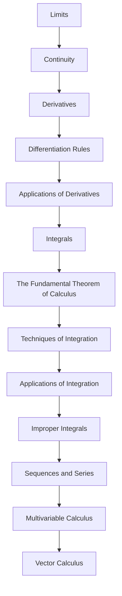

<!-- Generated by tools/build_indexes.py from tools/curriculum.json. Do not edit by hand. -->

# Calculus

*Change, accumulation and the link between them*

[Mathematics](../README.md) › Calculus

The derivative measures change; the integral measures accumulation; the fundamental theorem says they are inverse. Calculus turns geometry into algebra and motion into equations.

## At a glance

| | |
|---|---|
| Topics | 13 (13 complete, 0 draft, 0 planned) |
| Estimated study time | ~131 hours |
| Prerequisites | [03-algebra](../03-algebra/README.md), [05-trigonometry](../05-trigonometry/README.md), [06-precalculus](../06-precalculus/README.md) |

## Study order

The numbers are the recommended order. Study a topic only after the ones before it —
the dependency chain below is the shortest safe route through the discipline.

## Topic inventory

| # | Topic | Level | Est. time | Status | Materials |
|---|---|---|---|---|---|
| 1 | [Limits](01-limits/README.md) | Intermediate | 10 h | Complete | [Tutorial](01-limits/README.md) · [Exercises](01-limits/exercises.md) · [Solutions](01-limits/solutions.md) |
| 2 | [Continuity](02-continuity/README.md) | Intermediate | 7 h | Complete | [Tutorial](02-continuity/README.md) · [Exercises](02-continuity/exercises.md) · [Solutions](02-continuity/solutions.md) |
| 3 | [Derivatives](03-derivatives/README.md) | Intermediate | 10 h | Complete | [Tutorial](03-derivatives/README.md) · [Exercises](03-derivatives/exercises.md) · [Solutions](03-derivatives/solutions.md) |
| 4 | [Differentiation Rules](04-differentiation-rules/README.md) | Intermediate | 10 h | Complete | [Tutorial](04-differentiation-rules/README.md) · [Exercises](04-differentiation-rules/exercises.md) · [Solutions](04-differentiation-rules/solutions.md) |
| 5 | [Applications of Derivatives](05-applications-of-derivatives/README.md) | Intermediate | 10 h | Complete | [Tutorial](05-applications-of-derivatives/README.md) · [Exercises](05-applications-of-derivatives/exercises.md) · [Solutions](05-applications-of-derivatives/solutions.md) |
| 6 | [Integrals](06-integrals/README.md) | Intermediate | 10 h | Complete | [Tutorial](06-integrals/README.md) · [Exercises](06-integrals/exercises.md) · [Solutions](06-integrals/solutions.md) |
| 7 | [The Fundamental Theorem of Calculus](07-fundamental-theorem-of-calculus/README.md) | Intermediate | 8 h | Complete | [Tutorial](07-fundamental-theorem-of-calculus/README.md) · [Exercises](07-fundamental-theorem-of-calculus/exercises.md) · [Solutions](07-fundamental-theorem-of-calculus/solutions.md) |
| 8 | [Techniques of Integration](08-techniques-of-integration/README.md) | Advanced | 12 h | Complete | [Tutorial](08-techniques-of-integration/README.md) · [Exercises](08-techniques-of-integration/exercises.md) · [Solutions](08-techniques-of-integration/solutions.md) |
| 9 | [Applications of Integration](09-applications-of-integration/README.md) | Advanced | 9 h | Complete | [Tutorial](09-applications-of-integration/README.md) · [Exercises](09-applications-of-integration/exercises.md) · [Solutions](09-applications-of-integration/solutions.md) |
| 10 | [Improper Integrals](10-improper-integrals/README.md) | Advanced | 7 h | Complete | [Tutorial](10-improper-integrals/README.md) · [Exercises](10-improper-integrals/exercises.md) · [Solutions](10-improper-integrals/solutions.md) |
| 11 | [Sequences and Series](11-sequences-and-series-in-calculus/README.md) | Advanced | 12 h | Complete | [Tutorial](11-sequences-and-series-in-calculus/README.md) · [Exercises](11-sequences-and-series-in-calculus/exercises.md) · [Solutions](11-sequences-and-series-in-calculus/solutions.md) |
| 12 | [Multivariable Calculus](12-multivariable-calculus/README.md) | Advanced | 14 h | Complete | [Tutorial](12-multivariable-calculus/README.md) · [Exercises](12-multivariable-calculus/exercises.md) · [Solutions](12-multivariable-calculus/solutions.md) |
| 13 | [Vector Calculus](13-vector-calculus/README.md) | Advanced | 12 h | Complete | [Tutorial](13-vector-calculus/README.md) · [Exercises](13-vector-calculus/exercises.md) · [Solutions](13-vector-calculus/solutions.md) |

### What each topic covers

- **Limits** — Epsilon-delta, one-sided limits, limit laws, indeterminate forms and asymptotes.
- **Continuity** — Definition, types of discontinuity, the intermediate and extreme value theorems.
- **Derivatives** — The derivative as a limit, differentiability, tangent lines and rates of change.
- **Differentiation Rules** — Product, quotient, chain and implicit differentiation, with proofs.
- **Applications of Derivatives** — Extrema, the mean value theorem, curve sketching, related rates, optimization.
- **Integrals** — Riemann sums, the definite integral, area and the integral as accumulation.
- **The Fundamental Theorem of Calculus** — Both parts, their proofs, and why differentiation and integration are inverse.
- **Techniques of Integration** — Substitution, parts, partial fractions, trigonometric substitution and numerics.
- **Applications of Integration** — Volumes, arc length, averages, work, and probability density functions.
- **Improper Integrals** — Unbounded intervals and integrands, convergence tests and comparison.
- **Sequences and Series** — Convergence tests, power series, Taylor series and error estimates.
- **Multivariable Calculus** — Partial derivatives, gradients, multiple integrals, Lagrange multipliers.
- **Vector Calculus** — Vector fields, line and surface integrals, Green, Stokes and Gauss theorems.

## Related disciplines

- [14-real-analysis](../14-real-analysis/README.md)
- [16-differential-equations](../16-differential-equations/README.md)
- [18-optimization](../18-optimization/README.md)

## Status key

- **Complete** — tutorial, exercises and full solutions exist and the tutorial meets the
  [authoring standard](../CONTRIBUTING.md).
- **Draft** — some material exists but the topic is not finished.
- **Planned** — identified in the curriculum, not written yet.

Overall progress and the full topic inventory live in [ROADMAP.md](../ROADMAP.md).
