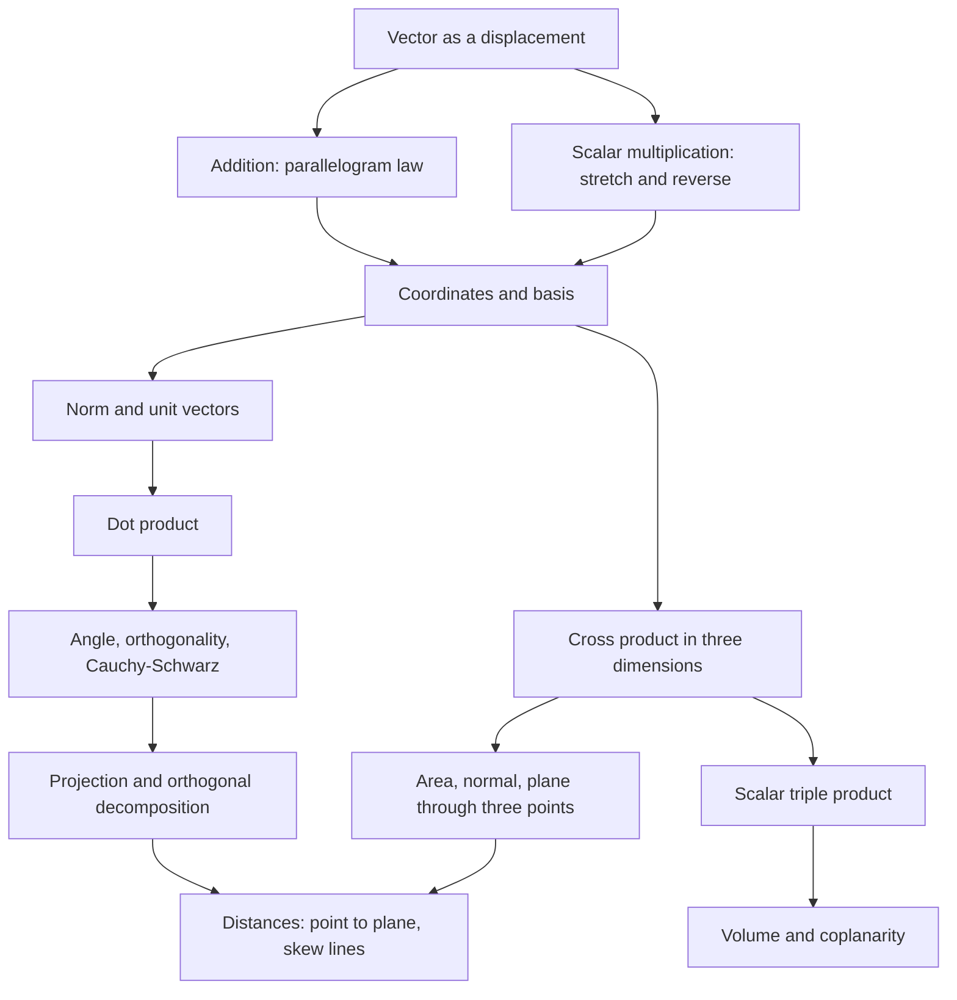

# Vectors

> [Mathematics](../../README.md) › [Linear Algebra](../README.md) · Level: Intermediate · Prerequisites: [Elementary Algebra](../../03-algebra/01-elementary-algebra/README.md), [Linear Equations](../../03-algebra/02-linear-equations/README.md), [Coordinate Geometry](../../04-geometry/04-coordinate-geometry/README.md), [Solid Geometry](../../04-geometry/05-solid-geometry/README.md), [Trigonometric Functions](../../05-trigonometry/01-trigonometric-functions/README.md), [The Unit Circle](../../05-trigonometry/02-unit-circle/README.md) · Estimated time: 8 h

## 1. Introduction

A vector is an arrow: a quantity with a magnitude and a direction. Wind, force, velocity and
displacement are vectors; temperature, mass and time are not. The mathematics of vectors is the
mathematics of anything that combines the way displacements combine — and that turns out to include
almost everything in geometry, physics and data analysis.

Two pictures of the same object organise the topic.

* **Geometric.** A vector is a directed segment, and only its length and direction matter: you may slide
  it anywhere. In this picture the sum is the diagonal of a parallelogram, the dot product measures the
  angle between two arrows, and the cross product is a perpendicular arrow whose length is an area.
* **Coordinate.** Once a frame is fixed, a vector in $\mathbb{R}^n$ is an ordered $n$-tuple
  $(v_1,\dots,v_n)$. In this picture addition is componentwise, length is a square root of squares, and
  the dot product is a one-line sum.

Neither picture suffices alone: the geometric picture suggests *why* a formula should be true, the
coordinate picture proves it and computes the answer, and every major formula below appears both ways.
Four operations generate the subject: addition (parallelogram law), scalar multiplication (stretching
and reversing), the dot product (lengths, angles, projections, orthogonality) and the cross product
(areas, normals, volumes in $\mathbb{R}^3$). From them follow the geometry of lines and planes in space,
every distance formula in three dimensions, and the models of work, torque, computer graphics and
similarity of data. The axiomatic version of the story, in which the choice of inner product becomes part
of the data, is the subject of the inner product spaces topic of this discipline.

## 2. Prerequisites

* **Algebra.** Expanding brackets, collecting like terms, solving linear equations, from
  [Elementary Algebra](../../03-algebra/01-elementary-algebra/README.md) and
  [Linear Equations](../../03-algebra/02-linear-equations/README.md). **Coordinate geometry in the plane.**
  Points, the distance formula, the midpoint and the equation of a line, from
  [Coordinate Geometry](../../04-geometry/04-coordinate-geometry/README.md); everything here is that
  material one dimension up.
* **Three-dimensional intuition.** Boxes, planes, lines and the fact that three non-collinear points
  determine a plane, from [Solid Geometry](../../04-geometry/05-solid-geometry/README.md).
* **Trigonometry.** $\sin$, $\cos$, the values at $30^\circ,45^\circ,60^\circ$, and
  $\sin^2\theta+\cos^2\theta=1$, from
  [Trigonometric Functions](../../05-trigonometry/01-trigonometric-functions/README.md) and
  [The Unit Circle](../../05-trigonometry/02-unit-circle/README.md). The derivation of the cosine formula
  also uses the law of cosines, proved in the trigonometry discipline.
* **Functions of one variable.** A rule such as $\mathbf{r}(t)=\mathbf{p}+t\mathbf{d}$ assigning a point
  to each real $t$ is how lines are written.

No matrices, determinants or linear systems are assumed. The $2\times2$ and $3\times3$ determinants
below are defined as shorthand for the expressions they abbreviate.

## 3. Learning Objectives
After this tutorial and its exercises you will be able to:

1. Represent a vector geometrically and as an ordered tuple, and pass between the two.
2. Add vectors and scale them, by drawing and by components, and explain why the two agree.
3. Express a vector in a basis and prove that its coefficients are unique.
4. Compute lengths, distances and unit vectors, and explain normalisation.
5. Compute dot products, angles and decide orthogonality.
6. Derive $\mathbf{u}\cdot\mathbf{v}=\lVert\mathbf{u}\rVert\lVert\mathbf{v}\rVert\cos\theta$ from the
   law of cosines.
7. Derive and use the projection formula and the orthogonal decomposition.
8. Compute cross products, verify perpendicularity, obtain areas and apply the right-hand rule.
9. Evaluate scalar triple products, interpret them as volumes and test coplanarity.
10. Write lines and planes, find their intersections, distances and angles.
11. Model forces, work and torque with vectors.
12. Choose the right operation in a new problem and justify each step.

## 4. Intuition

**An arrow is a displacement, not a place.** Walking $3$ km east then $4$ km north has the same net
effect as one displacement of $5$ km to the north-east: following one arrow and then another is their
sum. The starting point is irrelevant, which is why two arrows with the same length and direction are
the same vector.

**Addition is the parallelogram.** Draw $\mathbf{u}$ and $\mathbf{v}$ from one point and complete the
parallelogram: the diagonal is $\mathbf{u}+\mathbf{v}$, the other diagonal is $\mathbf{u}-\mathbf{v}$.
The symmetry of the picture is commutativity; the far corner of the parallelepiped is associativity.
Lengths, however, do not add: the sum of arrows of lengths $3$ and $4$ has any length from $1$ to $7$
depending on the angle.

**Scaling changes units.** Multiplying by $2$ doubles the length and keeps the direction; by $-1$
reverses it; by $0$ collapses it to the zero vector. This is why a vector has no sign of its own.

**The dot product measures agreement.** Two arrows can agree, be perpendicular, or disagree. The number
$\mathbf{u}\cdot\mathbf{v}$ reports where they lie: positive for an acute angle, zero at a right angle,
negative for an obtuse one, because it equals $\lVert\mathbf{u}\rVert\lVert\mathbf{v}\rVert\cos\theta$.
A force $\mathbf{F}$ moving a cart through $\mathbf{d}$ does work equal to the part of $\mathbf{F}$ along
$\mathbf{d}$ times $\lVert\mathbf{d}\rVert$, which is exactly $\mathbf{F}\cdot\mathbf{d}$.

**The cross product is area with orientation.** Two arrows span a parallelogram. The cross product is an
arrow perpendicular to it, of length equal to its area, pointing the way a right-hand screw advances when
turned from $\mathbf{u}$ to $\mathbf{v}$. Swapping the arrows reverses the screw, so
$\mathbf{v}\times\mathbf{u}=-\mathbf{u}\times\mathbf{v}$. It exists only in $\mathbb{R}^3$ because only
there is the perpendicular to a plane a single direction.

**Lines and planes.** A line is a point plus a direction; a plane is a point plus a normal. Almost every
formula in Sections 7.10–7.11 comes from that asymmetry.

## 5. Formal Definition

**Definition 5.1 (Vector in $\mathbb{R}^n$).** A vector in $\mathbb{R}^n$ is an ordered $n$-tuple
$\mathbf{v}=(v_1,\dots,v_n)$ of real numbers. The number $v_i$ is its $i$-th *component*, and

$$(u_1,\dots,u_n)=(v_1,\dots,v_n) \iff u_i=v_i \text{ for every } i.$$

**Definition 5.2 (Geometric vector).** A *geometric vector* is a directed line segment; two segments
represent the same vector when they have the same length and direction (one is a translate of the
other). The segment from $P$ to $Q$ is written $\overrightarrow{PQ}$, with tail $P$ and head $Q$, and
its length is $\lVert\overrightarrow{PQ}\rVert$.

Choosing an origin identifies the point with coordinates $(v_1,v_2,v_3)$ with the vector
$(v_1,v_2,v_3)$; Section 7.2 shows that this identification is consistent with the operations.

**Definition 5.3 (Addition, scalar multiplication).** For $\mathbf{u},\mathbf{v}\in\mathbb{R}^n$ and
$c\in\mathbb{R}$,

$$\mathbf{u}+\mathbf{v} := (u_1+v_1,\dots,u_n+v_n), \qquad c\mathbf{u} := (cu_1,\dots,cu_n).$$

The zero vector is $\mathbf{0}=(0,\dots,0)$, the opposite is $-\mathbf{u}=(-1)\mathbf{u}$, and
$\mathbf{u}-\mathbf{v}:=\mathbf{u}+(-\mathbf{v})$. Geometrically $\mathbf{u}+\mathbf{v}$ is the
parallelogram diagonal and $c\mathbf{u}$ is the stretched, reversed or collapsed arrow.

**Definition 5.4 (Norm, distance).** The *norm* of $\mathbf{v}$ is
$\lVert\mathbf{v}\rVert:=\sqrt{v_1^2+\cdots+v_n^2}$; the *distance* between $\mathbf{u}$ and $\mathbf{v}$
is $\lVert\mathbf{u}-\mathbf{v}\rVert$; a *unit vector* has norm $1$.

**Definition 5.5 (Dot product).** $\mathbf{u}\cdot\mathbf{v}:=u_1v_1+\cdots+u_nv_n=\sum_{i=1}^n u_iv_i$,
a scalar. Vectors are *orthogonal* when $\mathbf{u}\cdot\mathbf{v}=0$.

**Definition 5.6 (Cross product).** For $\mathbf{u},\mathbf{v}\in\mathbb{R}^3$,

$$\mathbf{u}\times\mathbf{v}:=\bigl(u_2v_3-u_3v_2,\;\;u_3v_1-u_1v_3,\;\;u_1v_2-u_2v_1\bigr).$$

It is defined only in $\mathbb{R}^3$.

**Definition 5.7 (Line, plane).** For $\mathbf{p},\mathbf{d}\in\mathbb{R}^3$ with $\mathbf{d}\ne\mathbf{0}$,
the *line* through $\mathbf{p}$ with direction $\mathbf{d}$ is
$L=\{\mathbf{p}+t\mathbf{d}:t\in\mathbb{R}\}$. For $\mathbf{n}\ne\mathbf{0}$ and $c\in\mathbb{R}$, the
*plane* with normal $\mathbf{n}$ is $\Pi=\{\mathbf{x}:\mathbf{n}\cdot\mathbf{x}=c\}$; equivalently, if
$\mathbf{n}\cdot\mathbf{p}=c$, then $\Pi=\{\mathbf{x}:\mathbf{n}\cdot(\mathbf{x}-\mathbf{p})=0\}$.

**Definition 5.8 (Determinants used below).** For $2\times2$ and $3\times3$ arrays,

$$\begin{vmatrix}a&b\\c&d\end{vmatrix}:=ad-bc,\qquad
\begin{vmatrix}a_1&a_2&a_3\\b_1&b_2&b_3\\c_1&c_2&c_3\end{vmatrix}
:=a_1(b_2c_3-b_3c_2)-a_2(b_1c_3-b_3c_1)+a_3(b_1c_2-b_2c_1).$$

These are definitions, not theorems; the systematic theory is the determinants topic of this discipline,
and nothing below depends on it.

## 6. Mathematical Notation

| Symbol | Read as | Meaning |
|---|---|---|
| $\mathbf{u},\mathbf{v},\mathbf{w}$ | vector $u$, vector $v$ | vectors, usually in $\mathbb{R}^2$ or $\mathbb{R}^3$ |
| $\overrightarrow{PQ}$ | vector $PQ$ | the arrow from $P$ to $Q$ |
| $u_i$ | the $i$-th component of $u$ | the $i$-th number of the tuple |
| $\mathbf{0}$ | zero vector | $(0,\dots,0)$, the additive identity |
| $\mathbf{e}_1,\dots,\mathbf{e}_n$ | standard basis | $\mathbf{e}_i$ has $1$ in slot $i$, $0$ elsewhere |
| $\lVert\mathbf{v}\rVert$ | norm of $v$ | $\sqrt{\sum_i v_i^2}$, the length |
| $\hat{\mathbf{v}}$ | v-hat | $\mathbf{v}/\lVert\mathbf{v}\rVert$, defined for $\mathbf{v}\ne\mathbf{0}$ |
| $\mathbf{u}\cdot\mathbf{v}$ | $u$ dot $v$ | the scalar $\sum_i u_iv_i$ |
| $\mathbf{u}\times\mathbf{v}$ | $u$ cross $v$ | the vector of Definition 5.6 |
| $\mathbf{u}\perp\mathbf{v}$ | $u$ perpendicular to $v$ | $\mathbf{u}\cdot\mathbf{v}=0$ |
| $\operatorname{proj}_{\mathbf{v}}\mathbf{u}$ | projection of $u$ onto $v$ | the vector part of $\mathbf{u}$ along $\mathbf{v}$ |
| $\operatorname{comp}_{\mathbf{v}}\mathbf{u}$ | component of $u$ along $v$ | the signed number $\mathbf{u}\cdot\mathbf{v}/\lVert\mathbf{v}\rVert$ |
| $\mathbf{n}$ | normal | a vector perpendicular to a plane |
| $\mathbf{r}(t)$ | r of $t$ | position vector of a point depending on $t$ |
| $\sum_{i=1}^n$ | sum from $i$ equals one to $n$ | $a_1+\cdots+a_n$; also $\iff$ and $\blacksquare$ below |

Read $\mathbf{u}\cdot\mathbf{v}$ as a *number*: expressions such as $(\mathbf{u}\cdot\mathbf{v})\times\mathbf{w}$
are meaningless. The angle $\theta$ between non-zero vectors always lies in $[0,\pi]$, so $\cos\theta$
determines it uniquely.

## 7. Core Concepts

### 7.1 Addition and the parallelogram law

Place the tail of $\mathbf{v}$ at the head of $\mathbf{u}$; the arrow from the tail of $\mathbf{u}$ to
the head of $\mathbf{v}$ is $\mathbf{u}+\mathbf{v}$, and completing the parallelogram gives the same
arrow as its diagonal. The other diagonal, from the head of $\mathbf{v}$ to the head of $\mathbf{u}$, is
$\mathbf{u}-\mathbf{v}$.

That the picture and the component rule agree is immediate: the $i$-th component of $\mathbf{u}+\mathbf{v}$
is $u_i+v_i$, and the resulting arrow has exactly the displacement "first $\mathbf{u}$, then
$\mathbf{v}$". The algebraic laws then follow component by component.

**Proposition 7.1 (Vector-space laws).** For all $\mathbf{u},\mathbf{v},\mathbf{w}\in\mathbb{R}^n$ and
$c,d\in\mathbb{R}$:

1. $\mathbf{u}+\mathbf{v}=\mathbf{v}+\mathbf{u}$;
2. $(\mathbf{u}+\mathbf{v})+\mathbf{w}=\mathbf{u}+(\mathbf{v}+\mathbf{w})$;
3. $\mathbf{u}+\mathbf{0}=\mathbf{u}$ and $\mathbf{u}+(-\mathbf{u})=\mathbf{0}$;
4. $c(\mathbf{u}+\mathbf{v})=c\mathbf{u}+c\mathbf{v}$ and $(c+d)\mathbf{u}=c\mathbf{u}+d\mathbf{u}$;
5. $c(d\mathbf{u})=(cd)\mathbf{u}$ and $1\mathbf{u}=\mathbf{u}$.

*Proof.* Compare components; each law is the corresponding law for real numbers. For instance the
$i$-th component of $(\mathbf{u}+\mathbf{v})+\mathbf{w}$ is $(u_i+v_i)+w_i=u_i+(v_i+w_i)$, and the
$i$-th component of $c(\mathbf{u}+\mathbf{v})$ is $c(u_i+v_i)=cu_i+cv_i$. $\blacksquare$

Lengths do *not* add: $\lVert\mathbf{u}+\mathbf{v}\rVert\le\lVert\mathbf{u}\rVert+\lVert\mathbf{v}\rVert$,
with equality only for equally directed parallel vectors (Theorem 7.9).

### 7.2 Components, bases, and uniqueness of coordinates

The *standard basis* of $\mathbb{R}^n$ consists of $\mathbf{e}_1=(1,0,\dots,0)$ up to
$\mathbf{e}_n=(0,\dots,0,1)$. Every vector is a combination of them:

$$\mathbf{v}=(v_1,\dots,v_n)=v_1\mathbf{e}_1+\cdots+v_n\mathbf{e}_n=\sum_{i=1}^n v_i\mathbf{e}_i.$$

**Proposition 7.2 (Uniqueness).** If $\sum_i a_i\mathbf{e}_i=\sum_i b_i\mathbf{e}_i$ then $a_i=b_i$ for
all $i$.

*Proof.* The $i$-th component of the difference is $a_i-b_i$, and the difference is $\mathbf{0}$, all of
whose components are $0$. $\blacksquare$

A *basis* of $\mathbb{R}^n$ is a list of $n$ vectors in which every vector has exactly one representation.
The standard basis is the default but not the only choice: $\mathbf{b}_1=(1,1)$, $\mathbf{b}_2=(1,-1)$
form a basis of $\mathbb{R}^2$, and $(3,1)=2\mathbf{b}_1+1\mathbf{b}_2$ is its unique representation
(solve $a+b=3$, $a-b=1$). Different bases give different coordinates for the same vector, which is why
one writes $\mathbf{v}=(2,1)_{\mathcal{B}}$ when the basis matters. In this tutorial the basis is the
standard one unless stated otherwise; the general theory belongs to the vector spaces topic.

### 7.3 Scalar multiplication, collinearity and linear combinations

A *linear combination* of $\mathbf{v}_1,\dots,\mathbf{v}_k$ is any $c_1\mathbf{v}_1+\cdots+c_k\mathbf{v}_k$;
the set of all of them is the *span*. In the plane the span of one non-zero vector is a line through the
origin; in space the span of two non-parallel vectors is a plane through the origin.

Two non-zero vectors are *parallel* (collinear) when one is a scalar multiple of the other. Then
$\lambda>0$ gives the same direction and $\lambda<0$ the opposite one.

**Proposition 7.3 (Scaling lengths).** $\lVert c\mathbf{v}\rVert=\lvert c\rvert\,\lVert\mathbf{v}\rVert$.

*Proof.* $\lVert c\mathbf{v}\rVert^2=\sum_i (cv_i)^2=c^2\sum_i v_i^2=c^2\lVert\mathbf{v}\rVert^2$, and
$\sqrt{c^2}=\lvert c\rvert$. $\blacksquare$

The absolute value is essential: scaling by $-3$ triples the length and reverses the direction.

### 7.4 Length, unit vectors and distance

In $\mathbb{R}^2$ the norm is Pythagoras; in $\mathbb{R}^3$ it is Pythagoras applied to the horizontal
displacement and the vertical one.

**Proposition 7.4 (Norm properties).** (i) $\lVert\mathbf{v}\rVert\ge0$ with equality only for
$\mathbf{v}=\mathbf{0}$; (ii) $\lVert c\mathbf{v}\rVert=\lvert c\rvert\lVert\mathbf{v}\rVert$;
(iii) $\lVert\mathbf{u}+\mathbf{v}\rVert\le\lVert\mathbf{u}\rVert+\lVert\mathbf{v}\rVert$.

*Proof.* (i) A sum of squares is non-negative and vanishes only when every term does. (ii) is Proposition
7.3. (iii) is Theorem 7.9. $\blacksquare$

**Normalising.** If $\mathbf{v}\ne\mathbf{0}$ then $\hat{\mathbf{v}}=\mathbf{v}/\lVert\mathbf{v}\rVert$ has
length $1$, because $\lVert\mathbf{v}\rVert/\lVert\mathbf{v}\rVert=1$. For example $(1,-2,2)$ has length
$3$ and unit vector $(\tfrac13,-\tfrac23,\tfrac23)$. The zero vector has no direction and cannot be
normalised; every formula that divides by a norm excludes it.

**Distance and position vectors.** The distance between points with position vectors $\mathbf{u}$ and
$\mathbf{v}$ is $\lVert\mathbf{u}-\mathbf{v}\rVert$, which in coordinates is the usual distance formula.
Fixing an origin turns points into vectors; the midpoint of $P,Q$ is
$\tfrac12(\mathbf{p}+\mathbf{q})$ and the point dividing $PQ$ in the ratio $t:(1-t)$ is
$(1-t)\mathbf{p}+t\mathbf{q}$. Such combinations, whose coefficients sum to $1$, are *affine*; if the
coefficients are also non-negative they are *convex*, and the point lies on the segment.

### 7.5 The dot product: algebra and geometry

**Proposition 7.5 (Algebraic properties).** For all $\mathbf{u},\mathbf{v},\mathbf{w}$ and $c$:

1. $\mathbf{u}\cdot\mathbf{v}=\mathbf{v}\cdot\mathbf{u}$;
2. $\mathbf{u}\cdot(\mathbf{v}+\mathbf{w})=\mathbf{u}\cdot\mathbf{v}+\mathbf{u}\cdot\mathbf{w}$ and
   $(c\mathbf{u})\cdot\mathbf{v}=c(\mathbf{u}\cdot\mathbf{v})$;
3. $\mathbf{v}\cdot\mathbf{v}=\lVert\mathbf{v}\rVert^2\ge0$, with equality only for $\mathbf{v}=\mathbf{0}$.

*Proof.* (1) $u_iv_i=v_iu_i$. (2) Distribute the sum:
$\sum_i u_i(v_i+w_i)=\sum_i u_iv_i+\sum_i u_iw_i$, and $\sum_i (cu_i)v_i=c\sum_i u_iv_i$. (3)
$\sum_i v_i^2=\lVert\mathbf{v}\rVert^2$. $\blacksquare$

**The cosine formula.** Let $\mathbf{u},\mathbf{v}\ne\mathbf{0}$ make the angle $\theta$. The triangle with
sides $\lVert\mathbf{u}\rVert$, $\lVert\mathbf{v}\rVert$, $\lVert\mathbf{u}-\mathbf{v}\rVert$ has the last
side opposite $\theta$, so the law of cosines gives

$$\lVert\mathbf{u}-\mathbf{v}\rVert^2=\lVert\mathbf{u}\rVert^2+\lVert\mathbf{v}\rVert^2-2\lVert\mathbf{u}\rVert\lVert\mathbf{v}\rVert\cos\theta.$$

Expanding in components,

$$\lVert\mathbf{u}-\mathbf{v}\rVert^2=\sum_i (u_i-v_i)^2=\lVert\mathbf{u}\rVert^2-2\sum_i u_iv_i+\lVert\mathbf{v}\rVert^2
=\lVert\mathbf{u}\rVert^2-2\,\mathbf{u}\cdot\mathbf{v}+\lVert\mathbf{v}\rVert^2.$$

Comparing the two expressions and cancelling $\lVert\mathbf{u}\rVert^2+\lVert\mathbf{v}\rVert^2$ gives
$-2\mathbf{u}\cdot\mathbf{v}=-2\lVert\mathbf{u}\rVert\lVert\mathbf{v}\rVert\cos\theta$, that is

$$\mathbf{u}\cdot\mathbf{v}=\lVert\mathbf{u}\rVert\,\lVert\mathbf{v}\rVert\cos\theta.$$

This is the central identity of the topic: an algebraic sum equals a geometric product of lengths and an
angle. No sign is lost. When $\theta$ is obtuse, $\cos\theta<0$ and so is the dot product.

**Corollary 7.6 (Angle formula).** For non-zero $\mathbf{u},\mathbf{v}$,

$$\cos\theta=\frac{\mathbf{u}\cdot\mathbf{v}}{\lVert\mathbf{u}\rVert\lVert\mathbf{v}\rVert},
\qquad \theta=\arccos\!\left(\frac{\mathbf{u}\cdot\mathbf{v}}{\lVert\mathbf{u}\rVert\lVert\mathbf{v}\rVert}\right).$$

The quotient lies in $[-1,1]$ by Theorem 7.8, which is what makes $\arccos$ applicable.

**Corollary 7.7 (Sign and orthogonality).** For non-zero vectors: the dot product is positive, zero or
negative according as the angle is acute, right or obtuse. Hence
$\mathbf{u}\perp\mathbf{v}\iff\mathbf{u}\cdot\mathbf{v}=0$. By convention $\mathbf{0}$ is orthogonal to
every vector, although no angle is defined with it.

**Check.** For $\mathbf{u}=(1,1,0)$, $\mathbf{v}=(1,0,1)$: $\mathbf{u}\cdot\mathbf{v}=1$,
$\lVert\mathbf{u}\rVert=\lVert\mathbf{v}\rVert=\sqrt2$, so $\cos\theta=\tfrac12$ and $\theta=60^\circ$.

### 7.6 Orthogonality, Cauchy–Schwarz and the triangle inequality

**Theorem 7.8 (Cauchy–Schwarz).** $\lvert\mathbf{u}\cdot\mathbf{v}\rvert\le\lVert\mathbf{u}\rVert\lVert\mathbf{v}\rVert$,
with equality if and only if one vector is a scalar multiple of the other.

*Proof.* If $\mathbf{v}=\mathbf{0}$ both sides vanish. Otherwise, for every real $t$,

$$0\le\lVert\mathbf{u}+t\mathbf{v}\rVert^2=\lVert\mathbf{u}\rVert^2+2t(\mathbf{u}\cdot\mathbf{v})+t^2\lVert\mathbf{v}\rVert^2.$$

This quadratic in $t$ is never negative, so its discriminant is at most zero:
$4(\mathbf{u}\cdot\mathbf{v})^2-4\lVert\mathbf{u}\rVert^2\lVert\mathbf{v}\rVert^2\le0$, which is the
claim. Equality means the quadratic has a real root $t_0$, so $\lVert\mathbf{u}+t_0\mathbf{v}\rVert=0$
and $\mathbf{u}=-t_0\mathbf{v}$; conversely scalar multiples clearly give equality. $\blacksquare$

**Theorem 7.9 (Triangle inequality).** $\lVert\mathbf{u}+\mathbf{v}\rVert\le\lVert\mathbf{u}\rVert+\lVert\mathbf{v}\rVert$,
with equality exactly when one vector is a non-negative multiple of the other.

*Proof.* Expand and apply Cauchy–Schwarz:

$$\lVert\mathbf{u}+\mathbf{v}\rVert^2=\lVert\mathbf{u}\rVert^2+2\,\mathbf{u}\cdot\mathbf{v}+\lVert\mathbf{v}\rVert^2
\le\lVert\mathbf{u}\rVert^2+2\lVert\mathbf{u}\rVert\lVert\mathbf{v}\rVert+\lVert\mathbf{v}\rVert^2
=\bigl(\lVert\mathbf{u}\rVert+\lVert\mathbf{v}\rVert\bigr)^2.$$

Taking square roots gives the inequality; equality needs equality in Cauchy–Schwarz and
$\mathbf{u}\cdot\mathbf{v}\ge0$. $\blacksquare$

**Pythagoras.** If $\mathbf{u}\perp\mathbf{v}$ then
$\lVert\mathbf{u}+\mathbf{v}\rVert^2=\lVert\mathbf{u}\rVert^2+\lVert\mathbf{v}\rVert^2$, and conversely
equality in this identity forces $\mathbf{u}\cdot\mathbf{v}=0$. For pairwise orthogonal vectors,
induction gives

$$\left\lVert\sum_{i=1}^k\mathbf{v}_i\right\rVert^2=\sum_{i=1}^k\lVert\mathbf{v}_i\rVert^2.$$

This is why orthonormal bases make length computations trivial: no cross terms survive.

### 7.7 Projection and orthogonal decomposition

**Theorem 7.10 (Orthogonal decomposition).** Let $\mathbf{v}\ne\mathbf{0}$. Every $\mathbf{u}$ has a
unique decomposition

$$\mathbf{u}=\lambda\mathbf{v}+\mathbf{w},\qquad \mathbf{w}\cdot\mathbf{v}=0,$$

and necessarily $\lambda=\dfrac{\mathbf{u}\cdot\mathbf{v}}{\mathbf{v}\cdot\mathbf{v}}$.

*Proof.* Dotting $\mathbf{u}=\lambda\mathbf{v}+\mathbf{w}$ with $\mathbf{v}$ gives
$\mathbf{u}\cdot\mathbf{v}=\lambda\lVert\mathbf{v}\rVert^2$, which forces $\lambda$ and then
$\mathbf{w}=\mathbf{u}-\lambda\mathbf{v}$; this proves uniqueness. For existence, take that $\lambda$ and
$\mathbf{w}$; then $\mathbf{w}\cdot\mathbf{v}=\mathbf{u}\cdot\mathbf{v}-\lambda\lVert\mathbf{v}\rVert^2=0$.
$\blacksquare$

**Definition 7.11.** With the notation above,

$$\operatorname{proj}_{\mathbf{v}}\mathbf{u}:=\frac{\mathbf{u}\cdot\mathbf{v}}{\mathbf{v}\cdot\mathbf{v}}\,\mathbf{v},
\qquad
\operatorname{comp}_{\mathbf{v}}\mathbf{u}:=\frac{\mathbf{u}\cdot\mathbf{v}}{\lVert\mathbf{v}\rVert}
=\lVert\mathbf{u}\rVert\cos\theta.$$

The projection is a *vector* along $\mathbf{v}$; the component is a *number*, negative when $\theta$ is
obtuse. Equivalently $\operatorname{proj}_{\mathbf{v}}\mathbf{u}=(\mathbf{u}\cdot\hat{\mathbf{v}})\hat{\mathbf{v}}$.
Projection is not symmetric: projecting $\mathbf{u}$ onto $\mathbf{v}$ and $\mathbf{v}$ onto $\mathbf{u}$
generally gives different vectors, though both have scalar component related to $\mathbf{u}\cdot\mathbf{v}$.

**Distance from a point to a line.** For $L=\{\mathbf{p}+t\mathbf{d}\}$ and a point $\mathbf{q}$, the
nearest point of $L$ is $\mathbf{p}+\operatorname{proj}_{\mathbf{d}}(\mathbf{q}-\mathbf{p})$: the residual
is orthogonal to $\mathbf{d}$ by Theorem 7.10, and moving away from the foot increases the distance by
Pythagoras. Hence $d(\mathbf{q},L)=\lVert\mathbf{q}-\mathbf{p}-\operatorname{proj}_{\mathbf{d}}(\mathbf{q}-\mathbf{p})\rVert$.
Example: the distance from $(1,2)$ to the $x$-axis is $\lVert(1,2)-(1,0)\rVert=2$.

### 7.8 The cross product in $\mathbb{R}^3$

**Definition (restated).** $\mathbf{u}\times\mathbf{v}=(u_2v_3-u_3v_2,\;u_3v_1-u_1v_3,\;u_1v_2-u_2v_1)$.
It is the expansion of the symbolic determinant

$$\begin{vmatrix}\mathbf{e}_1&\mathbf{e}_2&\mathbf{e}_3\\ u_1&u_2&u_3\\ v_1&v_2&v_3\end{vmatrix}$$

along the first row, with basis vectors in that row; the mnemonic is bookkeeping, not a determinant of
numbers.

**Theorem 7.12 (Properties).** For all $\mathbf{u},\mathbf{v},\mathbf{w}$ and $c$:

1. $\mathbf{u}\times\mathbf{u}=\mathbf{0}$;
2. $\mathbf{v}\times\mathbf{u}=-(\mathbf{u}\times\mathbf{v})$;
3. $\mathbf{u}\times(\mathbf{v}+\mathbf{w})=\mathbf{u}\times\mathbf{v}+\mathbf{u}\times\mathbf{w}$ and
   $(c\mathbf{u})\times\mathbf{v}=c(\mathbf{u}\times\mathbf{v})$;
4. $\mathbf{u}\cdot(\mathbf{u}\times\mathbf{v})=0$ and $\mathbf{v}\cdot(\mathbf{u}\times\mathbf{v})=0$;
5. $\lVert\mathbf{u}\times\mathbf{v}\rVert^2=\lVert\mathbf{u}\rVert^2\lVert\mathbf{v}\rVert^2-(\mathbf{u}\cdot\mathbf{v})^2$,
   hence $\lVert\mathbf{u}\times\mathbf{v}\rVert=\lVert\mathbf{u}\rVert\lVert\mathbf{v}\rVert\sin\theta$;
6. $\mathbf{u}\times\mathbf{v}=\mathbf{0}$ if and only if $\mathbf{u},\mathbf{v}$ are parallel.

*Proof.* (1) Each component is $u_iu_j-u_ju_i=0$. (2) Interchanging $\mathbf{u},\mathbf{v}$ flips every
component. (3) Each component is linear in each factor separately. (4) Expand:

$$\begin{aligned}
\mathbf{u}\cdot(\mathbf{u}\times\mathbf{v})
&=u_1(u_2v_3-u_3v_2)+u_2(u_3v_1-u_1v_3)+u_3(u_1v_2-u_2v_1)\\
&=u_1u_2v_3-u_1u_3v_2+u_2u_3v_1-u_1u_2v_3+u_1u_3v_2-u_2u_3v_1=0,
\end{aligned}$$

where every term cancels against another; the same computation with $\mathbf{u},\mathbf{v}$ exchanged
gives the second identity. (5) Expanding the three squares on the left and the right-hand side, both
equal $u_1^2v_2^2+u_1^2v_3^2+u_2^2v_1^2+u_2^2v_3^2+u_3^2v_1^2+u_3^2v_2^2$ minus
$2(u_1u_2v_1v_2+u_1u_3v_1v_3+u_2u_3v_2v_3)$. Using the cosine formula,
$\lVert\mathbf{u}\times\mathbf{v}\rVert^2=\lVert\mathbf{u}\rVert^2\lVert\mathbf{v}\rVert^2(1-\cos^2\theta)$,
and $\sin\theta\ge0$ on $[0,\pi]$. (6) If the cross product vanishes, (5) forces $\sin\theta=0$ (or a
zero factor), so the vectors are parallel; if $\mathbf{u}=\lambda\mathbf{v}$, each component is
$\lambda(v_2v_3-v_3v_2)=0$. $\blacksquare$

**Right-hand rule.** Part (4) says $\mathbf{u}\times\mathbf{v}$ is perpendicular to the plane of
$\mathbf{u},\mathbf{v}$, and part (5) fixes its length; orientation selects one of the two perpendicular
directions. Point the fingers of the right hand along $\mathbf{u}$, curl towards $\mathbf{v}$ through the
smaller angle, and the thumb gives $\mathbf{u}\times\mathbf{v}$. Equivalently
$(\mathbf{u},\mathbf{v},\mathbf{u}\times\mathbf{v})$ is right-handed. The standard triples satisfy
$\mathbf{e}_1\times\mathbf{e}_2=\mathbf{e}_3$, $\mathbf{e}_2\times\mathbf{e}_3=\mathbf{e}_1$,
$\mathbf{e}_3\times\mathbf{e}_1=\mathbf{e}_2$.

**Areas.** The parallelogram spanned by $\mathbf{u},\mathbf{v}$ has base $\lVert\mathbf{u}\rVert$ and
height $\lVert\mathbf{v}\rVert\sin\theta$, so its area is $\lVert\mathbf{u}\times\mathbf{v}\rVert$; the
triangle $ABC$ has area $\tfrac12\lVert\overrightarrow{AB}\times\overrightarrow{AC}\rVert$. This computes
areas from coordinates with no altitude.

**Non-associativity.** Using the standard triples,

$$(\mathbf{e}_1\times\mathbf{e}_1)\times\mathbf{e}_2=\mathbf{0},
\qquad
\mathbf{e}_1\times(\mathbf{e}_1\times\mathbf{e}_2)=\mathbf{e}_1\times\mathbf{e}_3=-\mathbf{e}_2,$$

so brackets matter. The correct expansion of a double cross product is in Section 7.9.

### 7.9 Scalar and vector triple products

**Definition.** $[\mathbf{u},\mathbf{v},\mathbf{w}]:=\mathbf{u}\cdot(\mathbf{v}\times\mathbf{w})$.

**Theorem 7.13 (Triple product as determinant).**

$$[\mathbf{u},\mathbf{v},\mathbf{w}]=
\begin{vmatrix}u_1&u_2&u_3\\ v_1&v_2&v_3\\ w_1&w_2&w_3\end{vmatrix}.$$

*Proof.* Write $\mathbf{v}\times\mathbf{w}=(v_2w_3-v_3w_2,\;v_3w_1-v_1w_3,\;v_1w_2-v_2w_1)$ and dot
with $\mathbf{u}$:

$$u_1(v_2w_3-v_3w_2)+u_2(v_3w_1-v_1w_3)+u_3(v_1w_2-v_2w_1)
=u_1(v_2w_3-v_3w_2)-u_2(v_1w_3-v_3w_1)+u_3(v_1w_2-v_2w_1),$$

which is the cofactor expansion of the determinant along its first row. $\blacksquare$

**Consequences.**

* **Volume.** $\lvert[\mathbf{u},\mathbf{v},\mathbf{w}]\rvert$ is the volume of the parallelepiped with
  edges $\mathbf{u},\mathbf{v},\mathbf{w}$: base area $\lVert\mathbf{v}\times\mathbf{w}\rVert$ times
  height, the height being the absolute component of $\mathbf{u}$ along the unit normal. A tetrahedron
  with those edges has volume $\tfrac16\lvert[\mathbf{u},\mathbf{v},\mathbf{w}]\rvert$.
* **Coplanarity.** $[\mathbf{u},\mathbf{v},\mathbf{w}]=0$ exactly when the three vectors are linearly
  dependent, i.e. lie in a common plane through the origin: the parallelepiped is flat.
* **Cyclic invariance.** $[\mathbf{u},\mathbf{v},\mathbf{w}]=[\mathbf{v},\mathbf{w},\mathbf{u}]=[\mathbf{w},\mathbf{u},\mathbf{v}]$,
  while swapping any two entries changes the sign. Both follow from the corresponding determinant
  properties and can be checked by expanding.
* **Vector triple product.** $\mathbf{u}\times(\mathbf{v}\times\mathbf{w})=(\mathbf{u}\cdot\mathbf{w})\mathbf{v}-(\mathbf{u}\cdot\mathbf{v})\mathbf{w}$
  (the BAC–CAB rule), verified by expanding in components. Adding the three cyclic versions gives the
  Jacobi identity
  $\mathbf{u}\times(\mathbf{v}\times\mathbf{w})+\mathbf{v}\times(\mathbf{w}\times\mathbf{u})+\mathbf{w}\times(\mathbf{u}\times\mathbf{v})=\mathbf{0}$
  (Exercise 32).

### 7.10 Lines in space

With $\mathbf{p}=(p_1,p_2,p_3)$ and $\mathbf{d}=(d_1,d_2,d_3)\ne\mathbf{0}$,

$$L=\{\mathbf{p}+t\mathbf{d}:t\in\mathbb{R}\},
\qquad x=p_1+td_1,\quad y=p_2+td_2,\quad z=p_3+td_3.$$

This is the *parametric form*; distinct $t$ give distinct points because $\mathbf{d}\ne\mathbf{0}$. The
point $\mathbf{x}$ lies on $L$ exactly when $\mathbf{x}-\mathbf{p}$ is parallel to $\mathbf{d}$, that is,
when $(\mathbf{x}-\mathbf{p})\times\mathbf{d}=\mathbf{0}$.

If all $d_i\ne0$, eliminating $t$ gives the *symmetric form*

$$\frac{x-p_1}{d_1}=\frac{y-p_2}{d_2}=\frac{z-p_3}{d_3}.$$

If one component vanishes, keep that coordinate constant instead of dividing by zero: for $d_3=0$ and
$d_1d_2\ne0$ the line is $\frac{x-p_1}{d_1}=\frac{y-p_2}{d_2},\; z=p_3$.

**Through two points.** If $\mathbf{p}\ne\mathbf{q}$ lie on the line, take $\mathbf{d}=\mathbf{q}-\mathbf{p}$;
then $t=0$ gives $\mathbf{p}$, $t=1$ gives $\mathbf{q}$ and $t=\tfrac12$ the midpoint.

**Two lines.** Distinct lines in space are parallel, intersecting, or *skew* (neither). Skewness is
three-dimensional: in the plane non-parallel lines always meet. To classify, solve
$\mathbf{p}_1+t\mathbf{d}_1=\mathbf{p}_2+s\mathbf{d}_2$ (three equations in two unknowns). No solution
with $\mathbf{d}_1\times\mathbf{d}_2\ne\mathbf{0}$ means skew; a zero cross product means parallel.

**Angle.** The acute angle between lines is

$$\cos\theta=\frac{\lvert\mathbf{d}_1\cdot\mathbf{d}_2\rvert}{\lVert\mathbf{d}_1\rVert\lVert\mathbf{d}_2\rVert},
\qquad 0\le\theta\le\tfrac{\pi}{2},$$

the absolute value because $\mathbf{d}$ and $-\mathbf{d}$ describe the same line.

**Point–line distance.** The parallelogram spanned by $\mathbf{d}$ and $\mathbf{q}-\mathbf{p}$ has area
$\lVert(\mathbf{q}-\mathbf{p})\times\mathbf{d}\rVert$, and also base $\lVert\mathbf{d}\rVert$ times height
$h$, where $h=d(\mathbf{q},L)$. Hence

$$d(\mathbf{q},L)=\frac{\lVert(\mathbf{q}-\mathbf{p})\times\mathbf{d}\rVert}{\lVert\mathbf{d}\rVert}.$$

**Skew lines.** If $L_1=\{\mathbf{p}_1+t\mathbf{d}_1\}$ and $L_2=\{\mathbf{p}_2+s\mathbf{d}_2\}$ are skew,
their common perpendicular has direction $\mathbf{d}_1\times\mathbf{d}_2$ and

$$d(L_1,L_2)=\frac{\lvert(\mathbf{p}_2-\mathbf{p}_1)\cdot(\mathbf{d}_1\times\mathbf{d}_2)\rvert}{\lVert\mathbf{d}_1\times\mathbf{d}_2\rVert},$$

the volume of the parallelepiped divided by the base area; Exercise 33 derives it.

### 7.11 Planes in space

With $\mathbf{n}\ne\mathbf{0}$ and $\mathbf{n}\cdot\mathbf{p}=d$,

$$\Pi=\{\mathbf{x}:\mathbf{n}\cdot(\mathbf{x}-\mathbf{p})=0\}=\{\mathbf{x}:\mathbf{n}\cdot\mathbf{x}=d\},
\qquad ax+by+cz=d \text{ in coordinates.}$$

**Why it is a plane.** A point $\mathbf{p}$ with $\mathbf{n}\cdot\mathbf{p}=d$ exists ($\mathbf{n}\ne\mathbf{0}$).
Every $\mathbf{x}\in\Pi$ satisfies $\mathbf{n}\cdot(\mathbf{x}-\mathbf{p})=0$, so its displacement from
$\mathbf{p}$ is orthogonal to the fixed vector $\mathbf{n}$. The orthogonal displacements form a
two-dimensional set: if $c\ne0$, the vectors $(1,0,-a/c)$ and $(0,1,-b/c)$ are independent and orthogonal
to $\mathbf{n}$, every combination of them is orthogonal to $\mathbf{n}$, and every vector orthogonal to
$\mathbf{n}$ is such a combination (Exercise 31).

**Through three points.** For non-collinear $A,B,C$, take
$\mathbf{n}=\overrightarrow{AB}\times\overrightarrow{AC}\ne\mathbf{0}$ and $\mathbf{p}=A$; the plane is
$\overrightarrow{AB}\cdot(\mathbf{x}-A)=0$ together with $\overrightarrow{AC}\cdot(\mathbf{x}-A)=0$.

**Point–plane distance.** Decompose $\mathbf{q}-\mathbf{p}$ into a normal part and a part parallel to
$\Pi$; the distance is the length of the normal part:

$$d(\mathbf{q},\Pi)=\left\lVert\operatorname{proj}_{\mathbf{n}}(\mathbf{q}-\mathbf{p})\right\rVert
=\frac{\lvert\mathbf{n}\cdot(\mathbf{q}-\mathbf{p})\rvert}{\lVert\mathbf{n}\rVert}
=\frac{\lvert\mathbf{n}\cdot\mathbf{q}-d\rvert}{\lVert\mathbf{n}\rVert}
=\frac{\lvert ax_0+by_0+cz_0-d\rvert}{\sqrt{a^2+b^2+c^2}}.$$

The absolute value makes the distance non-negative; without it the value is a signed distance, positive
on one side.

**Line–plane intersection.** Substituting $\mathbf{x}=\mathbf{p}_0+t\mathbf{d}$ into
$\mathbf{n}\cdot\mathbf{x}=d$ gives $\mathbf{n}\cdot\mathbf{p}_0+t\,\mathbf{n}\cdot\mathbf{d}=d$. If
$\mathbf{n}\cdot\mathbf{d}\ne0$, there is exactly one solution
$t=(d-\mathbf{n}\cdot\mathbf{p}_0)/(\mathbf{n}\cdot\mathbf{d})$. If $\mathbf{n}\cdot\mathbf{d}=0$ the line
is parallel to the plane, lying in it when $\mathbf{n}\cdot\mathbf{p}_0=d$ and missing it otherwise.

**Angle with a plane.** The angle between a line and a plane is measured to the line's shadow in the
plane, hence is the complement of the angle $\varphi$ between $\mathbf{d}$ and $\mathbf{n}$:

$$\sin\theta=\lvert\cos\varphi\rvert=\frac{\lvert\mathbf{d}\cdot\mathbf{n}\rvert}{\lVert\mathbf{d}\rVert\lVert\mathbf{n}\rVert}.$$

The sine is not a convention to memorise; it follows from the complement relation, and using cosine here
is the most common error in the section.

**Angle between planes.** Two planes meet in a line unless parallel, and the acute angle between them is
the acute angle between their normals:

$$\cos\theta=\frac{\lvert\mathbf{n}_1\cdot\mathbf{n}_2\rvert}{\lVert\mathbf{n}_1\rVert\lVert\mathbf{n}_2\rVert}.$$

Parallel planes $\mathbf{n}\cdot\mathbf{x}=d_1$ and $\mathbf{n}\cdot\mathbf{x}=d_2$ are at distance
$\lvert d_1-d_2\rvert/\lVert\mathbf{n}\rVert$.

## 8. Formulas and Properties

### 8.1 Reference table

| Quantity | Formula | Note |
|---|---|---|
| Norm | $\lVert\mathbf{v}\rVert=\sqrt{\sum_i v_i^2}$ | always $\ge0$ |
| Unit vector | $\hat{\mathbf{v}}=\mathbf{v}/\lVert\mathbf{v}\rVert$ | needs $\mathbf{v}\ne\mathbf{0}$ |
| Distance | $d(\mathbf{u},\mathbf{v})=\lVert\mathbf{u}-\mathbf{v}\rVert$ | symmetric |
| Dot product | $\mathbf{u}\cdot\mathbf{v}=\sum_i u_iv_i=\lVert\mathbf{u}\rVert\lVert\mathbf{v}\rVert\cos\theta$ | scalar |
| Angle | $\cos\theta=\dfrac{\mathbf{u}\cdot\mathbf{v}}{\lVert\mathbf{u}\rVert\lVert\mathbf{v}\rVert}$ | non-zero vectors |
| Orthogonality | $\mathbf{u}\perp\mathbf{v}\iff\mathbf{u}\cdot\mathbf{v}=0$ | zero vector orthogonal to all |
| Component | $\operatorname{comp}_{\mathbf{v}}\mathbf{u}=\dfrac{\mathbf{u}\cdot\mathbf{v}}{\lVert\mathbf{v}\rVert}$ | signed |
| Projection | $\operatorname{proj}_{\mathbf{v}}\mathbf{u}=\dfrac{\mathbf{u}\cdot\mathbf{v}}{\mathbf{v}\cdot\mathbf{v}}\mathbf{v}$ | needs $\mathbf{v}\ne\mathbf{0}$ |
| Cross product | $\mathbf{u}\times\mathbf{v}=(u_2v_3-u_3v_2,\;u_3v_1-u_1v_3,\;u_1v_2-u_2v_1)$ | only $\mathbb{R}^3$ |
| Cross length | $\lVert\mathbf{u}\times\mathbf{v}\rVert=\lVert\mathbf{u}\rVert\lVert\mathbf{v}\rVert\sin\theta$ | parallelogram area |
| Triangle area | $\tfrac12\lVert\overrightarrow{AB}\times\overrightarrow{AC}\rVert$ | any $A,B,C$ |
| Triple product | $[\mathbf{u},\mathbf{v},\mathbf{w}]=\mathbf{u}\cdot(\mathbf{v}\times\mathbf{w})$ | $3\times3$ determinant |
| Parallelepiped volume | $\lvert[\mathbf{u},\mathbf{v},\mathbf{w}]\rvert$ | tetrahedron: one sixth; zero iff coplanar |
| Line | $\mathbf{x}=\mathbf{p}+t\mathbf{d}$ | direction $\mathbf{d}\ne\mathbf{0}$ |
| Plane | $\mathbf{n}\cdot(\mathbf{x}-\mathbf{p})=0$ | normal $\mathbf{n}\ne\mathbf{0}$ |
| Point–line distance | $\dfrac{\lVert(\mathbf{q}-\mathbf{p})\times\mathbf{d}\rVert}{\lVert\mathbf{d}\rVert}$ | line $\mathbf{p}+t\mathbf{d}$ |
| Point–plane distance | $\dfrac{\lvert\mathbf{n}\cdot\mathbf{q}-d\rvert}{\lVert\mathbf{n}\rVert}$ | plane $\mathbf{n}\cdot\mathbf{x}=d$ |
| Skew-line distance | $\dfrac{\lvert(\mathbf{p}_2-\mathbf{p}_1)\cdot(\mathbf{d}_1\times\mathbf{d}_2)\rvert}{\lVert\mathbf{d}_1\times\mathbf{d}_2\rVert}$ | non-parallel lines |
| Line–plane angle | $\sin\theta=\dfrac{\lvert\mathbf{d}\cdot\mathbf{n}\rvert}{\lVert\mathbf{d}\rVert\lVert\mathbf{n}\rVert}$ | complement with normal |
| Work, torque | $W=\mathbf{F}\cdot\mathbf{d}$, $\boldsymbol{\tau}=\mathbf{r}\times\mathbf{F}$ | scalars and vectors |

### 8.2 The identities that carry the theory

**Cauchy–Schwarz.** $\lvert\mathbf{u}\cdot\mathbf{v}\rvert\le\lVert\mathbf{u}\rVert\lVert\mathbf{v}\rVert$,
equality exactly for parallel vectors. *Why:* the quadratic $\lVert\mathbf{u}+t\mathbf{v}\rVert^2$ is never
negative, so its discriminant is $\le0$ (Theorem 7.8).

**Triangle inequality.** $\lVert\mathbf{u}+\mathbf{v}\rVert\le\lVert\mathbf{u}\rVert+\lVert\mathbf{v}\rVert$,
equality exactly for equally directed parallel vectors. *Why:* expand and bound the cross term by
Cauchy–Schwarz (Theorem 7.9).

**Parallelogram law.**

$$\lVert\mathbf{u}+\mathbf{v}\rVert^2+\lVert\mathbf{u}-\mathbf{v}\rVert^2=2\lVert\mathbf{u}\rVert^2+2\lVert\mathbf{v}\rVert^2.$$

*Proof.* The expansions are $\lVert\mathbf{u}\rVert^2\pm2\mathbf{u}\cdot\mathbf{v}+\lVert\mathbf{v}\rVert^2$;
adding cancels the cross terms. $\blacksquare$
Geometrically: the squares of the two diagonals of a parallelogram sum to the squares of the four sides.

**Polarization identity.**

$$\mathbf{u}\cdot\mathbf{v}=\tfrac14\Bigl(\lVert\mathbf{u}+\mathbf{v}\rVert^2-\lVert\mathbf{u}-\mathbf{v}\rVert^2\Bigr).$$

*Proof.* Subtract the two expansions. $\blacksquare$
It says the dot product is determined by the norm alone — the starting point of the general theory of
inner product spaces, where one asks which norms come from a dot product. The answer is exactly those
satisfying the parallelogram law.

## 9. Step-by-Step Examples

### Example 1 (easy): components, length, unit vector

For $\mathbf{u}=(2,-1,3)$ and $\mathbf{v}=(-1,4,1)$ compute $\mathbf{u}+\mathbf{v}$,
$\mathbf{u}-\mathbf{v}$, $3\mathbf{u}-2\mathbf{v}$, $\lVert\mathbf{u}\rVert$, $\hat{\mathbf{u}}$ and
$d(\mathbf{u},\mathbf{v})$.

**Solution.** Componentwise,

$$\mathbf{u}+\mathbf{v}=(1,3,4),\qquad \mathbf{u}-\mathbf{v}=(3,-5,2),\qquad
3\mathbf{u}-2\mathbf{v}=(6,-3,9)-(-2,8,2)=(8,-11,7).$$

$$\lVert\mathbf{u}\rVert=\sqrt{4+1+9}=\sqrt{14},\qquad
\hat{\mathbf{u}}=\frac{1}{\sqrt{14}}(2,-1,3),$$

and the squared length of $\hat{\mathbf{u}}$ is $(4+1+9)/14=1$, as required. Finally
$d(\mathbf{u},\mathbf{v})=\lVert(3,-5,2)\rVert=\sqrt{9+25+4}=\sqrt{38}$.
Note $\lVert\mathbf{u}+\mathbf{v}\rVert=\sqrt{26}<\sqrt{14}+\sqrt{18}\approx7.98$: the triangle
inequality is strict because the vectors are not parallel.

### Example 2 (easy): angles from dot products

Find the angle between $\mathbf{u}=(1,1,0)$ and $\mathbf{v}=(1,0,1)$, and between $\mathbf{w}=(2,-1,2)$
and $\mathbf{x}=(-1,2,2)$.

**Solution.** For the first pair, $\mathbf{u}\cdot\mathbf{v}=1$ and
$\lVert\mathbf{u}\rVert=\lVert\mathbf{v}\rVert=\sqrt2$, so $\cos\theta=1/2$ and $\theta=60^\circ$.

For the second, $\mathbf{w}\cdot\mathbf{x}=-2-2+4=0$; both are non-zero, so $\theta=90^\circ$. As a check,
$\lVert\mathbf{w}+\mathbf{x}\rVert^2=\lVert(1,1,4)\rVert^2=18=9+9=\lVert\mathbf{w}\rVert^2+\lVert\mathbf{x}\rVert^2$,
which is Pythagoras.

### Example 3 (easy–medium): projection and decomposition

Project $\mathbf{u}=(5,2,-1)$ onto $\mathbf{v}=(2,-1,2)$, and verify the orthogonal decomposition.

**Solution.**

$$\mathbf{u}\cdot\mathbf{v}=10-2-2=6,\qquad \mathbf{v}\cdot\mathbf{v}=4+1+4=9,$$
$$\operatorname{proj}_{\mathbf{v}}\mathbf{u}=\frac69(2,-1,2)=\left(\frac43,-\frac23,\frac43\right),$$
$$\mathbf{w}=\mathbf{u}-\operatorname{proj}_{\mathbf{v}}\mathbf{u}
=\left(\frac{11}{3},\frac83,-\frac73\right).$$

Check orthogonality:
$\mathbf{w}\cdot\mathbf{v}=\frac{22}{3}-\frac83-\frac{14}{3}=0$. Check the sum:
$\operatorname{proj}+\mathbf{w}=(5,2,-1)$. The scalar component is $6/3=2>0$, so the projection points
along $\mathbf{v}$.

### Example 4 (medium): normal, plane and area

Find a unit vector orthogonal to both $\mathbf{a}=(1,1,1)$ and $\mathbf{b}=(1,-1,0)$. Then find the plane
through $A(1,2,3)$, $B(2,0,1)$, $C(-1,1,0)$ and the area of triangle $ABC$.

**Solution.** Expand the determinant with basis vectors in the first row:

$$\mathbf{a}\times\mathbf{b}=
\begin{vmatrix}\mathbf{e}_1&\mathbf{e}_2&\mathbf{e}_3\\ 1&1&1\\ 1&-1&0\end{vmatrix}
=\mathbf{e}_1(0+1)-\mathbf{e}_2(0-1)+\mathbf{e}_3(-1-1)=(1,1,-2).$$

Check: $\mathbf{a}\cdot(1,1,-2)=0$ and $\mathbf{b}\cdot(1,1,-2)=0$. The length is $\sqrt6$, so the unit
vectors are $\pm(1,1,-2)/\sqrt6$. They are the only ones, because the vectors orthogonal to two
non-parallel vectors form a line through the origin (Exercise 31).

For the plane, use edges $\overrightarrow{AB}=(1,-2,-2)$ and $\overrightarrow{AC}=(-2,-1,-3)$:

$$\begin{aligned}
\mathbf{n}=\overrightarrow{AB}\times\overrightarrow{AC}
&=\mathbf{e}_1\bigl(6-2\bigr)-\mathbf{e}_2\bigl(-3-4\bigr)+\mathbf{e}_3\bigl(-1-4\bigr)\\
&=(4,7,-5).
\end{aligned}$$

Thus $4(x-1)+7(y-2)-5(z-3)=0$, that is $4x+7y-5z=3$. Check each vertex: $A$ gives $4+14-15=3$, $B$ gives
$8+0-5=3$, $C$ gives $-4+7+0=3$. The area is

$$\tfrac12\lVert(4,7,-5)\rVert=\tfrac12\sqrt{90}=\tfrac{3\sqrt{10}}{2}\approx4.74.$$

### Example 5 (medium): triple product, volume and coplanarity

For $\mathbf{u}=(1,0,2)$, $\mathbf{v}=(0,2,1)$, $\mathbf{w}=(1,1,0)$, compute the triple product and the
volume; decide whether $\mathbf{u},\mathbf{v},\mathbf{u}+\mathbf{v}$ are coplanar.

**Solution.** $\mathbf{v}\times\mathbf{w}=(2\cdot0-1\cdot1,\;1\cdot1-0\cdot0,\;0\cdot1-2\cdot1)=(-1,1,-2)$,
so

$$[\mathbf{u},\mathbf{v},\mathbf{w}]=(1,0,2)\cdot(-1,1,-2)=-1+0-4=-5.$$

The signed volume is $-5$ (a left-handed triple) and the volume is $5$. With
$\mathbf{x}=\mathbf{u}+\mathbf{v}=(1,2,3)$,

$$[\mathbf{u},\mathbf{v},\mathbf{x}]=
\begin{vmatrix}1&0&2\\0&2&1\\1&2&3\end{vmatrix}
=1(6-2)-0+2(0-2)=4-4=0,$$

so the three vectors are coplanar. This is forced: $\mathbf{x}$ is a combination of $\mathbf{u}$ and
$\mathbf{v}$, so it lies in their plane; the computation confirms the criterion.

### Example 6 (medium–hard): line, plane, intersection, distance and angle

Let $L$ be the line through $P(1,1,1)$ with direction $\mathbf{d}=(2,-1,1)$ and $\Pi$ the plane
$x+2y-z=3$. Find $L\cap\Pi$, the distance from $Q(1,0,0)$ to $\Pi$, and the angle between $L$ and $\Pi$.

**Solution.** Points of $L$ are $(1+2t,\,1-t,\,1+t)$. Substituting:

$$(1+2t)+2(1-t)-(1+t)=2-t.$$

Setting $2-t=3$ gives $t=-1$ and the intersection $(-1,2,0)$. Check: $-1+4-0=3$ and at $t=-1$ the line
point is $(-1,2,0)$.

With $\mathbf{n}=(1,2,-1)$,

$$d(Q,\Pi)=\frac{\lvert1\cdot1+2\cdot0-1\cdot0-3\rvert}{\sqrt{1+4+1}}=\frac{2}{\sqrt6}=\frac{\sqrt6}{3}\approx0.816.$$

The line–plane angle satisfies

$$\sin\theta=\frac{\lvert\mathbf{d}\cdot\mathbf{n}\rvert}{\lVert\mathbf{d}\rVert\lVert\mathbf{n}\rVert}
=\frac{\lvert2-2-1\rvert}{\sqrt6\sqrt6}=\frac16,\qquad \theta=\arcsin\tfrac16\approx9.59^\circ.$$

The line is nearly parallel to the plane, consistent with the small value of $\mathbf{d}\cdot\mathbf{n}$.

### Example 7 (hard): distances to a line and between skew lines

(a) Find the distance from $Q(1,1,1)$ to the line through the origin with direction $(1,2,2)$.
(b) Show that $L_1=\{(1,0,0)+t(0,1,1)\}$ and $L_2=\{(1,1,0)+s(1,0,1)\}$ are skew and find their distance.

**Solution.** (a)

$$(1,1,1)\times(1,2,2)=\bigl(1\cdot2-1\cdot2,\;1\cdot1-1\cdot2,\;1\cdot2-1\cdot1\bigr)=(0,-1,1),$$

so $d=\lVert(0,-1,1)\rVert/\lVert(1,2,2)\rVert=\sqrt2/3\approx0.471$. Check: the foot is
$\frac{1+2+2}{1+4+4}(1,2,2)=\frac59(1,2,2)$ and the residual
$(1,1,1)-\frac59(1,2,2)=(\frac49,-\frac19,-\frac19)$ has length $\frac{\sqrt{18}}{9}=\frac{\sqrt2}{3}$.

(b) If the lines met, then $(1,t,t)=(1+s,1,s)$ for some $t,s$. The first coordinate gives $s=0$, the
second $t=1$, but the third requires $t=s=0$: contradiction. The directions are not parallel, since
$(0,1,1)\times(1,0,1)=(1,1,-1)\ne\mathbf{0}$, so the lines are skew. With
$\mathbf{p}_2-\mathbf{p}_1=(0,1,0)$ and $\mathbf{d}_1\times\mathbf{d}_2=(1,1,-1)$,

$$d=\frac{\lvert(0,1,0)\cdot(1,1,-1)\rvert}{\sqrt3}=\frac{1}{\sqrt3}=\frac{\sqrt3}{3}\approx0.577.$$

### Example 8 (hard): forces, work and torque

Forces $\mathbf{F}_1=(3,-2,1)$ and $\mathbf{F}_2=(-1,4,-2)$ act on a particle at the origin. Find the
resultant and its magnitude, the work of the resultant along $\mathbf{d}=(1,0,2)$, and the torque of
$\mathbf{F}_2$ about the origin when applied at $R(2,1,0)$.

**Solution.** The resultant is

$$\mathbf{R}=(3-1,\,-2+4,\,1-2)=(2,2,-1),\qquad \lVert\mathbf{R}\rVert=\sqrt{4+4+1}=3.$$

The work is $W=\mathbf{R}\cdot\mathbf{d}=2+0-2=0$: the force is perpendicular to the displacement, so it
does no work (it changes direction, not speed).

The torque is $\boldsymbol{\tau}=\mathbf{r}\times\mathbf{F}_2$ with $\mathbf{r}=(2,1,0)$:

$$\begin{aligned}
\boldsymbol{\tau}
&=\mathbf{e}_1\bigl(1\cdot(-2)-0\cdot4\bigr)-\mathbf{e}_2\bigl(2\cdot(-2)-0\cdot(-1)\bigr)
+\mathbf{e}_3\bigl(2\cdot4-1\cdot(-1)\bigr)\\
&=(-2,\,4,\,9).
\end{aligned}$$

Checks: $\boldsymbol{\tau}\cdot\mathbf{r}=-4+4+0=0$ and $\boldsymbol{\tau}\cdot\mathbf{F}_2=2+16-18=0$,
so the torque is perpendicular to the lever arm and to the force, as Theorem 7.12(4) requires. Its
magnitude is $\sqrt{101}\approx10.05$.

## 10. Visual Explanations

### 10.1 Dependencies between the ideas

Nothing below a node is used before it is established. The dot-product branch is metric (lengths,
angles, distances); the cross-product branch is areal and orientational (areas, normals, volumes). They
meet at the distance formulas, which combine a projection with a normal.

### 10.2 The same operation in two languages

| Operation | Picture | Coordinates |
|---|---|---|
| Addition | parallelogram diagonal | add components |
| Subtraction | the other diagonal | subtract components |
| Scaling | stretch, shrink, reverse | multiply every component |
| Length | length of the arrow | root of sum of squares |
| Dot product | lengths times cosine of the angle | sum of products of components |
| Orthogonality | a right angle | dot product zero |
| Projection | shadow on the other arrow's line | $\dfrac{\mathbf{u}\cdot\mathbf{v}}{\mathbf{v}\cdot\mathbf{v}}\mathbf{v}$ |
| Cross product | perpendicular arrow, area, right-hand rule | alternating $2\times2$ determinants |
| Triple product | signed volume | $3\times3$ determinant |
| Line, plane | point with direction; point with normal | $\mathbf{p}+t\mathbf{d}$; $\mathbf{n}\cdot\mathbf{x}=d$ |

Every row asserts that a construction and an arithmetic procedure produce the same object; the proofs are
in Section 7. When a problem is hard in one language, translate it into the other.

### 10.3 Reading the right-hand rule

Draw $\mathbf{u}$ and $\mathbf{v}$ from a common tail; point the right hand's fingers along $\mathbf{u}$;
curl them towards $\mathbf{v}$ through the smaller angle; the thumb gives $\mathbf{u}\times\mathbf{v}$.
Swapping the arrows requires curling the other way, so the thumb reverses — anticommutativity is visible
in the hand. The standard cycle $\mathbf{e}_1\to\mathbf{e}_2\to\mathbf{e}_3\to\mathbf{e}_1$ gives plus
signs; going backwards gives minus signs.

## 11. Common Mistakes

1. **Adding a scalar to a vector.** $\mathbf{u}+3$ is undefined; only vectors of the same dimension add.
2. **Confusing a point with a vector.** A point is a location, a vector a displacement; the *line*
   through the origin in direction $\mathbf{v}$ is not "the vector $\mathbf{v}$". Likewise
   $\mathbf{u}\cdot\mathbf{v}$ is a number, so $(\mathbf{u}\cdot\mathbf{v})\times\mathbf{w}$ is meaningless.
4. **Assuming lengths add.** $\lVert\mathbf{u}+\mathbf{v}\rVert=\lVert\mathbf{u}\rVert+\lVert\mathbf{v}\rVert$
   only for equally directed parallel vectors; in general use the triangle inequality.
5. **Dropping the absolute value when normalising.** $\lVert c\mathbf{v}\rVert=\lvert c\rvert\lVert\mathbf{v}\rVert$;
   the length is never negative.
6. **Using the wrong angle in the cosine formula.** $\theta$ is between the vectors placed tail to tail;
   the angle between the *lines* gives $\lvert\cos\theta\rvert$ and loses the sign.
7. **Sign errors in the cross product.** The middle component is $u_3v_1-u_1v_3$; reversing it produces
   $\mathbf{v}\times\mathbf{u}$ instead of $\mathbf{u}\times\mathbf{v}$.
8. **Using a cross product in the plane or in $\mathbb{R}^4$.** Only $\mathbb{R}^3$ has one; in the plane
   the analogue is the scalar $u_1v_2-u_2v_1$, a signed area.
9. **Assuming associativity.** $(\mathbf{e}_1\times\mathbf{e}_1)\times\mathbf{e}_2=\mathbf{0}$ but
   $\mathbf{e}_1\times(\mathbf{e}_1\times\mathbf{e}_2)=-\mathbf{e}_2$.
10. **Forgetting the absolute value in a volume.** The triple product is signed; a negative value means a
    left-handed triple, not an error.
11. **Confusing a line's direction with a plane's normal.** Substituting a direction vector into a plane
    equation is a category error.
12. **Using cosine for a line–plane angle.** The angle with the plane is the complement of the angle with
    the normal, so $\sin\theta=\lvert\mathbf{d}\cdot\mathbf{n}\rvert/(\lVert\mathbf{d}\rVert\lVert\mathbf{n}\rVert)$.
13. **Dividing by a zero direction component, or projecting onto $\mathbf{0}$.** Keep the constant
    coordinate as an equation; the projection formula divides by $\lVert\mathbf{0}\rVert^2=0$.
14. **Assuming non-parallel lines in space meet.** They may be skew; solve the system rather than
    comparing directions alone.

## 12. Applications

**Forces and equilibrium.** Forces add as vectors. Two forces of magnitudes $3$ and $4$ at $60^\circ$ have
resultant $\sqrt{9+16+2\cdot3\cdot4\cos60^\circ}=\sqrt{37}\approx6.08$, neither $7$ nor $5$: the angle
decides. Equilibrium means the vector sum of all forces is $\mathbf{0}$.
Work is $W=\mathbf{F}\cdot\mathbf{d}$; a $10$ N force at $30^\circ$ to a $5$ m displacement does
$50\cos30^\circ\approx43.3$ J. Torque about a pivot is $\boldsymbol{\tau}=\mathbf{r}\times\mathbf{F}$, with
magnitude $\lVert\mathbf{r}\rVert\lVert\mathbf{F}\rVert\sin\theta$: zero for a force along the lever arm,
maximal when perpendicular. Angular momentum $\mathbf{L}=\mathbf{r}\times\mathbf{p}$ and the magnetic force
$q\mathbf{v}\times\mathbf{B}$ use the same product.

**Geometry.** Area of a triangle $\tfrac12\lVert\overrightarrow{AB}\times\overrightarrow{AC}\rVert$;
volume of a tetrahedron $\tfrac16\lvert[\overrightarrow{AB},\overrightarrow{AC},\overrightarrow{AD}]\rvert$;
point–plane distance $\lvert ax_0+by_0+cz_0-d\rvert/\sqrt{a^2+b^2+c^2}$. These replace constructions by
arithmetic and work for any coordinates. **Computer graphics.** A mesh stores triangles with normals
obtained from cross products. Diffuse brightness is proportional to
$\max(0,\mathbf{n}\cdot\hat{\mathbf{L}})$, a clamped dot product; triangles with
$\mathbf{n}\cdot\hat{\mathbf{V}}<0$ face away and are culled; a ray $\mathbf{o}+t\mathbf{d}$ meets a plane
through the line–plane computation of Section 7.11; reflection uses
$\mathbf{r}=\mathbf{d}-2(\mathbf{d}\cdot\mathbf{n})\mathbf{n}$.

**Data and chemistry.** Treating measurements as vectors, the cosine similarity of
$\mathbf{a}=(1,2,2)$ and $\mathbf{b}=(2,3,1)$ is
$\dfrac{10}{3\sqrt{14}}\approx0.891$, an angle of about $27^\circ$: similar patterns, independent of scale.
In methane the H–C–H angle satisfies $\cos\theta=-\tfrac13$, giving $109.47^\circ$ (Exercise 35); in
crystallography a lattice plane is specified by the normal obtained from two lattice directions.

## 13. Exercises

The problem set is in [exercises.md](exercises.md): 36 problems from component arithmetic to proofs about
the cross product, distances between skew lines, tetrahedral geometry and vector applications. Attempt
each on paper first.

## 14. Solutions

Complete worked solutions, matching the exercise numbering, are in [solutions.md](solutions.md). Each
states the strategy, carries out every significant step, and checks the result by a second method or by
substitution.

## 15. Summary

* A vector is a directed segment; with a frame fixed, a vector in $\mathbb{R}^n$ is an ordered $n$-tuple.
  Length and direction are intrinsic; components are relative to a basis. Addition is componentwise and,
  geometrically, the parallelogram diagonal; scaling stretches by $\lvert c\rvert$ and reverses for $c<0$.
* Coordinates in a basis are unique; the standard basis gives $\mathbf{v}=\sum_i v_i\mathbf{e}_i$ in
  exactly one way. Length is $\sqrt{\sum_i v_i^2}$, the unit vector is $\mathbf{v}/\lVert\mathbf{v}\rVert$,
  and distance is the norm of the difference.
* $\mathbf{u}\cdot\mathbf{v}=\sum_i u_iv_i=\lVert\mathbf{u}\rVert\lVert\mathbf{v}\rVert\cos\theta$,
  derived from the law of cosines; it gives angles, orthogonality and projections.
* Cauchy–Schwarz makes the angle formula legitimate and implies the triangle inequality; the
  parallelogram and polarization identities show the dot product is determined by the norm. The
  orthogonal decomposition is unique and is the source of every distance formula.
* The cross product in $\mathbb{R}^3$ is perpendicular to both factors, has length equal to the spanned
  area, and is oriented by the right-hand rule; it is anticommutative and non-associative.
* The triple product is a determinant, its absolute value is a volume, and its vanishing is the
  coplanarity criterion.
* A line is a point plus a direction, a plane a point plus a normal; distances are projections and the
  line–plane angle uses sine because it is the complement of the normal angle. The same operations model
  forces, work, torque, areas, volumes, lighting and similarity of data.

## 16. Further Learning

**Next in this repository.** The discipline index is [Linear Algebra](../README.md). The next topic is
[Matrices](../02-matrices/README.md), which package linear combinations into tables; the later topics —
systems of linear equations, vector spaces, linear transformations, determinants, eigenvalues, inner
product spaces — are listed there in study order. For the two-dimensional case in more detail see
[Coordinate Geometry](../../04-geometry/04-coordinate-geometry/README.md), and for the identities behind
the angle formulas see
[Trigonometric Identities](../../05-trigonometry/03-trigonometric-identities/README.md).

**Standard references.** H. Anton and C. Rorres, *Elementary Linear Algebra* — many worked examples,
gentle on proofs. S. Lang, *Introduction to Linear Algebra* — geometric and concise. G. Strang,
*Introduction to Linear Algebra* — strong on the column picture and applications. M. Spivak, *Calculus* —
early chapters on vectors and conics use the same objects analytically.

**Practice.** Choose a triangle at random, compute its area by the cross product and by Heron's formula,
and compare; do the same for a tetrahedron against a determinant. Ten such cross-checks build the habit
of verifying geometry against algebra.

