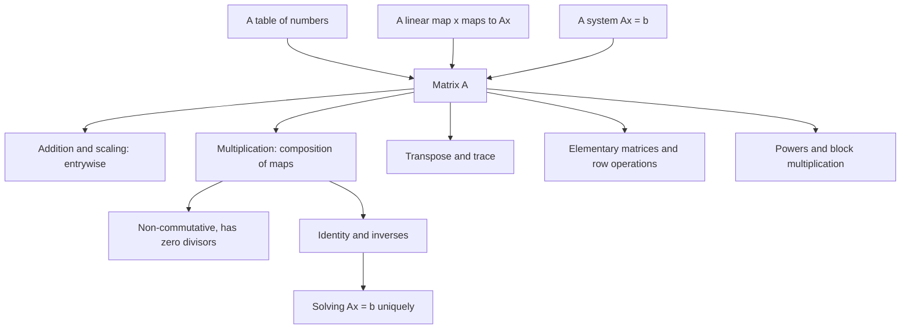

# Matrices

> [Mathematics](../../README.md) › [Linear Algebra](../README.md) · Level: Intermediate · Prerequisites: [Vectors](../01-vectors/README.md), [Elementary Algebra](../../03-algebra/01-elementary-algebra/README.md), [Linear Equations](../../03-algebra/02-linear-equations/README.md), [Systems of Linear Equations](../../03-algebra/05-systems-of-equations/README.md), [Functions](../../03-algebra/11-functions/README.md) · Estimated time: 9 h

## 1. Introduction

A matrix is a rectangular table of numbers, and that description says nothing about why tables are the
right object for so much of mathematics. The missing sentence is: **a matrix is a linear map written in
coordinates**, and the table is merely how the map is stored. Three descriptions organise the topic.

* **As a table.** A matrix is an array of numbers with rows and columns: a spreadsheet, a data set, a
  table of coefficients.
* **As a map.** An $m\times n$ matrix $A$ turns each vector $\mathbf{x}\in\mathbb{R}^n$ into a vector
  $A\mathbf{x}\in\mathbb{R}^m$, by taking linear combinations of its columns. Rotations, reflections,
  projections, scalings and shears are all of this form, and so is every process that respects addition
  and scaling.
* **As a system.** The equation $A\mathbf{x}=\mathbf{b}$ is a compact way to write $m$ linear equations
  in $n$ unknowns. Solving systems, finding inverses and understanding maps are three views of one
  problem.

The definitions of addition and scalar multiplication are the obvious ones, component by component. The
definition of multiplication is not obvious at all:

$$(AB)_{ij}=\sum_{k=1}^{n} a_{ik}b_{kj}.$$

Rows of the first matrix meet columns of the second. Why this and not, say, multiplying corresponding
entries? Because matrices are maps, and running two maps in succession must correspond to multiplying
their tables. Section 7.5 derives the rule from that requirement, and derives the two consequences that
surprise beginners: matrix multiplication is not commutative, and two non-zero matrices can multiply to
zero.

From there the theory develops the standard toolkit: inverses (Section 7.9), transpose (7.10), trace
(7.11), elementary matrices and row operations (7.12), powers (7.13) and block multiplication (7.14). Each
is a theorem with a proof, not a rule to memorise. Section 12 collects the applications: counting walks in
a graph, composing transformations, projecting populations forward in time, and positioning objects on a
screen. Matrices are also the entry point to the rest of this discipline: systems of linear equations,
vector spaces, linear transformations, determinants, eigenvalues and inner products all build on them.

## 2. Prerequisites

* **Vectors.** Components, addition, scalar multiplication, the dot product, linear combinations and
  bases, from [Vectors](../01-vectors/README.md); a matrix multiplies a vector, so this is the key
  prerequisite.
* **Algebra and systems.** Solving linear equations and elimination in two and three unknowns, from
  [Elementary Algebra](../../03-algebra/01-elementary-algebra/README.md),
  [Linear Equations](../../03-algebra/02-linear-equations/README.md) and
  [Systems of Linear Equations](../../03-algebra/05-systems-of-equations/README.md); row operations are
  elimination recorded systematically.
* **Functions and composition.** $f\circ g$ means "do $g$, then $f$", from
  [Functions](../../03-algebra/11-functions/README.md); matrix multiplication is composition in disguise.
* **Summation notation.** $\sum_{k=1}^n a_{ik}b_{kj}$ means "add the products over all $k$".

No determinants are assumed. The $2\times2$ determinant appears only as $ad-bc$ in the inverse formula,
where it is derived; the general theory is a later topic.

## 3. Learning Objectives

After this tutorial and its exercises you will be able to:

1. Read a matrix as a table, as a linear map and as a system, and translate between the views.
2. Add matrices and multiply them by scalars, and explain why these operations are componentwise.
3. Derive the row-by-column rule from the requirement that it represents composition of maps.
4. Multiply matrices of compatible sizes accurately, and decide when a product is defined.
5. Show by example that $AB\ne BA$ and that $AB=0$ does not force $A=0$ or $B=0$.
6. Use the identity matrix, invert $2\times2$ matrices and find $3\times3$ inverses by row reduction,
   verifying the result.
7. Prove the properties of the transpose, including $(AB)^{\mathsf{T}}=B^{\mathsf{T}}A^{\mathsf{T}}$.
8. Compute traces and prove $\operatorname{tr}(AB)=\operatorname{tr}(BA)$.
9. Describe how elementary matrices perform row operations and why each is invertible.
10. Compute powers, prove power formulas by induction, and multiply block matrices.
11. Model adjacency, transformations, populations and graphics with matrices.

## 4. Intuition

**A table that acts.** Think of a machine with $n$ input dials and $m$ output dials, each output a fixed
linear combination of the inputs: output $i$ is $\sum_j a_{ij}x_j$. The machine is recorded by the
$m\times n$ table of coefficients, and feeding it $\mathbf{x}$ returns $A\mathbf{x}$.

**Composition forces the product.** Suppose machine $B$ has $p$ inputs and $n$ outputs, and machine $A$
has $n$ inputs and $m$ outputs. Feeding $\mathbf{x}$ into $B$ and the result into $A$ gives a new machine
with $p$ inputs and $m$ outputs, and it is again linear. Its table must be expressible in terms of the
tables of $A$ and $B$. Chasing one input through the two machines — Section 7.5 does it symbol by symbol —
produces exactly the row-by-column formula. If multiplication were defined entry by entry, composing
machines would not correspond to multiplying their tables, and matrices would lose their meaning.

**Why non-commutativity is expected.** Turning a picture and then reflecting it is not the same as
reflecting and then turning. Since matrices record transformations, and transformations do not generally
commute, matrices cannot generally commute either. **Why zero divisors are expected.** Two non-zero maps
can annihilate each other's output: project onto the $x$-axis, then onto the $y$-axis, and everything
becomes zero though neither projection is zero. The product of the two non-zero tables is the zero table.

**Inverses undo.** If a transformation can be reversed, its matrix has an inverse. A rotation can be
undone by rotating back; a projection cannot be undone, because information is lost. This is why some
matrices are invertible and others are not, and why the condition $ad-bc\ne0$ appears in the $2\times2$
formula: it is the algebraic trace of "no information lost".

## 5. Formal Definition

**Definition 5.1 (Matrix).** An $m\times n$ matrix over $\mathbb{R}$ is a rectangular array

$$A=\begin{pmatrix}
a_{11} & a_{12} & \cdots & a_{1n}\\
a_{21} & a_{22} & \cdots & a_{2n}\\
\vdots & \vdots & \ddots & \vdots\\
a_{m1} & a_{m2} & \cdots & a_{mn}
\end{pmatrix}, \qquad a_{ij}\in\mathbb{R}.$$

It has $m$ rows and $n$ columns, and $a_{ij}$ is the entry in row $i$, column $j$. The set of all
$m\times n$ matrices is denoted $M_{m\times n}(\mathbb{R})$. Two matrices are equal when they have the
same size and equal entries in every position. The $m\times n$ *zero matrix* is written $0_{m\times n}$,
or $0$ when the size is clear.

**Terminology.** A matrix is *square* when $m=n$; its *diagonal* is $a_{11},a_{22},\dots$; a square matrix
with zeros off the diagonal is *diagonal*. A $1\times n$ matrix is a *row vector*, an $m\times1$ matrix a
*column vector*, and the $n\times n$ *identity matrix* has $1$ on the diagonal and $0$ elsewhere:

$$I_n=\begin{pmatrix}1&0&\cdots&0\\0&1&\cdots&0\\\vdots&\vdots&\ddots&\vdots\\0&0&\cdots&1\end{pmatrix},
\qquad (I_n)_{ij}=\delta_{ij}=\begin{cases}1,&i=j,\\0,&i\ne j.\end{cases}$$

**Definition 5.2 (Addition and scalar multiplication).** For $A,B\in M_{m\times n}(\mathbb{R})$ and
$c\in\mathbb{R}$,

$$(A+B)_{ij}:=a_{ij}+b_{ij}, \qquad (cA)_{ij}:=c\,a_{ij}.$$

Both operations are performed entry by entry, and both require the matrices to have the same size.

**Definition 5.3 (Matrix multiplication).** If $A$ is $m\times n$ and $B$ is $n\times p$, the product
$AB$ is the $m\times p$ matrix with

$$(AB)_{ij}:=\sum_{k=1}^{n} a_{ik}b_{kj}.$$

The product is defined only when the number of columns of $A$ equals the number of rows of $B$; the
inner dimensions must match, and the result has the outer dimensions $m\times p$.

**Definition 5.4 (Matrix as a linear map).** An $m\times n$ matrix $A$ defines a map
$T_A:\mathbb{R}^n\to\mathbb{R}^m$ by $T_A(\mathbf{x})=A\mathbf{x}$, where $A\mathbf{x}$ is the vector
whose $i$-th entry is $\sum_{j=1}^n a_{ij}x_j$. A map $T$ is *linear* when
$T(\mathbf{x}+\mathbf{y})=T(\mathbf{x})+T(\mathbf{y})$ and $T(c\mathbf{x})=cT(\mathbf{x})$ for all
$\mathbf{x},\mathbf{y}$ and $c$.

**Definition 5.5 (Matrix as a system).** For $A\in M_{m\times n}(\mathbb{R})$ and
$\mathbf{b}\in\mathbb{R}^m$, the equation $A\mathbf{x}=\mathbf{b}$ is shorthand for the $m$ equations

$$a_{i1}x_1+a_{i2}x_2+\cdots+a_{in}x_n=b_i,\qquad i=1,\dots,m.$$

The *augmented matrix* of the system is the $m\times(n+1)$ matrix obtained by appending $\mathbf{b}$ as an
extra column.

**Definition 5.6 (Transpose, trace, inverse).** For $A\in M_{m\times n}(\mathbb{R})$: the *transpose*
$A^{\mathsf{T}}\in M_{n\times m}(\mathbb{R})$ has $(A^{\mathsf{T}})_{ij}=a_{ji}$; if $A$ is square its
*trace* is $\operatorname{tr}A:=\sum_{i=1}^n a_{ii}$; and an *inverse* is a square matrix $B$ with
$AB=BA=I_n$. When it exists, $A$ is *invertible* and $B$ is written $A^{-1}$.

## 6. Mathematical Notation

| Symbol | Read as | Meaning |
|---|---|---|
| $A,B,C$ | matrix $A$, matrix $B$ | capital letters for matrices |
| $a_{ij}$ | a-sub-$i$-$j$ | entry in row $i$, column $j$ |
| $M_{m\times n}(\mathbb{R})$ | the $m$ by $n$ matrices over the reals | all tables of that size |
| $0_{m\times n}$ | zero matrix | every entry $0$ |
| $I_n$ | identity matrix | $1$ on the diagonal, $0$ elsewhere |
| $A\mathbf{x}$ | $A$ times $x$ | the image of the column vector $\mathbf{x}$ |
| $AB$ | $A$ times $B$ | composition: apply $B$, then $A$ |
| $A^{\mathsf{T}}$ | $A$ transpose | rows and columns exchanged |
| $A^{-1}$ | $A$ inverse | the map that undoes $A$ |
| $\operatorname{tr}A$ | trace of $A$ | sum of the diagonal entries |
| $\delta_{ij}$ | Kronecker delta | $1$ if $i=j$, $0$ otherwise |
| $\sum_{k=1}^{n}$ | sum over $k$ | finite sum of the listed terms |
| $\begin{pmatrix}A&B\\0&D\end{pmatrix}$ | block matrix | a table of smaller tables |
| $R_i\leftrightarrow R_j$ | swap rows $i$ and $j$ | a row operation |
| $R_i\leftarrow R_i+cR_j$ | add $c$ times row $j$ to row $i$ | a row operation |
| $E$ | elementary matrix | a matrix performing one row operation |
| $\iff$ | if and only if | logical equivalence |
| $\blacksquare$ | end of proof | end of a complete argument |

Two conventions of language. "The matrix $A$ is $m\times n$" always means $m$ rows and $n$ columns, in
that order. And $A\mathbf{x}$ denotes a *column* vector; when a vector is written inline as
$(x_1,\dots,x_n)$ it is understood as that column, so that the product is defined.

## 7. Core Concepts

### 7.1 Matrices as tables

A matrix is a rectangle of numbers. The table view fits data that are naturally double indexed: a
spreadsheet with rows for months and columns for products, a distance table, an adjacency table of a
network, a table of coefficients. In this view the structural facts are the size and the entries, and the
natural operations are entrywise.

The table view explains equality and the two easy operations of Section 7.4, but not multiplication:
no entrywise definition can represent composition. The map view does.

### 7.2 Matrices as linear maps

Let $A$ be $m\times n$ and let $\mathbf{a}_j\in\mathbb{R}^m$ be its $j$-th column. For any
$\mathbf{x}=(x_1,\dots,x_n)$,

$$(A\mathbf{x})_i=\sum_{j=1}^{n}a_{ij}x_j=\sum_{j=1}^{n}x_j\,(\mathbf{a}_j)_i
\qquad\Longrightarrow\qquad
A\mathbf{x}=x_1\mathbf{a}_1+x_2\mathbf{a}_2+\cdots+x_n\mathbf{a}_n.$$

So $A\mathbf{x}$ is the linear combination of the *columns* of $A$ with coefficients the entries of
$\mathbf{x}$. This single identity is the bridge between the table and the map: the table's columns are
the ingredients, and the input vector says how much of each to use.

**Linearity.** For all $\mathbf{x},\mathbf{y}$ and $c$,

$$A(\mathbf{x}+\mathbf{y})=A\mathbf{x}+A\mathbf{y}, \qquad A(c\mathbf{x})=c(A\mathbf{x}),$$

because each entry of the left side is $\sum_j a_{ij}(x_j+y_j)=\sum_j a_{ij}x_j+\sum_j a_{ij}y_j$, and
similarly for the scalar. Thus every matrix defines a linear map $\mathbb{R}^n\to\mathbb{R}^m$.

**Every linear map comes from a matrix.** Suppose $T:\mathbb{R}^n\to\mathbb{R}^m$ is linear, and let
$\mathbf{c}_j=T(\mathbf{e}_j)$. For any $\mathbf{x}=\sum_j x_j\mathbf{e}_j$, linearity gives

$$T(\mathbf{x})=\sum_{j=1}^{n}x_jT(\mathbf{e}_j)=\sum_{j=1}^{n}x_j\mathbf{c}_j.$$

The right side is $A\mathbf{x}$ for the matrix $A$ whose $j$-th column is $\mathbf{c}_j$. Hence $T=T_A$,
and the matrix is unique: its $j$-th column is forced to be $T(\mathbf{e}_j)$. This is the precise sense
in which "a matrix is a linear map written in coordinates".

**Example: rotations.** Rotation by $\theta$ sends $\mathbf{e}_1$ to $(\cos\theta,\sin\theta)$ and
$\mathbf{e}_2$ to $(-\sin\theta,\cos\theta)$, so its matrix is
$R(\theta)=\begin{pmatrix}\cos\theta&-\sin\theta\\ \sin\theta&\cos\theta\end{pmatrix}$. At
$\theta=90^\circ$ this gives $\begin{pmatrix}0&-1\\1&0\end{pmatrix}$, and $R(3,1)=(-1,3)$, a quarter turn
anticlockwise.

### 7.3 Matrices as systems

The equation $A\mathbf{x}=\mathbf{b}$ has two pictures.

* **Row picture.** Each row of $A$ gives one linear equation: the $i$-th row dotted with $\mathbf{x}$
  equals $b_i$. The solution set is the intersection of $m$ hyperplanes.
* **Column picture.** $A\mathbf{x}=\mathbf{b}$ asks for coefficients $x_j$ with
  $\sum_j x_j\mathbf{a}_j=\mathbf{b}$: express $\mathbf{b}$ as a linear combination of the columns of $A$.

The row picture is the one used for elimination; the column picture explains existence and uniqueness. For
example, $\begin{pmatrix}2&1\\1&3\end{pmatrix}\begin{pmatrix}x\\y\end{pmatrix}=\begin{pmatrix}5\\10\end{pmatrix}$
is either "solve $2x+y=5$, $x+3y=10$" or "write $(5,10)$ as a combination of $(2,1)$ and $(1,3)$"; the
solution $x=1$, $y=3$ gives $1\cdot(2,1)+3\cdot(1,3)=(5,10)$.

The *augmented matrix* records the system as a single table,
$\left(\begin{array}{cc|c}2&1&5\\1&3&10\end{array}\right)$, and row operations on it are exactly the
elimination steps of Section 7.12.

### 7.4 Addition and scalar multiplication

Both operations are entrywise. For $A,B$ of the same size and $c\in\mathbb{R}$,

$$(A+B)_{ij}=a_{ij}+b_{ij}, \qquad (cA)_{ij}=c\,a_{ij}.$$

**Proposition 7.1.** For fixed $m,n$, the set $M_{m\times n}(\mathbb{R})$ with these operations satisfies
the eight vector-space laws of Proposition 7.1 of the [vectors topic](../01-vectors/README.md).

*Proof.* Reading the $mn$ entries in a fixed order turns a matrix into a vector in $\mathbb{R}^{mn}$;
addition and scalar multiplication become the vector operations, and the laws transfer. $\blacksquare$

Two warnings. First, $A+B$ requires identical sizes: a $2\times3$ and a $3\times2$ matrix cannot be added.
Second, there is no entrywise *multiplication* that deserves the name; the next section explains what the
correct product is and why.

### 7.5 Why matrix multiplication is defined the way it is

Suppose $B$ is $n\times p$ and $A$ is $m\times n$, and consider the composite map
$\mathbf{x}\mapsto A(B\mathbf{x})$, which takes $\mathbb{R}^p$ to $\mathbb{R}^m$. It is linear: it is the
composite of two linear maps. Therefore it has a matrix, call it $C$, and the whole content of the
definition of matrix multiplication is that $C$ must be $AB$.

Compute the composite entry by entry. For $\mathbf{x}\in\mathbb{R}^p$,

$$(B\mathbf{x})_k=\sum_{j=1}^{p}b_{kj}x_j,$$

and therefore

$$\bigl(A(B\mathbf{x})\bigr)_i=\sum_{k=1}^{n}a_{ik}(B\mathbf{x})_k
=\sum_{k=1}^{n}a_{ik}\sum_{j=1}^{p}b_{kj}x_j
=\sum_{j=1}^{p}\Bigl(\sum_{k=1}^{n}a_{ik}b_{kj}\Bigr)x_j.$$

The coefficient of $x_j$ in the $i$-th output is forced to be
$c_{ij}=\sum_{k=1}^{n}a_{ik}b_{kj}$. Nothing else can work: testing the identity on
$\mathbf{x}=\mathbf{e}_j$ gives $C\mathbf{e}_j=A(B\mathbf{e}_j)$, whose $i$-th entry is exactly that sum.
Hence

$$(AB)_{ij}=\sum_{k=1}^{n}a_{ik}b_{kj}.$$

This is the definition, derived rather than decreed. Three readings follow.

* **Rows meet columns.** $c_{ij}$ is the dot product of row $i$ of $A$ with column $j$ of $B$.
* **Columns of the product are $A$ times columns of $B$.** Indeed $(AB)\mathbf{e}_j=A(B\mathbf{e}_j)$, so
  the $j$-th column of $AB$ is $A$ applied to the $j$-th column of $B$.
* **Rows of the product are rows of $A$ times $B$.** The $i$-th row of $AB$ is the row vector obtained by
  multiplying the $i$-th row of $A$ (as a $1\times n$ matrix) by $B$.

**Why not multiply entrywise?** Define the entrywise ("Hadamard") product by $(A\circ B)_{ij}=a_{ij}b_{ij}$
and test composition. Take

$$A=\begin{pmatrix}1&1\\0&1\end{pmatrix}, \qquad B=\begin{pmatrix}1&0\\1&1\end{pmatrix},
\qquad A\circ B=\begin{pmatrix}1&0\\0&1\end{pmatrix}=I.$$

Then $(A\circ B)\mathbf{e}_1=\mathbf{e}_1$, while $A(B\mathbf{e}_1)=A(1,1)=(2,1)$. The entrywise product
does not represent "first $B$, then $A$", so it is not the product that matrices need. The genuine product
gives $AB=\begin{pmatrix}2&1\\1&1\end{pmatrix}$ and $AB\,\mathbf{e}_1=(2,1)$, as required.

**Dimension bookkeeping.** $A$ is $m\times n$ and $B$ is $n\times p$; the inner dimensions cancel and the
result is $m\times p$. Otherwise the product is undefined, because the output space of $B$ must be the
input space of $A$.

### 7.6 Doing the computation

For $2\times2$ matrices the formula is four dot products:

$$\begin{pmatrix}a&b\\c&d\end{pmatrix}\begin{pmatrix}e&f\\g&h\end{pmatrix}
=\begin{pmatrix}ae+bg & af+bh\\ ce+dg & cf+dh\end{pmatrix}.$$

For example

$$\begin{pmatrix}1&2\\3&4\end{pmatrix}\begin{pmatrix}5&6\\7&8\end{pmatrix}
=\begin{pmatrix}1\cdot5+2\cdot7 & 1\cdot6+2\cdot8\\ 3\cdot5+4\cdot7 & 3\cdot6+4\cdot8\end{pmatrix}
=\begin{pmatrix}19&22\\43&50\end{pmatrix}.$$

A reliable procedure for larger matrices: write $B$'s columns beside $A$, compute one column of the
product at a time as a linear combination of $A$'s columns, and only then assemble the table. This is
faster and less error-prone than individual dot products, and it makes the column picture visible.

### 7.7 Non-commutativity and zero divisors

**Matrix multiplication is not commutative.** With the matrices of the previous paragraph,

$$AB=\begin{pmatrix}2&1\\1&1\end{pmatrix}, \qquad BA=\begin{pmatrix}1&1\\1&2\end{pmatrix},$$

so $AB\ne BA$: $A$ shears and $B$ shears the other way, and the two orders give different pictures. Take
instead $R=\begin{pmatrix}0&-1\\1&0\end{pmatrix}$ and $S=\begin{pmatrix}1&0\\0&-1\end{pmatrix}$; then
$RS=\begin{pmatrix}0&1\\1&0\end{pmatrix}$ reflects in $y=x$, while $SR=\begin{pmatrix}0&-1\\-1&0\end{pmatrix}$
reflects in $y=-x$. Visibly different maps, so again $RS\ne SR$.

**Zero divisors.** Two non-zero matrices can multiply to the zero matrix:

$$\begin{pmatrix}1&0\\0&0\end{pmatrix}\begin{pmatrix}0&0\\1&0\end{pmatrix}
=\begin{pmatrix}0&0\\0&0\end{pmatrix}.$$

The first matrix keeps only the first coordinate, the second produces a vector whose first coordinate is
the input's second; in sequence everything is killed. Consequently matrix algebra has no cancellation:
$AB=AC$ does not imply $B=C$ even when $A\ne0$. Take $A=\begin{pmatrix}1&0\\0&0\end{pmatrix}$,
$B=\begin{pmatrix}0&0\\1&0\end{pmatrix}$ and $C=0$; then $AB=AC=0$ but $B\ne C$.

**What does survive.** Associativity and the distributive laws, proved in the next section. These are
enough to make $M_{n\times n}(\mathbb{R})$ a *ring* — an algebraic structure with addition and
multiplication but, in general, neither commutativity nor cancellation.

### 7.8 Associativity and the distributive laws

**Theorem 7.2 (Associativity).** Whenever the products are defined,
$(AB)C=A(BC)$.

*Proof.* Work on the $(i,j)$ entry, using associativity and distributivity of real numbers and the fact
that a finite double sum may be summed in either order:

$$\begin{aligned}
\bigl((AB)C\bigr)_{ij}
&=\sum_{l}(AB)_{il}c_{lj}
=\sum_{l}\Bigl(\sum_{k}a_{ik}b_{kl}\Bigr)c_{lj}
=\sum_{k}a_{ik}\Bigl(\sum_{l}b_{kl}c_{lj}\Bigr)\\
&=\sum_{k}a_{ik}(BC)_{kj}
=\bigl(A(BC)\bigr)_{ij}. \qquad\blacksquare
\end{aligned}$$

In the language of maps the proof is one line: composition of functions is associative, and matrix
multiplication represents composition.

**Theorem 7.3 (Distributivity).** Whenever the sizes allow,
$A(B+C)=AB+AC$ and $(A+B)C=AC+BC$.

*Proof.* For the first, the $(i,j)$ entry is
$\sum_k a_{ik}(b_{kj}+c_{kj})=\sum_k a_{ik}b_{kj}+\sum_k a_{ik}c_{kj}$; the second is analogous. $\blacksquare$

**Scalars move freely.** For every $c\in\mathbb{R}$, $(cA)B=c(AB)=A(cB)$: each entry is multiplied by
$c$ once, and it does not matter at which stage. In particular $cA=(cI)A=A(cI)$.

These are exactly the properties needed to manipulate matrix expressions as if they were numbers, with two
exceptions: the order of factors may not be changed, and cancellation is invalid.

### 7.9 The identity and inverses

**Proposition 7.4 (Identity).** For $A\in M_{m\times n}(\mathbb{R})$,
$I_mA=A=AI_n$.

*Proof.* $(I_mA)_{ij}=\sum_k \delta_{ik}a_{kj}=a_{ij}$, since all terms vanish except $k=i$; and
$(AI_n)_{ij}=\sum_k a_{ik}\delta_{kj}=a_{ij}$. $\blacksquare$

**Definition 7.5 (Inverse).** A square matrix $A$ is *invertible* when there is a square matrix $B$ with
$AB=BA=I$. Such a $B$ is unique: if $B$ and $C$ both work, then
$B=BI=B(AC)=(BA)C=IC=C$. It is written $A^{-1}$.

**Proposition 7.6 (The $2\times2$ inverse).** Let $A=\begin{pmatrix}a&b\\c&d\end{pmatrix}$ and
$\Delta=ad-bc$. If $\Delta\ne0$ then

$$A^{-1}=\frac{1}{\Delta}\begin{pmatrix}d&-b\\-c&a\end{pmatrix},$$

and if $\Delta=0$ then $A$ has no inverse.

*Proof.* Multiply:

$$A\cdot\frac{1}{\Delta}\begin{pmatrix}d&-b\\-c&a\end{pmatrix}
=\frac{1}{\Delta}\begin{pmatrix}ad-bc&-ab+ba\\ cd-dc&-cb+da\end{pmatrix}
=\frac{1}{\Delta}\begin{pmatrix}\Delta&0\\0&\Delta\end{pmatrix}=I,$$

and the same product in the other order gives $I$ as well (the two computations are identical with the
factors exchanged). So the displayed matrix is an inverse, hence the inverse.

For the converse, suppose $\Delta=0$. If $(c,d)\ne(0,0)$, the non-zero vector $\mathbf{v}=(d,-c)$
satisfies

$$A\mathbf{v}=\begin{pmatrix}ad-bc\\ cd-dc\end{pmatrix}=\begin{pmatrix}0\\0\end{pmatrix}.$$

If $A$ had an inverse, applying it would give $\mathbf{v}=A^{-1}\mathbf{0}=\mathbf{0}$, a contradiction.
If $(c,d)=(0,0)$ and $(a,b)\ne(0,0)$, the same argument works with $\mathbf{v}=(b,-a)$; and if all entries
are zero the claim is obvious. $\blacksquare$

The number $\Delta=ad-bc$ is the $2\times2$ *determinant*. Its vanishing means the two columns are
proportional, so the map flattens the plane onto a line and cannot be undone.

**Proposition 7.7 (Algebra of inverses).** If $A,B$ are invertible of the same size, then

1. $(A^{-1})^{-1}=A$;
2. $(AB)^{-1}=B^{-1}A^{-1}$;
3. $(A^{\mathsf{T}})^{-1}=(A^{-1})^{\mathsf{T}}$.

*Proof.* (1) $A^{-1}A=I=AA^{-1}$ exhibits $A$ as the inverse of $A^{-1}$. (2) Multiply:

$$(AB)(B^{-1}A^{-1})=A(BB^{-1})A^{-1}=AA^{-1}=I, \qquad
(B^{-1}A^{-1})(AB)=B^{-1}(A^{-1}A)B=B^{-1}B=I.$$

(3) Transposing $AA^{-1}=I$ gives $(A^{-1})^{\mathsf{T}}A^{\mathsf{T}}=I$, and transposing
$A^{-1}A=I$ gives $A^{\mathsf{T}}(A^{-1})^{\mathsf{T}}=I$. Hence $(A^{-1})^{\mathsf{T}}$ is the inverse of
$A^{\mathsf{T}}$. $\blacksquare$

The reversal of order in (2) is not a typo. To undo "put on socks, then shoes" you must first remove the
shoes and then the socks.

**Solving systems.** If $A$ is invertible, $A\mathbf{x}=\mathbf{b}$ has exactly one solution,
$\mathbf{x}=A^{-1}\mathbf{b}$. Conversely, if $A$ is not invertible the system has either no solution or
infinitely many, because a non-invertible square matrix sends some non-zero vector to $\mathbf{0}$, and
that vector can be added to any solution.

### 7.10 Transpose

**Definition.** $(A^{\mathsf{T}})_{ij}=a_{ji}$. Rows become columns and columns become rows; the shape
$m\times n$ becomes $n\times m$.

**Proposition 7.8.** Whenever the operations are defined:

1. $(A^{\mathsf{T}})^{\mathsf{T}}=A$;
2. $(A+B)^{\mathsf{T}}=A^{\mathsf{T}}+B^{\mathsf{T}}$;
3. $(cA)^{\mathsf{T}}=cA^{\mathsf{T}}$;
4. $(AB)^{\mathsf{T}}=B^{\mathsf{T}}A^{\mathsf{T}}$.

*Proof.* (1)–(3) compare entries directly: for example
$((A+B)^{\mathsf{T}})_{ij}=(A+B)_{ji}=a_{ji}+b_{ji}=(A^{\mathsf{T}})_{ij}+(B^{\mathsf{T}})_{ij}$.
For (4), use the definition and the commutativity of multiplication of real numbers:

$$((AB)^{\mathsf{T}})_{ij}=(AB)_{ji}=\sum_{k}a_{jk}b_{ki}, \qquad
(B^{\mathsf{T}}A^{\mathsf{T}})_{ij}=\sum_{k}b_{ki}a_{jk},$$

which are equal term by term. $\blacksquare$

Again the order reverses, because transposing reverses the direction of every arrow. A square matrix is
*symmetric* when $A^{\mathsf{T}}=A$. For any $A$, $A^{\mathsf{T}}A$ and $AA^{\mathsf{T}}$ are symmetric,
since $(A^{\mathsf{T}}A)^{\mathsf{T}}=A^{\mathsf{T}}(A^{\mathsf{T}})^{\mathsf{T}}=A^{\mathsf{T}}A$; this is
why symmetric matrices appear whenever data are compared with themselves (covariance and Gram matrices,
adjacency matrices of undirected graphs).

### 7.11 Trace

**Definition.** For a square matrix, $\operatorname{tr}A=\sum_i a_{ii}$.

**Proposition 7.9.** For square matrices of the same size and $c\in\mathbb{R}$:

1. $\operatorname{tr}(A+B)=\operatorname{tr}A+\operatorname{tr}B$ and $\operatorname{tr}(cA)=c\operatorname{tr}A$;
2. $\operatorname{tr}(A^{\mathsf{T}})=\operatorname{tr}A$;
3. $\operatorname{tr}(AB)=\operatorname{tr}(BA)$;
4. $\operatorname{tr}(ABC)=\operatorname{tr}(BCA)=\operatorname{tr}(CAB)$ for any cyclic rearrangement.

*Proof.* (1) and (2) are immediate from the definition, since the diagonal is unchanged by transposition.
For (3),

$$\operatorname{tr}(AB)=\sum_{i}(AB)_{ii}=\sum_{i}\sum_{k}a_{ik}b_{ki}
=\sum_{k}\sum_{i}b_{ki}a_{ik}=\sum_{k}(BA)_{kk}=\operatorname{tr}(BA),$$

where the middle step interchanges the order of the finite sums. For (4), apply (3) to the pair
$A$ and $BC$: $\operatorname{tr}(A(BC))=\operatorname{tr}((BC)A)=\operatorname{tr}(BCA)$, and repeat.

$\blacksquare$

**What trace does not do.** It is not multiplicative: for $A=\begin{pmatrix}1&2\\3&4\end{pmatrix}$ and
$B=\begin{pmatrix}0&1\\1&0\end{pmatrix}$, $\operatorname{tr}(AB)=5$ while
$(\operatorname{tr}A)(\operatorname{tr}B)=5\cdot0=0$.

**Similarity invariance.** If $P$ is invertible then
$\operatorname{tr}(P^{-1}AP)=\operatorname{tr}((P^{-1}A)P)=\operatorname{tr}(P(P^{-1}A))=\operatorname{tr}A$
by (3): the trace survives a change of basis, the first hint that it measures something geometric.

### 7.12 Elementary matrices and row operations

An *elementary matrix* is obtained from $I_n$ by a single row operation. There are three kinds.

| Operation | Elementary matrix | Inverse |
|---|---|---|
| swap rows $i$ and $j$ | $E_{ij}$: $I$ with rows $i,j$ exchanged | $E_{ij}$ itself |
| multiply row $i$ by $c\ne0$ | $D_i(c)$: $I$ with $c$ in position $(i,i)$ | $D_i(1/c)$ |
| add $c$ times row $j$ to row $i$ | $T_{ij}(c)=I+c\,\mathbf{e}_i\mathbf{e}_j^{\mathsf{T}}$, $i\ne j$ | $T_{ij}(-c)$ |

**Theorem 7.10 (Left multiplication performs the row operation).** For any $n\times p$ matrix $A$:

1. $E_{ij}A$ is $A$ with rows $i$ and $j$ swapped;
2. $D_i(c)A$ is $A$ with row $i$ multiplied by $c$;
3. $T_{ij}(c)A$ is $A$ with $c$ times row $j$ added to row $i$.

*Proof.* Write $A$ as a stack of rows $\mathbf{r}_1,\dots,\mathbf{r}_n$; the $k$-th row of $EA$ is
$\sum_l E_{kl}\mathbf{r}_l$. For $E_{ij}$ every row of $E$ has a single $1$, so the rows are swapped. For
$D_i(c)$ the $i$-th row becomes $c\mathbf{r}_i$ and the rest are unchanged. For $T_{ij}(c)$ the $i$-th row
becomes $\mathbf{r}_i+c\mathbf{r}_j$ and the rest are unchanged. $\blacksquare$

**Inverses.** Swapping twice restores the matrix, so $E_{ij}^{-1}=E_{ij}$. Scaling by $c\ne0$ is undone by
scaling by $1/c$. For $T=T_{ij}(c)$, note that $\mathbf{e}_j^{\mathsf{T}}\mathbf{e}_i=0$ because $i\ne j$,
so $(c\,\mathbf{e}_i\mathbf{e}_j^{\mathsf{T}})^2=c^2\mathbf{e}_i(\mathbf{e}_j^{\mathsf{T}}\mathbf{e}_i)\mathbf{e}_j^{\mathsf{T}}=\mathbf{0}$;
therefore

$$(I+c\mathbf{e}_i\mathbf{e}_j^{\mathsf{T}})(I-c\mathbf{e}_i\mathbf{e}_j^{\mathsf{T}})=I-c^2\mathbf{e}_i\mathbf{e}_j^{\mathsf{T}}\mathbf{e}_i\mathbf{e}_j^{\mathsf{T}}=I,$$

and the same product in the other order is also $I$. So $T_{ij}(c)^{-1}=T_{ij}(-c)$.

**Consequence for invertibility.** Elimination multiplies $A$ on the left by a product
$E=E_k\cdots E_1$ of elementary matrices. If elimination turns $A$ into $I$, then $EA=I$, so
$A=E^{-1}$ is invertible. Conversely, if $A$ is invertible then $EA$ is invertible for every product of
elementary matrices, so elimination cannot produce a zero row (Exercise 27); it must produce $I$. This is
why the algorithm of Example 4 works.

### 7.13 Powers of matrices

For a square matrix $A$, define $A^0=I$, $A^1=A$ and $A^{k+1}=A^kA$. Then $A^kA^l=A^{k+l}$ for all
$k,l\ge0$; the proof is induction on $l$ and uses associativity. Powers of different matrices do not
combine: $(AB)^k\ne A^kB^k$ in general, because moving the factors past each other is forbidden.

**Rotations.** With $R(\theta)$ as in Section 7.2, the addition formulas give
$R(\theta)R(\varphi)=R(\theta+\varphi)$, so by induction $R(\theta)^n=R(n\theta)$: rotating $n$ times by
$\theta$ is one rotation by $n\theta$.

**A nilpotent example.** $N=\begin{pmatrix}0&1\\0&0\end{pmatrix}$ satisfies $N^2=0$, so $(I+N)^n=I+nN$ by the
binomial theorem, valid because $I$ and $N$ commute.

**The Fibonacci matrix.** Let $M=\begin{pmatrix}1&1\\1&0\end{pmatrix}$. Computing powers,

$$M^2=\begin{pmatrix}2&1\\1&1\end{pmatrix},\quad
M^3=\begin{pmatrix}3&2\\2&1\end{pmatrix},\quad
M^4=\begin{pmatrix}5&3\\3&2\end{pmatrix},\quad
M^5=\begin{pmatrix}8&5\\5&3\end{pmatrix}.$$

If $F_1=F_2=1$ and $F_{n+1}=F_n+F_{n-1}$, the pattern is
$M^n=\begin{pmatrix}F_{n+1}&F_n\\F_n&F_{n-1}\end{pmatrix}$, proved by induction:
multiplying the formula for $M^n$ by $M$ gives entries $F_{n+1}+F_n=F_{n+2}$ in the first row.

### 7.14 Block multiplication

If matrices are partitioned into blocks whose sizes are compatible, they multiply as if the blocks were
numbers. Precisely, if

$$A=\begin{pmatrix}A_{11}&A_{12}\\A_{21}&A_{22}\end{pmatrix},\qquad
B=\begin{pmatrix}B_{11}&B_{12}\\B_{21}&B_{22}\end{pmatrix},$$

with the column partition of $A$ matching the row partition of $B$, then

$$AB=\begin{pmatrix}
A_{11}B_{11}+A_{12}B_{21} & A_{11}B_{12}+A_{12}B_{22}\\
A_{21}B_{11}+A_{22}B_{21} & A_{21}B_{12}+A_{22}B_{22}
\end{pmatrix}.$$

*Why.* Each block entry is a sum of products of entries over the same index range, and splitting the
index range into two parts splits the sum into two sums. Nothing about the arithmetic changes; only the
bookkeeping is compressed. The same holds for any number of blocks.

**Block diagonal and triangular matrices.** A matrix of the form
$\begin{pmatrix}A&0\\0&D\end{pmatrix}$ acts on the two groups of coordinates independently, and

$$\begin{pmatrix}A&0\\0&D\end{pmatrix}^{k}=\begin{pmatrix}A^k&0\\0&D^k\end{pmatrix}.$$

For an invertible $D$ and any $B$,

$$\begin{pmatrix}A&B\\0&D\end{pmatrix}^{-1}
=\begin{pmatrix}A^{-1}&-A^{-1}BD^{-1}\\0&D^{-1}\end{pmatrix},$$

provided $A$ and $D$ are invertible; multiplying the two matrices gives $I$ in each block, using
$A(-A^{-1}BD^{-1})+BD^{-1}=0$ in the upper-right block. This is Exercise 33.

**Transposes of block matrices.** Transposing exchanges the block positions and transposes each block:
$\begin{pmatrix}A&B\\C&D\end{pmatrix}^{\mathsf{T}}=\begin{pmatrix}A^{\mathsf{T}}&C^{\mathsf{T}}\\B^{\mathsf{T}}&D^{\mathsf{T}}\end{pmatrix}$.

## 8. Formulas and Properties

### 8.1 Reference table

| Quantity | Formula | Size or condition |
|---|---|---|
| Sum | $(A+B)_{ij}=a_{ij}+b_{ij}$ | same size |
| Scalar multiple | $(cA)_{ij}=ca_{ij}$ | any size |
| Product | $(AB)_{ij}=\sum_{k=1}^{n}a_{ik}b_{kj}$ | $A$ is $m\times n$, $B$ is $n\times p$ |
| Product size | $m\times p$ | inner dimensions must agree |
| Identity | $I_mA=A=AI_n$ | $A$ is $m\times n$ |
| Transpose | $(A^{\mathsf{T}})_{ij}=a_{ji}$ | shape $n\times m$ |
| Product transpose | $(AB)^{\mathsf{T}}=B^{\mathsf{T}}A^{\mathsf{T}}$ | sizes compatible |
| Trace | $\operatorname{tr}A=\sum_i a_{ii}$ | square |
| Trace of a product | $\operatorname{tr}(AB)=\operatorname{tr}(BA)$ | $AB$ and $BA$ square |
| $2\times2$ inverse | $\dfrac{1}{ad-bc}\begin{pmatrix}d&-b\\-c&a\end{pmatrix}$ | requires $ad-bc\ne0$ |
| Inverse of a product | $(AB)^{-1}=B^{-1}A^{-1}$ | both invertible |
| Transpose of an inverse | $(A^{\mathsf{T}})^{-1}=(A^{-1})^{\mathsf{T}}$ | $A$ invertible |
| Elementary, add rows | $T_{ij}(c)=I+c\mathbf{e}_i\mathbf{e}_j^{\mathsf{T}}$ | $i\ne j$; inverse $T_{ij}(-c)$ |
| Elementary, swap | $E_{ij}$ | inverse $E_{ij}$ |
| Elementary, scale | $D_i(c)$ | $c\ne0$; inverse $D_i(1/c)$ |
| Powers | $A^{k+l}=A^kA^l$, $A^0=I$ | square |
| Rotation | $R(\theta)^n=R(n\theta)$ | any $n\ge1$ |
| Block product | block-by-block sums: $(A_{11}B_{11}+A_{12}B_{21})$ etc. | partitions compatible |
| Block triangular inverse | $\begin{pmatrix}A&B\\0&D\end{pmatrix}^{-1}=\begin{pmatrix}A^{-1}&-A^{-1}BD^{-1}\\0&D^{-1}\end{pmatrix}$ | $A,D$ invertible |

### 8.2 The statements that carry the theory

* **Multiplication is composition.** $(AB)\mathbf{x}=A(B\mathbf{x})$ determines the row-by-column rule.
* **Associativity and distributivity.** $(AB)C=A(BC)$, $A(B+C)=AB+AC$, $(A+B)C=AC+BC$ (Theorems 7.2,
  7.3), so matrix expressions can be manipulated — but factors may not be reordered and nothing cancels.
* **Order reverses on undo.** $(AB)^{-1}=B^{-1}A^{-1}$ and $(AB)^{\mathsf{T}}=B^{\mathsf{T}}A^{\mathsf{T}}$.
* **The trace is cyclic.** $\operatorname{tr}(AB)=\operatorname{tr}(BA)$, hence
  $\operatorname{tr}(ABC)=\operatorname{tr}(BCA)$ and $\operatorname{tr}(P^{-1}AP)=\operatorname{tr}A$.
* **Elementary matrices encode elimination**, and each is invertible, so $A$ is invertible exactly when
  row reduction turns it into $I$.
* **Block multiplication compresses bookkeeping**: partitioned matrices multiply block by block.

## 9. Step-by-Step Examples

### Example 1 (easy): sums, scalars and both products

For $A=\begin{pmatrix}2&-1\\3&0\end{pmatrix}$ and $B=\begin{pmatrix}1&4\\-2&5\end{pmatrix}$ compute
$A+B$, $3A$, $AB$ and $BA$.

**Solution.** Entrywise,

$$A+B=\begin{pmatrix}3&3\\1&5\end{pmatrix},\qquad 3A=\begin{pmatrix}6&-3\\9&0\end{pmatrix}.$$

For $AB$, each entry is a row of $A$ dotted with a column of $B$:

$$AB=\begin{pmatrix}2\cdot1+(-1)(-2) & 2\cdot4+(-1)\cdot5\\ 3\cdot1+0\cdot(-2) & 3\cdot4+0\cdot5\end{pmatrix}
=\begin{pmatrix}4&3\\3&12\end{pmatrix}.$$

In the other order,

$$BA=\begin{pmatrix}1\cdot2+4\cdot3 & 1\cdot(-1)+4\cdot0\\ (-2)\cdot2+5\cdot3 & (-2)(-1)+5\cdot0\end{pmatrix}
=\begin{pmatrix}14&-1\\11&2\end{pmatrix}.$$

Both products are $2\times2$, but $AB\ne BA$: the matrices do not commute. The diagonal entries of $AB$ are
not the products of the diagonal entries of $A$ and $B$; only the formula is reliable.

### Example 2 (easy): identity, transpose and trace

For $A=\begin{pmatrix}1&2\\3&4\end{pmatrix}$ and $B=\begin{pmatrix}0&1\\1&0\end{pmatrix}$, compute
$A^{\mathsf{T}}$, $\operatorname{tr}A$, $A+A^{\mathsf{T}}$, $AB$ and $(AB)^{\mathsf{T}}$, and verify
$(AB)^{\mathsf{T}}=B^{\mathsf{T}}A^{\mathsf{T}}$.

**Solution.**

$$A^{\mathsf{T}}=\begin{pmatrix}1&3\\2&4\end{pmatrix},\qquad \operatorname{tr}A=1+4=5,\qquad
A+A^{\mathsf{T}}=\begin{pmatrix}2&5\\5&8\end{pmatrix},$$

which is symmetric, as $A+A^{\mathsf{T}}$ always is. Next,

$$AB=\begin{pmatrix}1\cdot0+2\cdot1 & 1\cdot1+2\cdot0\\ 3\cdot0+4\cdot1 & 3\cdot1+4\cdot0\end{pmatrix}
=\begin{pmatrix}2&1\\4&3\end{pmatrix},\qquad (AB)^{\mathsf{T}}=\begin{pmatrix}2&4\\1&3\end{pmatrix}.$$

Since $B^{\mathsf{T}}=B$ and $A^{\mathsf{T}}=\begin{pmatrix}1&3\\2&4\end{pmatrix}$,

$$B^{\mathsf{T}}A^{\mathsf{T}}=\begin{pmatrix}0&1\\1&0\end{pmatrix}\begin{pmatrix}1&3\\2&4\end{pmatrix}
=\begin{pmatrix}2&4\\1&3\end{pmatrix},$$

matching $(AB)^{\mathsf{T}}$. (Here $\operatorname{tr}(AB)=5=\operatorname{tr}A$ by coincidence, not by a
rule; the rule is $\operatorname{tr}(AB)=\operatorname{tr}(BA)$.)

### Example 3 (medium): a $2\times2$ inverse and a system

Find the inverse of $A=\begin{pmatrix}4&7\\2&6\end{pmatrix}$, verify it, and solve
$A\mathbf{x}=(1,0)$.

**Solution.** Here $a=4$, $b=7$, $c=2$, $d=6$, so $ad-bc=24-14=10\ne0$ and

$$A^{-1}=\frac{1}{10}\begin{pmatrix}6&-7\\-2&4\end{pmatrix}.$$

Verification of $AA^{-1}=I$:

$$\begin{pmatrix}4&7\\2&6\end{pmatrix}\frac{1}{10}\begin{pmatrix}6&-7\\-2&4\end{pmatrix}
=\frac{1}{10}\begin{pmatrix}24-14&-28+28\\12-12&-14+24\end{pmatrix}
=\frac{1}{10}\begin{pmatrix}10&0\\0&10\end{pmatrix}=I.$$

Verification of $A^{-1}A=I$ is the same computation with the factors exchanged. The solution is

$$\mathbf{x}=A^{-1}\begin{pmatrix}1\\0\end{pmatrix}=\frac{1}{10}\begin{pmatrix}6\\-2\end{pmatrix}
=\begin{pmatrix}0.6\\-0.2\end{pmatrix}.$$

Check: $4(0.6)+7(-0.2)=2.4-1.4=1$ and $2(0.6)+6(-0.2)=1.2-1.2=0$. $\checkmark$

### Example 4 (medium): a $3\times3$ inverse by row reduction

Find the inverse of $A=\begin{pmatrix}1&2&3\\0&1&4\\5&6&0\end{pmatrix}$.

**Solution.** Apply row operations to the augmented matrix $(A\mid I)$ until the left half is $I$; the right
half is then $A^{-1}$.

$$\left(\begin{array}{ccc|ccc}
1&2&3&1&0&0\\
0&1&4&0&1&0\\
5&6&0&0&0&1
\end{array}\right)
\xrightarrow{R_3-5R_1}
\left(\begin{array}{ccc|ccc}
1&2&3&1&0&0\\
0&1&4&0&1&0\\
0&-4&-15&-5&0&1
\end{array}\right)$$

$$\xrightarrow{R_3+4R_2}
\left(\begin{array}{ccc|ccc}
1&2&3&1&0&0\\
0&1&4&0&1&0\\
0&0&1&-5&4&1
\end{array}\right)
\xrightarrow[R_2-4R_3]{R_1-3R_3}
\left(\begin{array}{ccc|ccc}
1&2&0&16&-12&-3\\
0&1&0&20&-15&-4\\
0&0&1&-5&4&1
\end{array}\right)$$

$$\xrightarrow{R_1-2R_2}
\left(\begin{array}{ccc|ccc}
1&0&0&-24&18&5\\
0&1&0&20&-15&-4\\
0&0&1&-5&4&1
\end{array}\right).$$

Hence $A^{-1}=\begin{pmatrix}-24&18&5\\20&-15&-4\\-5&4&1\end{pmatrix}$.

**Verification.** Row 1 of $A$ times the columns of $A^{-1}$ gives $1$, $0$, $0$; row 2 gives $0$, $1$, $0$;
row 3 gives $0$, $0$, $1$. So $AA^{-1}=I$, as required.

### Example 5 (medium): powers and the Fibonacci matrix

Show that $A=\begin{pmatrix}1&1\\0&1\end{pmatrix}$ satisfies $A^n=\begin{pmatrix}1&n\\0&1\end{pmatrix}$,
and compute $M^5$ for $M=\begin{pmatrix}1&1\\1&0\end{pmatrix}$.

**Solution.** The formula holds for $n=1$. If it holds for $n$, then

$$A^{n+1}=A^nA=\begin{pmatrix}1&n\\0&1\end{pmatrix}\begin{pmatrix}1&1\\0&1\end{pmatrix}
=\begin{pmatrix}1&1+n\\0&1\end{pmatrix},$$

so by induction it holds for all $n\ge1$. Directly: $A^2=\begin{pmatrix}1&2\\0&1\end{pmatrix}$ and
$A^3=\begin{pmatrix}1&3\\0&1\end{pmatrix}$, agreeing.

For $M$, compute successively:
$$M^2=\begin{pmatrix}2&1\\1&1\end{pmatrix},\quad
M^3=M^2M=\begin{pmatrix}3&2\\2&1\end{pmatrix},\quad
M^4=\begin{pmatrix}5&3\\3&2\end{pmatrix},\quad
M^5=\begin{pmatrix}8&5\\5&3\end{pmatrix}.$$
The entries are Fibonacci numbers: $M^n=\begin{pmatrix}F_{n+1}&F_n\\F_n&F_{n-1}\end{pmatrix}$ with
$F_1=F_2=1$, $F_0=0$. The induction step multiplies the first row $(F_{n+1},F_n)$ by the columns
$(1,1)$ and $(1,0)$, giving $F_{n+2}$ and $F_{n+1}$.

### Example 6 (hard): block multiplication

Let

$$A=\begin{pmatrix}1&2&0&0\\3&4&0&0\\0&0&5&6\\0&0&7&8\end{pmatrix},\qquad
B=\begin{pmatrix}1&0&1&0\\0&1&0&1\\1&1&0&0\\0&0&1&1\end{pmatrix}.$$

Compute $AB$ using $2\times2$ blocks, and check one entry directly.

**Solution.** Write $A=\begin{pmatrix}P&0\\0&Q\end{pmatrix}$ and $B=\begin{pmatrix}I&I\\R&S\end{pmatrix}$ with

$$P=\begin{pmatrix}1&2\\3&4\end{pmatrix},\quad Q=\begin{pmatrix}5&6\\7&8\end{pmatrix},\quad
R=\begin{pmatrix}1&1\\0&0\end{pmatrix},\quad S=\begin{pmatrix}0&0\\1&1\end{pmatrix}.$$

Then

$$AB=\begin{pmatrix}P\cdot I+0\cdot R & P\cdot I+0\cdot S\\ 0\cdot I+Q\cdot R & 0\cdot I+Q\cdot S\end{pmatrix}
=\begin{pmatrix}P&P\\QR&QS\end{pmatrix}.$$

Now $QR=\begin{pmatrix}5&5\\7&7\end{pmatrix}$ and $QS=\begin{pmatrix}6&6\\8&8\end{pmatrix}$, so

$$AB=\begin{pmatrix}1&2&1&2\\3&4&3&4\\5&5&6&6\\7&7&8&8\end{pmatrix}.$$

**Check.** Row 1 of $A$ is $(1,2,0,0)$, giving dot products $1,2,1,2$ with the four columns of $B$, matching
the first row of the product; row 3 is $(0,0,5,6)$, giving $5,5,6,6$. $\checkmark$

### Example 7 (hard): a rotation about a point, in homogeneous coordinates

Find the $3\times3$ matrix that rotates the plane by $90^\circ$ anticlockwise about the point $(2,1)$, and
apply it to $(3,1)$.

**Solution.** Use homogeneous coordinates, in which the point $(x,y)$ is represented by $(x,y,1)$. A
rotation about an arbitrary point is "translate that point to the origin, rotate, translate back":
$M=T\,R\,T^{-1}$ with

$$T=\begin{pmatrix}1&0&2\\0&1&1\\0&0&1\end{pmatrix},\quad
R=\begin{pmatrix}0&-1&0\\1&0&0\\0&0&1\end{pmatrix},\quad
T^{-1}=\begin{pmatrix}1&0&-2\\0&1&-1\\0&0&1\end{pmatrix}.$$

First $RT^{-1}$:

$$RT^{-1}=\begin{pmatrix}0&-1&0\\1&0&0\\0&0&1\end{pmatrix}\begin{pmatrix}1&0&-2\\0&1&-1\\0&0&1\end{pmatrix}
=\begin{pmatrix}0&-1&1\\1&0&-2\\0&0&1\end{pmatrix}.$$

Then

$$M=T(RT^{-1})=\begin{pmatrix}1&0&2\\0&1&1\\0&0&1\end{pmatrix}
\begin{pmatrix}0&-1&1\\1&0&-2\\0&0&1\end{pmatrix}
=\begin{pmatrix}0&-1&3\\1&0&-1\\0&0&1\end{pmatrix}.$$

Applying $M$ to $(3,1,1)$:
$(0\cdot3-1\cdot1+3,\;1\cdot3+0\cdot1-1,\;1)=(2,2,1)$, that is $(2,2)$. Check geometrically: the
displacement from the centre $(2,1)$ to $(3,1)$ is $(1,0)$, and a quarter turn sends it to $(0,1)$, giving
$(2,1)+(0,1)=(2,2)$. The centre itself is fixed: $M(2,1,1)=(2,1,1)$, as it must be.

## 10. Visual Explanations

### 10.1 Three views of one object

The left column is three descriptions; everything on the right follows from taking the map view seriously.
Inverses exist exactly when the map can be undone, transposes reverse every arrow, and row operations are
elementary maps applied on the left.

### 10.2 Reading a product

For $A$ ($m\times n$) and $B$ ($n\times p$), the product $AB$ has three equivalent readings: an entry is
row $i$ of $A$ dotted with column $j$ of $B$; column $j$ of $AB$ is $A$ times column $j$ of $B$; and row
$i$ of $AB$ is row $i$ of $A$ times $B$. The first is convenient for checking one entry, the second for
composition and the column picture of systems, the third for row operations.

### 10.3 The shape of an elimination

Each arrow of the algorithm is a left multiplication by an elementary matrix:

$$A\ \xrightarrow{E_1}\ E_1A\ \xrightarrow{E_2}\ E_2E_1A\ \longrightarrow\ \cdots\ \longrightarrow\ EA=I.$$

The product $E=E_k\cdots E_1$ of all the elementary matrices satisfies $EA=I$, so $A^{-1}=E$. This is
precisely why the augmented-matrix algorithm of Example 4 works: while the left half is being turned into
$I$, the right half accumulates the product $E$.

## 11. Common Mistakes

1. **Assuming $AB=BA$.** Almost never true; check with two $2\times2$ matrices before using any identity
   that moves factors past each other.
2. **Using $(A+B)^2=A^2+2AB+B^2$ or $(AB)^2=A^2B^2$.** The correct expansions are
   $A^2+AB+BA+B^2$ and $ABAB$; the shortcuts need $AB=BA$.
3. **Transposing or inverting a product without reversing.** $(AB)^{\mathsf{T}}=B^{\mathsf{T}}A^{\mathsf{T}}$
   and $(AB)^{-1}=B^{-1}A^{-1}$, never in the original order.
4. **Multiplying matrices of incompatible sizes.** $A$ is $m\times n$ and $B$ is $n\times p$; if the inner
   numbers differ the product does not exist.
5. **Concluding $A=0$ or $B=0$ from $AB=0$.** Zero divisors exist; see Section 7.7.
6. **Cancelling a matrix.** $AB=AC$ does not imply $B=C$ unless $A$ is invertible.
7. **Thinking $A^{-1}=\dfrac{1}{\det A}A$ or inverting entry by entry.** The inverse of
   $\begin{pmatrix}a&b\\c&d\end{pmatrix}$ is $\frac{1}{ad-bc}\begin{pmatrix}d&-b\\-c&a\end{pmatrix}$:
   diagonal entries swap, off-diagonal entries change sign, all divided by the determinant.
8. **Forgetting the right-hand block in elimination.** Row operations act on whole augmented rows; a
   common slip is to update only the left half.
9. **Treating the trace as multiplicative.** $\operatorname{tr}(AB)\ne\operatorname{tr}(A)\operatorname{tr}(B)$
   in general; the valid rule is $\operatorname{tr}(AB)=\operatorname{tr}(BA)$.
10. **Reading a matrix as a map on the wrong space.** An $m\times n$ matrix maps $\mathbb{R}^n$ to
    $\mathbb{R}^m$; the number of *columns* is the dimension of the input.

## 12. Applications

**Adjacency matrices and walks.** For a graph with vertices $1,\dots,n$, the adjacency matrix $A$ has
$a_{ij}=1$ when there is an edge from $i$ to $j$ and $0$ otherwise. Then
$(A^2)_{ij}=\sum_k a_{ik}a_{kj}$ counts walks of length $2$ from $i$ to $j$; by induction $(A^k)_{ij}$
counts walks of length $k$ (Exercise 34). For the triangle graph
$A=\begin{pmatrix}0&1&1\\1&0&1\\1&1&0\end{pmatrix}$, $A^2=\begin{pmatrix}2&1&1\\1&2&1\\1&1&2\end{pmatrix}$,
whose diagonal entries count the two-step returns.

**Transformations, populations and graphics.** Rotations, reflections, scalings and shears are matrices
(Section 7.2), and composing them is multiplying their matrices: a scaling by $2$ in $x$ and $3$ in $y$ is
$\begin{pmatrix}2&0\\0&3\end{pmatrix}$, a shear is $\begin{pmatrix}1&c\\0&1\end{pmatrix}$. For populations,
a Leslie matrix $L$ with birth rates in its first row and survival probabilities on a subdiagonal gives
$\mathbf{p}_{k+1}=L\mathbf{p}_k$, hence $\mathbf{p}_k=L^k\mathbf{p}_0$; eigenvalues, later, explain the
stable age distribution. In graphics a point $(x,y)$ is stored as $(x,y,1)$ so that translation is a
matrix product, and one matrix-vector product transforms every vertex; Example 7 composes a translation, a
rotation and an inverse translation.

**Data and networks.** A data table with rows as samples and columns as features is a matrix; multiplying
by a weight vector produces predictions, and $A^{\mathsf{T}}A$ measures how features vary together.
PageRank, recommendation systems and least squares all begin with a matrix product.

## 13. Exercises

The problem set is in [exercises.md](exercises.md): 36 problems, from $2\times2$ arithmetic through proofs
of the transpose and trace identities to block inverses, the Fibonacci matrix and graphics.

## 14. Solutions

Complete worked solutions, matching the numbering, are in [solutions.md](solutions.md). Every matrix
product is verified explicitly, entry by entry or by a second product.

## 15. Summary

* A matrix is a table, a linear map and a system at once; its columns are the images of the basis vectors,
  so $A\mathbf{x}$ is the combination of the columns with coefficients from $\mathbf{x}$.
* Addition and scalar multiplication are entrywise, making $M_{m\times n}$ a vector space; multiplication
  is forced by composition: $(AB)_{ij}=\sum_k a_{ik}b_{kj}$, defined only when the inner dimensions agree.
  It is associative and distributive but not commutative; zero divisors exist and cancellation fails.
* $I_n$ is the identity; inverses are unique when they exist; for $2\times2$ matrices
  $A^{-1}=\frac{1}{ad-bc}\begin{pmatrix}d&-b\\-c&a\end{pmatrix}$, failing exactly when $ad-bc=0$.
* $(AB)^{\mathsf{T}}=B^{\mathsf{T}}A^{\mathsf{T}}$ and $(AB)^{-1}=B^{-1}A^{-1}$: both reverse the order.
* $\operatorname{tr}(AB)=\operatorname{tr}(BA)$, so the trace survives cyclic rearrangement and change of
  basis.
* Elementary matrices perform row operations by left multiplication, and elimination computes inverses;
  $A^{k+l}=A^kA^l$, rotations satisfy $R(\theta)^n=R(n\theta)$, the Fibonacci matrix generates Fibonacci
  numbers, and block matrices multiply block by block.

## 16. Further Learning

**Next in this repository.** The discipline index is [Linear Algebra](../README.md). The natural
successor is systems of linear equations, where the augmented matrix and row operations of Section 7.12
become an algorithm with a complete theory of solution sets; after that come vector spaces, linear
transformations, determinants, eigenvalues and inner product spaces. [Vectors](../01-vectors/README.md)
supplies the geometry used throughout, and
[Systems of Linear Equations](../../03-algebra/05-systems-of-equations/README.md) covers the elimination
mechanics at an elementary level.

**Standard references.** H. Anton and C. Rorres, *Elementary Linear Algebra* — many exercises, gentle
proofs. G. Strang, *Introduction to Linear Algebra* — the four subspaces and the column picture. S. Lang,
*Introduction to Linear Algebra* — concise and conceptual. S. Boyd and L. Vandenberghe, *Introduction to
Applied Linear Algebra* — applications-driven and free online.

