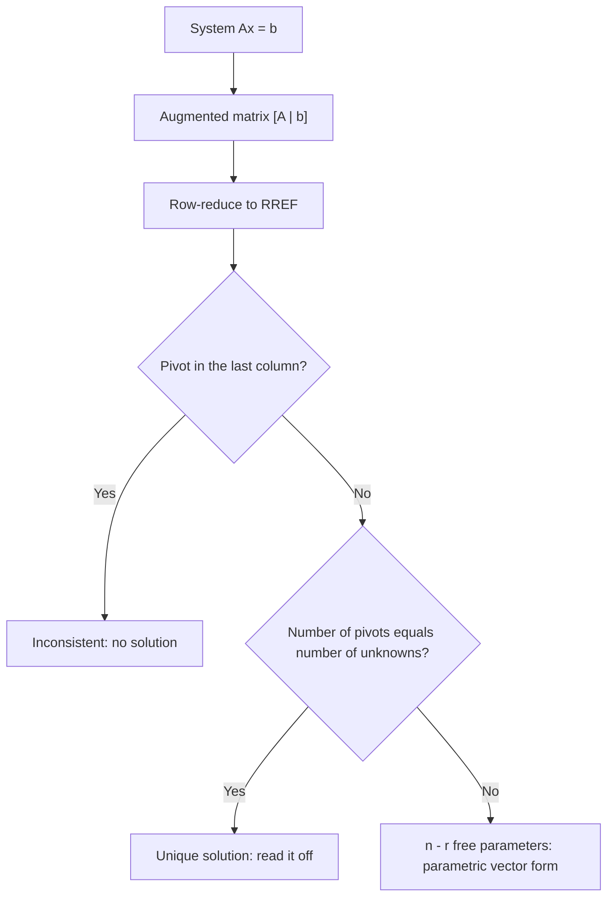

# Systems of Linear Equations

> [Mathematics](../../README.md) › [Linear Algebra](../README.md) · Level: Intermediate · Prerequisites: [Linear Equations](../../03-algebra/02-linear-equations/README.md), [Systems of Equations](../../03-algebra/05-systems-of-equations/README.md) · Estimated time: 540 min

## 1. Introduction

A **system of linear equations** is a list of linear conditions that must hold at the same time:

$$
\begin{cases}
2x + y - z = 1\\
x - 2y + 3z = 8\\
3x + y + 2z = 9 .
\end{cases}
$$

Each equation on its own is easy to satisfy: in three unknowns it describes a whole plane of points. The
system asks for the points on **all three planes at once**, and the answer is usually a single point,
sometimes a line or a plane, and sometimes nothing at all.

Two pictures of the same object compete for attention, and everything in this topic grows from the
tension between them.

* The **geometric** picture treats a system as an intersection problem. Each equation cuts space down;
  the solution set is what survives all the cuts.
* The **algebraic** picture treats a system as a list of equations to be rewritten. You may add two
  equations, multiply one by a number, or reorder them, and the solution set does not move. The goal is
  to rewrite until the answers are visible.

The algebraic picture scales. Adding two equations is legal because it is *reversible*: from the sum and
one of the originals you can recover the other. Every step of elimination is such a reversible
rewriting, and the first theorem of this tutorial (§7.3) says exactly that in general.

Written compactly, the system becomes a rectangular array of numbers, the **augmented matrix**

$$
\left(\begin{array}{ccc|c}
2 & 1 & -1 & 1\\
1 & -2 & 3 & 8\\
3 & 1 & 2 & 9
\end{array}\right).
$$

All the information is there; the letters $x, y, z$ are only labels for the columns. Row-reducing this
array is the standard algorithm, and the shape it reaches (§7.5) answers every question one can ask: is
there a solution, how many, and what do they look like.

The topic deserves more than a page because "how many solutions?" and "what shape is the solution
set?" both reduce to a single integer, the **rank**, and because the answer for one right-hand side
generalises to all right-hand sides at once. Along the way the ideas that the rest of linear algebra
abstracts — subspace, span, independence, basis, dimension — appear in concrete form. The null space of
§7.8 is the prototype of every subspace in [Vector Spaces](../04-vector-spaces/README.md), and the count
"$n - r$ free parameters" is the rank–nullity theorem in embryo.

Elimination itself is ancient: the *Nine Chapters on the Mathematical Art* (China, around 200 AD)
solves systems of three and four equations this way on a counting board, and Gauss used it in 1809 to
recover the orbit of Ceres from noisy observations. The matrix formulation is a twentieth-century
refinement of an idea that never really changed.

**What is new compared with [Systems of Equations](../../03-algebra/05-systems-of-equations/README.md).**
That tutorial solves small systems and explains the geometry. This one adds a proof that row operations
cannot change the solution set, a canonical form with a proof of uniqueness, the rank criterion for
consistency, the structure theorem for non-homogeneous systems, LU factorisation, and the row-reduction
algorithm for inverses.

## 2. Prerequisites

**Solving a linear equation in one unknown.** For $a \neq 0$ the equation $ax = b$ has the unique
solution $x = b/a$; adding the same quantity to both sides, or multiplying both sides by a nonzero
constant, is reversible. See [Linear Equations](../../03-algebra/02-linear-equations/README.md).

**Two equations in two unknowns.** Substitution, elimination, and the three geometric outcomes (lines
crossing, parallel, coincident). See [Systems of Equations](../../03-algebra/05-systems-of-equations/README.md).

**The plane and the equation of a plane.** A linear equation $a_1x_1 + \dots + a_nx_n = b$, with not all
$a_i$ zero, is satisfied by a hyperplane: a line when $n = 2$, a plane when $n = 3$. See
[Coordinate Geometry](../../04-geometry/04-coordinate-geometry/README.md).

**Elementary algebra.** Distributivity, collecting like terms, arithmetic with fractions and negative
numbers. See [Elementary Algebra](../../03-algebra/01-elementary-algebra/README.md).

**Proof technique.** Direct proof, proof of an "if and only if" by two implications, and proof of set
equality by two inclusions. See [Proof Techniques](../../00-foundations/04-proof-techniques/README.md).
Every proof below uses one of these patterns, and the pattern is always named.

**Notation.** $\sum_{j=1}^{n} a_{ij}x_j$ abbreviates $a_{i1}x_1 + \cdots + a_{in}x_n$; see
[Mathematical Notation](../../MATHEMATICAL_NOTATION.md) for the full symbol table used here.

## 3. Learning Objectives

By the end of this tutorial you will be able to

1. write any linear system as an augmented matrix and read a system back out of one;
2. perform elementary row operations and state precisely why each preserves the solution set;
3. carry out Gaussian elimination to row echelon form and finish by back substitution;
4. carry out Gauss–Jordan elimination to reduced row echelon form and explain why that form is unique;
5. compute the rank, identify pivot and free columns, and read off the number of free parameters;
6. decide consistency from $\operatorname{rank}A$ versus $\operatorname{rank}[A \mid \mathbf{b}]$, and
   prove the criterion;
7. prove that a linear system has no solution, exactly one, or infinitely many;
8. describe the solution set as one particular solution plus the null space, and parametrise it;
9. factor a matrix as $A = LU$ and reuse the factors for several right-hand sides;
10. compute $A^{-1}$ by row-reducing $[A \mid I]$ and explain why the procedure works;
11. model networks, chemical reactions and interpolation problems, and interpret the free parameters.

## 4. Intuition

Think of each equation as a **filter**. A filter does not name the answer; it rejects candidates. The
equation $x + y = 3$ rejects every pair whose coordinates do not add to $3$ and keeps the rest. A system
is a stack of filters, and the solution set is whatever survives the whole stack.

Stacking filters can go three ways. Either the filters pin down exactly one candidate — the **unique**
case. Or they are partly redundant, so a whole family survives — the **infinite** case; redundancy
means one condition is implied by the others and buys nothing. Or they contradict each other — the
**empty** case. The last two have algebraic fingerprints: a row of zeros ($0 = 0$, redundancy) and a row
$(0 \;\cdots\; 0 \mid c)$ with $c \neq 0$ (contradiction). Much of §7 is a device for producing such rows
systematically.

A second image explains the *method*. Solving a system is like untangling a knot without cutting it: you
may manipulate the rope but not change what is tied. Row operations are legal manipulations. Adding one
equation to another is legal because it can be undone — given the sum and the equation you added, I can
recover what you started with. Multiplying by $2$ is legal because dividing by $2$ undoes it. Swapping
two equations is legal because order carries no information. Nothing else is legal: squaring both sides
is not, because it is irreversible and manufactures solutions.

The geometry predicts the algebra. Three planes can meet in a point, in a line or plane, or not at all;
there is no fourth shape, because a flat piece of a plane cannot be two isolated points. The algebra
proves this: a linear system can never have exactly two solutions (§7.7).

## 5. Formal Definition

Throughout, $m, n \geq 1$, all coefficients and right-hand sides are real, and solutions are tuples of
reals. Nothing changes if $\mathbb{R}$ is replaced by another field such as $\mathbb{Q}$ or $\mathbb{C}$:
no proof below uses order or completeness.

**Definition 5.1 (Linear equation).** A **linear equation in the unknowns $x_1, \dots, x_n$** is an
equation $a_1x_1 + \cdots + a_nx_n = b$ with $a_1, \dots, a_n, b \in \mathbb{R}$ and not all $a_i$ zero.
The $a_i$ are the **coefficients**, $b$ is the **right-hand side**, and a **solution** is a tuple
$(s_1, \dots, s_n) \in \mathbb{R}^n$ that makes the equation true when substituted.

The restriction "not all coefficients zero" excludes $0 = b$ and $0 = 0$, which are not equations *in
the unknowns*; such degenerate rows nevertheless appear during elimination, and §7.6 explains how to
read them.

**Definition 5.2 (System, solution set).** A **system of $m$ linear equations in $n$ unknowns** is

$$
\begin{cases}
a_{11}x_1 + a_{12}x_2 + \cdots + a_{1n}x_n = b_1\\
\quad\vdots\\
a_{m1}x_1 + a_{m2}x_2 + \cdots + a_{mn}x_n = b_m ,
\end{cases}
$$

and its **solution set** is $S = \{\mathbf{x} \in \mathbb{R}^n : \sum_{j} a_{ij}x_j = b_i \text{ for all } i\}$.
The system is **consistent** if $S \neq \varnothing$ and **inconsistent** otherwise. Two systems are
**equivalent** if they have exactly the same solution set.

**Definition 5.3 (Matrices of a system).** The **coefficient matrix** is $A = (a_{ij}) \in \mathbb{R}^{m \times n}$,
the **right-hand side** is $\mathbf{b} = (b_1, \dots, b_m)^{\mathsf{T}}$, and the **augmented matrix** is

$$
[A \mid \mathbf{b}] = \left(\begin{array}{cccc|c}
a_{11} & a_{12} & \cdots & a_{1n} & b_1\\
\vdots & \vdots & & \vdots & \vdots\\
a_{m1} & a_{m2} & \cdots & a_{mn} & b_m
\end{array}\right).
$$

The bar is only a visual separator recording which column is not a coefficient column. In matrix–vector
form the whole system is the single equation $A\mathbf{x} = \mathbf{b}$.

**Definition 5.4 (Elementary row operations).** An **elementary row operation** is one of

* **(R1) exchange:** $R_i \leftrightarrow R_j$ with $i \neq j$;
* **(R2) scaling:** $R_i \leftarrow cR_i$ with $c \neq 0$;
* **(R3) replacement:** $R_i \leftarrow R_i + cR_j$ with $i \neq j$ and any $c$.

Two matrices of the same size are **row equivalent**, written $A \sim B$, if one is obtained from the
other by a finite sequence of such operations. Note what is excluded: scaling by $0$ (irreversible,
destroys information), adding a multiple of a row to itself in a way that zeroes it, and any operation
on columns — column operations change the solution set of $A\mathbf{x} = \mathbf{b}$.

**Definition 5.5 (Pivot, REF, RREF).** The **leading entry** of a nonzero row is its leftmost nonzero
entry. A matrix is in **row echelon form (REF)** if every zero row lies below every nonzero row and the
leading entry of each nonzero row lies strictly to the right of the leading entry of the row above. A
leading entry in REF is a **pivot**, and its column a **pivot column**. The matrix is in **reduced row
echelon form (RREF)** if in addition every pivot equals $1$ and is the only nonzero entry of its column.

**Definition 5.6 (Rank).** The **rank** of $A$, written $\operatorname{rank}A$, is the number of nonzero
rows of any row echelon form of $A$. This is well defined because all echelon forms of a matrix have the
same number of nonzero rows (§7.5); until then, read "the rank" as "the number of pivots the algorithm
produces", which is what the exercises use.

**Definition 5.7 (Homogeneous system, null space).** The system $A\mathbf{x} = \mathbf{0}$ is
**homogeneous**; $A\mathbf{x} = \mathbf{b}$ with $\mathbf{b} \neq \mathbf{0}$ is **non-homogeneous**. The
**null space** of $A$ is $\operatorname{null}A = \{\mathbf{x} \in \mathbb{R}^n : A\mathbf{x} = \mathbf{0}\}$,
which is never empty because it contains $\mathbf{0}$.

## 6. Mathematical Notation

| Symbol | Read as | Meaning |
|---|---|---|
| $A\mathbf{x} = \mathbf{b}$ | "$A$ times $x$ equals $b$" | the system in matrix form |
| $[A \mid \mathbf{b}]$ | "the augmented matrix of $A$ and $b$" | coefficient columns, then the right-hand side |
| $R_i$ | "row $i$" | the $i$-th row of the matrix |
| $R_i \leftrightarrow R_j$ | "swap rows $i$ and $j$" | operation (R1) |
| $R_i \leftarrow cR_i$ | "replace row $i$ by $c$ times row $i$" | operation (R2), $c \neq 0$ |
| $R_i \leftarrow R_i + cR_j$ | "add $c$ times row $j$ to row $i$" | operation (R3) |
| $A \sim B$ | "$A$ is row equivalent to $B$" | related by elementary row operations |
| $\operatorname{rank}A$ | "the rank of $A$" | the number of pivots |
| $\operatorname{null}A$ | "the null space of $A$" | solutions of $A\mathbf{x} = \mathbf{0}$ |
| $\mathbf{x}_p$ | "a particular solution" | any one fixed element of the solution set |
| $\mathbf{e}_j$ | "the $j$-th standard basis vector" | $1$ in position $j$, $0$ elsewhere |
| $\mathbb{R}^{m \times n}$ | "the $m$ by $n$ real matrices" | $m$ rows, $n$ columns |

Read $R_i \leftarrow R_i + cR_j$ as "row $i$ becomes row $i$ plus $c$ times row $j$". The arrow means
"is replaced by", not "equals": the old row is destroyed. This is the one place where an arrow does not
mean implication.

## 7. Core Concepts

### 7.1 The geometry: intersections of hyperplanes

Each equation in $n$ unknowns defines a **hyperplane**, the set of points satisfying one linear
condition. Its dimension is $n - 1$ — a line in the plane, a plane in space — unless all coefficients
vanish, in which case it is $\mathbb{R}^n$ or $\varnothing$. The solution set is the intersection of $m$
hyperplanes, and three observations organise everything.

* **Two** planes in $\mathbb{R}^3$ generally meet in a line, not a point; pinning down a point needs a
  third condition that is not a consequence of the first two.
* **Redundancy is invisible geometrically:** $x + y + z = 1$ and $2x + 2y + 2z = 2$ describe the same
  plane, so the intersection does not shrink.
* **Contradiction looks like a parallel gap:** $x + y + z = 1$ and $x + y + z = 2$ are parallel planes
  with empty intersection.

| Space | One equation | Two independent equations | Three independent equations |
|---|---|---|---|
| $\mathbb{R}^2$ | line | point | point, if consistent |
| $\mathbb{R}^3$ | plane | line | point, if consistent |
| $\mathbb{R}^4$ | hyperplane, dimension 3 | plane | line |

"Independent" here means that each new equation genuinely lowers the dimension by one. When it does not,
the dimension stays put and free parameters appear.

### 7.2 The augmented matrix

Dropping the letters is not laziness; it is a change of object. In $[A \mid \mathbf{b}]$ the position of
a number encodes both which equation it belongs to (its row) and which unknown it multiplies (its
column). The order of the unknowns is fixed at the start; reordering them means reordering the columns.

**Reading a system back.** Row $i$ reads $a_{i1}x_1 + \cdots + a_{in}x_n = b_i$. A pivot in column $j$
means $x_j$ is determined by the other unknowns; a non-pivot column means the corresponding unknown is
free. Since every legal operation acts on rows alone, the distinction between coefficient columns and
the right-hand column is never needed while eliminating, which is why computer implementations keep $A$
and $\mathbf{b}$ in one array.

### 7.3 Why elementary row operations preserve the solution set

Everything else in the topic is an application of this theorem. Each case is a statement about sets, so
each is proved by two inclusions.

**Theorem 7.1 (Row operations preserve solutions).** Let $S$ and $S'$ be the solution sets of
$A\mathbf{x} = \mathbf{b}$ and $A'\mathbf{x} = \mathbf{b}'$, where $[A' \mid \mathbf{b}']$ is obtained from
$[A \mid \mathbf{b}]$ by one elementary row operation. Then $S = S'$. Consequently row-equivalent
augmented matrices have identical solution sets.

**Proof.** Write $\mathbf{a}_i$ for row $i$ of $A$, so the system says $\mathbf{a}_i \cdot \mathbf{x} = b_i$
for all $i$.

*(R1) Exchange.* The new system is the same list of equations in a different order. A tuple satisfies a
list of conditions exactly when it satisfies each condition, and the order of a list does not affect
what it contains. So $S = S'$.

*(R2) Scaling.* Only equation $i$ changes, to $c\,\mathbf{a}_i \cdot \mathbf{x} = cb_i$. If
$\mathbf{x} \in S$ then $\mathbf{a}_i \cdot \mathbf{x} = b_i$; multiplying by $c$ gives
$(c\mathbf{a}_i)\cdot\mathbf{x} = cb_i$, so $\mathbf{x} \in S'$. Conversely if $\mathbf{x} \in S'$ then
$(c\mathbf{a}_i)\cdot\mathbf{x} = cb_i$, and dividing by $c \neq 0$ gives $\mathbf{a}_i \cdot \mathbf{x} = b_i$;
all other equations are unchanged, so $\mathbf{x} \in S$. The hypothesis $c \neq 0$ is used exactly
here, which is why scaling by zero is forbidden.

*(R3) Replacement.* Only equation $i$ changes, to $(\mathbf{a}_i + c\mathbf{a}_j)\cdot\mathbf{x} = b_i + cb_j$.
If $\mathbf{x} \in S$ then $(\mathbf{a}_i + c\mathbf{a}_j)\cdot\mathbf{x} = \mathbf{a}_i\cdot\mathbf{x} + c\,\mathbf{a}_j\cdot\mathbf{x} = b_i + cb_j$.
Conversely if $\mathbf{x} \in S'$ then equation $j$ is unchanged, so $\mathbf{a}_j\cdot\mathbf{x} = b_j$, and

$$
\mathbf{a}_i \cdot \mathbf{x} = (\mathbf{a}_i + c\mathbf{a}_j)\cdot\mathbf{x} - c\,(\mathbf{a}_j\cdot\mathbf{x})
= (b_i + cb_j) - cb_j = b_i ,
$$

so the old equation $i$ holds too and $\mathbf{x} \in S$.

In each case $S \subseteq S'$ and $S' \subseteq S$, hence $S = S'$; a sequence of $k$ operations is handled
by applying the single-step result $k$ times. $\blacksquare$

**Two corollaries.** First, row equivalence is an equivalence relation: reflexivity is "do nothing",
transitivity is "concatenate the sequences", and symmetry holds because each operation is undone by one
of the same type — swap back, scale by $1/c$, add $-c$ times row $j$ to row $i$. Second, row-equivalent
matrices have the same null space: apply the theorem with $\mathbf{b} = \mathbf{0}$. That second fact is
the key to §7.5.

### 7.4 Gaussian elimination and row echelon form

**Gaussian elimination** (the *forward phase*) applies row operations until the augmented matrix is in
REF.

1. Let the current row and current column start at the first row and first column.
2. Scan the current column at and below the current row. If all those entries are zero, move one column
   right and repeat this step.
3. Otherwise swap a row with a nonzero entry in that column into the current position; that entry is the
   pivot. (Choosing the largest absolute value is *partial pivoting*, the numerically safest choice.)
4. For each row below the current row, add a multiple of the pivot row so that the entry in the pivot
   column becomes $0$; the multiplier is $-$entry$/\,$pivot.
5. Advance one row and one column and repeat from step 2.

**Termination.** The pivot position moves strictly right and strictly down, and both indices are
bounded, so the process stops after at most $\min(m,n)$ pivots. **Why the result is in REF.** Entries
below a pivot are zeroed once and never touched again, since later operations only add multiples of
later rows, which are zero in that column. Zero rows end up at the bottom, because a row becomes zero
exactly when it has no unused leading entry.

**Back substitution.** In REF the last nonzero equation involves only the last pivot unknown and
determines it; substituting upwards determines each remaining pivot unknown in turn. A column without a
pivot carries a *free* unknown, which may be chosen arbitrarily; the pivot unknowns then depend on it.

**Cost.** For $n \times n$ the forward phase costs about $n^3/3$ operations and back substitution about
$n^2/2$, so about $\tfrac13n^3 + O(n^2)$ in total — the reason a $1000 \times 1000$ system is routine.

### 7.5 Gauss–Jordan elimination and reduced row echelon form

**Gauss–Jordan elimination** continues past REF by eliminating *above* each pivot and scaling each pivot
to $1$. The result is the RREF, from which the solution is read with no work: if the RREF is

$$
\left(\begin{array}{cccc|c}
1 & 0 & 2 & 0 & 3\\
0 & 1 & -1 & 0 & 4\\
0 & 0 & 0 & 1 & 5
\end{array}\right),
$$

the pivot columns are $1, 2, 4$ and column $3$ is free, so with $x_3 = t$ the solution set is
$S = \{(3 - 2t,\ 4 + t,\ t,\ 5) : t \in \mathbb{R}\}$.

**Theorem 7.2 (RREF is unique).** Every matrix is row equivalent to exactly one matrix in reduced row
echelon form.

*Existence* is the Gauss–Jordan algorithm: each step strictly reduces the number of nonzero entries
outside the pivot positions and never destroys a pivot already created, so the process stops.
*Uniqueness* is the substantive half.

**Lemma 7.2.1.** Row-equivalent matrices have the same null space.

**Proof.** It suffices to treat one operation. Left multiplication by an invertible matrix does not
change the solutions of $A\mathbf{x} = \mathbf{0}$: if $EA\mathbf{x} = \mathbf{0}$ then
$A\mathbf{x} = E^{-1}\mathbf{0} = \mathbf{0}$, and conversely. Each elementary row operation is left
multiplication by an invertible **elementary matrix** (the identity with that operation applied to it),
and a finite product of invertible matrices is invertible. $\blacksquare$

**Lemma 7.2.2.** For a matrix with columns $\mathbf{m}_1, \dots, \mathbf{m}_n$, the column
$\mathbf{m}_j$ lies in $\operatorname{span}(\mathbf{m}_1, \dots, \mathbf{m}_{j-1})$ if and only if
$\operatorname{null}M$ contains a vector whose $j$-th coordinate is nonzero and whose coordinates after
position $j$ are all zero.

**Proof.** If such a $\mathbf{v}$ exists then $\mathbf{0} = M\mathbf{v} = \sum_{i \le j} v_i\mathbf{m}_i$,
and $v_j \neq 0$ lets us solve for $\mathbf{m}_j$ in terms of earlier columns. Conversely if
$\mathbf{m}_j = \sum_{i<j} c_i\mathbf{m}_i$, then $(c_1, \dots, c_{j-1}, -1, 0, \dots, 0) \in \operatorname{null}M$. $\blacksquare$

**Proof of Theorem 7.2.** Let $R, R'$ be RREF matrices row equivalent to $A$; by Lemma 7.2.1 their null
spaces agree. Put $D(M) = \{j : \mathbf{m}_j \in \operatorname{span}(\mathbf{m}_1, \dots, \mathbf{m}_{j-1})\}$.
By Lemma 7.2.2, membership of $j$ in $D(M)$ depends only on $\operatorname{null}M$, so $D(R) = D(R')$.

*Claim: in RREF, $D$ is exactly the set of non-pivot columns.* If $j = p_k$ is a pivot column, row $k$
has a $1$ in column $p_k$ and zeros in every earlier column (a pivot is the leading entry of its row), so
no combination of earlier columns can equal column $p_k$: $p_k \notin D$. If $j$ is not a pivot column,
then $r_{k,j} = 0$ whenever $p_k > j$ — such an entry lies left of that row's leading entry — so
column $j$ equals $\sum_{p_k < j} r_{k,j}\,\mathbf{c}_{p_k}$ (with $\mathbf{c}_i$ the $i$-th column), a
combination of earlier columns: $j \in D$.

So $R$ and $R'$ have the same pivot positions. For a non-pivot column $j$, let $\mathbf{v}$ be the unique
null vector with $v_j = 1$ and $v_{j'} = 0$ for all other non-pivot $j'$; uniqueness holds because the
pivot coordinates are then forced. Row $k$ reads $v_{p_k} + \sum_{j'} r_{k,j'}v_{j'} = 0$, so
$r_{k,j} = -v_{p_k}$. Since $\operatorname{null}R = \operatorname{null}R'$ and the pivot positions agree,
$r'_{k,j} = -v_{p_k} = r_{k,j}$: every non-pivot entry agrees. Pivot entries are $1$ at a pivot and $0$
elsewhere in a pivot column in both matrices, so $R = R'$. $\blacksquare$

Equivalently: the pivot columns and all entries of the RREF are determined by the null space, which row
operations cannot change. This is also why $\operatorname{rank}A$ does not depend on the route taken.

### 7.6 Rank, free variables, and the consistency criterion

**Theorem 7.3 (Rouché–Capelli).** Let $A$ be $m \times n$ with $r = \operatorname{rank}A$. The system
$A\mathbf{x} = \mathbf{b}$ is consistent if and only if $\operatorname{rank}[A \mid \mathbf{b}] = r$. If it is
consistent, the solution is unique when $r = n$, and there are exactly $n - r$ free parameters when $r < n$.

**Proof.** Row operations change neither the ranks (Theorem 7.2) nor the solution set (Theorem 7.1), so
reduce to RREF and argue there. If the right-hand column contains a pivot, its row reads $0 = c$ with
$c \neq 0$ and there is no solution; this happens exactly when that column adds a pivot, that is exactly
when $\operatorname{rank}[A \mid \mathbf{b}] = r + 1$. If it contains no pivot, every row is either zero
($0 = 0$, harmless) or has a pivot among the first $n$ columns, and choosing arbitrary values for the
$n - r$ non-pivot unknowns produces a solution by solving each pivot row for its pivot unknown.

Different choices of the free unknowns give different solutions, so the solution set is in bijection
with $\mathbb{R}^{n-r}$; when $r = n$ there are no free unknowns and every value is forced. $\blacksquare$

**Reading the criterion.** $\operatorname{rank}A$ counts the independent conditions and $n$ counts the
unknowns. If the conditions reach the unknowns ($r = n$) the solution, when it exists, is unique; if
they fall short ($r < n$) freedom survives. Appending $\mathbf{b}$ raises the rank by at most one.

**A practical warning.** "Consistent with $r < n$" is not a rare accident: every homogeneous system with
$r < n$ has infinitely many solutions, and any system with fewer equations than unknowns has $r \le m < n$
and therefore either no solution or infinitely many.

### 7.7 The three cases, with proof

**Theorem 7.4 (Trichotomy).** A linear system has either no solution, exactly one solution, or
infinitely many. It never has exactly two.

**Proof.** By Theorem 7.3 the system is inconsistent, or consistent with $r = n$ (unique), or consistent
with $r < n$ (in bijection with $\mathbb{R}^{n-r}$, $n - r \ge 1$, hence infinite). That covers every
possibility. For the "never exactly two" claim there is a proof that shows *why*: if $\mathbf{u} \neq \mathbf{v}$
are both solutions, then for $t \in \mathbb{R}$

$$
\mathbf{x}(t) = \mathbf{u} + t(\mathbf{v} - \mathbf{u}), \qquad
A\mathbf{x}(t) = A\mathbf{u} + t(A\mathbf{v} - A\mathbf{u}) = \mathbf{b} + t(\mathbf{b} - \mathbf{b}) = \mathbf{b},
$$

so every $\mathbf{x}(t)$ is a solution. The points are distinct: if $\mathbf{x}(t) = \mathbf{x}(s)$ with
$t \neq s$, subtracting and dividing by $t - s$ gives $\mathbf{v} = \mathbf{u}$, a contradiction. Hence
there are infinitely many. $\blacksquare$

The set $\{\mathbf{x}(t)\}$ is the line through $\mathbf{u}$ and $\mathbf{v}$ — "a flat piece of a plane
cannot be two isolated points". The argument uses linearity twice, in $A(\mathbf{u} + t\mathbf{w}) = A\mathbf{u} + tA\mathbf{w}$
and in $A\mathbf{v} = A\mathbf{u}$; a non-linear system such as $x^2 = 1$ can have exactly two solutions.

### 7.8 Homogeneous systems and the structure of the solution set

**Theorem 7.5 (Structure).** Let $S = \{\mathbf{x} : A\mathbf{x} = \mathbf{b}\}$ be non-empty and let
$\mathbf{x}_p \in S$. Then $S = \mathbf{x}_p + \operatorname{null}A := \{\mathbf{x}_p + \mathbf{h} : \mathbf{h} \in \operatorname{null}A\}$.

**Proof.** If $\mathbf{x} \in S$ then $A(\mathbf{x} - \mathbf{x}_p) = \mathbf{b} - \mathbf{b} = \mathbf{0}$, so
$\mathbf{h} = \mathbf{x} - \mathbf{x}_p \in \operatorname{null}A$ and $\mathbf{x} = \mathbf{x}_p + \mathbf{h}$. Conversely if
$\mathbf{h} \in \operatorname{null}A$ then $A(\mathbf{x}_p + \mathbf{h}) = \mathbf{b} + \mathbf{0} = \mathbf{b}$. $\blacksquare$

**Interpretation.** The solution set of a non-homogeneous system is a *translate* of the null space — the
same shape, moved off the origin — and describing it needs exactly two ingredients: one solution and a
description of the null space. The null space is closed under addition and scalar multiplication, since
$A(\mathbf{h} + \mathbf{k}) = \mathbf{0}$ and $A(c\mathbf{h}) = \mathbf{0}$ whenever $A\mathbf{h} = A\mathbf{k} = \mathbf{0}$.

**Parametric vector form.** Solving the RREF expresses each pivot unknown in terms of the free ones.
Collecting terms gives

$$
\mathbf{x} = \mathbf{x}_p + t_1\mathbf{h}_1 + \cdots + t_{n-r}\mathbf{h}_{n-r},
$$

where $\mathbf{h}_k$ is obtained by setting the $k$-th free unknown to $1$ and the others to $0$. In the
language of [Vector Spaces](../04-vector-spaces/README.md) these $\mathbf{h}_k$ form a basis of
$\operatorname{null}A$ and $n - r$ is its dimension.

**Superposition.** For a homogeneous system, any linear combination of solutions is a solution. For a
non-homogeneous system, the *sum* of two solutions solves $A\mathbf{x} = 2\mathbf{b}$, not
$A\mathbf{x} = \mathbf{b}$; only *differences* of solutions solve the homogeneous system. Keeping the two
cases apart prevents most sign and factor errors.

### 7.9 LU factorisation

Elimination is repetitive: the same row operations are applied for every right-hand side. LU
factorisation records them once.

**Definition 7.6.** A factorisation $A = LU$, with $L$ lower triangular with all diagonal entries $1$
(*unit lower triangular*) and $U$ upper triangular, is an **LU factorisation** of $A$.

**Theorem 7.7 (Existence and construction).** Suppose Gaussian elimination applied to the $n \times n$
matrix $A$ never needs a row exchange — equivalently, every pivot that arises is nonzero. Then $A = LU$,
where $L = (\ell_{ik})$ has $\ell_{ik}$ equal to the multiplier used to eliminate row $i$, column $k$, and
$U$ is the echelon form produced.

**Proof.** Let $E_k$ be the elementary matrix of the operations at step $k$: it adds $-m_{ik}$ times row
$k$ to row $i$ for each $i > k$. Let $\boldsymbol{\tau}_k$ be the column vector with entries $-m_{ik}$ in
positions $i > k$ and zeros elsewhere, so $E_k = I + \boldsymbol{\tau}_k\mathbf{e}_k^{\mathsf{T}}$ and
$E_k^{-1} = I - \boldsymbol{\tau}_k\mathbf{e}_k^{\mathsf{T}}$. Then $E_{n-1}\cdots E_1A = U$, hence
$A = E_1^{-1}\cdots E_{n-1}^{-1}U$. For $k < l$ we have $\mathbf{e}_k^{\mathsf{T}}\boldsymbol{\tau}_l = 0$,
because $\boldsymbol{\tau}_l$ vanishes in positions $1, \dots, l$; therefore every cross term
$\boldsymbol{\tau}_k\mathbf{e}_k^{\mathsf{T}}\boldsymbol{\tau}_l\mathbf{e}_l^{\mathsf{T}}$ vanishes and

$$
L = I - \sum_{k=1}^{n-1}\boldsymbol{\tau}_k\mathbf{e}_k^{\mathsf{T}},
$$

which is unit lower triangular with $m_{ik}$ in position $(i,k)$: exactly the multipliers. $\blacksquare$

**Algorithm (Doolittle).** Run the forward phase on $A$, and each time you execute
$R_i \leftarrow R_i - mR_k$, write $m$ in position $(i,k)$ of a blank array whose diagonal is $1$. When
the phase ends that array is $L$ and the echelon matrix is $U$.

**Why it pays.** Solving $A\mathbf{x} = \mathbf{b}$ becomes two triangular solves, $L\mathbf{y} = \mathbf{b}$
(forward substitution) and $U\mathbf{x} = \mathbf{y}$ (back substitution), each $O(n^2)$. For $k$
right-hand sides, repeated elimination costs $\tfrac{k}{3}n^3$ while one factorisation plus $k$ triangular
solves costs $\tfrac13n^3 + kn^2$.

**If a pivot vanishes** a row exchange is needed and $A = LU$ may fail; the correct statement is
$PA = LU$ for a permutation matrix $P$. For example $A = \begin{pmatrix}0 & 1\\ 1 & 0\end{pmatrix}$ has no LU
factorisation: a unit lower triangular $2 \times 2$ matrix is
$\begin{pmatrix}1 & 0\\ \ell & 1\end{pmatrix}$, so $LU$ has first row $(u_{11}, u_{12})$; matching
$A$'s first entry forces $u_{11} = 0$, and then the $(2,1)$ entry of $LU$ is $\ell u_{11} = 0 \neq 1$.

### 7.10 Inverses by row reduction

**Theorem 7.8.** For an $n \times n$ matrix $A$ the following are equivalent: (i) $A$ is invertible;
(ii) $\operatorname{RREF}(A) = I_n$; (iii) $\operatorname{rank}A = n$. When they hold, the operations that
reduce $A$ to $I_n$ reduce $[A \mid I_n]$ to $[I_n \mid A^{-1}]$.

**Proof.** Row reduction gives $EA = R$ with $E$ a product of elementary (hence invertible) matrices and
$R$ the RREF.

(i) $\Rightarrow$ (ii): if $A$ is invertible then $R = EA$, a product of invertible matrices, is
invertible and so has no zero row. A RREF matrix with no zero row and $n$ columns has one pivot in each
column, hence equals $I_n$.

(ii) $\Leftrightarrow$ (iii): $R = I_n$ exactly when there are $n$ pivots, which is the definition of
rank.

(ii) $\Rightarrow$ (i): suppose $EA = I_n$. Then $A$ is injective, because $A\mathbf{x} = \mathbf{0}$
implies $\mathbf{x} = EA\mathbf{x} = \mathbf{0}$; hence $r = \operatorname{rank}A = n$ by (iii) and
Theorem 7.3. Since $\operatorname{rank}[A \mid \mathbf{b}] \le n = r$ for every $\mathbf{b}$, Theorem 7.3
also gives that $A\mathbf{x} = \mathbf{b}$ is consistent for every $\mathbf{b}$. Applying this to
$\mathbf{b} = \mathbf{e}_1, \dots, \mathbf{e}_n$ and putting the solutions as the columns of a matrix $B$
yields $AB = I_n$. Then $E = E(AB) = (EA)B = B$, so $BA = I_n$ as well and $A$ is invertible with
$A^{-1} = E$.

Applying the same operations to $[A \mid I]$ finally gives $[EA \mid E] = [I \mid E]$ with $E = A^{-1}$.
If the left block cannot be reduced to $I$, the matrix is singular. $\blacksquare$

**Cost and warning.** The algorithm costs about $n^3$ operations, the same as solving $n$ systems with
right-hand sides $\mathbf{e}_1, \dots, \mathbf{e}_n$ — which is exactly what it does. In practice one
rarely forms $A^{-1}$: solving $A\mathbf{x} = \mathbf{b}$ directly is cheaper and numerically better
behaved. The formula is indispensable in theory.

### 7.11 A summary of the vocabulary

| Notion | Matrix feature | Meaning |
|---|---|---|
| Pivot | first nonzero entry of a row in REF | an unknown determined by the data |
| Free column | a column without a pivot | an unknown that may be chosen |
| Rank $r$ | number of pivots | number of independent conditions |
| Consistency | no pivot in the right-hand column | at least one solution |
| Uniqueness | $r = n$ | no free unknown |
| Null space | solutions of $A\mathbf{x} = \mathbf{0}$ | directions of freedom |

## 8. Formulas and Properties

Throughout, $A$ is $m \times n$, $r = \operatorname{rank}A$, and $S$ is the solution set of
$A\mathbf{x} = \mathbf{b}$.

**Row invariance (§7.3).** Row-equivalent augmented matrices have the same solution set. *Why:* each
operation is reversible and preserves solutions.

**Canonical form (§7.5).** Every matrix has exactly one RREF. *Why:* the null space determines the pivot
columns and every entry.

**Consistency (§7.6).** $S \neq \varnothing \iff \operatorname{rank}[A \mid \mathbf{b}] = r$; then the number
of free parameters is $n - r$.

**Trichotomy (§7.7).** $|S| \in \{0, 1, \infty\}$.

**Structure (§7.8).** If $\mathbf{x}_p \in S$ then $S = \mathbf{x}_p + \operatorname{null}A$.

**LU (§7.9).** If elimination needs no row exchange then $A = LU$, with the entries of $L$ equal to the
multipliers and $U$ the echelon form.

**Inverse (§7.10).** $A$ invertible $\iff \operatorname{RREF}(A) = I \iff \operatorname{rank}A = n$; then
$[A \mid I] \sim [I \mid A^{-1}]$.

| Quantity | Formula | Reason |
|---|---|---|
| Maximum rank of an $m \times n$ matrix | $\min(m,n)$ | at most one pivot per row and per column |
| Free parameters | $n - r$ | non-pivot columns |
| Conditions actually used | $r$ | pivot rows |
| Redundant rows | $m - r$ | zero rows in REF |
| Rank after appending $\mathbf{b}$ | $r$ or $r+1$ | one new column |

**Equivalent conditions for an $n \times n$ matrix** (each implies the others, §7.6 and §7.10):
$\operatorname{rank}A = n$; $\operatorname{RREF}(A) = I$; $A$ is invertible; $A\mathbf{x} = \mathbf{0}$ has only
$\mathbf{x} = \mathbf{0}$; $A\mathbf{x} = \mathbf{b}$ has a unique solution for every $\mathbf{b}$.

## 9. Step-by-Step Examples

### Example 1 — A $3 \times 3$ system with a unique solution

Solve

$$
\begin{cases}
x + y + z = 4\\
2x + y - z = 0\\
x - 2y + 2z = 10 .
\end{cases}
$$

*Forward phase.* $R_2 \leftarrow R_2 - 2R_1$ gives $(0, -1, -3 \mid -8)$, and $R_3 \leftarrow R_3 - R_1$
gives $(0, -3, 1 \mid 6)$. Then $R_3 \leftarrow R_3 - 3R_2$ gives $(0, 0, 10 \mid 30)$, so the matrix is in
REF with pivots in columns $1, 2, 3$.

*Back substitution.* The last row gives $10z = 30$, so $z = 3$. The second gives $-y - 3z = -8$, so
$y = -1$. The first gives $x - 1 + 3 = 4$, so $x = 2$.

*Check:* $2 - 1 + 3 = 4$; $4 - 1 - 3 = 0$; $2 + 2 + 6 = 10$. Since $r = n = 3$, Theorem 7.3 predicts
uniqueness, and indeed the answer is the single point $(2, -1, 3)$.

### Example 2 — Detecting an inconsistent system

Solve

$$
\begin{cases}
x + 2y - z = 1\\
2x + 4y - 2z = 3\\
y + z = 0 .
\end{cases}
$$

$R_2 \leftarrow R_2 - 2R_1$ gives $(0, 0, 0 \mid 1)$. After moving the zero row to the bottom by
$R_2 \leftrightarrow R_3$ the matrix is in REF:

$$
\left(\begin{array}{ccc|c}
1 & 2 & -1 & 1\\
0 & 1 & 1 & 0\\
0 & 0 & 0 & 1
\end{array}\right).
$$

The last row reads $0 = 1$, which has no solution, so $S = \varnothing$. Here $\operatorname{rank}A = 2$
(pivots in columns $1$ and $2$) but $\operatorname{rank}[A \mid \mathbf{b}] = 3$: the right-hand column
introduced a pivot, exactly the criterion of Theorem 7.3. Geometrically the first two equations have
proportional left sides but inconsistent right sides, so they describe parallel planes.

### Example 3 — Two free parameters

Solve

$$
\begin{cases}
x_1 + 2x_2 + x_3 + 2x_4 = 7\\
2x_1 + 4x_2 + 6x_4 = 10\\
x_1 + 2x_2 - x_3 + 4x_4 = 3 .
\end{cases}
$$

$R_2 \leftarrow R_2 - 2R_1$ gives $(0, 0, -2, 2 \mid -4)$ and $R_3 \leftarrow R_3 - R_1$ gives the same
row; hence $R_3 \leftarrow R_3 - R_2$ yields a zero row. Scale $R_2 \leftarrow -\tfrac12R_2$, then
$R_1 \leftarrow R_1 - R_2$:

$$
\left(\begin{array}{cccc|c}
1 & 2 & 0 & 3 & 5\\
0 & 0 & 1 & -1 & 2\\
0 & 0 & 0 & 0 & 0
\end{array}\right).
$$

Pivots are in columns $1$ and $3$, so $r = 2$ and there are $n - r = 2$ free unknowns, $x_2 = s$ and
$x_4 = t$. The pivot equations give $x_1 = 5 - 2s - 3t$ and $x_3 = 2 + t$, so

$$
S = \{(5 - 2s - 3t,\ s,\ 2 + t,\ t) : s, t \in \mathbb{R}\}.
$$

*Check* with $s = t = 0$: $(5, 0, 2, 0)$ gives $5 + 2 = 7$, $10 = 10$, $5 - 2 = 3$. *Check the
parameters:* substituting the general tuple into the third equation gives
$(5 - 2s - 3t) + 2s - (2 + t) + 4t = 3$, which reduces to $3 = 3$ — an identity, the algebraic trace of
the redundancy.

### Example 4 — A homogeneous system

Solve $A\mathbf{x} = \mathbf{0}$ for

$$
A = \begin{pmatrix}1 & 2 & -1\\ 2 & 4 & -2\\ -1 & 3 & 2\end{pmatrix}.
$$

$R_2 \leftarrow R_2 - 2R_1$ gives a zero row and $R_3 \leftarrow R_3 + R_1$ gives $(0, 5, 1)$. Scaling
$R_2 \leftarrow \tfrac15R_2$ gives $(0, 1, \tfrac15)$, and $R_1 \leftarrow R_1 - 2R_2$ gives
$(1, 0, -\tfrac75)$. So $x_1 = \tfrac75x_3$ and $x_2 = -\tfrac15x_3$; with $x_3 = 5t$,

$$
\operatorname{null}A = \{(7t,\ -t,\ 5t) : t \in \mathbb{R}\}.
$$

*Check:* $7 + 2(-1) - 5 = 0$, $14 - 4 - 10 = 0$, $-7 - 3 + 10 = 0$. Here $r = 2$ and $n = 3$, so there
is one free parameter. The zero vector is always a solution; the real question is whether anything else
survives, and the answer is yes exactly when $r < n$.

### Example 5 — A system with a parameter

For which $k$ does the system

$$
\begin{cases}
x + y + kz = 1\\
x + ky + z = 1\\
kx + y + z = 1
\end{cases}
$$

have no solution, one solution, or infinitely many?

Subtracting the second equation from the first gives $(1 - k)(y - z) = 0$; by symmetry,
$(1 - k)(x - y) = 0$.

*If $k \neq 1$:* then $x = y = z$, and any equation gives $(k + 2)x = 1$. If also $k \neq -2$, the
solution is unique: $\big(\tfrac{1}{k+2}, \tfrac{1}{k+2}, \tfrac{1}{k+2}\big)$. If $k = -2$ the equations
are $x + y - 2z = 1$, $x - 2y + z = 1$, $-2x + y + z = 1$; their left sides sum to $0$ while their right
sides sum to $3$, so there is no solution.

*If $k = 1$:* all three equations read $x + y + z = 1$, the rank is $1$, and
$S = \{(1 - s - t,\ s,\ t)\}$ has two free parameters.

Summary: unique for $k \notin \{1, -2\}$, infinitely many for $k = 1$, none for $k = -2$. The
inconsistency at $k = -2$ comes not from a zero row of $A$ but from a *combination* of rows; only row
reduction reveals it.

### Example 6 — LU factorisation and two right-hand sides

Factor

$$
A = \begin{pmatrix}2 & 1 & -1\\ 4 & 5 & -1\\ -2 & 8 & 6\end{pmatrix}
$$

and solve $A\mathbf{x} = (1, 7, 18)^{\mathsf{T}}$.

*Forward elimination.* $R_2 \leftarrow R_2 - 2R_1$ (multiplier $2$) gives $(0, 3, 1)$;
$R_3 \leftarrow R_3 + R_1$ (multiplier $-1$) gives $(0, 9, 5)$; then $R_3 \leftarrow R_3 - 3R_2$
(multiplier $3$) gives $(0, 0, 2)$. Hence

$$
U = \begin{pmatrix}2 & 1 & -1\\ 0 & 3 & 1\\ 0 & 0 & 2\end{pmatrix},
\qquad
L = \begin{pmatrix}1 & 0 & 0\\ 2 & 1 & 0\\ -1 & 3 & 1\end{pmatrix}.
$$

*Verify:* row $2$ of $LU$ is $2(2,1,-1) + (0,3,1) = (4,5,-1)$ and row $3$ is
$-(2,1,-1) + 3(0,3,1) + (0,0,2) = (-2,8,6)$, as required.

*Solve $L\mathbf{y} = \mathbf{b}$:* $y_1 = 1$; $2y_1 + y_2 = 7$ gives $y_2 = 5$; $-y_1 + 3y_2 + y_3 = 18$
gives $y_3 = 4$. *Solve $U\mathbf{x} = \mathbf{y}$:* $2x_3 = 4$ gives $x_3 = 2$; $3x_2 + x_3 = 5$ gives
$x_2 = 1$; $2x_1 + x_2 - x_3 = 1$ gives $x_1 = 1$. So $\mathbf{x} = (1,1,2)$.

*Check:* $A\mathbf{x} = (2 + 1 - 2,\ 4 + 5 - 2,\ -2 + 8 + 12) = (1, 7, 18)$. For a second right-hand
side only the two triangular solves are repeated.

### Example 7 — An inverse by row reduction

Find $A^{-1}$ for $A = \begin{pmatrix}1 & 2 & 3\\ 0 & 1 & 4\\ 5 & 6 & 0\end{pmatrix}$.

Starting from $[A \mid I]$: $R_3 \leftarrow R_3 - 5R_1$ gives
$(0, -4, -15 \mid -5, 0, 1)$; $R_3 \leftarrow R_3 + 4R_2$ gives $(0, 0, 1 \mid -5, 4, 1)$. Now clear
upwards: $R_2 \leftarrow R_2 - 4R_3$ gives $(0, 1, 0 \mid 20, -15, -4)$;
$R_1 \leftarrow R_1 - 3R_3$ gives $(1, 2, 0 \mid 16, -12, -3)$; $R_1 \leftarrow R_1 - 2R_2$ gives
$(1, 0, 0 \mid -24, 18, 5)$. Therefore

$$
A^{-1} = \begin{pmatrix}-24 & 18 & 5\\ 20 & -15 & -4\\ -5 & 4 & 1\end{pmatrix}.
$$

*Check:* row $1$ of $A$ times column $1$ of $A^{-1}$ is $-24 + 40 - 15 = 1$; row $2$ times column $2$ is
$-15 + 16 = 1$; row $3$ times column $3$ is $25 - 24 = 1$; row $1$ times column $2$ is $18 - 30 + 12 = 0$.
Since the left block reached $I$, Theorem 7.8 guarantees the right block is the two-sided inverse.

### Example 8 — A network of pipes

Water flows in five pipes: $x_1$ on $1 \to 2$, $x_2$ on $2 \to 3$, $x_3$ on $1 \to 3$, $x_4$ on
$3 \to 4$, $x_5$ on $2 \to 4$. Node $1$ has inflow $20$, node $3$ discharges $12$, node $4$ discharges
$8$, and node $2$ is a junction. Conservation at each node gives

$$
\begin{cases}
x_1 + x_3 = 20 & \text{(node 1)}\\
x_1 = x_2 + x_5 & \text{(node 2)}\\
x_2 + x_3 = x_4 + 12 & \text{(node 3)}\\
x_4 + x_5 = 8 & \text{(node 4).}
\end{cases}
$$

$R_2 \leftarrow R_2 - R_1$ gives $(0, -1, -1, 0, -1 \mid -20)$; scaling $R_2 \leftarrow -R_2$ gives
$(0, 1, 1, 0, 1 \mid 20)$; $R_3 \leftarrow R_3 - R_2$ gives $(0, 0, 0, -1, -1 \mid -8)$; then
$R_4 \leftarrow R_4 + R_3$ gives a zero row. The pivot columns are $1, 2, 4$, so $r = 3$ and there are
$5 - 3 = 2$ free flows, say $x_2 = s$ and $x_5 = t$. Reading the RREF,

$$
x_1 = s + t, \qquad x_3 = 20 - s - t, \qquad x_4 = 8 - t .
$$

*Check at node $3$:* $x_2 + x_3 = s + 20 - s - t = 20 - t$ and $x_4 + 12 = 8 - t + 12 = 20 - t$. ✓

The fourth equation was redundant, and not by accident: the conservation equations always sum to
$0 = 0$, because every pipe carries flow out of one node and into another. Physically admissible flows
also need $x_i \ge 0$, which restricts $(s,t)$ to $s \ge 0$, $t \ge 0$, $s + t \le 20$, $t \le 8$ — a
polygon of feasible flows rather than a single answer. That is what "two degrees of freedom" means in a
real system.

## 10. Visual Explanations

The decision procedure of this tutorial in one picture:

The three cases, with their signatures in the reduced matrix and their geometry:

| Case | RREF signature | Algebra | Geometry in $\mathbb{R}^3$ |
|---|---|---|---|
| No solution | a row $(0 \;\cdots\; 0 \mid c)$, $c \neq 0$ | $\operatorname{rank}[A \mid \mathbf{b}] = r + 1$ | parallel planes, or a triangular prism |
| Unique | pivot in every column, no bad row | $r = n$ | three planes meeting in one point |
| Infinitely many | a non-pivot coefficient column, no bad row | $r < n$ | planes meeting in a line or a plane |

## 11. Common Mistakes

**1. Scaling a row by zero.** $R_i \leftarrow 0\cdot R_i$ destroys the equation and can create
solutions. Only $c \neq 0$ is allowed, and that hypothesis is used exactly where Theorem 7.1 divides by
$c$.

**2. Adding a multiple of a row to itself.** $R_i \leftarrow R_i - R_i$ produces a zero row and loses
information; the condition $i \neq j$ in (R3) exists for this reason.

**3. Operating on columns.** Adding a multiple of one *column* to another changes the roles of the
unknowns and the solution set. Only rows are legal, because rows correspond to equations.

**4. Forgetting the right-hand side.** Row operations act on the whole augmented row, including the last
entry. Leaving $b_i$ untouched silently changes the problem.

**5. Reading a solution from REF as if it were RREF.** In REF you must back-substitute; only in RREF is
each pivot unknown equal to the last entry of its row.

**6. Believing a zero row means no solution.** A zero row is $0 = 0$: redundancy, hence infinitely many
solutions if the system is consistent. Only $(0 \;\cdots\; 0 \mid c)$ with $c \neq 0$ signals
inconsistency.

**7. Confusing consistency with uniqueness.** "No pivot in the right-hand column" gives existence; the
test for uniqueness is $r = n$. A consistent system with a free column has infinitely many solutions.

**8. Concluding "infinitely many" from "more unknowns than equations".** Such a system is either
inconsistent or infinite; consistency must still be checked. Compare $x + y = 1$, $x + y = 2$.

**9. Adding solutions of a non-homogeneous system.** If $A\mathbf{u} = A\mathbf{v} = \mathbf{b}$ then
$A(\mathbf{u} + \mathbf{v}) = 2\mathbf{b}$. Only $\mathbf{u} - \mathbf{v}$ solves the homogeneous system.

**10. Using LU after a row exchange.** Writing $A = LU$ when elimination swapped rows gives wrong
factors. Record the permutation, $PA = LU$, or change method.

**11. Rounding during exact elimination.** Keep fractions. A rounded pivot propagates and can flip a
rank decision; rounding is a numerical issue with its own rules, not a licence to change the answer.

## 12. Applications

**Electrical networks.** Kirchhoff's current law (inflow equals outflow at each node) and voltage law
(sum of drops around each loop is zero) give one linear equation per node or loop, with currents as
unknowns; Example 8 is the water analogue. In a circuit with $N$ nodes one node equation is always
redundant, so the coefficient matrix has rank at most $N - 1$.

**Balancing chemical reactions.** Conservation of each element gives one equation per element, with
molecule counts as unknowns. For $a\,\mathrm{C_3H_8} + b\,\mathrm{O_2} \to c\,\mathrm{CO_2} + d\,\mathrm{H_2O}$,
carbon gives $3a = c$, hydrogen $8a = 2d$, oxygen $2b = 2c + d$ — a homogeneous system. Setting $a = 1$
gives $c = 3$, $d = 4$, $b = 5$, the familiar balanced equation. The solution is unique up to an overall
scale, which is why reactions are written with the smallest whole numbers.

**Polynomial interpolation.** Requiring $p(x) = a_0 + a_1x + a_2x^2$ to pass through $p(0) = 1$,
$p(1) = 4$, $p(2) = 11$ gives three linear equations in $a_0, a_1, a_2$; solving yields
$p(x) = 1 + x + 2x^2$. The coefficient matrix is a Vandermonde matrix, and distinct nodes make it
invertible, so the interpolating polynomial is unique. See
[Polynomials](../../03-algebra/06-polynomials/README.md) for the root-counting fact behind this.

**Computer graphics and robotics.** Ray–triangle intersection asks for barycentric coordinates, a
$3 \times 3$ linear system per ray, solved millions of times per frame. Robot inverse kinematics
linearises to a system in the joint increments, one linear solve per Newton step.

**Economics and operations research.** Leontief input–output models ask for production levels satisfying
demand: $(I - C)\mathbf{x} = \mathbf{d}$, one equation per sector. Linear programming adds inequalities
and searches the vertices of the resulting polyhedron, each vertex being the solution of a square
subsystem.

**Least squares.** Over-determined systems ($m > n$) usually have no exact solution; the remedy is to
solve the *normal equations*, a square system built from the data. That construction needs inner products
and belongs to a later stage of the discipline.

**A note on computation.** Production software never inverts a matrix to solve a system: it uses LU with
partial pivoting, or QR, or iterative methods for large sparse systems, because forming $A^{-1}$ costs
more and loses accuracy. The theory here — rank, consistency, free variables — is what those routines
report back.

## 13. Exercises

The problem set is in [exercises.md](exercises.md): thirty-five problems, graded from reading an augmented
matrix to proving the uniqueness of the reduced row echelon form, with applications to networks,
chemistry and interpolation.

## 14. Solutions

Complete worked solutions to every problem are in [solutions.md](solutions.md). Attempt the problems
first: reading a solution is not the same as being able to produce one.

## 15. Summary

* A linear system is the single equation $A\mathbf{x} = \mathbf{b}$; the augmented matrix
  $[A \mid \mathbf{b}]$ carries every coefficient.
* Elementary row operations — swap, scale by a nonzero constant, add a multiple of another row — are
  reversible and therefore preserve the solution set (Theorem 7.1). Everything rests on this.
* Gaussian elimination produces a row echelon form, and back substitution finishes the job; Gauss–Jordan
  elimination produces the reduced row echelon form, which is unique (Theorem 7.2).
* Rank is the number of pivots. The system is consistent exactly when the right-hand column adds no
  pivot, and then the number of free parameters is $n - r$ (Theorem 7.3).
* A system has no solution, one solution, or infinitely many — never exactly two (Theorem 7.4).
* The solution set of a consistent non-homogeneous system is one particular solution plus the null
  space (Theorem 7.5): $\mathbf{x} = \mathbf{x}_p + t_1\mathbf{h}_1 + \cdots + t_{n-r}\mathbf{h}_{n-r}$.
* If elimination needs no row exchange then $A = LU$; the factors are the multipliers and the echelon
  form, reusable for many right-hand sides.
* $A$ is invertible exactly when its RREF is $I$, and then $[A \mid I] \sim [I \mid A^{-1}]$.
* "Rank", "null space", "free parameters" and "dimension" are one idea seen from four angles;
  [Vector Spaces](../04-vector-spaces/README.md) makes that precise.

## 16. Further Learning

**Next in this discipline.** [Vector Spaces](../04-vector-spaces/README.md) abstracts this tutorial: the
null space becomes a subspace, free parameters become dimensions, and Theorem 7.3 becomes the
rank–nullity theorem with a coordinate-free proof. Read it next.

**Within the repository.** [Linear Equations](../../03-algebra/02-linear-equations/README.md) and
[Systems of Equations](../../03-algebra/05-systems-of-equations/README.md) for the elementary skills,
[Polynomials](../../03-algebra/06-polynomials/README.md) for interpolation, and
[Proof Techniques](../../00-foundations/04-proof-techniques/README.md) for the proof patterns used here.

**Standard texts.**

* G. Strang, *Introduction to Linear Algebra* — chapters 1–2 are exactly this material, with the best
  geometric commentary available.
* D. C. Lay, *Linear Algebra and Its Applications* — the most patient treatment of row reduction, with
  emphasis on the four subspaces.
* G. H. Golub and C. F. Van Loan, *Matrix Computations* — for what happens when the arithmetic is
  floating point: pivoting, growth factors, backward error.
