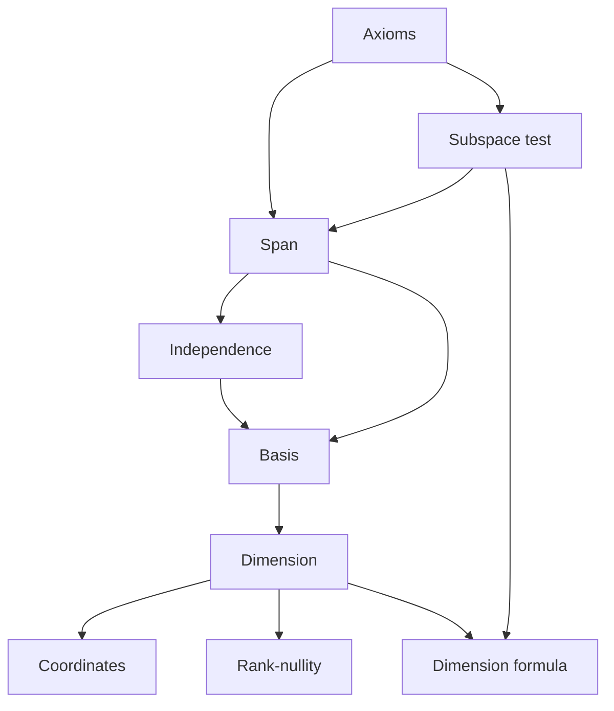

# Vector Spaces

> [Mathematics](../../README.md) › [Linear Algebra](../README.md) · Level: Advanced · Prerequisites: [Systems of Linear Equations](../03-systems-of-linear-equations/README.md), [Elementary Algebra](../../03-algebra/01-elementary-algebra/README.md), [Proof Techniques](../../00-foundations/04-proof-techniques/README.md) · Estimated time: 720 min

## 1. Introduction

Up to now a vector has been a tuple of numbers, and a matrix a rectangular array. That was enough to
solve systems, but it is not enough to explain why the same theorems keep appearing in different
subjects. Why do the solutions of a homogeneous system, the polynomials of degree at most three, the
$2 \times 2$ symmetric matrices and the continuous functions on $[0,1]$ all obey the *same* theory of
spanning sets, independence and dimension?

Because none of those proofs ever used the *numbers*. They used only the fact that you can add two
objects and multiply an object by a scalar, and that these operations obey a short list of rules. **A
vector space is any set equipped with such operations.** A vector is then simply an element of a vector
space — a tuple, a polynomial, a matrix, a function, a signal, a solution of a differential equation.

The topic proceeds in the only order that works.

1. State the axioms (§5) and understand *why* each one is there (§7.1): a list of rules with no
   motivation is impossible to remember, and an axiom that is never used should be deleted.
2. Define subspaces and prove the subspace test (§7.2), so that a set of vectors can be recognised as a
   vector space without re-checking ten axioms.
3. Build the central vocabulary: span (§7.3), independence (§7.4), bases and dimension (§7.5–7.6).
4. Apply it to matrices (§7.7) and prove the rank–nullity theorem (§7.8), the single most used theorem in
   the subject.
5. Combine subspaces (§7.9) and prove the dimension formula
   $\dim(U + W) = \dim U + \dim W - \dim(U \cap W)$.

Two features distinguish this treatment. First, every axiom is examined: some are provably redundant
(the commutativity of addition follows from the others), and each of the rest is illustrated by a
structure that satisfies the others and breaks that one. Second, every dimension claim is proved from a
basis, never guessed from a formula.

No previous topic in this discipline is assumed beyond
[Systems of Linear Equations](../03-systems-of-linear-equations/README.md); in particular, everything
about row reduction used in §7.7 is proved there.

## 2. Prerequisites

**Solving linear systems, row reduction, rank.** Row operations, echelon forms, pivots, the rank of a
matrix, the consistency criterion and the parametric description of a solution set. All of this is
developed in [Systems of Linear Equations](../03-systems-of-linear-equations/README.md), and §7.7 below
uses it without repeating the proofs.

**Fields and arithmetic.** Addition and multiplication of real and complex numbers with the field axioms,
plus polynomial and matrix arithmetic as examples.

**Sets and functions.** Subsets, set equality by double inclusion, intersections and unions of families
of sets, injective and surjective maps. See
[Set Theory](../../00-foundations/03-set-theory/README.md) and
[Relations and Functions](../../00-foundations/05-relations-and-functions/README.md).

**Proof technique.** Direct proof, proof by contradiction, induction, and the two-inclusion pattern for
set equalities. See [Proof Techniques](../../00-foundations/04-proof-techniques/README.md). The proof of
the Steinitz exchange lemma (§7.5) is an induction, and the exchange argument is worth reading twice.

## 3. Learning Objectives

By the end of this tutorial you will be able to

1. state the ten vector-space axioms and explain, for each, why it is present or why it is redundant;
2. decide whether a given subset of a vector space is a subspace, and prove the subspace test;
3. compute spans, prove that a vector lies or does not lie in a span, and prove that $\operatorname{span}S$
   is the smallest subspace containing $S$;
4. test a set for linear independence, and use the lemmas that relate independence of a set to
   independence of its subsets;
5. define a basis, prove the Steinitz exchange lemma, and deduce that any two bases of a
   finite-dimensional space have the same number of elements;
6. compute dimensions of subspaces of $\mathbb{R}^n$, of polynomial spaces, of matrix spaces and of
   function spaces;
7. compute coordinates relative to an ordered basis and prove that coordinates are unique;
8. find bases of the row, column and null spaces of a matrix, and prove that row rank equals column rank;
9. state and prove the rank–nullity theorem, and use it to count;
10. decide whether a sum of subspaces is direct, and use
    $\dim(U + W) = \dim U + \dim W - \dim(U \cap W)$.

## 4. Intuition

A vector space is a **place where linear combinations make sense**. That single phrase generates
everything. If you can form $3u - 2v + w$, you can ask which vectors are combinations of which
(spanning), which families add nothing new (independence), which families are exactly enough (bases),
and how many vectors such a family must contain (dimension).

The picture to carry in your head is the plane. Two vectors that are not parallel are a basis of
$\mathbb{R}^2$: every vector is a unique combination of them, and the coefficients are its coordinates.
Three vectors in the plane are always dependent — one too many. One vector never spans. The number of
elements in a basis is therefore a property of the *space*, not of the particular choice of basis, and
that number is the dimension.

Now replace "arrow in the plane" by "polynomial of degree at most $2$". The polynomials $1, x, x^2$ play
exactly the role of two non-parallel arrows: every such polynomial is a unique combination
$a + bx + cx^2$, three of them are needed, and the space is three-dimensional. Replace it by "$2 \times 2$
symmetric matrices": the three matrices
$\begin{pmatrix}1&0\\0&0\end{pmatrix}$, $\begin{pmatrix}0&1\\1&0\end{pmatrix}$, $\begin{pmatrix}0&0\\0&1\end{pmatrix}$
do the same job. The questions and answers are identical because the *structure* is identical.

Why state axioms at all, instead of just saying "things that behave like arrows"? Because intuition is
unreliable at the edges. It suggests, for instance, that $0 \cdot v$ should be $0$ — true, but a theorem,
not an axiom. It suggests that the sum of two subspaces determines the dimensions of the parts — false,
and §7.9 shows exactly what is true instead. The axioms are the contract; the theorems are what the
contract actually buys.

## 5. Formal Definition

**Definition 5.1 (Field).** A **field** $K$ is a set with two operations $+$ and $\cdot$ such that
$(K, +)$ is an abelian group with identity $0$, $(K \setminus \{0\}, \cdot)$ is an abelian group with
identity $1$, and $a(b + c) = ab + ac$ for all $a, b, c \in K$. The fields used in this tutorial are
$\mathbb{Q}$, $\mathbb{R}$ and $\mathbb{C}$.

**Definition 5.2 (Vector space).** Let $K$ be a field. A **vector space over $K$** is a set $V$ together
with two operations

$$
+\; : V \times V \to V, \qquad \cdot\; : K \times V \to V,
$$

called **addition** and **scalar multiplication**, satisfying the following ten axioms for all
$u, v, w \in V$ and all $a, b \in K$:

| | Axiom | Name |
|---|---|---|
| (A1) | $u + v \in V$ | closure under addition |
| (A2) | $(u + v) + w = u + (v + w)$ | associativity of addition |
| (A3) | $u + v = v + u$ | commutativity of addition |
| (A4) | there is $\mathbf{0} \in V$ with $\mathbf{0} + v = v$ | additive identity |
| (A5) | there is $-v \in V$ with $v + (-v) = \mathbf{0}$ | additive inverses |
| (S1) | $av \in V$ | closure under scalar multiplication |
| (S2) | $1v = v$ | scalar unit |
| (S3) | $(ab)v = a(bv)$ | compatibility of scalars |
| (S4) | $a(u + v) = au + av$ | scalars distribute over vector addition |
| (S5) | $(a + b)v = av + bv$ | scalars distribute over scalar addition |

The elements of $V$ are called **vectors** and the elements of $K$ **scalars**. When $K = \mathbb{R}$ we
speak of a **real vector space**; when $K = \mathbb{C}$, a **complex vector space**.

**Definition 5.3 (Subspace).** A subset $W \subseteq V$ is a **subspace** of $V$ if $W$, equipped with the
restricted operations, is itself a vector space over $K$. We write $W \leq V$.

**Definition 5.4 (Linear combination, span).** Let $S \subseteq V$. A **linear combination** of elements
of $S$ is a vector

$$
a_1v_1 + a_2v_2 + \cdots + a_kv_k
$$

with $k \geq 0$, $v_i \in S$ and $a_i \in K$. For $k = 0$ the combination is the **empty sum**, defined to
be $\mathbf{0}$. The **span** of $S$ is the set of all such combinations:

$$
\operatorname{span}S = \left\{\textstyle\sum_{i=1}^{k} a_iv_i : k \geq 0,\ v_i \in S,\ a_i \in K\right\}.
$$

We say $S$ **spans** $V$ if $\operatorname{span}S = V$, and that $S$ is a **spanning set** of $V$.

**Definition 5.5 (Linear independence).** A finite set $\{v_1, \dots, v_k\} \subseteq V$ is **linearly
independent** if

$$
a_1v_1 + a_2v_2 + \cdots + a_kv_k = \mathbf{0} \quad\Longrightarrow\quad a_1 = a_2 = \cdots = a_k = 0 .
$$

An arbitrary set $S$ is linearly independent if every finite subset of $S$ is linearly independent. A set
that is not independent is **linearly dependent**.

**Definition 5.6 (Basis, dimension).** A **basis** of $V$ is a linearly independent subset of $V$ that
spans $V$. A vector space is **finite-dimensional** if it has a basis with finitely many elements; then
the **dimension** $\dim V$ is the number of elements in any basis (well defined by Theorem 7.9). If $V$
has no finite basis, it is **infinite-dimensional**.

**Definition 5.7 (Coordinates).** Let $B = (v_1, \dots, v_n)$ be an **ordered** basis of $V$. For
$v \in V$, the unique scalars $c_1, \dots, c_n$ with $v = c_1v_1 + \cdots + c_nv_n$ are the
**coordinates** of $v$ relative to $B$, and the column vector

$$
[v]_B = \begin{pmatrix}c_1\\ \vdots\\ c_n\end{pmatrix} \in K^n
$$

is the **coordinate vector** of $v$ relative to $B$.

**Definition 5.8 (Sum and direct sum).** For subspaces $U, W \leq V$,

$$
U + W = \{u + w : u \in U,\ w \in W\}.
$$

The sum is **direct**, written $U \oplus W$, if every element of $U + W$ has a *unique* expression
$u + w$ with $u \in U$ and $w \in W$.

## 6. Mathematical Notation

| Symbol | Read as | Meaning |
|---|---|---|
| $K$ | "the field $K$" | the scalars: $\mathbb{Q}$, $\mathbb{R}$ or $\mathbb{C}$ |
| $V$, $U$, $W$ | "the space $V$" | vector spaces over $K$ |
| $W \leq V$ | "$W$ is a subspace of $V$" | subset that is a vector space under the inherited operations |
| $\mathbf{0}$ | "the zero vector" | the additive identity of $V$ (not the scalar $0$) |
| $\operatorname{span}S$ | "the span of $S$" | all finite linear combinations of elements of $S$ |
| $\dim V$ | "the dimension of $V$" | the number of elements in any basis |
| $[v]_B$ | "the coordinates of $v$ relative to $B$" | the coefficient column of $v$ in the ordered basis $B$ |
| $U + W$ | "$U$ plus $W$" | $\{u + w : u \in U, w \in W\}$ |
| $U \oplus W$ | "$U$ direct sum $W$" | a sum in which representations are unique |
| $\operatorname{Row}A$, $\operatorname{Col}A$ | "row space, column space" | spans of the rows / of the columns of $A$ |
| $\operatorname{null}A$ | "the null space of $A$" | $\{\mathbf{x} : A\mathbf{x} = \mathbf{0}\}$ |
| $\operatorname{rank}A$ | "the rank of $A$" | $\dim\operatorname{Col}A = \dim\operatorname{Row}A$ |
| $\operatorname{nullity}A$ | "the nullity of $A$" | $\dim\operatorname{null}A$ |
| $\ker T$, $\operatorname{im}T$ | "kernel, image of $T$" | preimage of $\mathbf{0}$; set of all values |

Distinguish $\mathbf{0} \in V$ (a vector) from $0 \in K$ (a scalar) and from the zero matrix. In practice
the context makes the meaning clear, but in proofs about axioms the distinction matters.

## 7. Core Concepts

### 7.1 The axioms, and why each one is needed

Ten axioms is a lot to accept on faith. The right way to read them is as a list of the properties that
the *proofs* below actually use. Two useful facts organise the discussion: some axioms are redundant
(they can be proved from the others), and some cannot be dropped without destroying the theory.

**Theorem 7.1 (Consequences of the axioms).** In any vector space $V$ over $K$:

1. the zero vector is unique;
2. the additive inverse of $v$ is unique;
3. $0 \cdot v = \mathbf{0}$ for every $v \in V$;
4. $a \cdot \mathbf{0} = \mathbf{0}$ for every $a \in K$;
5. $(-1)v = -v$ for every $v \in V$;
6. $av = \mathbf{0}$ implies $a = 0$ or $v = \mathbf{0}$.

**Proof.** (1) If $\mathbf{0}$ and $\mathbf{0}'$ are both additive identities, then
$\mathbf{0}' = \mathbf{0}' + \mathbf{0} = \mathbf{0}$, using first that $\mathbf{0}$ is an identity and
then that $\mathbf{0}'$ is.

(2) If $v + w = \mathbf{0}$ and $v + w' = \mathbf{0}$, then
$w = w + \mathbf{0} = w + (v + w') = (w + v) + w' = \mathbf{0} + w' = w'$, where the middle equality uses
associativity and commutativity.

(3) $0\cdot v = (0 + 0)\cdot v = 0\cdot v + 0\cdot v$ by (S5). Adding $-(0\cdot v)$ to both sides gives
$\mathbf{0} = 0\cdot v$.

(4) $a\cdot\mathbf{0} = a\cdot(\mathbf{0} + \mathbf{0}) = a\cdot\mathbf{0} + a\cdot\mathbf{0}$ by (S4), and
subtracting $a\cdot\mathbf{0}$ gives $\mathbf{0} = a\cdot\mathbf{0}$.

(5) $v + (-1)v = 1\cdot v + (-1)v = (1 + (-1))v = 0\cdot v = \mathbf{0}$ by (S2), (S5) and (3); so
$(-1)v$ is an additive inverse of $v$, and by (2) it is *the* inverse.

(6) If $a \neq 0$ then $v = 1\cdot v = (a^{-1}a)v = a^{-1}(av) = a^{-1}\mathbf{0} = \mathbf{0}$ by (S2),
(S3) and (4). $\blacksquare$

**Theorem 7.2 (Commutativity of addition is redundant).** Assume (A1), (A2), (A4), (A5), (S1)–(S5). Then
addition is commutative.

**Proof.** For $u, w \in V$, compute $(1 + 1)(u + w)$ in two ways. On one hand, by (S5) and (S4),

$$
(1+1)(u+w) = 1(u+w) + 1(u+w) = (u + w) + (u + w).
$$

On the other hand, by (S4) and (S5),

$$
(1+1)(u+w) = (1+1)u + (1+1)w = (u + u) + (w + w).
$$

So $(u + w) + (u + w) = (u + u) + (w + w)$. Cancelling $u$ on the left and $w$ on the right — legitimate
because (A5) supplies inverses and (A2) allows regrouping — leaves $w + u = u + w$. $\blacksquare$

So the list contains redundancy. It is kept because (A3) is used constantly and because a symmetric list
of axioms is easier to remember than a minimal one.

**What happens if an axiom is dropped.** The table gives, for each axiom that can be isolated, a
structure satisfying the other nine and violating it.

| Dropped | Structure | What fails |
|---|---|---|
| (A1) | $W = \{(x,y) : x = 0 \text{ or } y = 0\} \subseteq \mathbb{R}^2$ | $(1,0) + (0,1) = (1,1) \notin W$ |
| (S1) | $\mathbb{Q}^2 \subseteq \mathbb{R}^2$ over $K = \mathbb{R}$ | $\sqrt2\,(1,0) \notin \mathbb{Q}^2$ |
| (A4) | $W \subseteq \mathbb{R}^n$ closed under addition; suppose $z \in W$ satisfies $z + w = w$ for all $w \in W$ | then $z = z + w - w = \mathbf{0}$, so $W$ must contain $\mathbf{0}$ |
| (A5) | $\mathbb{N}_0 = \{0,1,2,\dots\}$ under ordinary addition | no nonzero element has an inverse: $1 + x = 0$ has no solution |
| (S2) | $\mathbb{R}^2$ with $c \odot (x,y) = (0,0)$ | $1 \odot (1,1) = (0,0) \neq (1,1)$ |
| (S5) | $\mathbb{R}^2$ with $c \odot (x,y) = (c^2x,\, c^2y)$ | $(1+1)\odot(1,1) = (4,4) \neq (1,1) + (1,1)$ |

For (S5), (S2) holds because $1^2 = 1$, (S3) because $(ab)^2 = a^2b^2$ and (S4) because scalar
multiplication is coordinatewise; only (S5) fails.

Four axioms are not isolated by such a table.

* (A2) associativity ensures that $u + v + w$ is unambiguous. Non-associative structures with an
  identity and inverses exist (loops), so the axiom is a genuine restriction, and the telescoping sums
  $\sum_i a_iv_i$ of §7.3 are meaningless without it.
* (A3) is redundant, as Theorem 7.2 shows.
* (S3) makes "$2 \cdot 3v$" unambiguous. Dropping it admits pathological models — an additive but not
  multiplicative map $K \to K$ used as scalar multiplication — which is why it is kept as an axiom
  rather than derived.
* (S4) is used in every expansion of a combination; the simple coordinate formulas that break the other
  axioms happen to satisfy it, which is why the table has no row for it.

**Why a field, not a ring.** If scalars are allowed to come from $\mathbb{Z}$, the ten axioms still make
sense and $\mathbb{Z}^2$ satisfies them, but the familiar theorems fail: in $\mathbb{Z}$ (as a
$\mathbb{Z}$-module) the set $\{2\}$ is linearly independent without spanning, while $\{2,3\}$ spans
without being independent ($3\cdot 2 - 2\cdot 3 = 0$, yet $n = 3n - 2n$ for every integer $n$). Inverses of
scalars are what allow the division in Theorem 7.1(6) and in every "solve for the coefficient" step below.

**Dimension depends on the field.** $\mathbb{C}$ is a complex vector space of dimension $1$ (basis
$\{1\}$) but a real vector space of dimension $2$ (basis $\{1, i\}$). More dramatically, $\mathbb{R}$ is
a vector space of dimension $1$ over $\mathbb{R}$ but infinite-dimensional over $\mathbb{Q}$: a
finite-dimensional $\mathbb{Q}$-vector space is countable (it is a finite product of copies of
$\mathbb{Q}$), whereas $\mathbb{R}$ is uncountable. "Dimension" is always dimension *over a stated
field*.

### 7.2 Subspaces and the subspace test

Checking ten axioms to recognise a vector space would be unbearable. Fortunately, for subsets of a known
vector space, most axioms are inherited for free.

**Theorem 7.3 (Subspace test).** Let $V$ be a vector space over $K$ and $W \subseteq V$ a non-empty
subset. Then $W$ is a subspace if and only if

1. $u, w \in W \Rightarrow u + w \in W$ (closure under addition);
2. $w \in W,\ a \in K \Rightarrow aw \in W$ (closure under scalar multiplication).

Equivalently, $W$ is a subspace if and only if $\mathbf{0} \in W$, $W$ is closed under addition, and $W$
is closed under scalar multiplication.

**Proof.** If $W$ is a subspace then it is a vector space under the restricted operations, so (1) and (2)
hold by (A1) and (S1).

Conversely assume (1) and (2). Axioms (A2), (A3), (S2), (S3), (S4), (S5) are *equations between vectors
of $V$ that hold for all vectors of $V$*; since the elements of $W$ are elements of $V$ and the operations
of $W$ are the restrictions of those of $V$, each of these axioms holds in $W$ automatically. Closure
(A1) and (S1) are (1) and (2). It remains to find a zero and inverses inside $W$.

$W$ is non-empty, so choose $w \in W$. By (2) with $a = 0$ and Theorem 7.1(3), $\mathbf{0} = 0\cdot w \in W$;
this is the zero of $W$ and satisfies (A4). By (2) with $a = -1$ and Theorem 7.1(5),
$-w = (-1)w \in W$, giving (A5). Hence $W$ is a vector space under the inherited operations.

The alternative form follows: conditions (1), (2) and $\mathbf{0} \in W$ imply non-emptiness, and
conversely a non-empty $W$ satisfying (1), (2) automatically contains $\mathbf{0}$ by the argument just
given. $\blacksquare$

**Immediate consequences.** $\{\mathbf{0}\}$ and $V$ are subspaces, called the **zero subspace** and the
**trivial subspace**. If $W_1, W_2 \leq V$ then $W_1 \cap W_2 \leq V$: it contains $\mathbf{0}$, and if
$u, w$ lie in both then so do $u + w$ and $aw$. More generally any intersection of subspaces is a
subspace. Unions, however, almost never are: in $\mathbb{R}^2$ the union of the two coordinate axes
contains $(1,0)$ and $(0,1)$ but not their sum.

### 7.3 Span and its properties

**Theorem 7.4.** Let $S \subseteq V$. Then $\operatorname{span}S$ is the smallest subspace of $V$
containing $S$; that is,

$$
\operatorname{span}S = \bigcap \{W \leq V : S \subseteq W\}.
$$

**Proof.** *$\operatorname{span}S$ is a subspace.* It contains $\mathbf{0}$ (the empty sum). If
$x = \sum_i a_iv_i$ and $y = \sum_j b_jw_j$ are finite combinations of elements of $S$, then
$x + y = \sum_i a_iv_i + \sum_j b_jw_j$ is again a finite combination (append the two lists), and
$cx = \sum_i (ca_i)v_i$ likewise. By Theorem 7.3, $\operatorname{span}S$ is a subspace, and clearly
$S \subseteq \operatorname{span}S$ because $v = 1\cdot v$ is a one-term combination.

*Minimality.* Let $W \leq V$ with $S \subseteq W$. Every element of $W$ is a vector; by closure under
addition and scalar multiplication, any finite combination $\sum_i a_iv_i$ with $v_i \in S \subseteq W$
lies in $W$ (induction on the number of terms, starting from $\mathbf{0} \in W$). Hence
$\operatorname{span}S \subseteq W$. So $\operatorname{span}S$ is contained in every subspace that
contains $S$, and being one itself it is the smallest. $\blacksquare$

**Properties worth knowing.** All follow directly from the definition or from Theorem 7.4.

* $S \subseteq T \Rightarrow \operatorname{span}S \subseteq \operatorname{span}T$.
* $\operatorname{span}(\operatorname{span}S) = \operatorname{span}S$.
* If $v \in \operatorname{span}S$ then $\operatorname{span}(S \cup \{v\}) = \operatorname{span}S$: adding
  a vector that is already reachable adds nothing.
* $\operatorname{span}\varnothing = \{\mathbf{0}\}$.

### 7.4 Linear independence

Independence is the statement that a family carries no redundancy.

**Lemma 7.5.** Let $S \subseteq V$.

1. Any set containing $\mathbf{0}$ is dependent.
2. If $S$ is independent then every subset of $S$ is independent; equivalently, if $S' \subseteq S$ is
   dependent then $S$ is dependent.
3. A one-element set $\{v\}$ is independent if and only if $v \neq \mathbf{0}$.
4. Two vectors $u, v$ are dependent if and only if one is a scalar multiple of the other.
5. If $S$ is independent and $v \notin \operatorname{span}S$, then $S \cup \{v\}$ is independent.

**Proof.** (1) If $\mathbf{0} \in S$, the relation $1\cdot\mathbf{0} = \mathbf{0}$ has a nonzero
coefficient. (2) A relation among a subset is a relation among $S$ with the remaining coefficients $0$.
(3) $a v = \mathbf{0}$ with $a \neq 0$ forces $v = \mathbf{0}$ by Theorem 7.1(6).

(4) If $u = cv$ then $1\cdot u - c\cdot v = \mathbf{0}$ is a nontrivial relation. Conversely if
$au + bv = \mathbf{0}$ with $(a,b) \neq (0,0)$: if $a \neq 0$ then $u = -(b/a)v$; if $a = 0$ then
$b \neq 0$ and $v = \mathbf{0} = 0\cdot u$.

(5) Let $a_1v_1 + \cdots + a_kv_k + cv = \mathbf{0}$ with $v_i \in S$. If $c \neq 0$ then
$v = -c^{-1}(a_1v_1 + \cdots + a_kv_k) \in \operatorname{span}S$, contrary to hypothesis. So $c = 0$, and
then $a_1v_1 + \cdots + a_kv_k = \mathbf{0}$ forces all $a_i = 0$ by independence of $S$. $\blacksquare$

**Independence and unique representation.** A set $B$ is independent if and only if every vector of
$\operatorname{span}B$ has a *unique* expression as a finite combination of elements of $B$. Indeed, if
$\sum a_iv_i = \sum b_iv_j$ then $\sum (a_i - b_i)v_i = \mathbf{0}$, and independence forces $a_i = b_i$;
conversely a nontrivial relation gives two different expressions for $\mathbf{0}$.

### 7.5 Bases, the exchange lemma, and the invariance of dimension

**Definition 7.6.** A subset $B \subseteq V$ is a **basis** of $V$ if it is linearly independent and spans
$V$. Equivalently, by the previous paragraph, every vector of $V$ is a *unique* finite linear combination
of elements of $B$.

**Lemma 7.7 (Steinitz exchange).** Let $V$ be a vector space, let $S = \{v_1, \dots, v_m\}$ be linearly
independent and let $T = \{w_1, \dots, w_n\}$ span $V$. Then $m \leq n$: an independent set is never
larger than a spanning set. In particular, no independent set has more elements than $\dim V$, and no
spanning set fewer.

**Proof.** Induction on $m$. For $m = 0$ there is nothing to prove.

Assume $m \geq 1$ and that the statement holds for $m - 1$. Since $T$ spans and $v_1 \neq \mathbf{0}$
(independence forbids a zero vector), we may write
$v_1 = a_1w_1 + \cdots + a_nw_n$ with some $a_j \neq 0$; relabel so that $a_1 \neq 0$. Then

$$
w_1 = a_1^{-1}\bigl(v_1 - a_2w_2 - \cdots - a_nw_n\bigr) \in \operatorname{span}\{v_1, w_2, \dots, w_n\},
$$

so the set $T' = \{v_1, w_2, \dots, w_n\}$ spans $V$: it contains $w_1$ in its span, hence all of $T$, hence
all of $V$. Now $\{v_2, \dots, v_m\}$ is independent (Lemma 7.5(2)) and $T'$ is a spanning set with $n$
elements, so the induction hypothesis gives $m - 1 \leq n - 1$, hence $m \leq n$. $\blacksquare$

**Theorem 7.8 (Bases of a finite-dimensional space have the same size).** Let $V$ have a finite basis
$B$ with $n$ elements. Then every basis of $V$ has exactly $n$ elements.

**Proof.** Let $C$ be any basis. Every finite subset $F \subseteq C$ is independent, so by Lemma 7.7
applied with $S = F$ and $T = B$ (which spans), $|F| \leq n$. Since every finite subset of $C$ has at most
$n$ elements, $C$ itself is finite (an infinite set has finite subsets of every size) and $|C| \leq n$.
Applying the same argument with the roles exchanged — $C$ spans and $B$ is independent — gives
$|B| \leq |C|$. Hence $|B| = |C|$. $\blacksquare$

**Theorem 7.9 (Dimension is well defined).** If $V$ is finite-dimensional, all its bases have the same
number of elements; that number is $\dim V$. In particular $\dim\{\mathbf{0}\} = 0$, since the empty set
is independent and spans $\{\mathbf{0}\}$.

**Proof.** Immediate from Theorem 7.8, taking $B$ to be any finite basis. $\blacksquare$

**Theorem 7.10 (Bases exist inside spanning sets and around independent sets).** Let $V$ be
finite-dimensional with $\dim V = n$.

1. Every spanning set of $V$ contains a basis of $V$.
2. Every linearly independent subset of $V$ extends to a basis of $V$; in particular any independent set
   has at most $n$ elements.

**Proof.** (1) Let $T$ span $V$. If $T$ is dependent, some $v \in T$ lies in the span of $T \setminus \{v\}$
(if no element were in the span of the others, $T$ would be independent); then $T \setminus \{v\}$ still
spans $V$. Remove such vectors one at a time. The process stops, because each removal lowers the size and
a spanning set cannot be empty unless $V = \{\mathbf{0}\}$; the remaining set spans and is independent,
hence is a basis.

(2) Let $I$ be independent. If $I$ does not span, choose $v \notin \operatorname{span}I$; by Lemma 7.5(5),
$I \cup \{v\}$ is independent. Repeat. By Lemma 7.7 with $T$ a basis of $V$, every independent set has at
most $n$ elements, so the process stops after at most $n - |I|$ steps; it can only stop when $I$ spans,
that is, when $I$ is a basis. $\blacksquare$

**Corollary 7.11.** If $W \leq V$ and $V$ is finite-dimensional, then $W$ is finite-dimensional,
$\dim W \leq \dim V$, and $\dim W = \dim V$ if and only if $W = V$.

**Proof.** A basis of $W$ is an independent set in $V$, so by Theorem 7.10(2) it has at most $n$ elements;
hence $W$ is finite-dimensional with $\dim W \leq n$. If $\dim W = n$, a basis of $W$ has $n$ elements and
is independent, hence by Lemma 7.7 is a basis of $V$; so $W$ contains a basis of $V$ and therefore
$W = V$. The converse is trivial. $\blacksquare$

### 7.6 Coordinates relative to a basis

A basis converts an abstract vector into a list of numbers without losing anything.

**Theorem 7.12 (Coordinates are well defined and linear).** Let $B = (v_1, \dots, v_n)$ be an ordered
basis of $V$ over $K$. Every $v \in V$ has a unique coordinate vector $[v]_B \in K^n$, and the map
$\varphi : V \to K^n$, $\varphi(v) = [v]_B$, satisfies

$$
\varphi(u + w) = \varphi(u) + \varphi(w), \qquad \varphi(av) = a\varphi(v)
$$

for all $u, w \in V$ and $a \in K$. It is a bijection.

**Proof.** *Existence* is the spanning property: $v = c_1v_1 + \cdots + c_nv_n$ for some scalars.
*Uniqueness* is independence: if also $v = d_1v_1 + \cdots + d_nv_n$, then
$\sum (c_i - d_i)v_i = \mathbf{0}$, so every $c_i - d_i = 0$.

For linearity, if $u = \sum c_iv_i$ and $w = \sum d_iv_i$ then
$u + w = \sum (c_i + d_i)v_i$ and $au = \sum (ac_i)v_i$; by uniqueness these are the coordinate vectors of
$u + w$ and $au$. *Bijectivity*: $\varphi$ is surjective because
$\varphi(c_1v_1 + \cdots + c_nv_n) = (c_1, \dots, c_n)$ for any column, and injective because
$\varphi(v) = \mathbf{0}$ forces $v = 0\cdot v_1 + \cdots + 0\cdot v_n = \mathbf{0}$. $\blacksquare$

Thus every $n$-dimensional space over $K$ is a copy of $K^n$ as far as linear structure is concerned; only
the *names* of the vectors differ. This is why a question about polynomials or matrices can be answered
by row-reducing a matrix of coordinates.

**Two standard dimensions.** The space $P_n$ of polynomials of degree at most $n$ has basis
$(1, x, \dots, x^n)$, so $\dim P_n = n + 1$: independence holds because a polynomial that vanishes
identically has all coefficients zero, and spanning is the definition of degree at most $n$. The space
$M_{m \times n}$ of $m \times n$ matrices has basis $\{E_{ij} : 1 \le i \le m,\ 1 \le j \le n\}$, where
$E_{ij}$ has a single $1$ in position $(i,j)$ and zeros elsewhere, so $\dim M_{m \times n} = mn$.

### 7.7 Row space, column space, null space

Let $A \in M_{m \times n}$ with columns $\mathbf{a}_1, \dots, \mathbf{a}_n \in \mathbb{R}^m$ and rows
$\mathbf{r}_1, \dots, \mathbf{r}_m \in \mathbb{R}^n$. Define

$$
\operatorname{Col}A = \operatorname{span}\{\mathbf{a}_1, \dots, \mathbf{a}_n\} \leq \mathbb{R}^m,
\qquad
\operatorname{Row}A = \operatorname{span}\{\mathbf{r}_1, \dots, \mathbf{r}_m\} \leq \mathbb{R}^n,
$$

$$
\operatorname{null}A = \{\mathbf{x} \in \mathbb{R}^n : A\mathbf{x} = \mathbf{0}\} \leq \mathbb{R}^n .
$$

$\operatorname{null}A$ is a subspace by the subspace test: it contains $\mathbf{0}$, and sums and scalar
multiples of solutions are solutions. Note also that $\operatorname{Col}A$ is exactly the set of
right-hand sides for which $A\mathbf{x} = \mathbf{b}$ is consistent.

**Theorem 7.13 (Row rank equals column rank).** For every matrix $A$,
$\dim\operatorname{Row}A = \dim\operatorname{Col}A = \operatorname{rank}A$, the number of pivots of any
echelon form.

**Proof.** Let $R$ be the RREF of $A$, reached by row operations. Each row of $R$ is a linear combination
of rows of $A$, so $\operatorname{Row}R \subseteq \operatorname{Row}A$; since the operations are
reversible, $\operatorname{Row}A \subseteq \operatorname{Row}R$ as well. Hence
$\operatorname{Row}A = \operatorname{Row}R$. The nonzero rows of $R$ are independent — each has its pivot
$1$ in a column where every other nonzero row has $0$ — and they span $\operatorname{Row}R$ by
definition. So $\dim\operatorname{Row}A = $ number of nonzero rows of $R$ $= \operatorname{rank}A$.

For the column space, observe that a linear relation among the columns is exactly a vector
$\mathbf{c}$ with $A\mathbf{c} = \mathbf{0}$, that is, an element of $\operatorname{null}A$. By Theorem
7.1 of [Systems of Linear Equations](../03-systems-of-linear-equations/README.md), row operations do not
change the null space, so the same coefficient vectors give the same relations among the columns of $A$
and of $R$. Hence a set of columns of $A$ is independent exactly when the corresponding set of columns of
$R$ is. In $R$ the pivot columns are independent (the submatrix on pivot rows and pivot columns is an
identity matrix) and every other column is a combination of them. So
$\dim\operatorname{Col}A = \dim\operatorname{Col}R = $ number of pivots $= \operatorname{rank}A$.
$\blacksquare$

**Recipes.** Row-reduce $A$ to $R$.

* *A basis of $\operatorname{Row}A$*: the nonzero rows of $R$ (or of any echelon form).
* *A basis of $\operatorname{Col}A$*: the pivot columns **of $A$** — not of $R$. The pivot columns of $R$
  are standard basis vectors and tell you *which indices* to use; the vectors themselves must be taken
  from $A$, because row operations change the column space.
* *A basis of $\operatorname{null}A$*: solve $R\mathbf{x} = \mathbf{0}$. For each free column $j$, set
  $x_j = 1$, set the other free unknowns to $0$, and read the pivot unknowns off the RREF. The resulting
  vectors ("special solutions") form a basis, one per free column.

### 7.8 Linear maps and the rank–nullity theorem

**Definition 7.14.** Let $V, W$ be vector spaces over $K$. A map $T : V \to W$ is **linear** if
$T(u + w) = T(u) + T(w)$ and $T(av) = aT(v)$ for all $u, w \in V$, $a \in K$. Its **kernel** and **image**
are

$$
\ker T = \{v \in V : T(v) = \mathbf{0}\} \leq V, \qquad \operatorname{im}T = \{T(v) : v \in V\} \leq W .
$$

Both are subspaces (the subspace test applies directly). The **nullity** is $\dim\ker T$ and the **rank**
is $\dim\operatorname{im}T$.

The map $T_A(\mathbf{x}) = A\mathbf{x}$ is linear, with $\ker T_A = \operatorname{null}A$ and
$\operatorname{im}T_A = \operatorname{Col}A$; the matrix case follows.

**Theorem 7.15 (Rank–nullity).** Let $T : V \to W$ be linear with $V$ finite-dimensional. Then

$$
\dim\ker T + \dim\operatorname{im}T = \dim V .
$$

**Proof.** Let $\{u_1, \dots, u_k\}$ be a basis of $\ker T$ and extend it, by Theorem 7.10(2), to a basis
$\{u_1, \dots, u_k, v_1, \dots, v_m\}$ of $V$, so that $\dim V = k + m$. We show that
$\{T(v_1), \dots, T(v_m)\}$ is a basis of $\operatorname{im}T$.

*Spans.* Any element of $\operatorname{im}T$ is $T(x)$ with $x = \sum_i a_iu_i + \sum_j b_jv_j$. Since
$T(u_i) = \mathbf{0}$ and $T$ is linear,
$T(x) = \sum_j b_jT(v_j)$.

*Independent.* If $\sum_j b_jT(v_j) = \mathbf{0}$ then $T\bigl(\sum_j b_jv_j\bigr) = \mathbf{0}$, so
$\sum_j b_jv_j \in \ker T$, hence $\sum_j b_jv_j = \sum_i a_iu_i$ for some scalars $a_i$. Thus
$\sum_j b_jv_j - \sum_i a_iu_i = \mathbf{0}$, and independence of the basis of $V$ forces every $b_j = 0$.

Therefore $\dim\operatorname{im}T = m$, $\dim\ker T = k$, and $k + m = \dim V$. $\blacksquare$

**Corollary 7.16 (Matrix form).** For $A \in M_{m \times n}$,
$\operatorname{rank}A + \operatorname{nullity}A = n$; equivalently $r + (n - r) = n$ with $r$ the number of
pivots. In particular a homogeneous system with more unknowns than equations has a non-trivial solution.

**Proof.** Apply Theorem 7.15 to $T_A$, using $\ker T_A = \operatorname{null}A$,
$\operatorname{im}T_A = \operatorname{Col}A$ and $\dim\mathbb{R}^n = n$. If $m < n$ then
$r \le m < n$, so $\operatorname{nullity}A = n - r \geq 1$ and a nonzero solution exists. $\blacksquare$

### 7.9 Sums and direct sums of subspaces

**Lemma 7.17.** For subspaces $U, W \leq V$, the set $U + W$ is a subspace of $V$, and it is the smallest
subspace containing $U \cup W$.

**Proof.** $\mathbf{0} = \mathbf{0} + \mathbf{0} \in U + W$. If $x = u_1 + w_1$ and $y = u_2 + w_2$ then
$x + y = (u_1 + u_2) + (w_1 + w_2) \in U + W$ and $cx = cu_1 + cw_1 \in U + W$; the subspace test applies.
Any subspace containing $U$ and $W$ contains all sums $u + w$, so $U + W$ is contained in every such
subspace. $\blacksquare$

**Theorem 7.18 (Direct sum criteria).** Let $U, W \leq V$. The following are equivalent:

1. every element of $U + W$ has a unique expression $u + w$;
2. $U \cap W = \{\mathbf{0}\}$;
3. if $u + w = \mathbf{0}$ with $u \in U$, $w \in W$, then $u = w = \mathbf{0}$.

**Proof.** (1) $\Rightarrow$ (2): if $x \in U \cap W$ then $x = x + \mathbf{0} = \mathbf{0} + x$ are two
expressions of $x$, so uniqueness forces $x = \mathbf{0}$.

(2) $\Rightarrow$ (3): if $u + w = \mathbf{0}$ then $u = -w \in U \cap W = \{\mathbf{0}\}$.

(3) $\Rightarrow$ (1): if $u_1 + w_1 = u_2 + w_2$ then $(u_1 - u_2) + (w_1 - w_2) = \mathbf{0}$ with
$u_1 - u_2 \in U$ and $w_1 - w_2 \in W$, so both are $\mathbf{0}$ and $u_1 = u_2$, $w_1 = w_2$.
$\blacksquare$

When these hold we write $U \oplus W$ for the sum and call it **direct**.

**Theorem 7.19 (Dimension formula).** For finite-dimensional subspaces $U, W$ of $V$,

$$
\dim(U + W) = \dim U + \dim W - \dim(U \cap W).
$$

**Proof.** Let $\{z_1, \dots, z_k\}$ be a basis of $U \cap W$. By Theorem 7.10(2) it extends to a basis
$\{z_1, \dots, z_k, u_1, \dots, u_m\}$ of $U$ and to a basis $\{z_1, \dots, z_k, w_1, \dots, w_\ell\}$ of
$W$; so $\dim U = k + m$ and $\dim W = k + \ell$. We claim

$$
\mathcal{B} = \{z_1, \dots, z_k,\ u_1, \dots, u_m,\ w_1, \dots, w_\ell\}
$$

is a basis of $U + W$.

*Spans.* Every element of $U + W$ is a sum of an element of $U$ (a combination of $z$'s and $u$'s) and an
element of $W$ (a combination of $z$'s and $w$'s), hence a combination of $\mathcal{B}$.

*Independent.* Suppose $\sum_i \alpha_iz_i + \sum_j \beta_ju_j + \sum_t \gamma_tw_t = \mathbf{0}$. Then the
vector $\sum_t \gamma_tw_t = -\bigl(\sum_i \alpha_iz_i + \sum_j \beta_ju_j\bigr)$ lies in $W$ and in $U$,
hence in $U \cap W$, so it equals $\sum_i \delta_iz_i$ for some scalars $\delta_i$. Then
$\sum_t \gamma_tw_t - \sum_i \delta_iz_i = \mathbf{0}$, and since
$\{z_1, \dots, z_k, w_1, \dots, w_\ell\}$ is a basis of $W$ it is independent, so all $\gamma_t = 0$ and all
$\delta_i = 0$. Then $\sum_i \alpha_iz_i + \sum_j \beta_ju_j = \mathbf{0}$, and since
$\{z_i, u_j\}$ is a basis of $U$, all $\alpha_i = 0$ and all $\beta_j = 0$.

Hence $\dim(U + W) = k + m + \ell = (k + m) + (k + \ell) - k = \dim U + \dim W - \dim(U \cap W)$.
$\blacksquare$

**Corollary 7.20.** If $V = U + W$ is finite-dimensional, then $V = U \oplus W$ if and only if
$\dim V = \dim U + \dim W$.

**Proof.** By Theorem 7.18, $V = U \oplus W$ iff $U \cap W = \{\mathbf{0}\}$ iff $\dim(U \cap W) = 0$, which
by Theorem 7.19 is equivalent to $\dim V = \dim U + \dim W$. $\blacksquare$

**A warning about three subspaces.** The formula does not extend naively. In $\mathbb{R}^2$ take
$U = \operatorname{span}\{(1,0)\}$, $W = \operatorname{span}\{(0,1)\}$ and
$Z = \operatorname{span}\{(1,1)\}$. Each has dimension $1$, each pairwise intersection is
$\{\mathbf{0}\}$, so inclusion–exclusion would predict $1 + 1 + 1 - 0 - 0 - 0 = 3$; but
$U + W + Z = \mathbb{R}^2$ has dimension $2$. What fails is that the three subspaces are not independent
of one another: $Z$ lies in $U + W$.

### 7.10 A catalogue of examples

| Space | Field | Basis | Dimension |
|---|---|---|---|
| $K^n$ | $K$ | $\mathbf{e}_1, \dots, \mathbf{e}_n$ | $n$ |
| $M_{m \times n}$ | $K$ | $E_{ij}$ | $mn$ |
| Symmetric $n \times n$ matrices | $\mathbb{R}$ | $E_{ii}$ and $E_{ij} + E_{ji}$ for $i < j$ | $n(n+1)/2$ |
| Skew-symmetric $n \times n$ matrices | $\mathbb{R}$ | $E_{ij} - E_{ji}$ for $i < j$ | $n(n-1)/2$ |
| Upper triangular $n \times n$ matrices | $K$ | $E_{ij}$ with $i \le j$ | $n(n+1)/2$ |
| $\{A : \operatorname{tr}A = 0\}$ | $K$ | $E_{ij}\ (i \neq j)$ and $E_{ii} - E_{nn}\ (i < n)$ | $n^2 - 1$ |
| $P_n$ | $K$ | $1, x, \dots, x^n$ | $n + 1$ |
| Solutions of a homogeneous system, $A$ of rank $r$ | $\mathbb{R}$ | special solutions | $n - r$ |
| $\mathbb{C}$ | $\mathbb{C}$ | $1$ | $1$ |
| $\mathbb{C}$ | $\mathbb{R}$ | $1, i$ | $2$ |
| Polynomials of all degrees | $K$ | $1, x, x^2, \dots$ | infinite |
| Continuous functions on $[0,1]$ | $\mathbb{R}$ | — | infinite |

The polynomials of all degrees are infinite-dimensional: a finite set of polynomials has a largest
degree $N$, and no combination of them can produce $x^{N+1}$.

## 8. Formulas and Properties

Throughout, $V$ is a vector space over $K$, $U, W \leq V$, and dimensions are finite where they appear.

**Axioms and their consequences (§7.1).** Unique zero and inverse; $0v = \mathbf{0}$; $a\mathbf{0} = \mathbf{0}$;
$(-1)v = -v$; $av = \mathbf{0}$ implies $a = 0$ or $v = \mathbf{0}$; addition is commutative in any
structure satisfying the other nine axioms.

**Subspace test (§7.2).** $W \leq V$ iff $W \neq \varnothing$, $W$ is closed under addition, and $W$ is
closed under scalar multiplication. Intersections of subspaces are subspaces; unions are not, in general.

**Span (§7.3).** $\operatorname{span}S$ is the smallest subspace containing $S$ and equals the
intersection of all subspaces containing $S$. Also
$\operatorname{span}(\operatorname{span}S) = \operatorname{span}S$ and $\operatorname{span}\varnothing = \{\mathbf{0}\}$.

**Independence (§7.4).** $B$ is independent iff every vector of $\operatorname{span}B$ is a *unique*
combination of elements of $B$. Subsets of independent sets are independent; supersets of dependent sets
are dependent; a set containing $\mathbf{0}$ is dependent.

**Bases and dimension (§7.5–7.6).** Every spanning set contains a basis; every independent set extends to
a basis; all bases of a finite-dimensional space have the same size; any independent set has at most
$\dim V$ elements; any spanning set has at least $\dim V$ elements; $\dim W \leq \dim V$ for subspaces,
with equality iff $W = V$.

**Coordinates (§7.6).** $v \mapsto [v]_B$ is a linear bijection $V \to K^n$; coordinates of a sum are the
sums of the coordinates, and coordinates of $av$ are $a$ times the coordinates.

**Four subspaces (§7.7–7.8).**

$$
\dim\operatorname{Row}A = \dim\operatorname{Col}A = \operatorname{rank}A, \qquad
\dim\operatorname{null}A = n - \operatorname{rank}A .
$$

Both are instances of rank–nullity: $\dim\ker T + \dim\operatorname{im}T = \dim V$.

**Sums (§7.9).**

$$
\dim(U + W) = \dim U + \dim W - \dim(U \cap W), \qquad
U \oplus W \iff U \cap W = \{\mathbf{0}\} \iff \dim(U + W) = \dim U + \dim W .
$$

## 9. Step-by-Step Examples

### Example 1 — Applying the subspace test

Decide which of the following are subspaces of $\mathbb{R}^3$:

$$
W_1 = \{(x,y,z) : 2x - y + 3z = 0\}, \quad
W_2 = \{(x,y,z) : x^2 + y^2 = 0\}, \quad
W_3 = \{(x,y,z) : x + y = 1\}.
$$

$W_1$: contains $\mathbf{0}$ since $0 - 0 + 0 = 0$; if $2x_i - y_i + 3z_i = 0$ for $i = 1, 2$ then the sum
satisfies $2(x_1 + x_2) - (y_1 + y_2) + 3(z_1 + z_2) = 0 + 0 = 0$; and
$2(cx) - (cy) + 3(cz) = c\cdot 0 = 0$. So $W_1$ is a subspace.

$W_2$: $x^2 + y^2 = 0$ forces $x = y = 0$, so $W_2 = \{(0,0,z) : z \in \mathbb{R}\}$, the $z$-axis. It is a
subspace (the test works exactly as for $W_1$).

$W_3$: $\mathbf{0} \notin W_3$ since $0 + 0 \neq 1$. Not a subspace. It is an affine plane — a translate of a subspace, not a subspace itself. (Also $(1,0,0) + (0,1,0) = (1,1,0) \notin W_3$.)

### Example 2 — A subspace of $\mathbb{R}^4$ described by equations

Find a basis and the dimension of
$W = \{(x,y,z,w) \in \mathbb{R}^4 : x + y + z + w = 0,\ x - y = 0\}$.

Solving: $y = x$ and $z + w = -2x$. Take $x = 1, z = 0$: $(1, 1, 0, -2)$. Take $x = 0, z = 1$:
$(0, 0, 1, -1)$. These satisfy both equations, so they lie in $W$.

*They span.* Given any $(x,y,z,w) \in W$, we have $y = x$ and $w = -2x - z$, so
$(x,y,z,w) = x(1,1,0,-2) + z(0,0,1,-1)$.

*They are independent.* $\alpha(1,1,0,-2) + \beta(0,0,1,-1) = \mathbf{0}$ gives $\alpha = 0$ from the first
coordinate and $\beta = 0$ from the third.

Hence $\{(1,1,0,-2), (0,0,1,-1)\}$ is a basis and $\dim W = 2$. This matches the count "$4$ unknowns minus
$2$ independent equations".

### Example 3 — Coordinates in a non-standard basis

Let $B = \bigl((1,1,1), (1,1,0), (1,0,0)\bigr)$, a basis of $\mathbb{R}^3$ (reduce the matrix with these
rows: pivots in every column). Find $[(2,3,5)]_B$.

Solve $a(1,1,1) + b(1,1,0) + c(1,0,0) = (2,3,5)$. The third coordinate gives $a = 5$; the second gives
$a + b = 3$, so $b = -2$; the first gives $a + b + c = 2$, so $c = -1$. *Check:*
$5(1,1,1) - 2(1,1,0) - (1,0,0) = (5 - 2 - 1,\ 5 - 2,\ 5) = (2,3,5)$. ✓ So
$[(2,3,5)]_B = (5, -2, -1)^{\mathsf{T}}$.

Note how different this is from the standard coordinates $(2,3,5)$: coordinates are *relative to a basis*,
and the basis must always be named.

### Example 4 — Extending an independent set to a basis

Extend $\{(1,2,0,0), (0,0,1,3)\}$ to a basis of $\mathbb{R}^4$.

The two vectors are independent (they are not multiples). Try $\mathbf{e}_1$: it is not in their span,
because a combination $a(1,2,0,0) + b(0,0,1,3)$ has second coordinate $2a$ and fourth coordinate $3b$,
so $\mathbf{e}_1$ would need $a = 1$ and $2a = 0$. By Lemma 7.5(5), adding $\mathbf{e}_1$ keeps
independence. Then try $\mathbf{e}_3$: a combination
$a(1,2,0,0) + b(0,0,1,3) + c(1,0,0,0)$ has third coordinate $b$ and fourth $3b$, so $\mathbf{e}_3$ would
force $b = 0$ and $3b = 1$. So $\mathbf{e}_3$ is not in the span either, and the four vectors are
independent. Four independent vectors in a space of dimension $4$ form a basis.

*Direct check:* $a(1,2,0,0) + b(0,0,1,3) + c(1,0,0,0) + d(0,0,1,0) = \mathbf{0}$ gives $2a = 0$, $3b = 0$,
then $c = 0$ and $b + d = 0$, so all coefficients vanish. ✓

### Example 5 — The four subspaces of a matrix

For

$$
A = \begin{pmatrix}1 & 2 & -1 & 3\\ 2 & 4 & 0 & 8\\ 3 & 6 & -1 & 11\end{pmatrix}
$$

find bases of $\operatorname{Row}A$, $\operatorname{Col}A$ and $\operatorname{null}A$, and verify
rank–nullity.

Row-reduce: $R_2 \leftarrow R_2 - 2R_1$ gives $(0,0,2,2)$; $R_3 \leftarrow R_3 - 3R_1$ gives $(0,0,2,2)$;
so $R_3 \leftarrow R_3 - R_2$ gives a zero row. Scale $R_2 \leftarrow \tfrac12R_2$: $(0,0,1,1)$. Then
$R_1 \leftarrow R_1 + R_2$: $(1,2,0,4)$. The RREF is

$$
\begin{pmatrix}1 & 2 & 0 & 4\\ 0 & 0 & 1 & 1\\ 0 & 0 & 0 & 0\end{pmatrix}.
$$

*Row space:* basis $(1,2,0,4)$, $(0,0,1,1)$; dimension $2$.

*Column space:* pivot columns are $1$ and $3$, so take those columns **of $A$**:
$(1,2,3)$ and $(-1,0,-1)$; dimension $2$. (Columns $2$ and $4$ are combinations: column $2 = 2\cdot$column
$1$, and column $4 = 4\cdot$column $1 + 1\cdot$column $3$, matching the RREF entries.)

*Null space:* free columns $2$ and $4$. With $x_2 = 1, x_4 = 0$: $x_1 = -2$, $x_3 = 0$, giving
$(-2,1,0,0)$. With $x_2 = 0, x_4 = 1$: $x_1 = -4$, $x_3 = -1$, giving $(-4,0,-1,1)$. Dimension $2$.

*Check:* $2 + 2 = 4 = n$ ✓. And indeed
$A(-2,1,0,0)^{\mathsf{T}} = (-2 + 2,\ -4 + 4,\ -6 + 6) = \mathbf{0}$, and
$A(-4,0,-1,1)^{\mathsf{T}} = (-4 + 0 + 1 + 3,\ -8 + 0 + 0 + 8,\ -12 + 0 + 1 + 11) = \mathbf{0}$ ✓.

### Example 6 — Symmetric plus skew-symmetric

Let $\mathrm{Sym}_n = \{A : A^{\mathsf{T}} = A\}$ and $\mathrm{Skew}_n = \{A : A^{\mathsf{T}} = -A\}$.

*Subspaces.* Both contain the zero matrix; $(A + B)^{\mathsf{T}} = A^{\mathsf{T}} + B^{\mathsf{T}}$ and
$(cA)^{\mathsf{T}} = cA^{\mathsf{T}}$, so each condition is preserved by sums and scalar multiples.

*Dimensions.* A symmetric matrix is determined by its entries on and above the diagonal: $n$ diagonal
entries and $\binom{n}{2} = n(n-1)/2$ above it, so $\dim\mathrm{Sym}_n = n(n+1)/2$ with basis $E_{ii}$ and
$E_{ij} + E_{ji}$ for $i < j$ (these are independent because each contains a coordinate equal to $1$ that
no other basis element has). Similarly $\dim\mathrm{Skew}_n = n(n-1)/2$ with basis $E_{ij} - E_{ji}$
($i < j$); the diagonal of a skew-symmetric matrix is zero, since $a_{ii} = -a_{ii}$ and $2 \neq 0$ in
$\mathbb{R}$.

*Direct sum.* Every $A$ splits as

$$
A = \underbrace{\tfrac12(A + A^{\mathsf{T}})}_{\text{symmetric}} + \underbrace{\tfrac12(A - A^{\mathsf{T}})}_{\text{skew}},
$$

so $M_n = \mathrm{Sym}_n + \mathrm{Skew}_n$. If $A$ is both symmetric and skew then $A = A^{\mathsf{T}} = -A$,
so $2A = 0$ and $A = 0$; hence the intersection is $\{\mathbf{0}\}$ and the sum is direct. The dimensions
add: $n(n+1)/2 + n(n-1)/2 = n^2$ ✓, consistent with Corollary 7.20.

### Example 7 — The dimension formula in action

Let $U = \operatorname{span}\{(1,1,0), (0,1,1)\}$ and $W = \operatorname{span}\{(1,0,1), (1,2,1)\}$ in
$\mathbb{R}^3$. Find $\dim(U + W)$ and $\dim(U \cap W)$.

*Dimensions of the parts.* Each spanning set has two vectors, neither a multiple of the other, so each is
independent (Lemma 7.5(4)): $\dim U = \dim W = 2$.

*The intersection.* A vector of $U$ is $a(1,1,0) + b(0,1,1) = (a,\ a + b,\ b)$, which satisfies
$x - y + z = a - (a + b) + b = 0$. Conversely every solution of $x - y + z = 0$ is of that form (take
$a = x$, $b = z$). So $U = \{(x,y,z) : x - y + z = 0\}$. Now $(1,2,1) \in U$ because $1 - 2 + 1 = 0$, while
$(1,0,1) \notin U$ because $1 - 0 + 1 = 2 \neq 0$. Hence $W$ is not contained in $U$, and
$U \cap W$ is a proper subspace of the two-dimensional space $W$ containing the nonzero vector $(1,2,1)$;
therefore $\dim(U \cap W) = 1$, with basis $\{(1,2,1)\}$.

*The sum.* $\dim(U + W) = 2 + 2 - 1 = 3$, so $U + W = \mathbb{R}^3$, and indeed
$(1,0,1) \notin U$ supplies the missing direction.

## 10. Visual Explanations

The logical dependencies of the topic:

The four subspaces of an $m \times n$ matrix of rank $r$, with their dimensions and ambient spaces:

| Subspace | Lives in | Dimension | Basis from the RREF |
|---|---|---|---|
| $\operatorname{Row}A$ | $K^n$ | $r$ | nonzero rows of the RREF |
| $\operatorname{Col}A$ | $K^m$ | $r$ | pivot columns of $A$ |
| $\operatorname{null}A$ | $K^n$ | $n - r$ | special solutions, one per free column |
| $\operatorname{null}A^{\mathsf{T}}$ | $K^m$ | $m - r$ | left null space |

## 11. Common Mistakes

**1. Forgetting the zero vector.** A subset that does not contain $\mathbf{0}$ is never a subspace. The
quickest test is always "is $\mathbf{0}$ in it?": $\{(x,y) : x + y = 1\}$ fails immediately.

**2. Checking closure only for positive scalars.** Closure must hold for every scalar in the field,
including $0$ and negatives. $\{(x,y) : x, y \geq 0\}$ is closed under addition and under multiplication by
positive scalars, and is not a subspace ($(-1)(1,0) = (-1,0)$ escapes).

**3. Assuming a union of subspaces is a subspace.** $U \cup W$ is a subspace only when one contains the
other; the union of the two axes in $\mathbb{R}^2$ misses $(1,1)$.

**4. Confusing "independent" with "orthogonal" or with "not parallel".** Independence is about linear
relations, not angles: $(1,0)$ and $(1,1)$ are independent although not orthogonal, and $(1,0,0)$,
$(3,4,0)$, $(0,0,1)$ are independent although the first two are not orthogonal.

**5. Believing that $n$ vectors in $\mathbb{R}^n$ are automatically a basis.** Independence must be
checked. $\{(1,2), (2,4)\}$ are two vectors in $\mathbb{R}^2$ and are dependent.

**6. Taking a basis of the column space from the RREF.** Row operations preserve the row space but change
the column space. The pivot *indices* come from the RREF; the vectors must come from $A$.

**7. Using "$\dim(U + W) = \dim U + \dim W$" without checking the intersection.** This holds only when
$U \cap W = \{\mathbf{0}\}$. For $U = W = \operatorname{span}\{(1,0)\}$, the left side is $1$, not $2$.

**8. Extrapolating the dimension formula to three subspaces.** §7.9 gives a counterexample in $\mathbb{R}^2$.

**9. Writing $[v]_B = v$.** Coordinates depend on the basis. The coordinates of $(2,3,5)$ in the basis of
Example 3 are $(5,-2,-1)$, not $(2,3,5)$.

## 12. Applications

**Differential equations.** The solutions of a homogeneous linear ODE of order $n$ form a vector space of
dimension $n$; every solution is a combination of $n$ independent ones. This is why "the general solution"
has exactly $n$ arbitrary constants, and why the method of undetermined coefficients is a spanning
argument.

**Fourier series and signal processing.** The functions $1, \cos x, \sin x, \cos 2x, \sin 2x, \dots$ are
linearly independent, and truncated Fourier series are coordinates in a growing basis. Audio compression,
image compression and spectral analysis are all expansion-in-a-basis problems.

**Statistics and machine learning.** A data set is a matrix; its column space is the set of linear
combinations of features, its null space records linear dependencies among features
(multicollinearity), and its rank is the number of effectively independent features.

**Control theory.** The state space of a linear system is a vector space; the reachable states form a
subspace whose dimension decides controllability.

## 13. Exercises

The problem set is in [exercises.md](exercises.md): thirty-five graded problems.

## 14. Solutions

Complete worked solutions are in [solutions.md](solutions.md), every proof written out in full.

## 15. Summary

* A vector space is any set with an addition and a scalar multiplication satisfying the ten axioms; a
  vector is an element of such a set. The axioms are a contract, and every theorem in this topic uses only
  them.
* Some axioms are redundant: commutativity of addition follows from the other nine. Others cannot be
  dropped: the table of §7.1 exhibits a structure violating each isolable axiom while satisfying the rest.
* $W \subseteq V$ is a subspace iff it is non-empty and closed under addition and scalar multiplication;
  then it automatically contains $\mathbf{0}$ and all inverses.
* $\operatorname{span}S$ is the smallest subspace containing $S$ and equals the intersection of all
  subspaces containing $S$.
* Independence means no non-trivial relation; a basis is an independent spanning set, and then every vector
  has *unique* coordinates.
* Steinitz exchange implies that all bases of a finite-dimensional space have the same size, which defines
  the dimension. Every spanning set contains a basis; every independent set extends to one.
* Coordinates relative to an ordered basis turn $V$ into a copy of $K^n$.
* $\dim\operatorname{Row}A = \dim\operatorname{Col}A = \operatorname{rank}A$ and
  $\operatorname{rank}A + \operatorname{nullity}A = n$ (rank–nullity, and its linear-map form
  $\dim\ker T + \dim\operatorname{im}T = \dim V$).
* $\dim(U + W) = \dim U + \dim W - \dim(U \cap W)$, and the sum is direct exactly when the intersection is
  trivial.

## 16. Further Learning

**Within this discipline.** [Systems of Linear Equations](../03-systems-of-linear-equations/README.md)
supplies the row reduction used in §7.7 and proves the results quoted there. The natural sequel is linear
transformations, where Theorem 7.15 becomes the structure theory of maps between spaces, and then
eigenvalues, where invariant subspaces enter.

**Within the repository.** [Set Theory](../../00-foundations/03-set-theory/README.md) and
[Relations and Functions](../../00-foundations/05-relations-and-functions/README.md) for the language of
sets and maps, [Proof Techniques](../../00-foundations/04-proof-techniques/README.md) for the proof
patterns, and [Abstract Algebra](../../13-abstract-algebra/README.md) for the general theory of modules,
of which vector spaces are the best-behaved example.

**Standard texts.**

* S. Axler, *Linear Algebra Done Right* — the most elegant treatment of the material in this topic, with
  dimension theory done before matrices.
* K. Hoffman and R. Kunze, *Linear Algebra* — a rigorous classical text; Chapter 2 is exactly §7.1–7.6.
* G. Strang, *Introduction to Linear Algebra* — for the geometric and computational companion to this
  abstract treatment.

