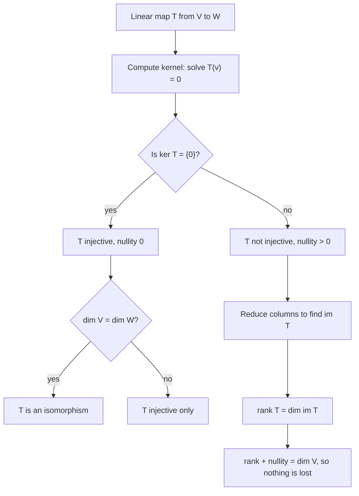

# Linear Transformations

> [Mathematics](../../README.md) › [Linear Algebra](../README.md) · Level: Advanced · Prerequisites: [Vectors](../01-vectors/README.md), [Systems of Linear Equations](../03-systems-of-linear-equations/README.md), [Proof Techniques](../../00-foundations/04-proof-techniques/README.md) · Estimated time: 660 min

## 1. Introduction

A **linear transformation** is a map between vector spaces that respects the two operations a vector
space is built from: adding vectors and multiplying them by scalars. Nothing more is asked, and that
single requirement turns out to be extraordinarily strong.

Take a map $T : \mathbb{R}^2 \to \mathbb{R}^2$. The requirements are
$T(\mathbf{u} + \mathbf{v}) = T(\mathbf{u}) + T(\mathbf{v})$ and $T(c\mathbf{u}) = c\,T(\mathbf{u})$.
Suppose you know only where $T$ sends the two standard basis vectors, say
$T(\mathbf{e}_1) = (2,1)$ and $T(\mathbf{e}_2) = (-1,3)$. Then for $(x,y) = x\mathbf{e}_1 + y\mathbf{e}_2$
the axioms force

$$
T(x,y) = x\,T(\mathbf{e}_1) + y\,T(\mathbf{e}_2) = x(2,1) + y(-1,3) = (2x - y,\ x + 3y)
= \begin{pmatrix} 2 & -1 \\ 1 & 3 \end{pmatrix}\begin{pmatrix} x \\ y \end{pmatrix}.
$$

Two vectors' worth of information determined the map on all uncountably many points. This is the
characteristic behaviour of linearity: **a linear map has no freedom left once its values on a basis
are fixed** (§7.1). The matrix that appears is just those two images stacked side by side, and two
questions organise the whole topic.

* **Is every linear map a matrix?** For finite-dimensional spaces, yes: choose a basis of the domain
  and one of the codomain and every linear map becomes a rectangular array (§7.4). The array is not
  canonical — it depends on both bases — and how it changes when the bases change is §7.8.
* **What does a linear map do to structure?** It collapses some vectors to $\mathbf{0}$ (the
  **kernel**) and sweeps out a subspace elsewhere (the **image**). Both are subspaces, and
  rank–nullity (§7.6) says their dimensions add up to $\dim V$: every dimension of the domain is
  either destroyed or transported.

Why insist on linearity? A vector space has exactly two operations and a distinguished zero, and
everything else — span, independence, basis, dimension, coordinates — is *defined* from them. A map
preserving the two operations therefore preserves every derived notion automatically: it sends
subspaces to subspaces, lines through the origin to lines through the origin, and linear combinations
to linear combinations. A map failing either requirement destroys information that no later cleverness
recovers. Linear maps are the **homomorphisms** of vector spaces; the invertible ones are the
**isomorphisms**, and two spaces with an isomorphism between them are indistinguishable as vector
spaces.

Linearity is also why linear algebra is computable. An arbitrary function of $\mathbb{R}^n$ cannot be
stored, but a linear map needs only $mn$ numbers. Rotations, reflections, projections, shears,
differentiation of polynomials, integration, transposition, expectation, and the discrete Fourier
transform are all linear, which is why one theory covers graphics, differential equations, quantum
mechanics and signal processing.

**What is new here.** [Systems of Linear Equations](../03-systems-of-linear-equations/README.md)
studied maps $\mathbf{x} \mapsto A\mathbf{x}$ without naming them, and
[Vectors](../01-vectors/README.md) studied arrows. Here the map itself becomes the object: linearity is
defined without coordinates, kernel and image are defined abstractly, rank–nullity is proved for
abstract spaces, and the matrix is *derived* as a coordinate description. The final sections specialise
to the plane, where rotation, reflection, projection, shear and scaling can be drawn.

## 2. Prerequisites

**Vectors in $\mathbb{R}^n$.** Componentwise addition, scaling, and their geometry. See
[Vectors](../01-vectors/README.md).

**Matrices and the product $A\mathbf{x}$.** How a matrix acts on a column, matrix multiplication,
inverses, and row reduction as a working tool: see
[Systems of Linear Equations](../03-systems-of-linear-equations/README.md).

**Independence, span, basis, dimension.** Defined again in §5 (Definitions 5.2 and 5.3) for
self-containedness, but used constantly; the full treatment belongs to the vector spaces topic of this
discipline. A reader meeting them first here should read those definitions twice and do the Beginner
exercises before continuing.

**Functions, images, preimages, injectivity, surjectivity, bijectivity.** See
[Relations and Functions](../../00-foundations/05-relations-and-functions/README.md).

**Proof technique.** Direct proof, cycles of implications for an equivalence, two inclusions for a set
equality, and induction. Each proof below names its pattern. See
[Proof Techniques](../../00-foundations/04-proof-techniques/README.md).

**Notation.** Sums, the Kronecker delta $\delta_{ij}$, and vector and matrix conventions are collected
in [Mathematical Notation](../../MATHEMATICAL_NOTATION.md).

## 3. Learning Objectives

By the end of this tutorial you will be able to

1. state the definition of a linear map and test a formula for linearity in one line;
2. prove $T(\mathbf{0}) = \mathbf{0}$ and $T(-\mathbf{v}) = -T(\mathbf{v})$, and derive
   $T(\sum_j c_j\mathbf{v}_j) = \sum_j c_jT(\mathbf{v}_j)$;
3. explain why linearity is exactly the condition that preserves every notion derived from the axioms;
4. compute kernel and image and write each as the span of an explicit basis;
5. prove that kernel and image are subspaces and that $T$ is injective iff $\ker T = \{\mathbf{0}\}$;
6. state and prove rank–nullity and use it to decide injectivity and surjectivity;
7. build the matrix $[T]_C^B$ of a map relative to two bases and prove $[T(\mathbf{v})]_C = [T]_C^B[\mathbf{v}]_B$;
8. prove that every linear map between finite-dimensional spaces is a matrix and that $\dim\mathcal{L}(V,W) = (\dim V)(\dim W)$;
9. prove that composition corresponds to matrix multiplication, in the correct order;
10. compute change-of-basis matrices, prove $[T]_{B'} = P^{-1}[T]_BP$, and list what similarity preserves;
11. recognise rotation, reflection, projection, shear and scaling matrices and read geometry off a matrix;
12. model graphics, control systems, differential operators and data transformations with linear maps.

## 4. Intuition

**The rubber-sheet picture.** Draw the integer grid on a rubber sheet and pin the corners of the unit
square anywhere you like, then let the sheet stretch so that every grid line stays straight and evenly
spaced. That is the image of the grid under a linear map. Two things are forbidden: bending a grid line,
and letting the spacing vary along one. Curvature and uneven spacing are exactly what linearity excludes.

Three consequences are visible and each becomes a theorem. The origin cannot move, since
$T(\mathbf{0}) = T(0\cdot\mathbf{0}) = 0\cdot T(\mathbf{0}) = \mathbf{0}$. A line through the origin
stays one, since $t\mathbf{v}$ goes to $tT(\mathbf{v})$. Midpoints stay midpoints, since $T$ commutes
with every weighted average: a linear map distorts space by the same rule everywhere.

**Superposition.** Engineers call the two axioms *superposition*: the response to a sum of inputs is the
sum of responses, and the response to a scaled input is the scaled response. Resistor networks, springs
in their linear regime, and the wave equation obey it, which is why they are analysed with linear algebra.

**What linearity is not.** The commonest confusion is to hear "linear" and think "straight-line graph".
The map $f(x) = x + 1$ has a straight-line graph but is not linear, because $f(0) = 1 \neq 0$; maps
$x \mapsto ax + b$ with $b \neq 0$ are **affine**, not linear. Likewise $x \mapsto x^2$ fails
$(x+y)^2 = x^2 + y^2$ and $x \mapsto \lvert x\rvert$ fails scaling by $-1$. Note also that a nonzero
linear map is unbounded: $T(n\mathbf{v}) = nT(\mathbf{v})$ grows without limit. "Linear" never means
"grows slowly".

**The kernel is the blind spot.** A map can lose information; whatever goes to $\mathbf{0}$ is invisible,
and two inputs with the same output differ by something invisible. Hence the kernel measures failure of
injectivity (§7.3) and its dimension measures how much of the domain is destroyed. The image measures
how much of the codomain is reached. Rank–nullity is the accounting identity: destroyed plus
transported equals total.

**Bases are a choice of language.** A matrix description needs a basis in the domain and one in the
codomain — a language for inputs and outputs. Change the language and the matrix changes while the map
does not; two matrices describing the same map in different languages are **similar** (§7.8), and the
sensible questions about a map are exactly those whose answers survive similarity.

## 5. Formal Definition

Throughout, $K$ is a field; take $K = \mathbb{R}$ everywhere. No proof uses anything about
$\mathbb{R}$ beyond the field axioms, so all results hold over $\mathbb{C}$, $\mathbb{Q}$ and
$\mathbb{F}_p$ too. A **field** is a set with two operations, $+$ and $\cdot$, such that $(K,+)$ and
$(K \setminus \{0\}, \cdot)$ are abelian groups with identities $0 \neq 1$ and
$a(b+c) = ab + ac$.

**Definition 5.1 (Vector space).** A **vector space over $K$** is a set $V$ with operations
$+ : V\times V \to V$ and $\cdot : K\times V \to V$ such that, for all
$\mathbf{u},\mathbf{v},\mathbf{w} \in V$ and $a,b \in K$: addition is associative and commutative, has a
zero $\mathbf{0}$ and additive inverses $-\mathbf{v}$; $1\cdot\mathbf{v} = \mathbf{v}$ and
$a\cdot(b\cdot\mathbf{v}) = (ab)\cdot\mathbf{v}$; and the two distributive laws
$a(\mathbf{u}+\mathbf{v}) = a\mathbf{u}+a\mathbf{v}$ and $(a+b)\mathbf{v} = a\mathbf{v}+b\mathbf{v}$
hold. The elements of $V$ are **vectors**, those of $K$ **scalars**. We write $a\mathbf{v}$ for
$a\cdot\mathbf{v}$ and $\mathbf{u}-\mathbf{v}$ for $\mathbf{u}+(-\mathbf{v})$.

**Definition 5.2 (Subspace).** A subset $U \subseteq V$ is a **subspace** if it is a vector space under
the inherited operations. The **subspace criterion**: $U$ is a subspace if and only if
$U \neq \varnothing$ and $a\mathbf{u} + b\mathbf{w} \in U$ for all $\mathbf{u},\mathbf{w} \in U$ and
$a,b \in K$. *Proof:* if $U$ is a subspace it contains some $\mathbf{u}$, hence $0\mathbf{u} =
\mathbf{0} \in U$, and is closed under both operations. Conversely the criterion gives closure under
$+$ (take $a=b=1$) and under scaling (take $b=0$), and the eight axioms are inherited from $V$.
$\square$ In particular $\{\mathbf{0}\}$ and $V$ are subspaces.

**Definition 5.3 (Span, independence, basis, dimension).** For $S \subseteq V$,
$\operatorname{span} S = \{\sum_{j=1}^{k} c_j\mathbf{v}_j : k \ge 0,\ c_j \in K,\ \mathbf{v}_j \in S\}$
is the smallest subspace containing $S$. A list $\mathbf{v}_1,\dots,\mathbf{v}_k$ is **linearly
independent** if $\sum_j c_j\mathbf{v}_j = \mathbf{0}$ forces all $c_j = 0$, and **dependent** otherwise.
An ordered list $B = (\mathbf{b}_1,\dots,\mathbf{b}_n)$ is a **basis** of $V$ if it is independent and
spans $V$; then every $\mathbf{v}$ has exactly one expansion $\mathbf{v} = \sum_j x_j\mathbf{b}_j$.
Uniqueness holds because a second expansion would give $\sum_j (x_j - y_j)\mathbf{b}_j = \mathbf{0}$,
forcing $x_j = y_j$. The **dimension** $\dim V$ is the length of any basis (well defined; this is
proved in the vector spaces topic), and $\dim\{\mathbf{0}\} = 0$.

We use the **basis extension lemma**: a linearly independent list $\mathbf{v}_1,\dots,\mathbf{v}_k$ in a
finite-dimensional $V$ extends to a basis. (If the list spans, stop; otherwise add a vector outside its
span, which keeps independence, and repeat; the process stops because no independent list is longer
than a basis.)

**Definition 5.4 (Linear transformation).** For vector spaces $V, W$ over $K$, a map $T : V \to W$ is
**linear** if
$T(\mathbf{u}+\mathbf{v}) = T(\mathbf{u})+T(\mathbf{v})$ and $T(a\mathbf{v}) = aT(\mathbf{v})$ for all
$\mathbf{u},\mathbf{v} \in V$, $a \in K$. Equivalently $T(a\mathbf{u}+b\mathbf{v}) = aT(\mathbf{u}) +
bT(\mathbf{v})$: the first form implies it by applying the two rules in turn, and the second implies the
first by taking $a=b=1$, respectively $b=0$. Induction on $k$ gives

$$
T\left(\sum_{j=1}^{k} c_j\mathbf{v}_j\right) = \sum_{j=1}^{k} c_j\,T(\mathbf{v}_j)
\tag{5.1}
$$

for every finite linear combination. We write $\mathcal{L}(V,W)$ for the set of linear maps $V \to W$ and
$\mathcal{L}(V) = \mathcal{L}(V,V)$.

**Definition 5.5 (Kernel, image, rank, nullity).** For linear $T : V \to W$,
$\ker T = \{\mathbf{v} \in V : T(\mathbf{v}) = \mathbf{0}_W\}$ and
$\operatorname{im} T = \{T(\mathbf{v}) : \mathbf{v} \in V\} \subseteq W$. The **nullity** is
$\dim(\ker T)$ and the **rank** is $\dim(\operatorname{im} T)$.

**Definition 5.6 (Isomorphism).** A linear map is an **isomorphism** if it is bijective, and
$V \cong W$ means that an isomorphism $V \to W$ exists.

**Definition 5.7 (Coordinates and the matrix of a map).** For an ordered basis
$B = (\mathbf{b}_1,\dots,\mathbf{b}_n)$ of $V$ and $\mathbf{v} = \sum_j x_j\mathbf{b}_j$, the
**coordinate vector** is $[\mathbf{v}]_B = (x_1,\dots,x_n)^{\mathsf{T}} \in K^n$. For an ordered basis
$C = (\mathbf{c}_1,\dots,\mathbf{c}_m)$ of $W$, the **matrix of $T$ relative to $B$ and $C$** is the
$m\times n$ matrix $[T]_C^B = (a_{ij})$ defined by $T(\mathbf{b}_j) = \sum_{i=1}^{m} a_{ij}\mathbf{c}_i$.
Its $j$-th column is thus $[T(\mathbf{b}_j)]_C$. When $V = W$ and $B = C$ we write $[T]_B$.

**Definition 5.8 (Similarity).** $A, B \in M_n(K)$ are **similar** if $B = P^{-1}AP$ for some invertible
$P$.

**Example 5.9 (Linear maps).** The zero map; the identity $\operatorname{id}_V$; scaling
$\mathbf{v} \mapsto \lambda\mathbf{v}$; matrix maps $\mathbf{x} \mapsto A\mathbf{x}$ (by Theorem 7.9,
these are all linear maps between finite-dimensional spaces, up to choice of bases); rotation and
reflection of the plane (§7.9); differentiation $D : \mathcal{P}_n \to \mathcal{P}_n$, since
$(p+q)' = p'+q'$; definite integration $p \mapsto \int_0^1 p$; transpose and trace on $M_n(K)$;
evaluation $p \mapsto p(a)$; expectation of a random variable; and the shift
$S(x_1,x_2,\dots) = (0,x_1,x_2,\dots)$ on real sequences.

**Example 5.10 (Non-linear maps).** Each fails one axiom, exhibited by one pair of inputs:
$x \mapsto x+1$ has $f(0) = 1 \neq 0$; $x \mapsto x^2$ has $(1+1)^2 \neq 1^2+1^2$;
$x \mapsto \lvert x\rvert$ has $\lvert -1\rvert \neq -\lvert 1\rvert$; $(x,y) \mapsto (xy,0)$ has
$(2,2) \mapsto (4,0) \neq 2(1,0)$; and $\mathbf{v} \mapsto \lVert\mathbf{v}\rVert$ has
$\lVert-\mathbf{v}\rVert = \lVert\mathbf{v}\rVert \neq -\lVert\mathbf{v}\rVert$ unless
$\mathbf{v} = \mathbf{0}$.

## 6. Mathematical Notation

| Symbol | Read as | Meaning |
|---|---|---|
| $K$ | the field | scalars; take $K = \mathbb{R}$ unless stated |
| $V, W, U$ | vector spaces over $K$ | domain, codomain, intermediate space |
| $T : V \to W$ | $T$ from $V$ to $W$ | a map with domain $V$ and codomain $W$ |
| $\mathbf{0}_V$ | zero vector of $V$ | written $\mathbf{0}$ when the space is clear |
| $\operatorname{id}_V$ | identity on $V$ | $\mathbf{v} \mapsto \mathbf{v}$ |
| $\ker T$ | kernel of $T$ | $\{\mathbf{v} : T(\mathbf{v}) = \mathbf{0}\}$ |
| $\operatorname{im} T$ | image of $T$ | $\{T(\mathbf{v}) : \mathbf{v} \in V\}$ |
| $\operatorname{rank} T$, $\operatorname{nullity} T$ | rank, nullity | $\dim(\operatorname{im} T)$, $\dim(\ker T)$ |
| $T \circ S$ | $T$ composed with $S$ | $S$ acts first: $(T\circ S)(\mathbf{v}) = T(S(\mathbf{v}))$ |
| $T^{-1}$ | inverse of $T$ | exists iff $T$ is an isomorphism |
| $\mathcal{L}(V,W)$ | ell of $V$, $W$ | the set of linear maps $V \to W$ |
| $M_{m\times n}(K)$ | matrices $m$ by $n$ | rectangular arrays over $K$ |
| $B = (\mathbf{b}_1,\dots,\mathbf{b}_n)$ | basis $B$ | an *ordered* basis of $V$ |
| $[\mathbf{v}]_B$ | coordinates of $\mathbf{v}$ in $B$ | the column of coefficients |
| $[T]_C^B$ | matrix of $T$ | $j$-th column is $[T(\mathbf{b}_j)]_C$ |
| $P^{-1}AP$ | $P$ inverse $A$ $P$ | matrix of the same map in a new basis |
| $V \cong W$ | $V$ is isomorphic to $W$ | a bijective linear map exists |
| $T[S]$ | image of the set $S$ | $\{T(\mathbf{s}) : \mathbf{s} \in S\}$ |
| $\square$ | end of proof | the argument is complete |

## 7. Core Concepts

### 7.1 Linearity and the structure of a vector space

**Proposition 7.1 (Elementary consequences).** For linear $T : V \to W$: (1) $T(\mathbf{0}_V) = \mathbf{0}_W$;
(2) $T(-\mathbf{v}) = -T(\mathbf{v})$; (3) $T(\mathbf{u}-\mathbf{v}) = T(\mathbf{u})-T(\mathbf{v})$.

*Proof.* (1) From $\mathbf{0}+\mathbf{0} = \mathbf{0}$ we get $T(\mathbf{0}) = T(\mathbf{0})+T(\mathbf{0})$;
adding $-T(\mathbf{0})$ gives $\mathbf{0} = T(\mathbf{0})$. (2) $T(-\mathbf{v}) = T((-1)\mathbf{v}) =
(-1)T(\mathbf{v}) = -T(\mathbf{v})$. (3) Additivity together with (2). $\square$

Property (1) eliminates translations instantly: if $T(\mathbf{0}) \neq \mathbf{0}$ then $T$ is not linear.

**Theorem 7.2 (Determined on a basis).** If $T, S : V \to W$ are linear and $T(\mathbf{b}_j) =
S(\mathbf{b}_j)$ for every vector of a basis $B = (\mathbf{b}_1,\dots,\mathbf{b}_n)$, then $T = S$.

*Proof.* For $\mathbf{v} = \sum_j x_j\mathbf{b}_j$, (5.1) gives
$T(\mathbf{v}) = \sum_j x_jT(\mathbf{b}_j) = \sum_j x_jS(\mathbf{b}_j) = S(\mathbf{v})$. $\square$

**Theorem 7.3 (Extension from a basis).** Given a basis $B$ of $V$ and arbitrary vectors
$\mathbf{w}_1,\dots,\mathbf{w}_n \in W$, there is exactly one linear $T : V \to W$ with
$T(\mathbf{b}_j) = \mathbf{w}_j$.

*Proof.* **Existence:** define $T(\sum_j x_j\mathbf{b}_j) = \sum_j x_j\mathbf{w}_j$; this is well
defined because coordinates are unique, and linear because coordinates are linear in the coefficients
(additivity and homogeneity of the coefficient lists). **Uniqueness:** Theorem 7.2. $\square$

Theorem 7.3 is how linear maps are *constructed*: say where a basis goes, and the rest is forced. It is
also the honest source of counterexamples.

**Why linearity is exactly right.** Every notion in a vector space other than the two operations and
$\mathbf{0}$ is defined from them: a linear combination uses $+$ and $\cdot$, a span is a set of linear
combinations, independence is a statement about $\sum c_j\mathbf{v}_j = \mathbf{0}$, a basis is a
spanning independent list. Hence a map preserving $+$ and $\cdot$ preserves all of them as a
*consequence*: $T(\operatorname{span} S) = \operatorname{span} T[S]$ (Exercise 24), dependence is
transported forward and, when $T$ is injective, reflected backward, subspaces go to subspaces and
preimages of subspaces are subspaces (Exercise 25). Conversely, a map failing additivity already fails
to preserve the most elementary derived object, the span of two vectors. There is no weaker condition
that transports the theory, and no stronger one that is needed.

### 7.2 Kernel and image

**Theorem 7.4.** $\ker T$ is a subspace of $V$ and $\operatorname{im} T$ is a subspace of $W$.

*Proof.* $\mathbf{0}_V \in \ker T$ by Proposition 7.1, so the kernel is nonempty; if
$\mathbf{u},\mathbf{v} \in \ker T$ then $T(a\mathbf{u}+b\mathbf{v}) = aT(\mathbf{u})+bT(\mathbf{v}) =
\mathbf{0}$, so $a\mathbf{u}+b\mathbf{v} \in \ker T$. Also $\mathbf{0}_W = T(\mathbf{0}_V) \in
\operatorname{im} T$, and $aT(\mathbf{u}) + bT(\mathbf{v}) = T(a\mathbf{u}+b\mathbf{v}) \in
\operatorname{im} T$. The subspace criterion (Definition 5.2) applies in both cases. $\square$

**Proposition 7.5 (Fibres are translates of the kernel).** If $T(\mathbf{v}_0) = \mathbf{w}_0$ then
$T^{-1}(\mathbf{w}_0) = \mathbf{v}_0 + \ker T$.

*Proof.* If $T(\mathbf{v}) = \mathbf{w}_0$ then $T(\mathbf{v}-\mathbf{v}_0) = \mathbf{0}$, so
$\mathbf{v} = \mathbf{v}_0 + (\mathbf{v}-\mathbf{v}_0)$ with $\mathbf{v}-\mathbf{v}_0 \in \ker T$;
conversely $T(\mathbf{v}_0+\mathbf{h}) = \mathbf{w}_0$ for $\mathbf{h} \in \ker T$. $\square$

This is the abstract solution-set theorem of
[Systems of Linear Equations](../03-systems-of-linear-equations/README.md): the solutions of
$A\mathbf{x} = \mathbf{b}$ are one particular solution plus the null space. Exactly one fibre — the one
over $\mathbf{0}$ — is a subspace; the rest are parallel copies of it.

### 7.3 Injectivity is equivalent to a trivial kernel

**Theorem 7.6.** $T$ is injective if and only if $\ker T = \{\mathbf{0}_V\}$.

*Proof.* If $T$ is injective and $T(\mathbf{v}) = \mathbf{0} = T(\mathbf{0})$, then
$\mathbf{v} = \mathbf{0}$. Conversely, if the kernel is trivial and $T(\mathbf{u}) = T(\mathbf{v})$,
then $T(\mathbf{u}-\mathbf{v}) = \mathbf{0}$, so $\mathbf{u}-\mathbf{v} = \mathbf{0}$. $\square$

The theorem is special to linear maps: for a general function, one fibre says nothing about the others.
Linearity makes all fibres translates of a single one (Proposition 7.5), so one fibre controls them all.

### 7.4 The matrix of a map, and why every linear map is a matrix

**Lemma 7.7.** The coordinate map $\Phi_B : V \to K^n$, $\mathbf{v} \mapsto [\mathbf{v}]_B$, is a linear
bijection.

*Proof.* If $\mathbf{u} = \sum_j x_j\mathbf{b}_j$ and $\mathbf{v} = \sum_j y_j\mathbf{b}_j$ then
$\mathbf{u}+\mathbf{v} = \sum_j (x_j+y_j)\mathbf{b}_j$ and $c\mathbf{u} = \sum_j (cx_j)\mathbf{b}_j$, so
by uniqueness of coordinates $\Phi_B$ is linear. It is injective, since $[\mathbf{v}]_B = \mathbf{0}$
means $\mathbf{v} = \sum_j 0\cdot\mathbf{b}_j = \mathbf{0}$, and surjective, since
$(x_1,\dots,x_n)^{\mathsf{T}}$ is the image of $\sum_j x_j\mathbf{b}_j$. $\square$

**Theorem 7.8 (Matrix representation formula).** For every $\mathbf{v} \in V$,
$[T(\mathbf{v})]_C = [T]_C^B\,[\mathbf{v}]_B$.

*Proof.* Write $\mathbf{v} = \sum_j x_j\mathbf{b}_j$. By (5.1) and the definition of the matrix,

$$
T(\mathbf{v}) = \sum_{j=1}^{n} x_jT(\mathbf{b}_j)
= \sum_{j=1}^{n} x_j\sum_{i=1}^{m}a_{ij}\mathbf{c}_i
= \sum_{i=1}^{m}\Big(\sum_{j=1}^{n}a_{ij}x_j\Big)\mathbf{c}_i ,
$$

and the inner sum is the $i$-th entry of $[T]_C^B[\mathbf{v}]_B$. Coordinates in $C$ are unique, so the
$i$-th coordinate of $T(\mathbf{v})$ is exactly that entry. $\square$

The formula's two bases have different jobs: $B$ reads the input, $C$ writes the output.

**Theorem 7.9 (Every linear map is a matrix).** With $\dim V = n$, $\dim W = m$ and ordered bases
$B, C$ fixed, the map $\Phi : \mathcal{L}(V,W) \to M_{m\times n}(K)$, $T \mapsto [T]_C^B$, is a linear
bijection. Hence $\dim\mathcal{L}(V,W) = mn$.

*Proof.* **Linear:** for each $j$, using that coordinates are linear (Lemma 7.7),

$$
[(S+T)(\mathbf{b}_j)]_C = [S(\mathbf{b}_j)]_C + [T(\mathbf{b}_j)]_C ,
\qquad
[(aT)(\mathbf{b}_j)]_C = a[T(\mathbf{b}_j)]_C ,
$$

so columns — hence matrices — add and scale entrywise. **Injective:** if $[T]_C^B = 0$ then
$T(\mathbf{b}_j) = \mathbf{0}_W$ for all $j$, so $T = 0$ by Theorem 7.2. **Surjective:** given
$A = (a_{ij})$, put $\mathbf{w}_j = \sum_i a_{ij}\mathbf{c}_i$ and let $T$ be the linear map with
$T(\mathbf{b}_j) = \mathbf{w}_j$ (Theorem 7.3); then $[T]_C^B = A$ by construction. Finally
$\dim M_{m\times n}(K) = mn$, since the matrix units $E_{ij}$ form a basis. $\square$

Two lessons: "the matrix of $T$" is meaningless until the bases are named, and the set of linear maps is
itself a vector space — linear maps can be added and scaled, so they are vectors too.

### 7.5 Composition is matrix multiplication

**Theorem 7.10.** Let $S : U \to V$ and $T : V \to W$ be linear, with ordered bases $A, B, C$ of
$U, V, W$. Then $[T\circ S]_C^A = [T]_C^B\,[S]_B^A$.

*Proof.* For every $\mathbf{u} \in U$, Theorem 7.8 applied twice gives
$[(T\circ S)(\mathbf{u})]_C = [T]_C^B[S(\mathbf{u})]_B = [T]_C^B[S]_B^A[\mathbf{u}]_A$. Evaluating at
$\mathbf{u} = \mathbf{a}_j$ shows the $j$-th column of $[T\circ S]_C^A$ equals $[T]_C^B$ times the
$j$-th column of $[S]_B^A$, which is the definition of the matrix product; uniqueness of the
representing matrix (Theorem 7.9) finishes the argument. $\square$

**Corollary 7.11.** For square $T : V \to V$, $T$ is an isomorphism if and only if $[T]_B$ is
invertible, and then $[T^{-1}]_B = ([T]_B)^{-1}$.

*Proof.* If $T^{-1}T = \operatorname{id}_V = TT^{-1}$ then Theorem 7.10 gives
$[T^{-1}]_B[T]_B = I_n = [T]_B[T^{-1}]_B$. Conversely, if $A = [T]_B$ is invertible, let $S$ be the
linear map with $[S]_B = A^{-1}$ (Theorem 7.9); then $[S\circ T]_B = A^{-1}A = I_n =
[\operatorname{id}_V]_B$, so $S\circ T = \operatorname{id}_V$, and similarly $T\circ S =
\operatorname{id}_V$. $\square$

Since composition of maps is associative, Theorem 7.10 reproves associativity of matrix multiplication
without any index computation. It also explains the strange definition of the product: any other
formula would fail to represent composition.

### 7.6 The rank–nullity theorem

**Theorem 7.12 (Rank–nullity).** For finite-dimensional $V$ and linear $T : V \to W$,
$\dim V = \operatorname{nullity} T + \operatorname{rank} T$.

*Proof.* Let $k = \dim(\ker T)$, take a basis $\mathbf{u}_1,\dots,\mathbf{u}_k$ of $\ker T$ and extend
it to a basis $\mathbf{u}_1,\dots,\mathbf{u}_k,\mathbf{w}_1,\dots,\mathbf{w}_{n-k}$ of $V$, where
$n = \dim V$. We show that $T(\mathbf{w}_1),\dots,T(\mathbf{w}_{n-k})$ is a basis of
$\operatorname{im} T$.

*Spanning.* If $\mathbf{y} = T(\mathbf{v})$ and
$\mathbf{v} = \sum_i \alpha_i\mathbf{u}_i + \sum_j \beta_j\mathbf{w}_j$, then
$\mathbf{y} = \sum_j \beta_jT(\mathbf{w}_j)$, because $T(\mathbf{u}_i) = \mathbf{0}$.

*Independence.* If $\sum_j \beta_jT(\mathbf{w}_j) = \mathbf{0}$ then
$\mathbf{z} := \sum_j \beta_j\mathbf{w}_j \in \ker T$, so $\mathbf{z} = \sum_i \alpha_i\mathbf{u}_i$ for
some $\alpha_i$. Then $\sum_i \alpha_i\mathbf{u}_i - \sum_j \beta_j\mathbf{w}_j = \mathbf{0}$, and
independence of the full basis forces every $\alpha_i = \beta_j = 0$.

Hence $\operatorname{rank} T = n-k$, that is $n = \dim(\ker T) + \dim(\operatorname{im} T)$. $\square$

The proof is a recipe, not merely a formula: a basis of the kernel, extended, becomes a basis of the
image once the kernel part is dropped. Every computation in §9 implements this.

**Corollary 7.13.** Let $\dim V = n$ and $\dim W = m$, both finite. Then
(1) $0 \le \operatorname{rank} T \le \min(n,m)$;
(2) $T$ injective $\iff \operatorname{rank} T = n$;
(3) $T$ surjective $\iff \operatorname{rank} T = m$;
(4) if $n = m$ then injective $\iff$ surjective $\iff$ isomorphism.

*Proof.* (1) The image is a subspace of $W$, so its dimension is at most $m$; and
$\operatorname{rank} T = n - \operatorname{nullity} T \le n$. (2) Injectivity is
$\operatorname{nullity} T = 0$ (Theorem 7.6), i.e. $\operatorname{rank} T = n$. (3) Surjectivity is
$\operatorname{im} T = W$, i.e. $\operatorname{rank} T = m$. (4) When $n = m$ both conditions read
$\operatorname{rank} T = n$. $\square$

Part (4) is the workhorse of the subject: for square matrices "invertible", "columns independent",
"columns span" and "trivial null space" are one statement. It fails in infinite dimension (§7.7).

### 7.7 Isomorphisms and the dimension criterion

**Theorem 7.14 (Dimension criterion).** Two finite-dimensional spaces over the same field are isomorphic
if and only if they have the same dimension.

*Proof.* If $T : V \to W$ is an isomorphism, then $\ker T = \{\mathbf{0}\}$ and
$\operatorname{im} T = W$, so Theorem 7.12 gives $\dim V = 0 + \dim W$. Conversely, if
$\dim V = \dim W = n$, pick bases $B$ of $V$ and $C$ of $W$; the map
$\Phi_C^{-1}\circ\Phi_B : V \to W$ sends $\sum_j x_j\mathbf{b}_j$ to $\sum_j x_j\mathbf{c}_j$ and is a
linear bijection. $\square$

So every $n$-dimensional space over $K$ is $K^n$ in disguise, and proving a theorem for $K^n$ and
transferring it by coordinates loses nothing.

**Proposition 7.15 (Inverses of linear maps are linear).** If $T$ is a linear bijection then $T^{-1}$ is
linear.

*Proof.* Let $\mathbf{w}_i = T(\mathbf{v}_i)$ and $a,b \in K$. Then $T(a\mathbf{v}_1+b\mathbf{v}_2) =
a\mathbf{w}_1+b\mathbf{w}_2$, so $T^{-1}(a\mathbf{w}_1+b\mathbf{w}_2) = a\mathbf{v}_1+b\mathbf{v}_2 =
aT^{-1}(\mathbf{w}_1)+bT^{-1}(\mathbf{w}_2)$. $\square$

**Where the criterion breaks.** On the space of real sequences let $R(x_1,x_2,\dots) =
(0,x_1,x_2,\dots)$ and $L(x_1,x_2,\dots) = (x_2,x_3,\dots)$. Both are linear; $R$ is injective but not
surjective (its image is the subspace of sequences with first term $0$) and $L$ is surjective but not
injective ($\ker L = \{(c,0,0,\dots)\}$). Also $L\circ R = \operatorname{id}$ while
$R\circ L \neq \operatorname{id}$. Every "square $\Rightarrow$ injective or surjective" argument
silently uses finite dimension.

### 7.8 Change of basis and similar matrices

For ordered bases $B = (\mathbf{b}_1,\dots,\mathbf{b}_n)$ and $B' = (\mathbf{b}'_1,\dots,\mathbf{b}'_n)$
of $V$, the **change-of-basis matrix** from $B'$ to $B$ is $P = [\operatorname{id}_V]_B^{B'}$, whose
$j$-th column is $[\mathbf{b}'_j]_B$: the new basis vectors written in the old basis. It is invertible,
with $P^{-1} = [\operatorname{id}_V]_{B'}^B$ by Corollary 7.11.

**Lemma 7.16.** For every $\mathbf{v} \in V$, $[\mathbf{v}]_B = P[\mathbf{v}]_{B'}$.

*Proof.* Write $\mathbf{v} = \sum_j x'_j\mathbf{b}'_j$ and apply the linear map $\Phi_B$:
$[\mathbf{v}]_B = \sum_j x'_j[\mathbf{b}'_j]_B = P[\mathbf{v}]_{B'}$. $\square$

**Theorem 7.17 (Similarity formula).** With $P = [\operatorname{id}_V]_B^{B'}$,
$[T]_{B'} = P^{-1}[T]_B\,P$.

*Proof.* Factor $T = \operatorname{id}_V\circ T\circ\operatorname{id}_V$ and apply Theorem 7.10 with the
right identity written from $B'$ to $B$ and the left identity from $B$ to $B'$:
$[T]_{B'} = [\operatorname{id}_V]_B^{B'}[T]_B[\operatorname{id}_V]_{B'}^B = P^{-1}[T]_BP$. $\square$

**Proposition 7.18.** Similarity is an equivalence relation on $M_n(K)$.

*Proof.* Reflexive: $A = I^{-1}AI$. Symmetric: $B = P^{-1}AP$ gives $A = (P^{-1})^{-1}BP^{-1}$.
Transitive: $B = P^{-1}AP$ and $C = Q^{-1}BQ$ give $C = (PQ)^{-1}A(PQ)$. $\square$

**Proposition 7.19 (Similarity invariants).** Similar matrices have equal trace, equal rank and equal
determinant.

*Proof.* Trace: $\operatorname{tr}(XY) = \sum_{i,j}x_{ij}y_{ji} = \operatorname{tr}(YX)$, so
$\operatorname{tr}(P^{-1}AP) = \operatorname{tr}(APP^{-1}) = \operatorname{tr}A$. Rank: multiplying by
an invertible matrix is an isomorphism on columns, so rank is unchanged, and
$\operatorname{rank}(AQ) = \operatorname{rank}((AQ)^{\mathsf{T}}) =
\operatorname{rank}(Q^{\mathsf{T}}A^{\mathsf{T}}) = \operatorname{rank}(A^{\mathsf{T}}) =
\operatorname{rank}(A)$. Determinant: $\det(P^{-1}AP) = \det(P)^{-1}\det(A)\det(P) = \det A$, using
multiplicativity of the determinant, proved in the determinants topic of this discipline. $\square$

Trace, rank and determinant therefore belong to the *map*, not to a matrix chosen for it — which is why
they can be defined for an operator $T : V \to V$ with no basis in sight.

**Example 7.20 (One derivative, two matrices).** On $\mathcal{P}_2 = \operatorname{span}(1,x,x^2)$,
differentiation has $D(1) = 0$, $D(x) = 1$, $D(x^2) = 2x$, so in $B = (1,x,x^2)$,

$$
[D]_B = \begin{pmatrix} 0 & 1 & 0 \\ 0 & 0 & 2 \\ 0 & 0 & 0\end{pmatrix}.
$$

In $B' = (1,\,1+x,\,1+x+x^2)$ we need $D(1+x) = 1$ and $D(1+x+x^2) = 1+2x$, expressed in $B'$:
$1 = 1\cdot 1 + 0\cdot(1+x)+0\cdot(1+x+x^2)$ and $1+2x = (-1)\cdot 1 + 2\cdot(1+x) + 0\cdot(1+x+x^2)$.
Hence

$$
[D]_{B'} = \begin{pmatrix} 0 & 1 & -1 \\ 0 & 0 & 2 \\ 0 & 0 & 0\end{pmatrix},
$$

with the same trace $0$, rank $2$ and nullity $1$, as Proposition 7.19 and rank–nullity demand. Here
$P = [\operatorname{id}]_B^{B'}$ has columns $[1]_B = (1,0,0)^{\mathsf{T}}$,
$[1+x]_B = (1,1,0)^{\mathsf{T}}$, $[1+x+x^2]_B = (1,1,1)^{\mathsf{T}}$ — the new basis vectors written
in the old basis — and one checks $[D]_{B'} = P^{-1}[D]_BP$.

**Why change basis?** A good basis makes a matrix simple. The shear $\begin{pmatrix}1&1\\0&1\end{pmatrix}$
and the triangular matrix above are as simple as a non-diagonalisable map can be; a diagonal matrix is
as simple as any. "Which basis makes $T$ diagonal?" is the eigenvalue problem, a later topic here; all
we need now is that the question is well posed, since similarity preserves diagonalisability.

### 7.9 The geometry of linear maps of the plane

Every linear map $\mathbb{R}^2 \to \mathbb{R}^2$ is $\mathbf{x} \mapsto A\mathbf{x}$ for a unique
$2\times2$ matrix $A$, whose columns are the images of $\mathbf{e}_1$ and $\mathbf{e}_2$.

| Map | Matrix | Effect on the unit square | Kernel | Injective? |
|---|---|---|---|---|
| Identity | $\begin{pmatrix}1&0\\0&1\end{pmatrix}$ | fixed | $\{\mathbf{0}\}$ | yes |
| Scaling by $k \neq 0$ | $\begin{pmatrix}k&0\\0&k\end{pmatrix}$ | similar square, factor $k$ | $\{\mathbf{0}\}$ | yes |
| Rotation by $\theta$ | $\begin{pmatrix}\cos\theta&-\sin\theta\\ \sin\theta&\cos\theta\end{pmatrix}$ | rotated square | $\{\mathbf{0}\}$ | yes |
| Reflection, angle $\theta$ | $\begin{pmatrix}\cos2\theta&\sin2\theta\\ \sin2\theta&-\cos2\theta\end{pmatrix}$ | mirrored square | $\{\mathbf{0}\}$ | yes |
| Projection, angle $\theta$ | $\begin{pmatrix}c^2&cs\\ cs&s^2\end{pmatrix}$ | squashed to a segment | perpendicular line | no |
| Horizontal shear | $\begin{pmatrix}1&k\\0&1\end{pmatrix}$ | parallelogram, same area | $\{\mathbf{0}\}$ | yes |

Here $c = \cos\theta$ and $s = \sin\theta$.

**Rotation.** Counter-clockwise rotation $R_\theta$ sends $\mathbf{e}_1 \mapsto (\cos\theta,\sin\theta)$
and $\mathbf{e}_2 \mapsto (-\sin\theta,\cos\theta)$, both read off the unit circle, so
$R_\theta = \begin{pmatrix}\cos\theta&-\sin\theta\\ \sin\theta&\cos\theta\end{pmatrix}$.

**Proposition 7.21.** $R_\alpha R_\beta = R_{\alpha+\beta}$ and $R_\theta^{-1} = R_{-\theta}$.

*Proof.* Multiplying the two matrices and using the addition formulas (see
[Trigonometric Identities](../../05-trigonometry/03-trigonometric-identities/README.md)) gives
entries $\cos\alpha\cos\beta - \sin\alpha\sin\beta = \cos(\alpha+\beta)$ and
$\sin\alpha\cos\beta + \cos\alpha\sin\beta = \sin(\alpha+\beta)$ in the first column, and
$-\cos\alpha\sin\beta-\sin\alpha\cos\beta = -\sin(\alpha+\beta)$,
$-\sin\alpha\sin\beta+\cos\alpha\cos\beta = \cos(\alpha+\beta)$ in the second. Taking $\beta = -\theta$
gives $R_\theta R_{-\theta} = R_0 = I$. $\square$

**Reflection.** Reflection in the line at angle $\theta$ fixes $(\cos\theta,\sin\theta)$ and negates
$(-\sin\theta,\cos\theta)$, so its matrix is
$M_\theta = R_\theta\operatorname{diag}(1,-1)R_{-\theta} =
\begin{pmatrix}\cos2\theta&\sin2\theta\\ \sin2\theta&-\cos2\theta\end{pmatrix}$. The familiar cases
follow: $\theta=0$ is the $x$-axis, $\theta = \pi/4$ is $y = x$, and $\theta = \pi/2$ is the $y$-axis.

**Proposition 7.22.** $M_\alpha M_\beta = R_{2(\alpha-\beta)}$; in particular $M_\alpha^2 = I$.

*Proof.* Multiplying and using the double-angle identities
$\cos2\alpha\cos2\beta+\sin2\alpha\sin2\beta = \cos 2(\alpha-\beta)$ and
$\sin2\alpha\cos2\beta-\cos2\alpha\sin2\beta = \sin2(\alpha-\beta)$ gives $R_{2(\alpha-\beta)}$. Setting
$\alpha = \beta$ gives the identity. $\square$

**Projection.** The orthogonal projection onto the line spanned by the unit vector
$\mathbf{u} = (\cos\theta,\sin\theta)$ is $\mathbf{x} \mapsto (\mathbf{x}\cdot\mathbf{u})\mathbf{u}$,
linear because the dot product is linear in each argument, with matrix
$P_\theta = \mathbf{u}\mathbf{u}^{\mathsf{T}} = \begin{pmatrix}c^2&cs\\ cs&s^2\end{pmatrix}$. Its kernel
is the perpendicular line, its image the line $\operatorname{span}\mathbf{u}$, and
$\operatorname{rank} + \operatorname{nullity} = 1+1 = 2$. It is idempotent ($P_\theta^2 = P_\theta$) and
symmetric ($P_\theta^{\mathsf{T}} = P_\theta$), and among plane maps of rank $1$ those two properties
characterise orthogonal projection onto the image line.

**Shear.** $S_k = \begin{pmatrix}1&k\\0&1\end{pmatrix}$ fixes the $x$-axis pointwise and slides each
horizontal line sideways in proportion to its height; $S_k^{-1} = S_{-k}$. It is the standard example of
a map that is triangular but not diagonal in the standard basis.

**Area.** Rotation and reflection preserve area, shear preserves area, projection destroys it and
scaling by $k$ multiplies it by $k^2$. The signed factor — negative when orientation reverses, as for a
reflection — is the **determinant**, the subject of the next topic in this discipline. That one number
controls area for *all* shapes simultaneously is a consequence of linearity, and it is why determinants
are computable at all.

## 8. Formulas and Properties

| Name | Statement | Where proved |
|---|---|---|
| Extension from a basis | values on a basis determine a unique linear map | Theorem 7.3 |
| Dimension of $\mathcal{L}(V,W)$ | $\dim\mathcal{L}(V,W) = (\dim V)(\dim W)$ | Theorem 7.9 |
| Representation formula | $[T(\mathbf{v})]_C = [T]_C^B[\mathbf{v}]_B$ | Theorem 7.8 |
| Composition | $[T\circ S]_C^A = [T]_C^B[S]_B^A$ | Theorem 7.10 |
| Inverse | $[T^{-1}]_B = ([T]_B)^{-1}$ when $T$ is invertible | Corollary 7.11 |
| Rank–nullity | $\dim V = \operatorname{nullity} T + \operatorname{rank} T$ | Theorem 7.12 |
| Injectivity test | $T$ injective $\iff \ker T = \{\mathbf{0}\} \iff \operatorname{rank} T = \dim V$ | Theorems 7.6, 7.12 |
| Surjectivity test | $T$ surjective $\iff \operatorname{rank} T = \dim W$ | Corollary 7.13 |
| Square case | $\dim V = \dim W \Rightarrow$ injective $\iff$ surjective $\iff$ isomorphism | Corollary 7.13 |
| Change of basis | $[T]_{B'} = P^{-1}[T]_BP$ with $P = [\operatorname{id}]_B^{B'}$ | Theorem 7.17 |
| Similarity invariants | trace, rank and determinant are unchanged by conjugation | Proposition 7.19 |

Three further properties are used so often that they are stated here with proofs.

**Proposition 8.1 (Rank of a composite).** For linear maps $S : U \to V$ and $T : V \to W$ with $U$
finite-dimensional, $\operatorname{rank}(T\circ S) \le \min\{\operatorname{rank}S,
\operatorname{rank}T\}$.

*Proof.* $\operatorname{im}(T\circ S) = T(\operatorname{im}S) \subseteq T(V) = \operatorname{im}T$, so
the rank of the composite is at most $\operatorname{rank}T$. Also $T(\operatorname{im}S)$ is the image
of the subspace $\operatorname{im}S$ under a linear map, so its dimension is at most
$\dim(\operatorname{im}S) = \operatorname{rank}S$. $\square$

**Proposition 8.2 (Nesting).** $\ker S \subseteq \ker(T\circ S)$ and
$\operatorname{im}(T\circ S) \subseteq \operatorname{im}T$.

*Proof.* If $S(\mathbf{u}) = \mathbf{0}$ then $T(S(\mathbf{u})) = T(\mathbf{0}) = \mathbf{0}$; and every
vector of the form $T(S(\mathbf{u}))$ is of the form $T(\mathbf{v})$. $\square$

**Proposition 8.3 (Idempotents split the space).** If $T : V \to V$ is linear with $T^2 = T$ and $V$ is
finite-dimensional, then $V = \ker T \oplus \operatorname{im}T$, meaning every $\mathbf{v}$ is uniquely
$\mathbf{h} + T(\mathbf{u})$ with $\mathbf{h} \in \ker T$.

*Proof.* For $\mathbf{v} \in V$ write $\mathbf{v} = \big(\mathbf{v} - T(\mathbf{v})\big) + T(\mathbf{v})$.
The second summand lies in $\operatorname{im}T$, and $T\big(\mathbf{v}-T(\mathbf{v})\big) =
T(\mathbf{v}) - T^2(\mathbf{v}) = \mathbf{0}$, so the first lies in $\ker T$. If
$\mathbf{w} \in \ker T \cap \operatorname{im}T$, say $\mathbf{w} = T(\mathbf{u})$ with
$T(\mathbf{w}) = \mathbf{0}$, then $\mathbf{w} = T(\mathbf{u}) = T^2(\mathbf{u}) = T(\mathbf{w}) =
\mathbf{0}$; so the two subspaces meet only at $\mathbf{0}$ and the decomposition is unique. $\square$

## 9. Step-by-Step Examples

### Example 1 — Testing linearity

Decide which maps are linear: (a) $T(x,y) = (2x,\ y - x)$; (b) $S(x,y) = (x+1,\ y)$;
(c) $P(x,y) = (xy,\ 0)$; (d) $N(x,y) = (x^2,\ y)$.

(a) is linear: both components are homogeneous polynomials of degree $1$ with no constant term, so
$T(a\mathbf{u}+b\mathbf{v}) = aT(\mathbf{u})+bT(\mathbf{v})$ holds entrywise. (b) is not, because
$S(0,0) = (1,0) \neq (0,0)$. (c) is not: $P(1,1)+P(1,1) = (2,0)$ while $P(2,2) = (4,0)$. (d) is not:
$N(1,0)+N(1,0) = (2,0)$ while $N(2,0) = (4,0)$. The quickest first test is always $T(\mathbf{0}) =
\mathbf{0}$; it settles (b) at once, and the second-quickest is a single failed distributive identity.

### Example 2 — Kernel and image of a $3\times4$ map

For $A = \begin{pmatrix}1&2&0&1\\ 0&1&1&1\\ 1&1&-1&0\end{pmatrix}$, find bases of $\ker T_A$ and
$\operatorname{im}T_A$ and check rank–nullity.

Row reduction: $R_3 \leftarrow R_3 - R_1$ gives $(0,-1,-1,-1)$; $R_3 \leftarrow R_3 + R_2$ gives a zero
row; then $R_1 \leftarrow R_1 - 2R_2$ gives

$$
\begin{pmatrix}1&0&-2&-1\\ 0&1&1&1\\ 0&0&0&0\end{pmatrix}.
$$

Pivots sit in columns $1$ and $2$, so $x_3 = s$ and $x_4 = t$ are free, and the rows give
$x_1 = 2s + t$, $x_2 = -s - t$. Hence

$$
\ker T_A = \operatorname{span}\{(2,-1,1,0)^{\mathsf{T}},\ (1,-1,0,1)^{\mathsf{T}}\}.
$$

The pivot columns of $A$ — the first and second — span the image, so
$\operatorname{im}T_A = \operatorname{span}\{(1,0,1)^{\mathsf{T}},\ (2,1,1)^{\mathsf{T}}\}$. Here
$\operatorname{rank} = 2$, $\operatorname{nullity} = 2$ and $\dim\mathbb{R}^4 = 4$, in agreement with
rank–nullity. *Check:* $A(2,-1,1,0)^{\mathsf{T}} = (2-2+0+0,\ 0-1+1+0,\ 2-1-1+0)^{\mathsf{T}} =
\mathbf{0}$ and $A(1,-1,0,1)^{\mathsf{T}} = (1-2+0+1,\ 0-1+0+1,\ 1-1+0+0)^{\mathsf{T}} = \mathbf{0}$.

### Example 3 — A map given on a basis

Let $T : \mathbb{R}^3 \to \mathbb{R}^3$ be linear with $T(\mathbf{e}_1) = (1,1,0)$,
$T(\mathbf{e}_2) = (0,1,1)$, $T(\mathbf{e}_3) = (1,2,1)$. Find its matrix, kernel, image and rank.

The matrix has those images as columns: $A = \begin{pmatrix}1&0&1\\ 1&1&2\\ 0&1&1\end{pmatrix}$. Reducing,
$R_2 \leftarrow R_2 - R_1$ gives $(0,1,1)$ and then $R_3 \leftarrow R_3 - R_2$ gives a zero row, so
$\operatorname{rank}A = 2$ and $\operatorname{nullity} = 3 - 2 = 1$. Solving $A\mathbf{x} = \mathbf{0}$
from the reduced form $\begin{pmatrix}1&0&1\\0&1&1\\0&0&0\end{pmatrix}$ gives
$x_1 = -x_3$, $x_2 = -x_3$, so
$\ker T = \operatorname{span}\{(-1,-1,1)^{\mathsf{T}}\}$, and
$\operatorname{im}T = \operatorname{span}\{(1,1,0)^{\mathsf{T}},\ (0,1,1)^{\mathsf{T}}\}$. *Check:*
$T(1,1,-1) = (1,1,0) + (0,1,1) - (1,2,1) = (0,0,0)$, and the third column is the sum of the first two —
visible in $A$ and predicted by $T(\mathbf{e}_3) = T(\mathbf{e}_1) + T(\mathbf{e}_2)$.

### Example 4 — Differentiation as a matrix

On $\mathcal{P}_3 = \operatorname{span}(1,x,x^2,x^3)$ with basis $B = (1,x,x^2,x^3)$, the derivative
sends $1 \mapsto 0$, $x \mapsto 1$, $x^2 \mapsto 2x$, $x^3 \mapsto 3x^2$. So

$$
[D]_B = \begin{pmatrix}0&1&0&0\\ 0&0&2&0\\ 0&0&0&3\\ 0&0&0&0\end{pmatrix}.
$$

For $p = 3 - 2x + x^2$ the coordinate column is $(3,-2,1,0)^{\mathsf{T}}$ and
$[Dp]_B = [D]_B(3,-2,1,0)^{\mathsf{T}} = (-2,2,0,0)^{\mathsf{T}}$, i.e. $p' = -2 + 2x$, as expected. The
kernel is $\operatorname{span}\{1\}$ (constants), the image is
$\operatorname{span}\{1,x,x^2\}$ (polynomials of degree $\le 2$), and $1 + 3 = 4 = \dim\mathcal{P}_3$.
Squaring the matrix gives $[D^2]_B = [D]_B^2$ with entries $2$ and $6$ in positions $(1,3)$ and
$(2,4)$, matching $(x^2)'' = 2$ and $(x^3)'' = 6x$.

### Example 5 — A matrix in a non-standard basis

Let $T(x,y) = (2x - y,\ x + 3y)$ and $B = (\mathbf{b}_1,\mathbf{b}_2)$ with $\mathbf{b}_1 = (1,2)$,
$\mathbf{b}_2 = (-1,1)$. Compute $[T]_B$ and verify the columns.

$T(\mathbf{b}_1) = (0,7)$. Solve $\alpha(1,2) + \beta(-1,1) = (0,7)$: subtracting gives $\alpha - \beta
= 0$, so $\alpha = \beta$ and $3\alpha = 7$, giving $(\tfrac73,\tfrac73)$. Next
$T(\mathbf{b}_2) = (-3,2)$: from $\alpha - \beta = -3$ and $2\alpha + \beta = 2$ we get
$3\alpha = -1$, so $\alpha = -\tfrac13$ and $\beta = \tfrac83$. Therefore

$$
[T]_B = \begin{pmatrix} \tfrac73 & -\tfrac13\\[2pt] \tfrac73 & \tfrac83\end{pmatrix}.
$$

*Check by the representation formula:* $[\mathbf{b}_1]_B = (1,0)^{\mathsf{T}}$ and
$[T]_B(1,0)^{\mathsf{T}} = (\tfrac73,\tfrac73)^{\mathsf{T}}$, which is $[T(\mathbf{b}_1)]_B$. The trace
is $\tfrac73+\tfrac83 = 5$, equal to $\operatorname{tr}\begin{pmatrix}2&-1\\1&3\end{pmatrix} = 5$, as
similarity requires.

### Example 6 — Change of basis

Take $A = \begin{pmatrix}3&1\\0&2\end{pmatrix}$, $P = \begin{pmatrix}1&1\\1&-1\end{pmatrix}$ and compute
$P^{-1}AP$.

First $\det P = -2$ and $P^{-1} = \tfrac12\begin{pmatrix}1&1\\1&-1\end{pmatrix} = P^{-1}$; indeed
$P^2 = 2I$, so $P^{-1} = \tfrac12P$. Then

$$
P^{-1}AP = \tfrac12\begin{pmatrix}1&1\\1&-1\end{pmatrix}\begin{pmatrix}3&1\\0&2\end{pmatrix}
\begin{pmatrix}1&1\\1&-1\end{pmatrix}
= \tfrac12\begin{pmatrix}3&3\\3&-1\end{pmatrix}\begin{pmatrix}1&1\\1&-1\end{pmatrix}
= \begin{pmatrix}3&0\\1&2\end{pmatrix}.
$$

*Check by columns:* the columns of $P$ are $\mathbf{b}_1 = (1,1)$ and $\mathbf{b}_2 = (1,-1)$, and
$A\mathbf{b}_1 = (4,2) = 3\mathbf{b}_1 + 1\mathbf{b}_2$, $A\mathbf{b}_2 = (2,-2) = 0\mathbf{b}_1 +
2\mathbf{b}_2$, which is exactly the column description of $\begin{pmatrix}3&0\\1&2\end{pmatrix}$.
Trace $5 = 5$ and rank $2 = 2$ in both descriptions.

### Example 7 — A composite of a rotation and a reflection

Let $F$ be reflection in the $x$-axis and $R$ rotation by $45^\circ$; compute $F\circ R$ and identify it.

$$
F R = \begin{pmatrix}1&0\\0&-1\end{pmatrix}
\begin{pmatrix}\tfrac{\sqrt2}{2}&-\tfrac{\sqrt2}{2}\\[2pt] \tfrac{\sqrt2}{2}&\tfrac{\sqrt2}{2}\end{pmatrix}
= \begin{pmatrix}\tfrac{\sqrt2}{2}&\tfrac{\sqrt2}{2}\\[2pt] \tfrac{\sqrt2}{2}&-\tfrac{\sqrt2}{2}\end{pmatrix}.
$$

This has the shape $\begin{pmatrix}\cos2\theta&\sin2\theta\\ \sin2\theta&-\cos2\theta\end{pmatrix}$ with
$2\theta = 45^\circ$, so $F\circ R$ is reflection in the line at angle $22.5^\circ$. *Check
geometrically:* the composite fixes no vector of the $x$-axis except $\mathbf{0}$ and must be an
orientation-reversing isometry fixing a line; the line it fixes is found by solving
$FR\mathbf{v} = \mathbf{v}$, which gives $y = (\sqrt2-1)x$, the line at $22.5^\circ$. Note $RF \neq FR$:
the other order gives $\begin{pmatrix}\tfrac{\sqrt2}{2}&-\tfrac{\sqrt2}{2}\\-\tfrac{\sqrt2}{2}&-\tfrac{\sqrt2}{2}\end{pmatrix}$,
a reflection in a different line, so composition of linear maps is not commutative.

### Example 8 — A family with a parameter

For which $t \in \mathbb{R}$ is $T_t(x,y,z) = (x + y,\ y + tz,\ x + ty + z)$ an isomorphism?

Suppose $T_t(x,y,z) = \mathbf{0}$. Then $x = -y$ and $y = -tz$, hence $x = tz$. The third equation
becomes $tz + t(-tz) + z = z(1 + t - t^2) = 0$. If $1 + t - t^2 \neq 0$ then $z = 0$, then $y = x = 0$,
so the kernel is trivial and $T_t$ is injective; by Corollary 7.13 it is then an isomorphism. If
$1 + t - t^2 = 0$, that is $t = \tfrac12(1 \pm \sqrt5)$, the vector $(t, -t, 1)$ is a nonzero kernel
vector and $T_t$ is not injective, hence not an isomorphism. So $T_t$ is an isomorphism
except for the two golden-ratio values $t = \tfrac12(1+\sqrt5)$ and $t = \tfrac12(1-\sqrt5)$.

## 10. Visual Explanations

The decision procedure below is the content of §7.3, §7.6 and Corollary 7.13, arranged in the order in
which one actually computes.

The same information can be read off one matrix: if $A$ is the matrix of $T$ in any bases, then
$\operatorname{rank}T = \operatorname{rank}A$ (row reduce), the number of non-pivot columns is the
nullity, and injectivity is "no free columns", surjectivity is "pivot in every row".

| Question about $T$ | Quantity to compute | Answer |
|---|---|---|
| Is $T$ injective? | $\ker T$ | yes $\iff$ kernel trivial |
| Is $T$ surjective? | $\operatorname{rank}T$ | yes $\iff \operatorname{rank}T = \dim W$ |
| Is $T$ an isomorphism? | both, or $\dim V = \dim W$ plus injectivity | yes by Corollary 7.13 |
| How much does $T$ destroy? | $\operatorname{nullity}T$ | number of free variables |
| What does $T$ do to a basis? | columns of $[T]_C^B$ | images in $C$-coordinates |
| How does $[T]$ change with the basis? | $P = [\operatorname{id}]_B^{B'}$ | $[T]_{B'} = P^{-1}[T]_BP$ |

## 11. Common Mistakes

**1. "Linear means the graph is a line."** The map $x \mapsto x+1$ has a line as graph and is not linear;
it is affine. Linearity is an algebraic condition on $+$ and $\cdot$, not a statement about shape.

**2. Testing linearity at one point.** Checking $T(\mathbf{0}) = \mathbf{0}$ only *rules out* maps; it
never proves linearity. Both axioms must be verified for arbitrary inputs and arbitrary scalars.

**3. Writing "the matrix of $T$" without naming bases.** The matrix depends on the basis of the domain
and the basis of the codomain. Two different bases give two different matrices, both correct.

**4. Using $\dim W$ in place of $\dim V$ in rank–nullity.** The correct identity is
$\dim V = \operatorname{nullity} + \operatorname{rank}$, with the dimension of the *domain* on the left.

**5. Concluding "not injective" from a nontrivial image.** Injectivity is decided by the kernel alone;
$\operatorname{im}T \neq W$ says $T$ is not surjective, which for square matrices is equivalent, but not
for rectangular ones.

**6. Confusing kernel with image.** The kernel lies in the domain, the image in the codomain. For
$T : \mathbb{R}^3 \to \mathbb{R}^2$ it is meaningless to ask whether $\ker T \subseteq \operatorname{im}T$.

**7. Reversing composition order.** $[T\circ S] = [T][S]$, not $[S][T]$: the right factor acts first.
Likewise $[T]_{B'} = P^{-1}[T]_BP$ and not $P[T]_BP^{-1}$.

**8. Assuming injective $\iff$ surjective always.** Corollary 7.13(4) needs
$\dim V = \dim W$; the shifts of §7.7 show the failure in infinite dimension.

**9. Thinking $T(A)$ is a subspace for an arbitrary set $A$.** Only the image of a *subspace* is a
subspace; the image of a circle under a shear is an ellipse, not a subspace.

**10. Believing similar matrices are equal.** Similar matrices have the same trace, rank and
determinant, but they are generally different matrices; $P^{-1}AP = A$ only for special $P$.

**11. Forgetting that the zero map is linear.** The map $\mathbf{v}\mapsto\mathbf{0}$ satisfies both
axioms and has kernel $V$; it is the extreme case of everything above.

**12. Treating "$T$ preserves independence" as automatic.** Linearity transports dependence forward, but
independence only when $T$ is injective: the zero map sends every independent set to $\{\mathbf{0}\}$.

## 12. Applications

**Computer graphics and robotics.** Every rotation, scale, shear and reflection of a 3-D scene is a
linear map, and every camera is a projective one. A sequence of $k$ transformations is applied as the
single matrix product $A_k\cdots A_1$, which is why graphics hardware multiplies $4\times4$ matrices
instead of transforming vertices one at a time. Robot arms use the same matrices for joint frames; the
linearisation of a nonlinear kinematic map is its Jacobian, a linear map at each configuration.

**Differential equations.** Differentiation and integration are linear operators on function spaces, so
the solution set of a homogeneous linear ODE $y' + p(x)y = 0$ is the kernel of a linear operator and is
therefore a subspace — for a second-order equation, a two-dimensional one. Superposition of solutions is
exactly additivity. The solution set of an inhomogeneous equation is a translate of that subspace
(Proposition 7.5), which is the abstract form of "particular plus complementary".

**Control theory and signal processing.** A linear system has state update $\mathbf{x}_{k+1} =
A\mathbf{x}_k + B\mathbf{u}_k$; the map $\mathbf{x}_k \mapsto \mathbf{x}_{k+1}$ is linear and its
rank–nullity and spectral properties decide controllability and stability. Filters, convolution and the
discrete Fourier transform are linear, so they are described by matrices and analysed by their kernels
and images.

**Data science.** Standardisation, whitening and principal component analysis are affine maps built from
linear ones; the kernel of a linear feature map is the set of directions the model cannot see, and the
rank is the number of independent features. Compression is rank reduction: keeping the largest directions
of the image and discarding the kernel.

**Quantum mechanics.** States are vectors in a complex vector space and observables are linear operators;
superposition is additivity, and the fact that a measurement collapses to an eigenvector is the statement
that the diagonalisation problem of §7.8 is physically meaningful.

**Economics and networks.** Leontief input–output models and Kirchhoff's laws are linear systems, hence
linear maps between commodity or current spaces; the rank counts independent constraints and the nullity
counts degrees of freedom, as in
[Systems of Linear Equations](../03-systems-of-linear-equations/README.md).

## 13. Exercises

The problem set is in [exercises.md](exercises.md): thirty-eight problems, graded from testing a formula
for linearity to constructing maps with prescribed kernel and image, and to proving the structure
theorems for idempotent and complex-structure operators.

## 14. Solutions

Complete worked solutions to every problem are in [solutions.md](solutions.md). Attempt each problem
first; reading a proof is not the same as being able to construct one.

## 15. Summary

* A linear map preserves the two operations of a vector space, and therefore every notion derived from
  them: spans, dependence, subspaces, lines through the origin.
* Linear maps send $\mathbf{0}$ to $\mathbf{0}$ and are determined by, and freely definable on, the
  values of a basis (Theorems 7.2 and 7.3).
* $\ker T$ and $\operatorname{im}T$ are subspaces; $T$ is injective exactly when $\ker T =
  \{\mathbf{0}\}$; all nonempty fibres are translates of the kernel.
* A choice of bases turns each linear map into a matrix, and the correspondence
  $T \mapsto [T]_C^B$ is a linear bijection onto $M_{m\times n}(K)$, so
  $\dim\mathcal{L}(V,W) = mn$.
* Composition corresponds to matrix multiplication in the order $[T\circ S] = [T][S]$, and inverses
  correspond to inverses.
* Rank–nullity, $\dim V = \operatorname{nullity} + \operatorname{rank}$, is proved by extending a basis
  of the kernel to a basis of $V$; it controls injectivity and surjectivity.
* For $\dim V = \dim W$, injective, surjective and isomorphism are the same; in infinite dimension they
  are not.
* Changing basis conjugates the matrix: $[T]_{B'} = P^{-1}[T]_BP$, so trace, rank and determinant belong
  to the map rather than to a chosen matrix.
* Rotation, reflection, projection, shear and scaling exhaust the plane geometry one meets daily, and
  their compositions are read off from $2\times2$ matrix products.

## 16. Further Learning

**Next in this discipline.** Determinants — the signed area and volume factor mentioned at the end of
§7.9 — are the next topic, followed by eigenvalues and eigenvectors, where the change-of-basis formula of
§7.8 is used to make matrices diagonal.

**Within the repository.** [Vectors](../01-vectors/README.md) and
[Systems of Linear Equations](../03-systems-of-linear-equations/README.md) for the concrete background;
[Trigonometric Identities](../../05-trigonometry/03-trigonometric-identities/README.md) for the rotation
formulas; [Relations and Functions](../../00-foundations/05-relations-and-functions/README.md) for
injectivity and surjectivity; [Proof Techniques](../../00-foundations/04-proof-techniques/README.md) for
the proof patterns used in §7.

**Standard texts.**

* S. Axler, *Linear Algebra Done Right* — the coordinate-free approach of §7.1–§7.7 at book length.
* G. Strang, *Introduction to Linear Algebra* — the geometric and applied view of §7.9 and §12.
* P. D. Lax, *Linear Algebra and Its Applications* — for linear maps on infinite-dimensional spaces and
  the shift examples of §7.7.
