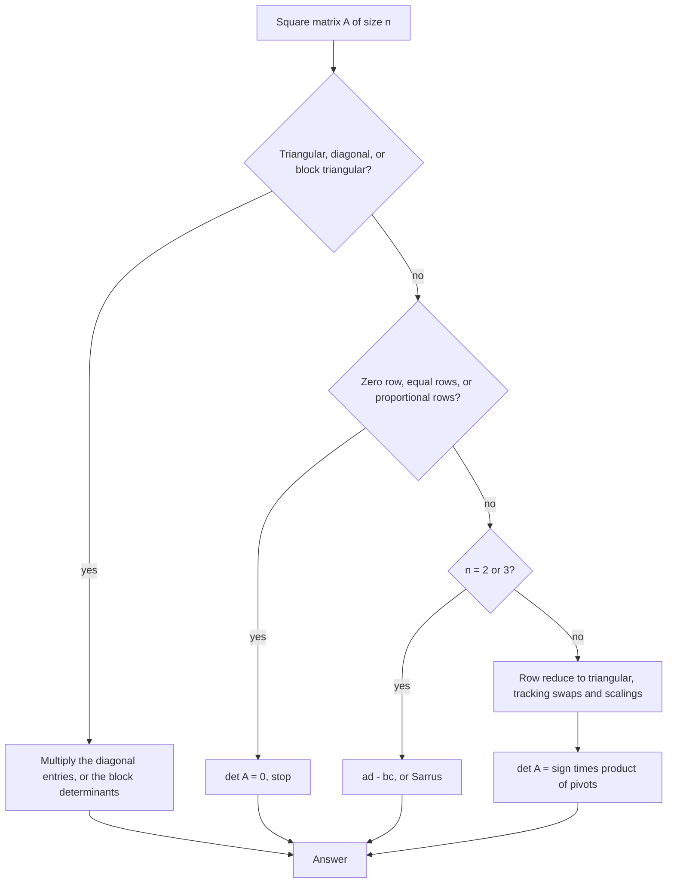

# Determinants

> [Mathematics](../../README.md) › [Linear Algebra](../README.md) · Level: Advanced · Prerequisites: [Linear Transformations](../05-linear-transformations/README.md), [Systems of Linear Equations](../03-systems-of-linear-equations/README.md), [Proof Techniques](../../00-foundations/04-proof-techniques/README.md) · Estimated time: 540 min

## 1. Introduction

A square matrix encodes a linear map, and a linear map distorts space. Among all the ways it can distort
— stretching, shearing, rotating, squashing — one question has a single number as its answer: **by what
factor does the map multiply volume?** That number is the **determinant**.

The answer deserves a moment's suspicion. Why should a single number describe the volume change of
*every* shape at once? Because a linear map sends the unit cube to a parallelepiped, and every shape is
approximated by little cubes whose images are little parallelepipeds of the same shape. Linearity makes
the distortion uniform: the local factor is the global factor. For the map

$$
T(x,y) = \begin{pmatrix}a&b\\ c&d\end{pmatrix}\begin{pmatrix}x\\ y\end{pmatrix},
$$

the unit square goes to the parallelogram spanned by $(a,c)$ and $(b,d)$, and its area is
$\lvert ad - bc\rvert$. The quantity $ad - bc$ is the $2\times2$ determinant, and its **sign** records
whether the map preserves or reverses orientation.

For $3\times3$ the same story holds with volume, and the formula is the scalar triple product
$\mathbf{a}\cdot(\mathbf{b}\times\mathbf{c})$. For $n \times n$ there is no picture, but there is a
definition that captures exactly what the pictures show.

**The definition used here is not a formula.** It is a list of three properties: the determinant is
*multilinear* (doubling one edge of the parallelepiped doubles its volume), *alternating* (a
parallelepiped with two equal edges is flat, so its volume is zero) and *normalised* (the unit cube has
volume one). §7.3 proves that **at most one** function has these three properties, and §7.4 proves that
**at least one** does by exhibiting it — the Leibniz formula
$\det A = \sum_\sigma \operatorname{sgn}(\sigma)\prod_i a_{i,\sigma(i)}$. Together, existence and
uniqueness say the determinant is the only possible notion of signed volume, and every formula for it —
cofactor expansion, Sarrus's rule, row reduction — is a consequence rather than a definition.

That order of ideas is deliberate. A definition by formula invites the question "why this formula?", and
the answer is a computation. A definition by properties answers the question up front and turns the
formulas into theorems. The same three properties also yield, with very little extra work, the results
that make determinants useful:

* $\det(AB) = \det A\,\det B$: volume factors multiply under composition (§7.9);
* $\det A \ne 0$ exactly when $A$ is invertible, so the determinant answers the central question of
  [Systems of Linear Equations](../03-systems-of-linear-equations/README.md) in one number (§7.8);
* **Cramer's rule** writes the solution of $A\mathbf{x} = \mathbf{b}$ as a ratio of determinants (§7.10);
* the **adjugate** gives a formula for $A^{-1}$ valid over any commutative ring (§7.11);
* determinants of block triangular matrices factor, which is why eigenvalues are computable block by
  block (§7.12);
* the **characteristic polynomial** $\det(\lambda I - A)$ packages the eigenvalues and previews the next
  topic (§7.13).

The determinant has a long history: Leibniz used it in 1693 to study systems of linear equations, Seki
Takakazu independently found the $3\times3$ and $4\times4$ cases in Japan, and Cramer published the rule
bearing his name in 1750. The word "determinant" was coined by Cauchy in 1812, and the volume
interpretation was made precise by Grassmann and Peano later in the century.

**What this tutorial adds.** [Linear Transformations](../05-linear-transformations/README.md) ended with
the statement that the signed area factor of a plane map is its determinant, and
[Systems of Linear Equations](../03-systems-of-linear-equations/README.md) decided invertibility by row
reduction. Here both claims become theorems: the determinant is constructed from axioms, shown to be
unique, shown to multiply, and used to decide invertibility, to solve systems by a formula, and to
compute volumes.

## 2. Prerequisites

**Matrices, matrix multiplication and inverses.** Products, transposes, and the meaning of
$A^{-1}$. See [Systems of Linear Equations](../03-systems-of-linear-equations/README.md) for row
reduction and [Linear Transformations](../05-linear-transformations/README.md) for matrices as maps.

**Linear maps, kernel, image, rank, rank–nullity.** The determinant will be characterised as an
alternating multilinear function of the *columns* of a matrix, and its vanishing will be tied to rank.
See [Linear Transformations](../05-linear-transformations/README.md), especially §7.6 and §7.9.

**Vectors, dot product and cross product in $\mathbb{R}^3$.** The triple product
$\mathbf{a}\cdot(\mathbf{b}\times\mathbf{c})$ is the $3\times3$ determinant. See
[Vectors](../01-vectors/README.md).

**Permutations and their signs.** Defined again in §5.5, but a previous meeting helps. See
[Relations and Functions](../../00-foundations/05-relations-and-functions/README.md) for permutations
as bijections.

**Induction and proof by cases.** Several proofs here are inductions on the size of the matrix. See
[Mathematical Induction](../../09-discrete-mathematics/01-mathematical-induction/README.md) and
[Proof Techniques](../../00-foundations/04-proof-techniques/README.md).

**Polynomials.** The characteristic polynomial is a polynomial in $\lambda$; its degree and constant term
are used in §7.13. See [Polynomials](../../03-algebra/06-polynomials/README.md).

**Notation.** $\sum$, $\prod$, $\operatorname{sgn}$ and matrix conventions are collected in
[Mathematical Notation](../../MATHEMATICAL_NOTATION.md).

## 3. Learning Objectives

By the end of this tutorial you will be able to

1. state the three defining properties of the determinant and explain each as a statement about volume;
2. prove that a function with those three properties is unique (Theorem 7.5);
3. prove the Leibniz formula and hence existence (Theorem 7.4);
4. derive cofactor expansion along the first row, and then along any row or column;
5. compute determinants of size $2,3,4$ and general $n$ by expansion, by row reduction and by spotting
   structure (triangular, block, zeros, proportional rows);
6. prove and use the effects of the three elementary row operations;
7. prove $\det(AB) = \det A\det B$, $\det A^{\mathsf{T}} = \det A$ and $\det(cA) = c^n\det A$;
8. prove that $\det A \ne 0$ is equivalent to invertibility, and connect the determinant to rank;
9. solve square systems by Cramer's rule and prove the rule;
10. compute the adjugate, prove $A\operatorname{adj}A = (\det A)I$, and use it for inverses;
11. compute determinants of block triangular and anti-triangular matrices;
12. write the characteristic polynomial, verify $p_A(0) = \det A$ and read off $-\operatorname{tr}A$;
13. compute areas, volumes and orientations in $2$D and $3$D with determinants.

## 4. Intuition

**Volume, signed.** Start with the unit cube in $\mathbb{R}^n$: edge vectors
$\mathbf{e}_1,\dots,\mathbf{e}_n$, volume $1$. Apply a linear map $T$ and look at the image: the
parallelepiped with edges $T(\mathbf{e}_1),\dots,T(\mathbf{e}_n)$. Its volume, divided by $1$, is the
factor by which $T$ scales every volume. The determinant is that factor, with a sign attached.

The sign is not decoration. It records **orientation**: whether the ordered list
$T(\mathbf{e}_1),\dots,T(\mathbf{e}_n)$ is right-handed or left-handed relative to the original list. A
rotation has determinant $+1$ (volume and handedness preserved), a reflection has determinant $-1$
(volume preserved, handedness reversed), a projection onto a plane has determinant $0$ (a solid is
flattened to a sheet, so volume is destroyed).

**The three properties, in pictures.** Think of the determinant as a function of the $n$ edge vectors.

* *Multilinear*: fix all edges but one. Doubling that edge doubles the volume; adding a vector
  $\mathbf{w}$ to an edge slides the top face, and by Cavalieri's principle the volume changes by the
  volume of the parallelepiped with that one edge replaced by $\mathbf{w}$. Volume is additive in each
  edge separately, as a determinant must be.
* *Alternating*: if two edges coincide, the "parallelepiped" is flat and its volume is zero. This single
  requirement is what forces the sign changes and the cancellations.
* *Normalised*: the standard cube has volume $1$.

Three properties, one function. There is nothing left to choose: once multilinearity lets you expand in
the standard basis and alternation kills the repeated terms, only the permuted terms survive, each with
the sign of its permutation. That is the content of §7.3, and it is why every determinant formula looks
the way it does.

**Why alternating implies sign changes.** If two edges are equal the volume is zero, so
$0 = \operatorname{vol}(\dots,\mathbf{u}+\mathbf{v},\dots,\mathbf{u}+\mathbf{v},\dots) =
\operatorname{vol}(\dots,\mathbf{u},\dots,\mathbf{v},\dots) +
\operatorname{vol}(\dots,\mathbf{v},\dots,\mathbf{u},\dots)$ after the two zero terms drop out. Swapping
two edges therefore negates the volume: the parallelepiped is the same, but the ordered list has the
opposite handedness.

**Zero determinant.** $\det A = 0$ means the image of the cube has no volume, which means the edge
vectors $T(\mathbf{e}_1),\dots,T(\mathbf{e}_n)$ lie in a proper subspace: they are linearly dependent.
So the determinant vanishes exactly when the columns are dependent, exactly when the map is not
invertible. This is the most-used fact about determinants, and §7.8 proves it.

## 5. Formal Definition

Throughout, $K$ is a field with $1 + 1 \neq 0$; take $K = \mathbb{R}$ or $\mathbb{C}$. (In
characteristic $2$ the alternating property stops being equivalent to antisymmetry, and the theory needs
separate care.)

**Definition 5.1 (Multilinear form).** A map $D : (K^n)^n \to K$ is **multilinear** if, for each
$i \in \{1,\dots,n\}$ and each fixed choice of the other $n-1$ arguments, the map
$\mathbf{v} \mapsto D(\mathbf{v}_1,\dots,\mathbf{v}_{i-1},\mathbf{v},\mathbf{v}_{i+1},\dots,\mathbf{v}_n)$
is linear. That is, $D$ is additive and homogeneous in each argument separately.

**Definition 5.2 (Alternating).** $D$ is **alternating** if $D(\mathbf{v}_1,\dots,\mathbf{v}_n) = 0$
whenever $\mathbf{v}_i = \mathbf{v}_j$ for some indices $i \neq j$.

**Definition 5.3 (Normalised).** $D$ is **normalised** if $D(\mathbf{e}_1,\dots,\mathbf{e}_n) = 1$, where
$\mathbf{e}_1,\dots,\mathbf{e}_n$ is the standard basis of $K^n$.

**Definition 5.4 (Determinant).** For $A \in M_n(K)$ with columns $\mathbf{a}_1,\dots,\mathbf{a}_n$, the
**determinant** is

$$
\det A = D(\mathbf{a}_1,\dots,\mathbf{a}_n),
$$

where $D$ is the (unique, as Theorem 7.3 shows) function satisfying Definitions 5.1–5.3. We also write
$\lvert A\rvert$ and, for the determinant of a matrix displayed explicitly,
$\begin{vmatrix} a & b \\ c & d\end{vmatrix}$.

Theorem 7.3 proves uniqueness and Theorem 7.4 proves existence, so the definition is legitimate. The rest
of §7 derives formulas from the three properties alone.

**Lemma 5.5 (The $2\times2$ case).** For $A = \begin{pmatrix}a&b\\ c&d\end{pmatrix}$,
$\det A = ad - bc$.

*Proof.* The columns are $\mathbf{a}_1 = a\mathbf{e}_1 + c\mathbf{e}_2$ and
$\mathbf{a}_2 = b\mathbf{e}_1 + d\mathbf{e}_2$. By multilinearity,

$$
\det A = ab\,D(\mathbf{e}_1,\mathbf{e}_1) + ad\,D(\mathbf{e}_1,\mathbf{e}_2)
+ cb\,D(\mathbf{e}_2,\mathbf{e}_1) + cd\,D(\mathbf{e}_2,\mathbf{e}_2).
$$

The first and last terms vanish by alternation; $D(\mathbf{e}_1,\mathbf{e}_2) = 1$ by normalisation; and
$D(\mathbf{e}_2,\mathbf{e}_1) = -D(\mathbf{e}_1,\mathbf{e}_2) = -1$ because swapping two arguments
negates an alternating multilinear function (Lemma 7.1). Hence $\det A = ad - bc$. $\square$

**Definition 5.6 (Permutations and their sign).** A **permutation** of $\{1,\dots,n\}$ is a bijection
$\sigma$ of that set; the set of all of them is $S_n$, with $n!$ elements. Its **sign** is

$$
\operatorname{sgn}(\sigma) = \prod_{1 \le i < j \le n} \frac{\sigma(j) - \sigma(i)}{j - i} \in \{1,-1\}.
$$

The product has the same factors in numerator and denominator, merely reordered, so it is $\pm 1$. Write
$\Delta(x_1,\dots,x_n) = \prod_{i<j}(x_j - x_i)$; then the definition says
$\Delta(\sigma(1),\dots,\sigma(n)) = \operatorname{sgn}(\sigma)\Delta(1,\dots,n)$. Applying this twice,

$$
\Delta\big(\sigma\tau(1),\dots,\sigma\tau(n)\big) = \operatorname{sgn}(\sigma)\Delta\big(\tau(1),\dots,\tau(n)\big)
= \operatorname{sgn}(\sigma)\operatorname{sgn}(\tau)\Delta(1,\dots,n),
$$

while directly it is $\operatorname{sgn}(\sigma\tau)\Delta(1,\dots,n)$. Since
$\Delta(1,\dots,n) \ne 0$, the sign is multiplicative:
$\operatorname{sgn}(\sigma\tau) = \operatorname{sgn}(\sigma)\operatorname{sgn}(\tau)$. In particular
$\operatorname{sgn}(\sigma^{-1}) = \operatorname{sgn}(\sigma)$ and
$\operatorname{sgn}(\operatorname{id}) = 1$. A **transposition** is a permutation swapping exactly two
values, say $p < q$; substituting it into the product shows that exactly $2(q-p)-1$ factors change sign,
an odd number, so its sign is $-1$. Every permutation is a product of transpositions, and the number of
factors has the same parity for all such products — that parity is what $\operatorname{sgn}$ measures.

**Definition 5.7 (Minor and cofactor).** For $A \in M_n(K)$ with $n \ge 2$, the **$(i,j)$-minor** $M_{ij}$
is the determinant of the $(n-1)\times(n-1)$ matrix obtained by deleting row $i$ and column $j$. The
**$(i,j)$-cofactor** is $C_{ij} = (-1)^{i+j}M_{ij}$.

**Definition 5.8 (Adjugate).** The **adjugate** of $A \in M_n(K)$ is the matrix of cofactors transposed,

$$
\operatorname{adj}A = (C_{ji})_{1 \le i,j \le n},
$$

so that the entry in row $i$, column $j$ of $\operatorname{adj}A$ is the cofactor $C_{ji}$.

**Definition 5.9 (Characteristic polynomial).** For $A \in M_n(K)$, the **characteristic polynomial** is
$p_A(\lambda) = \det(\lambda I_n - A)$, a polynomial of degree $n$ in $\lambda$.

## 6. Mathematical Notation

| Symbol | Read as | Meaning |
|---|---|---|
| $\det A$, $\lvert A\rvert$ | determinant of $A$ | signed volume-scaling factor of $A$ |
| $\begin{vmatrix} a&b\\c&d\end{vmatrix}$ | determinant | the matrix is delimited by bars |
| $D(\mathbf{v}_1,\dots,\mathbf{v}_n)$ | $D$ of the vectors | a function of $n$ column vectors |
| $\operatorname{sgn}(\sigma)$ | sign of $\sigma$ | $+1$ or $-1$; parity of $\sigma$ |
| $S_n$ | the symmetric group | all permutations of $\{1,\dots,n\}$ |
| $M_{ij}$ | the $(i,j)$-minor | determinant after deleting row $i$, column $j$ |
| $C_{ij}$ | the $(i,j)$-cofactor | $(-1)^{i+j}M_{ij}$ |
| $\operatorname{adj}A$ | adjugate of $A$ | transpose of the cofactor matrix |
| $p_A(\lambda)$ | characteristic polynomial | $\det(\lambda I - A)$ |
| $A^{\mathsf{T}}$ | transpose | rows and columns exchanged |
| $\delta_{ij}$ | Kronecker delta | $1$ if $i=j$, else $0$ |
| $\operatorname{tr}A$ | trace | sum of the diagonal entries |
| $\det(A - \lambda I)$ | — | alternative characteristic polynomial, sign differs |
| $\square$ | end of proof | the argument is complete |

## 7. Core Concepts

### 7.1 Why these three properties

A volume function on parallelepipeds should be additive in each edge, vanish when the solid is flat, and
assign $1$ to the unit cube. Those are exactly Definitions 5.1–5.3. The remarkable fact, proved in §7.3,
is that they leave no freedom at all: the value on every matrix is forced. The proofs below use nothing
beyond the three properties, so every formula obtained is a *consequence* of the geometry.

### 7.2 Alternating means antisymmetric

**Lemma 7.1.** Let $D : (K^n)^n \to K$ be multilinear and alternating. Then exchanging any two arguments
changes the sign:

$$
D(\dots,\mathbf{u},\dots,\mathbf{v},\dots) = -\,D(\dots,\mathbf{v},\dots,\mathbf{u},\dots).
$$

*Proof.* First take the two arguments adjacent, in positions $k$ and $k+1$. Multilinearity in those two
positions gives

$$
0 = D(\dots,\mathbf{u}+\mathbf{v},\dots,\mathbf{u}+\mathbf{v},\dots)
= D(\dots,\mathbf{u},\dots,\mathbf{u},\dots) + D(\dots,\mathbf{u},\dots,\mathbf{v},\dots)
+ D(\dots,\mathbf{v},\dots,\mathbf{u},\dots) + D(\dots,\mathbf{v},\dots,\mathbf{v},\dots),
$$

and the first and last terms vanish by alternation. So the two cross terms are negatives of each other.
For non-adjacent positions $i < j$, move the argument at position $j$ leftwards to position $i$ and then
the other one rightwards; this uses $2(j-i)-1$ adjacent exchanges, an odd number, so the sign changes
once. $\square$

**Corollary 7.2.** If $D$ is multilinear and alternating, then for every permutation $\sigma$,

$$
D(\mathbf{v}_{\sigma(1)},\dots,\mathbf{v}_{\sigma(n)}) = \operatorname{sgn}(\sigma)\,
D(\mathbf{v}_1,\dots,\mathbf{v}_n).
$$

*Proof.* Write $\sigma$ as a product of $k$ transpositions; by Lemma 7.1 each transposition multiplies
the value by $-1$, so the result is $(-1)^k D(\mathbf{v}_1,\dots,\mathbf{v}_n)$, and
$(-1)^k = \operatorname{sgn}(\sigma)$ because the sign is multiplicative and every transposition has sign
$-1$ (Definition 5.6). $\square$

### 7.3 Uniqueness: at most one determinant

**Theorem 7.3 (Uniqueness).** Let $D : (K^n)^n \to K$ be multilinear, alternating and normalised. Then
for every matrix $A = (a_{ij})$,

$$
D(\mathbf{a}_1,\dots,\mathbf{a}_n) = \sum_{\sigma \in S_n} \operatorname{sgn}(\sigma)
\prod_{i=1}^{n} a_{i,\sigma(i)} .
$$

*Proof.* Write each column in the standard basis: $\mathbf{a}_j = \sum_{i=1}^{n} a_{ij}\mathbf{e}_i$. By
multilinearity, expanding one column at a time,

$$
D(\mathbf{a}_1,\dots,\mathbf{a}_n)
= \sum_{(i_1,\dots,i_n)} a_{i_1 1}a_{i_2 2}\cdots a_{i_n n}\,
D(\mathbf{e}_{i_1},\dots,\mathbf{e}_{i_n}),
$$

the sum over all $n$-tuples $(i_1,\dots,i_n) \in \{1,\dots,n\}^n$. If some value repeats among the
$i_j$, two arguments of $D$ coincide and the term vanishes by alternation. The surviving tuples are
exactly the permutations, $i_j = \sigma(j)$; by Corollary 7.2,
$D(\mathbf{e}_{\sigma(1)},\dots,\mathbf{e}_{\sigma(n)}) = \operatorname{sgn}(\sigma)D(\mathbf{e}_1,
\dots,\mathbf{e}_n) = \operatorname{sgn}(\sigma)$. Collecting terms gives the stated formula. $\square$

Two functions with the three properties therefore agree on every matrix. In particular there is at most
one determinant.

### 7.4 Existence: the Leibniz formula

**Theorem 7.4 (Existence).** Define $L(A) = \sum_{\sigma \in S_n} \operatorname{sgn}(\sigma)\prod_{i=1}^{n}
a_{i,\sigma(i)}$. Then $L$ is multilinear, alternating and normalised.

*Proof.* **Multilinear.** Every term of the sum contains exactly one factor from column $j$, namely
$a_{\sigma^{-1}(j),\,j}$, and every other factor comes from other columns. Each term is therefore a
constant times that entry, so $L$ is linear in column $j$; this holds for every $j$.

**Alternating.** Suppose columns $j$ and $k$ of $A$ are equal, $j \neq k$, and let $\tau = (j\,k)$ be the
transposition swapping them. Compare the terms indexed by $\sigma$ and by $\sigma\tau$: at position $i$
they use $a_{i,\sigma(i)}$ and $a_{i,\sigma(\tau(i))}$, which differ only by reading column $j$ in place
of column $k$ (or the reverse), and those columns are equal. So the two products coincide, while
$\operatorname{sgn}(\sigma\tau) = -\operatorname{sgn}(\sigma)$. The map $\sigma \mapsto \sigma\tau$ is a
fixed-point-free pairing of $S_n$, so the terms cancel in pairs and $L(A) = 0$.

**Normalised.** For $A = I_n$ we have $a_{i,\sigma(i)} = \delta_{i,\sigma(i)}$, which is $1$ only when
$\sigma(i) = i$ for all $i$. Only the identity permutation contributes, and
$L(I_n) = \operatorname{sgn}(\operatorname{id}) = 1$. $\square$

Combining Theorems 7.3 and 7.4: **a function with the three properties exists and is unique**, and it is
given by the Leibniz formula. That function is the determinant. Notice the shape of the argument: the
three properties buy uniqueness for free, and the formula is only needed once, to show that the
properties are not vacuous.

### 7.5 Cofactor expansion

Leibniz's formula has $n!$ terms, which is useless for $n = 10$. The remedy is to group the terms.

**Theorem 7.5 (Expansion along the first row).** For $n \ge 2$ and $A \in M_n(K)$,

$$
\det A = \sum_{j=1}^{n} (-1)^{1+j}a_{1j}\det M_{1j} = a_{11}M_{11} - a_{12}M_{12} + \cdots
+ (-1)^{1+n}a_{1n}M_{1n}.
$$

*Proof.* Group the permutations in Theorem 7.3 by the value $j = \sigma(1)$. For such a $\sigma$, delete
the value $j$ from the list $\sigma(2),\dots,\sigma(n)$ and relabel the remaining values
$\{1,\dots,n\}\setminus\{j\}$ as $\{1,\dots,n-1\}$ in increasing order; this gives a permutation $\tau$ of
$n-1$ elements. Moving the value $j$ to the front of $1,\dots,n$ takes $j-1$ transpositions, so
$\operatorname{sgn}(\sigma) = (-1)^{j-1}\operatorname{sgn}(\tau) = (-1)^{j+1}\operatorname{sgn}(\tau)$.
Also

$$
\prod_{i=1}^{n} a_{i,\sigma(i)} = a_{1j}\prod_{i=2}^{n}a_{i,\sigma(i)},
$$

and $\prod_{i=2}^{n}a_{i,\sigma(i)}$ is precisely the product appearing in the Leibniz term of
$\det M_{1j}$ indexed by $\tau$, because the rows of $M_{1j}$ are rows $2,\dots,n$ of $A$ and its columns
are the columns other than $j$, in order. Summing over $\tau$ gives $\det M_{1j}$. Hence
$\det A = \sum_j (-1)^{1+j}a_{1j}\det M_{1j}$. $\square$

**Corollary 7.6 (Expansion along any row).** For every $i$,
$\det A = \sum_{j=1}^{n}(-1)^{i+j}a_{ij}\det M_{ij}$.

*Proof.* Let $A'$ be $A$ with row $i$ moved to the top, using $i-1$ adjacent row swaps. Swapping two rows
of a matrix negates its determinant: in the Leibniz formula, a row swap replaces each permutation
$\sigma$ by $\tau\circ\sigma$ for a transposition $\tau$, and
$\operatorname{sgn}(\tau\circ\sigma) = -\operatorname{sgn}(\sigma)$ while the product of entries is
unchanged after relabelling. Hence $\det A' = (-1)^{i-1}\det A$, and Theorem 7.5 applied to $A'$ gives

$$
(-1)^{i-1}\det A = \det A' = \sum_{j=1}^{n}(-1)^{1+j}a_{ij}\det M_{ij},
$$

because deleting row $1$ of $A'$ (which is row $i$ of $A$) and column $j$ leaves the same minor $M_{ij}$.
Multiplying by $(-1)^{i-1}$ and using $(-1)^{i-1}(-1)^{1+j} = (-1)^{i+j}$ gives the claim. $\square$

Expansion along a *column* is obtained from Theorem 7.8 below, since $\det A = \det A^{\mathsf{T}}$.

### 7.6 Row operations

**Proposition 7.7 (Effect of row operations).** Let $A \in M_n(K)$.

1. Swapping two rows multiplies the determinant by $-1$.
2. Multiplying one row by $c \in K$ multiplies the determinant by $c$.
3. Adding a multiple of one row to a *different* row leaves the determinant unchanged.
4. If $A$ has a row of zeros, or two equal rows, then $\det A = 0$.
5. If $A$ is upper or lower triangular, $\det A = a_{11}a_{22}\cdots a_{nn}$.

*Proof.* (1) is proved in Exercise 22: exchanging two rows replaces each permutation $\sigma$ in the
Leibniz sum by $\tau\circ\sigma$ for a transposition $\tau$, which negates every term. (2) holds because
every term of the Leibniz sum contains exactly one entry from row $i$, so scaling that row scales every
term by $c$. For (3), let $A'$ be $A$
with $c$ times row $i$ added to row $j$, $i \neq j$. Multilinearity in row $j$ gives
$\det A' = \det A + c\det A''$, where $A''$ is $A$ with row $j$ replaced by row $i$; $A''$ has two equal
rows, so $\det A'' = 0$. Part (4) for equal rows is alternation; for a zero row, scale that row by $0$
and apply (2). For (5), in the Leibniz formula every term $\prod_i a_{i,\sigma(i)}$ vanishes unless
$\sigma(i) \ge i$ for all $i$ when $A$ is upper triangular; summing these inequalities over $i$ gives
equality throughout, so $\sigma = \operatorname{id}$ and the only surviving term is
$\prod_i a_{ii}$. For lower triangular the argument is the same with $\sigma(i) \le i$. $\square$

**Consequence (Gaussian elimination).** Row reduction multiplies the determinant by a known nonzero
factor at each step: swaps contribute $-1$, scalings contribute their factor, additions contribute $1$.
Reducing to row echelon form therefore computes determinants exactly, and is the method of choice for
$n \ge 4$. Triangular matrices are free: the determinant is the product of the diagonal.

### 7.7 The determinant of the transpose

**Theorem 7.8.** For every square matrix, $\det A^{\mathsf{T}} = \det A$.

*Proof.* By Theorem 7.3 applied to $A^{\mathsf{T}}$, whose $(i,\sigma(i))$ entry is $a_{\sigma(i),i}$,

$$
\det A^{\mathsf{T}} = \sum_{\sigma}\operatorname{sgn}(\sigma)\prod_{i=1}^{n}a_{\sigma(i),i}.
$$

Let $\tau = \sigma^{-1}$. As $\sigma$ runs over $S_n$ so does $\tau$, and
$\prod_i a_{\sigma(i),i} = \prod_j a_{j,\tau(j)}$ (the same factors, reordered), while
$\operatorname{sgn}(\sigma) = \operatorname{sgn}(\tau)$. Hence
$\det A^{\mathsf{T}} = \sum_\tau \operatorname{sgn}(\tau)\prod_j a_{j,\tau(j)} = \det A$. $\square$

Everything proved about rows therefore holds for columns: swapping columns negates the determinant,
adding a multiple of one column to another preserves it, and expansion along a column is valid. In
particular, $\det$ may be regarded as an alternating multilinear function of the rows just as well as of
the columns.

### 7.8 The invertibility criterion

**Theorem 7.9.** A square matrix $A$ is invertible if and only if $\det A \neq 0$.

*Proof.* Reduce $A$ to its reduced row echelon form $R$ by elementary row operations. Each operation
changes the determinant by a nonzero factor (Proposition 7.7), so there is a nonzero constant $K$ with
$\det A = K\det R$. Now $R$ is either $I_n$ — exactly when $A$ is invertible, since row operations are
reversible — or it has a zero row, in which case $\det R = 0$. Hence $\det A \neq 0$ if and only if
$R = I_n$, that is, if and only if $A$ is invertible. $\square$

**Corollary 7.10.** For $A \in M_n(K)$: $\det A = 0$ if and only if $\operatorname{rank}A < n$, if and
only if the columns of $A$ are linearly dependent, if and only if $A\mathbf{x} = \mathbf{0}$ has a
nonzero solution.

*Proof.* Each statement is equivalent to $A$ being non-invertible: rank $< n$ means the image has
dimension less than $n$, the columns are dependent exactly when the kernel is nontrivial (rank–nullity),
and a nontrivial kernel means no inverse exists. $\square$

### 7.9 Multiplicativity

**Theorem 7.11.** For $A, B \in M_n(K)$, $\det(AB) = \det A\,\det B$.

*Proof.* **Case $\det B = 0$.** Then $B$ is not invertible (Theorem 7.9), so $\operatorname{rank}B < n$.
The rank of a composite is at most the rank of each factor (Proposition 8.1 of
[Linear Transformations](../05-linear-transformations/README.md)), so $\operatorname{rank}(AB) < n$ and
$AB$ is not invertible; hence $\det(AB) = 0 = \det A\det B$.

**Case $\det B \neq 0$.** Fix $B$ and consider $f(A) = \det(AB)$ as a function of the columns
$\mathbf{a}_1,\dots,\mathbf{a}_n$ of $A$. Column $j$ of $AB$ is $A\mathbf{b}_j = \sum_i b_{ij}\mathbf{a}_i$,
a linear combination of the columns of $A$; hence $f$ is multilinear in the $\mathbf{a}_j$. If
$\mathbf{a}_i = \mathbf{a}_j$ with $i \neq j$, then columns $i$ and $j$ of $AB$ are equal, so $f(A) = 0$;
hence $f$ is alternating. So $\frac{1}{\det B}f$ is multilinear, alternating and normalised, and by
Theorem 7.3 it equals $\det A$. Therefore $\det(AB) = \det A\det B$. $\square$

**Corollary 7.12.** For invertible $A$ and any $k \ge 1$:
$\det(A^{-1}) = 1/\det A$, $\det(A^k) = (\det A)^k$, and $\det(cA) = c^n\det A$ for $c \in K$. Moreover
$\det(AB) = \det(BA)$ for all square $A, B$ of the same size.

*Proof.* $1 = \det I = \det(AA^{-1}) = \det A\det A^{-1}$ gives the first; induction on $k$ using
Theorem 7.11 gives the second; scaling each of the $n$ columns by $c$ multiplies the determinant by
$c^n$; and $\det(AB) = \det A\det B = \det B\det A = \det(BA)$. $\square$

A warning: $\det(A + B) \ne \det A + \det B$ in general. Determinants are multiplicative, not additive.

### 7.10 Cramer's rule

**Theorem 7.13 (Cramer).** Let $A \in M_n(K)$ be invertible and let $\mathbf{b} \in K^n$. If $A_j$ denotes
$A$ with its $j$-th column replaced by $\mathbf{b}$, then the unique solution of $A\mathbf{x} = \mathbf{b}$
is

$$
x_j = \frac{\det A_j}{\det A},\qquad j = 1,\dots,n .
$$

*Proof.* Let $\mathbf{x}$ be the solution and let $E_j(\mathbf{x})$ be the identity matrix with its
$j$-th column replaced by $\mathbf{x}$. Multiplying, $A\,E_j(\mathbf{x})$ is the matrix whose columns are
$A\mathbf{e}_1,\dots,A\mathbf{x},\dots,A\mathbf{e}_n$ — that is $A$ with column $j$ replaced by
$A\mathbf{x} = \mathbf{b}$, which is $A_j$. Hence, by Theorem 7.11,

$$
\det A_j = \det A\,\det E_j(\mathbf{x}).
$$

Expanding $\det E_j(\mathbf{x})$ along column $j$, only the entry $x_j$ is nonzero, with cofactor
$(-1)^{j+j}\det I_{n-1} = 1$, so $\det E_j(\mathbf{x}) = x_j$. Dividing by $\det A \neq 0$ gives the
formula. $\square$

Cramer's rule is a theoretical tool, not a numerical one: it costs about $n!$ operations against
$n^3/3$ for elimination. Its value is that it exhibits the solution as a ratio of polynomial functions of
the data, which is why it appears in perturbation theory and in proofs of continuity of solutions.

### 7.11 The adjugate and the inverse

**Theorem 7.14.** For every $A \in M_n(K)$, $A\operatorname{adj}A = \operatorname{adj}A\,A = (\det A)I_n$.

*Proof.* The $(i,j)$ entry of $A\operatorname{adj}A$ is
$\sum_{k=1}^{n}a_{ik}(\operatorname{adj}A)_{kj} = \sum_k a_{ik}C_{jk}$. By Corollary 7.6 applied to the
matrix $A^{(i\leftarrow j)}$ obtained from $A$ by replacing row $j$ with row $i$ and expanding along row
$j$, this sum is $\det A^{(i\leftarrow j)}$. If $i = j$ this is $\det A$. If $i \ne j$ then
$A^{(i\leftarrow j)}$ has two equal rows, so its determinant is $0$. Hence $A\operatorname{adj}A = (\det A)I$;
transposing the argument (or applying Theorem 7.8) gives $\operatorname{adj}A\,A = (\det A)I$. $\square$

**Corollary 7.15.** If $A$ is invertible then $A^{-1} = \dfrac{1}{\det A}\operatorname{adj}A$, and
$\det(\operatorname{adj}A) = (\det A)^{n-1}$.

*Proof.* The first is immediate from Theorem 7.14 and Theorem 7.9. For the second, take determinants in
$A\operatorname{adj}A = (\det A)I$: $\det A\cdot\det(\operatorname{adj}A) = (\det A)^n$, and divide by
$\det A \neq 0$. $\square$

The formula $A^{-1} = \operatorname{adj}A/\det A$ is the only general closed formula for an inverse; it
makes sense over any commutative ring in which $\det A$ is a unit, and it is the formula a computer
algebra system uses for exact inverses of small matrices.

### 7.12 Block matrices

**Theorem 7.16 (Block triangular).** Let $A \in M_p(K)$, $D \in M_q(K)$, $B \in M_{p\times q}(K)$, and let
$0$ be the $q \times p$ zero block. Then

$$
\det\begin{pmatrix} A & B \\ 0 & D \end{pmatrix} = \det A\,\det D .
$$

*Proof.* Induct on $p$. For $p = 1$, expand along the first column: the only nonzero entry is
$a_{11}$, so the determinant is $a_{11}\det D$. For $p > 1$, expand along the first column. Its entries
below row $p$ are zero, so

$$
\det M = \sum_{i=1}^{p}(-1)^{i+1}a_{i1}\det M_{i1},
$$

and each $M_{i1}$ is again block upper triangular, with blocks $A_{i1}$ (the $(i,1)$-minor of $A$) and
$D$. By induction $\det M_{i1} = \det A_{i1}\det D$, so
$\det M = \det D\sum_i (-1)^{i+1}a_{i1}\det A_{i1} = \det D\det A$ by Theorem 7.5. $\square$

**Proposition 7.17 (Anti-triangular blocks).** With blocks of sizes $p \times q$ and $q \times p$,

$$
\det\begin{pmatrix} 0 & B \\ C & 0 \end{pmatrix} = (-1)^{pq}\det B\,\det C .
$$

*Proof.* Moving the last $q$ rows above the first $p$ rows requires $p q$ row transpositions, each
multiplying the determinant by $-1$; the result is $\begin{pmatrix} C & 0 \\ 0 & B\end{pmatrix}$, whose
determinant is $\det C\det B$ by Theorem 7.16. $\square$

### 7.13 The characteristic polynomial

**Proposition 7.18.** For $A \in M_n(K)$, $p_A(\lambda) = \det(\lambda I - A)$ is a polynomial of degree
$n$ with leading coefficient $1$, coefficient of $\lambda^{n-1}$ equal to $-\operatorname{tr}A$, and
constant term $(-1)^n\det A$. For $n = 2$,

$$
p_A(\lambda) = \lambda^2 - (\operatorname{tr}A)\lambda + \det A .
$$

*Proof.* In the Leibniz formula for $\det(\lambda I - A)$, the diagonal entry in position $(i,i)$ is
$\lambda - a_{ii}$. A term indexed by $\sigma$ is a product of $n$ entries, one per row and column; the
power of $\lambda$ is the number of diagonal positions used, and off-diagonal entries contribute only
constants. The term of degree $n$ uses all diagonal entries, giving $\lambda^n$. The terms of degree
$n-1$ use exactly $n-1$ diagonal entries, hence contribute
$\lambda^{n-1}\sum_i(-a_{ii}) = -\lambda^{n-1}\operatorname{tr}A$. The constant term is
$p_A(0) = \det(-A) = (-1)^n\det A$. For $n=2$ these three facts determine
$\lambda^2 - (\operatorname{tr}A)\lambda + \det A$. $\square$

The roots of $p_A$ are the eigenvalues of $A$, the subject of the next topic in this discipline. Two
useful special cases: $A$ is invertible iff $p_A(0) \ne 0$, and the sum of the eigenvalues (with
multiplicity) is $\operatorname{tr}A$ while their product is $\det A$.

### 7.14 Geometry in two and three dimensions

**Proposition 7.19 (Area and volume).** Let $\mathbf{u}, \mathbf{v} \in \mathbb{R}^2$ be the columns of
$A \in M_2(\mathbb{R})$. The parallelogram
$\{s\mathbf{u} + t\mathbf{v} : 0 \le s,t \le 1\}$ has area $\lvert\det A\rvert$. For
$\mathbf{u}, \mathbf{v}, \mathbf{w} \in \mathbb{R}^3$ as columns of $A \in M_3(\mathbb{R})$, the
parallelepiped $\{s\mathbf{u} + t\mathbf{v} + r\mathbf{w} : 0 \le s,t,r \le 1\}$ has volume
$\lvert\det A\rvert$.

*Proof.* Consider the **signed** area $(\mathbf{u},\mathbf{v}) \mapsto \pm\text{area}$ of the spanned
parallelogram, the sign being $+$ for a counter-clockwise pair and $-$ for a clockwise one. This
function is multilinear (doubling one edge doubles the signed area; sliding one edge parallel to itself
adds signed areas, by Cavalieri), alternating (a degenerate parallelogram has signed area $0$) and
normalised (the unit square spanned by $\mathbf{e}_1,\mathbf{e}_2$ has signed area $1$). By Theorem 7.3
it equals $\det$ of the matrix with those columns, so the unsigned area is $\lvert\det A\rvert$. The same
argument in $\mathbb{R}^3$ uses the elementary properties of signed volume. $\square$

**Proposition 7.20 (Triple product).** For $\mathbf{a}, \mathbf{b}, \mathbf{c} \in \mathbb{R}^3$,

$$
\mathbf{a}\cdot(\mathbf{b}\times\mathbf{c}) = \det[\mathbf{a}\ \mathbf{b}\ \mathbf{c}],
$$

where the matrix has those vectors as columns.

*Proof.* Write $\mathbf{b}\times\mathbf{c} =
\begin{pmatrix}b_2c_3 - b_3c_2\\ b_3c_1 - b_1c_3\\ b_1c_2 - b_2c_1\end{pmatrix}$. Then
$\mathbf{a}\cdot(\mathbf{b}\times\mathbf{c}) = a_1(b_2c_3 - b_3c_2) + a_2(b_3c_1 - b_1c_3) +
a_3(b_1c_2 - b_2c_1)$, which is exactly the expansion of $\det[\mathbf{a}\ \mathbf{b}\ \mathbf{c}]$
along its first column. $\square$

**Orientation.** $\det A > 0$ means the ordered list of columns is **positively oriented** (right-handed);
$\det A < 0$ means it is negatively oriented. A rotation has determinant $+1$, a reflection $-1$, a
projection $0$. In $\mathbb{R}^2$ the signed area of the triangle with vertices
$\mathbf{0}, \mathbf{u}, \mathbf{v}$ is $\tfrac12\det[\mathbf{u}\ \mathbf{v}]$, and for arbitrary vertices
$\mathbf{p},\mathbf{q},\mathbf{r}$ it is
$\tfrac12\det[\mathbf{q} - \mathbf{p}\ \ \mathbf{r} - \mathbf{p}]$; the sign tells whether the vertices are
listed counter-clockwise or clockwise, and collinearity is the vanishing of that determinant.

## 8. Formulas and Properties

| Property | Statement | Justification |
|---|---|---|
| Multiplication | $\det(AB) = \det A\,\det B$ | Theorem 7.11 |
| Transpose | $\det A^{\mathsf{T}} = \det A$ | Theorem 7.8 |
| Inverse | $\det(A^{-1}) = 1/\det A$ | Corollary 7.12 |
| Powers | $\det(A^k) = (\det A)^k$ | Corollary 7.12 |
| Scaling | $\det(cA) = c^n\det A$ | Corollary 7.12 |
| Identity and zero | $\det I = 1$, $\det 0 = 0$ | normalisation; zero row |
| Triangular | $\det A = \prod_i a_{ii}$ | Proposition 7.7(5) |
| Invertibility | $A$ invertible $\iff \det A \ne 0$ | Theorem 7.9 |
| Rank | $\det A = 0 \iff \operatorname{rank}A < n$ | Corollary 7.10 |
| Row swap | multiplies $\det$ by $-1$ | Proposition 7.7(1) |
| Row scaling | multiplies $\det$ by the factor | Proposition 7.7(2) |
| Row addition | leaves $\det$ unchanged | Proposition 7.7(3) |
| Cofactor expansion | $\det A = \sum_j(-1)^{i+j}a_{ij}M_{ij}$ for any $i$ | Theorem 7.5, Corollary 7.6 |
| Block triangular | $\det\begin{pmatrix}A&B\\0&D\end{pmatrix} = \det A\det D$ | Theorem 7.16 |
| Anti-triangular | $\det\begin{pmatrix}0&B\\C&0\end{pmatrix} = (-1)^{pq}\det B\det C$ | Proposition 7.17 |
| Adjugate | $A\operatorname{adj}A = (\det A)I$ | Theorem 7.14 |
| Adjugate determinant | $\det(\operatorname{adj}A) = (\det A)^{n-1}$ | Corollary 7.15 |
| Cramer | $x_j = \det A_j/\det A$ | Theorem 7.13 |
| Characteristic polynomial | $p_A(\lambda) = \lambda^n - (\operatorname{tr}A)\lambda^{n-1} + \dots + (-1)^n\det A$ | Proposition 7.18 |

**The $2\times2$ and $3\times3$ formulas.** For $2\times2$ the definition gives
$\det\begin{pmatrix}a&b\\c&d\end{pmatrix} = ad - bc$. For $3\times3$ the Leibniz formula has six terms, and
writing them out gives **Sarrus's rule**:

$$
\det\begin{pmatrix}a_{11}&a_{12}&a_{13}\\ a_{21}&a_{22}&a_{23}\\ a_{31}&a_{32}&a_{33}\end{pmatrix}
= a_{11}a_{22}a_{33} + a_{12}a_{23}a_{31} + a_{13}a_{21}a_{32}
- a_{13}a_{22}a_{31} - a_{11}a_{23}a_{32} - a_{12}a_{21}a_{33}.
$$

The three positive terms are the products along the "downward" diagonals (wrapping around), the three
negative terms along the "upward" ones. Sarrus's rule is a coincidence of small size: there is **no**
analogous rule for $4\times4$, because the permutation group $S_4$ has 24 elements and they do not
arrange themselves into diagonals. For $n \ge 4$ use expansion or elimination.

**Elementary matrices.** If $E$ is obtained from $I_n$ by one row operation, then $\det E$ is the factor
by which that operation multiplies determinants: $-1$ for a swap, $c$ for scaling a row by $c$, and $1$
for adding a multiple of one row to another. Row reduction expresses $A$ as a product of elementary
matrices times its echelon form, and Theorem 7.11 then reproduces Proposition 7.7.

## 9. Step-by-Step Examples

### Example 1 — A $3\times3$ by cofactor expansion

Compute $\det A$ for $A = \begin{pmatrix}2&-3&1\\ 4&1&-2\\ -1&5&3\end{pmatrix}$.

Expand along the first row. The minors are the determinants of the $2\times2$ matrices left after deleting
row $1$ and the relevant column:

$$
\det A = 2\begin{vmatrix}1&-2\\5&3\end{vmatrix} - (-3)\begin{vmatrix}4&-2\\-1&3\end{vmatrix}
+ 1\begin{vmatrix}4&1\\-1&5\end{vmatrix}
= 2(3 + 10) + 3(12 - 2) + (20 + 1).
$$

So $\det A = 26 + 30 + 21 = 77$. *Check by expansion along the second column:* the cofactors give
$-(-3)\begin{vmatrix}4&-2\\-1&3\end{vmatrix} + 1\begin{vmatrix}2&1\\-1&3\end{vmatrix} -
5\begin{vmatrix}2&1\\4&-2\end{vmatrix} = 3(10) + 7 - 5(-8) = 30 + 7 + 40 = 77$ ✓. Sarrus's rule gives
$2\cdot1\cdot3 + (-3)(-2)(-1) + 1\cdot4\cdot5 - 1\cdot1\cdot(-1) - 2(-2)5 - (-3)4\cdot3 = 6 - 6 + 20 + 1 +
20 + 36 = 77$ ✓, and $\operatorname{tr}A = 6$ will reappear as the coefficient of $\lambda^2$ in $p_A$.

### Example 2 — A $4\times4$ by elimination

Compute $\det C$ for $C = \begin{pmatrix}2&1&-1&3\\ 4&3&1&1\\ -2&1&2&-1\\ 2&4&1&2\end{pmatrix}$.

Use row operations of the third kind only, which leave the determinant unchanged:
$R_2 \leftarrow R_2 - 2R_1 = (0,1,3,-5)$, $R_3 \leftarrow R_3 + R_1 = (0,2,1,2)$,
$R_4 \leftarrow R_4 - R_1 = (0,3,2,-1)$. Then $R_3 \leftarrow R_3 - 2R_2 = (0,0,-5,12)$ and
$R_4 \leftarrow R_4 - 3R_2 = (0,0,-7,14)$. Finally $R_4 \leftarrow R_4 - \tfrac75R_3 =
(0,0,0,-\tfrac{14}{5})$. The matrix is now upper triangular with diagonal
$2,\ 1,\ -5,\ -\tfrac{14}{5}$, so

$$
\det C = 2\cdot1\cdot(-5)\cdot\Big(-\tfrac{14}{5}\Big) = 28 .
$$

*Check:* the product of the pivots is positive and moderate, and no row swap or scaling occurred, so the
sign is $+1$ — consistent with $\det C = 28$. Expanding the original matrix along the first row would
require four $3\times3$ determinants; elimination needed five row operations.

### Example 3 — Structure: block triangular

For $B = \begin{pmatrix}1&2&0&3\\ 2&5&-1&1\\ 0&0&3&-2\\ 0&0&1&4\end{pmatrix}$ the lower-left $2\times2$
block is zero, so $B$ is block upper triangular with $A = \begin{pmatrix}1&2\\2&5\end{pmatrix}$ and
$D = \begin{pmatrix}3&-2\\1&4\end{pmatrix}$. By Theorem 7.16,

$$
\det B = \det A\,\det D = (5 - 4)(12 + 2) = 1\cdot14 = 14 .
$$

*Check by expansion:* along the first column only two entries are nonzero, and the recursion reduces to
the two $3\times3$ minors, whose values combine to $14$ ✓. Spotting the block saves most of the work; this
is the practical reason determinants of block matrices are computed blockwise.

### Example 4 — A determinant with a parameter

For $Q_t = \begin{pmatrix}2&t&0\\ t&1&t\\ 0&t&2\end{pmatrix}$, find all $t$ with $\det Q_t = 0$.

Expand along the first row:

$$
\det Q_t = 2\begin{vmatrix}1&t\\ t&2\end{vmatrix} - t\begin{vmatrix}t&t\\ 0&2\end{vmatrix} + 0
= 2(2 - t^2) - t(2t) = 4 - 2t^2 - 2t^2 = 4(1 - t^2).
$$

So $Q_t$ is singular exactly when $t = 1$ or $t = -1$. At $t = 1$ the first two columns are $(2,1,0)$ and
$(1,1,1)$; the matrix has rank $2$ and the relation $\mathbf{a}_1 - 2\mathbf{a}_2 + \mathbf{a}_3 = 0$
exhibits a nonzero kernel vector $(1,-2,1)^{\mathsf{T}}$. At $t = -1$ one checks
$(1,2,1)^{\mathsf{T}} \in \ker Q_{-1}$.

### Example 5 — Cramer's rule

Solve

$$
\begin{cases}
2x + y - z = 8\\
-3x - y + 2z = -11\\
-2x + y + 2z = -3 .
\end{cases}
$$

The coefficient matrix is $M = \begin{pmatrix}2&1&-1\\ -3&-1&2\\ -2&1&2\end{pmatrix}$ with
$\det M = 2(-2-2) - 1(-6+4) + (-1)(-3-2) = -8 + 2 + 5 = -1$. Replacing the columns by
$\mathbf{b} = (8,-11,-3)^{\mathsf{T}}$ in turn gives

$$
\det M_1 = -2,\qquad \det M_2 = -3,\qquad \det M_3 = 1 .
$$

Hence $x = \tfrac{-2}{-1} = 2$, $y = \tfrac{-3}{-1} = 3$, $z = \tfrac{1}{-1} = -1$. *Check:* $2(2) + 3 -
(-1) = 8$ ✓, $-6 - 3 - 2 = -11$ ✓, $-4 + 3 - 2 = -3$ ✓.

### Example 6 — Adjugate and inverse

For $F = \begin{pmatrix}2&1&1\\ 1&2&1\\ 1&1&2\end{pmatrix}$, compute $\operatorname{adj}F$ and $F^{-1}$.

The cofactors are $C_{11} = \begin{vmatrix}2&1\\1&2\end{vmatrix} = 3$,
$C_{12} = -\begin{vmatrix}1&1\\1&2\end{vmatrix} = -1$,
$C_{13} = \begin{vmatrix}1&2\\1&1\end{vmatrix} = -1$, and by symmetry
$C_{22} = 3$, $C_{23} = -1$, $C_{33} = 3$, with all off-diagonal cofactors equal to $-1$. Hence

$$
\operatorname{adj}F = \begin{pmatrix}3&-1&-1\\ -1&3&-1\\ -1&-1&3\end{pmatrix},
\qquad
\det F = 2(4-1) - 1(2-1) + 1(1-2) = 6 - 1 - 1 = 4 .
$$

*Check* $F\operatorname{adj}F = 4I_3$: the first row of the product is
$\big(6-1-1,\ -2+3-1,\ -2-1+3\big) = (4,0,0)$ ✓, and the other rows are the same by symmetry. Therefore
$F^{-1} = \tfrac14\operatorname{adj}F$, whose entries are $\pm\tfrac14$ or $\tfrac34$. *Check:*
$F^{-1}F = I$ since $F\cdot\tfrac14\operatorname{adj}F = I$ ✓.

### Example 7 — Multiplicativity and its consequences

Let $A = \begin{pmatrix}1&2\\3&4\end{pmatrix}$ (so $\det A = -2$) and $B = \begin{pmatrix}2&0\\1&3\end{pmatrix}$
(so $\det B = 6$). Then $AB = \begin{pmatrix}4&6\\10&12\end{pmatrix}$ and
$\det(AB) = 48 - 60 = -12 = (-2)(6)$ ✓.

Consequences: $\det(A^{-1}) = -\tfrac12$; $\det(A^2) = 4$; $\det(3A) = 3^2(-2) = -18$, checked directly
from $3A = \begin{pmatrix}3&6\\9&12\end{pmatrix}$ whose determinant is $36 - 54 = -18$ ✓. Note
$\det(A + B) = \det\begin{pmatrix}3&2\\4&7\end{pmatrix} = 21 - 8 = 13 \neq -2 + 6$: determinants do not
add.

### Example 8 — Area, volume and orientation

The triangle with vertices $\mathbf{p} = (1,1)$, $\mathbf{q} = (4,2)$, $\mathbf{r} = (2,5)$ has edge
vectors $\mathbf{q} - \mathbf{p} = (3,1)$ and $\mathbf{r} - \mathbf{p} = (1,4)$, so

$$
\text{area} = \tfrac12\left\lvert\det\begin{pmatrix}3&1\\1&4\end{pmatrix}\right\rvert
= \tfrac12\lvert 12 - 1\rvert = 5.5 .
$$

The sign of the determinant is positive, so the vertices are listed counter-clockwise.

The parallelepiped spanned by $\mathbf{a} = (1,2,3)$, $\mathbf{b} = (0,1,4)$, $\mathbf{c} = (5,6,0)$ has
volume $\lvert\det[\mathbf{a}\ \mathbf{b}\ \mathbf{c}]\rvert$. Expanding,

$$
\det\begin{pmatrix}1&0&5\\ 2&1&6\\ 3&4&0\end{pmatrix}
= 1(0 - 24) - 0 + 5(8 - 3) = -24 + 25 = 1,
$$

so the volume is $1$ and the triple $(\mathbf{a},\mathbf{b},\mathbf{c})$ is right-handed. *Check by the
triple product:* $\mathbf{b}\times\mathbf{c} = (1\cdot0 - 4\cdot6,\ 4\cdot5 - 0\cdot0,\ 0\cdot6 -
1\cdot5) = (-24,20,-5)$ and $\mathbf{a}\cdot(\mathbf{b}\times\mathbf{c}) = -24 + 40 - 15 = 1$ ✓.

### Example 9 — The characteristic polynomial

For $E = \begin{pmatrix}2&1&0\\ 1&2&1\\ 0&1&2\end{pmatrix}$,

$$
p_E(\lambda) = \det(\lambda I - E) =
\begin{vmatrix}\lambda - 2&-1&0\\ -1&\lambda-2&-1\\ 0&-1&\lambda-2\end{vmatrix}
= (\lambda-2)\big((\lambda-2)^2 - 1\big) - 1\cdot(\lambda - 2)
$$

by expansion along the first row, using that the $(1,2)$-cofactor is
$-\big(-1(\lambda-2) - 0\big) = \lambda - 2$. Hence
$p_E(\lambda) = (\lambda-2)^3 - 2(\lambda-2) = \lambda^3 - 6\lambda^2 + 10\lambda - 4$. Checks:
$p_E(0) = -4 = (-1)^3\det E$ with $\det E = 4$ ✓; the coefficient of $\lambda^2$ is $-6 = -
\operatorname{tr}E$ ✓. The eigenvalues are therefore roots of this cubic, the subject of the next topic.

## 10. Visual Explanations

The decision tree below is what one actually does when facing a determinant.

The cofactor signs follow a checkerboard, which is worth memorising for the first few sizes:

| | $j=1$ | $j=2$ | $j=3$ | $j=4$ |
|---|---|---|---|---|
| $i=1$ | $+$ | $-$ | $+$ | $-$ |
| $i=2$ | $-$ | $+$ | $-$ | $+$ |
| $i=3$ | $+$ | $-$ | $+$ | $-$ |
| $i=4$ | $-$ | $+$ | $-$ | $+$ |

A useful sanity rule: expanding along a row or column with many zeros is cheapest, because the terms with
zero coefficient contribute nothing.

## 11. Common Mistakes

**1. Believing $\det(A + B) = \det A + \det B$.** Determinants are multiplicative, not additive. In
Example 7, $\det(A+B) = 13$ while $\det A + \det B = 4$.

**2. Forgetting that a row swap flips the sign.** Elimination without tracking swaps gives the wrong sign,
which is fatal when the determinant is used to decide invertibility by a sign-sensitive argument.

**3. Scaling a row and forgetting the factor.** Multiplying a row by $2$ multiplies $\det$ by $2$; only
$\det(cA) = c^n\det A$ involves the size, because every row is scaled.

**4. Using Sarrus's rule for $4\times4$.** There is no diagonal rule beyond $3\times3$; the $4\times4$
determinant has 24 terms, not $8$.

**5. Dropping the cofactor sign.** The factor is $(-1)^{i+j}$, not always $+$. Expanding along row $2$
without alternating the signs produces a wrong answer that is often plausible.

**6. Confusing a minor with a cofactor.** $C_{ij} = (-1)^{i+j}M_{ij}$; the minor is unsigned.

**7. Thinking $\det A = 0$ means a zero entry.** A matrix full of nonzero entries can be singular, and a
matrix with zeros can be invertible. Example 4 is singular with no zero entry on its diagonal.

**8. Concluding $A = 0$ from $\det A = 0$.** $\det A = 0$ only says $A$ is not invertible; for instance
$\begin{pmatrix}1&0\\0&0\end{pmatrix}$ has determinant $0$ and is not the zero matrix.

**9. Cancelling determinants in a matrix equation.** From $\det(AB) = \det(AC)$ one may conclude
$\det B = \det C$ only if $\det A \ne 0$; and even then one may not cancel $A$ itself without invertibility.

**10. Using Cramer's rule when $\det A = 0$.** The formula requires an invertible coefficient matrix; if
$\det A = 0$ the system may have no solution or infinitely many.

**11. Believing $\det(\operatorname{adj}A) = \det(A)^{n}$.** The correct exponent is $n-1$; the identity
comes from $A\operatorname{adj}A = (\det A)I$, whose determinant is $(\det A)^n$.

**12. Assuming a determinant is a good numerical tool.** For large matrices expansion is exponentially
slow, and determinants of nearly singular matrices are catastrophically ill-conditioned. Software uses
elimination with pivoting, or avoids the determinant entirely.

## 12. Applications

**Change of variables in integration.** In the substitution $\mathbf{x} = \Phi(\mathbf{u})$ for a
differentiable map, the volume element transforms by the absolute Jacobian determinant,
$d\mathbf{x} = \lvert\det D\Phi(\mathbf{u})\rvert\,d\mathbf{u}$: the linear case is Proposition 7.19, and
the nonlinear case applies it infinitesimally. See
[The Fundamental Theorem of Calculus](../../07-calculus/07-fundamental-theorem-of-calculus/README.md) for
the one-variable prototype, where the "determinant" is $\Phi'(u)$.

**Geometry and physics.** Areas of triangles, volumes of parallelepipeds, the scalar triple product, and
the cross product itself are determinants in disguise: the cross product's components are $2\times2$
minors of the matrix whose rows are $\mathbf{a}$ and $\mathbf{b}$. In physics the determinant decides
orientations, angular momentum signs and the handedness of coordinate frames.

**Eigenvalues and stability.** The characteristic polynomial $\det(\lambda I - A)$ is the gateway to
eigenvalues, diagonalisation and the stability of linear dynamical systems; a continuous-time system
$\dot{\mathbf{x}} = A\mathbf{x}$ is stable when all roots of $p_A$ have negative real part, and
$\det A$ (the product of the roots) decides whether the origin is a saddle.

**Differential equations.** The Wronskian $W(y_1,\dots,y_n) = \det\big(y_j^{(i-1)}\big)$ detects linear
independence of solutions of a linear ODE: it is either nowhere zero or identically zero.

**Graph theory.** Kirchhoff's matrix–tree theorem counts spanning trees of a graph as a determinant of a
minor of its Laplacian. Determinants over finite fields also drive coding theory, where a generator matrix
of a linear code is required to have a nonzero maximal minor.

**Computer graphics and robotics.** Whether a triangle is front-facing is decided by the sign of a
$2\times2$ determinant (a projected area); whether a configuration of joints is singular is decided by a
Jacobian determinant, exactly where a robot arm loses a degree of freedom.

**Numerical practice.** Determinants are computed by elimination, never by expansion: Gaussian
elimination costs $O(n^3)$ operations, expansion costs $n!$. Since a determinant is a product of $n$
pivots it underflows or overflows easily, which is why libraries expose the logarithm of its absolute
value. The determinant is best used as a structural tool, not as a numerical scale.

## 13. Exercises

The problem set is in [exercises.md](exercises.md): thirty-six problems, graded from computing $2\times2$
and $3\times3$ determinants to proving uniqueness, multiplicity, the matrix determinant lemma and the
general Vandermonde formula.

## 14. Solutions

Complete worked solutions to every problem are in [solutions.md](solutions.md). Every determinant answer
in the solutions is checked by a second method — expansion against elimination, or a symbolic
factorisation — because a single arithmetic slip propagates silently.

## 15. Summary

* The determinant is the **unique** function of the columns of a square matrix that is multilinear,
  alternating and normalised (Theorems 7.3 and 7.4); it equals the Leibniz sum
  $\sum_\sigma\operatorname{sgn}(\sigma)\prod_i a_{i,\sigma(i)}$.
* It measures **signed volume scaling**: $\lvert\det A\rvert$ is the factor by which $A$ multiplies areas
  in the plane and volumes in space, and the sign records orientation.
* Cofactor expansion along any row or column computes it recursively; triangular matrices give the product
  of the diagonal.
* Row operations act predictably: swaps flip the sign, scalings multiply it, additions leave it alone.
* $\det(AB) = \det A\det B$, $\det A^{\mathsf{T}} = \det A$, $\det(cA) = c^n\det A$ and
  $\det(A^{-1}) = 1/\det A$.
* $A$ is invertible exactly when $\det A \ne 0$, equivalently when $\operatorname{rank}A = n$.
* Cramer's rule gives $x_j = \det A_j/\det A$, and the adjugate gives
  $A^{-1} = \operatorname{adj}A/\det A$.
* Block triangular determinants factor; anti-triangular ones pick up the sign $(-1)^{pq}$.
* The characteristic polynomial $\det(\lambda I - A)$ packages trace and determinant and leads to
  eigenvalues.

## 16. Further Learning

**Next in this discipline.** Eigenvalues and eigenvectors: the roots of $p_A(\lambda) = \det(\lambda I - A)$,
diagonalisation, and the spectral theorem. The change-of-basis formula of
[Linear Transformations](../05-linear-transformations/README.md) explains why $p_A$ is the same for similar
matrices.

**Within the repository.** [Linear Transformations](../05-linear-transformations/README.md) for
multilinearity in the abstract, [Systems of Linear Equations](../03-systems-of-linear-equations/README.md)
for elimination, [Vectors](../01-vectors/README.md) for the cross and triple products,
[Polynomials](../../03-algebra/06-polynomials/README.md) for the algebra of $p_A$, and
[Proof Techniques](../../00-foundations/04-proof-techniques/README.md) for the permutation and induction
arguments of §7.

**Standard texts.**

* S. Axler, *Linear Algebra Done Right* — develops the determinant from multilinearity as in §7.1–§7.4.
* G. Strang, *Introduction to Linear Algebra* — the volume interpretation and §7.9 with many examples.
* R. A. Horn and C. R. Johnson, *Matrix Analysis* — block identities and the adjugate at reference level.
