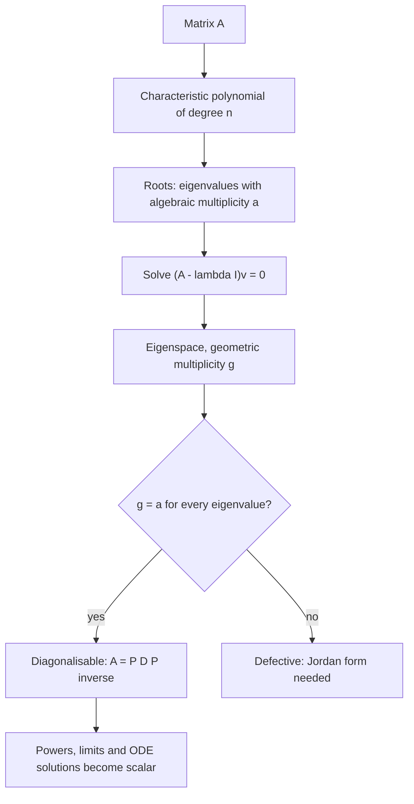

# Eigenvalues and Eigenvectors

> [Mathematics](../../README.md) › [Linear Algebra](../README.md) · Level: Advanced · Prerequisites: [Vectors](../01-vectors/README.md), [Matrices](../02-matrices/README.md), [Systems of Linear Equations](../03-systems-of-linear-equations/README.md), [Vector Spaces](../04-vector-spaces/README.md), [Polynomials](../../03-algebra/06-polynomials/README.md), [Complex Numbers](../../03-algebra/13-complex-numbers/README.md) · Estimated time: 660 min

## 1. Introduction

A matrix is a machine that moves vectors. Feed it a vector and it returns another vector, usually
pointing somewhere else entirely. Among all inputs, however, there are always a few privileged ones, and
they explain the whole machine.

Take

$$
A = \begin{pmatrix} 2 & 1 \\ 1 & 2 \end{pmatrix}
\quad\text{and compute}\quad
A\begin{pmatrix} 1 \\ 1 \end{pmatrix} = \begin{pmatrix} 3 \\ 3 \end{pmatrix},
\qquad
A\begin{pmatrix} 1 \\ 0 \end{pmatrix} = \begin{pmatrix} 2 \\ 1 \end{pmatrix},
\qquad
A\begin{pmatrix} 1 \\ -1 \end{pmatrix} = \begin{pmatrix} 1 \\ -1 \end{pmatrix}.
$$

The first output is $3$ times the input and the third is the input itself; the second has turned.
The vectors $(1,1)$ and $(1,-1)$ are the **eigenvectors** of $A$ and the numbers $3$ and $1$ are its
**eigenvalues**. The word is German: *eigen* means "own", and *Eigenwert* (Hilbert, 1904) means "own
value". An eigenvector is a direction the map cannot turn; an eigenvalue is the factor by which it
stretches along that direction.

**Why this is the central idea of linear algebra.** Once the privileged directions are known, the map
becomes trivial: on the line through $(1,1)$ it is "multiply by $3$", on the line through $(1,-1)$ it is
"multiply by $1$". Two one-dimensional problems replace one two-dimensional problem, and repeated
application costs nothing:

$$
A^k\begin{pmatrix} 1 \\ 1 \end{pmatrix} = 3^k \begin{pmatrix} 1 \\ 1 \end{pmatrix}
\qquad\text{for every } k \ge 0 .
$$

This is why eigenvalues appear wherever a process repeats: population models, Markov chains, PageRank,
numerical stability, vibrating bridges, energy levels of atoms, principal components of data, the
long-run behaviour of differential equations.

**What is genuinely new here.** Until now the right-hand side of a linear system was known. Now it is
the unknown multiplied by an unknown scalar:

$$
A\mathbf{v} = \lambda \mathbf{v} .
$$

Both $\mathbf{v}$ and $\lambda$ are unknown, so this is a *nonlinear* problem in disguise. The theory
below reduces it to a polynomial equation in the single unknown $\lambda$; once $\lambda$ is known,
finding $\mathbf{v}$ is an ordinary homogeneous linear system.

## 2. Prerequisites

**Vectors and matrices.** Computing $A\mathbf{v}$, linear combinations and matrix multiplication, from
[Vectors](../01-vectors/README.md) and [Matrices](../02-matrices/README.md).

**Vector spaces, bases, dimension, kernel.** The proofs use *basis*, *span*, *subspace* and *kernel*;
see [Vector Spaces](../04-vector-spaces/README.md). The rank–nullity theorem
$\dim\ker B + \operatorname{rank}B = n$ is used to count dimensions of eigenspaces; the row-reduction
mechanics come from [Systems of Linear Equations](../03-systems-of-linear-equations/README.md).

**Determinants.** Only three facts: $\det(AB) = \det A \det B$, $\det I = 1$, and $B$ is invertible iff
$\det B \neq 0$. These are proved in the discipline's Determinants topic (position 6); every proof below
is a chain of equalities using only them.

**Polynomials and complex numbers.** Roots, multiplicity, the fundamental theorem of algebra, conjugation
and modulus: [Polynomials](../../03-algebra/06-polynomials/README.md),
[Factoring](../../03-algebra/07-factoring/README.md),
[Complex Numbers](../../03-algebra/13-complex-numbers/README.md).

**Proof technique.** Direct proof, minimal counterexample, induction, and equivalence by a cycle of
implications, from [Proof Techniques](../../00-foundations/04-proof-techniques/README.md).

## 3. Learning Objectives

By the end of this tutorial you will be able to

1. state the definitions of eigenvalue, eigenvector and eigenspace, and explain why eigenvectors are
   never zero;
2. read eigenvalues of triangular matrices by inspection and describe eigenvectors geometrically;
3. compute characteristic polynomials and find all eigenvalues over $\mathbb{R}$ or $\mathbb{C}$;
4. prove that the roots of $p_A$ are exactly the eigenvalues;
5. compute eigenspaces and geometric multiplicities, and distinguish them from algebraic multiplicities;
6. prove $1 \le g_\lambda \le a_\lambda$ and decide diagonalisability with the multiplicity criterion;
7. prove that similar matrices have equal characteristic polynomials and exhibit non-similar matrices
   with equal spectra;
8. state and use the Cayley–Hamilton theorem, including for inverses and high powers;
9. state the spectral theorem for real symmetric matrices, prove its two lemmas and diagonalise
   orthogonally;
10. model difference equations, Markov chains, stability, PCA and linear ODEs as eigenvalue problems.

## 4. Intuition

**The grain of wood.** A carpenter works *with* the grain because the wood splits cleanly along it.
Every linear map has a grain: along it the map is a pure stretch, across it coordinates mix and rotate.
Finding the grain is finding the eigenvectors.

**The shadow on a line.** Fix a line $L$ through the origin. If $A$ maps $L$ into itself, then on $L$
the map is multiplication by a single number, because a linear map from a one-dimensional space to
itself is always multiplication by a scalar. That number is the eigenvalue; the line is the eigenspace.
So: *an eigenvector is a direction that the map does not rotate away.*

**The ellipse picture.** Apply a linear map to the unit circle. The image is an ellipse with a major
and a minor axis, and these axes are perpendicular. They are the directions of greatest and least
stretching, that is, the eigenvectors of a symmetric matrix, and the semi-axis lengths are the absolute
values of the eigenvalues.

**Trace, determinant and the spectrum.** If the eigenvalues are $\lambda_1,\dots,\lambda_n$ counted with
multiplicity over $\mathbb{C}$, then $\sum_i\lambda_i = \operatorname{tr}A$ and
$\prod_i\lambda_i = \det A$. The spectrum therefore summarises the two most important scalar invariants:
the average stretching and the volume scaling. An eigenvalue $0$ means $\det A = 0$, so the map squashes
space into a lower-dimensional image.

## 5. Formal Definition

Throughout, $\mathbb{F}$ is $\mathbb{R}$ or $\mathbb{C}$, and $A \in M_n(\mathbb{F})$ is an $n \times n$
matrix.

**Definition 5.1 (eigenvalue, eigenvector).** A scalar $\lambda \in \mathbb{F}$ is an **eigenvalue** of
$A$ if there is a vector $\mathbf{v} \in \mathbb{F}^n$ with

$$
\mathbf{v} \neq \mathbf{0}
\qquad\text{and}\qquad
A\mathbf{v} = \lambda \mathbf{v}.
$$

Such a $\mathbf{v}$ is an **eigenvector** belonging to $\lambda$.

Three remarks, each a common source of error. The vector must be **nonzero**, since
$A\mathbf{0} = \lambda\mathbf{0}$ holds for every $\lambda$ and would make every scalar an eigenvalue.
The value $\lambda = 0$ **is** allowed, and occurs exactly when $A$ is singular. And $\lambda$ must lie
in the chosen field: the rotation by $90^\circ$ has no real eigenvalue but has $\pm i$ over $\mathbb{C}$,
so "has no eigenvalues" is meaningless until a field is fixed.

**Definition 5.2 (eigenspace).** For $\lambda \in \mathbb{F}$,

$$
E_\lambda = \{\mathbf{v} \in \mathbb{F}^n : A\mathbf{v} = \lambda\mathbf{v}\} = \ker(A - \lambda I),
$$

the **eigenspace** of $\lambda$. It is a subspace, and it is nonzero exactly when $\lambda$ is an
eigenvalue.

**Definition 5.3 (characteristic polynomial).** $p_A(\lambda) = \det(\lambda I - A)$, a monic polynomial
of degree $n$. Other books use $\det(A - \lambda I)$, which differs by $(-1)^n$ and has the same roots;
never mix the two conventions inside one computation.

**Definition 5.4 (multiplicities).** The **algebraic multiplicity** $a_\lambda$ is the multiplicity of
$\lambda$ as a root of $p_A$. The **geometric multiplicity** is $g_\lambda = \dim E_\lambda$.

**Definition 5.5 (diagonalisable).** $A$ is **diagonalisable over $\mathbb{F}$** if there are an
invertible $P \in M_n(\mathbb{F})$ and a diagonal $D \in M_n(\mathbb{F})$ with $A = PDP^{-1}$.

**Definition 5.6 (similarity).** $A$ and $B$ are **similar** if $B = P^{-1}AP$ for some invertible $P$;
this is an equivalence relation (reflexive with $P = I$, symmetric with $P^{-1}$, transitive by
multiplying the $P$'s).

**Definition 5.7 (symmetric, orthogonal).** A real matrix is **symmetric** if $A^{\mathsf{T}} = A$, and
**orthogonal** if $Q^{\mathsf{T}}Q = I$, equivalently $Q^{-1} = Q^{\mathsf{T}}$. The columns of an
orthogonal matrix form an orthonormal basis of $\mathbb{R}^n$.

**Definition 5.8 (spectrum, spectral radius).** The **spectrum** is the set $\sigma(A)$ of eigenvalues
in $\mathbb{C}$; the **spectral radius** is $\rho(A) = \max\{|\lambda| : \lambda \in \sigma(A)\}$.

## 6. Mathematical Notation

| Symbol | Read as | Meaning |
|---|---|---|
| $A \in M_n(\mathbb{F})$ | "$A$ in $M$-$n$ over $F$" | an $n\times n$ matrix with entries in $\mathbb{F}$ |
| $\lambda$ | lambda | an eigenvalue, a scalar |
| $\mathbf{v}$ | bold $v$ | a column vector in $\mathbb{F}^n$ |
| $\mathbf{0}$ | zero vector | the vector with all entries $0$ |
| $I$, $I_n$ | identity | $1$ on the diagonal, $0$ elsewhere |
| $E_\lambda$ | "$E$ sub lambda" | eigenspace $\ker(A - \lambda I)$ |
| $\ker B$ | kernel of $B$ | $\{\mathbf{x} : B\mathbf{x} = \mathbf{0}\}$ |
| $\operatorname{rank}B$ | rank of $B$ | dimension of the column space |
| $p_A(\lambda)$ | "$p$ sub $A$ of lambda" | characteristic polynomial $\det(\lambda I - A)$ |
| $\operatorname{tr}A$ | trace of $A$ | sum of the diagonal entries |
| $a_\lambda$, $g_\lambda$ | algebraic, geometric multiplicity | root multiplicity; $\dim E_\lambda$ |
| $\sigma(A)$, $\rho(A)$ | spectrum, spectral radius | set of eigenvalues; largest modulus |
| $A^{\mathsf{T}}$ | "$A$ transpose" | rows and columns exchanged |
| $A^{*}$ | "$A$ star" | conjugate transpose |
| $\bar z$, $\lvert z\rvert$ | conjugate, modulus | for $z \in \mathbb{C}$ |
| $\delta_{ij}$ | Kronecker delta | $1$ if $i=j$, else $0$ |
| $\blacksquare$ | end of proof | the argument is complete |

Read $A\mathbf{v} = \lambda\mathbf{v}$ aloud as "$A$ times $v$ equals lambda times $v$", and interpret it
as "$A$ *stretches* $v$ by lambda without turning it".

## 7. Core Concepts

### 7.1 The invariant-direction idea

**Proposition 7.1 (invariant lines are eigenspaces).** Let $\mathbf{v} \neq \mathbf{0}$ and
$L = \operatorname{span}\{\mathbf{v}\}$. Then $A(L) \subseteq L$ if and only if $\mathbf{v}$ is an
eigenvector of $A$.

**Proof.** If $A(L) \subseteq L$ then $A\mathbf{v} \in L$, so $A\mathbf{v} = \lambda\mathbf{v}$ for some
scalar $\lambda$, which is the definition of an eigenvector. Conversely, if
$A\mathbf{v} = \lambda\mathbf{v}$, then every element of $L$ is $c\mathbf{v}$ and
$A(c\mathbf{v}) = cA\mathbf{v} = c\lambda\mathbf{v} = (c\lambda)\mathbf{v} \in L$. $\blacksquare$

So eigenvalues detect the lines the map respects; a map with no real eigenvalue turns every line, as the
$90^\circ$ rotation does. One useful corollary of the fundamental theorem of algebra: since $p_A$ has
real coefficients, its non-real roots occur in conjugate pairs, so **every real matrix of odd order has a
real eigenvalue**. In three dimensions every linear map therefore preserves at least one line — this is
the Euler–Lagrange axis of rotation, and it is pure algebra.

### 7.2 Definition and geometric picture

| Matrix acting on $\mathbb{R}^2$ | Eigenvalues | Eigenvectors | Effect |
|---|---|---|---|
| $\begin{pmatrix}3 & 0\\ 0 & \tfrac12\end{pmatrix}$ | $3,\ \tfrac12$ | $\mathbf{e}_1,\mathbf{e}_2$ | stretch along the axes |
| $\begin{pmatrix}1 & 1\\ 0 & 1\end{pmatrix}$ (shear) | $1,\ 1$ | only $\operatorname{span}\{\mathbf{e}_1\}$ | slide horizontal lines sideways |
| $\begin{pmatrix}0 & -1\\ 1 & 0\end{pmatrix}$ (rotation) | none real; $\pm i$ | $(1,\mp i)$ over $\mathbb{C}$ | turn every line by $90^\circ$ |
| $\begin{pmatrix}1 & 0\\ 0 & 0\end{pmatrix}$ (projection) | $1,\ 0$ | $\mathbf{e}_1,\mathbf{e}_2$ | collapse onto the $x$-axis |
| $\begin{pmatrix}0 & 1\\ 1 & 0\end{pmatrix}$ (reflection) | $1,\ -1$ | $(1,1),(1,-1)$ | mirror across $y = x$ |
| $\begin{pmatrix}2 & 1\\ 1 & 2\end{pmatrix}$ | $3,\ 1$ | $(1,1),(1,-1)$ | stretch along the diagonals |

The shear has a repeated eigenvalue but a one-dimensional eigenspace: counting eigenvalues with
multiplicity can overcount directions (§7.4). The rotation has no real eigenvector but two complex ones,
and the conjugate pair $i,-i$ is exactly the algebraic trace of a $90^\circ$ turn.

### 7.3 The characteristic polynomial, and why its roots are the eigenvalues

The definition quantifies over all nonzero vectors, which is not computable. The next theorem removes the
quantifier.

**Lemma 7.2.** For square $B$, the system $B\mathbf{x} = \mathbf{0}$ has a nonzero solution if and only
if $B$ is not invertible, if and only if $\det B = 0$.

This is the standard criterion from [Systems of Linear Equations](../03-systems-of-linear-equations/README.md).

**Theorem 7.3 (eigenvalues are the roots of $p_A$).** Let $\lambda \in \mathbb{F}$. Then $\lambda$ is an
eigenvalue of $A$ if and only if $\det(\lambda I - A) = 0$.

**Proof.** Chain of equivalences:

$$
\lambda \text{ eigenvalue}
\iff \exists\,\mathbf{v}\neq\mathbf{0}:\ (A - \lambda I)\mathbf{v} = \mathbf{0}
\iff \ker(A-\lambda I) \neq \{\mathbf{0}\}
\iff \det(A - \lambda I) = 0,
$$

where the last step is Lemma 7.2. Finally $\det(A - \lambda I) = (-1)^n\det(\lambda I - A)$, and
$(-1)^n \neq 0$. $\blacksquare$

**Consequences.** Since $\deg p_A = n$: there are at most $n$ distinct eigenvalues; over $\mathbb{C}$ there
are exactly $n$ eigenvalues counted with algebraic multiplicity (fundamental theorem of algebra); over
$\mathbb{R}$ the count of real eigenvalues has the same parity as $n$.

**Theorem 7.4 (coefficients, trace and determinant).** For $A \in M_n(\mathbb{F})$,

$$
p_A(\lambda) = \lambda^n - (\operatorname{tr}A)\lambda^{n-1} + \cdots + (-1)^n\det A .
$$

**Proof.** Expand $\det(\lambda I - A)$ with the Leibniz formula
$\det M = \sum_{\sigma}\operatorname{sgn}(\sigma)\prod_i M_{i,\sigma(i)}$ applied to
$M_{ij} = \lambda\delta_{ij} - a_{ij}$. Setting $\lambda = 0$ gives $p_A(0) = \det(-A) = (-1)^n\det A$.
In the product for a permutation $\sigma$, a factor contributes a power of $\lambda$ only when
$\sigma(i) = i$, so the degree is the number of fixed points of $\sigma$; a non-identity permutation
fixes at most $n-2$ points, so only $\sigma = \operatorname{id}$ reaches degree $n-1$ or $n$. That term
is $\prod_i(\lambda - a_{ii})$, whose $\lambda^{n-1}$ coefficient is $-\sum_i a_{ii}$. $\blacksquare$

**Corollary 7.5.** Over $\mathbb{C}$, with eigenvalues listed with algebraic multiplicity,

$$
\sum_{i=1}^{n}\lambda_i = \operatorname{tr}A, \qquad \prod_{i=1}^{n}\lambda_i = \det A .
$$

**Proof.** $p_A(\lambda) = \prod_i(\lambda - \lambda_i)$ by the fundamental theorem of algebra; compare
the coefficient of $\lambda^{n-1}$ and the constant term with Theorem 7.4. $\blacksquare$

These identities are the fastest check on any eigenvalue computation, and they recover a missing
eigenvalue: a $3\times3$ matrix with eigenvalues $3$, $-1$ and trace $5$ has third eigenvalue $3$.

### 7.4 Eigenspaces, algebraic and geometric multiplicity

**Proposition 7.6.** $E_\lambda = \ker(A - \lambda I)$ is a subspace of $\mathbb{F}^n$.

**Proof.** A kernel is always a subspace: it contains $\mathbf{0}$ and is closed under linear
combinations, since $(A - \lambda I)(c\mathbf{v} + d\mathbf{w}) = c(A-\lambda I)\mathbf{v} +
d(A-\lambda I)\mathbf{w} = \mathbf{0}$ whenever $\mathbf{v},\mathbf{w}$ are killed. $\blacksquare$

By rank–nullity, $g_\lambda = n - \operatorname{rank}(A - \lambda I)$: row-reduce $A - \lambda I$ and
count free columns.

**Theorem 7.7 (the fundamental inequality).** For every eigenvalue $\lambda$,
$1 \le g_\lambda \le a_\lambda \le n$.

**Proof.** The left inequality holds because $\lambda$ is an eigenvalue, so $E_\lambda$ contains a
nonzero vector. For the middle one, let $g = g_\lambda$ and choose a basis
$\mathbf{v}_1,\dots,\mathbf{v}_g$ of $E_\lambda$, extended to a basis $\mathcal{B}$ of $\mathbb{F}^n$.
In $\mathcal{B}$ the matrix of $A$ is block upper triangular,

$$
\tilde A = \begin{pmatrix}\lambda I_g & *\\ 0 & C\end{pmatrix},
\qquad\text{so}\qquad
\lambda I - \tilde A = \begin{pmatrix}0 & *\\ 0 & \lambda I_{n-g} - C\end{pmatrix},
$$

and the determinant of a block triangular matrix is the product of the determinants of its diagonal
blocks. Hence $p_A(t) = (t - \lambda)^g\det(tI_{n-g} - C)$, so $(t-\lambda)^g$ divides $p_A$ and
$a_\lambda \ge g$. (Changing basis does not change $p_A$; this is Theorem 7.13 below.) $\blacksquare$

**Theorem 7.8 (distinct eigenvalues give independent eigenvectors).** Eigenvectors belonging to distinct
eigenvalues are linearly independent.

**Proof.** Suppose a nontrivial relation
$c_1\mathbf{v}_1 + \cdots + c_k\mathbf{v}_k = \mathbf{0}$ exists with $\mathbf{v}_i \in E_{\lambda_i}$,
the $\lambda_i$ distinct. Choose one with the fewest nonzero terms, with index set $S$, $|S| = m$. If
$m = 1$ then $c\mathbf{v} = \mathbf{0}$ with $\mathbf{v} \neq \mathbf{0}$ forces $c = 0$, contradiction.
So $m \ge 2$; pick $j \in S$ and apply $A - \lambda_j I$. The $j$-th term vanishes and every other term
becomes $c_i(\lambda_i - \lambda_j)\mathbf{v}_i$, which is nonzero because $\lambda_i \neq \lambda_j$ and
$c_i \neq 0$. This gives a nontrivial relation with $m-1$ terms, contradicting minimality. $\blacksquare$

**Corollary.** Eigenspaces of distinct eigenvalues meet only in $\{\mathbf{0}\}$, so their sum is direct
and $\dim(E_{\lambda_1} + \cdots + E_{\lambda_k}) = g_{\lambda_1} + \cdots + g_{\lambda_k}$.

### 7.5 Diagonalisability and its criterion

**Theorem 7.9 (diagonalisability criterion).** Let $A \in M_n(\mathbb{F})$ and suppose $p_A$ splits over
$\mathbb{F}$ (automatic if $\mathbb{F} = \mathbb{C}$). The following are equivalent.

(a) $A$ is diagonalisable over $\mathbb{F}$;
(b) $\mathbb{F}^n$ has a basis of eigenvectors of $A$;
(c) $\sum_{\lambda \in \sigma(A)} g_\lambda = n$;
(d) $g_\lambda = a_\lambda$ for every eigenvalue $\lambda$.

**Proof.** *(a) $\Rightarrow$ (b)*: if $A = PDP^{-1}$ then $AP = PD$, and comparing $j$-th columns gives
$A\mathbf{p}_j = d_j\mathbf{p}_j$; the columns of $P$ are independent, hence a basis of eigenvectors.
*(b) $\Rightarrow$ (a)*: given a basis $\mathbf{v}_j$ with $A\mathbf{v}_j = d_j\mathbf{v}_j$, let $P$ be
the matrix of columns; then $AP = PD$, so $A = PDP^{-1}$.

*(b) $\Leftrightarrow$ (c)*: take a basis of each $E_{\lambda_i}$, with $g_i$ elements. Their union has
$\sum_i g_i$ elements and is independent by Theorem 7.8; it spans $E_{\lambda_1} + \cdots + E_{\lambda_k}$,
of dimension $\sum_i g_i$ by the corollary above. It is a basis of $\mathbb{F}^n$ exactly when
$\sum_i g_i = n$.

*(c) $\Leftrightarrow$ (d)*: since $p_A$ splits and is monic,
$p_A(t) = \prod_i (t - \lambda_i)^{a_i}$, so $\sum_i a_i = n$. As $g_i \le a_i$ for each $i$,
$\sum_i g_i \le n$ with equality exactly when $g_i = a_i$ for all $i$. $\blacksquare$

In practice: compute each $a_\lambda$, compute $\operatorname{rank}(A - \lambda I)$, then

$$
A \text{ is diagonalisable} \iff n - \operatorname{rank}(A - \lambda I) = a_\lambda
\text{ for every eigenvalue } \lambda .
$$

If some $g_\lambda < a_\lambda$ the matrix is **defective** and no change of basis makes it diagonal.

**Corollary 7.10.** $n$ distinct eigenvalues in $\mathbb{F}$ imply diagonalisability over $\mathbb{F}$.

**Proof.** Each $a_\lambda = 1$ and $1 \le g_\lambda \le a_\lambda$, so $g_\lambda = a_\lambda$. $\blacksquare$

**Corollary 7.11.** If $p_A$ does not split over $\mathbb{F}$, then $A$ is not diagonalisable over
$\mathbb{F}$ (because a diagonal matrix has a split characteristic polynomial).

**Corollary 7.12 (powers).** If $A = PDP^{-1}$ then $A^k = PD^kP^{-1}$ for all $k \ge 0$, and if $A$ is
invertible then $A^{-1} = PD^{-1}P^{-1}$.

**Proof.** Induct on $k$, using $P^{-1}P = I$; for negative powers invert both sides. $\blacksquare$

**A remark on the logic.** Diagonalisability is not invertibility: the zero matrix is diagonal but not
invertible, and the shear $\begin{pmatrix}1&1\\0&1\end{pmatrix}$ is invertible but not diagonalisable.
Nor does a repeated eigenvalue prevent diagonalisation: the identity has $a_1 = g_1 = n$.

### 7.6 Similar matrices have the same characteristic polynomial

**Theorem 7.13 (similarity invariance).** If $B = P^{-1}AP$ with $P$ invertible, then $p_B = p_A$; hence
$A$ and $B$ have the same eigenvalues with the same algebraic multiplicities, the same trace and the same
determinant.

**Proof.** Since $P^{-1}(\lambda I)P = \lambda I$,

$$
\lambda I - B = \lambda I - P^{-1}AP = P^{-1}(\lambda I - A)P,
$$

so by multiplicativity of the determinant,

$$
p_B(\lambda) = \det(P^{-1})\det(\lambda I - A)\det(P) = \det(P)^{-1}\det(P)\,p_A(\lambda) = p_A(\lambda).
$$

Equal polynomials have the same roots with the same multiplicities; trace and determinant are determined
by the spectrum (Corollary 7.5). $\blacksquare$

Rank and diagonalisability are also similarity invariants (multiplying by invertible matrices preserves
rank, and $A = QDQ^{-1}$ gives $B = (P^{-1}Q)D(P^{-1}Q)^{-1}$).

**The converse fails.** The matrices $N = \begin{pmatrix}0&1\\0&0\end{pmatrix}$ and
$Z = \begin{pmatrix}0&0\\0&0\end{pmatrix}$ both have $p(\lambda) = \lambda^2$, but $\operatorname{rank}N = 1 \neq 0 =
\operatorname{rank}Z$. So the characteristic polynomial classifies a matrix up to similarity only among
diagonalisable matrices.

### 7.7 The Cayley–Hamilton theorem

**Lemma 7.14 (triangularisation over $\mathbb{C}$).** Every complex matrix is similar to an upper
triangular matrix whose diagonal entries are its eigenvalues repeated with multiplicity.

**Proof sketch (induction on $n$).** For $n=1$ clear. Otherwise take an eigenvector $\mathbf{v}_1$ with
eigenvalue $\lambda_1$ and put it first in a basis. The matrix of $A$ in that basis is
$\begin{pmatrix}\lambda_1 & \mathbf{b}^{\mathsf{T}}\\ \mathbf{0} & C\end{pmatrix}$, since the first column is
$A\mathbf{v}_1 = \lambda_1\mathbf{v}_1$. By induction there is an invertible $S$ with $S^{-1}CS$ upper
triangular, and conjugating by $\operatorname{diag}(1,S)$ triangularises the whole matrix. The diagonal
is $(\lambda_1, \text{diagonal of } S^{-1}CS)$, and by the block determinant formula
$p_A(t) = (t-\lambda_1)\det(tI - C)$, so these are the eigenvalues with multiplicity. $\blacksquare$

**Theorem 7.15 (Cayley–Hamilton).** For every $A \in M_n(\mathbb{F})$, $p_A(A) = 0$, where $p_A(A)$ means
$\sum_k c_kA^k$ for $p_A(t) = \sum_k c_kt^k$ (with $A^0 = I$).

**Proof sketch.** Work over $\mathbb{C}$ (a real matrix is also complex, with the same $p_A$). By Lemma
7.14 take $T = P^{-1}AP$ upper triangular with diagonal $\lambda_1,\dots,\lambda_n$, so $p_T = p_A$. Put
$B_k = (T - \lambda_1I)\cdots(T - \lambda_kI)$; we show $B_k\mathbf{e}_j = \mathbf{0}$ for $j \le k$, by
induction on $k$.

For $k=1$: the first column of $T - \lambda_1I$ is zero, so $B_1\mathbf{e}_1 = \mathbf{0}$. For the step,
let $j \le k$. The $j$-th column of the upper triangular $T$ has zero entries below the diagonal and
$\lambda_j$ in position $j$, so $(T - \lambda_kI)\mathbf{e}_j$ has zero entries in rows $j+1,\dots,n$ and
$0$ in position $j$ when $j = k$. Hence $(T-\lambda_kI)\mathbf{e}_j \in
\operatorname{span}\{\mathbf{e}_1,\dots,\mathbf{e}_{k-1}\}$, a space annihilated by $B_{k-1}$ by
induction, so $B_k\mathbf{e}_j = \mathbf{0}$.

With $k = n$, $B_n = 0$ as a matrix, and $B_n = \prod_i(T - \lambda_iI) = p_T(T) = p_A(T)$. Finally
$p_A(T) = P^{-1}p_A(A)P$ for every polynomial, so $p_A(A) = P\,p_A(T)\,P^{-1} = 0$. $\blacksquare$

**Remark 7.16 (why the naive proof fails).** The tempting line "$p_A(A) = \det(AI - A) = \det 0 = 0$" is
not a proof: $\lambda$ inside $\det(\lambda I - A)$ is a *number*, and substituting a matrix for it is
illegal. The honest routes are the triangularisation above or the adjugate identity
$M\operatorname{adj}(M) = \det(M)I$ handled carefully. The general theorem is due to Frobenius (1878).

**Application 7.17 (inverses and powers from $p_A$).** Write
$p_A(t) = t^n + c_{n-1}t^{n-1} + \cdots + c_1t + c_0$ with $c_0 = (-1)^n\det A$. Then

$$
A^n + c_{n-1}A^{n-1} + \cdots + c_1A + c_0I = 0,
\qquad\text{and if } A \text{ is invertible,}\qquad
A^{-1} = -\frac{1}{c_0}\left(A^{n-1} + c_{n-1}A^{n-2} + \cdots + c_1I\right).
$$

For $A = \begin{pmatrix}1&2\\3&4\end{pmatrix}$ we have $p_A(t) = t^2 - 5t - 2$, so $A^2 = 5A + 2I$ and
$A^{-1} = \tfrac12(A - 5I) = \begin{pmatrix}-2&1\\ 3/2&-1/2\end{pmatrix}$, matching the cofactor formula.
Multiplying the relation repeatedly by $A$ gives every power as a combination of $A$ and $I$; for example
$A^5 = 779A + 290I$. The **minimal polynomial** $m_A$ is the monic polynomial of least degree with
$m_A(A) = 0$; it divides $p_A$, and $A$ is diagonalisable if and only if $m_A$ has distinct roots.

### 7.8 The spectral theorem for real symmetric matrices

**Theorem 7.18 (spectral theorem, real symmetric case).** Let $A \in M_n(\mathbb{R})$ with
$A^{\mathsf{T}} = A$. Then there is a real orthogonal $Q$ and a real diagonal
$D = \operatorname{diag}(\lambda_1,\dots,\lambda_n)$ with

$$
A = QDQ^{\mathsf{T}}, \qquad\text{equivalently}\qquad Q^{\mathsf{T}}AQ = D .
$$

Equivalently: $\mathbb{R}^n$ has an orthonormal basis of eigenvectors of $A$, and all eigenvalues are
real.

**Lemma 7.19 (real eigenvalues).** A real symmetric matrix has only real eigenvalues.

**Proof.** Let $A\mathbf{v} = \lambda\mathbf{v}$ with $\mathbf{v} \neq \mathbf{0}$ over $\mathbb{C}$. Using
the Hermitian inner product and symmetry ($\langle A\mathbf{x},\mathbf{y}\rangle = \langle
\mathbf{x},A\mathbf{y}\rangle$, valid for complex vectors because $A$ has real entries),

$$
\lambda\langle\mathbf{v},\mathbf{v}\rangle = \langle\mathbf{v},A\mathbf{v}\rangle
= \langle A\mathbf{v},\mathbf{v}\rangle = \bar\lambda\langle\mathbf{v},\mathbf{v}\rangle,
$$

and $\langle\mathbf{v},\mathbf{v}\rangle > 0$ gives $\lambda = \bar\lambda$. $\blacksquare$

**Lemma 7.20 (orthogonal eigenvectors).** Eigenvectors for *distinct* eigenvalues of a real symmetric
matrix are orthogonal.

**Proof.** With $A\mathbf{v}_i = \lambda_i\mathbf{v}_i$ and $\lambda_1 \neq \lambda_2$,
$\lambda_1\langle\mathbf{v}_1,\mathbf{v}_2\rangle = \langle A\mathbf{v}_1,\mathbf{v}_2\rangle =
\langle\mathbf{v}_1,A\mathbf{v}_2\rangle = \lambda_2\langle\mathbf{v}_1,\mathbf{v}_2\rangle$, so
$(\lambda_1 - \lambda_2)\langle\mathbf{v}_1,\mathbf{v}_2\rangle = 0$. $\blacksquare$

The remaining step is the repeated-eigenvalue case: one shows $g_\lambda = a_\lambda$ by observing that
the orthogonal complement of an eigenspace is again $A$-invariant and inducting on the dimension; the
full argument is Theorem 7.21 of the next topic. So every real symmetric matrix is diagonalisable, and in
fact **orthogonally** diagonalisable.

**Intuition.** A symmetric matrix only stretches: it has no twist, and its stretch directions are
perpendicular. Physically, symmetric matrices are matrices of *energy* — inertia tensors, covariance
matrices, Hessians, Hamiltonians — and the eigenvectors are the principal axes, the eigenvalues the
measurable quantities (moments of inertia, variances, curvatures, energy levels). The eigenvalues also
bound the **Rayleigh quotient**:

$$
\lambda_{\min} \le \frac{\mathbf{x}^{\mathsf{T}}A\mathbf{x}}{\mathbf{x}^{\mathsf{T}}\mathbf{x}} \le \lambda_{\max}
\qquad\text{for } \mathbf{x} \neq \mathbf{0},
$$

with equality at the corresponding eigenvectors. This is the basis of the power method and of PCA.

### 7.9 Applications: an overview

Eigenvalues answer every question of the form "what happens when this map is applied again and again?".

| Setting | Eigenvalue meaning |
|---|---|
| $\mathbf{x}_{k+1} = A\mathbf{x}_k$ | mode $\mathbf{v}_i$ grows like $\lambda_i^k$ |
| Markov chain $P$ | $\lambda = 1$ gives the stationary distribution; other $\lvert\lambda\rvert$ give the mixing rate |
| $\mathbf{x}' = A\mathbf{x}$ | $\operatorname{Re}\lambda < 0$ for all $\lambda$ means stability |
| PCA, covariance $\Sigma$ | variance captured along each principal direction |
| Vibration, $K\mathbf{v} = \omega^2M\mathbf{v}$ | $\omega$ is a natural frequency |

§12 develops these in detail.

## 8. Formulas and Properties

Hypotheses are part of each statement; all are proved in §7.

1. **Eigenvalue test.** $\lambda$ is an eigenvalue of $A$ $\iff$ $\det(\lambda I - A) = 0$ (Theorem 7.3).
2. **Size two.** $p_A(\lambda) = \lambda^2 - (\operatorname{tr}A)\lambda + \det A$, so
   $\lambda = \tfrac12\big(\operatorname{tr}A \pm \sqrt{(\operatorname{tr}A)^2 - 4\det A}\big)$.
3. **Triangular matrices.** The eigenvalues are the diagonal entries, each with multiplicity equal to
   the number of its occurrences (the product $\prod_i(\lambda - a_{ii})$ is already $p_A$).
4. **Trace and determinant.** Over $\mathbb{C}$, $\operatorname{tr}A = \sum_i\lambda_i$ and
   $\det A = \prod_i\lambda_i$, with algebraic multiplicities (Corollary 7.5).
5. **Eigenspace dimension.** $g_\lambda = \dim\ker(A-\lambda I) = n - \operatorname{rank}(A-\lambda I)$.
6. **Sandwich.** $1 \le g_\lambda \le a_\lambda$ (Theorem 7.7).
7. **Diagonalisability.** Over a field where $p_A$ splits, $A$ is diagonalisable
   $\iff$ $g_\lambda = a_\lambda$ for every eigenvalue (Theorem 7.9).
8. **Distinct eigenvalues suffice.** $n$ distinct eigenvalues over $\mathbb{F}$ imply diagonalisability
   (Corollary 7.10).
9. **Similarity invariance.** Similar matrices share $p_A$, spectrum with multiplicities, trace,
   determinant, rank and diagonalisability (Theorem 7.13).
10. **Transpose.** $p_{A^{\mathsf{T}}} = p_A$, because
    $\det(\lambda I - A^{\mathsf{T}}) = \det((\lambda I - A)^{\mathsf{T}}) = \det(\lambda I - A)$.
11. **Cayley–Hamilton.** $p_A(A) = 0$ (Theorem 7.15).
12. **Powers.** $A = PDP^{-1} \Rightarrow A^k = PD^kP^{-1}$, so the entries of $A^k$ are combinations of
    $\lambda_i^k$ (Corollary 7.12).
13. **Spectral theorem.** $A = A^{\mathsf{T}} \in M_n(\mathbb{R})$ $\Rightarrow$ $A = QDQ^{\mathsf{T}}$
    with $Q$ orthogonal and $D$ real diagonal (Theorem 7.18).
14. **Limits.** If $A$ is diagonalisable, then $A^k \to 0$ entrywise $\iff \rho(A) < 1$: by Corollary
    7.12 the convergence is that of $D^k$, and a fixed $P$ does not affect it.

## 9. Step-by-Step Examples

### Example 9.1 (test candidates by multiplication)

For $A = \begin{pmatrix}3&1\\0&2\end{pmatrix}$, which of $(1,0)$, $(1,1)$, $(1,-1)$ are eigenvectors?

Being triangular, $A$ has eigenvalues $3$ and $2$. Multiply:

$$
A\begin{pmatrix}1\\0\end{pmatrix} = \begin{pmatrix}3\\0\end{pmatrix} = 3\begin{pmatrix}1\\0\end{pmatrix},
\qquad
A\begin{pmatrix}1\\1\end{pmatrix} = \begin{pmatrix}4\\2\end{pmatrix},
\qquad
A\begin{pmatrix}1\\-1\end{pmatrix} = \begin{pmatrix}2\\-2\end{pmatrix} = 2\begin{pmatrix}1\\-1\end{pmatrix}.
$$

The first is an eigenvector for $\lambda = 3$, the third for $\lambda = 2$. For the middle one,
$(4,2) = \lambda(1,1)$ would need $\lambda = 4$ and $\lambda = 2$ at once. Testing a candidate is one
matrix–vector product, nothing more.

### Example 9.2 (a complete $2\times2$ analysis)

Let $A = \begin{pmatrix}5&4\\1&2\end{pmatrix}$. Then

$$
p_A(\lambda) = \lambda^2 - (5+2)\lambda + (5\cdot2 - 4\cdot1) = \lambda^2 - 7\lambda + 6 = (\lambda-6)(\lambda-1),
$$

so the eigenvalues are $6$ and $1$. For $\lambda = 6$:

$$
A - 6I = \begin{pmatrix}-1&4\\1&-4\end{pmatrix} \longrightarrow \begin{pmatrix}1&-4\\0&0\end{pmatrix}
\Rightarrow x = 4y, \qquad \mathbf{v}_1 = \begin{pmatrix}4\\1\end{pmatrix}.
$$

For $\lambda = 1$:

$$
A - I = \begin{pmatrix}4&4\\1&1\end{pmatrix} \longrightarrow \begin{pmatrix}1&1\\0&0\end{pmatrix}
\Rightarrow x = -y, \qquad \mathbf{v}_2 = \begin{pmatrix}1\\-1\end{pmatrix}.
$$

*Checks:* $A\mathbf{v}_1 = (24,6)^{\mathsf{T}} = 6\mathbf{v}_1$ ✓; $A\mathbf{v}_2 = (1,-1)^{\mathsf{T}} = \mathbf{v}_2$ ✓;
trace $7 = 6+1$ ✓; determinant $6 = 6\cdot1$ ✓. With $P = \begin{pmatrix}4&1\\1&-1\end{pmatrix}$ and
$D = \operatorname{diag}(6,1)$, $\det P = -5 \neq 0$, so $A = PDP^{-1}$.

### Example 9.3 (complex eigenvalues: a rotation)

For $A = \begin{pmatrix}0&-1\\1&0\end{pmatrix}$, $p_A(\lambda) = \lambda^2 + 1$, so there is no real
eigenvalue and over $\mathbb{C}$ the eigenvalues are $\pm i$. For $\lambda = i$,

$$
A - iI = \begin{pmatrix}-i&-1\\1&-i\end{pmatrix} \Rightarrow ix + y = 0 \Rightarrow y = -ix,
\qquad \mathbf{v} = \begin{pmatrix}1\\-i\end{pmatrix}.
$$

Indeed $A\mathbf{v} = (i,1)^{\mathsf{T}} = i(1,-i)^{\mathsf{T}}$ ✓, and conjugating gives $(1,i)$ for
$-i$. There is no real invariant line: the rotation turns every line. The moduli of the eigenvalues are
$1$, which is the algebraic statement that the map preserves lengths.

### Example 9.4 (a defective $3\times3$ matrix)

Let $A = \begin{pmatrix}3&1&0\\0&3&0\\0&0&3\end{pmatrix}$. Triangular with diagonal $3,3,3$, so
$p_A(\lambda) = (\lambda-3)^3$ and $a_3 = 3$. Now

$$
A - 3I = \begin{pmatrix}0&1&0\\0&0&0\\0&0&0\end{pmatrix}, \qquad \operatorname{rank} = 1,
\qquad g_3 = 3 - 1 = 2 < 3 = a_3 .
$$

The eigenspace is $\{(s,0,t)\}$, spanned by $\mathbf{e}_1,\mathbf{e}_3$, so there is no basis of
eigenvectors and $A$ is not diagonalisable (Theorem 7.9). The missing direction is a *generalised*
eigenvector: $(A-3I)\mathbf{e}_2 = \mathbf{e}_1 \neq \mathbf{0}$. This is the first step of Jordan form.

### Example 9.5 (difference equations and Binet's formula)

The Fibonacci recurrence is $\mathbf{x}_n = A\mathbf{x}_{n-1}$ with
$A = \begin{pmatrix}1&1\\1&0\end{pmatrix}$ and $\mathbf{x}_0 = (F_1,F_0)^{\mathsf{T}} = (1,0)^{\mathsf{T}}$.
Here $p_A(\lambda) = \lambda^2 - \lambda - 1$ with roots

$$
\varphi = \frac{1+\sqrt5}{2} \approx 1.618, \qquad \psi = \frac{1-\sqrt5}{2} \approx -0.618 .
$$

From $(A - \varphi I)\mathbf{v} = \mathbf{0}$, whose second row reads $x - \varphi y = 0$, one gets
$\mathbf{v}_1 = (\varphi,1)^{\mathsf{T}}$ (using $\varphi^2 = \varphi + 1$); similarly
$\mathbf{v}_2 = (\psi,1)^{\mathsf{T}}$.
Writing $\mathbf{x}_0 = c_1\mathbf{v}_1 + c_2\mathbf{v}_2$ and using $1/(\varphi-\psi) = 1/\sqrt5$ gives
$c_1 = 1/\sqrt5$, $c_2 = -1/\sqrt5$, so

$$
\mathbf{x}_n = \frac{1}{\sqrt5}\left(\varphi^n\begin{pmatrix}\varphi\\1\end{pmatrix}
- \psi^n\begin{pmatrix}\psi\\1\end{pmatrix}\right),
\qquad
F_n = \frac{\varphi^n - \psi^n}{\sqrt5}.
$$

*Check:* $F_{10} = (122.9919 - 0.0081)/2.2361 = 55.000$ ✓. Since $|\psi| < 1$, $F_{n+1}/F_n \to \varphi$:
the golden ratio is an eigenvalue.

### Example 9.6 (Cayley–Hamilton in action)

For $A = \begin{pmatrix}1&2\\3&4\end{pmatrix}$, $p_A(\lambda) = \lambda^2 - 5\lambda - 2$, so
$A^2 - 5A - 2I = 0$ should hold. Indeed

$$
A^2 = \begin{pmatrix}7&10\\15&22\end{pmatrix}
\quad\text{and}\quad
5A + 2I = \begin{pmatrix}5&10\\15&20\end{pmatrix} + \begin{pmatrix}2&0\\0&2\end{pmatrix}
= \begin{pmatrix}7&10\\15&22\end{pmatrix} ✓ .
$$

Hence $A(A - 5I) = 2I$ and $A^{-1} = \tfrac12(A-5I) = \begin{pmatrix}-2&1\\3/2&-1/2\end{pmatrix}$, which
agrees with the cofactor formula. Repeated substitution gives

$$
A^3 = 5A^2 + 2A = 27A + 10I, \quad A^4 = 145A + 54I, \quad A^5 = 779A + 290I
= \begin{pmatrix}1069&1558\\2337&3406\end{pmatrix} ✓ .
$$

### Example 9.7 (hard: orthogonal diagonalisation of a symmetric matrix)

Let $A = \begin{pmatrix}2&-1&0\\-1&2&-1\\0&-1&2\end{pmatrix}$, the discrete Laplacian of a chain of three
masses. Expanding along the first row,

$$
p_A(\lambda) = (2-\lambda)\big[(2-\lambda)^2 - 1\big] - \big[(-1)(2-\lambda)\big]
= (2-\lambda)\big[(2-\lambda)^2 - 2\big],
$$

so the eigenvalues are $2$, $2+\sqrt2 \approx 3.414$ and $2-\sqrt2 \approx 0.586$. *Checks:* sum
$= 6 = \operatorname{tr}A$ ✓; product $= 2(4-2) = 4$ and
$\det A = 2(4-1) - (-1)(-2) = 6-2 = 4$ ✓.

For $\lambda = 2$: $A - 2I = \begin{pmatrix}0&-1&0\\-1&0&-1\\0&-1&0\end{pmatrix}$ forces $y = 0$, $x+z = 0$,
so $\mathbf{u}_1 = (1,0,-1)^{\mathsf{T}}/\sqrt2$. For $\lambda = 2+\sqrt2$: the first row gives
$-\sqrt2\,x - y = 0$, so $y = -\sqrt2 x$ and $z = x$, giving $\mathbf{u}_2 = (1,-\sqrt2,1)^{\mathsf{T}}/2$.
Similarly $\mathbf{u}_3 = (1,\sqrt2,1)^{\mathsf{T}}/2$ for $\lambda = 2-\sqrt2$. Orthogonality checks:

$$
\mathbf{u}_1\cdot\mathbf{u}_2 = \frac{1 + 0 - 1}{2\sqrt2} = 0, \quad
\mathbf{u}_2\cdot\mathbf{u}_3 = \frac{1-2+1}{4} = 0, \quad
\mathbf{u}_1\cdot\mathbf{u}_3 = \frac{1+0-1}{2\sqrt2} = 0,
$$

and each vector has length $1$. Hence $Q = (\mathbf{u}_1\mid\mathbf{u}_2\mid\mathbf{u}_3)$ is orthogonal
and $A = Q\operatorname{diag}(2, 2+\sqrt2, 2-\sqrt2)Q^{\mathsf{T}}$. Consequently
$2-\sqrt2 \le \mathbf{x}^{\mathsf{T}}A\mathbf{x}/\mathbf{x}^{\mathsf{T}}\mathbf{x} \le 2+\sqrt2$.

## 10. Visual Explanations

The whole topic is one pipeline: a geometric question becomes a polynomial equation, and the answer is
read off from multiplicities.

For $2\times2$ matrices the discriminant $\Delta = (\operatorname{tr}A)^2 - 4\det A$ of $p_A$ classifies
the geometry.

| Condition | Eigenvalues | Geometry |
|---|---|---|
| $\Delta > 0$, $\det A > 0$ | real, same sign | two invariant lines, both stretched or both shrunk |
| $\Delta > 0$, $\det A < 0$ | real, opposite signs | saddle: one attracting, one repelling direction |
| $\Delta = 0$ | repeated real $\lambda$ | diagonalisable only if $A = \lambda I$; otherwise a shear |
| $\Delta < 0$ | complex conjugate pair | rotation composed with scaling by $\sqrt{\det A}$ |

The last row is worth memorising: a real $2\times2$ matrix with non-real eigenvalues is a
rotation–scaling, and the scaling factor is $|\lambda| = \sqrt{\det A}$.

## 11. Common Mistakes

1. **Treating $\mathbf{0}$ as an eigenvector.** It satisfies every equation $A\mathbf{0} = \lambda\mathbf{0}$,
   which would make every scalar an eigenvalue.
2. **Forgetting that $\lambda = 0$ is allowed.** A singular matrix has eigenvalue $0$, with eigenvectors
   in its kernel.
3. **Mixing sign conventions.** $\det(\lambda I - A)$ and $\det(A-\lambda I)$ differ by $(-1)^n$; roots are
   the same, the polynomial is not. Check against trace and determinant.
4. **Assuming real eigenvalues exist.** The rotation has none. Always state the field.
5. **Confusing the two multiplicities.** $a_\lambda$ counts a root, $g_\lambda$ counts dimensions; only
   $g_\lambda$ counts independent eigenvectors.
6. **Believing repeated eigenvalues prevent diagonalisation.** The identity has $a_1 = g_1 = n$; the test
   is $g_\lambda = a_\lambda$ for every $\lambda$.
7. **Not checking that $P$ is invertible.** Writing $A = PDP^{-1}$ requires independent eigenvectors;
   verify $\det P \neq 0$ (automatic with distinct eigenvalues).
8. **Assuming similar matrices have the same eigenvectors.** They share eigenvalues; eigenvectors of
   $B = P^{-1}AP$ are $P^{-1}\mathbf{v}$, not $\mathbf{v}$.
9. **Assuming equal characteristic polynomials imply similarity.** False: $\begin{pmatrix}0&1\\0&0\end{pmatrix}$
   and the zero matrix both have $p(\lambda) = \lambda^2$ but different ranks.
10. **Confusing $A$ with $A^{\mathsf{T}}$.** They share eigenvalues but generally not eigenvectors.
11. **Substituting a matrix into a determinant.** $p_A(A) = 0$ is a theorem (Cayley–Hamilton), not the
    computation "$\det(AI - A) = \det 0$".

## 12. Applications

### 12.1 Difference equations and iteration

If $\mathbf{x}_{k+1} = A\mathbf{x}_k$ and $A = PDP^{-1}$ with columns $\mathbf{v}_i$ and eigenvalues
$\lambda_i$, then

$$
\mathbf{x}_k = A^k\mathbf{x}_0 = \sum_{i=1}^{n} c_i\,\lambda_i^k\,\mathbf{v}_i ,
$$

a superposition of **modes**. A mode decays if $|\lambda_i| < 1$, persists if $|\lambda_i| = 1$ and
explodes if $|\lambda_i| > 1$; the long-run behaviour is governed by the spectral radius. When one
eigenvalue dominates strictly, the direction of $\mathbf{x}_k$ converges to its eigenvector, which is
exactly the **power method** for computing a dominant eigenpair. Fibonacci (Example 9.5) is the
prototype.

### 12.2 Markov chains and stationary distributions

A **column-stochastic** matrix $P$ has nonnegative entries and columns summing to $1$. Then
$(1,\dots,1)P = (1,\dots,1)$, so $P^{\mathsf{T}}$ has eigenvalue $1$ with eigenvector of all ones; since
$P$ and $P^{\mathsf{T}}$ have the same characteristic polynomial, $P$ has eigenvalue $1$ too. A
corresponding nonnegative eigenvector $\boldsymbol{\pi}$ normalised to sum $1$ is a **stationary
distribution**, and $P^k$ converges to the matrix with every column $\boldsymbol{\pi}$ when all other
eigenvalues have modulus $< 1$.

For the two-state chain

$$
P = \begin{pmatrix}0.9&0.2\\0.1&0.8\end{pmatrix},
\qquad
p_P(\lambda) = \lambda^2 - 1.7\lambda + 0.7 = (\lambda-1)(\lambda-0.7),
$$

the stationary vector solves $0.9x + 0.2y = x$, that is $0.2y = 0.1x$, so $x = 2y$ and
$\boldsymbol{\pi} = (\tfrac23,\tfrac13)$: two thirds of the time is spent in state $1$. From
$\mathbf{x}_0 = (0.5,0.5)$,

$$
\mathbf{x}_k = \begin{pmatrix}2/3\\1/3\end{pmatrix}
+ \frac16\left(\frac{7}{10}\right)^{k}\begin{pmatrix}-1\\1\end{pmatrix},
$$

so the deviation decays geometrically at rate $0.7$. *Check* $k=0$: $2/3 - 1/6 = 1/2$ ✓. This rate is the
mixing time, and the same structure underlies PageRank.

### 12.3 Stability

For $\mathbf{x}' = A\mathbf{x}$ a solution started at an eigenvector is $\mathbf{v}e^{\lambda t}$. So the
equilibrium $\mathbf{0}$ is **asymptotically stable** if and only if $\operatorname{Re}\lambda < 0$ for
every eigenvalue, and unstable if some $\operatorname{Re}\lambda > 0$. For
$\mathbf{x}_{k+1} = A\mathbf{x}_k$ the condition is $|\lambda| < 1$, that is $\rho(A) < 1$. For
$2\times2$ matrices these read: continuous stable $\iff \operatorname{tr}A < 0$ and $\det A > 0$;
discrete stable $\iff |\operatorname{tr}A| < 1 + \det A$ and $\det A < 1$.

The matrix $\begin{pmatrix}1&4\\2&3\end{pmatrix}$ has $\operatorname{tr} = 4$, $\det = -5$, eigenvalues
$5$ and $-1$: one growing and one decaying mode. The origin is a **saddle**, stable along $(-2,1)$ and
unstable along $(1,1)$.

### 12.4 Principal component analysis

Let $X$ be a centred data matrix. The covariance matrix $\Sigma = \frac{1}{m-1}XX^{\mathsf{T}}$ is
symmetric and positive semidefinite, so it has an orthonormal eigenbasis with real eigenvalues
$\lambda_1 \ge \cdots \ge \lambda_n \ge 0$. The eigenvector of $\lambda_1$ is the direction of greatest
variance, and $\sum_i\lambda_i = \operatorname{tr}\Sigma$ is the total variance; keeping the first $k$
eigen-coordinates gives the best rank-$k$ approximation of the data. For

$$
\Sigma = \begin{pmatrix}2&1\\1&2\end{pmatrix},
$$

the eigenvalues are $3$ and $1$ with orthonormal eigenvectors $(1,1)/\sqrt2$ and $(1,-1)/\sqrt2$. The
first component carries $3/4 = 75\%$ of the total variance $4$, so one coordinate summarises three
quarters of the information.

### 12.5 Linear ODEs and vibration

For diagonalisable $A$, the system $\mathbf{x}' = A\mathbf{x}$ has the general solution

$$
\mathbf{x}(t) = \sum_{i=1}^{n} c_i\,e^{\lambda_i t}\,\mathbf{v}_i ,
$$

so real negative eigenvalues give decaying exponentials and complex $\lambda = a\pm bi$ give damped
oscillations $e^{at}\cos bt$, $e^{at}\sin bt$. A mechanical system $M\mathbf{x}'' + K\mathbf{x} = \mathbf{0}$
with symmetric positive definite $M, K$ and the ansatz $\mathbf{x} = \mathbf{v}\cos(\omega t)$ leads to
the generalised problem $K\mathbf{v} = \omega^2M\mathbf{v}$: the eigenvalues are the squared **natural
frequencies**, the eigenvectors the **normal modes**. For the chain of Example 9.7 the frequencies are
$\sqrt{2-\sqrt2}$, $\sqrt2$, $\sqrt{2+\sqrt2}$.

The same idea covers the adjacency matrix of a graph (connectivity, spectral clustering), the inertia
tensor (principal moments), and the Hamiltonian of a quantum system (energy levels).

## 13. Exercises

The problem set is in [exercises.md](exercises.md): 35 problems from direct computation to proofs and
applications, including diagonalisation, defectiveness, Markov chains and Cayley–Hamilton.

## 14. Solutions

Complete worked solutions with every step and every check are in [solutions.md](solutions.md).

## 15. Summary

* An **eigenvector** is a nonzero vector whose direction is preserved, $A\mathbf{v} = \lambda\mathbf{v}$;
  equivalently $\operatorname{span}\{\mathbf{v}\}$ is an invariant line of $A$.
* $\lambda$ is an eigenvalue exactly when $\det(\lambda I - A) = 0$; the **characteristic polynomial**
  $p_A$ is monic of degree $n$ with $\lambda^{n-1}$ coefficient $-\operatorname{tr}A$ and constant term
  $(-1)^n\det A$.
* $E_\lambda = \ker(A-\lambda I)$ is a subspace with $g_\lambda = n - \operatorname{rank}(A-\lambda I)$.
* Always $1 \le g_\lambda \le a_\lambda$, and $A$ is diagonalisable iff $g_\lambda = a_\lambda$ for every
  eigenvalue; $n$ distinct eigenvalues always suffice.
* $A = PDP^{-1}$ gives $A^k = PD^kP^{-1}$, turning powers, limits and recurrences into scalar algebra.
* Similar matrices share $p_A$, the spectrum with multiplicities, trace, determinant, rank and
  diagonalisability; the converse fails.
* **Cayley–Hamilton**: $p_A(A) = 0$, which produces $A^{-1}$ and all higher powers from a scalar relation.
* **Spectral theorem**: real symmetric matrices are orthogonally diagonalisable with real eigenvalues.
* Applications — difference equations, Markov chains, stability, PCA, ODEs and vibration — all ask what
  repeated application of a map does, which is an eigenvalue question.

## 16. Further Learning

**Next in this discipline.** [Inner Product Spaces](../08-inner-product-spaces/README.md) supplies the
geometry — angles, projections, orthogonality — that completes the spectral theorem and leads to least
squares, QR and Fourier analysis. The discipline index is [Linear Algebra](../README.md).

**Within the repository.**

* [Recurrence Relations](../../09-discrete-mathematics/02-recurrence-relations/README.md) — the
  combinatorial side of §12.1.
* [Differential Equations](../../16-differential-equations/README.md) — systems, normal modes, stability.
* [Optimization](../../18-optimization/README.md) — Rayleigh quotients, quadratic forms, Hessian tests.
* [Numerical Analysis](../../19-numerical-analysis/README.md) — power iteration and QR iteration.
* [Abstract Algebra](../../13-abstract-algebra/README.md) — eigenvalues over general fields and the
  minimal polynomial.
* [Theorems](../../reference/theorems/README.md) — compact statements of Cayley–Hamilton and the
  spectral theorem.

**Standard texts.** G. Strang, *Introduction to Linear Algebra* (geometric, applied); S. Axler,
*Linear Algebra Done Right* (determinant-free, rigorous); R. A. Horn and C. R. Johnson, *Matrix Analysis*
(similarity, Jordan form, inequalities); G. H. Golub and C. F. Van Loan, *Matrix Computations* (how
eigenvalues are computed in practice).
