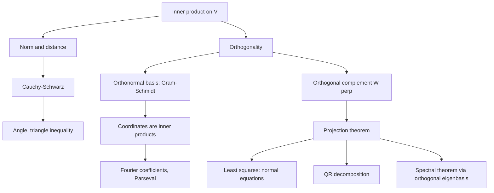

# Inner Product Spaces

> [Mathematics](../../README.md) › [Linear Algebra](../README.md) · Level: Advanced · Prerequisites: [Vectors](../01-vectors/README.md), [Matrices](../02-matrices/README.md), [Vector Spaces](../04-vector-spaces/README.md), [Eigenvalues and Eigenvectors](../07-eigenvalues-and-eigenvectors/README.md), [Trigonometric Functions](../../05-trigonometry/01-trigonometric-functions/README.md) · Estimated time: 600 min

## 1. Introduction

Up to now a vector space has been a place where you can add and scale, and nothing more. Such a space
knows about lines, planes and linear combinations, but it does not know about **length**, **angle** or
**distance**. Add one extra piece of structure — an inner product — and all the geometry of ordinary
space becomes available in any dimension, and even in spaces of functions.

The payoff is immediate. With lengths and angles come orthogonality, and orthogonality is the great
simplifier of mathematics. A basis of perpendicular unit vectors turns every computation into arithmetic
on coordinates:

$$
\mathbf{x} = \sum_{i=1}^{n}\langle \mathbf{x},\mathbf{u}_i\rangle\,\mathbf{u}_i ,
\qquad
\lVert \mathbf{x}\rVert^2 = \sum_{i=1}^{n}\langle \mathbf{x},\mathbf{u}_i\rangle^2 .
$$

No linear system has to be solved: the coefficients are inner products. Two consequences are so useful
that whole subjects are built on them. **Least squares** — how to fit a line to data that does not lie on
one — becomes the geometry of dropping a perpendicular onto a subspace. **Fourier series** — how to
represent a signal as a sum of pure tones — becomes exactly the same formula, with the basis
$1,\cos x,\sin x,\cos 2x,\dots$ in place of $\mathbf{u}_i$.

A concrete preview. Let $W$ be the plane in $\mathbb{R}^3$ spanned by $(1,1,0)$ and $(0,1,1)$, and let
$\mathbf{b} = (1,2,3)$. The closest point of $W$ to $\mathbf{b}$ is

$$
\mathbf{p} = \left(\tfrac13,\tfrac83,\tfrac73\right),
\qquad
\mathbf{b} - \mathbf{p} = \left(\tfrac23,-\tfrac23,\tfrac23\right),
$$

and the residual $\mathbf{b} - \mathbf{p}$ is perpendicular to *both* spanning vectors:
$(1,1,0)\cdot(\tfrac23,-\tfrac23,\tfrac23) = 0$ and $(0,1,1)\cdot(\tfrac23,-\tfrac23,\tfrac23) = 0$.
That perpendicularity is not lucky; it is the defining property of the projection, and it is the entire
content of the projection theorem of §7.7.

**What is genuinely new here.** Everything in this tutorial comes from one inequality,
Cauchy–Schwarz, $\lvert\langle \mathbf{u},\mathbf{v}\rangle\rvert \le \lVert\mathbf{u}\rVert\lVert\mathbf{v}\rVert$.
It is what makes "angle" definable, what makes the triangle inequality true, what makes orthogonal
projections exist, and what makes Gram–Schmidt terminate.

## 2. Prerequisites

**Vectors, dot product, projections in $\mathbb{R}^2$ and $\mathbb{R}^3$.** Length, angle and the
component formula, from [Vectors](../01-vectors/README.md).

**Matrices, transpose, matrix multiplication.** Products, inverses, and the identity
$(AB)^{\mathsf{T}} = B^{\mathsf{T}}A^{\mathsf{T}}$, from [Matrices](../02-matrices/README.md).

**Vector spaces, bases, dimension, subspaces, linear maps.** [Vector Spaces](../04-vector-spaces/README.md);
the rank–nullity theorem is quoted where it is used.

**Eigenvalues, symmetry and the spectral theorem.** The statements of §7.8 of
[Eigenvalues and Eigenvectors](../07-eigenvalues-and-eigenvectors/README.md) are used in §7.11 here; that
section is self-contained only if you accept Theorem 7.18 there.

**Complex numbers.** Conjugation, modulus, and $\lvert z\rvert^2 = z\bar z$; see
[Complex Numbers](../../03-algebra/13-complex-numbers/README.md).

## 3. Learning Objectives

By the end of this tutorial you will be able to

1. state the inner-product axioms over $\mathbb{R}$ and over $\mathbb{C}$ and verify them for concrete
   examples, including function spaces;
2. derive the induced norm and distance and prove the parallelogram and polarization identities;
3. prove the Cauchy–Schwarz inequality (two ways) and characterise its equality case;
4. prove the triangle inequality and use it to show that the induced distance is a metric;
5. define angles and orthogonality, and prove that orthogonal nonzero vectors are independent;
6. carry out Gram–Schmidt orthogonalisation, prove it works, and compute orthonormal bases;
7. use orthogonal complements, prove the orthogonal decomposition $V = W \oplus W^{\perp}$, and compute
   orthogonal projections;
8. characterise orthogonal matrices, prove they are exactly the isometries fixing the origin, and
   classify the $2\times2$ cases;
9. derive the normal equations for least squares as a projection, and solve data-fitting problems;
10. compute a QR decomposition and use it to solve least squares;

## 4. Intuition

**Coordinates without solving.** In $\mathbb{R}^2$ with basis $\mathbf{e}_1,\mathbf{e}_2$, to write
$\mathbf{x} = c_1\mathbf{e}_1 + c_2\mathbf{e}_2$ you simply read the coordinates. With a slanted basis,
you must solve a $2\times2$ system. Orthonormal bases restore the easy life: the coefficient of
$\mathbf{u}_i$ is just $\langle\mathbf{x},\mathbf{u}_i\rangle$, because all the other terms die.

**The shadow.** The projection of a vector onto a subspace is its shadow when light falls perpendicular
to the subspace. The shadow is the closest point of the subspace, and the line joining the point to its
shadow is perpendicular to the subspace. This single picture gives least squares (§7.8): the best fit is
the shadow of the data vector on the subspace of "fitting functions".

**The inequality that makes geometry work.** Cauchy–Schwarz says the inner product can never exceed the
product of the lengths. Without it, $\langle\mathbf{u},\mathbf{v}\rangle/(\lVert\mathbf{u}\rVert\lVert\mathbf{v}\rVert)$
might exceed $1$ and "angle" would be meaningless; with it, the ratio lies in $[-1,1]$ and there is always
an angle. It is the single most used inequality in analysis.

## 5. Formal Definition

**Definition 5.1 (real inner product).** Let $V$ be a real vector space. An **inner product** on $V$ is a
map $\langle\cdot,\cdot\rangle : V\times V \to \mathbb{R}$ such that for all
$\mathbf{u},\mathbf{v},\mathbf{w} \in V$ and all $\alpha,\beta \in \mathbb{R}$:

| Axiom | Name | Statement |
|---|---|---|
| (IP1) | symmetry | $\langle\mathbf{u},\mathbf{v}\rangle = \langle\mathbf{v},\mathbf{u}\rangle$ |
| (IP2) | linearity in the first argument | $\langle\alpha\mathbf{u}+\beta\mathbf{v},\mathbf{w}\rangle = \alpha\langle\mathbf{u},\mathbf{w}\rangle + \beta\langle\mathbf{v},\mathbf{w}\rangle$ |
| (IP3) | positive definiteness | $\langle\mathbf{v},\mathbf{v}\rangle \ge 0$, and $\langle\mathbf{v},\mathbf{v}\rangle = 0$ iff $\mathbf{v} = \mathbf{0}$ |

By (IP1), linearity in the first argument implies linearity in the second, so a real inner product is
**bilinear**. A real vector space with an inner product is a **real inner product space** (or Euclidean
space).

**Definition 5.2 (complex inner product).** Let $V$ be a complex vector space. A **complex inner product**
is a map $\langle\cdot,\cdot\rangle : V\times V \to \mathbb{C}$ with

| Axiom | Name | Statement |
|---|---|---|
| (IP1$'$) | conjugate symmetry | $\langle\mathbf{u},\mathbf{v}\rangle = \overline{\langle\mathbf{v},\mathbf{u}\rangle}$ |
| (IP2$'$) | linearity in the first argument | $\langle\alpha\mathbf{u}+\beta\mathbf{v},\mathbf{w}\rangle = \alpha\langle\mathbf{u},\mathbf{w}\rangle + \beta\langle\mathbf{v},\mathbf{w}\rangle$ |
| (IP3$'$) | positive definiteness | $\langle\mathbf{v},\mathbf{v}\rangle \ge 0$ (real) and $=0$ iff $\mathbf{v} = \mathbf{0}$ |

A map satisfying (IP1$'$) and (IP2$'$) is called **sesquilinear** ("one and a half linear"). Conjugate
symmetry forces $\langle\mathbf{v},\mathbf{v}\rangle = \overline{\langle\mathbf{v},\mathbf{v}\rangle}$,
so the number is real and (IP3$'$) makes sense. Note that linearity in the *second* slot now comes with a
conjugate:

$$
\langle\mathbf{u},\alpha\mathbf{v}+\beta\mathbf{w}\rangle = \bar\alpha\langle\mathbf{u},\mathbf{v}\rangle + \bar\beta\langle\mathbf{u},\mathbf{w}\rangle .
$$

**Convention warning.** Many physics texts put the conjugate in the *first* slot instead. The two
conventions produce the same norms, the same orthogonality and the same Cauchy–Schwarz inequality; only
the order of the factors changes. This repository uses linearity in the first slot and conjugation in the
second, consistently.

**Definition 5.3 (norm, distance, unit vector).** In an inner product space set

$$
\lVert\mathbf{v}\rVert = \sqrt{\langle\mathbf{v},\mathbf{v}\rangle},
\qquad
d(\mathbf{u},\mathbf{v}) = \lVert\mathbf{u}-\mathbf{v}\rVert .
$$

$\mathbf{v}$ is a **unit vector** if $\lVert\mathbf{v}\rVert = 1$; the **normalisation** of
$\mathbf{v} \neq \mathbf{0}$ is $\mathbf{v}/\lVert\mathbf{v}\rVert$. That $\lVert\cdot\rVert$ really is a
norm and $d$ a metric is proved in §7.3 — it is a consequence of Cauchy–Schwarz, not an axiom.

**Definition 5.4 (orthogonality).** $\mathbf{u}$ and $\mathbf{v}$ are **orthogonal**, written
$\mathbf{u} \perp \mathbf{v}$, if $\langle\mathbf{u},\mathbf{v}\rangle = 0$. A set is **orthogonal** if
its elements are pairwise orthogonal and none is zero; it is **orthonormal** if in addition every element
has norm $1$.

**Definition 5.5 (orthogonal complement).** For a subspace $W \subseteq V$,

$$
W^{\perp} = \{\mathbf{v} \in V : \langle\mathbf{v},\mathbf{w}\rangle = 0 \text{ for all } \mathbf{w} \in W\}.
$$

**Definition 5.6 (orthogonal and unitary matrices).** A real matrix $Q$ is **orthogonal** if
$Q^{\mathsf{T}}Q = I$; a complex matrix $U$ is **unitary** if $U^{*}U = I$, where
$U^{*} = \overline{U}^{\mathsf{T}}$.

**Standard examples.** Each of the following is an inner product space; the verifications are routine
sums or integrals and are requested in the exercises.

1. $\mathbb{R}^n$ with $\langle\mathbf{u},\mathbf{v}\rangle = \sum_{i=1}^n u_iv_i$.
2. $\mathbb{R}^n$ with a **weighted** inner product
   $\langle\mathbf{u},\mathbf{v}\rangle_w = \sum_{i=1}^n w_iu_iv_i$, where all $w_i > 0$.
3. $\mathbb{C}^n$ with $\langle\mathbf{z},\mathbf{w}\rangle = \sum_{j=1}^n z_j\overline{w_j}$.
4. $C[a,b]$, continuous real functions, with $\langle f,g\rangle = \int_a^b f(t)g(t)\,dt$; over
   $\mathbb{C}$, $\langle f,g\rangle = \int_a^b f(t)\overline{g(t)}\,dt$.

## 6. Mathematical Notation

| Symbol | Read as | Meaning |
|---|---|---|
| $\langle\mathbf{u},\mathbf{v}\rangle$ | "inner product of $u$ and $v$" | the scalar pairing |
| $\lVert\mathbf{v}\rVert$ | norm of $v$ | $\sqrt{\langle\mathbf{v},\mathbf{v}\rangle}$ |
| $d(\mathbf{u},\mathbf{v})$ | distance | $\lVert\mathbf{u}-\mathbf{v}\rVert$ |
| $\mathbf{u} \perp \mathbf{v}$ | "$u$ perpendicular to $v$" | $\langle\mathbf{u},\mathbf{v}\rangle = 0$ |
| $W^{\perp}$ | "$W$ perp" | orthogonal complement of $W$ |
| $V = W \oplus W^{\perp}$ | orthogonal direct sum | every vector is a unique $w + w^{\perp}$ |
| $\operatorname{proj}_W\mathbf{b}$ | projection of $b$ onto $W$ | the closest point of $W$ to $\mathbf{b}$ |
| $P_W$ | projection matrix | the matrix of $\operatorname{proj}_W$ |
| $\bar z$, $\lvert z\rvert$ | conjugate, modulus | $\lvert z\rvert^2 = z\bar z$ |
| $A^{\mathsf{T}}$, $A^{*}$ | transpose, conjugate transpose | $A^{*} = \overline{A}^{\mathsf{T}}$ |
| $\delta_{ij}$ | Kronecker delta | $1$ if $i=j$, else $0$ |
| $\operatorname{span}S$ | span | all finite linear combinations |
| $\dim V$, $\ker T$ | dimension, kernel | as in [Vector Spaces](../04-vector-spaces/README.md) |
| $\hat{c}_k$, $a_k$, $b_k$ | Fourier coefficients | inner products with $\cos kx$, $\sin kx$ |
| $\lVert A\rVert_F$ | Frobenius norm | $\sqrt{\operatorname{tr}(A^{\mathsf{T}}A)}$ |
| $\mathbb{R}^n$, $\mathbb{C}^n$ | real, complex $n$-space | tuples with the standard inner product |
| $\ell^2$ | little ell two | square-summable sequences |
| $\blacksquare$ | end of proof | the argument is complete |

Read $\langle\mathbf{u},\mathbf{v}\rangle$ as "u inner-product v", and $\mathbf{u} \perp \mathbf{v}$ as
"u is orthogonal to v".

## 7. Core Concepts

### 7.1 First consequences of the axioms

**Proposition 7.1.** In an inner product space, for all vectors and scalars:

(a) $\langle\mathbf{v},\mathbf{0}\rangle = \langle\mathbf{0},\mathbf{v}\rangle = 0$;
(b) $\langle\mathbf{v},\mathbf{v}\rangle = 0$ implies $\mathbf{v} = \mathbf{0}$;
(c) $\langle\mathbf{u},\mathbf{v}\rangle = 0$ for all $\mathbf{v}$ implies $\mathbf{u} = \mathbf{0}$.

**Proof.** (a) $\langle\mathbf{v},\mathbf{0}\rangle = \langle\mathbf{v},0\cdot\mathbf{0}\rangle =
0\cdot\langle\mathbf{v},\mathbf{0}\rangle = 0$. (b) is axiom (IP3). (c) Take $\mathbf{v} = \mathbf{u}$:
$\langle\mathbf{u},\mathbf{u}\rangle = 0$, so $\mathbf{u} = \mathbf{0}$ by (b). $\blacksquare$

**Proposition 7.2 (parallelogram law).** $\lVert\mathbf{u}+\mathbf{v}\rVert^2 +
\lVert\mathbf{u}-\mathbf{v}\rVert^2 = 2\lVert\mathbf{u}\rVert^2 + 2\lVert\mathbf{v}\rVert^2$.

**Proof.** Expand. For a complex inner product,
$\lVert\mathbf{u}\pm\mathbf{v}\rVert^2 = \lVert\mathbf{u}\rVert^2 \pm 2\operatorname{Re}\langle\mathbf{u},\mathbf{v}\rangle + \lVert\mathbf{v}\rVert^2$;
adding the two signs cancels the middle term. (For a real inner product the same expansion holds without
the $\operatorname{Re}$.) $\blacksquare$

**Proposition 7.3 (Pythagoras).** If $\mathbf{u} \perp \mathbf{v}$ then
$\lVert\mathbf{u}+\mathbf{v}\rVert^2 = \lVert\mathbf{u}\rVert^2 + \lVert\mathbf{v}\rVert^2$. More
generally, for pairwise orthogonal $\mathbf{v}_1,\dots,\mathbf{v}_k$,
$\lVert\sum_i\mathbf{v}_i\rVert^2 = \sum_i\lVert\mathbf{v}_i\rVert^2$.

**Proof.** $\lVert\mathbf{u}+\mathbf{v}\rVert^2 = \lVert\mathbf{u}\rVert^2 + 2\operatorname{Re}\langle\mathbf{u},\mathbf{v}\rangle + \lVert\mathbf{v}\rVert^2$
and $\langle\mathbf{u},\mathbf{v}\rangle = 0$. Induct for the general case: all cross terms vanish.
$\blacksquare$

### 7.2 The Cauchy–Schwarz inequality

**Theorem 7.4 (Cauchy–Schwarz).** For all $\mathbf{u},\mathbf{v}$ in an inner product space,

$$
\lvert\langle\mathbf{u},\mathbf{v}\rangle\rvert \le \lVert\mathbf{u}\rVert\,\lVert\mathbf{v}\rVert .
$$

Equality holds if and only if $\mathbf{u}$ and $\mathbf{v}$ are linearly dependent.

**Proof 1 (minimising a quadratic).** If $\mathbf{v} = \mathbf{0}$ both sides are $0$, so assume
$\mathbf{v} \neq \mathbf{0}$. For every real $t$, positive definiteness gives

$$
0 \le \lVert\mathbf{u} - t\mathbf{v}\rVert^2 = \lVert\mathbf{u}\rVert^2 - 2t\operatorname{Re}\langle\mathbf{u},\mathbf{v}\rangle + t^2\lVert\mathbf{v}\rVert^2 .
$$

This is a quadratic in $t$ with nonnegative values, so its discriminant is at most $0$:

$$
4\big(\operatorname{Re}\langle\mathbf{u},\mathbf{v}\rangle\big)^2 - 4\lVert\mathbf{u}\rVert^2\lVert\mathbf{v}\rVert^2 \le 0
\;\Longrightarrow\;
\lvert\operatorname{Re}\langle\mathbf{u},\mathbf{v}\rangle\rvert \le \lVert\mathbf{u}\rVert\lVert\mathbf{v}\rVert .
$$

In the real case $\operatorname{Re}\langle\mathbf{u},\mathbf{v}\rangle = \langle\mathbf{u},\mathbf{v}\rangle$ and we are done. In the
complex case write $\langle\mathbf{u},\mathbf{v}\rangle = re^{i\theta}$ with $r \ge 0$. Applying what we
just proved to $e^{-i\theta}\mathbf{u}$ and $\mathbf{v}$ (the norm is unchanged because
$\langle e^{-i\theta}\mathbf{u},e^{-i\theta}\mathbf{u}\rangle = \langle\mathbf{u},\mathbf{u}\rangle$) gives

$$
r = \operatorname{Re}\langle e^{-i\theta}\mathbf{u},\mathbf{v}\rangle \le \lVert\mathbf{u}\rVert\lVert\mathbf{v}\rVert .
$$

**Equality case.** If $\mathbf{u} = c\mathbf{v}$ then
$\lvert\langle\mathbf{u},\mathbf{v}\rangle\rvert = \lvert c\rvert\lVert\mathbf{v}\rVert^2 = \lVert\mathbf{u}\rVert\lVert\mathbf{v}\rVert$.
Conversely, equality in Proof 1 forces the quadratic $\lVert\mathbf{u}-t\mathbf{v}\rVert^2$ to vanish for
$t = \operatorname{Re}\langle\mathbf{u},\mathbf{v}\rangle/\lVert\mathbf{v}\rVert^2$ in the real case, i.e.
$\mathbf{u} = t\mathbf{v}$. In the complex case equality forces $\mathbf{u} = e^{i\theta}t\mathbf{v}$.
Either way the vectors are dependent. $\blacksquare$

*Numerical illustration:* $\mathbf{u} = (3,4)$, $\mathbf{v} = (1,2)$ give
$\langle\mathbf{u},\mathbf{v}\rangle = 11$, $\lVert\mathbf{u}\rVert = 5$, $\lVert\mathbf{v}\rVert = \sqrt5$,
and $11 \le 5\sqrt5 \approx 11.18$ ✓.

### 7.3 The triangle inequality and the induced metric

**Theorem 7.5 (triangle inequality).** $\lVert\mathbf{u}+\mathbf{v}\rVert \le \lVert\mathbf{u}\rVert + \lVert\mathbf{v}\rVert$.

**Proof.** Using Cauchy–Schwarz on the cross term,

$$
\lVert\mathbf{u}+\mathbf{v}\rVert^2 = \lVert\mathbf{u}\rVert^2 + 2\operatorname{Re}\langle\mathbf{u},\mathbf{v}\rangle + \lVert\mathbf{v}\rVert^2
\le \lVert\mathbf{u}\rVert^2 + 2\lVert\mathbf{u}\rVert\lVert\mathbf{v}\rVert + \lVert\mathbf{v}\rVert^2
= \big(\lVert\mathbf{u}\rVert + \lVert\mathbf{v}\rVert\big)^2 .
$$

Taking square roots (both sides are nonnegative) proves the claim. $\blacksquare$

**Corollary 7.6 (the norm is a metric).** $d(\mathbf{u},\mathbf{v}) = \lVert\mathbf{u}-\mathbf{v}\rVert$
satisfies $d(\mathbf{u},\mathbf{v}) \ge 0$ with equality iff $\mathbf{u} = \mathbf{v}$,
$d(\mathbf{u},\mathbf{v}) = d(\mathbf{v},\mathbf{u})$, and $d(\mathbf{u},\mathbf{w}) \le d(\mathbf{u},\mathbf{v}) + d(\mathbf{v},\mathbf{w})$.

**Proof.** The first two are immediate from (IP3) and conjugate symmetry. For the third write
$\mathbf{u}-\mathbf{w} = (\mathbf{u}-\mathbf{v}) + (\mathbf{v}-\mathbf{w})$ and apply Theorem 7.5. $\blacksquare$

### 7.4 Angles and orthogonality

For real nonzero vectors Cauchy–Schwarz says
$-1 \le \dfrac{\langle\mathbf{u},\mathbf{v}\rangle}{\lVert\mathbf{u}\rVert\lVert\mathbf{v}\rVert} \le 1$,
so there is a unique $\theta \in [0,\pi]$ with

$$
\cos\theta = \frac{\langle\mathbf{u},\mathbf{v}\rangle}{\lVert\mathbf{u}\rVert\,\lVert\mathbf{v}\rVert} ,
$$

the **angle** between $\mathbf{u}$ and $\mathbf{v}$. Orthogonality is the case $\theta = \pi/2$, and
parallel vectors give $\theta = 0$ or $\pi$. Over $\mathbb{C}$ there is no canonical angle, but
orthogonality is still defined by $\langle\mathbf{u},\mathbf{v}\rangle = 0$.

**Proposition 7.8 (orthogonal vectors are independent).** A finite orthogonal set of nonzero vectors is
linearly independent. Consequently an orthonormal set is linearly independent.

**Proof.** Let $\mathbf{v}_1,\dots,\mathbf{v}_k$ be pairwise orthogonal and nonzero, and suppose
$\sum_i c_i\mathbf{v}_i = \mathbf{0}$. Taking the inner product with $\mathbf{v}_j$ and using
$\langle\mathbf{v}_i,\mathbf{v}_j\rangle = 0$ for $i \neq j$,

$$
0 = \Big\langle\sum_i c_i\mathbf{v}_i,\mathbf{v}_j\Big\rangle = c_j\langle\mathbf{v}_j,\mathbf{v}_j\rangle = c_j\lVert\mathbf{v}_j\rVert^2 .
$$

Since $\lVert\mathbf{v}_j\rVert \neq 0$, $c_j = 0$. As $j$ was arbitrary, the set is independent.
$\blacksquare$

### 7.5 Orthonormal bases and the Gram–Schmidt process

**Definition 7.9.** A basis $\mathcal{B} = (\mathbf{u}_1,\dots,\mathbf{u}_n)$ is **orthonormal** if
$\langle\mathbf{u}_i,\mathbf{u}_j\rangle = \delta_{ij}$.

**Theorem 7.10 (coordinates in an orthonormal basis).** If $\mathcal{B}$ is orthonormal then for every
$\mathbf{x}$,

$$
\mathbf{x} = \sum_{i=1}^{n}\langle\mathbf{x},\mathbf{u}_i\rangle\,\mathbf{u}_i,
\qquad
\lVert\mathbf{x}\rVert^2 = \sum_{i=1}^{n}\lvert\langle\mathbf{x},\mathbf{u}_i\rangle\rvert^2 .
$$

**Proof.** Write $\mathbf{x} = \sum_j c_j\mathbf{u}_j$ (possible because $\mathcal{B}$ is a basis). Taking
the inner product with $\mathbf{u}_i$,

$$
\langle\mathbf{x},\mathbf{u}_i\rangle = \sum_j c_j\langle\mathbf{u}_j,\mathbf{u}_i\rangle = c_i,
$$

since only the $j = i$ term survives. The norm identity is Pythagoras applied to the orthogonal
decomposition $\mathbf{x} = \sum_i c_i\mathbf{u}_i$. $\blacksquare$

The second identity is **Parseval's identity**; the finite-dimensional version is an equality because
$\mathcal{B}$ is a basis. For an orthonormal set that is not a basis, the same computation gives
**Bessel's inequality** $\sum_i\lvert\langle\mathbf{x},\mathbf{u}_i\rangle\rvert^2 \le \lVert\mathbf{x}\rVert^2$
(see Exercise 30).

**Theorem 7.11 (Gram–Schmidt).** Let $\mathbf{a}_1,\dots,\mathbf{a}_k$ be linearly independent. Define
recursively

$$
\mathbf{v}_1 = \mathbf{a}_1, \qquad
\mathbf{v}_j = \mathbf{a}_j - \sum_{i=1}^{j-1}\frac{\langle\mathbf{a}_j,\mathbf{v}_i\rangle}{\langle\mathbf{v}_i,\mathbf{v}_i\rangle}\,\mathbf{v}_i
\quad (j \ge 2), \qquad
\mathbf{u}_j = \frac{\mathbf{v}_j}{\lVert\mathbf{v}_j\rVert}.
$$

Then $(\mathbf{u}_1,\dots,\mathbf{u}_k)$ is orthonormal and
$\operatorname{span}\{\mathbf{u}_1,\dots,\mathbf{u}_j\} = \operatorname{span}\{\mathbf{a}_1,\dots,\mathbf{a}_j\}$
for every $j$.

**Proof by induction on $j$.** For $j = 1$: $\mathbf{v}_1 = \mathbf{a}_1 \neq \mathbf{0}$ because the set is
independent, and $\mathbf{u}_1$ is a unit vector.

Assume the claim for $j-1$, so that $\mathbf{u}_1,\dots,\mathbf{u}_{j-1}$ are orthonormal with the required
span. Since each $\mathbf{v}_i$ is a nonzero multiple of $\mathbf{u}_i$, we may equally write
$\mathbf{v}_j = \mathbf{a}_j - \sum_{i<j}\langle\mathbf{a}_j,\mathbf{u}_i\rangle\mathbf{u}_i$.

*$\mathbf{v}_j \neq \mathbf{0}$:* otherwise $\mathbf{a}_j = \sum_{i<j}\langle\mathbf{a}_j,\mathbf{u}_i\rangle\mathbf{u}_i
\in \operatorname{span}\{\mathbf{u}_1,\dots,\mathbf{u}_{j-1}\} = \operatorname{span}\{\mathbf{a}_1,\dots,\mathbf{a}_{j-1}\}$,
contradicting independence. So $\mathbf{u}_j$ is defined.

*Orthogonality:* for $i < j$,

$$
\langle\mathbf{v}_j,\mathbf{u}_i\rangle = \langle\mathbf{a}_j,\mathbf{u}_i\rangle
- \sum_{l<j}\langle\mathbf{a}_j,\mathbf{u}_l\rangle\langle\mathbf{u}_l,\mathbf{u}_i\rangle
= \langle\mathbf{a}_j,\mathbf{u}_i\rangle - \langle\mathbf{a}_j,\mathbf{u}_i\rangle = 0,
$$

using $\langle\mathbf{u}_l,\mathbf{u}_i\rangle = \delta_{li}$. Dividing by the norm preserves orthogonality,
so $\mathbf{u}_j$ is orthogonal to all earlier vectors.

*Spans:* $\mathbf{v}_j$ is $\mathbf{a}_j$ minus a combination of earlier vectors, so it lies in
$\operatorname{span}\{\mathbf{a}_1,\dots,\mathbf{a}_j\}$; conversely $\mathbf{a}_j$ is $\mathbf{v}_j$ plus a
combination of earlier $\mathbf{v}_i$'s. Hence the spans agree at each step. $\blacksquare$

**Corollary 7.12.** Every finite-dimensional inner product space has an orthonormal basis, and every
orthonormal set can be extended to one.

**Proof.** Apply Theorem 7.11 to any basis (or to any independent set, extended to a basis first).
$\blacksquare$

### 7.6 Orthogonal complements and the projection theorem

**Proposition 7.13.** $W^{\perp}$ is a subspace, and $W \cap W^{\perp} = \{\mathbf{0}\}$.

**Proof.** If $\mathbf{v}_1,\mathbf{v}_2 \perp \mathbf{w}$ for all $\mathbf{w} \in W$ then
$\langle c_1\mathbf{v}_1 + c_2\mathbf{v}_2,\mathbf{w}\rangle = c_1\langle\mathbf{v}_1,\mathbf{w}\rangle + c_2\langle\mathbf{v}_2,\mathbf{w}\rangle = 0$,
so $W^{\perp}$ is closed under linear combinations; it contains $\mathbf{0}$ by Proposition 7.1(a). If
$\mathbf{v} \in W\cap W^{\perp}$ then $\langle\mathbf{v},\mathbf{v}\rangle = 0$, so $\mathbf{v} = \mathbf{0}$.
$\blacksquare$

**Theorem 7.14 (projection theorem).** Let $W$ be a finite-dimensional subspace of an inner product space
$V$, with orthonormal basis $(\mathbf{e}_1,\dots,\mathbf{e}_m)$. For every $\mathbf{b} \in V$ define

$$
\mathbf{p} = \sum_{i=1}^{m}\langle\mathbf{b},\mathbf{e}_i\rangle\,\mathbf{e}_i,
\qquad
\mathbf{q} = \mathbf{b} - \mathbf{p}.
$$

Then $\mathbf{p} \in W$, $\mathbf{q} \in W^{\perp}$, $\mathbf{b} = \mathbf{p} + \mathbf{q}$, and the
decomposition is unique: $V = W \oplus W^{\perp}$. Moreover $\mathbf{p}$ is the unique closest point of
$W$ to $\mathbf{b}$:

$$
\lVert\mathbf{b} - \mathbf{p}\rVert < \lVert\mathbf{b} - \mathbf{w}\rVert
\qquad\text{for every } \mathbf{w} \in W,\ \mathbf{w} \neq \mathbf{p}.
$$

**Proof.** $\mathbf{p} \in W$ because it is a combination of basis vectors. For each $j$,

$$
\langle\mathbf{q},\mathbf{e}_j\rangle = \langle\mathbf{b},\mathbf{e}_j\rangle - \sum_{i}\langle\mathbf{b},\mathbf{e}_i\rangle\langle\mathbf{e}_i,\mathbf{e}_j\rangle
= \langle\mathbf{b},\mathbf{e}_j\rangle - \langle\mathbf{b},\mathbf{e}_j\rangle = 0,
$$

so $\mathbf{q}$ is orthogonal to every basis vector of $W$, hence to every element of $W$: $\mathbf{q} \in W^{\perp}$.

*Uniqueness:* if $\mathbf{b} = \mathbf{p}_1 + \mathbf{q}_1 = \mathbf{p}_2 + \mathbf{q}_2$ with
$\mathbf{p}_i \in W$, $\mathbf{q}_i \in W^{\perp}$, then
$\mathbf{p}_1 - \mathbf{p}_2 = \mathbf{q}_2 - \mathbf{q}_1$ lies in $W \cap W^{\perp} = \{\mathbf{0}\}$.

*Minimality:* let $\mathbf{w} \in W$. Then $\mathbf{p} - \mathbf{w} \in W$ and
$\mathbf{b} - \mathbf{p} \in W^{\perp}$, so these two vectors are orthogonal. By Pythagoras,

$$
\lVert\mathbf{b}-\mathbf{w}\rVert^2 = \lVert(\mathbf{b}-\mathbf{p}) + (\mathbf{p}-\mathbf{w})\rVert^2
= \lVert\mathbf{b}-\mathbf{p}\rVert^2 + \lVert\mathbf{p}-\mathbf{w}\rVert^2 \ge \lVert\mathbf{b}-\mathbf{p}\rVert^2,
$$

with equality exactly when $\mathbf{w} = \mathbf{p}$. $\blacksquare$

**Corollary 7.15.** If $V$ is $n$-dimensional and $W \subseteq V$ is a subspace, then
$\dim W + \dim W^{\perp} = n$ and $(W^{\perp})^{\perp} = W$.

**Proof.** The decomposition $V = W \oplus W^{\perp}$ gives the dimension count. For the second claim,
$W \subseteq (W^{\perp})^{\perp}$ is immediate, and the dimensions agree:
$\dim(W^{\perp})^{\perp} = n - \dim W^{\perp} = \dim W$. $\blacksquare$

### 7.7 Orthogonal matrices and isometries

**Theorem 7.16 (characterisations of orthogonal matrices).** For $Q \in M_n(\mathbb{R})$ the following are
equivalent.

(a) $Q^{\mathsf{T}}Q = I$;
(b) the columns of $Q$ are orthonormal;
(c) $\langle Q\mathbf{u},Q\mathbf{v}\rangle = \langle\mathbf{u},\mathbf{v}\rangle$ for all $\mathbf{u},\mathbf{v}$;
(d) $\lVert Q\mathbf{x}\rVert = \lVert\mathbf{x}\rVert$ for all $\mathbf{x}$;
(e) the rows of $Q$ are orthonormal.

**Proof.** *(a) $\Leftrightarrow$ (b):* the $(i,j)$ entry of $Q^{\mathsf{T}}Q$ is the inner product of the
$i$-th and $j$-th columns, so $Q^{\mathsf{T}}Q = I$ says exactly that they form an orthonormal set (and
there are $n$ of them, hence a basis).

*(b) $\Rightarrow$ (c):* if the columns $\mathbf{q}_j$ are orthonormal, then
$Q\mathbf{x} = \sum_j x_j\mathbf{q}_j$ and $\langle Q\mathbf{x},Q\mathbf{y}\rangle = \sum_{i,j}x_iy_j\langle\mathbf{q}_i,\mathbf{q}_j\rangle = \sum_i x_iy_i = \langle\mathbf{x},\mathbf{y}\rangle$.

*(c) $\Rightarrow$ (d):* set $\mathbf{y} = \mathbf{x}$.

*(d) $\Rightarrow$ (c):* expand $\lVert Q(\mathbf{u}+\mathbf{v})\rVert^2 = \lVert\mathbf{u}+\mathbf{v}\rVert^2$
and $\lVert Q(\mathbf{u}-\mathbf{v})\rVert^2 = \lVert\mathbf{u}-\mathbf{v}\rVert^2$; subtracting gives
$\langle Q\mathbf{u},Q\mathbf{v}\rangle = \langle\mathbf{u},\mathbf{v}\rangle$ (the polarization identity).

*(c) $\Rightarrow$ (a):* with $\mathbf{u} = \mathbf{e}_i$, $\mathbf{v} = \mathbf{e}_j$ we get
$\langle Q\mathbf{e}_i,Q\mathbf{e}_j\rangle = \delta_{ij}$, which says $Q^{\mathsf{T}}Q = I$.

*(a) $\Leftrightarrow$ (e):* $QQ^{\mathsf{T}} = I$ follows from $Q^{\mathsf{T}}Q = I$ by invertibility of
$Q$, and the $(i,j)$ entry of $QQ^{\mathsf{T}}$ is the inner product of rows $i$ and $j$. $\blacksquare$

**Corollary 7.17.** If $Q$ is orthogonal then $\det Q = \pm 1$, and every eigenvalue of $Q$ (over
$\mathbb{C}$) has modulus $1$.

**Proof.** $1 = \det I = \det(Q^{\mathsf{T}}Q) = (\det Q)^2$, so $\det Q = \pm 1$. If
$Q\mathbf{v} = \lambda\mathbf{v}$ with $\mathbf{v} \neq \mathbf{0}$ then
$\lVert\mathbf{v}\rVert = \lVert Q\mathbf{v}\rVert = \lvert\lambda\rvert\lVert\mathbf{v}\rVert$, so
$\lvert\lambda\rvert = 1$. $\blacksquare$

**The $2\times2$ classification.** An orthogonal $Q \in M_2(\mathbb{R})$ has orthonormal columns
$(\cos\theta,\sin\theta)$ and $(-\sin\theta,\cos\theta)$, or $(\cos\theta,\sin\theta)$ and
$(\sin\theta,-\cos\theta)$. Hence

$$
Q = \begin{pmatrix}\cos\theta & -\sin\theta\\ \sin\theta & \cos\theta\end{pmatrix}\ (\det = 1,\ \text{rotation}),
\qquad
Q = \begin{pmatrix}\cos\theta & \sin\theta\\ \sin\theta & -\cos\theta\end{pmatrix}\ (\det = -1,\ \text{reflection}).
$$

A linear map that preserves distances and fixes the origin is exactly an orthogonal map: isometry means
$\lVert T\mathbf{x} - T\mathbf{y}\rVert = \lVert\mathbf{x}-\mathbf{y}\rVert$, and linearity reduces this
to (d). So "rotations and reflections" exhaust the linear isometries of the plane, and "orthogonal
matrices" exhaust the linear isometries of $\mathbb{R}^n$.

### 7.8 Least squares as orthogonal projection

**Problem.** Given $A \in M_{m\times n}$ with $m > n$ and $\mathbf{b} \in \mathbb{R}^m$, the system
$A\mathbf{x} = \mathbf{b}$ is usually inconsistent. Find $\hat{\mathbf{x}}$ minimising
$\lVert A\mathbf{x} - \mathbf{b}\rVert$.

**Theorem 7.18 (normal equations).** Let $W = \operatorname{col}(A)$. A vector $\hat{\mathbf{x}}$ minimises
$\lVert A\mathbf{x}-\mathbf{b}\rVert$ if and only if

$$
A^{\mathsf{T}}A\,\hat{\mathbf{x}} = A^{\mathsf{T}}\mathbf{b},
$$

the **normal equations**. If the columns of $A$ are linearly independent, $A^{\mathsf{T}}A$ is invertible
and the minimiser is unique: $\hat{\mathbf{x}} = (A^{\mathsf{T}}A)^{-1}A^{\mathsf{T}}\mathbf{b}$.

**Proof.** By Theorem 7.14 with $W = \operatorname{col}(A)$, the closest point of $W$ to $\mathbf{b}$ is
the projection $\mathbf{p} = A\hat{\mathbf{x}}$, and it is characterised by
$\mathbf{b} - A\hat{\mathbf{x}} \perp W$. Now $\mathbf{b} - A\hat{\mathbf{x}}$ is orthogonal to every
column of $A$ exactly when

$$
A^{\mathsf{T}}(\mathbf{b} - A\hat{\mathbf{x}}) = \mathbf{0},
\qquad\text{i.e.}\qquad
A^{\mathsf{T}}A\hat{\mathbf{x}} = A^{\mathsf{T}}\mathbf{b}.
$$

So the minimiser is exactly a solution of the normal equations. If the columns of $A$ are independent and
$A^{\mathsf{T}}A\mathbf{z} = \mathbf{0}$, then
$0 = \mathbf{z}^{\mathsf{T}}A^{\mathsf{T}}A\mathbf{z} = \lVert A\mathbf{z}\rVert^2$, so
$A\mathbf{z} = \mathbf{0}$ and hence $\mathbf{z} = \mathbf{0}$; thus $A^{\mathsf{T}}A$ is invertible, and
the minimiser is unique. $\blacksquare$

The same equations come from calculus: $\lVert A\mathbf{x}-\mathbf{b}\rVert^2 = \mathbf{x}^{\mathsf{T}}A^{\mathsf{T}}A\mathbf{x} - 2\mathbf{x}^{\mathsf{T}}A^{\mathsf{T}}\mathbf{b} + \lVert\mathbf{b}\rVert^2$
is a convex quadratic, and setting its gradient $2A^{\mathsf{T}}A\mathbf{x} - 2A^{\mathsf{T}}\mathbf{b}$ to
zero gives the normal equations again.

**Corollary 7.19 (projection matrix).** The orthogonal projection onto $W = \operatorname{col}(A)$ with $A$
of full column rank is

$$
P_W = A(A^{\mathsf{T}}A)^{-1}A^{\mathsf{T}} .
$$

It satisfies $P_W^2 = P_W$ and $P_W^{\mathsf{T}} = P_W$. Conversely every matrix with these two properties
is the orthogonal projection onto its column space.

**Proof.** $P_W\mathbf{b} = A\hat{\mathbf{x}}$ is the closest point, as computed. For the properties, using
$A^{\mathsf{T}}A$ invertible in the middle,

$$
P_W^2 = A(A^{\mathsf{T}}A)^{-1}A^{\mathsf{T}}A(A^{\mathsf{T}}A)^{-1}A^{\mathsf{T}} = A(A^{\mathsf{T}}A)^{-1}A^{\mathsf{T}} = P_W,
$$

and symmetry is immediate from $(A(A^{\mathsf{T}}A)^{-1}A^{\mathsf{T}})^{\mathsf{T}}$ together with the
symmetry of $A^{\mathsf{T}}A$. (The converse is Exercise 27.) $\blacksquare$

### 7.9 The QR decomposition

**Theorem 7.20 (QR).** Let $A \in M_{m\times n}$ have linearly independent columns
($m \ge n$). Then there are a matrix $Q \in M_{m\times n}$ with orthonormal columns and an upper
triangular $R \in M_n(\mathbb{R})$ with positive diagonal entries such that

$$
A = QR .
$$

**Proof.** Apply Gram–Schmidt (Theorem 7.11) to the columns $\mathbf{a}_1,\dots,\mathbf{a}_n$ of $A$,
producing orthonormal $\mathbf{q}_1,\dots,\mathbf{q}_n$. By Theorem 7.10, each column expands in this
orthonormal set:

$$
\mathbf{a}_j = \sum_{i=1}^{j}\langle\mathbf{a}_j,\mathbf{q}_i\rangle\,\mathbf{q}_i ,
$$

where the sum stops at $j$ because $\mathbf{a}_j \in \operatorname{span}\{\mathbf{q}_1,\dots,\mathbf{q}_j\}$
(Gram–Schmidt preserves spans, and $\mathbf{a}_j$ lies in the span of the first $j$ original columns).
Set $r_{ij} = \langle\mathbf{a}_j,\mathbf{q}_i\rangle$ for $i \le j$ and $r_{ij} = 0$ for $i > j$. Then
$A = QR$ with $Q = (\mathbf{q}_1\mid\cdots\mid\mathbf{q}_n)$ and $R = (r_{ij})$, which is upper triangular.
The diagonal entry $r_{jj} = \langle\mathbf{a}_j,\mathbf{q}_j\rangle = \lVert\mathbf{v}_j\rVert > 0$ because
$\mathbf{v}_j$ is a positive multiple of $\mathbf{q}_j$. $\blacksquare$

**Least squares by QR.** If $A = QR$ with $Q^{\mathsf{T}}Q = I_n$, the normal equations become

$$
R^{\mathsf{T}}R\hat{\mathbf{x}} = R^{\mathsf{T}}Q^{\mathsf{T}}\mathbf{b}
\quad\Longrightarrow\quad
R\hat{\mathbf{x}} = Q^{\mathsf{T}}\mathbf{b},
$$

because $R^{\mathsf{T}}$ is invertible. Solving this triangular system by back substitution is cheaper and
numerically better behaved than forming $A^{\mathsf{T}}A$, which squares the condition number.

### 7.10 Fourier coefficients as an orthonormal expansion

Let $V$ be the space of continuous $2\pi$-periodic functions with
$\langle f,g\rangle = \int_{-\pi}^{\pi}f(x)\overline{g(x)}\,dx$. The **trigonometric system**

$$
\frac{1}{\sqrt{2\pi}},\quad \frac{\cos kx}{\sqrt\pi},\quad \frac{\sin kx}{\sqrt\pi}\quad (k \ge 1)
$$

is orthonormal. The orthogonality is a computation with product-to-sum formulas, for instance

$$
\int_{-\pi}^{\pi}\sin(mx)\cos(nx)\,dx = \tfrac12\int_{-\pi}^{\pi}\big[\sin((m+n)x) + \sin((m-n)x)\big]dx = 0
$$

for integers $m,n \ge 1$, and $\int_{-\pi}^{\pi}\sin^2(kx)\,dx = \pi$ for $k \ge 1$.

By Theorem 7.10, the coefficients of a function in this system are its inner products. Writing the
expansion in the traditional normalisation,

$$
f(x) \sim \frac{a_0}{2} + \sum_{k=1}^{\infty}\big(a_k\cos kx + b_k\sin kx\big),
\qquad
a_k = \frac{1}{\pi}\int_{-\pi}^{\pi}f(x)\cos kx\,dx,
\quad
b_k = \frac{1}{\pi}\int_{-\pi}^{\pi}f(x)\sin kx\,dx .
$$

These are the **Fourier coefficients**. Parseval's identity in this normalisation is

$$
\frac{1}{\pi}\int_{-\pi}^{\pi}\lvert f(x)\rvert^2\,dx = \frac{a_0^2}{2} + \sum_{k=1}^{\infty}\big(a_k^2 + b_k^2\big).
$$

Because the trigonometric system is orthonormal, the partial sum
$S_N f = \frac{a_0}{2} + \sum_{k=1}^{N}(a_k\cos kx + b_k\sin kx)$ is exactly the orthogonal projection of
$f$ onto the span of the first $N$ harmonics, and by Theorem 7.14 it is the best approximation to $f$ in
that span for the mean-square error. This is the precise sense in which "the Fourier series is the
projection of the signal onto pure tones".

### 7.11 The spectral theorem for symmetric matrices

**Theorem 7.21 (spectral theorem, real symmetric case).** Let $A \in M_n(\mathbb{R})$ be symmetric. Then
there exist an orthogonal $Q$ and a real diagonal $D$ with

$$
A = QDQ^{\mathsf{T}}, \qquad\text{equivalently}\qquad A = \sum_{i=1}^{n}\lambda_i\mathbf{q}_i\mathbf{q}_i^{\mathsf{T}},
$$

where $\mathbf{q}_i$ are the orthonormal columns of $Q$ and $\lambda_i$ the eigenvalues. The eigenvectors
form an orthonormal basis of $\mathbb{R}^n$.

**Proof sketch.** Lemma 7.19 of [Eigenvalues and Eigenvectors](../07-eigenvalues-and-eigenvectors/README.md)
shows that every eigenvalue is real, and Lemma 7.20 there shows that eigenvectors for distinct eigenvalues
are orthogonal. For the repeated case, argue by induction on $n$: pick a unit eigenvector $\mathbf{q}_1$
with real eigenvalue $\lambda_1$ (it exists by the fundamental theorem of algebra plus reality). The
orthogonal complement $W = \mathbf{q}_1^{\perp}$ is $A$-invariant because for $\mathbf{x} \in W$,

$$
\langle A\mathbf{x},\mathbf{q}_1\rangle = \langle\mathbf{x},A\mathbf{q}_1\rangle = \lambda_1\langle\mathbf{x},\mathbf{q}_1\rangle = 0,
$$

using symmetry. The restriction of $A$ to $W$ is again symmetric, so by induction $W$ has an orthonormal
basis of eigenvectors $\mathbf{q}_2,\dots,\mathbf{q}_n$. Adjoining $\mathbf{q}_1$ gives an orthonormal basis
of $\mathbb{R}^n$ of eigenvectors, i.e. $Q^{\mathsf{T}}AQ = D$. $\blacksquare$

**Interpretation.** Because $Q$ is orthogonal, the change of basis to the eigenbasis is a *rigid motion*:
lengths and angles are preserved. So a symmetric matrix "stretches along perpendicular axes" — the picture
of §4. The decomposition $A = \sum_i\lambda_i\mathbf{q}_i\mathbf{q}_i^{\mathsf{T}}$ writes $A$ as a sum of
rank-one projections, weighted by the eigenvalues: the **spectral decomposition**. Truncating the sum to
the largest few eigenvalues gives the best low-rank approximation (Eckart–Young), the mathematical basis of
principal component analysis and of image compression.

## 8. Formulas and Properties

1. **Cauchy–Schwarz.** $\lvert\langle\mathbf{u},\mathbf{v}\rangle\rvert \le \lVert\mathbf{u}\rVert\lVert\mathbf{v}\rVert$,
   equality iff $\mathbf{u},\mathbf{v}$ are dependent (Theorem 7.4).
2. **Triangle.** $\lVert\mathbf{u}+\mathbf{v}\rVert \le \lVert\mathbf{u}\rVert+\lVert\mathbf{v}\rVert$;
   reverse form $\big\lvert\lVert\mathbf{u}\rVert-\lVert\mathbf{v}\rVert\big\rvert \le \lVert\mathbf{u}-\mathbf{v}\rVert$ (Theorem 7.5, Corollary 7.7).
3. **Pythagoras.** $\mathbf{u}\perp\mathbf{v} \Rightarrow \lVert\mathbf{u}+\mathbf{v}\rVert^2 = \lVert\mathbf{u}\rVert^2+\lVert\mathbf{v}\rVert^2$;
   for pairwise orthogonal $\mathbf{v}_i$, $\lVert\sum_i\mathbf{v}_i\rVert^2 = \sum_i\lVert\mathbf{v}_i\rVert^2$.
4. **Parallelogram law.** $\lVert\mathbf{u}+\mathbf{v}\rVert^2+\lVert\mathbf{u}-\mathbf{v}\rVert^2 = 2\lVert\mathbf{u}\rVert^2+2\lVert\mathbf{v}\rVert^2$;
   a norm failing it does not come from an inner product.
5. **Polarization (real).** $\langle\mathbf{u},\mathbf{v}\rangle = \tfrac14\big(\lVert\mathbf{u}+\mathbf{v}\rVert^2-\lVert\mathbf{u}-\mathbf{v}\rVert^2\big)$.
6. **Coordinates.** For an orthonormal basis $(\mathbf{u}_i)$:
   $\mathbf{x} = \sum_i\langle\mathbf{x},\mathbf{u}_i\rangle\mathbf{u}_i$ and
   $\lVert\mathbf{x}\rVert^2 = \sum_i\lvert\langle\mathbf{x},\mathbf{u}_i\rangle\rvert^2$ (Theorem 7.10).
7. **Bessel.** For any orthonormal set, $\sum_i\lvert\langle\mathbf{x},\mathbf{u}_i\rangle\rvert^2 \le \lVert\mathbf{x}\rVert^2$
   (Exercise 30).
8. **Gram–Schmidt.** $\mathbf{v}_j = \mathbf{a}_j-\sum_{i<j}\frac{\langle\mathbf{a}_j,\mathbf{v}_i\rangle}{\langle\mathbf{v}_i,\mathbf{v}_i\rangle}\mathbf{v}_i$,
   $\mathbf{u}_j = \mathbf{v}_j/\lVert\mathbf{v}_j\rVert$ (Theorem 7.11).
9. **Projection.** $\operatorname{proj}_W\mathbf{b} = \sum_{i\le m}\langle\mathbf{b},\mathbf{e}_i\rangle\mathbf{e}_i$
   and $\mathbf{b}-\operatorname{proj}_W\mathbf{b}\perp W$ (Theorem 7.14).
10. **Direct sum.** $V = W\oplus W^{\perp}$, $\dim W+\dim W^{\perp} = \dim V$ (Corollary 7.15).
11. **Projection matrix.** $P_W = A(A^{\mathsf{T}}A)^{-1}A^{\mathsf{T}}$; $P_W^2 = P_W = P_W^{\mathsf{T}}$
    (Corollary 7.19).
12. **Normal equations.** $\hat{\mathbf{x}} = (A^{\mathsf{T}}A)^{-1}A^{\mathsf{T}}\mathbf{b}$ (Theorem 7.18).
13. **QR.** $A = QR$, $Q^{\mathsf{T}}Q = I$, $R$ upper triangular; least squares solves
    $R\hat{\mathbf{x}} = Q^{\mathsf{T}}\mathbf{b}$ (Theorem 7.20).
14. **Orthogonal matrices.** $Q^{\mathsf{T}}Q = I$ $\iff$ orthonormal columns $\iff$ preserves inner
    products $\iff$ preserves norms, and then $\det Q = \pm1$ (Theorems 7.16, 7.17).
15. **Fourier.** $a_k = \frac1\pi\int_{-\pi}^{\pi}f\cos kx\,dx$, $b_k = \frac1\pi\int_{-\pi}^{\pi}f\sin kx\,dx$,
    with $\frac1\pi\int f^2 = \frac{a_0^2}{2}+\sum_k(a_k^2+b_k^2)$.
16. **Spectral decomposition.** For symmetric $A$:
    $A = \sum_i\lambda_i\mathbf{q}_i\mathbf{q}_i^{\mathsf{T}} = QDQ^{\mathsf{T}}$ (Theorem 7.21).

## 9. Step-by-Step Examples

### Example 9.1 (inner products, norms, angle, Cauchy–Schwarz check)

For $\mathbf{u} = (3,4,0)$ and $\mathbf{v} = (1,2,2)$:

$$
\langle\mathbf{u},\mathbf{v}\rangle = 3+8+0 = 11, \qquad
\lVert\mathbf{u}\rVert = 5, \qquad \lVert\mathbf{v}\rVert = 3, \qquad
\cos\theta = \tfrac{11}{15} \Rightarrow \theta \approx 42.8^\circ .
$$

Cauchy–Schwarz holds strictly ($11 < 15$), as it must for non-parallel vectors ✓. The projection of
$\mathbf{u}$ on $\mathbf{v}$ is $\frac{11}{9}(1,2,2) = (\tfrac{11}{9},\tfrac{22}{9},\tfrac{22}{9})$, and
the residual $(\tfrac{16}{9},\tfrac{14}{9},-\tfrac{22}{9})$ has inner product $0$ with $\mathbf{v}$ ✓.

### Example 9.2 (Gram–Schmidt in $\mathbb{R}^3$)

Orthonormalise $\mathbf{a}_1 = (1,1,0)$, $\mathbf{a}_2 = (1,0,1)$, $\mathbf{a}_3 = (0,1,1)$.

$$
\mathbf{v}_1 = (1,1,0), \quad \lVert\mathbf{v}_1\rVert^2 = 2,
$$

$$
\mathbf{v}_2 = (1,0,1) - \frac{\langle(1,0,1),(1,1,0)\rangle}{2}(1,1,0)
= (1,0,1) - \tfrac12(1,1,0) = \left(\tfrac12,-\tfrac12,1\right), \quad \lVert\mathbf{v}_2\rVert^2 = \tfrac32,
$$

$$
\mathbf{v}_3 = (0,1,1) - \tfrac12(1,1,0) - \frac{1/2}{3/2}\left(\tfrac12,-\tfrac12,1\right)
= \left(-\tfrac23,\tfrac23,\tfrac23\right), \quad \lVert\mathbf{v}_3\rVert^2 = \tfrac43 .
$$

*Checks:* $\mathbf{v}_3\cdot\mathbf{v}_1 = -\tfrac23+\tfrac23+0 = 0$ ✓ and
$\mathbf{v}_3\cdot\mathbf{v}_2 = -\tfrac13-\tfrac13+\tfrac23 = 0$ ✓. Hence

$$
\mathbf{u}_1 = \frac{(1,1,0)}{\sqrt2}, \qquad
\mathbf{u}_2 = \frac{(1,-1,2)}{\sqrt6}, \qquad
\mathbf{u}_3 = \frac{(-1,1,1)}{\sqrt3}
$$

is an orthonormal basis (note $\mathbf{v}_2 = \tfrac12(1,-1,2)$ and $\mathbf{v}_3 = \tfrac23(-1,1,1)$).

### Example 9.3 (projection onto a subspace)

Project $\mathbf{b} = (1,2,3)$ onto $W = \operatorname{span}\{(1,1,0),(0,1,1)\}$.

An orthonormal basis of $W$ is $\mathbf{e}_1 = (1,1,0)/\sqrt2$ and (from Example 9.2's second step)
$\mathbf{e}_2 = (-1,1,2)/\sqrt6$. The coefficients are

$$
\langle\mathbf{b},\mathbf{e}_1\rangle = \frac{1+2}{\sqrt2} = \frac{3}{\sqrt2},
\qquad
\langle\mathbf{b},\mathbf{e}_2\rangle = \frac{-1+2+6}{\sqrt6} = \frac{7}{\sqrt6},
$$

so

$$
\mathbf{p} = \frac{3}{\sqrt2}\cdot\frac{(1,1,0)}{\sqrt2} + \frac{7}{\sqrt6}\cdot\frac{(-1,1,2)}{\sqrt6}
= \left(\tfrac32 - \tfrac76,\ \tfrac32+\tfrac76,\ \tfrac{14}{6}\right)
= \left(\tfrac13,\tfrac83,\tfrac73\right).
$$

*Check:* $\mathbf{b}-\mathbf{p} = (\tfrac23,-\tfrac23,\tfrac23)$, and
$\langle\mathbf{b}-\mathbf{p},(1,1,0)\rangle = \tfrac23-\tfrac23 = 0$ ✓,
$\langle\mathbf{b}-\mathbf{p},(0,1,1)\rangle = -\tfrac23+\tfrac23 = 0$ ✓. The distance is
$\lVert\mathbf{b}-\mathbf{p}\rVert = \sqrt{\tfrac49+\tfrac49+\tfrac49} = \tfrac{2}{\sqrt3} \approx 1.155$.

### Example 9.4 (least squares: fitting a line)

Fit $y = a + bx$ to the points $(0,1)$, $(1,3)$, $(2,4)$, $(3,5)$.

The model is $A\mathbf{x} = \mathbf{b}$ with

$$
A = \begin{pmatrix}1&0\\1&1\\1&2\\1&3\end{pmatrix}, \qquad
\mathbf{x} = \begin{pmatrix}a\\b\end{pmatrix}, \qquad
\mathbf{b} = \begin{pmatrix}1\\3\\4\\5\end{pmatrix}.
$$

The normal equations $A^{\mathsf{T}}A\hat{\mathbf{x}} = A^{\mathsf{T}}\mathbf{b}$ are

$$
\begin{pmatrix}4 & 6\\ 6 & 14\end{pmatrix}\begin{pmatrix}a\\b\end{pmatrix}
= \begin{pmatrix}13\\26\end{pmatrix},
$$

because $\sum x_i = 0+1+2+3 = 6$, $\sum x_i^2 = 14$, $\sum y_i = 13$, $\sum x_iy_i = 0+3+8+15 = 26$.
Solving: from $4a+6b = 13$ and $6a+14b = 26$, subtract $\tfrac32$ times the first from the second to get
$5b = 6.5$, so $b = 1.3$ and $a = (13-7.8)/4 = 1.3$. The line is

$$
y = 1.3 + 1.3x .
$$

*Check by orthogonality of the residual:* the residuals are $(-0.3, 0.4, 0.1, -0.2)$, whose sum is $0$ ✓;
and $\sum x_ir_i = 0 + 0.4 + 0.2 - 0.6 = 0$ ✓. Those two equations are exactly $A^{\mathsf{T}}(\mathbf{b}-A\hat{\mathbf{x}}) = \mathbf{0}$.

### Example 9.5 (a QR decomposition)

For $A = \begin{pmatrix}1&1\\1&0\\0&1\end{pmatrix}$ apply Gram–Schmidt to the columns
$\mathbf{a}_1 = (1,1,0)$, $\mathbf{a}_2 = (1,0,1)$:

$$
\mathbf{q}_1 = \frac{(1,1,0)}{\sqrt2}, \qquad
r_{12} = \langle\mathbf{a}_2,\mathbf{q}_1\rangle = \frac{1}{\sqrt2}, \qquad
\mathbf{v}_2 = (1,0,1) - \frac{1}{\sqrt2}\cdot\frac{(1,1,0)}{\sqrt2} = \left(\tfrac12,-\tfrac12,1\right),
$$

with $\lVert\mathbf{v}_2\rVert = \sqrt{3/2} = \sqrt6/2$, so $\mathbf{q}_2 = (1,-1,2)/\sqrt6$. Hence

$$
Q = \begin{pmatrix}\tfrac{1}{\sqrt2} & \tfrac{1}{\sqrt6}\\[2pt] \tfrac{1}{\sqrt2} & -\tfrac{1}{\sqrt6}\\[2pt] 0 & \tfrac{2}{\sqrt6}\end{pmatrix},
\qquad
R = \begin{pmatrix}\sqrt2 & \tfrac{1}{\sqrt2}\\ 0 & \tfrac{\sqrt6}{2}\end{pmatrix}.
$$

*Check* $Q^{\mathsf{T}}Q = I$: columns have norm $1$ and inner product
$\tfrac{1}{\sqrt{12}} - \tfrac{1}{\sqrt{12}} + 0 = 0$ ✓. *Check* $QR = A$: the first column is
$\sqrt2\,\mathbf{q}_1 = (1,1,0)$ ✓, and the second is
$\tfrac{1}{\sqrt2}\mathbf{q}_1 + \tfrac{\sqrt6}{2}\mathbf{q}_2 = (\tfrac12,\tfrac12,0) + (\tfrac12,-\tfrac12,1) = (1,0,1)$ ✓.

### Example 9.6 (Fourier coefficients and Parseval)

For $f(x) = x$ on $[-\pi,\pi]$: $f$ is odd, so $a_k = 0$ for all $k \ge 0$. Integrating by parts,

$$
b_k = \frac{1}{\pi}\int_{-\pi}^{\pi}x\sin kx\,dx = \frac{2}{\pi}\int_0^{\pi}x\sin kx\,dx
= \frac{2}{\pi}\left[-\frac{x\cos kx}{k} + \frac{\sin kx}{k^2}\right]_0^{\pi} = \frac{2(-1)^{k+1}}{k}.
$$

So $x \sim 2\sum_{k\ge1}\frac{(-1)^{k+1}}{k}\sin kx = 2\left(\sin x - \frac{\sin 2x}{2} + \frac{\sin 3x}{3} - \cdots\right)$.

*Parseval.* $\frac{1}{\pi}\int_{-\pi}^{\pi}x^2dx = \frac{1}{\pi}\cdot\frac{2\pi^3}{3} = \frac{2\pi^2}{3}$, while
$\sum_k b_k^2 = 4\sum_k\frac{1}{k^2}$. Hence $\sum_k\frac{1}{k^2} = \frac{2\pi^2}{3}\cdot\frac14 = \frac{\pi^2}{6}$ ✓.

### Example 9.7 (spectral decomposition of a rank-one symmetric matrix)

Let $A = \begin{pmatrix}4&2\\2&1\end{pmatrix}$. Since $A = \begin{pmatrix}2\\1\end{pmatrix}(2,1)$, it is
rank one, so $0$ is an eigenvalue ($A(1,-2)^{\mathsf{T}} = (0,0)^{\mathsf{T}}$ ✓) and the trace $5$ is the
other one ($A(2,1)^{\mathsf{T}} = (10,5)^{\mathsf{T}} = 5(2,1)^{\mathsf{T}}$ ✓).

Normalising $\mathbf{q}_1 = (2,1)/\sqrt5$ and $\mathbf{q}_2 = (-1,2)/\sqrt5$ (orthogonal, since
$\mathbf{q}_1\cdot\mathbf{q}_2 = (-2+2)/5 = 0$) gives the spectral decomposition

$$
A = 5\,\mathbf{q}_1\mathbf{q}_1^{\mathsf{T}} + 0\,\mathbf{q}_2\mathbf{q}_2^{\mathsf{T}}
= 5\cdot\frac{1}{5}\begin{pmatrix}2\\1\end{pmatrix}(2,1) = \begin{pmatrix}4&2\\2&1\end{pmatrix} ✓ .
$$

## 10. Visual Explanations

The left branch is *metric* (lengths, angles, inequalities); the right branch is *structural*
(decomposition, projection). Cauchy–Schwarz is the bridge: it is the only inequality needed to make the
left branch rigorous, and every theorem on the right uses it at least once.

## 11. Common Mistakes

1. **Forgetting the conjugate in $\mathbb{C}^n$.** With $\langle\mathbf{z},\mathbf{w}\rangle = \sum z_jw_j$
   (no bar) the "norm" $\sqrt{\langle\mathbf{z},\mathbf{z}\rangle}$ can be complex or zero for nonzero
   $\mathbf{z}$, e.g. $\mathbf{z} = (1,i)$ gives $1 + i^2 = 0$. Always conjugate.
2. **Assuming $\langle\mathbf{u},\mathbf{v}\rangle = 0$ means a coordinate is zero.** Orthogonality is a
   relation between vectors, not a statement about individual entries.
3. **Normalising too early or not at all.** Gram–Schmidt may subtract with unnormalised $\mathbf{v}_i$,
   but then the divisor must be $\langle\mathbf{v}_i,\mathbf{v}_i\rangle$, not $1$.
4. **Dividing by a zero norm.** In Gram–Schmidt, $\mathbf{v}_j = \mathbf{0}$ exactly when
   $\mathbf{a}_j$ lies in the span of the previous vectors; that is why the algorithm requires
   independence.
5. **Confusing "$A^{\mathsf{T}}A$ invertible" with "$A$ invertible".** $A$ is usually rectangular; the
   correct statement is that $A^{\mathsf{T}}A$ is invertible iff the columns of $A$ are independent.
6. **Using $A^{-1}$ in least squares.** For $m > n$ there is no inverse; the formula is
   $(A^{\mathsf{T}}A)^{-1}A^{\mathsf{T}}$, which is a left inverse of $A$, not an inverse.
7. **Thinking $P^2 = P$ implies orthogonal projection.** Oblique projections also satisfy $P^2 = P$; the
   extra condition is $P^{\mathsf{T}} = P$.
8. **Claiming the Fourier series equals $f$.** The series converges to $f$ in mean square (and pointwise
   at continuity points under extra hypotheses); at a jump the series converges to the average of the
   one-sided limits, and equality everywhere is a theorem, not a definition.

## 12. Applications

### 12.1 Data fitting

Given measurements $(t_i,y_i)$, $i = 1,\dots,m$, and a model $y = c_1\varphi_1(t) + \cdots + c_n\varphi_n(t)$,
form the **design matrix** $\Phi_{ij} = \varphi_j(t_i)$ and the data vector $\mathbf{y}$. Minimising
$\lVert\Phi\mathbf{c}-\mathbf{y}\rVert^2$ is a projection onto the column space, so the coefficients solve
$\Phi^{\mathsf{T}}\Phi\mathbf{c} = \Phi^{\mathsf{T}}\mathbf{y}$.

For a line $\varphi_1 = 1$, $\varphi_2 = t$, writing $S_t = \sum t_i$ etc., the normal equations are

$$
\begin{pmatrix}m & S_t\\ S_t & S_{tt}\end{pmatrix}\begin{pmatrix}c_1\\c_2\end{pmatrix}
= \begin{pmatrix}S_y\\ S_{ty}\end{pmatrix},
\qquad
c_2 = \frac{mS_{ty} - S_tS_y}{mS_{tt} - S_t^2}, \quad
c_1 = \frac{S_y - c_2S_t}{m}.
$$

Example 9.4 is the case $m = 4$ with $S_t = 6$, $S_{tt} = 14$, $S_y = 13$, $S_{ty} = 26$, giving
$c_2 = (4\cdot26 - 6\cdot13)/(4\cdot14-36) = 26/20 = 1.3$ and $c_1 = (13-7.8)/4 = 1.3$.

### 12.2 Signal representation

A periodic signal $f$ is analysed by projecting it onto the orthogonal system of harmonics. The
coefficients $a_k,b_k$ measure how much of the frequency $k$ the signal contains, and Parseval says that
the total energy equals the sum of the energies of the harmonics:

$$
\underbrace{\frac{1}{\pi}\int_{-\pi}^{\pi}\lvert f\rvert^2}_{\text{total energy}}
= \underbrace{\frac{a_0^2}{2} + \sum_{k\ge1}(a_k^2+b_k^2)}_{\text{energy per frequency}} .
$$

## 13. Exercises

The problem set is in [exercises.md](exercises.md): 35 problems, from computing inner products and
orthonormalising small sets to proofs of Cauchy–Schwarz, the projection theorem, Bessel's inequality and
Fourier–Parseval computations.

## 14. Solutions

Complete worked solutions are in [solutions.md](solutions.md).

## 15. Summary

* An **inner product** is a positive definite (conjugate-)symmetric bilinear (sesquilinear) form; it
  induces a norm $\lVert\mathbf{v}\rVert = \sqrt{\langle\mathbf{v},\mathbf{v}\rangle}$ and a distance
  $d(\mathbf{u},\mathbf{v}) = \lVert\mathbf{u}-\mathbf{v}\rVert$.
* **Cauchy–Schwarz** $\lvert\langle\mathbf{u},\mathbf{v}\rangle\rvert \le \lVert\mathbf{u}\rVert\lVert\mathbf{v}\rVert$
  is what makes angles definable and yields the triangle inequality; equality holds iff the vectors are
  dependent.
* Orthogonal nonzero vectors are independent, so an orthonormal set of $n$ vectors in an $n$-dimensional
  space is a basis, and then $\mathbf{x} = \sum\langle\mathbf{x},\mathbf{u}_i\rangle\mathbf{u}_i$ with
  $\lVert\mathbf{x}\rVert^2 = \sum\lvert\langle\mathbf{x},\mathbf{u}_i\rangle\rvert^2$.
* **Gram–Schmidt** constructs an orthonormal basis from any independent set, preserving spans.
* $V = W\oplus W^{\perp}$, and the **projection** of $\mathbf{b}$ onto $W$ is the unique closest point,
  characterised by $\mathbf{b}-\mathbf{p}\perp W$.
* **Least squares** is projection onto the column space; the minimiser solves the normal equations
  $A^{\mathsf{T}}A\hat{\mathbf{x}} = A^{\mathsf{T}}\mathbf{b}$, and $P_W = A(A^{\mathsf{T}}A)^{-1}A^{\mathsf{T}}$.
* **QR** factors $A$ into orthonormal columns times an upper triangular matrix and gives a stable route to
  least squares.
* **Fourier coefficients are inner products** with the orthonormal trigonometric system; Parseval says
  the energy of the signal is the sum of the energies of its harmonics.
* The **spectral theorem** for real symmetric matrices gives an orthonormal eigenbasis and the
  decomposition $A = \sum_i\lambda_i\mathbf{q}_i\mathbf{q}_i^{\mathsf{T}}$.

## 16. Further Learning

**Previous in this discipline.** [Eigenvalues and Eigenvectors](../07-eigenvalues-and-eigenvectors/README.md)
develops the spectrum, diagonalisation and the statement of the spectral theorem used here. The
discipline index is [Linear Algebra](../README.md).

**Within the repository.**

* [Differential Equations](../../16-differential-equations/README.md) — Fourier series and orthogonal
  expansions applied to boundary value problems.
* [Optimization](../../18-optimization/README.md) — projections, least squares and convex quadratic
  minimisation.
* [Numerical Analysis](../../19-numerical-analysis/README.md) — QR, Householder reflectors, the SVD and
  conditioning.
* [Probability](../../10-probability/README.md) and [Statistics](../../11-statistics/README.md) —
  covariance as an inner product, orthogonal random variables, regression.
* [Trigonometric Functions](../../05-trigonometry/01-trigonometric-functions/README.md) — the identities
  behind the orthogonality integrals.
* [Theorems](../../reference/theorems/README.md) — compact statements of Cauchy–Schwarz and the spectral
  theorem.

**Standard texts.** G. Strang, *Introduction to Linear Algebra* (projections and least squares done
geometrically); S. Axler, *Linear Algebra Done Right* (inner products and spectral theory done
abstractly); G. H. Golub and C. F. Van Loan, *Matrix Computations* (QR and stability); M. Reed and
B. Simon, *Methods of Modern Mathematical Physics I* (inner product spaces in analysis and quantum
theory).
