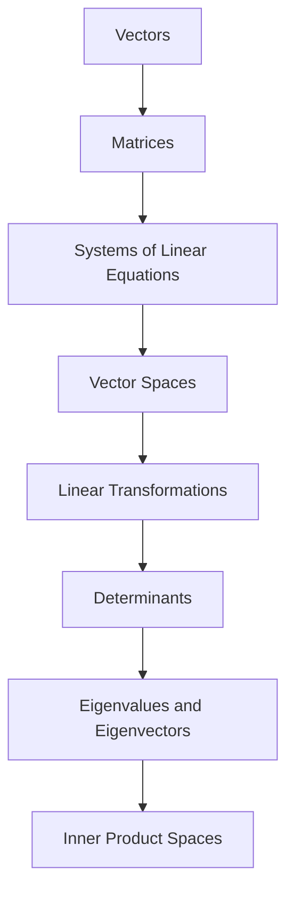

<!-- Generated by tools/build_indexes.py from tools/curriculum.json. Do not edit by hand. -->

# Linear Algebra

*Vectors, matrices and linear structure*

[Mathematics](../README.md) › Linear Algebra

Linear algebra is the most widely applied subject in mathematics: geometry, differential equations, statistics, physics, machine learning and abstract algebra all run on it.

## At a glance

| | |
|---|---|
| Topics | 8 (8 complete, 0 draft, 0 planned) |
| Estimated study time | ~79 hours |
| Prerequisites | [03-algebra](../03-algebra/README.md) |

## Study order

The numbers are the recommended order. Study a topic only after the ones before it —
the dependency chain below is the shortest safe route through the discipline.

## Topic inventory

| # | Topic | Level | Est. time | Status | Materials |
|---|---|---|---|---|---|
| 1 | [Vectors](01-vectors/README.md) | Intermediate | 8 h | Complete | [Tutorial](01-vectors/README.md) · [Exercises](01-vectors/exercises.md) · [Solutions](01-vectors/solutions.md) |
| 2 | [Matrices](02-matrices/README.md) | Intermediate | 9 h | Complete | [Tutorial](02-matrices/README.md) · [Exercises](02-matrices/exercises.md) · [Solutions](02-matrices/solutions.md) |
| 3 | [Systems of Linear Equations](03-systems-of-linear-equations/README.md) | Intermediate | 9 h | Complete | [Tutorial](03-systems-of-linear-equations/README.md) · [Exercises](03-systems-of-linear-equations/exercises.md) · [Solutions](03-systems-of-linear-equations/solutions.md) |
| 4 | [Vector Spaces](04-vector-spaces/README.md) | Advanced | 12 h | Complete | [Tutorial](04-vector-spaces/README.md) · [Exercises](04-vector-spaces/exercises.md) · [Solutions](04-vector-spaces/solutions.md) |
| 5 | [Linear Transformations](05-linear-transformations/README.md) | Advanced | 11 h | Complete | [Tutorial](05-linear-transformations/README.md) · [Exercises](05-linear-transformations/exercises.md) · [Solutions](05-linear-transformations/solutions.md) |
| 6 | [Determinants](06-determinants/README.md) | Advanced | 9 h | Complete | [Tutorial](06-determinants/README.md) · [Exercises](06-determinants/exercises.md) · [Solutions](06-determinants/solutions.md) |
| 7 | [Eigenvalues and Eigenvectors](07-eigenvalues-and-eigenvectors/README.md) | Advanced | 11 h | Complete | [Tutorial](07-eigenvalues-and-eigenvectors/README.md) · [Exercises](07-eigenvalues-and-eigenvectors/exercises.md) · [Solutions](07-eigenvalues-and-eigenvectors/solutions.md) |
| 8 | [Inner Product Spaces](08-inner-product-spaces/README.md) | Advanced | 10 h | Complete | [Tutorial](08-inner-product-spaces/README.md) · [Exercises](08-inner-product-spaces/exercises.md) · [Solutions](08-inner-product-spaces/solutions.md) |

### What each topic covers

- **Vectors** — Geometric and algebraic vectors, dot and cross products, projections.
- **Matrices** — Matrix algebra, multiplication as composition, inverses, transpose, rank.
- **Systems of Linear Equations** — Gaussian elimination, row reduction, solution structure and LU factorisation.
- **Vector Spaces** — Axioms, subspaces, span, independence, bases, dimension and coordinates.
- **Linear Transformations** — Matrices as maps, kernel and image, rank-nullity, change of basis.
- **Determinants** — Volume interpretation, properties, cofactor expansion and Cramer's rule.
- **Eigenvalues and Eigenvectors** — Characteristic polynomials, diagonalisation, spectral theorem, applications.
- **Inner Product Spaces** — Orthogonality, Gram-Schmidt, projections, least squares and Fourier ideas.

## Related disciplines

- [13-abstract-algebra](../13-abstract-algebra/README.md)
- [18-optimization](../18-optimization/README.md)
- [14-real-analysis](../14-real-analysis/README.md)

## Status key

- **Complete** — tutorial, exercises and full solutions exist and the tutorial meets the
  [authoring standard](../CONTRIBUTING.md).
- **Draft** — some material exists but the topic is not finished.
- **Planned** — identified in the curriculum, not written yet.

Overall progress and the full topic inventory live in [ROADMAP.md](../ROADMAP.md).
