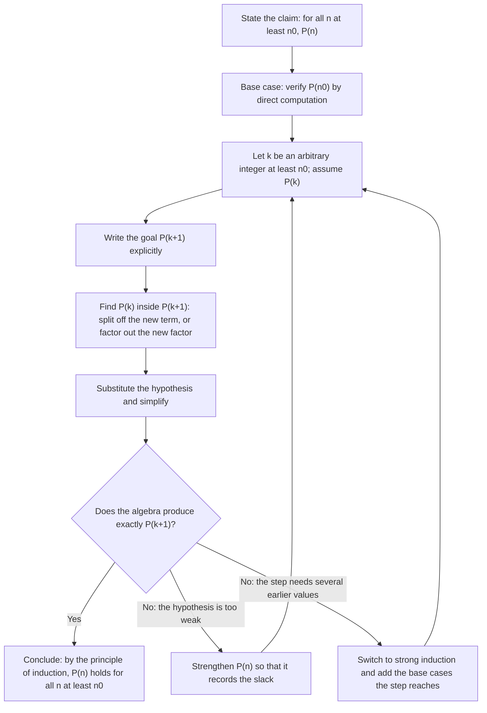
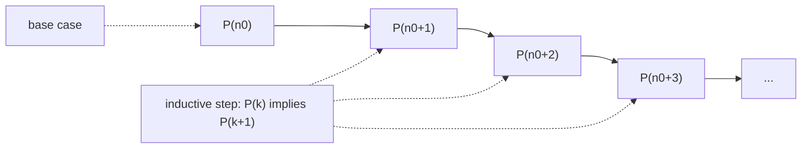

# Mathematical Induction

> [Mathematics](../../README.md) › [Discrete Mathematics](../README.md) › Mathematical Induction · Level: Intermediate · Prerequisites: [Proof Techniques](../../00-foundations/04-proof-techniques/README.md), [Natural Numbers](../../01-arithmetic/01-natural-numbers/README.md), elementary algebra · Estimated time: 150 min

## 1. Introduction

There is a kind of statement that mathematics cannot do without and that no amount of checking can settle. "For every natural number $n$, the sum of the first $n$ odd numbers is $n^2$." You can verify it for $n = 1, 2, 3, 4, 5$ in under a minute. You can verify it, with a computer, for the first billion values. None of that is a proof, because the claim is about *all* of $\mathbb{N}$, and $\mathbb{N}$ does not end.

**Mathematical induction** is the technique that turns an infinite verification into two finite tasks. It is not a heuristic and it is not "guessing a pattern". It is a single axiom of the natural numbers, and from that axiom every one of the following follows:

* the formula for $1 + 2 + \cdots + n$;
* the fact that a $2^n \times 2^n$ board with one square removed can be tiled by L-shaped trominoes;
* the correctness of a recursive sorting routine;
* the binomial theorem;
* the existence of a prime factorisation for every integer $n \ge 2$;
* the fact that a loop invariant, once true, stays true.

The idea is older than the formalism. Euclid used a descent argument for the infinitude of primes; al-Karaji proved the binomial theorem around 1000 CE by what is essentially induction on the exponent; Pascal gave the first careful account of the "method of infinite descent" in 1654 and named the principle; Peano, in 1889, made it an axiom. What was once a trick became a definition: the natural numbers are, by axiom, the *smallest* collection containing a starting point and closed under adding one. Induction is simply that minimality, used as a proof rule.

Because the principle is an axiom rather than a theorem, it deserves scrutiny. Why should we accept it? What exactly does it assert? Section 7.2 answers both: induction is logically equivalent to the statement that every nonempty set of natural numbers has a least element, and Section 7.2 proves the equivalence in both directions. After that proof you are free to use whichever of the two forms is convenient — most mathematicians switch between them without comment.

The rest of the tutorial builds a working toolkit. You will meet the induction template, its strong form, induction over recursively built objects (formulas, trees, strings), its use in computer science to prove algorithms correct and programs terminating, and its limits. Along the way we prove the classical results carefully and, more importantly, we study the ways an induction proof can go wrong: the missing base case, the circular hypothesis, the step that silently needs a larger $n$ than the base case supplies.

Induction is also the bridge to the next topic. A sequence defined by a recurrence is a function built by recursion, and every statement about its closed form is proved by induction. The two ideas are the same idea seen from two sides — Section 7.8 makes the comparison precise.

## 2. Prerequisites

This tutorial assumes the following, all of which are taught earlier in the repository.

* **Statements, quantifiers, implication.** You should be able to read "for all $n \ge 1$, $P(n)$" and to write the negation of a quantified statement. Taught in [Mathematical Thinking](../../00-foundations/01-mathematical-thinking/README.md) and [Logic](../../00-foundations/02-logic/README.md).
* **Direct proof, contradiction, contrapositive, proof by cases.** Induction is one more proof technique, not a replacement for the others. Taught in [Proof Techniques](../../00-foundations/04-proof-techniques/README.md); its Section 7.10 is a short preview of what follows here.
* **The natural numbers and the Peano axioms.** You should know that $\mathbb{N}$ is generated from a starting point by repeated successors, and that induction is axiom (P5) of that system. Taught in [Natural Numbers](../../01-arithmetic/01-natural-numbers/README.md), Sections 5.1, 5.8 and 7.14.
* **Divisibility and primes.** $a \mid b$ means $b = ak$ for an integer $k$; a prime is an integer $p > 1$ whose only positive divisors are $1$ and $p$. Taught in [Factors and Multiples](../../02-pre-algebra/03-factors-and-multiples/README.md) and again in [Natural Numbers](../../01-arithmetic/01-natural-numbers/README.md), Sections 7.9 and 7.11.
* **Elementary algebra.** Expanding $(k+1)^2$, $(k+1)^3$, factoring $a^2 - b^2$, manipulating fractions, and solving quadratic equations. Taught in [Elementary Algebra](../../03-algebra/01-elementary-algebra/README.md) and [Quadratic Equations](../../03-algebra/08-quadratic-equations/README.md).
* **Sum and product notation.** $\sum_{k=1}^{n} a_k$ and $\prod_{k=1}^{n} a_k$, together with the splitting rule $\sum_{k=1}^{n+1} a_k = \sum_{k=1}^{n} a_k + a_{n+1}$. Taught in [Advanced Algebra](../../03-algebra/14-advanced-algebra/README.md), Section 7.9.

Two conventions, used consistently below and matching [MATHEMATICAL_NOTATION.md](../../MATHEMATICAL_NOTATION.md):

* $\mathbb{N} = \{1, 2, 3, \dots\}$ and $\mathbb{N}_0 = \{0, 1, 2, 3, \dots\}$. Some books call $\mathbb{N}_0$ "the natural numbers"; whenever a statement depends on where the sequence starts, the starting value is written out explicitly as $n \ge n_0$.
* A **sequence** is a function from a set of consecutive integers to some set of values; we write $a_n$ for the value at $n$. Sequences and series are treated systematically in [Advanced Algebra](../../03-algebra/14-advanced-algebra/README.md), Section 7.8; here they appear only as targets for induction.

## 3. Learning Objectives

By the end of this tutorial you will be able to:

1. State the principle of induction precisely, including its hypotheses and its conclusion.
2. Explain why induction is an axiom of $\mathbb{N}$ and prove that it is equivalent to the well-ordering principle.
3. Write a complete induction proof in the standard five-part template: statement, base case, inductive hypothesis, inductive step, conclusion.
4. Distinguish weak (ordinary) induction from strong (course-of-values) induction and choose the appropriate one for a given problem.
5. Prove summation formulas, product formulas, inequalities, divisibility statements and closed forms for recurrences by induction.
6. Prove statements about recursively defined structures — formulas, strings, trees, tilings, graphs — by structural induction.
7. Use course-of-values induction to prove that a recursive algorithm is correct and that it terminates.
8. Explain the difference between a proof by induction and a definition by recursion, and state the recursion theorem that licenses the latter.
9. Recognise and repair the four standard induction fallacies: a missing base case, a circular hypothesis, a step whose threshold exceeds the base case, and a gap in the chain caused by "all horses are the same colour".
10. Prove the fundamental theorem of arithmetic's *existence* half, and explain why uniqueness needs
    a separate argument.
11. Explain why induction applies to $\mathbb{N}$ but not directly to $\mathbb{Q}$ or $\mathbb{R}$,
    and what replaces it there (well-founded and transfinite induction).
12. Judge when an induction proof should be strengthened rather than patched.

## 4. Intuition

### 4.1 Dominoes

Imagine a row of dominoes, one for each natural number, standing close enough that each falling domino topples the next. Push the first one. What happens? Every domino falls. That is induction. Two separate facts are being used:

* the **base case**: the first domino falls because you pushed it;
* the **inductive step**: whenever a domino falls, the next one falls.

Neither fact alone is enough. Without the push, nothing moves, however well spaced the dominoes are. Without the spacing, the first domino falls and the rest stand. And note that the argument does not require you to watch all the dominoes: it is an argument about the *arrangement*, not about any particular domino.

The image also shows what "for all $n$" means. There is no last domino. The proof does not reach infinity; it shows that the set of fallen dominoes has the two properties that force it to be all of them.

### 4.2 Climbing an infinite ladder

A second picture, useful when the indexing starts at some $n_0 \ne 1$: you stand on rung $n_0$ of a ladder that continues upward forever. To know you can reach every rung you need to get onto rung $n_0$, and you need a rule that says "from any rung you can reach the next". Getting onto rung $n_0$ is not the same as getting onto rung $1$: if the ladder's bottom rung is $n_0 = 5$, standing on rung $1$ is impossible and irrelevant.

### 4.3 Strong induction: using the whole staircase

Ordinary induction lets you use one hypothesis: "the statement holds at $k$". Sometimes that is not enough. Suppose you want to show that every integer $n \ge 2$ is a product of primes. If $n$ is composite, $n = ab$ with $2 \le a, b < n$. You need the statement at $a$ and at $b$ — two smaller values, not just $n - 1$. **Strong induction** lets you assume the statement at *every* value below $n$. It looks like a stronger assumption, and therefore a stronger claim to prove, but it is logically equivalent to ordinary induction (Section 7.4 proves this). The picture is a staircase where, to climb to step $n$, you may stand on any lower step, not only the one immediately below.

### 4.4 Why the discreteness matters

Induction works because between $1$ and $n$ there are only finitely many steps, and because every nonempty collection of natural numbers has a smallest member. Neither is true of the rationals: the set $\{1/n : n \in \mathbb{N}\}$ has no smallest element, and you cannot reach $1/2$ from $1$ by repeatedly "going to the next rational", because there is no next rational. Anything that looks like induction over $\mathbb{R}$ is usually an argument about *integers* in disguise — for example induction on the number of decimal places, or on a denominator.

### 4.5 The feeling of a correct induction proof

A correct induction proof has a distinctive feel: the inductive step is *mechanical*. You write down the statement for $k+1$, you look for the expression for $k$ inside it, you substitute the hypothesis, and the algebra closes. If you find yourself waving your hands at the step, either the statement is false, or it is true but too weak to carry the induction, and it needs to be strengthened (Section 7.13). Experienced mathematicians treat a stubborn inductive step as information about the *statement*, not as a sign that they should try harder on the algebra.

## 5. Formal Definition

### 5.1 The natural numbers

We take the natural numbers as characterised by the Peano axioms, stated here in the form used throughout this repository (compare [Natural Numbers](../../01-arithmetic/01-natural-numbers/README.md), Section 5.1). There is a set $\mathbb{N}_0$, a distinguished element $0 \in \mathbb{N}_0$, and a **successor** map $S : \mathbb{N}_0 \to \mathbb{N}_0$.

* **(P1)** $0 \in \mathbb{N}_0$.
* **(P2)** For every $n \in \mathbb{N}_0$, $S(n) \in \mathbb{N}_0$.
* **(P3)** For every $n \in \mathbb{N}_0$, $S(n) \ne 0$.
* **(P4)** $S$ is injective: $S(m) = S(n)$ implies $m = n$.
* **(P5)** **Induction.** If $A \subseteq \mathbb{N}_0$ satisfies $0 \in A$ and $n \in A \Rightarrow S(n) \in A$ for every $n$, then $A = \mathbb{N}_0$.

Nothing in (P1)–(P4) mentions addition or order; those are *defined* from $S$ (Section 8 permits this: $m + 0 = m$ and $m + S(n) = S(m + n)$, both recursive definitions licensed by the recursion theorem of Section 7.8).

### 5.2 The principle of induction

**Definition 5.1 (Principle of mathematical induction).** Let $n_0 \in \mathbb{N}_0$ and let $P(n)$ be a statement for each integer $n \ge n_0$. If

1. **(base case)** $P(n_0)$ is true, and
2. **(inductive step)** for every integer $k \ge n_0$, $P(k)$ implies $P(k+1)$,

then $P(n)$ is true for every integer $n \ge n_0$.

When $n_0 = 0$ this is exactly (P5) applied to $A = \{n \in \mathbb{N}_0 : P(n)\}$. For $n_0 > 0$, apply (P5) to $Q(n) :\Leftrightarrow (n < n_0) \lor P(n)$, or simply observe that the set $\{n \ge n_0\}$ with the inherited successor satisfies the same axioms.

**Definition 5.2 (Vocabulary).** In a proof by induction:

* the proof of $P(n_0)$ is the **base case**;
* the assumption $P(k)$ inside the inductive step is the **inductive hypothesis**;
* the proof of "$P(k) \Rightarrow P(k+1)$" is the **inductive step**;
* the integer $n_0$ is the **starting value** (or threshold);
* the final sentence, citing Definition 5.1, is the **conclusion**.

### 5.3 Strong induction

**Definition 5.3 (Strong induction, also called course-of-values induction).** Let $n_0 \in \mathbb{N}_0$ and let $P(n)$ be a statement for each $n \ge n_0$. If

1. $P(n_0)$ is true, and
2. for every $k \ge n_0$, the truth of $P(m)$ for *all* $m$ with $n_0 \le m \le k$ implies $P(k+1)$,

then $P(n)$ is true for every $n \ge n_0$.

The difference is only in the hypothesis available in the step. Strong induction is not a different axiom; Section 7.4 derives it from Definition 5.1.

### 5.4 The well-ordering principle

**Definition 5.4 (Well-ordering).** A **least element** of a set $S \subseteq \mathbb{N}_0$ is an element $\ell \in S$ such that $\ell \le s$ for every $s \in S$.

**Axiom 5.5 (Well-ordering principle).** Every nonempty subset of $\mathbb{N}_0$ has a least element.

Like induction, this is a property of $\mathbb{N}_0$ and not of ordered sets in general: the set $\{1/n : n \in \mathbb{N}\} \subseteq \mathbb{Q}$ is nonempty and has no least element.

### 5.5 Structural and well-founded induction

Induction does not really need numbers; it needs a *well-founded* way of going backwards.

**Definition 5.6 (Well-founded relation).** A relation $\prec$ on a set $X$ is **well-founded** if there is no infinite descending chain $x_0 \succ x_1 \succ x_2 \succ \cdots$, equivalently if every nonempty subset of $X$ has a $\prec$-minimal element.

**Principle 5.7 (Well-founded induction).** Let $\prec$ be well-founded on $X$. If for every $x \in X$,

$$\bigl(\forall y \in X,\ y \prec x \Rightarrow P(y)\bigr) \;\Rightarrow\; P(x),$$

then $P(x)$ holds for every $x \in X$.

The relation $m \prec n \Leftrightarrow m < n$ on $\mathbb{N}_0$ is well-founded, so Definition 5.3 is the special case $X = \mathbb{N}_0$. Section 7.6 specialises further to objects built by grammar rules, which is what "structural induction" means.

## 6. Mathematical Notation

| Symbol | Read as | Meaning |
|---|---|---|
| $P(n)$ | "$P$ of $n$" | a statement depending on an integer $n$; it is either true or false at each $n$ |
| $\forall n \ge n_0,\ P(n)$ | for all $n$ at least $n_0$, $P(n)$ | the conclusion of an induction |
| $n_0$ | "$n$ nought" | the starting value of the induction |
| $k$ | "$k$" | a fixed but arbitrary integer $\ge n_0$, used in the step |
| $P(k) \Rightarrow P(k+1)$ | "$P(k)$ implies $P(k+1)$" | the inductive step |
| $\mathbb{N}$ | the natural numbers | $\{1,2,3,\dots\}$ in this repository |
| $\mathbb{N}_0$ | the natural numbers with zero | $\{0,1,2,3,\dots\}$ |
| $\sum_{k=1}^{n} a_k$ | sum of $a_k$ from $k=1$ to $n$ | $a_1 + a_2 + \cdots + a_n$ |
| $\prod_{k=1}^{n} a_k$ | product of $a_k$ from $k=1$ to $n$ | $a_1 a_2 \cdots a_n$ |
| $a \mid b$ | $a$ divides $b$ | $b = aq$ for some integer $q$ |
| $a \nmid b$ | $a$ does not divide $b$ | negation of the above |
| $a \equiv b \pmod n$ | $a$ is congruent to $b$ modulo $n$ | $n \mid (a-b)$ |
| $\binom{n}{k}$ | "$n$ choose $k$" | $\dfrac{n!}{k!\,(n-k)!}$ |
| $\lvert S \rvert$ | cardinality of $S$ | the number of elements of a finite set $S$ |
| $\chi(G)$ | chromatic number of $G$ | fewest colours in a proper vertex colouring |
| $\Delta(G)$ | maximum degree of $G$ | largest number of edges at a vertex |
| $\square$ | end of proof | the proof is complete |
| $\Leftrightarrow$ | if and only if | logical equivalence |
| $\varnothing$ | the empty set | the set with no elements |
| $\varphi$ | phi | the golden ratio $(1+\sqrt5)/2 \approx 1.618$ |

Two pieces of language deserve a comment because they are used with a precise meaning.

* "**Assume $P(k)$ for a fixed but arbitrary $k \ge n_0$**" means: let $k$ be any integer at least $n_0$, and suppose $P(k)$ holds for *that* $k$. You may not assume $P$ at any other value (unless you are doing strong induction).
* "**By induction**" at the end of an argument is a citation of Definition 5.1, not a hand wave. It must be possible to point to the base case and to the step.

## 7. Core Concepts

### 7.1 The induction template

Every induction proof in this repository is written in the same five parts. Learning the template is most of the battle, because it forces you to notice when something is missing.

> **Template.**
> **Claim.** For every integer $n \ge n_0$, $P(n)$.
>
> *Proof by induction on $n$.*
>
> 1. **Base case.** [Verify $P(n_0)$ by direct computation. Show the arithmetic.]
> 2. **Inductive hypothesis.** Let $k \ge n_0$ be an integer and assume $P(k)$.
> 3. **Goal.** Show $P(k+1)$.
> 4. **Step.** [Derive $P(k+1)$, displaying the place where $P(k)$ is used.]
> 5. **Conclusion.** By the principle of induction (Definition 5.1), $P(n)$ holds for all $n \ge n_0$. $\square$

Three remarks on the template.

* The hypothesis says "let $k$ be arbitrary". You may not choose $k = 1$ or $k = n_0$; the step must work for every $k \ge n_0$, including values far beyond any you have checked.
* The goal is $P(k+1)$, with $k$ still symbolic. A common error is to prove $P(k)$ again, or to prove $P(k+1)$ only for the $k$ that happens to make the algebra easy.
* The conclusion is not optional in a formal write-up. It tells the reader which axiom was used and that the induction is over.

A miniature example, carried out in full, shows how mechanical the middle is. The claim is that $1 + 3 + 5 + \cdots + (2n-1) = n^2$ for all $n \ge 1$.

*Base case* $n = 1$: the left side is $2 \cdot 1 - 1 = 1$ and the right side is $1^2 = 1$. ✓

*Inductive hypothesis*: suppose $1 + 3 + \cdots + (2k-1) = k^2$ for some $k \ge 1$.

*Goal*: $1 + 3 + \cdots + (2k-1) + (2k+1) = (k+1)^2$.

*Step*:

$$1 + 3 + \cdots + (2k-1) + (2k+1) = k^2 + (2k+1) = (k+1)^2 .$$

The second equality is the expansion of $(k+1)^2$; the first is the inductive hypothesis. *Conclusion*: by induction the formula holds for all $n \ge 1$. $\square$

Notice what the inductive hypothesis contributes: it replaces a sum of $k$ terms with a single expression. In harder problems the hypothesis replaces a whole structural description — a factorisation, a divisibility relation, a tiling — and that is where the skill lies.

### 7.2 Why induction is an axiom, and its equivalence with well-ordering

Induction is not provable from (P1)–(P4). To see this, exhibit a structure satisfying them in which induction fails.

**Example 7.2.1 (a model of (P1)–(P4) without induction).** Let

$$M = \bigl(\{0\} \times \mathbb{N}_0\bigr) \cup \bigl(\{1\} \times \mathbb{Z}\bigr), \qquad \sigma(i, n) = (i, n+1).$$

Take $0_M = (0,0)$. Then $\sigma$ maps $M$ to $M$; $\sigma(i,n) = (0,0)$ is impossible because the first coordinate is preserved; and $\sigma$ is injective because $(i,n) \mapsto (i,n+1)$ is injective on each copy. So (P1)–(P4) hold. But

$$A = \{0\} \times \mathbb{N}_0$$

contains $(0,0)$ and is closed under $\sigma$, yet $A \ne M$. The "extra" part $\{1\} \times \mathbb{Z}$ is a bi-infinite chain that no induction can ever reach. $\square$

So (P5) is a genuine axiom: it says that there are no such extra chains, that the successor chain starting at $0$ *exhausts* the set. Equivalently, it says that $\mathbb{N}_0$ is the smallest set satisfying (P1)–(P4).

**Theorem 7.2.2 (well-ordering implies induction).** Suppose every nonempty subset of $\mathbb{N}_0$ has a least element. Let $P(n)$ be a statement such that $P(0)$ holds and $P(k)$ implies $P(k+1)$ for every $k \ge 0$. Then $P(n)$ holds for every $n \ge 0$.

*Proof.* Suppose, for contradiction, that $S = \{n \in \mathbb{N}_0 : P(n) \text{ is false}\}$ is nonempty. By well-ordering, $S$ has a least element $m$. Since $P(0)$ holds, $m \ne 0$, so $m \ge 1$ and $m - 1 \in \mathbb{N}_0$. By minimality of $m$, $m - 1 \notin S$, that is, $P(m-1)$ is true. The inductive step applied with $k = m-1$ then gives $P(m)$ true, which contradicts $m \in S$. Hence $S = \varnothing$. $\square$

**Theorem 7.2.3 (induction implies well-ordering).** Suppose the principle of induction holds. Then every nonempty subset of $\mathbb{N}_0$ has a least element.

*Proof.* Let $S \subseteq \mathbb{N}_0$ and suppose $S$ has no least element; we show $S = \varnothing$. Let $Q(n)$ be the statement "no element of $S$ is less than or equal to $n$".

*Base case* $n = 0$: if some $s \in S$ satisfied $s \le 0$ then $s = 0$, and $0$ would be the least element of $S$ (because $0 \le s$ for every $s \in S$). That contradicts the hypothesis on $S$, so $Q(0)$ holds.

*Inductive step*: assume $Q(k)$, that is, no element of $S$ is $\le k$. Suppose some $s \in S$ had $s \le k+1$. Since no element of $S$ is $\le k$, we must have $s = k+1$. Then $k+1 \in S$, and every element of $S$ exceeds $k$, hence is $\ge k+1$; therefore $k+1$ is the least element of $S$, contradiction. So no element of $S$ is $\le k+1$, which is $Q(k+1)$.

By induction, $Q(n)$ holds for every $n \in \mathbb{N}_0$. If $S$ were nonempty it would contain some $s$, and $Q(s)$ would say that no element of $S$ is $\le s$ — in particular $s \not\le s$, absurd. Hence $S = \varnothing$. $\square$

**Corollary 7.2.4.** Over axioms (P1)–(P4), the induction principle and the well-ordering principle are equivalent.

Two remarks, so that the logic is not oversold.

* The argument above is carried out in ordinary mathematical language where $P$ may be *any* property and $S$ any subset. In first-order arithmetic, where induction is a schema restricted to definable properties, the equivalence with full well-ordering fails: one obtains well-ordering only for definable subsets. Nothing in this tutorial depends on that distinction, but a reader who meets "the induction schema" in a logic text should not be surprised by it.
* Because induction is an axiom, a "proof" that induction is valid is circular. What Theorem 7.2.2 and Theorem 7.2.3 establish is that we could equally well have taken well-ordering as the axiom; they do not derive either from weaker assumptions.

**Why well-ordering is useful in practice.** Some statements are far easier to prove by contradiction plus a least counterexample than by a direct induction. The pattern is: suppose the statement fails; take the smallest failure; derive a smaller failure. That is a "minimal counterexample" proof, and it is exactly Theorem 7.2.2 in action. Section 9.9 uses it.

### 7.3 Weak induction: sums and products

**Theorem 7.3.1 (geometric sum).** For every real $r \ne 1$ and every $n \ge 0$,

$$\sum_{j=0}^{n-1} r^j = 1 + r + r^2 + \cdots + r^{n-1} = \frac{r^n - 1}{r - 1}.$$

*Proof by induction on $n$.* Base case $n = 0$: the sum is empty, hence $0$, and $\frac{r^0-1}{r-1} = 0$. ✓ Inductive step: assume the identity at $k$. Then

$$\sum_{j=0}^{k} r^j = \frac{r^k-1}{r-1} + r^k = \frac{r^k - 1 + r^k(r-1)}{r-1} = \frac{r^{k+1} - 1}{r-1},$$

which is the identity at $k+1$. By induction it holds for all $n \ge 0$. $\square$

The hypothesis $r \ne 1$ is not decoration: for $r = 1$ the right-hand side is $0/0$. The correct statement at $r = 1$ is $\sum_{j=0}^{n-1} 1 = n$, which is the limit of the formula as $r \to 1$. Section 11 lists "dividing by zero in a geometric sum" among the common mistakes.

**Theorem 7.3.2 (telescoping products).** For every $n \ge 1$,

$$\prod_{k=1}^{n} \frac{k+1}{k} = n + 1.$$

*Proof.* Base case $n = 1$: the product is $2/1 = 2 = 1+1$. ✓ Step: if $\prod_{k=1}^{n} \frac{k+1}{k} = n+1$, then

$$\prod_{k=1}^{n+1} \frac{k+1}{k} = (n+1)\cdot\frac{n+2}{n+1} = n+2. \qquad \square$$

The product telescopes for the same reason the sum $\sum (b_k - b_{k-1})$ does: consecutive factors cancel. Recognising a telescoping shape is often the fastest route to a closed form; the technique is developed for sequences in [Advanced Algebra](../../03-algebra/14-advanced-algebra/README.md), Section 7.9.

### 7.4 Strong induction

**Theorem 7.4.1 (strong induction is derivable).** Definition 5.3 follows from Definition 5.1.

*Proof.* Assume the hypotheses of Definition 5.3 and define $Q(n) :\Leftrightarrow$ "$P(m)$ holds for every $m$ with $n_0 \le m \le n$". Then $Q(n_0)$ is just $P(n_0)$, which holds. If $Q(k)$ holds, then $P(m)$ holds for all $n_0 \le m \le k$, so by hypothesis (2) of Definition 5.3, $P(k+1)$ holds; together with $Q(k)$ this is $Q(k+1)$. By ordinary induction $Q(n)$ holds for all $n \ge n_0$, and $Q(n)$ implies $P(n)$. $\square$

Conversely, ordinary induction is the special case of strong induction in which the hypothesis about $m < k$ is simply never used. So the two are equivalent, and the choice between them is a matter of convenience — but a decisive one, because a step that needs two or three earlier values cannot be carried out with a single-value hypothesis.

**Theorem 7.4.2 (every integer $\ge 2$ has a prime divisor).** Every integer $n \ge 2$ has a prime divisor.

*Proof by strong induction on $n$.* Base case $n = 2$: $2$ is prime and $2 \mid 2$. ✓ Inductive step: let $k \ge 2$ and assume that every integer $m$ with $2 \le m \le k$ has a prime divisor. Consider $k+1$.

* If $k+1$ is prime, then $k+1$ is a prime divisor of itself.
* If $k+1$ is composite, then $k+1 = ab$ with integers $2 \le a, b \le k$. By the inductive hypothesis, $a$ has a prime divisor $p$. Since $p \mid a$ and $a \mid k+1$, we get $p \mid k+1$ (transitivity of divisibility), and $p$ is prime.

In both cases $k+1$ has a prime divisor. By strong induction, every $n \ge 2$ does. $\square$

The hypothesis is used at $a$, which may be much smaller than $k$; this is exactly what ordinary induction cannot supply. The same argument, iterated, gives the existence half of unique factorisation.

**Theorem 7.4.3 (existence of prime factorisations).** Every integer $n \ge 2$ can be written as a product of primes: $n = p_1 p_2 \cdots p_r$ with each $p_i$ prime and $r \ge 1$.

*Proof by strong induction on $n$.* Base case $n = 2$: $2$ is itself prime, so $r = 1$ and $p_1 = 2$. Inductive step: let $k \ge 2$ and assume every $m$ with $2 \le m \le k$ is a product of primes. Consider $k+1$. If $k+1$ is prime, it is a product of one prime. Otherwise $k+1 = ab$ with integers $2 \le a, b \le k$; by the inductive hypothesis $a = p_1\cdots p_s$ and $b = q_1 \cdots q_t$ with all factors prime, so $k+1 = p_1\cdots p_s q_1\cdots q_t$ is a product of primes. $\square$

**Uniqueness** — that the multiset of primes is determined by $n$ — does *not* follow from this argument, and it is false for arbitrary rings, so it needs a real proof. It relies on Euclid's lemma (if $p$ is prime and $p \mid ab$, then $p \mid a$ or $p \mid b$), which is proved from Bézout's identity in [Natural Numbers](../../01-arithmetic/01-natural-numbers/README.md), Sections 8.6–8.8. Do not conflate the two halves of the fundamental theorem of arithmetic: existence is an induction; uniqueness is a divisibility argument.

### 7.5 Varying the base case and the threshold

Three adjustments to the template are routine.

**(a) The induction may start at any $n_0$.** For "every $n \ge 5$", the base case is $n = 5$. The step then has the form "for $k \ge 5$, $P(k) \Rightarrow P(k+1)$".

**(b) The step may require $k \ge$ some threshold $T$ larger than $n_0$.** Then the base case must be at least $T$, or several base cases must be checked. Example: claim $2^n > n^2$ for all $n \ge 5$. Base case $n = 5$: $32 > 25$ ✓. Step: if $2^k > k^2$ and $k \ge 3$, then

$$2^{k+1} = 2\cdot 2^k > 2k^2 > (k+1)^2,$$

where the last inequality is $k^2 - 2k - 1 > 0$, true for $k \ge 3$ (the positive root of $t^2 - 2t - 1$ is $1 + \sqrt2 \approx 2.414$). The step is valid for $k \ge 3$, which includes every $k \ge 5$, so the induction runs. Had we tried base case $n = 1$, we would have had the true statement $2 > 1$ and a step that breaks at $k = 2$: $2^2 = 4$ is not greater than $2^2$. The induction would prove nothing beyond $n = 1$.

**(c) Several base cases may be needed.** Claim: every integer $n \ge 2$ is a sum of $2$s and $3$s. Proof by strong induction with base cases $n = 2$ ($2$) and $n = 3$ ($3$). For $k+1 \ge 4$ we have $k + 1 - 2 \ge 2$, so by the inductive hypothesis $k+1-2$ is a sum of $2$s and $3$s; adding one more $2$ represents $k+1$. Two base cases are required because the step reduces $n$ by $2$, so it can only reach back into the verified range once $n \ge 4$.

A useful rule of thumb: **the set of base cases must meet the set of values the step can reach.** If the step goes from $k$ to $k+1$ and needs $k \ge T$, the base cases must cover $n_0, n_0+1, \ldots, T$. If the step from $k+1$ refers back to $k+1-2$, base cases $n_0$ and $n_0+1$ suffice.

### 7.6 Structural induction

Many objects in mathematics and computer science are defined by *rules* rather than by a position in a sequence. A **full binary tree** is defined by two rules:

* a single leaf is a full binary tree;
* if $T_1$ and $T_2$ are full binary trees, then the object consisting of a new root joined to the roots of $T_1$ and $T_2$ is a full binary tree.

Structural induction is the principle that to prove a statement about all such objects it suffices to prove it for each rule, assuming it for the objects the rule is applied to. This is Principle 5.7 with $\prec$ = "is a proper substructure of", which is well-founded because every construction tree is finite.

**Theorem 7.6.1.** In every full binary tree, the number of leaves equals the number of internal nodes plus one.

*Proof by structural induction.* **Base case:** a single leaf has $1$ leaf and $0$ internal nodes, and $1 = 0 + 1$. ✓ **Inductive step:** let $T$ consist of a root with subtrees $T_1$, $T_2$. Assume the claim for $T_1$ and $T_2$, writing $L_i$ and $I_i$ for their leaf and internal counts: $L_i = I_i + 1$. Then

$$L(T) = L_1 + L_2 = (I_1 + 1) + (I_2 + 1) = I_1 + I_2 + 2,$$

while $T$ has exactly one more internal node than $T_1$ and $T_2$ together, namely the new root, so $I(T) = I_1 + I_2 + 1$. Hence $L(T) = I(T) + 1$. $\square$

The same scheme handles **strings generated by a grammar**. For example, let $L$ be the smallest set of strings over $\{a, b\}$ containing the empty string $\varepsilon$ and closed under $w \mapsto a\,w\,b$. Claim: every $w \in L$ has equally many $a$s and $b$s. Base: $\varepsilon$ has $0$ of each. Step: if $w$ has $p$ of each, then $awb$ has $p+1$ of each. ✓

Structural induction is the standard tool for programming languages (every expression has a type; every well-formed formula has balanced brackets), for compiler correctness, and for the analysis of recursive data structures.

### 7.7 Course-of-values induction in computer science

**Termination.** A recursive procedure terminates if every recursive call is made on a strictly smaller value of some **measure** that takes values in $\mathbb{N}_0$. Termination is then itself a theorem of course-of-values induction: "there is no infinite descending chain in $\mathbb{N}_0$" is exactly well-ordering.

*Example 7.7.1 (the Euclidean algorithm).* For integers $a > b \ge 1$, define $\gcd(a,b) = \gcd(b, a \bmod b)$. Each recursive call replaces $(a,b)$ by $(b, r)$ with $0 \le r < b$. The measure $a + b$ strictly decreases, because the new sum is $b + r < b + b \le a + b$ (the last step since $b \le a$; and if $b = a$ then $r = 0$ and the sum is $b < a+b$). Hence the recursion terminates. $\square$

**Correctness.** The same recursion theorem that licenses the definition also supplies the induction schema for proving properties of it.

*Example 7.7.2 (fast exponentiation).* Consider the recursive procedure

```
power(x, n):
    if n == 0: return 1
    if n is even:
        y = power(x, n // 2)
        return y * y
    return x * power(x, n - 1)
```

*Claim:* for every real $x$ and every integer $n \ge 0$, `power(x, n)` returns $x^n$.

*Proof by strong induction on $n$.* Base: $n = 0$ returns $1 = x^0$. Step: let $k \ge 0$ and assume the claim for all $m \le k$; consider $n = k+1 \ge 1$. If $n$ is even, $n/2 \le k$ (indeed $n/2 < n$), so the recursive call returns $x^{n/2}$ and the result is $(x^{n/2})^2 = x^n$. If $n$ is odd, $n - 1 \le k$, so the recursive call returns $x^{n-1}$ and the result is $x\cdot x^{n-1} = x^n$. $\square$

**Loop invariants.** For iterative code the induction is on the number of completed iterations.

*Example 7.7.3 (binary exponentiation in a loop).*

```
r, b, e = 1, x, n
while e > 0:
    if e is odd: r = r * b
    b = b * b
    e = e // 2
```

The invariant is $r \cdot b^e = x^n$ together with $e \ge 0$. It holds before the loop ($1 \cdot x^n = x^n$) and is preserved by each iteration: writing $e = 2q$ in the even case gives $r\,(b^2)^q = rb^{2q} = rb^e$, and writing $e = 2q+1$ in the odd case gives $(rb)\,(b^2)^q = rb^{2q+1} = rb^e$. When the loop exits, $e = 0$, so $r = x^n$. The invariant is established and preserved, hence true after any number of iterations by induction on that number. $\square$

### 7.8 Induction versus recursion

The two words describe mirror images.

* **Recursion** is a way of *defining* an object: $f(0)$ is given, and $f(n+1)$ is specified in terms of $f(n)$ (or of several earlier values).
* **Induction** is a way of *proving* a statement: $P(0)$ is proved, and $P(n+1)$ is derived from $P(n)$.

Both rest on the same axiom (P5). The bridge is the following theorem, which is what actually makes "$a_{n+1} = 2a_n + 1$, $a_0 = 0$" a legitimate definition rather than a wish.

**Theorem 7.8.1 (recursion theorem).** Let $A$ be a set, $a \in A$, and $h : \mathbb{N}_0 \times A \to A$ a function. Then there is exactly one function $f : \mathbb{N}_0 \to A$ such that

$$f(0) = a, \qquad f(n+1) = h\bigl(n, f(n)\bigr) \ \text{ for all } n \ge 0.$$

*Proof sketch.* **Uniqueness:** if $f$ and $g$ both satisfy the equations, then $f(0) = g(0)$ and, whenever $f(n) = g(n)$, also $f(n+1) = h(n,f(n)) = h(n,g(n)) = g(n+1)$; by induction $f = g$.

**Existence:** call a function $g$ an *$n$-approximation* if its domain is $\{0, 1, \ldots, n\}$, it satisfies $g(0) = a$ and $g(m+1) = h(m, g(m))$ for $m < n$. One shows by induction on $n$ that an $n$-approximation exists: the $0$-approximation is $\{(0,a)\}$, and any $n$-approximation extends to an $(n+1)$-approximation by adding the pair $\bigl(n+1, h(n, g(n))\bigr)$. One also shows, again by induction, that any two approximations agree on the intersection of their domains. Therefore the formula $f(n) := g_n(n)$, where $g_n$ is any $n$-approximation, is independent of the choice of $g_n$, and the resulting $f$ satisfies the two equations. $\square$

**Table 7.8.2 — the same structure seen twice.**

| Aspect | Recursion | Induction |
|---|---|---|
| Purpose | defines an object or process | proves a statement |
| Base | initial value $f(0)$ | base case $P(n_0)$ |
| Step | $f(n+1)$ from $f(n)$ | $P(n+1)$ from $P(n)$ |
| Justified by | recursion theorem (which is proved by induction) | axiom (P5) |
| Typical occurrence | sequences, algorithms, data types | theorems about them |
| Failure mode | non-terminating recursion, missing initial value | missing base case, circular step |

A recurrence is therefore a *definition by recursion*, and the closed-form formula for it is a *theorem proved by induction*. This is exactly the division of labour in [Recurrence Relations](../02-recurrence-relations/README.md).

### 7.9 Induction for inequalities

Inequalities require one extra discipline: every multiplication or division must be justified by the sign of the multiplier.

**Theorem 7.9.1 (Bernoulli's inequality).** For every real $x \ge -1$ and every $n \in \mathbb{N}_0$,

$$(1+x)^n \ge 1 + nx.$$

*Proof by induction on $n$.* Base case $n = 0$: $(1+x)^0 = 1 = 1 + 0\cdot x$. ✓ Step: assume $(1+x)^k \ge 1 + kx$. Since $x \ge -1$ we have $1 + x \ge 0$, so multiplying the inequality by $1+x$ preserves its direction:

$$(1+x)^{k+1} = (1+x)^k(1+x) \ge (1+kx)(1+x) = 1 + (k+1)x + kx^2 \ge 1 + (k+1)x,$$

because $kx^2 \ge 0$. $\square$

Two points are easy to miss. First, the hypothesis $x \ge -1$ is used exactly at the multiplication step. Second, the hypothesis is sharp: for $n = 3$ and $x = -4$, $(1+x)^3 = -27$ while $1 + 3x = -11$, and $-27 \ge -11$ is false.

**Theorem 7.9.2 (AM–GM for $2^n$ variables).** For every $n \ge 1$ and all non-negative reals $a_1, \dots, a_{2^n}$,

$$\frac{a_1 + a_2 + \cdots + a_{2^n}}{2^n} \;\ge\; \bigl(a_1 a_2 \cdots a_{2^n}\bigr)^{1/2^n}.$$

*Proof by induction on $n$.* Base case $n = 1$: the claim is $\frac{a_1+a_2}{2} \ge \sqrt{a_1a_2}$, which is equivalent to $(\sqrt{a_1} - \sqrt{a_2})^2 \ge 0$. Step: group the $2^{k+1}$ numbers into two blocks of $2^k$ and let $A$, $B$ be the two block averages. By the inductive hypothesis $A \ge (\text{product of block 1})^{1/2^k}$ and similarly for $B$. Then

$$\frac{A + B}{2} \;\ge\; \sqrt{AB} \;\ge\; \Bigl(\prod_{i=1}^{2^{k+1}} a_i\Bigr)^{1/2^{k+1}},$$

the first inequality by the base case and the second by multiplying the two block inequalities and taking square roots. $\square$

**Corollary 7.9.3 (AM–GM in general).** The inequality holds for every number of variables $n \ge 1$. Indeed, choose $k$ with $2^{k-1} < n \le 2^k$ and let $A$ be the arithmetic mean of $a_1, \dots, a_n$. Apply Theorem 7.9.2 to the $2^k$ numbers consisting of $a_1, \dots, a_n$ together with $2^k - n$ copies of $A$:

$$A = \frac{nA + (2^k-n)A}{2^k} \ge \bigl(a_1\cdots a_n A^{\,2^k-n}\bigr)^{1/2^k}.$$

Raising to the power $2^k$ gives $A^{2^k} \ge a_1\cdots a_n A^{2^k-n}$, and dividing by the positive quantity $A^{2^k-n}$ yields $A^n \ge a_1\cdots a_n$. $\square$

The "padding with the mean" trick is worth remembering: it converts a result proved for a sparse set of sizes into a result for every size. If $A = 0$ the division is unnecessary, since the conclusion $0 \ge a_1\cdots a_n$ is immediate from non-negativity.

### 7.10 Induction for divisibility

Divisibility statements have a standard shape: to prove $d \mid a_n$ for all $n$, write $a_{k+1}$ as an integer multiple of $a_k$ plus an explicit multiple of $d$. The multiple of $a_k$ is handled by the inductive hypothesis; the multiple of $d$ is divisible by $d$ by construction.

**Theorem 7.10.1.** For every $n \ge 0$, $\;6 \mid n^3 - n$.

*Proof.* Base case $n = 0$: $0^3 - 0 = 0 = 6 \cdot 0$. ✓ Step: assume $6 \mid k^3 - k$. Then

$$(k+1)^3 - (k+1) = k^3 + 3k^2 + 3k + 1 - k - 1 = (k^3 - k) + 3k(k+1).$$

The first term is divisible by $6$ by hypothesis. The second is divisible by $6$ because $k(k+1)$ is a product of two consecutive integers, hence even, so $3k(k+1)$ is divisible by $3 \cdot 2 = 6$. A sum of two multiples of $6$ is a multiple of $6$. $\square$

**Theorem 7.10.2.** For every $n \ge 1$, $\;9 \mid 10^n - 1$.

*Proof.* Base case $n = 1$: $10 - 1 = 9$. ✓ Step: assume $9 \mid 10^k - 1$. Then

$$10^{k+1} - 1 = 10\cdot 10^k - 1 = 10(10^k - 1) + 9,$$

a sum of a multiple of $9$ (by hypothesis, multiplied by $10$) and $9$ itself. $\square$

**Theorem 7.10.3.** For every $n \ge 1$, $\;7 \mid 8^n - 1$.

*Proof.* Base case $n = 1$: $8 - 1 = 7$. ✓ Step: $8^{k+1} - 1 = 8(8^k - 1) + 7$. $\square$

The pattern in the last two proofs is: $a^{k+1} - 1 = a(a^k - 1) + (a - 1)$. It works for every integer $a \ge 2$, giving $a - 1 \mid a^n - 1$; the general statement is Exercise 18.

When a statement mixes two exponential terms, the same device applies with a linear combination:

**Theorem 7.10.4.** For every $n \ge 1$, $\;133 \mid 11^{n+1} + 12^{2n-1}$.

*Proof.* Base case $n = 1$: $11^2 + 12^1 = 121 + 12 = 133$. ✓ Step: suppose $133 \mid 11^{k+1} + 12^{2k-1}$. Then

$$11^{k+2} + 12^{2k+1} = 11\cdot 11^{k+1} + 144\cdot 12^{2k-1} = 11\bigl(11^{k+1} + 12^{2k-1}\bigr) + 133\cdot 12^{2k-1},$$

a sum of a multiple of $133$ and $133 \cdot 12^{2k-1}$. $\square$

### 7.11 Induction and recurrence solutions

A **recurrence** expresses $a_n$ in terms of earlier terms; a **closed form** expresses $a_n$ directly in $n$. Induction is the standard way to *verify* a proposed closed form; finding it is the subject of [Recurrence Relations](../02-recurrence-relations/README.md). The verification has a characteristic shape: substitute the formula into both sides of the recurrence and check the algebra.

**Theorem 7.11.1 (Towers of Hanoi).** Let $T_n$ be the least number of single-disc moves needed to transfer a tower of $n$ discs from one peg to another, when a larger disc may never be placed on a smaller one and three pegs are available. Then $T_n = 2^n - 1$ for every $n \ge 1$.

*Proof.* **Upper bound.** The following procedure works: move the top $n-1$ discs to the spare peg ($T_{n-1}$ moves), move the largest disc to the target peg ($1$ move), move the $n-1$ discs onto it ($T_{n-1}$ moves). Hence $T_n \le 2T_{n-1} + 1$. By induction, $T_n \le 2^n - 1$: the base $T_1 \le 1$ holds, and if $T_{n-1} \le 2^{n-1}-1$ then $T_n \le 2(2^{n-1}-1)+1 = 2^n - 1$. ✓

**Lower bound.** Consider any successful solution. The largest disc must move at least once. At the moment it moves, all $n-1$ smaller discs lie on the third peg (they cannot be on either peg involved in the move, and they are all off the largest disc's peg). Getting them there took at least $T_{n-1}$ moves, and moving them off again takes at least $T_{n-1}$ moves. Therefore $T_n \ge 2T_{n-1}+1$, and by induction $T_n \ge 2^n - 1$. ✓

The two bounds coincide, so $T_n = 2^n - 1$. $\square$

The proof illustrates a common pattern: an *upper* bound is proved by exhibiting a recursive algorithm and inducting on it; a *lower* bound is proved by finding a quantity that any algorithm must spend. Both are inductions, and both are needed for an exact formula.

### 7.12 Tiling and graph colouring

**Theorem 7.12.1 (deficient chessboard).** For every $n \ge 1$, a $2^n \times 2^n$ board with any one square removed can be tiled by L-shaped trominoes, each covering exactly three squares in an L.

*Proof by induction on $n$.* Base case $n = 1$: the $2 \times 2$ board minus one square is exactly one L-tromino. ✓ Step: let $N = 2^n$ and consider a $2N \times 2N$ board $B$ with one square $s$ removed. Cut $B$ into four $N \times N$ quadrants. The square $s$ lies in exactly one quadrant, say $Q_1$; tile $Q_1$ by the inductive hypothesis. Place one tromino over the three squares that lie at the centre of $B$, one in each of the other three quadrants. Each of those three quadrants has now lost exactly one square, so each is a deficient $N \times N$ board and can be tiled by the inductive hypothesis. All four quadrants are tiled and the trominoes do not overlap. $\square$

**Graph colouring.** A **proper vertex colouring** of a graph $G$ is an assignment of colours to vertices so that adjacent vertices receive different colours; $\chi(G)$ is the least number of colours needed, and $\Delta(G)$ is the largest degree of a vertex.

**Theorem 7.12.2 (greedy bound).** For every finite graph $G$, $\chi(G) \le \Delta(G) + 1$.

*Proof by induction on the number $n$ of vertices.* Base case $n = 1$: one colour suffices. Step: let $G$ have $n+1$ vertices; choose a vertex $v$ and let $G' = G - v$. By the inductive hypothesis $G'$ has a proper colouring with $\Delta(G') + 1 \le \Delta(G) + 1$ colours. The vertex $v$ has at most $\Delta(G)$ neighbours, so at most $\Delta(G)$ colours appear among them, leaving at least one of the $\Delta(G)+1$ colours free for $v$. Extending the colouring gives a proper colouring of $G$. $\square$

**Theorem 7.12.3.** Every finite tree with at least one vertex is 2-colourable.

*Proof by induction on $n = |V|$.* Base $n = 1$: a single vertex, one colour suffices (and two are allowed). Step: let $T$ have $n + 1 \ge 2$ vertices. A tree with at least two vertices has a **leaf**, a vertex of degree $1$: take a longest path $v_0 v_1 \cdots v_m$ with $m \ge 1$; if $v_m$ had a neighbour $w$ other than $v_{m-1}$, then either $w$ is outside the path, contradicting maximality, or $w$ is on the path, creating a cycle, contradicting acyclicity. Remove a leaf $v$ with neighbour $u$; the remaining graph $T - v$ is a tree with $n$ vertices, 2-coloured by the inductive hypothesis. Give $v$ the colour different from the colour of $u$; no other vertex is adjacent to $v$. $\square$

Note that Theorem 7.12.2 is useless for trees — a star has $\Delta = n-1$, so the greedy bound gives $n$ colours — which is why Theorem 7.12.3 needs its own argument. A bound that is true is not always a bound that is good.

### 7.13 Strengthening the inductive hypothesis

Sometimes the statement you want is true but cannot be proved by induction, while a *stronger* statement can. This is the most counter-intuitive lesson in the subject: proving more can be easier.

The standard example is $\sum_{k=1}^{n} \frac{1}{k^2} < 2$. Attempting the direct induction, the step would need

$$\sum_{k=1}^{n+1} \frac{1}{k^2} = \sum_{k=1}^{n} \frac{1}{k^2} + \frac{1}{(n+1)^2} < 2 + \frac{1}{(n+1)^2},$$

which does not give $< 2$. The hypothesis "$< 2$" is too blunt; it has no room for the new term. The remedy is to prove the sharper estimate

$$\sum_{k=1}^{n} \frac{1}{k^2} \le 2 - \frac{1}{n} \qquad (n \ge 1).$$

*Base case* $n = 1$: $1 \le 2 - 1 = 1$. ✓ *Step*: assume the estimate at $k$. Then

$$\sum_{j=1}^{k+1} \frac{1}{j^2} \le 2 - \frac{1}{k} + \frac{1}{(k+1)^2} \;\le\; 2 - \frac{1}{k+1},$$

where the second inequality is equivalent to $\frac{1}{k} - \frac{1}{(k+1)^2} \ge \frac{1}{k+1}$, i.e. to $(k+1)^2 - k \ge k(k+1)$, i.e. to $k^2 + k + 1 \ge k^2 + k$. ✓ Hence the sharper estimate holds for all $n \ge 1$, and it implies the original claim because $2 - 1/n < 2$.

Diagnosis: the induction needs a hypothesis that *quantifies the slack*. "Less than 2" gives no information about how much less; "$2 - 1/n$" does, and it decreases by exactly the right amount to absorb the next term.

### 7.14 What induction cannot do

* **It does not apply to $\mathbb{Q}$ or $\mathbb{R}$ directly.** There is no "next" rational, and the well-ordering principle fails. Statements about all reals are proved by other means (completeness, the intermediate value theorem, algebra), or by induction on an integer parameter such as a denominator or a degree.
* **It does not establish the truth of a guess by itself.** You must know the formula before you can verify it. Finding $1 + 2 + \cdots + n = n(n+1)/2$ requires experimentation; the induction only certifies it.
* **It does not cover statements with a quantifier over an unbounded set hidden inside.** "Every infinite subset of $\mathbb{R}$ has a limit point" is not an induction.
* **It does not replace understanding.** An induction can verify a formula whose origin is obscure; the derivation (for example by telescoping, or by counting the same set twice) usually explains *why* it is true.
* **It generalises, but only along well-founded orderings.** Transfinite induction over the ordinals is the same principle applied to a well-ordered class, and it is the tool behind Zorn's lemma arguments in algebra and topology.

## 8. Formulas and Properties

This section collects the statements used elsewhere in the repository, each with the hypotheses it needs. Nothing here is proved from a stronger theory than induction; the proofs are given or indicated.

### 8.1 The binomial theorem

**Theorem 8.1 (binomial theorem).** For all real (or complex) numbers $a, b$ and every $n \in \mathbb{N}_0$,

$$(a+b)^n = \sum_{k=0}^{n} \binom{n}{k} a^{\,n-k} b^{\,k}.$$

*Proof by induction on $n$.* Base case $n = 0$: $(a+b)^0 = 1 = \binom{0}{0}a^0b^0$. ✓ Step: assume the formula at $n$. Then

$$(a+b)^{n+1} = (a+b)\sum_{k=0}^{n}\binom{n}{k}a^{n-k}b^k = \sum_{k=0}^{n}\binom{n}{k}a^{n+1-k}b^{k} + \sum_{k=0}^{n}\binom{n}{k}a^{n-k}b^{k+1}.$$

In the second sum put $j = k+1$; its term becomes $\binom{n}{j-1}a^{n+1-j}b^{j}$, with $j$ running from $1$ to $n+1$. Hence

$$(a+b)^{n+1} = \sum_{j=0}^{n+1}\left[\binom{n}{j} + \binom{n}{j-1}\right] a^{n+1-j}b^{j},$$

where the binomial coefficients are taken as $0$ when the lower index is outside $\{0,\dots,n\}$. Pascal's rule $\binom{n}{j} + \binom{n}{j-1} = \binom{n+1}{j}$ turns the bracket into $\binom{n+1}{j}$, which is the formula at $n+1$. $\square$

Two consequences worth remembering, both immediate from the theorem: setting $a = b = 1$ gives $\sum_k \binom{n}{k} = 2^n$, and setting $a = 1$, $b = -1$ gives $\sum_k (-1)^k\binom{n}{k} = 0$ for $n \ge 1$.

### 8.2 Power sums

**Theorem 8.2.** For every $n \ge 1$,

$$\sum_{k=1}^{n} k = \frac{n(n+1)}{2}, \qquad \sum_{k=1}^{n} k^2 = \frac{n(n+1)(2n+1)}{6}, \qquad \sum_{k=1}^{n} k^3 = \left(\frac{n(n+1)}{2}\right)^{2}.$$

Each is proved by induction; Example 9.1 carries out the second, and Exercise 2 the first. The third follows from the step

$$\left(\frac{k(k+1)}{2}\right)^{2} + (k+1)^3 = \frac{(k+1)^2\bigl(k^2 + 4(k+1)\bigr)}{4} = \frac{(k+1)^2(k+2)^2}{4}.$$

*Numerical check of the three formulas* at $n = 4$: the left sides are $1+2+3+4 = 10$, $1+4+9+16 = 30$ and $1+8+27+64 = 100$; the right sides are $\frac{4\cdot5}{2} = 10$, $\frac{4\cdot5\cdot9}{6} = 30$ and $\left(\frac{4\cdot5}{2}\right)^2 = 100$. ✓

### 8.3 Geometric and telescoping identities

**Theorem 8.3.** For $r \ne 1$ and $n \ge 0$, $\sum_{j=0}^{n-1} r^j = \dfrac{r^n-1}{r-1}$ (Theorem 7.3.1). For $n \ge 1$, $\sum_{k=1}^{n} \dfrac{1}{k(k+1)} = 1 - \dfrac{1}{n+1} = \dfrac{n}{n+1}$, because $\dfrac{1}{k(k+1)} = \dfrac1k - \dfrac1{k+1}$ telescopes.

Geometric series, their convergence and their financial applications are developed in [Advanced Algebra](../../03-algebra/14-advanced-algebra/README.md), Sections 7.8 and 8.4.

### 8.4 Inequalities proved by induction

| Statement | Hypotheses | Where |
|---|---|---|
| $(1+x)^n \ge 1+nx$ | $x \ge -1$, $n \in \mathbb{N}_0$ | Theorem 7.9.1 |
| $\dfrac{a_1+\cdots+a_N}{N} \ge (a_1\cdots a_N)^{1/N}$ | $a_i \ge 0$, $N \ge 1$ | Theorem 7.9.2, Corollary 7.9.3 |
| $2^n > n^2$ | $n \ge 5$ | Section 7.5 |
| $n! > 2^n$ | $n \ge 4$ | Example 9.2 |
| $n^2 < 2^n$ | $n \ge 5$ | Exercise 20 |
| $\sum_{k=1}^{n} k^{-2} \le 2 - 1/n$ | $n \ge 1$ | Section 7.13 |
| $\sum_{k=1}^{n} k^{-1/2} \ge \sqrt n$ | $n \ge 1$ | Exercise 16 |
| $3^n \ge n^3$ | $n \ge 1$ | Exercise 29 |

Every one of these has a *threshold*: a smallest $n$ from which it is true. Finding the threshold is part of solving the problem, and the step must be valid on the whole range above it.

### 8.5 Counting identities

**Theorem 8.4.** A finite set with $n$ elements has exactly $2^n$ subsets.

*Proof by induction on $n$.* Base $n = 0$: the empty set has one subset, itself, and $2^0 = 1$. Step: let $S$ have $n+1$ elements and fix $x \in S$. Every subset of $S$ either omits $x$ — and then is a subset of $S \setminus \{x\}$, of which there are $2^n$ by hypothesis — or contains $x$ — and then is $\{x\} \cup T$ with $T \subseteq S\setminus\{x\}$, again $2^n$ choices. The two classes are disjoint and exhaust the subsets, so there are $2^n + 2^n = 2^{n+1}$. $\square$

**Theorem 8.5 (stars and bars, preview).** The number of solutions in non-negative integers of $x_1 + \cdots + x_r = n$ is $\binom{n+r-1}{r-1}$. The standard proof is a bijection with arrangements of $n$ stars and $r-1$ bars; the identity can also be proved by induction on $r$. Combinatorial counting is developed in [Combinatorics](../../20-combinatorics/README.md).

### 8.6 Summary of the induction principles

| Principle | Hypothesis available at step $k$ | Equivalent to |
|---|---|---|
| Weak induction | $P(k)$ | (P5) |
| Strong induction | $P(m)$ for all $n_0 \le m \le k$ | (P5), by Theorem 7.4.1 |
| Well-ordering | none — choose a least counterexample | (P5), by Theorems 7.2.2–7.2.3 |
| Structural induction | $P$ on every proper substructure | (P5) applied to construction depth |
| Well-founded induction | $P(y)$ for all $y \prec x$ | (P5) applied to a rank function |

## 9. Step-by-Step Examples

The examples run from a routine sum to a proof that needs two base cases and a genuine idea. Every arithmetic step is displayed, and every result is checked numerically at small values.

### Example 9.1 (Easy): the sum of squares

**Claim.** For every $n \ge 1$, $\displaystyle\sum_{j=1}^{n} j^2 = \frac{n(n+1)(2n+1)}{6}$.

*Check before proving.* $n = 1$: $1 = \frac{1\cdot2\cdot3}{6} = 1$ ✓. $n = 2$: $1 + 4 = 5$ and $\frac{2\cdot3\cdot5}{6} = 5$ ✓. $n = 3$: $5 + 9 = 14$ and $\frac{3\cdot4\cdot7}{6} = 14$ ✓.

*Base case* $n = 1$: verified above.

*Inductive hypothesis*: $\sum_{j=1}^{k} j^2 = \frac{k(k+1)(2k+1)}{6}$ for some $k \ge 1$.

*Goal*: $\sum_{j=1}^{k+1} j^2 = \frac{(k+1)(k+2)(2k+3)}{6}$.

*Step.* Splitting off the last term and substituting the hypothesis,

$$\sum_{j=1}^{k+1} j^2 = \frac{k(k+1)(2k+1)}{6} + (k+1)^2 = \frac{k(k+1)(2k+1) + 6(k+1)^2}{6}.$$

Factor $(k+1)$ out of the numerator:

$$k(k+1)(2k+1) + 6(k+1)^2 = (k+1)\bigl[k(2k+1) + 6(k+1)\bigr] = (k+1)(2k^2 + 7k + 6).$$

Now $2k^2 + 7k + 6 = (k+2)(2k+3)$, since $(k+2)(2k+3) = 2k^2 + 3k + 4k + 6 = 2k^2 + 7k + 6$. Hence

$$\sum_{j=1}^{k+1} j^2 = \frac{(k+1)(k+2)(2k+3)}{6},$$

which is the goal. By induction the formula holds for every $n \ge 1$. $\square$

*Remark.* The factorisation $2k^2+7k+6 = (k+2)(2k+3)$ is the only place where foresight is needed: you know the target, so you know the factor $(2k+3)$ must appear. This is typical of induction proofs — the algebra is directed by the shape of the goal.

### Example 9.2 (Easy–medium): a factorial inequality

**Claim.** For every integer $n \ge 4$, $\;n! > 2^n$.

*Check.* $n = 4$: $24 > 16$ ✓. $n = 5$: $120 > 32$ ✓.

*Base case* $n = 4$: $4! = 24 > 16 = 2^4$. ✓

*Inductive hypothesis*: $k! > 2^k$ for some $k \ge 4$.

*Goal*: $(k+1)! > 2^{k+1}$.

*Step.* By the definition of the factorial and the hypothesis,

$$(k+1)! = (k+1)\cdot k! > (k+1)\cdot 2^k.$$

Since $k \ge 4$, we have $k + 1 \ge 5 > 2$, so $(k+1)\cdot 2^k > 2\cdot 2^k = 2^{k+1}$. Chaining the two strict inequalities gives $(k+1)! > 2^{k+1}$. $\square$

Notice where the threshold $n \ge 4$ is used: only to conclude $k+1 > 2$. The inequality is actually true for $n = 1$ ($1 > 2$ is false), $n = 2$ ($2 > 4$ false), $n = 3$ ($6 > 8$ false) and true from $n = 4$ onwards. A base case at $n = 1$ would be false, and a base case at $n = 4$ with a step valid for $k \ge 4$ covers everything.

### Example 9.3 (Medium): a divisibility statement with a linear term

**Claim.** For every $n \ge 0$, $\;9 \mid 4^n + 6n - 1$.

*Check.* $n = 0$: $1 + 0 - 1 = 0$ ✓. $n = 1$: $4 + 6 - 1 = 9$ ✓. $n = 2$: $16 + 12 - 1 = 27$ ✓. $n = 3$: $64 + 18 - 1 = 81$ ✓.

*Base case* $n = 0$: $0 = 9\cdot 0$. ✓

*Inductive hypothesis*: $4^k + 6k - 1 = 9m$ for some integer $m$, with $k \ge 0$.

*Goal*: $9 \mid 4^{k+1} + 6(k+1) - 1 = 4^{k+1} + 6k + 5$.

*Step.* Relate the $(k+1)$-expression to four copies of the $k$-expression:

$$4\bigl(4^k + 6k - 1\bigr) = 4^{k+1} + 24k - 4.$$

Therefore

$$4^{k+1} + 6k + 5 = \bigl(4^{k+1} + 24k - 4\bigr) - 18k + 9 = 4\bigl(4^k + 6k - 1\bigr) + 9(1 - 2k).$$

By the hypothesis the first term is $4 \cdot 9m$, a multiple of $9$; the second is $9(1-2k)$. Hence the sum is $9\bigl(4m + 1 - 2k\bigr)$. $\square$

The device is to *force* the old expression to appear: multiply it by $4$ (the base of the exponential), then correct the discrepancy. The correction must come out as a multiple of $9$ — and it does, because $4(-1) = -4$ and the new constant term is $+5$, leaving $+9$.

### Example 9.4 (Medium): a Fibonacci summation identity

Let $F_1 = 1$, $F_2 = 1$ and $F_{n} = F_{n-1} + F_{n-2}$ for $n \ge 3$.

**Claim.** For every $n \ge 1$, $\;F_1 + F_2 + \cdots + F_n = F_{n+2} - 1$.

*Check.* The sequence begins $1, 1, 2, 3, 5, 8, 13$. $n = 1$: $1 = F_3 - 1 = 2-1$ ✓. $n = 2$: $1 + 1 = 2 = F_4 - 1 = 3-1$ ✓. $n = 3$: $1+1+2 = 4 = F_5 - 1 = 5-1$ ✓.

*Base case* $n = 1$: $F_1 = 1$ and $F_3 - 1 = 2 - 1 = 1$. ✓

*Inductive hypothesis*: $F_1 + \cdots + F_k = F_{k+2} - 1$ for some $k \ge 1$.

*Goal*: $F_1 + \cdots + F_{k+1} = F_{k+3} - 1$.

*Step.*

$$F_1 + \cdots + F_{k+1} = \bigl(F_{k+2} - 1\bigr) + F_{k+1} = \bigl(F_{k+1} + F_{k+2}\bigr) - 1 = F_{k+3} - 1,$$

using the recurrence in the last equality. $\square$

The induction uses the definition of the sequence, not any property of the formula. That is the typical shape for identities about recursively defined sequences; the closed form is not needed.

### Example 9.5 (Medium–hard): verifying a closed form with two lags

**Claim.** The sequence defined by $a_1 = 1$, $a_2 = 3$ and $a_n = a_{n-1} + 2a_{n-2}$ for $n \ge 3$ satisfies

$$a_n = \frac{2^{\,n+1} + (-1)^n}{3}.$$

*Check.* $n = 1$: $\frac{4-1}{3} = 1$ ✓. $n = 2$: $\frac{8+1}{3} = 3$ ✓. $n = 3$: recurrence gives $3 + 2\cdot 1 = 5$; formula gives $\frac{16-1}{3} = 5$ ✓. $n = 4$: recurrence gives $5 + 2\cdot3 = 11$; formula gives $\frac{32+1}{3} = 11$ ✓.

*Proof by strong induction on $n$.* **Base cases** $n = 1$ and $n = 2$ are the checks above. **Step:** let $k \ge 2$ and assume the formula for all $m \le k$; consider $k+1 \ge 3$, for which the recurrence gives $a_{k+1} = a_k + 2a_{k-1}$. Both indices are at most $k$, so both hypotheses apply:

$$a_{k+1} = \frac{2^{k+1} + (-1)^k}{3} + 2\cdot\frac{2^{k} + (-1)^{k-1}}{3} = \frac{2^{k+1} + 2^{k+1} + (-1)^k + 2(-1)^{k-1}}{3}.$$

Now $2(-1)^{k-1} = -2(-1)^{k}$, so the bracket is $2^{k+2} + (-1)^k(1 - 2) = 2^{k+2} - (-1)^k$, and $-(-1)^k = (-1)^{k+1}$. Hence

$$a_{k+1} = \frac{2^{k+2} + (-1)^{k+1}}{3},$$

which is the formula at $k+1$. By strong induction the formula holds for every $n \ge 1$. $\square$

Both base cases are essential: the step at $k = 2$ needs $a_1$ *and* $a_2$. With only $a_1$ the induction would have a hole at $n = 3$.

### Example 9.6 (Medium–hard): a structural bound on binary trees

Define a **binary tree** by two rules: the empty tree $\varnothing$ is a binary tree, and if $T_1, T_2$ are binary trees then the object $T$ consisting of a new root with left subtree $T_1$ and right subtree $T_2$ is a binary tree. Its **height** is $h(\varnothing) = -1$ and $h(T) = 1 + \max\{h(T_1), h(T_2)\}$; thus a single vertex has height $0$.

**Claim.** Every binary tree satisfies $|T| \le 2^{h(T)+1} - 1$, where $|T|$ is its number of vertices.

*Proof by structural induction on $T$.* **Base case:** $T = \varnothing$ has $|T| = 0$ and $h(T) = -1$, and $0 \le 2^{0} - 1 = 0$. ✓ **Step:** let $T$ consist of a root with subtrees $T_1$, $T_2$, and assume the bound for both. Then $|T| = 1 + |T_1| + |T_2|$ and

$$|T| \;\le\; 1 + \bigl(2^{h(T_1)+1}-1\bigr) + \bigl(2^{h(T_2)+1}-1\bigr).$$

Now $h(T_i) \le \max\{h(T_1), h(T_2)\} = h(T) - 1$ for $i = 1, 2$, so $2^{h(T_i)+1} \le 2^{h(T)}$, and

$$|T| \;\le\; 1 + 2^{h(T)} + 2^{h(T)} - 2 \;=\; 2^{h(T)+1} - 1. \qquad \square$$

The bound is attained by the *complete* binary tree, in which every level is full; so the inequality cannot be improved. Checking small cases: $h = 0$ gives $1$ vertex; $h = 1$ gives at most $3$; $h = 2$ gives at most $7$. ✓

### Example 9.7 (Hard, conceptual): minimal counterexample

**Claim.** $\sqrt2$ is irrational.

*Proof by minimal counterexample.* Suppose not. Then the set

$$S = \Bigl\{\, q \in \mathbb{N} \;:\; \sqrt2 = \frac{p}{q} \text{ for some } p \in \mathbb{N} \,\Bigr\}$$

is nonempty, so by well-ordering (Axiom 5.5) it has a least element $q_0$; write $\sqrt2 = p_0/q_0$. Squaring gives $p_0^2 = 2q_0^2$, so $p_0^2$ is even, hence $p_0$ is even (if $p_0$ were odd, $p_0^2$ would be odd). Write $p_0 = 2r$. Then $4r^2 = 2q_0^2$, so $q_0^2 = 2r^2$, which shows that $q_0$ is even as well: $q_0 = 2s$. But then $\sqrt2 = p_0/q_0 = r/s$, so $s \in S$ with $s < q_0$, contradicting minimality. Hence $S$ is empty and $\sqrt2$ is irrational. $\square$

The negation of the claim is "there is a counterexample", and well-ordering converts it into "there is a *least* counterexample", which is a stronger and far more usable hypothesis. Note that the argument never mentions induction explicitly; by Theorem 7.2.2 it is an induction in disguise.

### Example 9.8 (Hard): domino tilings and Fibonacci numbers

**Claim.** Let $t_n$ be the number of ways to tile a $2 \times n$ rectangle with $1 \times 2$ dominoes (rotations allowed). Then $t_n = F_{n+1}$, where $F_1 = F_2 = 1$.

*Check.* $t_1 = 1$ (one vertical domino) $= F_2$ ✓. $t_2 = 2$ (two vertical, or two horizontal) $= F_3$ ✓. $t_3 = 3$ (three vertical; vertical + two horizontal in either order) $= F_4 = 3$ ✓.

*First, a recurrence.* Look at the leftmost column. Either it is covered by one vertical domino, leaving a $2 \times (n-1)$ rectangle, or the two leftmost squares are covered by two horizontal dominoes, leaving a $2 \times (n-2)$ rectangle. These two cases are disjoint and exhaustive, so

$$t_n = t_{n-1} + t_{n-2} \quad (n \ge 3), \qquad t_1 = 1, \quad t_2 = 2.$$

*Now the induction.* **Claim:** $t_n = F_{n+1}$ for all $n \ge 1$. **Base cases:** $n = 1$ and $n = 2$ were checked. **Step:** let $k \ge 2$ and assume $t_m = F_{m+1}$ for every $m \le k$. Then

$$t_{k+1} = t_k + t_{k-1} = F_{k+1} + F_{k} = F_{k+2},$$

using the recurrence for the first equality, the hypothesis for the second, and the definition of the Fibonacci sequence for the third. $\square$

Both base cases are needed because the recurrence has two lags. This example also shows that a *combinatorial* recurrence is often the easiest route to a closed form: the recurrence was read off the picture, and the induction then identifies it with a known sequence.

## 10. Visual Explanations

### 10.1 A template for writing an induction proof

The flowchart below is the working version of the template in Section 7.1. Follow it top to bottom; the two loops at the bottom are the two legitimate reasons for going back, and they are the only ones.



### 10.2 The shape of the logical dependency

The next diagram shows why induction is a *chain* and not a *loop*: the base case supplies the first link, the step supplies every subsequent link, and the conclusion covers the whole infinite chain at once.



### 10.3 Choosing the right principle

| Situation | Principle to use | Tell-tale sign |
|---|---|---|
| the step uses only the previous value | weak induction | "$a_{n+1}$ is expressed through $a_n$" |
| the step needs several earlier values | strong induction | "$n = ab$ with $a, b < n$", or a two-lag recurrence |
| the statement is about a recursive structure | structural induction | trees, formulas, strings, tilings |
| the statement is about a well-founded process | well-founded induction | termination via a decreasing measure |
| the natural proof is "take the smallest failure" | well-ordering | minimal counterexample, infinite descent |

### 10.4 Small values as a sanity check

A table of the first few values of a claimed formula costs a minute and catches most errors. Below is the table used for Example 9.1; every induction proof in this tutorial was checked the same way before being written down.

| $n$ | $\sum_{j=1}^{n} j^2$ | $n(n+1)(2n+1)/6$ | agree? |
|---|---|---|---|
| 1 | 1 | 1 | ✓ |
| 2 | 5 | 5 | ✓ |
| 3 | 14 | 14 | ✓ |
| 4 | 30 | 30 | ✓ |
| 5 | 55 | 55 | ✓ |

## 11. Common Mistakes

**1. The missing base case.** The inductive step "$P(k) \Rightarrow P(k+1)$" can be perfectly valid while $P$ is false everywhere. Take $P(n)$: "$n = n+1$". The step is valid: if $k = k+1$, then adding $1$ to both sides gives $k+1 = k+2$, which is $P(k+1)$. No base case can be proved, and indeed the statement is false for every $n$. The proof of "$n^2+n$ is odd" in Exercise 11 is the same failure in a less obvious form.

**2. The step is proved only for the base case.** Checking $P(1)$ and then verifying $P(2)$ by hand is not induction; it is two examples. The step must be proved for a *symbolic* $k$.

**3. Circular assumption.** "Assume $P(n)$ for all $n$" assumes the conclusion. "Assume $P(k+1)$ and derive $P(k)$" proves the wrong implication: $P(k+1) \Rightarrow P(k)$ is the converse of what the principle needs, and it says nothing about values above the one you started with.

**4. A step whose threshold exceeds the base case.** If the algebra requires $k \ge 3$ but the base case is $n = 1$, the chain breaks at once: the passage from $k=1$ to $2$ is not justified, so no value beyond $n = 1$ is reached. Section 7.5's $2^n > n^2$ example shows the repair: start the induction at $n = 5$, where the step's threshold is already met, or add base cases until the ranges overlap.

**5. "All horses are the same colour."** The classical bogus induction. Claim: in every set of $n$ horses, all horses have the same colour. Base $n = 1$ is clear. Step: given $n+1$ horses, remove one; the remaining $n$ are the same colour by hypothesis; remove a different one; again the remaining $n$ are the same colour; the two groups overlap, so all $n+1$ agree. The flaw is at $n = 1 \to 2$: with two horses, removing one leaves a single horse, removing the other leaves a single horse, and the two "groups" do not overlap, so nothing forces the two horses to match. The step is valid only for $n \ge 2$, and the base case does not supply $n = 2$.

**6. Multiplying an inequality by something of unknown sign.** From $a \ge b$ one may conclude $ac \ge bc$ only when $c \ge 0$. Bernoulli's inequality (Theorem 7.9.1) needs the hypothesis $x \ge -1$ exactly here. In an induction step, always name the sign of the factor you multiply by.

**7. Dividing by zero in a closed form.** The geometric sum $\frac{r^n-1}{r-1}$ is meaningless at $r = 1$. Either state $r \ne 1$ or treat that case separately. The same trap appears whenever a formula was derived by dividing by $r_1 - r_2$: the repeated-root case needs its own argument (compare [Recurrence Relations](../02-recurrence-relations/README.md), Section 7.4).

**8. Using the hypothesis nowhere.** If the step never uses $P(k)$, then the argument proves $P(k+1)$ unconditionally, and if that were possible the base case would be unnecessary. Usually this signals that the "proof" has quietly assumed the statement at a larger value, or that it proves a different statement.

**9. Confusing "for a fixed $k$" with "for all $k$".** The hypothesis is about one arbitrary but fixed $k$. Writing "assume $P(k)$ for all $k$" is the circular error; writing "assume $P(k)$ for $k = n_0$" is too weak to reach anything except $n_0 + 1$.

**10. Trying to induct over the reals.** "For all $x > 0$, ..." cannot be proved by adding $1$ to a real number. If a real parameter is present, induct on an integer that measures it: a denominator, a degree, the number of decimal places, a dimension.

**11. Forgetting the quantifier in the claim.** "Prove $2^n > n$" without saying for which $n$ is not a statement. The threshold is part of the theorem, and so is the domain.

**12. Skipping the numerical check.** An induction proof can be internally consistent and still prove a formula with a wrong constant, if the constant is also wrong in the base case. Checking $n = 1, 2, 3$ against a direct computation takes a minute and catches arithmetic slips that the algebra of the step will happily preserve.

## 12. Applications

**Computer science.** Induction is the standard tool for *program correctness*: a loop invariant is proved by induction on the number of iterations, and the correctness of a recursive procedure is proved by induction on its argument or its recursion depth (Section 7.7). It is also the tool for *termination*: a recursive call on a strictly smaller natural-number measure cannot continue forever, which is well-ordering. Compilers use structural induction on syntax trees to prove that a translation preserves meaning, and type systems are defined so that every expression's type can be computed by structural recursion.

**Number theory.** The existence of prime factorisations (Theorem 7.4.3), the infinitude of primes via Euclid's argument, Fermat's little theorem (proved by induction on the base in some treatments), and the correctness of the Euclidean algorithm all rest on induction. The classical theory is developed in [Number Theory](../../12-number-theory/README.md).

**Combinatorics and graph theory.** Tiling arguments (Theorem 7.12.1), the number of subsets (Theorem 8.4), colouring bounds (Theorem 7.12.2), and the handshake lemma are all inductions on the number of objects. See [Combinatorics](../../20-combinatorics/README.md) and [Graph Theory](../../21-graph-theory/README.md).

**Algebra.** The binomial theorem (Theorem 8.1), the factorisation $a^n - b^n = (a-b)(a^{n-1}+\cdots+b^{n-1})$, and the laws of exponents for natural exponents are inductions; the last is used in [Advanced Algebra](../../03-algebra/14-advanced-algebra/README.md) to justify polynomial identities.

**Algorithms and complexity.** A recursive algorithm's running time satisfies a recurrence, and the recurrence is solved or bounded by induction and by the master theorem. This is the content of [Recurrence Relations](../02-recurrence-relations/README.md); the following topic in this discipline, *Algorithms and Complexity*, builds on both and is listed in the [discipline index](../README.md).

**Finance and science.** Compound interest is a geometric progression; the balance after $n$ periods is $P(1+r)^n$, which is a closed form verified by induction on $n$ (Theorem 7.3.1 with $r$ replaced by $1+r$). Population models with a constant growth factor, radioactive decay, and the doubling of bacterial colonies are the same computation.

## 13. Exercises

The problem set is in [exercises.md](exercises.md). It contains 36 problems in four groups:

* **Beginner (1–12)** — direct applications of the template: sums, products, simple divisibility and inequalities, plus two exercises on recognising a flawed proof.
* **Intermediate (13–22)** — statements that need a little algebra first, strong induction, and inequalities with a threshold.
* **Advanced (23–30)** — structural induction, graph colouring, counting regions, double induction, and a proof that requires strengthening the hypothesis.
* **Challenge (31–36)** — Zeckendorf representations, the Frobenius coin problem, the hockey-stick identity, and a nested induction on a product of consecutive integers.

Attempt every problem in writing before reading the solutions. A proof you have only thought through is a proof you cannot check.

## 14. Solutions

Full worked solutions are in [solutions.md](solutions.md). Each solution states the strategy, carries out the base case and the step with every significant algebraic move displayed, and cites the principle used. Where an exercise is designed to expose an error, the solution identifies the faulty line precisely.

## 15. Summary

* **Induction** proves a statement $P(n)$ for all $n \ge n_0$ from two facts: $P(n_0)$, and $P(k) \Rightarrow P(k+1)$ for arbitrary $k \ge n_0$.
* It is **axiom (P5)** of the natural numbers, not a theorem about them. Axioms (P1)–(P4) admit models with extra chains, in which induction fails.
* Induction is **equivalent to well-ordering** (every nonempty subset of $\mathbb{N}_0$ has a least element); Theorems 7.2.2 and 7.2.3 prove both directions.
* **Strong induction** assumes the statement at every smaller value; it is derivable from weak induction (Theorem 7.4.1) and is the right tool when a step splits $n$ into factors or subtracts more than one.
* **The threshold matters**: the base case must cover every value the step cannot reach. Several base cases may be needed.
* **Structural induction** applies the same principle to objects built by rules — trees, formulas, strings, tilings — and **well-founded induction** applies it to any relation with no infinite descending chains.
* In computer science, **correctness** and **termination** are induction statements, and a loop invariant is an induction hypothesis indexed by the iteration count.
* **Induction proves; recursion defines.** The recursion theorem (Theorem 7.8.1) is what makes a recursive definition legitimate, and it is itself proved by induction.
* The standard failures are the missing base case, the circular hypothesis, a step whose threshold exceeds the base case, and the "all horses" gap at the first nontrivial step.
* When the step will not close, **strengthen the hypothesis** (Section 7.13) rather than pushing harder on the algebra.

## 16. Further Learning

**Next in this discipline.**

* [Recurrence Relations](../02-recurrence-relations/README.md) — closed forms for recursively defined sequences, the characteristic equation, the master theorem, and algorithmic complexity. Every proof there is an induction of the kind practised here.
* [Discrete Mathematics](../README.md) — the discipline index, with the topics that follow.
* *Algorithms and Complexity* — the third topic of this discipline, listed in the [discipline index](../README.md); it applies induction to big-O bounds, sorting and the analysis of recursive procedures.

**Earlier material worth revisiting.**

* [Proof Techniques](../../00-foundations/04-proof-techniques/README.md) — direct proof, contrapositive, contradiction and the induction preview in its Section 7.10.
* [Natural Numbers](../../01-arithmetic/01-natural-numbers/README.md) — the Peano axioms, the well-ordering principle and the first proofs of the laws of arithmetic by induction.
* [Advanced Algebra](../../03-algebra/14-advanced-algebra/README.md) — sequences, sigma notation and telescoping sums, Section 7.8–7.9.
* [Set Theory](../../00-foundations/03-set-theory/README.md) — for the language of subsets used in Theorem 8.4.

**Standard references.**

* Kenneth H. Rosen, *Discrete Mathematics and Its Applications* — the chapters on induction and recursion are the standard undergraduate treatment.
* Daniel J. Velleman, *How to Prove It* — a careful guide to writing induction proofs in the style used here.
* Richard Hammack, *Book of Proof* — free online, with many induction exercises and complete solutions.
* David S. Gunderson, *Handbook of Mathematical Induction* — an encyclopaedia of induction techniques and identities.
* Donald E. Knuth, *The Art of Computer Programming*, Volume 1 — induction and recursion as tools of algorithm analysis.

