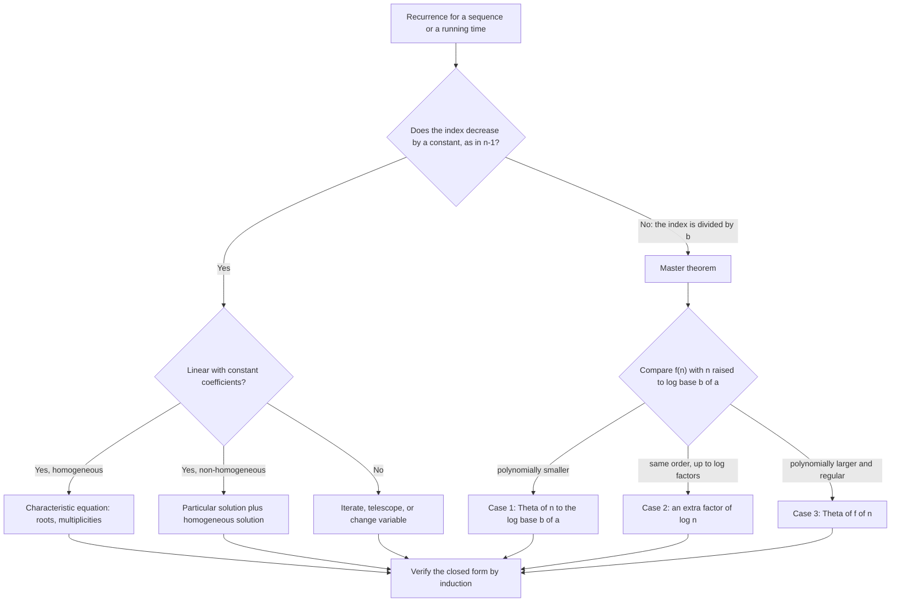
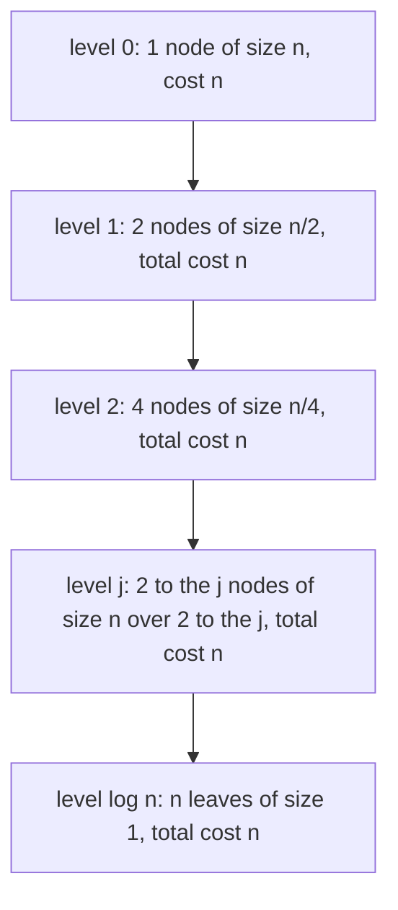

# Recurrence Relations

> [Mathematics](../../README.md) › [Discrete Mathematics](../README.md) › Recurrence Relations · Level: Advanced · Prerequisites: [Mathematical Induction](../01-mathematical-induction/README.md), [Advanced Algebra](../../03-algebra/14-advanced-algebra/README.md), [Quadratic Equations](../../03-algebra/08-quadratic-equations/README.md) · Estimated time: 180 min

## 1. Introduction

Some sequences are given by a formula: the $n$-th term is $3n + 2$, and you can compute it without knowing any other term. Others are given by a rule that refers to earlier terms: the $n$-th term is twice the previous one plus one. The first kind is easy to evaluate and hard to *derive*; the second kind is easy to *define* and hard to evaluate. A **recurrence relation** is the second kind, and the central problem of this topic is to convert it into the first kind — to find a **closed form**, a formula in $n$ alone.

The problem is not academic. Every recursive algorithm has a running time $T(n)$ that satisfies a recurrence: merge sort does two recursive sorts of half the input plus a linear merge, so $T(n) = 2T(n/2) + \Theta(n)$. Every population model with overlapping generations satisfies one: if each pair of rabbits produces a new pair each season, the population obeys $F_n = F_{n-1} + F_{n-2}$, the Fibonacci recurrence. Every interest calculation compounded $k$ times per year, every amortised loan, every analysis of a random walk, and every count of binary trees satisfies a recurrence. Solving the recurrence is what turns a description into a prediction.

There are four main techniques, and this tutorial develops all of them:

1. **Iteration (unrolling).** Substitute the recurrence into itself repeatedly, look for a pattern, and sum the resulting series. It always works in principle and is often the fastest route for simple recurrences.
2. **The characteristic equation.** For linear recurrences with constant coefficients, the solutions are combinations of exponentials $r^n$, where $r$ runs over the roots of a polynomial. This converts a problem about sequences into a problem about polynomials.
3. **Undetermined coefficients.** For non-homogeneous recurrences, guess the *shape* of a particular solution and solve for its constants, then add the general homogeneous solution.
4. **Generating functions.** Package the whole sequence into a power series, turn the recurrence into an algebraic equation for the series, solve it, and read off the coefficients. This is the most powerful and the most mechanical method, and it generalises far beyond constant coefficients.

Cutting across all four is the **master theorem**, which solves the divide-and-conquer recurrences that dominate algorithm analysis in one line, without any of the machinery above. It has precise hypotheses, and Section 7.10 states them carefully and proves the two easiest cases.

The topic sits at the boundary of algebra and computer science. The sequence manipulations — arithmetic and geometric progressions, sigma notation, telescoping sums — are developed in [Advanced Algebra](../../03-algebra/14-advanced-algebra/README.md), Sections 7.8–7.9; this tutorial assumes them and concentrates on what is new: recurrences, characteristic roots, and asymptotics. Every closed form derived here is proved by induction, the technique of the previous topic [Mathematical Induction](../01-mathematical-induction/README.md). The division of labour is exact: the recurrence *defines* the sequence by recursion, and induction *certifies* the closed form.

## 2. Prerequisites

* **Induction, including strong induction.** Every closed form in this tutorial is proved by induction, and several proofs need the strong form because the recurrence has several lags. Taught in [Mathematical Induction](../01-mathematical-induction/README.md), Sections 7.4 and 7.11.
* **Sequences, sigma notation and telescoping sums.** Arithmetic and geometric progressions, $\sum_{k=0}^{n-1} r^k = \frac{r^n-1}{r-1}$, and the telescoping identity $\sum (b_k - b_{k-1}) = b_n - b_0$. Taught in [Advanced Algebra](../../03-algebra/14-advanced-algebra/README.md), Sections 7.8, 7.9 and 8.4.
* **Quadratic equations and the discriminant.** The roots of $r^2 - pr - q = 0$ are $\frac{p \pm \sqrt{p^2+4q}}{2}$, and the discriminant $p^2+4q$ decides whether they are distinct, equal or complex. Taught in [Quadratic Equations](../../03-algebra/08-quadratic-equations/README.md).
* **Complex numbers.** Modulus, argument and de Moivre's theorem, for the oscillating case of Section 7.5. Taught in [Complex Numbers](../../03-algebra/13-complex-numbers/README.md).
* **Logarithms and exponentials.** $\log_b n$, the change of base, and $b^{\log_b n} = n$; these identities drive every master-theorem computation. Taught in [Exponential and Logarithmic Functions](../../03-algebra/12-exponential-and-logarithmic-functions/README.md).
* **Sets, functions and basic linear algebra language.** "Vector space" and "dimension" are used once, in Section 7.3, and are explained there. See [Relations and Functions](../../00-foundations/05-relations-and-functions/README.md).
* **Asymptotic notation.** $O$, $\Omega$ and $\Theta$ are used from Section 7.12 onwards and are defined in Section 6. The full treatment belongs to the topic *Algorithms and Complexity*, which follows this one in the [discipline index](../README.md).

## 3. Learning Objectives

By the end of this tutorial you will be able to:

1. Distinguish a recurrence from a closed form, and state the **order** of a recurrence.
2. Classify a recurrence as linear or non-linear, homogeneous or non-homogeneous, constant-coefficient or variable-coefficient.
3. Explain why a recurrence of order $k$ together with $k$ initial conditions defines exactly one sequence.
4. Solve a recurrence by **iteration**, and by **telescoping** when consecutive terms differ by a known quantity.
5. Derive the **characteristic equation** of a linear homogeneous recurrence with constant coefficients, and explain why $r^n$ is the right guess.
6. Solve the order-two case completely, including the distinct-root, repeated-root and complex-root cases.
7. State and apply the general order-$k$ theorem, including the multiplicity rule $(A_0 + A_1n + \cdots + A_{m-1}n^{m-1})r^n$.
8. Derive **Binet's formula** for the Fibonacci numbers, verify it numerically, and deduce that $F_n$ is the nearest integer to $\varphi^n/\sqrt5$.
9. Solve non-homogeneous recurrences by the **method of undetermined coefficients**, including the resonance case.
10. State the **master theorem** precisely, explain it with a recursion tree, and prove its first two cases for $n = b^k$.
11. Compute the asymptotic complexity of merge sort, binary search, Strassen's algorithm and Karatsuba's algorithm from their recurrences.
12. Set up and solve a recurrence with a **generating function**, and read off Binet's formula and the Catalan numbers from a power series.

## 4. Intuition

### 4.1 A recipe versus a result

A recurrence is a recipe that says how to get the next term from the ones you already have. A closed form is the result: a formula that produces the term directly. If someone asks for the $100$-th Fibonacci number, the recurrence makes you compute ninety-nine predecessors first; the closed form $F_n = (\varphi^n - \psi^n)/\sqrt5$ answers immediately. The whole subject is about the passage from the recipe to the result.

There is a useful accounting analogy. A recurrence is a *running balance*: each month's balance depends on the last. A closed form is a *formula for the balance at month $n$*, which lets you jump ahead, compare scenarios, and see the long-run growth rate. The formula is not just faster; it reveals the structure — for instance, that the balance doubles every $72/r$ months at an annual rate of $r$ percent.

### 4.2 Why exponentials

Try to guess a solution of $a_n = 5a_{n-1} - 6a_{n-2}$. Constant solutions fail unless the constants satisfy $c = 5c - 6c$, i.e. $c = 0$. Linear solutions fail. But an exponential $a_n = r^n$ works whenever $r$ satisfies a certain quadratic: the recurrence is *scale-invariant* in the sense that shifting $n$ by one multiplies every term by the same factor. Exponentials are the functions with that property, so they are the natural building blocks, exactly as sines and cosines are the natural building blocks for equations that are invariant under translation in space.

### 4.3 The recursion tree

For divide-and-conquer recurrences, draw the computation as a tree. The root costs $f(n)$; it has $a$ children, each costing $f(n/b)$; each of those has $a$ children, and so on until the subproblems reach size $1$. The depth is $\log_b n$, and the total work is the sum of the costs of all levels. The master theorem (Section 7.10) is nothing more than the statement that this sum is dominated by one of three things: the leaves, the root, or every level equally. Once you can see which, you can read the answer off the tree without any algebra.

### 4.4 Generating functions: the whole sequence on one clothesline

A generating function hangs the entire infinite sequence $a_0, a_1, a_2, \ldots$ on a single object, the power series $G(x) = \sum a_n x^n$. The recurrence, which relates one term to its predecessors, becomes an algebraic relation between $G(x)$ and $xG(x)$ and $x^2G(x)$ — that is, an equation for $G$. Solving that equation and expanding the result gives every term at once. It is the most "automatic" of the methods: no guessing, no case analysis, and the same recipe works for Fibonacci numbers, Catalan numbers and partition counts.

### 4.5 The three regimes of divide and conquer

Suppose a problem of size $n$ splits into $a$ subproblems of size $n/b$, with $f(n)$ work at the top. If the work per level *increases* as you go down the tree, the leaves dominate: the answer is $\Theta(n^{\log_b a})$. If the work per level is *constant*, every level contributes equally and the answer is $\Theta(n^{\log_b a}\log n)$. If the work per level *decreases*, the root dominates and the answer is $\Theta(f(n))$. Those three sentences are the master theorem, and they are worth memorising before the formal statement.

## 5. Formal Definition

### 5.1 Sequences and recurrences

**Definition 5.1 (Sequence).** A sequence is a function $a : \{n_0, n_0+1, n_0+2, \dots\} \to S$ for some starting index $n_0$ and some set $S$ of values; we write $a_n$ for $a(n)$. In this tutorial $S$ is usually $\mathbb{R}$ or $\mathbb{C}$.

**Definition 5.2 (Recurrence relation).** A **recurrence relation** for a sequence $(a_n)$ is an equation that expresses $a_n$ in terms of some of the preceding terms $a_{n-1}, a_{n-2}, \ldots, a_{n-k}$ and of $n$ itself, valid for all $n$ beyond some index. The integer $k$ is the **order** of the recurrence when $a_n$ genuinely depends on $a_{n-k}$.

**Definition 5.3 (Solution, initial conditions, closed form).** A sequence $(a_n)$ **satisfies** the recurrence if substituting its terms makes the equation true for every $n$ in the stated range. **Initial conditions** are the values $a_{n_0}, \ldots, a_{n_0+k-1}$ that start the recursion. A **closed form** is an expression for $a_n$ using a fixed number of standard operations and depending on $n$ but on no other term of the sequence.

**Definition 5.4 (Classification).** Let the recurrence have the form

$$a_n = c_1(n)a_{n-1} + c_2(n)a_{n-2} + \cdots + c_k(n)a_{n-k} + f(n).$$

* It is **linear** if the left side is $a_n$ and the right side is a linear combination of earlier terms plus a function of $n$ alone; equivalently, no term is squared and no two terms are multiplied together.
* It is **homogeneous** if $f(n) = 0$ for all $n$; otherwise it is **non-homogeneous**, and $f$ is the **forcing term**.
* It has **constant coefficients** if every $c_i(n)$ is a constant $c_i$; otherwise it has **variable coefficients**.
* It has **order $k$** if $c_k \ne 0$ and the recurrence genuinely involves $a_{n-k}$.

**Example 5.5.** Classify each recurrence.

| Recurrence | Order | Linear? | Homogeneous? | Constant coefficients? |
|---|---|---|---|---|
| $a_n = 5a_{n-1} - 6a_{n-2}$ | 2 | yes | yes | yes |
| $a_n = 2a_{n-1} + n$ | 1 | yes | no | yes |
| $a_n = a_{n-1} + a_{n-2} + a_{n-3}$ | 3 | yes | yes | yes |
| $a_n = n\,a_{n-1}$ | 1 | yes | yes | no |
| $a_n = a_{n-1}^2 + 1$ | 1 | no | no | yes |
| $a_n = a_{n-1}a_{n-2}$ | 2 | no | yes | yes |
| $T(n) = 2T(n/2) + n$ | — | yes | no | yes |

The last row is a **divide-and-conquer recurrence**: the index is divided rather than reduced by one, so the "order" is not defined; it is treated separately in Sections 7.9–7.10. Note that $a_n = a_{n-1}a_{n-2}$ is homogeneous (there is no additive forcing term) but not linear, and that linearity is about the *unknown sequence*, not about the coefficients: $a_n = n a_{n-1}$ is linear with variable coefficients.

### 5.2 Well-definedness

**Theorem 5.6.** Let $k \ge 1$, let $c_1, \ldots, c_k$ be fixed numbers, let $f$ be a function of $n$, and let $u_0, \ldots, u_{k-1}$ be prescribed values. Then there is exactly one sequence $(a_n)_{n \ge 0}$ satisfying

$$a_n = c_1a_{n-1} + \cdots + c_ka_{n-k} + f(n) \quad (n \ge k), \qquad a_i = u_i \ (0 \le i \le k-1).$$

*Proof.* Define $a_n$ by recursion on $n$: for $n < k$ set $a_n = u_n$, and for $n \ge k$ compute $a_n$ from the already defined earlier terms. The recursion theorem (Theorem 7.8.1 of [Mathematical Induction](../01-mathematical-induction/README.md)) licenses this definition, and induction on $n$ shows that any sequence satisfying the conditions agrees with the one constructed, term by term. $\square$

Two consequences are used constantly. First, **a recurrence plus too few initial conditions does not determine a sequence**: $a_n = a_{n-1} + a_{n-2}$ with only $a_0 = 1$ given has infinitely many solutions, one for each choice of $a_1$. Second, **to prove that two candidate formulas describe the same sequence it suffices to check the recurrence and the first $k$ values** — that is the induction principle in disguise, and it is exactly how a closed form is verified.

### 5.3 The solution space of a linear homogeneous recurrence

**Theorem 5.7.** The set $V$ of sequences satisfying a fixed linear homogeneous recurrence with constant coefficients is a vector space under term-by-term addition and scalar multiplication, and if the recurrence has order $k$ then $\dim V = k$.

*Proof.* If $(a_n)$ and $(b_n)$ both satisfy the recurrence, then so does $(\alpha a_n + \beta b_n)$, because the recurrence is a linear equation: substituting gives $\alpha \cdot 0 + \beta \cdot 0 = 0$. So $V$ is a vector space. The map $V \to \mathbb{R}^k$, $(a_n) \mapsto (a_0, \ldots, a_{k-1})$, is linear; it is injective because a solution with $k$ zero initial values is identically zero by induction, and surjective because Theorem 5.6 produces a solution for every initial vector. A linear bijection is an isomorphism, so $\dim V = k$. $\square$

This is the reason the general solution of an order-two recurrence has exactly two free constants: $V$ is two-dimensional, and any two linearly independent solutions form a basis.

## 6. Mathematical Notation

| Symbol | Read as | Meaning |
|---|---|---|
| $a_n$ | "$a$ sub $n$" | the $n$-th term of a sequence |
| $(a_n)_{n \ge 0}$ | the sequence $a$ from $n=0$ | the whole sequence |
| $k$ | order | number of previous terms the recurrence refers to |
| $c_1, \ldots, c_k$ | coefficients | constants multiplying earlier terms |
| $f(n)$ | the forcing term | the non-homogeneous part |
| $r$ | root | a candidate base of an exponential solution $r^n$ |
| $r^2 - pr - q$ | characteristic polynomial | the polynomial whose roots give the solutions |
| $A, B, C$ | constants of combination | determined by the initial conditions |
| $\varphi, \psi$ | phi, psi | $\varphi = \frac{1+\sqrt5}{2} \approx 1.618$, $\psi = \frac{1-\sqrt5}{2} \approx -0.618$ |
| $F_n$ | Fibonacci number | $F_0 = 0$, $F_1 = 1$, $F_n = F_{n-1}+F_{n-2}$ |
| $T(n)$ | "$T$ of $n$" | running time of an algorithm on input size $n$ |
| $O(g)$, $\Omega(g)$, $\Theta(g)$ | big-O, big-Omega, big-Theta | upper bound, lower bound, matching bound up to constants |
| $\log_b a$ | log base $b$ of $a$ | the exponent $c$ with $b^c = a$ |
| $G(x)$ | generating function | $\sum_{n \ge 0} a_n x^n$ |
| $[x^n]G(x)$ | coefficient of $x^n$ | the number $a_n$ |
| $\lfloor x \rfloor$, $\lceil x \rceil$ | floor, ceiling | greatest integer $\le x$; least integer $\ge x$ |
| $\sim$ | asymptotically equal | the ratio tends to $1$ |

**Asymptotic notation, precisely.** For functions of $n$: $f(n) = O(g(n))$ means there are constants $C > 0$ and $N$ with $|f(n)| \le C|g(n)|$ for all $n \ge N$; $f(n) = \Omega(g(n))$ means $g(n) = O(f(n))$; $f(n) = \Theta(g(n))$ means both. These are statements about *growth*, valid for large $n$, and they ignore constant factors. When a recurrence is stated with $\Theta$ in the forcing term, the solution is asserted up to constants in both directions; when it is stated with $O$, only the upper bound is asserted.

## 7. Core Concepts

### 7.1 Recurrence versus closed form

The same sequence can be presented in two ways, and neither is automatically better.

| Sequence | Recurrence | Closed form |
|---|---|---|
| $2, 5, 8, 11, 14, \ldots$ | $a_n = a_{n-1}+3$, $a_0 = 2$ | $a_n = 3n+2$ |
| $1, 2, 4, 8, 16, \ldots$ | $a_n = 2a_{n-1}$, $a_0 = 1$ | $a_n = 2^n$ |
| $0, 1, 1, 2, 3, 5, 8, \ldots$ | $F_n = F_{n-1}+F_{n-2}$, $F_0=0, F_1=1$ | $F_n = \dfrac{\varphi^n-\psi^n}{\sqrt5}$ |
| $1, 2, 6, 24, 120, \ldots$ | $a_n = n\,a_{n-1}$, $a_0=1$ | $a_n = n!$ |
| $1, 4, 14, 52, \ldots$ | $a_n = 4a_{n-1}-a_{n-2}$, $a_0=2, a_1=4$ | $a_n = (2+\sqrt3)^n+(2-\sqrt3)^n$ |

The recurrence is a *description of the mechanism* and is usually how the sequence arises in the first place; the closed form is a *description of the value* and is what you need to compute, compare or bound. The word "closed form" is used loosely: $n!$ counts as a closed form even though it is itself a product, because it is a standard function of $n$; $\Theta(n\log n)$ counts as a closed form *for complexity purposes*, because it describes the growth rate exactly up to constants.

Two warnings before we begin.

* **A recurrence is not a formula.** Writing "$a_n = 2a_{n-1}+1$" does not tell you $a_{100}$; it tells you how to find it after ninety-nine steps.
* **A closed form is not automatically simpler.** $(2+\sqrt3)^n + (2-\sqrt3)^n$ looks worse than $a_n = 4a_{n-1}-a_{n-2}$, but it is an integer for every $n$ (Exercise 31 of [Mathematical Induction](../01-mathematical-induction/README.md) territory), it can be evaluated in $O(\log n)$ multiplications, and it shows immediately that $a_n \sim (2+\sqrt3)^n$.

### 7.2 Iteration and telescoping

**The additive case.** Suppose $a_n = a_{n-1} + g(n)$ for $n \ge 1$. Then

$$a_n = a_0 + g(1) + g(2) + \cdots + g(n) = a_0 + \sum_{j=1}^{n} g(j),$$

because the intermediate terms cancel in a chain: $a_n - a_{n-1} = g(n)$, $a_{n-1}-a_{n-2} = g(n-1)$, and so on down to $a_1 - a_0 = g(1)$. Adding these $n$ equations leaves $a_n - a_0$ on the left and the whole sum on the right. This is **telescoping**, and it reduces the recurrence to a summation.

**The multiplicative case.** Suppose $a_n = c_n a_{n-1}$ with $c_n \ne 0$. Then

$$a_n = a_0 \prod_{j=1}^{n} c_j,$$

by the same cancellation applied to the ratios. If $c_n = c$ is constant this gives $a_n = a_0 c^n$.

**The mixed case.** Suppose $a_n = c\,a_{n-1} + g(n)$ with $c \ne 1$. Iterating,

$$\begin{aligned} a_n &= c\,a_{n-1} + g(n) \\ &= c^2 a_{n-2} + c\,g(n-1) + g(n) \\ &= c^3 a_{n-3} + c^2 g(n-2) + c\,g(n-1) + g(n) \\ &= \cdots \\ &= c^n a_0 + \sum_{j=1}^{n} c^{\,n-j} g(j). \end{aligned}$$

The pattern is: **three lines, then the general term**. Writing the first three substitutions is not pedantry; it is how you discover the exponent $n-j$ on the factor. With $g(j) = d$ constant the sum is geometric and gives

$$a_n = c^n a_0 + d\,\frac{c^n-1}{c-1} \qquad (c \ne 1).$$

For $c = 1$ the recurrence is additive and $a_n = a_0 + nd$.

**Example 7.2.1.** Solve $a_n = 2a_{n-1} + 3$, $a_0 = 1$.

*Iterating:* $a_1 = 2 + 3 = 5$, $a_2 = 10+3 = 13$, $a_3 = 26+3 = 29$. The formula with $c = 2$, $d = 3$ gives $a_n = 2^n\cdot 1 + 3(2^n-1) = 4\cdot 2^n - 3$. Check: $n=0$: $4-3 = 1$ ✓; $n=1$: $8-3 = 5$ ✓; $n=2$: $16-3 = 13$ ✓; $n=3$: $32-3 = 29$ ✓.

**Example 7.2.2 (telescoping with a rational term).** Solve $a_n = a_{n-1} + \frac{1}{n(n+1)}$, $a_0 = 0$. Since $\frac{1}{j(j+1)} = \frac1j - \frac{1}{j+1}$, the sum telescopes:

$$a_n = \sum_{j=1}^{n}\left(\frac1j - \frac1{j+1}\right) = 1 - \frac{1}{n+1} = \frac{n}{n+1}.$$

Check: $a_1 = 1/2$ ✓, $a_2 = 1/2 + 1/6 = 2/3$ ✓.

### 7.3 Linear homogeneous recurrences: the characteristic equation

Consider the order-two recurrence with constant coefficients

$$a_n = p\,a_{n-1} + q\,a_{n-2} \qquad (n \ge 2),$$

where $p, q$ are fixed real numbers and $q \ne 0$ (the case $q = 0$ reduces the order to one and is dealt with at the end of Section 7.4).

**The guess.** Because the recurrence treats all indices alike, it is natural to look for a solution whose values scale by a constant factor at each step: $a_n = r^n$ for some $r \ne 0$. Substituting,

$$r^n = p\,r^{n-1} + q\,r^{n-2}.$$

Since $r \ne 0$, divide by $r^{n-2}$:

$$r^2 = p\,r + q, \qquad \text{that is} \qquad r^2 - pr - q = 0.$$

This quadratic is the **characteristic equation** of the recurrence, and its left side is the **characteristic polynomial**. Two observations follow immediately.

* If $r$ is a root then $a_n = r^n$ is a solution, and so is $a_n = A r^n$ for any constant $A$, because the recurrence is linear.
* The quadratic has two roots, counted with multiplicity, given by $$r_{1,2} = \frac{p \pm \sqrt{p^2 + 4q}}{2}, \qquad r_1 + r_2 = p, \qquad r_1r_2 = -q.$$

**Theorem 7.3.1 (distinct roots).** If $r_1 \ne r_2$ are the roots of $r^2 - pr - q = 0$, then every solution of $a_n = pa_{n-1}+qa_{n-2}$ has the form

$$a_n = A\,r_1^{\,n} + B\,r_2^{\,n}$$

for constants $A, B$, and every such expression is a solution.

*Proof.* **Every such expression is a solution:** $(Ar_1^n + Br_2^n)$ is a linear combination of the two solutions $(r_1^n)$ and $(r_2^n)$, and $V$ is a vector space by Theorem 5.7. **Every solution has this form:** the two sequences $(r_1^n)$ and $(r_2^n)$ are linearly independent, since if $Ar_1^n + Br_2^n = 0$ for all $n$ then taking $n = 0$ and $n = 1$ gives

$$A + B = 0, \qquad Ar_1 + Br_2 = 0,$$

whose determinant is $r_2 - r_1 \ne 0$, so $A = B = 0$. Two independent solutions span a two-dimensional subspace of the two-dimensional space $V$ (Theorem 5.7), hence span all of it. $\square$

**Finding $A$ and $B$.** The initial conditions give the linear system

$$A + B = a_0, \qquad Ar_1 + Br_2 = a_1,$$

with solution

$$A = \frac{a_1 - a_0r_2}{r_1-r_2}, \qquad B = \frac{a_0r_1 - a_1}{r_1-r_2}.$$

**Example 7.3.2.** Solve $a_n = 5a_{n-1} - 6a_{n-2}$ with $a_0 = 1$, $a_1 = 2$.

*Characteristic equation:* $r^2 - 5r + 6 = 0$, i.e. $(r-2)(r-3) = 0$, so $r_1 = 2$, $r_2 = 3$. *General solution:* $a_n = A2^n + B3^n$. *Initial conditions:*

$$A + B = 1, \qquad 2A + 3B = 2.$$

Subtracting twice the first from the second gives $B = 0$, hence $A = 1$, so $a_n = 2^n$. *Check:* $a_2 = 5\cdot 2 - 6\cdot 1 = 4 = 2^2$ ✓; $a_3 = 5\cdot 4 - 6\cdot 2 = 8 = 2^3$ ✓.

The example shows that a solution can collapse to a single exponential: $B = 0$ is a perfectly good choice. It also shows why the general solution must be written with both roots even when the answer uses one.

### 7.4 The repeated-root case

If the discriminant $p^2 + 4q$ vanishes, the characteristic equation has a double root $r = p/2$, and $q = -r^2$ because $r^2 - pr - q = 0$ gives $q = r^2 - 2r^2 = -r^2$. Then Theorem 7.3.1 does not apply: $(r^n)$ is one solution, but it cannot span a two-dimensional space alone. The missing solution is $n\,r^n$.

**Theorem 7.4.1 (repeated root).** If $r \ne 0$ is a double root of $r^2 - pr - q = 0$, that is $p = 2r$ and $q = -r^2$, then every solution of $a_n = pa_{n-1}+qa_{n-2}$ has the form

$$a_n = (A + Bn)\,r^{\,n}.$$

*Proof.* **$(n r^n)$ is a solution:** compute

$$\begin{aligned} p\,(n-1)r^{n-1} + q\,(n-2)r^{n-2} &= 2r\,(n-1)r^{n-1} - r^2\,(n-2)r^{n-2} \\ &= 2(n-1)r^{n} - (n-2)r^{n} \\ &= r^{n}\bigl(2(n-1) - (n-2)\bigr) = r^{n}\bigl(2n - 2 - n + 2\bigr) = n\,r^{n}, \end{aligned}$$

which is exactly the right-hand side of the recurrence for $a_n = nr^n$ (the first line substitutes $p = 2r$ and $q = -r^2$, the second collects powers of $r$). **Independence:** if $Ar^n + Bnr^n = 0$ for all $n$ then at $n = 0$ we get $A = 0$, and at $n = 1$ we get $Br = 0$, so $B = 0$ since $r \ne 0$. Two independent solutions in the two-dimensional space $V$ span it. $\square$

**Example 7.4.2.** Solve $a_n = 4a_{n-1} - 4a_{n-2}$ with $a_0 = 1$, $a_1 = 4$.

*Characteristic equation:* $r^2 - 4r + 4 = (r-2)^2 = 0$, a double root $r = 2$. *General solution:* $a_n = (A + Bn)2^n$. *Initial conditions:* $A = 1$ and $(1+B)\cdot 2 = 4$, so $B = 1$. Hence $a_n = (1+n)2^n$. *Check:* $a_2 = 4\cdot 4 - 4\cdot 1 = 12$, and $(1+2)\cdot 4 = 12$ ✓; $a_3 = 4\cdot 12 - 4\cdot 4 = 32$, and $4 \cdot 8 = 32$ ✓.

**The degenerate case $r = 0$.** If $p = q = 0$ then the recurrence is $a_n = 0$ for all $n \ge 2$, and the solution is $a_0, a_1$ arbitrary and $a_n = 0$ thereafter. The formula $(A+Bn)0^n$ cannot represent this, because $0^n = 0$ for $n \ge 1$ regardless of $B$; the two-dimensional space here is spanned by $(1,0,0,\ldots)$ and $(0,1,0,\ldots)$. The repeated-root formula therefore requires $r \ne 0$, which is why the theorem states it. This is exactly the kind of boundary case that a careless application of the formula loses.

### 7.5 Complex roots and oscillation

If $p^2 + 4q < 0$ the characteristic roots are complex conjugates. Write them in polar form:

$$r_{1,2} = \rho e^{\pm i\theta}, \qquad \rho = \sqrt{-q} > 0, \qquad \cos\theta = \frac{p}{2\rho}, \qquad \sin\theta = \frac{\sqrt{-p^2-4q}}{2\rho}.$$

Since the coefficients are real, a real sequence is obtained by taking real and imaginary parts of $Ar^n$, and the general real solution is

$$a_n = \rho^{\,n}\bigl(C\cos(n\theta) + D\sin(n\theta)\bigr).$$

This follows from de Moivre's theorem $(\rho e^{i\theta})^n = \rho^n(\cos n\theta + i\sin n\theta)$; the details of complex arithmetic are in [Complex Numbers](../../03-algebra/13-complex-numbers/README.md). The qualitative content is important: the sequence **oscillates** with period $2\pi/\theta$ while its amplitude grows like $\rho^n$ (or decays, if $\rho < 1$).

**Example 7.5.1.** Solve $a_n = 2a_{n-1} - 2a_{n-2}$ with $a_0 = 0$, $a_1 = 2$.

The characteristic equation is $r^2 - 2r + 2 = 0$ with roots $r = 1 \pm i = \sqrt2\,e^{\pm i\pi/4}$. So $\rho = \sqrt2$ and $\theta = \pi/4$, and $a_n = (\sqrt2)^n\bigl(C\cos\frac{n\pi}{4} + D\sin\frac{n\pi}{4}\bigr)$. From $a_0 = 0$ we get $C = 0$; from $a_1 = 2$,

$$\sqrt2\cdot D\sin\frac{\pi}{4} = \sqrt2\cdot D\cdot\frac{1}{\sqrt2} = D = 2.$$

Hence $a_n = 2(\sqrt2)^n\sin\frac{n\pi}{4}$. *Check:* $a_2 = 2\cdot 2\cdot 1 = 4$, and the recurrence gives $2\cdot 2 - 2\cdot 0 = 4$ ✓; $a_4 = 2\cdot 4\cdot 0 = 0$, and the recurrence gives $2\cdot 4 - 2\cdot 4 = 0$ ✓; $a_5 = 2(\sqrt2)^5\sin\frac{5\pi}{4} = 2\cdot 4\sqrt2\cdot(-\frac{1}{\sqrt2}) = -8$, and the recurrence gives $2\cdot 0 - 2\cdot 4 = -8$ ✓.

### 7.6 Order $k$: the general theorem

**Theorem 7.6.1 (linear homogeneous, constant coefficients, order $k$).** Let

$$a_n = c_1a_{n-1} + c_2a_{n-2} + \cdots + c_ka_{n-k} \qquad (n \ge k),$$

with $c_k \ne 0$, and let

$$P(r) = r^k - c_1r^{k-1} - c_2r^{k-2} - \cdots - c_k$$

be its characteristic polynomial. Suppose $P$ has distinct roots $r_1, \ldots, r_m$ with multiplicities $m_1, \ldots, m_m$, so that $m_1 + \cdots + m_m = k$. Then every solution has the form

$$a_n = \sum_{j=1}^{m}\Bigl(A_{j,0} + A_{j,1}n + \cdots + A_{j,m_j-1}n^{m_j-1}\Bigr)r_j^{\,n},$$

and every expression of this form is a solution.

*Proof sketch.* Each sequence $n^{i}r_j^n$ with $0 \le i < m_j$ is a solution. To see why, let $L$ be the operator $L(a)_n = a_n - c_1a_{n-1} - \cdots - c_ka_{n-k}$; for $a_n = r^n$ we have $L(a)_n = r^{n-k}P(r)$. Differentiating $i$ times with respect to $r$ gives
$$L\bigl(n(n-1)\cdots(n-i+1)r^{n-i}\bigr)_n = \frac{\partial^i}{\partial r^i}\bigl[r^{n-k}P(r)\bigr] = \sum_{j=0}^{i}\binom{i}{j}\bigl(r^{n-k}\bigr)^{(j)}P^{(i-j)}(r),$$ and every derivative of $P$ that appears vanishes because $i - j \le i \le m_j - 1$ and $r_j$ is a root of multiplicity $m_j$. So the falling factorials are solutions, and so is $n^ir^n$, being a linear combination of them. There are exactly $m_1 + \cdots + m_m = k$ such sequences and they are linearly independent (if a nontrivial combination vanished for all $n$, clearing denominators would give a nonzero polynomial in $n$ with infinitely many roots). Since the solution space has dimension $k$ (Theorem 5.7), they form a basis. $\square$

The theorem is a complete description, but it is not a practical algorithm for large $k$: the roots of a degree-$k$ polynomial cannot generally be written in radicals once $k \ge 5$ (see [Advanced Algebra](../../03-algebra/14-advanced-algebra/README.md), Section 7.11). In applications one usually either factors the polynomial (because it was built from simple factors) or works with the dominant root only, as in Section 7.13.

### 7.7 The Fibonacci sequence and Binet's formula

**Definition 7.7.1.** $F_0 = 0$, $F_1 = 1$, and $F_n = F_{n-1} + F_{n-2}$ for $n \ge 2$. The sequence begins

$$0,\ 1,\ 1,\ 2,\ 3,\ 5,\ 8,\ 13,\ 21,\ 34,\ 55,\ 89,\ \ldots$$

**The characteristic equation.** $r^2 - r - 1 = 0$, with roots

$$\varphi = \frac{1+\sqrt5}{2} \approx 1.6180339887, \qquad \psi = \frac{1-\sqrt5}{2} \approx -0.6180339887.$$

Two identities are used repeatedly and follow from the sum and product of the roots:

$$\varphi + \psi = 1, \qquad \varphi\psi = -1, \qquad \varphi - \psi = \sqrt5.$$

**Derivation of Binet's formula.** By Theorem 7.3.1 the general solution is $F_n = A\varphi^n + B\psi^n$. The initial conditions give

$$F_0 = 0: \quad A + B = 0, \qquad F_1 = 1: \quad A\varphi + B\psi = 1.$$

From the first, $B = -A$; substituting into the second gives $A(\varphi - \psi) = 1$, so $A = 1/\sqrt5$ and $B = -1/\sqrt5$. Therefore

$$F_n = \frac{\varphi^n - \psi^n}{\sqrt5}.$$

**Verification.** It is worth checking the formula term by term, because the two irrational numbers must conspire to produce integers.

| $n$ | $\varphi^n$ | $\psi^n$ | $(\varphi^n-\psi^n)/\sqrt5$ | $F_n$ |
|---|---|---|---|---|
| 0 | $1$ | $1$ | $0$ | 0 |
| 1 | $1.618034$ | $-0.618034$ | $2.236068/2.236068 = 1$ | 1 |
| 2 | $2.618034$ | $0.381966$ | $2.236068/2.236068 = 1$ | 1 |
| 3 | $4.236068$ | $-0.236068$ | $4.472136/2.236068 = 2$ | 2 |
| 4 | $6.854102$ | $0.145898$ | $6.708204/2.236068 = 3$ | 3 |
| 5 | $11.090170$ | $-0.090170$ | $11.180340/2.236068 = 5$ | 5 |
| 6 | $17.944272$ | $0.055728$ | $17.888544/2.236068 = 8$ | 8 |

The values in the last two columns agree, as they must. An exact check for $n = 2$ uses $\varphi^2 = \varphi + 1$ and $\psi^2 = \psi+1$, so $\varphi^2 - \psi^2 = (\varphi-\psi)(\varphi+\psi) = \sqrt5\cdot 1 = \sqrt5$ and the formula gives $1$. For $n = 3$, $\varphi^3 - \psi^3 = (\varphi-\psi)(\varphi^2+\varphi\psi+\psi^2) = \sqrt5\bigl((\varphi+\psi)^2 - \varphi\psi\bigr) = \sqrt5(1+1) = 2\sqrt5$, giving $2$.

**Theorem 7.7.2 (Binet's formula).** For every $n \ge 0$,

$$F_n = \frac{1}{\sqrt5}\left[\left(\frac{1+\sqrt5}{2}\right)^n - \left(\frac{1-\sqrt5}{2}\right)^n\right].$$

*Proof by induction.* The base cases $n = 0$ and $n = 1$ are the computations above. For the step, note that $\varphi^2 = \varphi+1$ and $\psi^2 = \psi+1$, so each of $\varphi^n$ and $\psi^n$ satisfies the Fibonacci recurrence; hence so does any linear combination, and a sequence satisfying the recurrence with $F_0 = 0$ and $F_1 = 1$ is the Fibonacci sequence by Theorem 5.6. $\square$

**Corollary 7.7.3.** $F_n$ is the nearest integer to $\varphi^n/\sqrt5$ for every $n \ge 0$; equivalently,

$$F_n = \left\lfloor \frac{\varphi^n}{\sqrt5} + \frac12 \right\rfloor .$$

*Proof.* Since $|\psi| = (\sqrt5-1)/2 \approx 0.618 < 1$, we have $|\psi|^n/\sqrt5 < 1/\sqrt5 < 1/2$ for $n \ge 0$. So $F_n = \varphi^n/\sqrt5 - \psi^n/\sqrt5$ differs from $\varphi^n/\sqrt5$ by less than $1/2$. If $n$ is even, $\psi^n > 0$ and $F_n < \varphi^n/\sqrt5$; if $n$ is odd, $\psi^n < 0$ and $F_n > \varphi^n/\sqrt5$. In both cases $F_n$ is the unique integer in the open interval of length $1$ centred on $\varphi^n/\sqrt5$, which is the stated formula. $\square$

**Corollary 7.7.4 (growth rate).** $F_n = \Theta(\varphi^n)$, and $F_{n+1}/F_n \to \varphi$.

*Proof.* Divide the Binet formula by $\varphi^n$: $F_n/\varphi^n = \frac{1}{\sqrt5}\bigl(1 - (\psi/\varphi)^n\bigr) \to 1/\sqrt5$, since $|\psi/\varphi| = 1/\varphi^2 \approx 0.382 < 1$. Hence $F_n \sim \varphi^n/\sqrt5$, which gives both statements. $\square$

### 7.8 Non-homogeneous recurrences

A non-homogeneous recurrence has the form

$$a_n = c_1a_{n-1} + \cdots + c_ka_{n-k} + f(n), \qquad f \not\equiv 0.$$

**Theorem 7.8.1 (particular plus homogeneous).** If $a^{(p)}$ is any one solution of the non-homogeneous recurrence, then the general solution is

$$a_n = a^{(p)}_n + a^{(h)}_n,$$

where $a^{(h)}$ runs over all solutions of the associated homogeneous recurrence.

*Proof.* If $a$ and $b$ both solve the non-homogeneous recurrence, then $d = a - b$ satisfies

$$d_n = a_n - b_n = \Bigl(\sum_i c_ia_{n-i} + f(n)\Bigr) - \Bigl(\sum_i c_ib_{n-i} + f(n)\Bigr) = \sum_i c_i d_{n-i},$$

so $d$ solves the homogeneous recurrence. Conversely, adding any homogeneous solution to a particular solution gives another solution of the non-homogeneous recurrence. $\square$

So the task splits in two: solve the homogeneous recurrence (Section 7.3–7.6), and find **one** solution of the full recurrence.

**The method of undetermined coefficients** finds that one solution by guessing its *shape* from the shape of $f$, and solving a linear system for the unknown constants. The guesses work because the operator $L(a)_n = a_n - \sum c_ia_{n-i}$ maps polynomials times $s^n$ to polynomials times $s^n$ of the same or lower degree.

| Forcing term $f(n)$ | Condition | Trial solution |
|---|---|---|
| polynomial $P_d(n)$ of degree $d$ | $1$ is not a characteristic root | $Q_d(n)$, a general polynomial of degree $d$ |
| polynomial $P_d(n)$ | $1$ is a root of multiplicity $m$ | $n^mQ_d(n)$ |
| $P_d(n)s^n$, $s \ne 0$ | $s$ is not a characteristic root | $Q_d(n)s^n$ |
| $P_d(n)s^n$ | $s$ is a root of multiplicity $m$ | $n^mQ_d(n)s^n$ |
| $\alpha\cos(n\theta) + \beta\sin(n\theta)$ | $e^{i\theta}$ is not a root | $C\cos(n\theta) + D\sin(n\theta)$ |
| $f_1(n) + f_2(n)$ | — | sum of the trials for $f_1$ and $f_2$ |

The multiplicity case is called **resonance**: the forcing term has the same base as a homogeneous solution, so the naive trial is already annihilated by $L$ and a factor $n^m$ is needed to escape.

**Example 7.8.2 (resonance).** Find a particular solution of $a_n = 5a_{n-1} - 6a_{n-2} + 2^n$.

The characteristic polynomial is $r^2 - 5r + 6 = (r-2)(r-3)$, so $s = 2$ is a **simple** root and the trial is $a_n = Cn2^n$. Substituting,

$$Cn2^n = 5C(n-1)2^{n-1} - 6C(n-2)2^{n-2} + 2^n .$$

Divide by $2^{n-2}$:

$$4Cn = 10C(n-1) - 6C(n-2) + 4 = 10Cn - 10C - 6Cn + 12C + 4 = 4Cn + 2C + 4 .$$

The $4Cn$ terms cancel, leaving $2C + 4 = 0$, so $C = -2$ and the particular solution is $a_n^{(p)} = -2n2^n = -n\,2^{n+1}$.

*Check.* At $n = 2$ the particular solution has value $-16$. The recurrence gives $5a_1 - 6a_0 + 4 = 5(-4) - 6(0) + 4 = -16$ ✓.

**Example 7.8.3 (the full solution).** Solve $a_n = 5a_{n-1} - 6a_{n-2} + 2^n$ with $a_0 = 1$, $a_1 = 3$.

By Theorem 7.8.1 and Example 7.8.2 the general solution is

$$a_n = A\,2^n + B\,3^n - 2n\,2^n .$$

The initial conditions give $A + B = 1$ and $2A + 3B - 4 = 3$, i.e. $2A + 3B = 7$. Substituting $A = 1-B$ gives $2 - 2B + 3B = 7$, so $B = 5$ and $A = -4$. Hence

$$a_n = -4\cdot 2^n + 5\cdot 3^n - 2n\,2^n .$$

*Check.* $a_2$ from the recurrence is $5\cdot 3 - 6\cdot 1 + 4 = 13$; the formula gives $-16 + 45 - 16 = 13$ ✓. $a_3$ from the recurrence is $5\cdot 13 - 6\cdot 3 + 8 = 55$; the formula gives $-32 + 135 - 48 = 55$ ✓.

**Why the guesses are the right ones.** The operator $L$ sends $n^js^n$ to a linear combination of $n^is^n$ with $i \le j$, because shifting $n$ by a constant shifts $(n-1)^j$ into a polynomial in $n$ of the same degree. So the space of polynomials of degree $\le d$ times $s^n$ is invariant under $L$, and solving $L(a) = P_d(n)s^n$ inside it is a finite linear problem. If $s$ is not a root, $L$ is invertible on that space; if $s$ is a root of multiplicity $m$, the kernel contains exactly $s^n, ns^n, \ldots, n^{m-1}s^n$, and multiplying the trial by $n^m$ moves it out of the kernel. This is the same phenomenon as resonance in differential equations.

### 7.9 Change of variable

Divide-and-conquer recurrences are indexed by a size $n$ that is repeatedly divided by a constant $b$. Two conventions keep them manageable.

* **Exact powers.** Assume $n = b^k$ when solving; the resulting expression is then a function of $k = \log_b n$, which is rewritten in terms of $n$.
* **Floors and ceilings.** Real algorithms call themselves on $\lfloor n/b\rfloor$ or $\lceil n/b\rceil$. These change the answer by at most a constant factor, so the $\Theta$ statement is unaffected; a rigorous treatment uses the monotonicity of $T$ and a sandwiching argument. This tutorial states results for exact powers and notes the general case.

**Example 7.9.1 (a radical recurrence).** Solve $T(n) = 2T(\sqrt n) + \log_2 n$ for $n = 2^{2^k}$.

Put $n = 2^m$ and define $S(m) = T(2^m)$. Then $\sqrt n = 2^{m/2}$ and

$$S(m) = 2S(m/2) + m .$$

This is the divide-and-conquer form with $a = 2$, $b = 2$ and $f(m) = m = \Theta(m^{\log_2 2})$, which is the second case of the master theorem (Section 7.10). Hence $S(m) = \Theta(m\log m)$, and substituting back $m = \log_2 n$,

$$T(n) = \Theta(\log n \cdot \log\log n).$$

*Why the substitution is legitimate.* The map $n \mapsto \log_2 n$ is a bijection from $\{2^m\}$ to $\{m\}$, and the recurrence for $S$ has exactly the same structure as the one for $T$ with size parameter $m$. This "expansion" is the standard way to handle recurrences whose argument is transformed non-linearly.

### 7.10 The master theorem

**Theorem 7.10.1 (master theorem).** Let $a \ge 1$ and $b > 1$ be constants, let $f : \mathbb{N} \to [0,\infty)$ be eventually positive, and let $T$ be defined for $n = b^k$ by

$$T(n) = a\,T(n/b) + f(n), \qquad T(1) = \Theta(1).$$

Write $c = \log_b a$. Then:

1. **Case 1 (leaves dominate).** If $f(n) = O(n^{c-\varepsilon})$ for some $\varepsilon > 0$, then $T(n) = \Theta(n^{c})$.
2. **Case 2 (all levels equal).** If $f(n) = \Theta(n^{c})$, then $T(n) = \Theta(n^{c}\log n)$. More generally, if $f(n) = \Theta(n^{c}\log^{k}n)$ for some $k \ge 0$, then $T(n) = \Theta(n^{c}\log^{k+1}n)$.
3. **Case 3 (the root dominates).** If $f(n) = \Omega(n^{c+\varepsilon})$ for some $\varepsilon > 0$ **and** $f$ satisfies the regularity condition $a\,f(n/b) \le \delta f(n)$ for some constant $\delta < 1$ and all large $n$, then $T(n) = \Theta(f(n))$.

The theorem also holds when $n$ is not an exact power of $b$ and when the recursive calls are on $\lfloor n/b\rfloor$ and $\lceil n/b\rceil$, with the same conclusions; that extension requires the monotonicity argument mentioned in Section 7.9.

**Intuition: the recursion tree.** Level $j$ of the recursion tree ($j = 0$ at the root) contains $a^j$ nodes, each of size $n/b^j$, so the total work at level $j$ is

$$W_j = a^j f\!\left(\frac{n}{b^j}\right).$$

With $f(n) = n^{c}$ the level costs are $W_j = (a/b^{c})^j n^{c} = n^{c}$, since $b^{c} = a$. So every level costs the same, there are $1 + \log_b n$ levels, and the total is $\Theta(n^c\log n)$ — Case 2. If $f$ grows more slowly than $n^c$, then $W_j$ *increases* geometrically with $j$ and the deepest level (the leaves, which cost $\Theta(a^{\log_b n}) = \Theta(n^c)$) dominates — Case 1. If $f$ grows faster, $W_j$ decreases geometrically and the root dominates — Case 3, and the regularity condition is exactly what makes the geometric decrease fast enough.

**Proof of Case 2 (for $n = b^k$).** Let $f(n) = C n^{c}$ exactly. Then

$$W_j = a^j \cdot C\left(\frac{n}{b^j}\right)^{c} = C\,n^{c}\cdot\frac{a^j}{b^{jc}} = C\,n^{c},$$

because $b^{jc} = (b^{c})^j = a^j$. There are $k + 1 = \log_b n + 1$ levels, so

$$T(n) = \sum_{j=0}^{k} W_j = C\,n^{c}(k+1) = \Theta(n^{c}\log n). \qquad \square$$

**Proof of Case 1 (for $n = b^k$).** Suppose $f(n) \le C n^{c-\varepsilon}$. Then

$$W_j \le a^j \cdot C\left(\frac{n}{b^j}\right)^{c-\varepsilon} = C\,n^{c-\varepsilon}\cdot\frac{a^j}{b^{j(c-\varepsilon)}} = C\,n^{c-\varepsilon}\,b^{j\varepsilon},$$

using $a = b^{c}$. Summing the geometric series,

$$T(n) \;\le\; \sum_{j=0}^{k} C\,n^{c-\varepsilon}b^{j\varepsilon} = C\,n^{c-\varepsilon}\,\frac{b^{\varepsilon(k+1)}-1}{b^{\varepsilon}-1} = O\bigl(n^{c-\varepsilon}\cdot b^{\varepsilon k}\bigr) = O(n^{c}),$$

because $b^{\varepsilon k} = (b^{k})^{\varepsilon} = n^{\varepsilon}$. The leaves alone cost $\Theta(a^{k}) = \Theta(n^{c})$, so $T(n) = \Theta(n^{c})$. $\square$

**Proof of Case 3 (for $n = b^k$).** The regularity condition gives $a\,f(n/b) \le \delta f(n)$, and iterating it gives $W_j = a^j f(n/b^j) \le \delta^j f(n)$. Hence

$$T(n) \le f(n)\sum_{j=0}^{k}\delta^j \le \frac{f(n)}{1-\delta} = O(f(n)),$$

while $T(n) \ge f(n)$ trivially. So $T(n) = \Theta(f(n))$. $\square$

**Caveats worth stating.** The three cases do not cover every function: $f(n) = n^{c}\log\log n$ falls between Case 1 and Case 2, and $f(n) = n^{c}/\log n$ falls between Case 2 and Case 3. For such functions the recursion tree must be summed directly. The regularity condition in Case 3 is not automatic; it rules out forcing terms that oscillate or grow in a way that does not respect the scaling $n \mapsto n/b$. And the theorem says nothing when $a < 1$ (impossible for a genuine recursion) or when the recursion decreases $n$ by a constant rather than a factor, as in $T(n) = T(n-1) + 1$, which is solved by iteration and gives $\Theta(n)$.

### 7.11 Generating functions: a first look

**Definition 7.11.1.** The (ordinary) **generating function** of a sequence $(a_n)_{n\ge0}$ is the formal power series

$$G(x) = \sum_{n \ge 0} a_n x^n .$$

Formal means that we manipulate the series algebraically without worrying about convergence; for the sequences in this tutorial the series converges in a neighbourhood of $0$ anyway.

**Example 7.11.2 (Fibonacci).** Let $G(x) = \sum_{n \ge 0}F_nx^n$. Multiply the recurrence $F_n = F_{n-1}+F_{n-2}$ by $x^n$ and sum over $n \ge 2$:

$$\sum_{n\ge2}F_nx^n = x\sum_{n\ge2}F_{n-1}x^{n-1} + x^2\sum_{n\ge2}F_{n-2}x^{n-2}.$$

In terms of $G$ this says $G - F_0 - F_1x = x(G - F_0) + x^2G$. With $F_0 = 0$, $F_1 = 1$,

$$G(x)(1 - x - x^2) = x, \qquad G(x) = \frac{x}{1-x-x^2}.$$

Since $1 - x - x^2 = (1-\varphi x)(1-\psi x)$, partial fractions give

$$\frac{x}{(1-\varphi x)(1-\psi x)} = \frac{1}{\sqrt5}\left(\frac{1}{1-\varphi x} - \frac{1}{1-\psi x}\right),$$

and expanding each factor as a geometric series produces Binet's formula again:

$$G(x) = \frac{1}{\sqrt5}\sum_{n\ge0}(\varphi^n - \psi^n)x^n .$$

This is the cleanest derivation of Binet's formula: no guessing, no case analysis. Partial fractions are developed in [Advanced Algebra](../../03-algebra/14-advanced-algebra/README.md), Section 7.6.

**Example 7.11.3 (Catalan numbers).** Let $C_n$ count the triangulations of a convex $(n+2)$-gon, or equivalently the full binary trees with $n+1$ leaves, or the strings of $n$ pairs of balanced brackets. Splitting such an object at its first return gives

$$C_0 = 1, \qquad C_n = \sum_{k=0}^{n-1} C_kC_{n-1-k} \quad (n \ge 1).$$

This is not a fixed-order recurrence but a **convolution recurrence**, and generating functions handle it effortlessly: the convolution is exactly the coefficient rule for a product of series, so

$$C(x) = 1 + x\,C(x)^2 .$$

Solving the quadratic $xC^2 - C + 1 = 0$ and choosing the branch finite at $x = 0$ gives

$$C(x) = \frac{1 - \sqrt{1-4x}}{2x},$$

and expanding the square root gives $C_n = \frac{1}{n+1}\binom{2n}{n}$. *Check:* $C_0, \ldots, C_4 = 1, 1, 2, 5, 14$ ✓, which count the triangulations of a triangle, quadrilateral, pentagon, hexagon and heptagon.

### 7.12 Algorithmic complexity: three recurrences worth knowing

**Merge sort.** Splitting an array in half, sorting each half and merging costs $n$ comparisons for the merge and nothing for the split:

$$T(n) = 2T(n/2) + \Theta(n).$$

Here $a = 2$, $b = 2$, $c = \log_2 2 = 1$, and $f(n) = \Theta(n^{1})$: Case 2 gives $T(n) = \Theta(n\log n)$. This is optimal for comparison sorting.

**Binary search.** One comparison, then a recursive call on half the array:

$$T(n) = T(n/2) + \Theta(1).$$

Here $a = 1$, $b = 2$, $c = \log_2 1 = 0$, and $f(n) = \Theta(1) = \Theta(n^{0})$: Case 2 gives $T(n) = \Theta(\log n)$.

**Strassen's matrix multiplication.** Multiplying two $n\times n$ matrices by the naive method takes $\Theta(n^3)$; Strassen reduces it to seven multiplications of half-size matrices plus $O(n^2)$ additions:

$$T(n) = 7T(n/2) + \Theta(n^2).$$

Here $c = \log_2 7 \approx 2.807$, and $f(n) = \Theta(n^2) = O(n^{c - 0.807})$: Case 1 gives $T(n) = \Theta(n^{\log_2 7})$. The exponent $2.807\ldots$ is the famous improvement on $3$.

**For comparison, three recurrences that look similar.**

| Recurrence | $a$ | $b$ | $c = \log_ba$ | Case | Solution |
|---|---|---|---|---|---|
| $T(n) = 2T(n/2)+n$ | 2 | 2 | 1 | 2 | $\Theta(n\log n)$ |
| $T(n) = T(n/2)+1$ | 1 | 2 | 0 | 2 | $\Theta(\log n)$ |
| $T(n) = 7T(n/2)+n^2$ | 7 | 2 | $\approx 2.807$ | 1 | $\Theta(n^{2.807})$ |
| $T(n) = 2T(n/2)+n^2$ | 2 | 2 | 1 | 3 | $\Theta(n^2)$ |
| $T(n) = 8T(n/2)+n^2$ | 8 | 2 | 3 | 1 | $\Theta(n^3)$ |
| $T(n) = 3T(n/2)+n$ | 3 | 2 | $\approx 1.585$ | 1 | $\Theta(n^{1.585})$ |
| $T(n) = 2T(n/2)+n\log n$ | 2 | 2 | 1 | 2 (extended) | $\Theta(n\log^2 n)$ |

The sixth row is Karatsuba's integer-multiplication algorithm (three half-size multiplications instead of four), with exponent $\log_2 3 \approx 1.585$. The last row needs the extended Case 2: $f(n) = n\log n = \Theta(n^{1}\log^{1}n)$ gives $\Theta(n\log^{2}n)$.

**A recurrence the master theorem does not solve.** Linear search satisfies $T(n) = T(n-1) + \Theta(1)$. The argument decreases by a constant, not by a factor; iteration gives $T(n) = \Theta(n)$ directly. Trying to force the master theorem here is a category error: its hypotheses require $b > 1$.

### 7.13 Asymptotic behaviour and the dominant root

For large $n$, the solution of a linear homogeneous recurrence is governed by the characteristic root (or roots) of largest modulus.

**Lemma 7.13.1 (dominant root).** Let $P(r) = r^{k} - c_1r^{k-1} - \cdots - c_k$ with all $c_i \ge 0$ and $c_k > 0$. Then $P$ has exactly one positive real root $\alpha$, and every other root $r$ satisfies $|r| \le \alpha$. If in addition $\gcd\{i : c_i \ne 0\} = 1$, then $|r| = \alpha$ forces $r = \alpha$.

*Proof.* For $t > 0$, $P(t)/t^{k} = 1 - \sum_{i=1}^{k}c_it^{-i}$ is strictly increasing in $t$, tends to $-\infty$ as $t \to 0^{+}$ (because $c_k > 0$) and to $1$ as $t \to \infty$. So there is exactly one positive root $\alpha$, with $P(t) < 0$ for $t < \alpha$ and $P(t) > 0$ for $t > \alpha$.

Now let $r$ be any root and $\rho = |r|$. From $r^{k} = \sum c_ir^{k-i}$ the triangle inequality gives

$$\rho^{k} \le \sum_{i=1}^{k}c_i\rho^{k-i}, \qquad \text{i.e.} \qquad P(\rho) \le 0,$$

so $\rho \le \alpha$. If $\rho = \alpha$, equality must hold throughout the triangle inequality, so all the nonzero terms $c_ir^{k-i}$ have the same argument as $r^{k}$; writing $r = \alpha e^{i\theta}$, this says $e^{-i i\theta}$ is real and positive for every $i$ with $c_i \ne 0$, so $i\theta \equiv 0 \pmod{2\pi}$ for those $i$. If the indices with $c_i \ne 0$ have gcd $1$, then $\theta \equiv 0$, i.e. $r = \alpha$. $\square$

**Corollary 7.13.2.** Under the hypotheses of the lemma, every solution satisfies $a_n = O(n^{m-1}\alpha^{n})$, where $m$ is the multiplicity of $\alpha$; if $\alpha$ is a simple root and its coefficient in the general solution is nonzero, then $a_n = \Theta(\alpha^{n})$.

*Proof.* By Theorem 7.6.1, $a_n$ is a sum of terms $P_j(n)r_j^n$ with $|r_j| \le \alpha$ and $\deg P_j \le m_j - 1 \le m - 1$; each such term is $O(n^{m-1}\alpha^n)$. The lower bound follows from the single term $\alpha^n$ when its coefficient does not vanish. $\square$

For the Fibonacci recurrence, $P(r) = r^2 - r - 1$, the dominant root is $\alpha = \varphi$, and Corollary 7.13.2 recovers $F_n = \Theta(\varphi^n)$ (Corollary 7.7.4), with the coefficient $1/\sqrt5$ computed explicitly by Binet's formula. The same computation for the Tribonacci recurrence $a_n = a_{n-1}+a_{n-2}+a_{n-3}$ gives $P(r) = r^3-r^2-r-1$, whose dominant root is $\alpha \approx 1.8392867$.

*Remark.* When the coefficients are non-negative and the initial values are positive, the dominant eigenvalue of the companion matrix is positive, simple and unique in modulus; this is the Perron–Frobenius theorem. It explains why "the largest root wins" in almost every application, and why the growth constant of a combinatorial class is so often an algebraic number.

## 8. Formulas and Properties

### 8.1 The solution catalogue

| Type of recurrence | General solution | Where proved |
|---|---|---|
| $a_n = a_{n-1} + g(n)$ | $a_0 + \sum_{j=1}^{n} g(j)$ | Section 7.2 |
| $a_n = c\,a_{n-1} + g(n)$, $c \ne 1$ | $c^na_0 + \sum_{j=1}^{n}c^{n-j}g(j)$ | Section 7.2 |
| $a_n = c\,a_{n-1} + d$, $c \ne 1$ | $c^na_0 + d\dfrac{c^n-1}{c-1}$ | Section 7.2 |
| $a_n = pa_{n-1}+qa_{n-2}$, roots $r_1 \ne r_2$ | $Ar_1^n + Br_2^n$ | Theorem 7.3.1 |
| $a_n = pa_{n-1}+qa_{n-2}$, double root $r \ne 0$ | $(A+Bn)r^n$ | Theorem 7.4.1 |
| $a_n = pa_{n-1}+qa_{n-2}$, roots $\rho e^{\pm i\theta}$ | $\rho^n(C\cos n\theta + D\sin n\theta)$ | Section 7.5 |
| order $k$, root $r_j$ of multiplicity $m_j$ | $\sum_j\bigl(A_{j,0}+\cdots+A_{j,m_j-1}n^{m_j-1}\bigr)r_j^n$ | Theorem 7.6.1 |
| non-homogeneous | particular solution + general homogeneous solution | Theorem 7.8.1 |
| $T(n) = aT(n/b)+f(n)$ | Cases 1–3 of the master theorem | Theorem 7.10.1 |

### 8.2 The master theorem at a glance

| Compare $f(n)$ with $n^{\log_ba}$ | Conclusion |
|---|---|
| $f$ is polynomially smaller | $T(n) = \Theta(n^{\log_ba})$ |
| $f$ is the same order (possibly times $\log^k n$) | $T(n) = \Theta(n^{\log_ba}\log^{k+1}n)$ |
| $f$ is polynomially larger, and regular | $T(n) = \Theta(f(n))$ |

"Polynomially" means a factor $n^{\varepsilon}$ with $\varepsilon > 0$; a logarithmic factor does not count, which is why $n\log n$ against $n$ is Case 2 (extended) and not Case 3.

### 8.3 Fibonacci identities

| Identity | Statement | Check at $n = 3$ |
|---|---|---|
| Binet | $F_n = \dfrac{\varphi^n-\psi^n}{\sqrt5}$ | $(4.236+0.236)/2.236 = 2 = F_3$ ✓ |
| Sum | $\sum_{k=1}^{n}F_k = F_{n+2}-1$ | $1+1+2 = 4 = 5-1$ ✓ |
| Even-index sum | $\sum_{k=1}^{n}F_{2k} = F_{2n+1}-1$ | $1+3+8 = 12 = 13-1$ ✓ |
| Cassini | $F_{n+1}F_{n-1}-F_n^2 = (-1)^n$ | $3\cdot1 - 4 = -1$ ✓ |
| Generating function | $\sum_{n\ge0}F_nx^n = \dfrac{x}{1-x-x^2}$ | at $x = 0.1$: $\frac{0.1}{0.89} = 0.11236 = 0.1+0.01+0.002+0.0003+\cdots$ ✓ |
| Growth | $F_n \sim \varphi^n/\sqrt5$ | $F_3 = 2$ and $4.236/2.236 = 1.894$, nearest integer $2$ ✓ |

### 8.4 Numerical verification of the catalogue

Every formula in this tutorial was checked against the recurrence at small $n$ before being written down. The table records the checks for the main examples.

| Sequence | $a_0$ | $a_1$ | $a_2$ | $a_3$ | $a_4$ | $a_5$ | Closed form |
|---|---|---|---|---|---|---|---|
| $a_n = a_{n-1}+3$, $a_0=2$ | 2 | 5 | 8 | 11 | 14 | 17 | $3n+2$ |
| $a_n = 2a_{n-1}+3$, $a_0=1$ | 1 | 5 | 13 | 29 | 61 | 125 | $4\cdot2^n-3$ |
| $a_n = 2a_{n-1}+1$, $a_0=0$ | 0 | 1 | 3 | 7 | 15 | 31 | $2^n-1$ |
| $a_n = 5a_{n-1}-6a_{n-2}$, $1,2$ | 1 | 2 | 4 | 8 | 16 | 32 | $2^n$ |
| $a_n = 4a_{n-1}-4a_{n-2}$, $1,6$ | 1 | 6 | 20 | 56 | 144 | 352 | $(1+2n)2^n$ |
| $a_n = 4a_{n-1}-a_{n-2}$, $2,4$ | 2 | 4 | 14 | 52 | 194 | 724 | $(2+\sqrt3)^n+(2-\sqrt3)^n$ |
| $F_n$ | 0 | 1 | 1 | 2 | 3 | 5 | $(\varphi^n-\psi^n)/\sqrt5$ |

### 8.5 Properties of asymptotic notation

For functions of $n$ and constants:

* $f = \Theta(g)$ if and only if $f = O(g)$ and $f = \Omega(g)$.
* $\Theta$ is an equivalence relation; $O$ is reflexive and transitive but not symmetric.
* Constants do not matter: $5n^2 = \Theta(n^2)$.
* Lower-order terms do not matter: $n^2 + 3n = \Theta(n^2)$.
* Logarithms grow slower than any positive power: $\log n = O(n^{\varepsilon})$ for every $\varepsilon > 0$. This is why a multiplicative logarithmic factor is invisible to the polynomial comparison in the master theorem, but an *additive* level count of $\log n$ is not invisible to the total.
* $a^{\log_b n} = n^{\log_b a}$ for all $a, b > 0$, $b \ne 1$; this identity is used in every master-theorem computation and follows by taking logarithms base $b$.

## 9. Step-by-Step Examples

### Example 9.1 (Easy): iteration with a constant forcing term

**Claim.** The sequence $a_0 = 0$, $a_n = 2a_{n-1} + 1$ is $a_n = 2^n - 1$.

*Values.* $a_0 = 0$, $a_1 = 1$, $a_2 = 3$, $a_3 = 7$, $a_4 = 15$. These are $2^n - 1$. ✓

*Iteration.* Substituting repeatedly,

$$\begin{aligned} a_n &= 2a_{n-1} + 1 \\ &= 4a_{n-2} + 2 + 1 \\ &= 8a_{n-3} + 4 + 2 + 1 \\ &= 2^na_0 + (2^{n-1} + 2^{n-2} + \cdots + 2 + 1) = 0 + \sum_{j=0}^{n-1}2^j = 2^n - 1 . \end{aligned}$$

The sum is geometric with ratio $2$, and Theorem 7.3.1 of [Mathematical Induction](../01-mathematical-induction/README.md) evaluates it.

*Verification by induction.* Base $n=0$: $2^0-1 = 0$ ✓. Step: if $a_k = 2^k-1$ then $a_{k+1} = 2(2^k-1)+1 = 2^{k+1}-1$ ✓. $\square$

### Example 9.2 (Easy–medium): telescoping with a geometric difference

**Claim.** The sequence $a_0 = 1$, $a_n - a_{n-1} = 3^n$ is $a_n = \dfrac{3^{n+1}-1}{2}$.

*Values.* $a_0 = 1$, $a_1 = 4$, $a_2 = 13$, $a_3 = 40$. Formula: $(3-1)/2 = 1$, $(9-1)/2 = 4$, $(27-1)/2 = 13$, $(81-1)/2 = 40$. ✓

*Telescoping.* Sum the equations $a_j - a_{j-1} = 3^j$ for $j = 1, \ldots, n$:

$$a_n - a_0 = \sum_{j=1}^{n}3^j = 3\cdot\frac{3^{n}-1}{3-1} = \frac{3^{n+1}-3}{2},$$

so $a_n = 1 + \frac{3^{n+1}-3}{2} = \frac{3^{n+1}-1}{2}$. $\square$

*Induction check.* Base $n = 0$ ✓. Step: $a_{k+1} = \frac{3^{k+1}-1}{2} + 3^{k+1} = \frac{3^{k+1}-1+2\cdot3^{k+1}}{2} = \frac{3^{k+2}-1}{2}$ ✓.

### Example 9.3 (Medium): distinct characteristic roots

**Claim.** The sequence $a_0 = 1$, $a_1 = 6$, $a_n = 7a_{n-1} - 12a_{n-2}$ is $a_n = -2\cdot 3^n + 3\cdot 4^n$.

*Characteristic equation.* $r^2 - 7r + 12 = (r-3)(r-4) = 0$, so $r_1 = 3$, $r_2 = 4$.

*General solution.* $a_n = A3^n + B4^n$.

*Initial conditions.*

$$A + B = 1, \qquad 3A + 4B = 6.$$

Subtracting three times the first equation from the second: $B = 3$; then $A = -2$.

*Check.* $a_2 = 7\cdot 6 - 12\cdot 1 = 30$; the formula gives $-2\cdot 9 + 3\cdot 16 = -18 + 48 = 30$ ✓. $a_3 = 7\cdot 30 - 12\cdot 6 = 210 - 72 = 138$; the formula gives $-2\cdot 27 + 3\cdot 64 = -54 + 192 = 138$ ✓.

*Induction.* Suppose the formula holds at $k$ and $k-1$. Then

$$a_{k+1} = 7\bigl(-2\cdot3^k + 3\cdot4^k\bigr) - 12\bigl(-2\cdot3^{k-1}+3\cdot4^{k-1}\bigr) = -2\cdot3^{k-1}(21-12) + 3\cdot4^{k-1}(28-12),$$

i.e. $-2\cdot 3^{k-1}\cdot 9 + 3\cdot 4^{k-1}\cdot 16 = -2\cdot3^{k+1}+3\cdot4^{k+1}$ ✓. $\square$

### Example 9.4 (Medium): a repeated root

**Claim.** The sequence $a_0 = 1$, $a_1 = 6$, $a_n = 4a_{n-1} - 4a_{n-2}$ is $a_n = (1+2n)2^n$.

*Characteristic equation.* $r^2 - 4r + 4 = (r-2)^2 = 0$: a double root $r = 2$.

*General solution.* $a_n = (A+Bn)2^n$.

*Initial conditions.* $A = 1$; $(A+B)\cdot 2 = 6$ gives $1 + B = 3$, so $B = 2$. Hence $a_n = (1+2n)2^n$.

*Check.* $a_2 = 4\cdot 6 - 4\cdot 1 = 20$; formula $(1+4)\cdot 4 = 20$ ✓. $a_3 = 4\cdot 20 - 4\cdot 6 = 56$; formula $(1+6)\cdot 8 = 56$ ✓. $a_4 = 4\cdot 56 - 4\cdot 20 = 144$; formula $9\cdot 16 = 144$ ✓.

*Why the factor $n$ is needed.* With only $A2^n$ one free constant is available, and the two initial conditions cannot both be met unless $a_1 = 2a_0$. Here $a_1 = 6 \ne 2$, so the extra solution $n2^n$ is exactly what is missing.

### Example 9.5 (Medium–hard): non-homogeneous with resonance

**Claim.** The sequence $a_0 = 0$, $a_1 = 1$, $a_n = 3a_{n-1} - 2a_{n-2} + 2^n$ is $a_n = 3 - 3\cdot2^n + 2n\,2^n$.

*Homogeneous part.* $r^2 - 3r + 2 = (r-1)(r-2)$, so the homogeneous general solution is $A + B2^n$.

*Particular solution.* The forcing term is $2^n$ and $s = 2$ is a simple root, so the trial is $Cn2^n$. Substituting,

$$Cn2^n = 3C(n-1)2^{n-1} - 2C(n-2)2^{n-2} + 2^n .$$

Divide by $2^{n-2}$:

$$4Cn = 6C(n-1) - 2C(n-2) + 4 = 6Cn - 6C - 2Cn + 4C + 4 = 4Cn - 2C + 4,$$

so $-2C + 4 = 0$ and $C = 2$. The particular solution is $2n2^n$.

*General solution.* $a_n = A + B2^n + 2n2^n$.

*Initial conditions.* $A + B = 0$ and $A + 2B + 4 = 1$, so $A + 2B = -3$. Subtracting gives $B = -3$, hence $A = 3$.

*Check.* $a_2 = 3\cdot1 - 2\cdot 0 + 4 = 7$; the formula gives $3 - 12 + 16 = 7$ ✓. $a_3 = 3\cdot 7 - 2\cdot 1 + 8 = 27$; the formula gives $3 - 24 + 48 = 27$ ✓.

*Diagnosis.* Without the factor $n$, the trial $C2^n$ would be annihilated by the homogeneous operator and no value of $C$ would work. Resonance is not a technicality; it is the difference between a solvable and an unsolvable linear system.

### Example 9.6 (Medium–hard): three master-theorem applications

**(a) $T(n) = 4T(n/2) + n$.** Here $a = 4$, $b = 2$, $c = \log_2 4 = 2$, and $f(n) = n = O(n^{2-\varepsilon})$ with $\varepsilon = 1$. Case 1 gives $T(n) = \Theta(n^2)$. *Sanity check by levels:* level $j$ costs $4^j\cdot n/2^j = 2^jn$, which grows geometrically, so the leaves dominate: $4^{\log_2 n} = n^2$ ✓.

**(b) $T(n) = 2T(n/2) + n^2$.** Here $c = 1$ and $f(n) = n^2 = \Omega(n^{1+\varepsilon})$ with $\varepsilon = 1$; the regularity condition is $2(n/2)^2 = n^2/2 \le \delta n^2$ with $\delta = 1/2 < 1$ ✓. Case 3 gives $T(n) = \Theta(n^2)$. *Sanity check:* level $j$ costs $2^j(n/2^j)^2 = n^2/2^j$, a decreasing geometric series summing to at most $2n^2$ ✓.

**(c) $T(n) = 2T(n/2) + n\log_2 n$.** Here $c = 1$ and $f(n) = n\log n = \Theta(n^{1}\log^{1}n)$, which is the extended Case 2 with $k = 1$, so $T(n) = \Theta(n\log^{2}n)$. *Sanity check:* level $j$ costs $2^j\cdot\frac{n}{2^j}\log\frac{n}{2^j} = n(\log n - j)$, and summing over $j = 0,\ldots,\log n$ gives $n\cdot\frac{(\log n)(\log n+1)}{2} = \Theta(n\log^2 n)$ ✓.

### Example 9.7 (Hard): solving by generating function

**Claim.** The sequence $a_0 = 1$, $a_1 = 0$, $a_n = 5a_{n-1} - 6a_{n-2}$ is $a_n = 3\cdot2^n - 2\cdot3^n$.

*Set up the generating function.* Let $G(x) = \sum_{n\ge0}a_nx^n$ and multiply the recurrence by $x^n$, summing over $n \ge 2$:

$$\sum_{n\ge2}a_nx^n = 5x\sum_{n\ge2}a_{n-1}x^{n-1} - 6x^2\sum_{n\ge2}a_{n-2}x^{n-2}.$$

That is, $G - a_0 - a_1x = 5x(G - a_0) - 6x^2G$. With $a_0 = 1$, $a_1 = 0$:

$$G(1 - 5x + 6x^2) = 1 - 5x, \qquad G(x) = \frac{1-5x}{(1-2x)(1-3x)}.$$

*Partial fractions.* Write $\frac{1-5x}{(1-2x)(1-3x)} = \frac{A}{1-2x} + \frac{B}{1-3x}$. Multiplying out,

$$A(1-3x) + B(1-2x) = 1 - 5x,$$

so $A + B = 1$ and $3A + 2B = 5$; subtracting twice the first from the second gives $A = 3$, hence $B = -2$.

*Read off the coefficients.* Since $\frac{1}{1-cx} = \sum_{n\ge0}c^nx^n$,

$$G(x) = 3\sum_{n\ge0}2^nx^n - 2\sum_{n\ge0}3^nx^n, \qquad a_n = 3\cdot2^n - 2\cdot3^n .$$

*Check.* $a_0 = 3-2 = 1$ ✓; $a_1 = 6-6 = 0$ ✓; $a_2 = 5\cdot 0 - 6\cdot 1 = -6$ and $12 - 18 = -6$ ✓; $a_3 = 5(-6) - 6\cdot 0 = -30$ and $24 - 54 = -30$ ✓.

### Example 9.8 (Hard): repeated root together with resonance

**Claim.** The sequence $a_0 = 0$, $a_1 = 1$, $a_n = 4a_{n-1} - 4a_{n-2} + 2^n$ is $a_n = n^2\,2^{n-1}$.

*Values.* $a_2 = 4\cdot1 - 4\cdot0 + 4 = 8$; $a_3 = 4\cdot8 - 4\cdot1 + 8 = 36$; $a_4 = 4\cdot36 - 4\cdot8 + 16 = 128$. The formula gives $4\cdot2 = 8$, $9\cdot4 = 36$, $16\cdot8 = 128$ ✓.

*Homogeneous part.* $r^2 - 4r + 4 = (r-2)^2$: double root $2$, so $A2^n + Bn2^n$.

*Particular solution.* Now $s = 2$ is a root of multiplicity $2$, so the trial must be $Cn^22^n$. Substituting,

$$Cn^22^n = 4C(n-1)^22^{n-1} - 4C(n-2)^22^{n-2} + 2^n .$$

Divide by $2^{n-2}$:

$$4Cn^2 = 8C(n-1)^2 - 4C(n-2)^2 + 4.$$

Expand: $8C(n^2-2n+1) = 8Cn^2 - 16Cn + 8C$ and $-4C(n^2-4n+4) = -4Cn^2+16Cn-16C$. So the right side is

$$8Cn^2 - 16Cn + 8C - 4Cn^2 + 16Cn - 16C + 4 = 4Cn^2 - 8C + 4.$$

Comparing with $4Cn^2$ gives $-8C + 4 = 0$, so $C = 1/2$ and the particular solution is $\frac12n^22^n = n^22^{n-1}$.

*General solution.* $a_n = (A + Bn)2^n + n^22^{n-1}$.

*Initial conditions.* $a_0 = A = 0$; $a_1 = 2B + 1 = 1$ gives $B = 0$. Hence $a_n = n^22^{n-1}$. $\square$

*Moral.* The multiplicity of the resonance determines the power of $n$: a simple root needs one factor, a double root needs two. Getting this wrong produces an inconsistent linear system, which is the algebra's way of telling you that the trial was wrong.

## 10. Visual Explanations

### 10.1 Which method should I use?

The flowchart below is the decision procedure used throughout this tutorial. The first question — does the index decrease by a constant or by a factor? — separates the classical theory from the master theorem.

### 10.2 The recursion tree for $T(n) = 2T(n/2) + n$

The tree has one node per recursive call. Each level costs the same, which is the signature of Case 2.

| Level $j$ | Nodes | Size of each | Cost of the level |
|---|---|---|---|
| 0 | $1$ | $n$ | $n$ |
| 1 | $2$ | $n/2$ | $n$ |
| 2 | $4$ | $n/4$ | $n$ |
| $j$ | $2^j$ | $n/2^j$ | $n$ |
| $\log_2 n$ | $n$ | $1$ | $n$ |

There are $\log_2 n + 1$ levels, each costing $n$, so $T(n) = n(\log_2 n + 1) = \Theta(n\log n)$. The same picture with $a = 7$ and $b = 2$ would show level costs $n^2(7/4)^j$, growing geometrically, and the *last* level would dominate — Case 1.

## 11. Common Mistakes

**1. Too few initial conditions.** A recurrence of order $k$ needs $k$ initial values. Writing "$a_n = a_{n-1}+a_{n-2}$, $a_0 = 1$" describes infinitely many sequences, one for each choice of $a_1$. If a problem gives only one value and the recurrence has order two, either the recurrence is wrong or a hidden condition is missing.

**2. Sign errors in the characteristic polynomial.** For $a_n = pa_{n-1}+qa_{n-2}$ the polynomial is $r^2 - pr - q$, not $r^2 + pr + q$ and not $r^2 = pr + q$ with the terms moved incorrectly. A useful check: the sum of the roots must equal $p$ and the product must equal $-q$. For $a_n = 5a_{n-1}-6a_{n-2}$ the roots $2$ and $3$ satisfy $2+3 = 5$ ✓ and $2\cdot 3 = 6 = -(-6)$ ✓.

**3. Applying the distinct-root formula when the roots coincide.** Dividing by $r_1 - r_2$ in the formula for $A$ and $B$ is invalid when $r_1 = r_2$; the answer then involves $n r^n$, not a limit of two exponentials. The repeated-root case is not a pathology to be avoided but a case that occurs for every discriminant-zero recurrence.

**4. Forgetting the resonance factor.** For $a_n = 5a_{n-1}-6a_{n-2}+2^n$, the trial $C2^n$ fails because $2^n$ is already a homogeneous solution: substituting gives $0 = 2^n$, a contradiction. The correct trial is $Cn2^n$. In general, multiply the trial by $n^m$, where $m$ is the multiplicity of $s$ as a characteristic root.

**5. Believing the homogeneous solution is the general one.** For a non-homogeneous recurrence, the homogeneous solution misses any particular behaviour forced by $f$. For $a_n = a_{n-1}+1$, the homogeneous solution is the constant sequence, but the actual solutions grow linearly: $a_n = a_0 + n$. Dropping the particular solution produces an answer that satisfies the wrong recurrence.

**6. Guessing a closed form from the first few terms.** The four values $1, 2, 4, 8$ agree with $a_n = 2^n$ and also with $a_n = \frac{n^3+5n+6}{6}$, which gives $1, 2, 4, 8$ at $n = 0,1,2,3$ but $15$ at $n = 4$. Finitely many values never determine a sequence. Only a derivation, or a proof by induction, does.

**7. Applying the master theorem outside its hypotheses.** Three frequent violations: a "recurrence" that subtracts ($T(n) = T(n-1)+n$ has no $b$); a base $b \le 1$; and a forcing term that falls in the gap between two cases, such as $f(n) = n^{c}\log\log n$ or $f(n) = n^{c}/\log n$. In the gap, the recursion tree must be summed by hand.

**8. Ignoring the regularity condition in Case 3.** It is not automatic. The condition $a\,f(n/b) \le \delta f(n)$ with $\delta < 1$ says that the work shrinks by a fixed factor at each level; a forcing term that oscillates can violate it, and then Case 3 does not apply even when $f$ is polynomially larger than $n^{c}$. Standard treatments give explicit examples in which the conclusion of Case 3 fails; the safe procedure is to check regularity before invoking the case.

**9. Confusing $O$ with $\Theta$.** "$T(n) = O(n^2)$" permits $T(n) = \Theta(n)$; if the truth is $\Theta(n\log n)$, the statement $O(n^2)$ is true but weak. When a question asks for the complexity, give the tight bound if you have it, and say which bound you are giving.

**10. Losing the logarithmic factor in Case 2.** $T(n) = 2T(n/2)+n$ is $\Theta(n\log n)$, not $\Theta(n)$; the error comes from counting only the leaves or only the root. The level table of Section 10.2 is the antidote: every level costs $n$, and there are $\log n$ of them.

**11. Mishandling logarithms.** $\log_2 n$ and $\ln n$ differ by the constant factor $\ln 2$, which $\Theta$ ignores, so the base of a *logarithmic factor* is irrelevant. But $\log_ba$ appears in the *exponent* $n^{\log_ba}$, and there the base matters: $\log_27 \approx 2.807$ while $\log_37 \approx 1.771$. Use the change-of-base formula $\log_ba = \ln a/\ln b$ and keep the base straight.

**12. Checking only at $n = 0$.** A candidate closed form can agree at the first value and differ afterwards (for instance if the solution has a component $n r^n$ that vanishes at $n = 0$). Check at least $k+1$ consecutive values, where $k$ is the order, and preferably verify the recurrence itself.

## 12. Applications

**Algorithm analysis.** Every divide-and-conquer algorithm has a recurrence: merge sort and quicksort (average case) give $n\log n$, binary search gives $\log n$, Strassen gives $n^{2.807}$, Karatsuba gives $n^{1.585}$, the fast Fourier transform gives $n\log n$, and the closest-pair algorithm's $n\log n$ comes from $T(n) = 2T(n/2)+\Theta(n)$. The master theorem is the working tool of every algorithms course; the analysis continues in the topic *Algorithms and Complexity*, listed in the [discipline index](../README.md).

**Population dynamics.** Fibonacci's rabbits are the original example: $F_n = F_{n-1}+F_{n-2}$ counts pairs in successive generations under the assumption that each mature pair produces one new pair. Age-structured models refine this into a system of recurrences (a Leslie matrix), whose dominant eigenvalue gives the long-run growth rate — exactly the dominant-root phenomenon of Section 7.13.

**Finance.** Compound interest gives $A_n = (1+r)A_{n-1}$, so $A_n = A_0(1+r)^n$. A loan repaid in equal instalments satisfies $B_n = (1+r)B_{n-1} - M$, whose closed form (Section 7.2) yields the annuity formula and the amortisation schedule. The same algebra gives the "rule of 72": the doubling time is $\ln 2/\ln(1+r) \approx 72/(100r)$ for small percentage rates $r$.

**Probability and random walks.** The gambler's ruin problem gives a second-order recurrence in the fortune, and the expected duration of a random walk on a finite interval satisfies a non-homogeneous recurrence. The stationary distribution of a Markov chain is the dominant eigenvector of its transition matrix; the connection to recurrences is the companion-matrix construction.

**Combinatorics.** Catalan-type recurrences $C_n = \sum_{k<n}C_kC_{n-1-k}$ count binary trees, triangulations, balanced bracketings and Dyck paths; the generating function turns the convolution into a quadratic equation. Generating functions in full generality belong to [Combinatorics](../../20-combinatorics/README.md).

**Signal processing and control.** Digital filters are defined by linear recurrences with constant coefficients (IIR filters), and their stability is exactly the condition that all characteristic roots lie inside the unit circle — $|r| < 1$. The complex-root case of Section 7.5 describes an oscillating, decaying response, which is the discrete analogue of a damped spring.

## 13. Exercises

The problem set is in [exercises.md](exercises.md). It contains 36 problems in four groups:

* **Beginner (1–12)** — solving first-order recurrences by iteration, classifying recurrences, computing terms, and two easy characteristic-equation problems.
* **Intermediate (13–22)** — merge-sort and binary-search recurrences, non-homogeneous recurrences with and without resonance, master-theorem applications, and a generating function.
* **Advanced (23–30)** — repeated and complex roots, a full generating-function solution, the extended second case of the master theorem, and a proof that a recurrence with $k$ initial conditions defines a unique sequence.
* **Challenge (31–36)** — quadratic-irrational roots, a proof of the master theorem's first case, the $\sqrt n$ recurrence, Fibonacci asymptotics, Binet via generating functions, and the Tribonacci growth constant.

Attempt every problem in writing before reading the solutions; in this subject, the algebra is the understanding.

## 14. Solutions

Full worked solutions are in [solutions.md](solutions.md). Each solution names the method, carries out every step of the algebra, and verifies the closed form against the recurrence at several values of $n$. Where a recurrence has a resonance or a repeated root, the solution explains how the correct trial was chosen.

## 15. Summary

* A **recurrence** defines a sequence by referring to earlier terms; a **closed form** gives $a_n$ directly. The order is the number of earlier terms used, and $k$ initial conditions are needed for order $k$.
* **Iteration** substitutes the recurrence into itself and sums the resulting series; **telescoping** handles differences $a_n - a_{n-1} = g(n)$.
* For **linear homogeneous recurrences with constant coefficients**, substitute $a_n = r^n$ to obtain the **characteristic equation** $r^k - c_1r^{k-1} - \cdots - c_k = 0$.
* **Distinct roots** give $Ar_1^n + Br_2^n$; a **double root** $r \ne 0$ gives $(A+Bn)r^n$; **complex roots** $\rho e^{\pm i\theta}$ give $\rho^n(C\cos n\theta + D\sin n\theta)$; a root of multiplicity $m$ contributes a polynomial of degree $m-1$ times $r^n$.
* **Binet's formula** $F_n = (\varphi^n-\psi^n)/\sqrt5$ follows from the characteristic roots of $r^2 - r - 1$; it implies $F_n = \Theta(\varphi^n)$ and $F_n = \lfloor \varphi^n/\sqrt5 + 1/2\rfloor$.
* **Non-homogeneous** recurrences are solved as *particular + homogeneous*; the method of **undetermined coefficients** guesses the shape of the particular solution from $f$, and resonance requires a factor $n^m$.
* The **master theorem** solves $T(n) = aT(n/b)+f(n)$: leaves dominate ($\Theta(n^{\log_ba})$), all levels tie ($\Theta(n^{\log_ba}\log n)$), or the root dominates ($\Theta(f(n))$), according to how $f$ compares with $n^{\log_ba}$.
* **Generating functions** convert a recurrence into an algebraic equation for $G(x) = \sum a_nx^n$; expanding the solution gives the closed form, and convolution recurrences become products.
* Merge sort is $\Theta(n\log n)$, binary search $\Theta(\log n)$, Strassen $\Theta(n^{\log_27}) \approx \Theta(n^{2.807})$, Karatsuba $\Theta(n^{\log_23}) \approx \Theta(n^{1.585})$.
* For recurrences with non-negative coefficients, the **dominant characteristic root** controls the growth rate: $a_n = O(n^{m-1}\alpha^n)$, with $\alpha$ the unique positive root.

## 16. Further Learning

**Next and nearby in this discipline.**

* [Mathematical Induction](../01-mathematical-induction/README.md) — the previous topic; every closed form here is certified there, and its Section 7.11 develops the verification pattern used throughout.
* [Discrete Mathematics](../README.md) — the discipline index; the next topic, *Algorithms and Complexity*, develops big-O notation, sorting bounds and the analysis of recursive algorithms in full.
* [Combinatorics](../../20-combinatorics/README.md) — generating functions, Catalan structures and counting recurrences.
* [Graph Theory](../../21-graph-theory/README.md) — recurrences for tree counts and colourings.

**Supporting material.**

* [Advanced Algebra](../../03-algebra/14-advanced-algebra/README.md) — sequences, sigma notation, telescoping sums (Sections 7.8–7.9) and partial fractions (Section 7.6).
* [Quadratic Equations](../../03-algebra/08-quadratic-equations/README.md) — the discriminant and the repeated-root case.
* [Complex Numbers](../../03-algebra/13-complex-numbers/README.md) — polar form and de Moivre's theorem, for the oscillating case.
* [Exponential and Logarithmic Functions](../../03-algebra/12-exponential-and-logarithmic-functions/README.md) — the identities behind $\log_b a$ and $b^{\log_b n} = n$.

**Standard references.**

* Thomas H. Cormen, Charles E. Leiserson, Ronald L. Rivest and Clifford Stein, *Introduction to Algorithms* — the master theorem (Chapter 4) is stated and proved in the form used here.
* Ronald L. Graham, Donald E. Knuth and Oren Patashnik, *Concrete Mathematics* — recurrences, generating functions and asymptotics, written with unusual care.
* Herbert S. Wilf, *generatingfunctionology* — free online; the definitive short treatment of generating functions.
* Kenneth H. Rosen, *Discrete Mathematics and Its Applications* — the standard undergraduate chapter on recurrence relations.
* Philippe Flajolet and Robert Sedgewick, *Analytic Combinatorics* — where the dominant-root phenomenon becomes a general theory.

