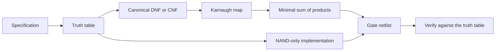

# Boolean Algebra

> [Mathematics](../../README.md) › [Discrete Mathematics](../README.md) › Boolean Algebra · Level: Intermediate · Prerequisites: [Logic](../../00-foundations/02-logic/README.md), [Set Theory](../../00-foundations/03-set-theory/README.md), [Proof Techniques](../../00-foundations/04-proof-techniques/README.md) · Estimated time: 240 min

## 1. Introduction

In ordinary algebra the variables range over numbers and the operations are addition and multiplication. In **Boolean algebra** the variables range over two values — true and false, or $1$ and $0$ — and the operations are *and*, *or* and *not*. That change of subject produces an algebraic system with its own axioms, its own normal forms and its own notion of duality, and it turns out to describe three apparently unrelated things at once:

* **Logic.** Propositions combined with "and", "or", "not" obey exactly these laws.
* **Sets.** Subsets of a fixed universe, combined with intersection, union and complement, obey exactly these laws.
* **Circuits.** Digital gates that compute and, or and not obey exactly these laws.

The reason a single algebra covers all three is that all three are *the same structure*: a complemented distributive lattice. The two-element algebra $\{0,1\}$ is the smallest example, the power set of a finite set is another, and every finite Boolean algebra is isomorphic to a power set. That classification, proved by Marshall Stone in 1936, is why a theorem proved for truth tables is automatically a theorem about sets, and why a circuit designed with a Karnaugh map is automatically correct as a logical formula.

Two further ideas make the subject practical. The first is **canonical form**: every Boolean function can be written as a sum of minterms, and that representation is unique. This converts the question "are these two circuits equivalent?" into a finite computation, and it gives a mechanical procedure for building a circuit from a truth table. The second is **functional completeness**: some sets of gates can express every function. The set $\{\text{AND}, \text{OR}, \text{NOT}\}$ is complete, and — remarkably — so is the single gate NAND. That is why a chip fabrication line can be built around one gate type and still compute anything.

The topic ends where computer science begins. **Satisfiability** — given a Boolean formula, is there an assignment making it true? — is the canonical $\mathrm{NP}$-complete problem, treated in [Algorithms and Complexity](../03-algorithms-and-complexity/README.md), Section 7.11. The algebra tells you how to write a formula in a canonical shape; the complexity theory tells you that finding a satisfying assignment can be hard.

## 2. Prerequisites

* **Propositional logic.** Connectives, truth tables, logical equivalence, and the meaning of $\neg$, $\land$, $\lor$, $\Rightarrow$, $\Leftrightarrow$. Taught in [Logic](../../00-foundations/02-logic/README.md).
* **Sets and set operations.** Union, intersection, complement, subset, power set, and De Morgan's laws for sets. Taught in [Set Theory](../../00-foundations/03-set-theory/README.md).
* **Proof techniques.** Direct proof, case analysis, proof by truth table (exhaustive case analysis), and induction for the generalised De Morgan laws. Taught in [Proof Techniques](../../00-foundations/04-proof-techniques/README.md).
* **Basic counting.** The number of functions from a finite set to a finite set, and the number of subsets of an $n$-element set. Taught in [Counting Principles](../../20-combinatorics/01-counting-principles/README.md).
* **Optional: $\mathrm{NP}$-completeness.** Only Section 7.12 needs it, and it links to the treatment in [Algorithms and Complexity](../03-algorithms-and-complexity/README.md). The rest of the topic is independent of it.

## 3. Learning Objectives

By the end of this tutorial you will be able to:

1. Evaluate any Boolean expression by constructing its truth table, and read a function off a truth table.
2. State the axioms of a Boolean algebra and derive the standard laws — idempotence, domination, absorption, involution — from them.
3. Prove identities by truth table, by algebraic manipulation, and by duality, and explain why duality is a theorem about derivations rather than about functions.
4. State and prove both De Morgan laws, and generalise them to any finite number of variables by induction.
5. Convert any Boolean function to canonical disjunctive normal form (sum of minterms) and to canonical conjunctive normal form (product of maxterms), and explain why each representation is unique.
6. Prove that $\{\land, \lor, \neg\}$ is functionally complete, that NAND alone is complete, and that $\{\land, \lor\}$ is not.
7. Simplify a Boolean expression using a Karnaugh map for two, three and four variables, including groups that wrap around the edges.
8. Use don't-care conditions correctly, and explain why treating a don't care as $1$ can never make the final circuit wrong.
9. Translate an expression into a gate-level circuit, count its gates and depth, and re-implement it using NAND gates only.
10. Design and verify half adders and full adders, and explain the carry chain of a ripple-carry adder.
11. Prove the correspondence between Boolean algebras and Boolean rings, and compute with addition modulo $2$ and symmetric difference.
12. Define $\mathrm{CNF}$-$\mathrm{SAT}$ and $\mathrm{3SAT}$, place them in the complexity landscape, and explain why satisfiability matters for circuit design and verification.

## 4. Intuition

### 4.1 Switches and truth

Imagine a circuit of switches in series and in parallel. Two switches in series conduct only when both are closed; two in parallel conduct when at least one is closed. Now read "closed" as $1$ and "open" as $0$: series is AND, parallel is OR. If you build a network of switches, the question "does current flow?" depends only on which switches are closed, and the answer is a Boolean function of those switch states.

This is the physical origin of the subject. Boole wrote *The Laws of Thought* in 1854 with no knowledge of electronics; Shannon noticed in 1937, in his master's thesis, that Boole's algebra describes relay circuits exactly. The same year, Turing was imagining a universal machine. The coincidence is not accidental: both are about the manipulation of two-valued information.

### 4.2 Why an algebra, not just a truth table

A truth table is a complete description: for $n$ variables it lists $2^n$ rows, and any function is determined by its column. So why not always use truth tables?

Because a truth table does not *simplify*. Two functions with identical columns are equal, but the expressions that produce them can differ wildly in cost. The expression

$$f = \bar x\bar y z + \bar x y z + x\bar y z + xyz$$

has four terms and twelve literals; the expression $f = z$ has one literal and no terms. They denote the same function, and a truth table shows the equality only after you compute both columns. The algebra gives you a way to *transform* one into the other.

There is a second reason. Truth tables grow exponentially, while algebraic laws are local: you can replace a subexpression by an equivalent one without recomputing the whole table. That locality is what makes automated simplification, and human reasoning about circuits, possible at all.

### 4.3 The shape of a Boolean function

Every function of $n$ variables can be described by saying *on which rows it is true*. Listing those rows is a sum of minterms. Alternatively, describe it by saying *on which rows it is false*; that gives a product of maxterms. These are the two canonical forms, and they are dual to each other.

A useful mental picture: a Boolean function on $n$ variables is a colouring of the $2^n$ corners of an $n$-dimensional cube with two colours. A minterm selects one corner; a DNF is a union of selected corners; a Karnaugh map is a flattened picture of that cube in which adjacent cells are adjacent corners. Simplifying a DNF means covering the $1$-corners with as few large subcubes as possible — a geometric problem hiding inside an algebraic one.

### 4.4 Why NAND is enough

AND, OR and NOT look like three different operations, but they are not independent. De Morgan's law says that AND can be built from OR and NOT, or OR from AND and NOT. Push that further: if you can build NOT and one of AND, OR from a single gate, that gate alone suffices. The NAND gate does both:

$$\bar x = x \uparrow x, \qquad x \land y = (x \uparrow y) \uparrow (x \uparrow y), \qquad x \lor y = (x \uparrow x) \uparrow (y \uparrow y).$$

Every circuit, no matter how complex, can therefore be manufactured from NAND gates alone. This is not a curiosity: it is why CMOS fabrication, which naturally produces inverting gates, can implement arbitrary logic.

### 4.5 Why the algebra is subtle

The pair (AND, OR) distributes in both directions, whereas ordinary arithmetic distributes only one way. That extra distributivity is what makes simplification possible — and also what makes it subtle: an expression can be transformed in many directions, and only some lead to a smaller circuit.

## 5. Formal Definition

### 5.1 Boolean algebras

**Definition 5.1** (Boolean algebra). A *Boolean algebra* is a structure $(B, \lor, \land, \neg, 0, 1)$ where $B$ is a non-empty set, $\lor$ and $\land$ are binary operations on $B$, $\neg$ is a unary operation on $B$, and $0, 1 \in B$ with $0 \ne 1$, such that for all $x, y, z \in B$:

| Axiom | Statement |
|---|---|
| (B1) commutativity | $x \lor y = y \lor x$ and $x \land y = y \land x$ |
| (B2) associativity | $(x \lor y) \lor z = x \lor (y \lor z)$ and $(x \land y) \land z = x \land (y \land z)$ |
| (B3) distributivity | $x \land (y \lor z) = (x \land y) \lor (x \land z)$ and $x \lor (y \land z) = (x \lor y) \land (x \lor z)$ |
| (B4) identity | $x \lor 0 = x$ and $x \land 1 = x$ |
| (B5) complement | $x \lor \neg x = 1$ and $x \land \neg x = 0$ |

These are Huntington's postulates (1904), one of several equivalent axiomatisations. Notice that (B3) lists **two** distributive laws, unlike the single distributive law of rings; both are needed, and neither follows from the other in a general lattice.

The axioms are self-dual in pairs: exchanging $\lor$ with $\land$ and $0$ with $1$ in any axiom produces another axiom. That symmetry is the source of the duality principle (Section 7.3).

**Examples.**

* $B_2 = (\{0,1\}, \lor, \land, \neg, 0, 1)$ with the usual truth-table operations. This is the algebra of propositions and of switching circuits.
* For any set $S$, the power set $(\mathcal{P}(S), \cup, \cap, \complement, \varnothing, S)$ is a Boolean algebra. Its elements are subsets, and $\complement$ is relative to $S$.
* For a square-free positive integer $N = p_1p_2\cdots p_k$, the set of divisors of $N$, ordered by divisibility, forms a Boolean algebra with $x \lor y = \operatorname{lcm}(x,y)$, $x \land y = \gcd(x,y)$, $\neg x = N/x$, $0 = 1$, $1 = N$. It has $2^k$ elements and is isomorphic to $\mathcal{P}(\{p_1,\dots,p_k\})$.
* The set of equivalence classes of propositional formulas under logical equivalence, with the induced operations, is a Boolean algebra — the *Lindenbaum–Tarski algebra* of propositional logic.
* The two-element algebra is not the only one, and not every lattice with complements is Boolean: the five-element lattice $\{0, a, b, c, 1\}$ with $a, b$ incomparable can be complemented in more than one way, violating the uniqueness of complements that Theorem 8.1 establishes for Boolean algebras.

### 5.2 Boolean functions and expressions

**Definition 5.2** (Boolean function). An *$n$-ary Boolean function* is a map $f : \{0,1\}^n \to \{0,1\}$. A *Boolean expression* on variables $x_1,\dots,x_n$ is a well-formed word built from the variables, the constants $0,1$, the connectives $\land, \lor, \neg$, and parentheses. Every expression denotes an $n$-ary Boolean function by evaluation.

There are $2^{2^n}$ $n$-ary Boolean functions, because a truth table has $2^n$ rows and each row can carry either value; this is proved in Theorem 8.5.

**Definition 5.3** (Literals, minterms, maxterms, normal forms). Fix variables $x_1,\dots,x_n$.

* A **literal** is a variable $x_i$ or its negation $\neg x_i$. A literal is *positive* in the first case and *negative* in the second.
* A **minterm** is a conjunction of $n$ literals containing exactly one literal for each variable. Identifying an assignment $a = (a_1,\dots,a_n)$ with the integer $j = \sum_i a_i 2^{n-i}$, the minterm $m_j$ contains $x_i$ if $a_i = 1$ and $\neg x_i$ if $a_i = 0$. Then $m_j(a) = 1$ and $m_j(b) = 0$ for every $b \ne a$.
* A **maxterm** is a disjunction of $n$ literals, one per variable. The maxterm $M_j$ contains $\neg x_i$ if $a_i = 1$ and $x_i$ if $a_i = 0$, so that $M_j(a) = 0$ and $M_j(b) = 1$ for every $b \ne a$.
* A formula is in **disjunctive normal form** (DNF) if it is a disjunction of conjunctions of literals; it is in **conjunctive normal form** (CNF) if it is a conjunction of disjunctions of literals. The *canonical* (or *full*) forms use exactly the minterms or maxterms of the function.

### 5.3 Functional completeness and rings

**Definition 5.4** (Functional completeness). A set $S$ of connectives is *functionally complete* if every Boolean function of every arity can be expressed by a formula using only the connectives in $S$ (variables and parentheses are always allowed).

**Definition 5.5** (Boolean ring). A *Boolean ring* is a ring $(R, +, \cdot)$ with identity in which $x^2 = x$ for every $x \in R$. A ring is *commutative* if $xy = yx$, and has *characteristic $2$* if $x + x = 0$ for every $x$. Every Boolean ring is commutative and has characteristic $2$ (a standard consequence of $x^2 = x$, proved in Theorem 8.7).

**Definition 5.6** (Satisfiability). A formula $\varphi$ is *satisfiable* if some assignment of values to its variables makes it true, and *valid* (a tautology) if every assignment makes it true. $\mathrm{SAT}$ is the decision problem: given a CNF formula, is it satisfiable? $\mathrm{3SAT}$ is the restriction to clauses with exactly three literals.

## 6. Mathematical Notation

| Symbol | Read as | Meaning |
|---|---|---|
| $\land$ | and | conjunction; also written $\cdot$ or juxtaposition |
| $\lor$ | or | disjunction; also written $+$ |
| $\neg x$ | not $x$ | complement; also written $\bar x$, $x'$ |
| $\oplus$ | xor | exclusive or; $x \oplus y = (x \land \neg y) \lor (\neg x \land y)$ |
| $x \uparrow y$ | NAND | $\neg(x \land y)$; Sheffer stroke |
| $x \downarrow y$ | NOR | $\neg(x \lor y)$; Peirce arrow |
| $x \Rightarrow y$ | implies | $\neg x \lor y$ |
| $x \Leftrightarrow y$ | iff | $(x \Rightarrow y) \land (y \Rightarrow x)$ |
| $m_j$ | minterm $j$ | the conjunction true only on assignment $j$ |
| $M_j$ | maxterm $j$ | the disjunction false only on assignment $j$ |
| $\Sigma m(\cdot)$ | sum of minterms | canonical DNF |
| $\Pi M(\cdot)$ | product of maxterms | canonical CNF |
| $f \equiv g$ | $f$ equivalent to $g$ | equal as Boolean functions |
| $\mathbf{0}, \mathbf{1}$ | zero, one | the two elements of $B_2$ |
| $0, 1$ | identities | the bottom and top of a Boolean algebra |
| $\triangle$ | symmetric difference | $x \triangle y = (x \setminus y) \cup (y \setminus x)$; ring addition |
| $\bar x$ | $x$ bar | complement, used interchangeably with $\neg x$ |
| $x'$ | $x$ prime | complement, in circuit-design texts |

Two notational conventions deserve care. In the **algebraic** convention, $\land$ is written as multiplication and $\lor$ as addition, so $xy + \bar x z$ means $(x \land y) \lor (\neg x \land z)$. In the **engineering** convention, $+$ is OR and juxtaposition is AND; both conventions make $\land$ bind tighter than $\lor$. Neither convention makes $+$ behave like ordinary addition: $x + x = x$, not $2x$.

## 7. Core Concepts

### 7.1 Boolean operations and truth tables

The two-element algebra $B_2$ has five familiar connectives and two less familiar ones:

| $x$ | $y$ | $x \land y$ | $x \lor y$ | $x \oplus y$ | $x \uparrow y$ | $x \downarrow y$ | $x \Rightarrow y$ | $x \Leftrightarrow y$ |
|---|---|---|---|---|---|---|---|---|
| 0 | 0 | 0 | 0 | 0 | 1 | 1 | 1 | 1 |
| 0 | 1 | 0 | 1 | 1 | 1 | 0 | 1 | 0 |
| 1 | 0 | 0 | 1 | 1 | 1 | 0 | 0 | 0 |
| 1 | 1 | 1 | 1 | 0 | 0 | 0 | 1 | 1 |

Every column is a two-input Boolean function, and there are exactly $2^{2^2} = 16$ of them. The table shows seven; the constants $0$ and $1$ account for two more; the remaining seven are the projections $x$ and $y$, their negations, XNOR, and the negations of the two implications. NAND and NOR are distinguished by being the only two-input connectives that are complete on their own (Section 7.7).

*Precedence and parsing.* Negation binds tightest, then $\land$, then $\lor$, then $\Rightarrow$, then $\Leftrightarrow$. Thus $\neg x \lor y \land z$ means $(\neg x) \lor (y \land z)$. Redundant parentheses are cheap and misread expressions are expensive; write them.

*A truth table is a complete proof.* Two expressions denote the same Boolean function exactly when their truth tables agree on every row. For $n$ variables that is $2^n$ rows, each checked mechanically. Every identity in Section 7.4 can therefore be certified without any algebraic insight, and this is the fallback whenever a derivation is in doubt.

### 7.2 The axioms and what follows from them

The five axiom groups of Definition 5.1 are deliberately minimal. Four standard laws are not axioms and must be derived.

**Idempotence.** $x \lor x = x$ and $x \land x = x$.

$$x \lor x = (x \lor x) \land 1 = (x \lor x) \land (x \lor \neg x) = x \lor (x \land \neg x) = x \lor 0 = x.$$

The dual derivation (replace $\lor$ by $\land$, $0$ by $1$, and reverse each step) gives $x \land x = x$.

**Domination.** $x \lor 1 = 1$ and $x \land 0 = 0$.

$$x \lor 1 = x \lor (x \lor \neg x) = (x \lor x) \lor \neg x = x \lor \neg x = 1.$$

**Absorption.** $x \lor (x \land y) = x$ and $x \land (x \lor y) = x$.

$$x \lor (x \land y) = (x \land 1) \lor (x \land y) = x \land (1 \lor y) = x \land 1 = x.$$

**Involution.** $\neg\neg x = x$. Both $x$ and $\neg\neg x$ are complements of $\neg x$, and complements are unique (Theorem 8.1), so they are equal.

The derivations illustrate a general point: once uniqueness of complement is available, every statement about complements becomes an algebraic calculation. Before it, one has to verify both complement axioms each time.

**Remark.** Huntington's original axiom set lists both distributive laws. In the presence of the complement axioms one distributive law implies the other, so the two are not independent; they are both listed here because doing so makes the duality principle manifest and keeps the axiom set self-dual.

### 7.3 Duality

**Definition 7.1** (Dual). The *dual* of a Boolean expression is obtained by exchanging $\land \leftrightarrow \lor$ and $0 \leftrightarrow 1$ throughout. The dual of a statement $s$ is written $s^{\partial}$.

For example, the dual of $x \lor (y \land z) = (x \lor y) \land (x \lor z)$ is $x \land (y \lor z) = (x \land y) \lor (x \land z)$, which is the other distributive law.

**Theorem 7.1** (Duality principle). If a statement holds in every Boolean algebra, then so does its dual.

*Proof.* A statement holds in every Boolean algebra exactly when it is derivable from the axioms. Take a derivation of $s$ from (B1)–(B5). Replace every formula by its dual and every axiom used by its dual; each axiom is paired with its dual, so each step of the derivation remains a valid instance of an axiom, and the conclusion becomes $s^{\partial}$. Hence $s^{\partial}$ is derivable, and therefore holds in every Boolean algebra. $\blacksquare$

The proof is a statement about *derivations*, not about functions. Duality does not say that a formula equals its dual — usually it does not: $x \lor (y \land z)$ and $x \land (y \lor z)$ denote different functions. It says that the *equation* $x \lor (y \land z) = (x \lor y) \land (x \lor z)$ implies the equation $x \land (y \lor z) = (x \land y) \lor (x \land z)$, because the second is the dual of the first and the proof transforms step by step.

Duality halves the work of proving theorems: prove one distributive law and you get the other free. It also halves the work of remembering them.

### 7.4 The laws, with proofs

| Law | Form |
|---|---|
| Commutativity | $x \lor y = y \lor x$, $x \land y = y \land x$ |
| Associativity | $(x \lor y) \lor z = x \lor (y \lor z)$, $(x \land y) \land z = x \land (y \land z)$ |
| Distributivity | $x \land (y \lor z) = (x \land y) \lor (x \land z)$ and its dual |
| Identity | $x \lor 0 = x$, $x \land 1 = x$ |
| Domination | $x \lor 1 = 1$, $x \land 0 = 0$ |
| Idempotence | $x \lor x = x$, $x \land x = x$ |
| Absorption | $x \lor (x \land y) = x$, $x \land (x \lor y) = x$ |
| Complement | $x \lor \neg x = 1$, $x \land \neg x = 0$ |
| Involution | $\neg\neg x = x$ |
| De Morgan | $\neg(x \land y) = \neg x \lor \neg y$, $\neg(x \lor y) = \neg x \land \neg y$ |
| Consensus | $xy \lor \bar x z \lor yz = xy \lor \bar x z$ |
| Shannon expansion | $f = x \land f(1,y,\dots) \lor \neg x \land f(0,y,\dots)$ |

**Proof by truth table: absorption.** The identity $x \lor (x \land y) = x$ has three variables' worth of rows only two of which depend on $y$:

| $x$ | $y$ | $x \land y$ | $x \lor (x \land y)$ | $x$ |
|---|---|---|---|---|
| 0 | 0 | 0 | 0 | 0 |
| 0 | 1 | 0 | 0 | 0 |
| 1 | 0 | 0 | 1 | 1 |
| 1 | 1 | 1 | 1 | 1 |

The two rightmost columns agree, so the identity holds.

**Proof by algebra: consensus.** $xy \lor \bar x z \lor yz = xy \lor \bar x z$. Expand the extra term using $y \lor \bar y = 1$:

$$yz = yz(x \lor \bar x) = xyz \lor \bar x y z.$$

Each piece is absorbed:

$$xy \lor xyz = xy(1 \lor z) = xy, \qquad \bar x z \lor \bar x y z = \bar x z (1 \lor y) = \bar x z.$$

Hence the left side equals $xy \lor \bar x z \lor xyz \lor \bar xyz = xy \lor \bar x z$. $\square$

The consensus term $yz$ is redundant: it is true exactly when both $xy$ and $\bar x z$ could be true, and in that case one of them already is. This is the algebraic counterpart of a Karnaugh-map group that is covered by two others.

**Proof by algebra: Shannon expansion.** For any function $f$ on variables including $x$, and any assignment to the other variables, exactly one of $x = 0$, $x = 1$ holds. If $x = 1$ the right-hand side is $1 \land f(1,\dots) = f(1,\dots)$; if $x = 0$ it is $\neg 0 \land f(0,\dots) = f(0,\dots)$. In both cases it equals $f$. $\square$

### 7.5 De Morgan's laws

**Theorem 7.2** (De Morgan). In every Boolean algebra, $\neg(x \land y) = \neg x \lor \neg y$ and $\neg(x \lor y) = \neg x \land \neg y$.

*Proof by truth table (first law).*

| $x$ | $y$ | $x \land y$ | $\neg(x \land y)$ | $\neg x$ | $\neg y$ | $\neg x \lor \neg y$ |
|---|---|---|---|---|---|---|
| 0 | 0 | 0 | 1 | 1 | 1 | 1 |
| 0 | 1 | 0 | 1 | 1 | 0 | 1 |
| 1 | 0 | 0 | 1 | 0 | 1 | 1 |
| 1 | 1 | 1 | 0 | 0 | 0 | 0 |

The fourth and seventh columns agree.

*Proof by algebra (first law).* It suffices to show that $\neg x \lor \neg y$ satisfies the two complement axioms relative to $x \land y$, because complements are unique.

$$(x \land y) \lor (\neg x \lor \neg y) = \bigl((x \land y) \lor \neg x\bigr) \lor \neg y = \bigl((x \lor \neg x) \land (y \lor \neg x)\bigr) \lor \neg y = (y \lor \neg x) \lor \neg y = 1,$$

using associativity, distributivity, $x \lor \neg x = 1$, $1 \land u = u$, and finally $y \lor \neg y = 1$. And

$$(x \land y) \land (\neg x \lor \neg y) = \bigl((x \land y) \land \neg x\bigr) \lor \bigl((x \land y) \land \neg y\bigr) = (0 \land y) \lor (x \land 0) = 0.$$

So $\neg x \lor \neg y$ is a complement of $x \land y$, hence equal to $\neg(x \land y)$ by uniqueness. The second law follows by duality. $\blacksquare$

*Generalisation.* By induction on $n$, $\neg(x_1 \land \cdots \land x_n) = \neg x_1 \lor \cdots \lor \neg x_n$ and dually for $\lor$. The base case $n = 2$ is the theorem, and the step groups the first $n$ variables:

$$\neg(x_1 \land \cdots \land x_n \land x_{n+1}) = \neg\bigl((x_1 \land \cdots \land x_n) \land x_{n+1}\bigr) = \neg(x_1 \land \cdots \land x_n) \lor \neg x_{n+1}.$$

*Set-theoretic form.* In the power-set algebra, $\neg$ is complement, so the same theorem reads $(A \cap B)^{\complement} = A^{\complement} \cup B^{\complement}$ and $(A \cup B)^{\complement} = A^{\complement} \cap B^{\complement}$ — the De Morgan laws for sets. This is not an analogy: it is the same theorem in a different Boolean algebra.

### 7.6 Canonical forms: DNF, CNF, minterms and maxterms

Every function has a canonical DNF and a canonical CNF, and both are unique.

**Theorem 7.3** (Canonical DNF). Every $n$-ary Boolean function $f$ satisfies

$$f = \bigvee_{j\,:\,f(a_j)=1} m_j,$$

where $a_j$ is the assignment whose binary value is $j$ and $m_j$ is its minterm. The representation is unique up to the order of the disjuncts.

*Proof.* Fix an assignment $a_k$. Among all $2^n$ minterms, exactly one evaluates to $1$ at $a_k$, namely $m_k$: a minterm contains, for each variable, the literal that is true under the assignment it encodes, so only the minterm matching $a_k$ can be satisfied. Hence the right-hand side evaluates at $a_k$ to $1$ if $k$ is in the index set and to $0$ otherwise, which is $f(a_k)$. This proves the identity. For uniqueness, if $f = \bigvee_{j \in S} m_j$, evaluating at $a_k$ gives $f(a_k) = 1$ exactly when $k \in S$, so $S = \{j : f(a_j) = 1\}$. $\blacksquare$

**Theorem 7.4** (Canonical CNF). Every $n$-ary Boolean function satisfies

$$f = \bigwedge_{j\,:\,f(a_j)=0} M_j,$$

and this representation is unique up to order.

*Proof.* Dualise Theorem 7.3, or verify directly: $M_j$ is false exactly at $a_j$, so the conjunction is false exactly at the assignments where $f$ is false. Uniqueness follows by evaluating at each assignment. $\blacksquare$

**Worked illustration: the majority function.** For $f(x,y,z) = xy \lor xz \lor yz$ the truth table is

| $x$ | $y$ | $z$ | $f$ |
|---|---|---|---|
| 0 | 0 | 0 | 0 |
| 0 | 0 | 1 | 0 |
| 0 | 1 | 0 | 0 |
| 0 | 1 | 1 | 1 |
| 1 | 0 | 0 | 0 |
| 1 | 0 | 1 | 1 |
| 1 | 1 | 0 | 1 |
| 1 | 1 | 1 | 1 |

The true rows are $3, 5, 6, 7$, so the canonical DNF is

$$f = \bar x y z \lor x \bar y z \lor x y \bar z \lor xyz.$$

The false rows are $0, 1, 2, 4$, so the canonical CNF is

$$f = (x \lor y \lor z)(x \lor y \lor \bar z)(x \lor \bar y \lor z)(\bar x \lor y \lor z).$$

Both are correct and both are wasteful; the minimal forms are $xy \lor xz \lor yz$ and $(x \lor y)(x \lor z)(y \lor z)$, each with three two-literal terms.

*Converting between the forms.* A DNF and a CNF for the same function are related by double negation and De Morgan:

$$\bar x y \lor x \bar y = \neg\neg(\bar x y \lor x \bar y) = \neg\bigl((x \lor \bar y)(\bar x \lor y)\bigr) = \neg(x \lor \bar y) \lor \neg(\bar x \lor y).$$

Whether the conversion shrinks or grows the formula depends on the function: canonical DNF has one term per true row, canonical CNF one clause per false row, so the smaller canonical form is the one keyed to the rarer value.

*Canonical is not minimal.* The canonical forms have a mechanical definition and a unique index set, which is exactly what makes them useful for equivalence checking. They are almost never the smallest circuit: the parity function on $n$ variables has $2^{n-1}$ minterms but can be computed with $n-1$ XOR gates.

### 7.7 Functional completeness: why NAND alone suffices

**Definition** (restating Definition 5.4). A set $S$ of connectives is *complete* if every Boolean function can be written using only connectives from $S$.

**Theorem 7.5.** $\{\land, \lor, \neg\}$ is functionally complete.

*Proof.* By Theorem 7.3 every function is a disjunction of minterms, and each minterm is a conjunction of literals. Both operations and negation are in the set. $\blacksquare$

**Theorem 7.6.** $\{\uparrow\}$ (NAND alone) is functionally complete.

*Proof.* It is enough to express $\neg$, $\land$ and $\lor$ using only $\uparrow$, since $\{\land, \lor, \neg\}$ is complete. Recall $x \uparrow y = \neg(x \land y)$.

* Negation: $x \uparrow x = \neg(x \land x) = \neg x$.
* Conjunction: $(x \uparrow y) \uparrow (x \uparrow y) = \neg\bigl(\neg(x \land y) \land \neg(x \land y)\bigr) = \neg\neg(x \land y) = x \land y$.
* Disjunction: $(x \uparrow x) \uparrow (y \uparrow y) = \neg(\neg x \land \neg y) = x \lor y$, by De Morgan.

Every formula built from $\land, \lor, \neg$ can therefore be rewritten with $\uparrow$ alone, so every Boolean function is expressible. $\blacksquare$

Check the disjunction identity on the four assignments: for $x = y = 0$, $(0\uparrow0)\uparrow(0\uparrow0) = 1 \uparrow 1 = 0$ ✓; for $x = 1, y = 0$, $(1\uparrow1)\uparrow(0\uparrow0) = 0 \uparrow 1 = 1$ ✓; the other two rows similarly.

**Corollary 7.7.** $\{\downarrow\}$ (NOR alone) is complete, by duality: $\neg x = x \downarrow x$, $x \lor y = (x \downarrow y) \downarrow (x \downarrow y)$, and $x \land y = (x \downarrow x) \downarrow (y \downarrow y)$.

**Theorem 7.8.** $\{\land, \lor\}$ is not functionally complete.

*Proof.* Call a function *monotone* if $a \le b$ componentwise implies $f(a) \le f(b)$. Variables are monotone, the constants are monotone, and monotone functions are closed under $\land$ and $\lor$: if $f$ and $g$ are monotone then so are $f \land g$ and $f \lor g$. By induction on the structure of the formula, every function expressible without negation is monotone. But $\neg$ is not monotone: $0 \le 1$ while $\neg 0 = 1 > 0 = \neg 1$. Hence $\neg$ is not expressible, and the set is not complete. $\blacksquare$

**Other complete sets.** The following are also complete, which is useful when a particular technology supplies only certain gates:

* $\{\neg, \land\}$ and $\{\neg, \lor\}$ — De Morgan removes the third operation.
* $\{\Rightarrow, 0\}$: $\neg x = x \Rightarrow 0$, then $x \lor y = (\neg x) \Rightarrow y$.
* $\{\oplus, \land, 1\}$: $\neg x = x \oplus 1$ and $x \lor y = x \oplus y \oplus (x \land y)$.

**Theorem 7.9** (Post, 1941). A set $S$ of connectives is complete if and only if it is not contained in any of the five *maximal clones*: functions preserving $0$, functions preserving $1$, monotone functions, self-dual functions, and affine (linear over $\mathbb{F}_2$) functions.

Post's theorem classifies completeness completely; its proof is a case analysis over the five properties and is beyond this tutorial. One consequence is easy to state: of the sixteen two-input connectives, only NAND and NOR are complete by themselves, because each of the other fourteen preserves at least one of the five properties.

### 7.8 Simplification with Karnaugh maps

A **Karnaugh map** (K-map) is a redrawing of the truth table in which cells that differ in exactly one variable are physically adjacent. Grouping adjacent $1$s then corresponds to applying $xy \lor x\bar y = x$.

**Layout.** Rows and columns are labelled in *Gray code* order, so consecutive labels differ in one bit:

* two variables: rows $x = 0, 1$; columns $y = 0, 1$;
* three variables: rows $x = 0, 1$; columns $yz = 00, 01, 11, 10$;
* four variables: rows $AB = 00, 01, 11, 10$; columns $CD = 00, 01, 11, 10$.

The order $00, 01, 11, 10$ is what makes the map work: with ordinary binary order, the cells for $01$ and $10$ would be adjacent on the page but differ in two variables.

**Rules.**

1. Groups must be rectangular blocks of $1, 2, 4, 8, \dots$ cells — always a power of two.
2. Groups may wrap around the edges and may overlap; the four corners of a four-variable map form a single group of four.
3. Every $1$ must lie in at least one group. Groups may contain only $1$s (or don't cares, Section 7.9).
4. Make each group as large as possible, and use as few groups as possible. A group of $2^k$ cells contributes a product with $n - k$ literals; the literals are those variables that are constant across the group.
5. For a minimal product-of-sums, group the $0$s instead and read each group as a clause in which a constant variable appears negated.

**Example (three variables).** Let $f = \Sigma m(0,1,2,3,5,7)$. With rows $x$ and columns $yz$:

| $x \backslash yz$ | 00 | 01 | 11 | 10 |
|---|---|---|---|---|
| 0 | 1 | 1 | 1 | 1 |
| 1 | 0 | 1 | 1 | 0 |

The whole row $x = 0$ is a group of four and gives $\bar x$. The four cells with $z = 1$ — columns $01$ and $11$, both rows — are all $1$ and form a group of four giving $z$. These two groups cover every $1$, so $f = \bar x \lor z$. Check the cell $m_5$ ($x=1,y=0,z=1$): $z = 1$ ✓; the cell $m_4$ ($100$): $\bar x = 0$ and $z = 0$ ✓; the cell $m_6$ ($110$): both $0$ ✓.

If one instead takes only the two cells $m_5, m_7$, the result is the term $xz$ and the formula $\bar x \lor xz$. It is correct, since $\bar x \lor xz = \bar x \lor z$ by consensus, but it is not minimal. The lesson is that a K-map finds a minimal sum of products only when every group is chosen to be maximal; stopping at a smaller group produces a correct but larger formula.

**Example (four variables).** Let $f = \Sigma m(0,2,4,5,6,7,8,10,13,15)$. With rows $AB$ and columns $CD$:

| $AB \backslash CD$ | 00 | 01 | 11 | 10 |
|---|---|---|---|---|
| 00 | 1 | 0 | 0 | 1 |
| 01 | 1 | 1 | 1 | 1 |
| 11 | 0 | 0 | 1 | 0 |
| 10 | 1 | 1 | 0 | 1 |

Groups: the cells $m_0, m_2, m_8, m_{10}$ (the four corners) give $\bar B \bar D$; the cells $m_4, m_5, m_6, m_7$ (row $AB = 01$) give $\bar A B$; the cells $m_5, m_7, m_{13}, m_{15}$ (column $CD = 11$ with rows $01$ and $11$) give $BD$; the cells $m_{10}, m_2$? Those are already covered. Check coverage: $m_0, m_2, m_4, m_5, m_6, m_7, m_8, m_{10}, m_{13}, m_{15}$ — all ten ✓. So $f = \bar B \bar D \lor \bar A B \lor BD$. Verify $m_{13}$ ($AB=11, CD=01$): $\bar B\bar D = 0$; $\bar A B = 0$; $BD = 1\cdot1 = 1$ ✓. Verify the zero $m_{12}$ ($1100$): all three terms $0$ ✓. Verify the zero $m_{14}$ ($1110$): $\bar B\bar D = 0\cdot1 = 0$; $\bar A B = 0$; $BD = 1\cdot0 = 0$ ✓.

**Limits.** For five or six variables a map can still be drawn as two or four four-variable maps, but the visual grouping becomes unreliable. Beyond that one uses the **Quine–McCluskey** algorithm, which computes all prime implicants systematically (exponential in the worst case), or heuristic tools. Even in four variables, a minimal sum of products is not necessarily a minimal *circuit*: a multi-level factorisation may use fewer gates or have smaller depth.

### 7.9 Don't-care conditions

In many designs some input combinations never occur, or their output is irrelevant. These are **don't-care** conditions, written $d(\cdot)$ or $X$ in the map. A don't care may be treated as $1$ if that helps to enlarge a group, and as $0$ otherwise; it never has to be covered.

The reason this is sound is that correctness is required only on the *care set*. If the function is specified on a subset $C \subseteq \{0,1\}^n$, any completion of the specification to all of $\{0,1\}^n$ is an acceptable implementation, and a K-map group that includes don't cares is simply choosing one completion.

**Example.** Let $f = \Sigma m(1,3,7,11,15)$ with don't cares $d(0,2,5)$ on variables $A,B,C,D$ (rows $AB$, columns $CD$):

| $AB \backslash CD$ | 00 | 01 | 11 | 10 |
|---|---|---|---|---|
| 00 | X | 1 | 1 | X |
| 01 | 0 | X | 1 | 0 |
| 11 | 0 | 0 | 1 | 0 |
| 10 | 0 | 0 | 1 | 0 |

Treating $m_0$ and $m_2$ as $1$ turns the whole row $AB = 00$ into a group of four, giving $\bar A \bar B$. The column $CD = 11$ is entirely $1$, giving $CD$. Hence

$$f = \bar A \bar B \lor CD.$$

Without the don't cares the row group would be only the two cells $m_1, m_3$, giving $\bar A \bar B \bar C$ and a three-literal term instead of two. Both implementations are correct on the care set; the one using don't cares is smaller.

*Caution.* Using a don't care in a group asserts that the output is $1$ there. If the "don't care" input can actually occur — for example, if the specification is incomplete rather than the input impossible — the resulting circuit may be wrong. Don't cares are a promise about the environment, not a licence to ignore it.

### 7.10 Logic gates and circuit design

A **gate** is a physical device computing one Boolean operation. The standard set is AND, OR, NOT, NAND, NOR, XOR and XNOR; their behaviour is the truth table of Section 7.1. A **combinational circuit** is a directed acyclic graph whose sources are the primary inputs and whose internal nodes are gates; each gate's output may fan out to several consumers.

Two size measures matter:

* **Size** — the number of gates (or, more precisely, the total number of input pins, the *literal count*).
* **Depth** — the length of the longest path from an input to an output, which models propagation delay when each gate takes unit time.

**Two-level realisations.** Any DNF becomes an AND-OR circuit of depth two (plus inverters for the negated literals), and any CNF becomes an OR-AND circuit. Because NAND is an inverted AND, an AND-OR circuit can be rebuilt with NAND gates alone: by De Morgan,

$$\overline{\overline{P} \lor \overline{Q}} = P \land Q,$$

so a NAND whose inputs are the (NAND) products computes the OR of those products. The same argument turns OR-AND into NOR-NOR. This is why a two-level sum-of-products is really a NAND-NAND circuit, and why the cost of a two-level design is usually quoted as "number of NAND gates".

**Example.** The function $f = xy \lor \bar x z$ is realised by four NAND gates:

```
n1 = NAND(x, y)          # ¬(xy)
n2 = NAND(x, x)          # ¬x
n3 = NAND(n2, z)         # ¬(¬x · z)
f  = NAND(n1, n3)        # ¬(¬(xy) · ¬(¬xz)) = xy ∨ ¬xz
```

Depth three counting the input inverter, size four. Check the row $x=1,y=1,z=0$: $n_1 = 0$, $n_2 = 0$, $n_3 = 1$, $f = \mathrm{NAND}(0,1) = 1$, and indeed $xy \lor \bar xz = 1 \lor 0 = 1$ ✓.

**Depth versus size.** A ripple-carry adder (Section 7.12) has size $\Theta(n)$ and depth $\Theta(n)$, because each carry must propagate through every stage. A carry-lookahead adder computes the same function with depth $\Theta(\log n)$ at the cost of more gates. Neither is uniformly better: the choice depends on whether area or latency is the binding constraint.

**Hazards.** A two-level circuit can produce a momentary wrong output when one input changes, even though the steady-state function is correct. Take $f = xy \lor \bar x z$ and change $x$ from $1$ to $0$ with $y = z = 1$. The output should remain $1$: before the change $xy = 1$, after it $\bar x z = 1$. But the second term needs the inverter's delay, so for a short interval both terms can be $0$ and the output glitches. The cure is to add the consensus term $yz$, which is $1$ throughout the transition; this is exactly the algebraic redundancy that Karnaugh maps encourage you to remove when optimising size. Speed and area genuinely conflict.

### 7.11 Boolean algebras and Boolean rings

There is a second algebraic structure hiding inside every Boolean algebra. Define

$$x \oplus y := (x \land \neg y) \lor (\neg x \land y),$$

the **symmetric difference**. In the power-set algebra this is $A \triangle B$; in $B_2$ it is addition modulo $2$.

**Theorem 7.10.** For every Boolean algebra $B$, the structure $(B, \oplus, \land, 0, 1)$ is a commutative ring with identity, and $x \oplus x = 0$ for every $x$.

*Proof.* We verify the ring axioms.

*Additive structure.* Commutativity is immediate from the definition. The identity is $0$:
$$x \oplus 0 = (x \land \neg 0) \lor (\neg x \land 0) = (x \land 1) \lor 0 = x.$$
Every element is its own inverse:
$$x \oplus x = (x \land \neg x) \lor (\neg x \land x) = 0 \lor 0 = 0.$$
For associativity, De Morgan gives $\neg(y \oplus z) = (\neg y \land \neg z) \lor (y \land z)$, so expanding $x \oplus (y \oplus z)$ yields the four-term expression
$$(x\bar y\bar z) \lor (\bar x y \bar z) \lor (\bar x \bar y z) \lor (xyz),$$
which is symmetric in $x, y, z$; expanding $(x \oplus y) \oplus z$ gives exactly the same expression. Hence $\oplus$ is associative (it is the *odd parity* function of its three arguments).

*Multiplicative structure and distributivity.* The operation $\land$ is associative, commutative, idempotent, and has identity $1$. Distributivity over $\oplus$ holds because
$$x \land (y \oplus z) = (x \land y \land \neg z) \lor (x \land \neg y \land z),$$
while $(x \land y) \oplus (x \land z)$ expands, using $\neg(x \land z) = \neg x \lor \neg z$, to the same two terms with $\neg x$ factors vanishing. The two expressions agree.

*Characteristic.* $x \oplus x = 0$ was shown above, so the ring has characteristic $2$. $\blacksquare$

**Theorem 7.11** (Converse). Let $(R, +, \cdot, 0, 1)$ be a commutative ring with identity in which $x^2 = x$ for every $x$. Define

$$x \lor y := x + y + xy, \qquad x \land y := xy, \qquad \neg x := 1 + x.$$

Then $(R, \lor, \land, \neg, 0, 1)$ is a Boolean algebra.

*Proof.* In such a ring $x + x = 0$ for every $x$, because $(x+x)^2 = x+x$ expands to $x^2 + 2x^2 + x^2 = x + 2x + x = 2x + 2x$, so $2x = 2x + 2x$ and hence $2x = 0$. Then:

* $x \lor \neg x = x + (1+x) + x(1+x) = x + 1 + x + x + x^2 = 1 + (x+x+x) + x = 1 + x + x = 1$;
* $x \land \neg x = x(1+x) = x + x^2 = x + x = 0$;
* $x \lor 0 = x + 0 + 0 = x$ and $x \land 1 = x$;
* commutativity, associativity and idempotence of $\lor$ follow by expanding and using $x^2 = x$ and characteristic $2$; distributivity follows by expanding both sides.

So the axioms of Definition 5.1 hold. $\blacksquare$

**In $B_2$.** The ring is $\mathbb{F}_2$: $\oplus$ is addition modulo $2$, $\land$ is multiplication, and the identities read $1 \oplus 1 = 0$, $x \lor y = x + y + xy \pmod 2$. Check the row $x = y = 1$: $1 + 1 + 1 = 3 \equiv 1$ ✓; the row $x = 1, y = 0$: $1 + 0 + 0 = 1$ ✓.

**Power sets.** $(\mathcal{P}(S), \triangle, \cap)$ is a Boolean ring: symmetric difference is associative, $\varnothing$ is the identity, every set is its own inverse, and intersection distributes over symmetric difference. Its Boolean-algebra operations read $A \lor B = A \triangle B \triangle (A \cap B) = A \cup B$, recovering set union from symmetric difference and intersection.

**Stone representation.** A finite Boolean algebra is isomorphic to $(\mathcal{P}(S), \cup, \cap, \complement)$ for some finite set $S$; hence its cardinality is $2^n$. The elements of $S$ correspond to the **atoms** of the algebra — the minimal non-zero elements — and every element is the join of the atoms below it. This is why the truth-table algebra $B_2$, the power-set algebra, and the divisor algebra of a square-free integer are not merely similar: they are the same algebra up to renaming.

### 7.12 Applications: adders, multiplexers and SAT

**Half adder.** Adding two bits $x, y$ produces a sum bit and a carry bit:

$$s = x \oplus y, \qquad c = x \land y.$$

The four rows give $(0,0) \to (0,0)$, $(1,0) \to (1,0)$, $(0,1) \to (1,0)$, $(1,1) \to (0,1)$: binary addition, correct in all cases.

**Full adder.** Adding $x, y$ and an incoming carry $c_{\text{in}}$ gives

$$s = x \oplus y \oplus c_{\text{in}}, \qquad c_{\text{out}} = xy \lor c_{\text{in}}(x \oplus y).$$

| $x$ | $y$ | $c_{\text{in}}$ | $s$ | $c_{\text{out}}$ |
|---|---|---|---|---|
| 0 | 0 | 0 | 0 | 0 |
| 0 | 0 | 1 | 1 | 0 |
| 0 | 1 | 0 | 1 | 0 |
| 0 | 1 | 1 | 0 | 1 |
| 1 | 0 | 0 | 1 | 0 |
| 1 | 0 | 1 | 0 | 1 |
| 1 | 1 | 0 | 0 | 1 |
| 1 | 1 | 1 | 1 | 1 |

Each row is the binary sum $x + y + c_{\text{in}}$ written as a two-bit number $c_{\text{out}}s$: for example $1 + 1 + 1 = 3 = 11_2$ gives $c_{\text{out}} = 1$, $s = 1$ ✓.

**Ripple-carry adder.** Chain $n$ full adders, feeding each carry into the next. Adding two $n$-bit numbers costs $\Theta(n)$ gates and has depth $\Theta(n)$, because the last carry depends on all preceding ones. **Carry-lookahead** breaks the chain: with generate $g_i = x_i y_i$ and propagate $p_i = x_i \oplus y_i$, the carry recurrence $c_{i+1} = g_i \lor p_i c_i$ unrolls into a formula whose evaluation is a prefix computation of depth $\Theta(\log n)$.

**Multiplexer.** A $2{:}1$ multiplexer selects one of two data inputs under the control of $s$:

$$z = (\neg s \land a) \lor (s \land b).$$

A $4{:}1$ multiplexer with select bits $s_1s_0$ is the sum of four minterms of the select variables, each ANDed with the corresponding data input:

$$z = (\bar s_1\bar s_0 \land d_0) \lor (\bar s_1 s_0 \land d_1) \lor (s_1\bar s_0 \land d_2) \lor (s_1 s_0 \land d_3).$$

A multiplexer is therefore a canonical DNF with the data inputs as coefficients — an important observation, because it means any Boolean function of $n$ variables can be implemented by a $2^n{:}1$ multiplexer with the function's truth table wired to the data inputs. That is the fastest (depth two) and most wasteful (exponential size) implementation possible.

**Satisfiability.** A CNF formula is satisfiable if some assignment makes every clause true. Deciding this is $\mathrm{SAT}$, the first problem proved $\mathrm{NP}$-complete (Cook–Levin; see [Algorithms and Complexity](../03-algorithms-and-complexity/README.md), Section 7.11). It is not an abstract curiosity:

* **Hardware verification.** To check that a circuit implements its specification, one builds the formula "circuit output differs from the specification" and asks whether it is satisfiable. A satisfying assignment is a counterexample; unsatisfiability is a proof of equivalence.
* **Planning and scheduling.** Constraints — "these two tasks cannot overlap", "this resource is used at most once" — are clauses; a satisfying assignment is a schedule.
* **Software analysis.** Bounded model checking unrolls a program for $k$ steps and encodes the assertion violations as a CNF; the solver either finds a bug trace or proves none exists within $k$ steps.

Modern solvers (DPLL with conflict-driven clause learning, watched literals, restarts) routinely handle formulas with millions of variables on structured instances, even though the worst case is exponential. Section 7.12 of the algorithms topic explains why this is compatible with $\mathrm{NP}$-hardness: hardness is a worst-case statement about all instances, not a prediction about any particular one.

## 8. Formulas and Properties

**Theorem 8.1** (Uniqueness of complement). Let $x, a, b$ be elements of a Boolean algebra with $x \lor a = 1$, $x \land a = 0$, $x \lor b = 1$ and $x \land b = 0$. Then $a = b$. In particular $\neg x$ is the unique complement of $x$.

*Proof.*

$$\begin{aligned}
a &= a \land 1 && \text{(identity)}\\
  &= a \land (x \lor b) && (x \lor b = 1)\\
  &= (a \land x) \lor (a \land b) && \text{(distributivity)}\\
  &= 0 \lor (a \land b) && (a \land x = x \land a = 0)\\
  &= (x \land b) \lor (a \land b) && (x \land b = 0)\\
  &= (x \lor a) \land b && \text{(distributivity)}\\
  &= 1 \land b && (x \lor a = 1)\\
  &= b && \text{(identity).}
\end{aligned}$$

$\blacksquare$

This theorem is what makes complementation an *operation* rather than a relation, and it is used in every algebraic proof of a complement identity (Theorems 7.2 and 8.2).

**Theorem 8.2** (Generalised De Morgan). For every $n \ge 1$,
$$\neg(x_1 \land \cdots \land x_n) = \neg x_1 \lor \cdots \lor \neg x_n, \qquad \neg(x_1 \lor \cdots \lor x_n) = \neg x_1 \land \cdots \land \neg x_n.$$

*Proof.* Induction on $n$. The case $n = 1$ is trivial and $n = 2$ is Theorem 7.2. For the step, group the first $n$ variables and apply the two-variable law:
$$\neg(x_1 \land \cdots \land x_n \land x_{n+1}) = \neg(x_1 \land \cdots \land x_n) \lor \neg x_{n+1} = \neg x_1 \lor \cdots \lor \neg x_n \lor \neg x_{n+1}.$$
The dual statement follows by duality. $\blacksquare$

**Theorem 8.3** (Shannon expansion). For every Boolean function $f$ of $n$ variables and every variable $x$ among them,

$$f(x, y_1, \dots, y_{n-1}) = \bigl(x \land f(1, y_1, \dots)\bigr) \lor \bigl(\neg x \land f(0, y_1, \dots)\bigr).$$

*Proof.* For each fixed assignment of $y_1,\dots,y_{n-1}$, either $x = 1$ or $x = 0$. In the first case the right side is $1 \land f(1,\dots) = f(1,\dots)$; in the second it is $\neg 0 \land f(0,\dots) = f(0,\dots)$. Both equal $f$ at that assignment; since the assignment was arbitrary, the identity holds. $\blacksquare$

Iterating the expansion over all variables yields the canonical DNF, which is another proof of Theorem 7.3.

**Theorem 8.4** (Prime implicants). Every minimal sum-of-products expression for $f$ is a disjunction of *prime implicants* — products that imply $f$ and cease to do so when any literal is deleted. The K-map groups of maximal size are exactly the prime implicants, and a minimal cover is a smallest set of prime implicants whose union covers all true rows.

*Proof sketch.* If a product $P$ in a sum-of-products for $f$ is not prime, some literal can be deleted from $P$ and the resulting product still implies $f$; replacing $P$ by the shorter product gives an expression with fewer literals, so the original was not minimal. Hence a minimal expression consists of prime implicants. A group of $2^k$ cells in the map corresponds to a product with $n-k$ literals; maximal groups correspond to prime implicants because a group can be enlarged exactly when a literal can be deleted. Choosing a smallest set of groups covering all $1$s is then a set-cover problem, which is why K-map minimisation is a visual heuristic and exact minimisation is computationally hard in general. $\blacksquare$

**Theorem 8.5** (Number of Boolean functions). There are exactly $2^{2^n}$ $n$-ary Boolean functions.

*Proof.* A function is determined by its truth table, which is a column of $2^n$ bits, one per assignment. There are $2^{2^n}$ such columns, and distinct columns define distinct functions. $\blacksquare$

For $n = 1$ this gives $4$ functions ($0$, $1$, $x$, $\neg x$); for $n = 2$ it gives $16$; for $n = 3$ it gives $256$; for $n = 4$ it gives $65\,536$.

**Theorem 8.6** (Finite Boolean algebras). Every finite Boolean algebra is isomorphic to the power-set algebra of its set of atoms, and therefore has exactly $2^k$ elements, where $k$ is the number of atoms.

*Proof.* An **atom** is a non-zero element $a$ such that $0 \le b \le a$ implies $b = 0$ or $b = a$. Let $A$ be the set of atoms and $S(x) = \{a \in A : a \le x\}$.

Since $B$ is finite, every $x$ is the join of the atoms below it (take a maximal chain below $x$; its last non-zero element is an atom, and removing it and repeating on the complement produces finitely many atoms). Hence $x = \bigvee S(x)$, so $x \mapsto S(x)$ is injective and, because $S(\bigvee T) = T$ for any set $T$ of atoms, surjective onto $\mathcal{P}(A)$. It preserves the operations: $S(x \lor y) = S(x) \cup S(y)$, $S(x \land y) = S(x) \cap S(y)$, and $S(\neg x) = A \setminus S(x)$ because an atom lies below exactly one of $x$ and $\neg x$. Therefore $B \cong \mathcal{P}(A)$ and $|B| = 2^{|A|}$. $\blacksquare$

**Theorem 8.7** (Boolean rings, converse direction). Every Boolean ring is commutative and has characteristic $2$.

*Proof.* Let $R$ be a ring with $x^2 = x$ for all $x$. For any $x$,
$$(x + x)^2 = x + x \implies x^2 + x^2 + x^2 + x^2 = x + x \implies 4x = 2x \implies 2x = 0,$$
so the characteristic is $2$. For any $x, y$,
$$(x+y)^2 = x+y \implies x^2 + xy + yx + y^2 = x + y \implies xy + yx = 0 \implies xy = -yx = yx,$$
using $2x = 0$ (so $xy = -xy$). Hence $R$ is commutative. $\blacksquare$

Together with Theorems 7.10 and 7.11 this gives an exact dictionary:

| Boolean algebra | Boolean ring |
|---|---|
| $x \lor y$ | $x + y + xy$ |
| $x \land y$ | $xy$ |
| $\neg x$ | $1 + x$ |
| $0$ | $0$ |
| $1$ | $1$ |
| $x \oplus y$ | $x + y$ |
| $x = y$ | $x + y = 0$ |
| $x \le y$ | $xy = x$ |

## 9. Step-by-Step Examples

### 9.1 Easy: a truth table and both canonical forms

**Problem.** For $f(x,y,z) = xy \lor \bar x z$, build the truth table, and write $f$ in canonical DNF and canonical CNF.

**Solution.** Evaluate each row:

| $x$ | $y$ | $z$ | $xy$ | $\bar x z$ | $f$ | minterm |
|---|---|---|---|---|---|---|
| 0 | 0 | 0 | 0 | 0 | 0 | — |
| 0 | 0 | 1 | 0 | 1 | 1 | $m_1$ |
| 0 | 1 | 0 | 0 | 0 | 0 | — |
| 0 | 1 | 1 | 0 | 1 | 1 | $m_3$ |
| 1 | 0 | 0 | 0 | 0 | 0 | — |
| 1 | 0 | 1 | 0 | 0 | 0 | — |
| 1 | 1 | 0 | 1 | 0 | 1 | $m_6$ |
| 1 | 1 | 1 | 1 | 0 | 1 | $m_7$ |

*Canonical DNF.* The true rows are $1, 3, 6, 7$:

$$f = \bar x\bar y z \lor \bar x y z \lor x y\bar z \lor xyz.$$

*Canonical CNF.* The false rows are $0, 2, 4, 5$, so

$$f = (x \lor y \lor z)(x \lor \bar y \lor z)(\bar x \lor y \lor z)(\bar x \lor y \lor \bar z).$$

Check one clause: $M_5$ is false only at $101$, and indeed $f(1,0,1) = 0$ ✓. The simpler expression $xy \lor \bar x z$ is already minimal in DNF (two terms, four literals), and the canonical form expands it to four minterms with twelve literals.

### 9.2 Easy: two identities, two proofs each

**Problem.** Prove idempotence $x \lor x = x$ and absorption $x \land (x \lor y) = x$ (a) by truth table and (b) algebraically.

**Solution.** *(a) Truth tables.*

| $x$ | $y$ | $x \lor x$ | $x$ | $x \lor y$ | $x \land (x \lor y)$ |
|---|---|---|---|---|---|
| 0 | 0 | 0 | 0 | 0 | 0 |
| 0 | 1 | 0 | 0 | 1 | 0 |
| 1 | 0 | 1 | 1 | 1 | 1 |
| 1 | 1 | 1 | 1 | 1 | 1 |

The third and fourth columns agree, and the fifth and sixth columns agree; both identities hold.

*(b) Algebra.* For idempotence, using identity, complement, distributivity and identity again:
$$x \lor x = (x \lor x) \land 1 = (x \lor x) \land (x \lor \neg x) = x \lor (x \land \neg x) = x \lor 0 = x.$$
For absorption, using distributivity, idempotence, identity and domination:
$$\begin{aligned}
x \land (x \lor y) &= (x \land x) \lor (x \land y) && \text{(distributivity)}\\
&= x \lor (x \land y) && \text{(idempotence)}\\
&= (x \land 1) \lor (x \land y) && \text{(identity)}\\
&= x \land (1 \lor y) && \text{(distributivity)}\\
&= x \land 1 && (1 \lor y = 1)\\
&= x && \text{(identity).}
\end{aligned}$$
The dual derivation, exchanging $\land$ with $\lor$ and $0$ with $1$, proves $x \lor (x \land y) = x$.

### 9.3 Medium: canonical forms to minimal forms

**Problem.** For $f = \Sigma m(0,1,3,7)$ on variables $x,y,z$, write the canonical DNF and CNF, then find a minimal sum of products and a minimal product of sums.

**Solution.** *Canonical DNF.*

$$f = \bar x\bar y\bar z \lor \bar x\bar y z \lor \bar x y z \lor xyz.$$

*Canonical CNF.* The zeros are at $2, 4, 5, 6$:

$$f = (x \lor \bar y \lor z)(\bar x \lor y \lor z)(\bar x \lor y \lor \bar z)(\bar x \lor \bar y \lor z).$$

*Minimal SOP by K-map.* Rows $x$, columns $yz$:

| $x \backslash yz$ | 00 | 01 | 11 | 10 |
|---|---|---|---|---|
| 0 | 1 | 1 | 1 | 0 |
| 1 | 0 | 0 | 1 | 0 |

The group $\{m_0, m_1\}$ gives $\bar x\bar y$; the group $\{m_3, m_7\}$ (column $11$) gives $yz$. Hence

$$f = \bar x\bar y \lor yz.$$

Check $m_1$ ($001$): $\bar x\bar y = 1$ ✓; $m_3$: $yz = 1$ ✓; $m_7$: $yz = 1$ ✓; and the zeros: $m_2$ ($010$) has $\bar x\bar y = 0$ and $yz = 0$ ✓; $m_4, m_5, m_6$ similarly $0$ ✓.

*Minimal POS.* Group the zeros: $\{m_4, m_5\}$ differ in $z$ only, giving the clause $(\bar x \lor y)$; $\{m_2, m_6\}$ differ in $x$ only, giving $(\bar y \lor z)$. Hence

$$f = (\bar x \lor y)(\bar y \lor z).$$

Verify at $m_0$ ($000$): $(1 \lor 0)(1 \lor 0) = 1$ ✓; at $m_5$ ($101$): $(0 \lor 0)(1 \lor 1) = 0$ ✓; at $m_6$ ($110$): $(1)(0 \lor 0) = 0$ ✓; at $m_7$: $(0 \lor 1)(0 \lor 1) = 1$ ✓.

### 9.4 Medium: algebraic simplification using the "wrong" distributive law

**Problem.** Simplify (a) $x \lor \bar x y$, (b) $(x \lor y)(x \lor \bar y)$, (c) $xy \lor \bar x z \lor yz$, justifying each step by a named law.

**Solution.**

*(a)* By distributivity of $\lor$ over $\land$ — the law that has no analogue in ordinary arithmetic —
$$x \lor \bar x y = (x \lor \bar x)(x \lor y) = 1 \cdot (x \lor y) = x \lor y.$$
Truth-table check: at $x = 0, y = 1$ the left side is $0 \lor 1 \cdot 1 = 1$ and the right side is $1$ ✓; at $x = 1, y = 0$ both are $1$ ✓; at $x = y = 0$ both are $0$ ✓.

*(b)* The same law gives
$$(x \lor y)(x \lor \bar y) = x \lor (y \land \bar y) = x \lor 0 = x.$$
Check: at $x = 0$ the product is $y \cdot \bar y = 0 = x$ ✓; at $x = 1$ both factors are $1$ ✓.

*(c)* This is the consensus law of Section 7.4:
$$xy \lor \bar x z \lor yz = xy \lor \bar x z \lor yz(x \lor \bar x) = xy(1 \lor z) \lor \bar x z(1 \lor y) = xy \lor \bar x z.$$

### 9.5 Medium–hard: a K-map with don't cares

**Problem.** Simplify $f(x,y,z) = \Sigma m(0,2,5)$ with don't cares $d(1,3)$, using a Karnaugh map. Verify the result on the care set.

**Solution.** Rows $x$, columns $yz$:

| $x \backslash yz$ | 00 | 01 | 11 | 10 |
|---|---|---|---|---|
| 0 | 1 | X | X | 1 |
| 1 | 0 | 1 | 0 | 0 |

Treating $m_1$ and $m_3$ as $1$ makes the entire row $x = 0$ a group of four, giving $\bar x$. The cell $m_5$ is adjacent to $m_1$ (they differ only in $x$), so the pair $\{m_1, m_5\}$ gives the product $\bar y z$: $y = 0$ and $z = 1$ are constant across the pair. Therefore

$$f = \bar x \lor \bar y z.$$

*Verification on the care set.*

| $(x,y,z)$ | $\bar x$ | $\bar y z$ | $f$ | required |
|---|---|---|---|---|
| 000 | 1 | 0 | 1 | 1 ✓ |
| 010 | 1 | 0 | 1 | 1 ✓ |
| 101 | 0 | 1 | 1 | 1 ✓ |
| 100 | 0 | 0 | 0 | 0 ✓ |
| 110 | 0 | 0 | 0 | 0 ✓ |
| 111 | 0 | 0 | 0 | 0 ✓ |
| 001 | 1 | 0 | 1 | don't care |
| 011 | 1 | 0 | 1 | don't care |

The two don't cares take the value $1$, which is permitted. Note that the alternative cover $\bar x \lor x\bar y z$ (without using the don't care) is correct but has four literals instead of three.

### 9.6 Medium–hard: XOR from four NAND gates

**Problem.** Show that $x \oplus y$ can be computed with four NAND gates, give the circuit, and verify it row by row. Then count the gates needed for the sum output of a full adder.

**Solution.** With $n = x \uparrow y$:

```
n = NAND(x, y)
p = NAND(x, n)
q = NAND(y, n)
s = NAND(p, q)
```

The claim is $s = x \oplus y$. Algebraically,
$$p = \neg(x \land \neg(xy)) = \neg x \lor (xy), \qquad q = \neg y \lor (xy),$$
so
$$s = \neg(p \land q) = \neg\bigl[(\neg x \lor xy)(\neg y \lor xy)\bigr] = \neg(\neg x\neg y \lor xy) = (x \lor y)(\neg x \lor \neg y) = x\bar y \lor \bar x y.$$

| $x$ | $y$ | $n$ | $p$ | $q$ | $s$ | $x \oplus y$ |
|---|---|---|---|---|---|---|
| 0 | 0 | 1 | 1 | 1 | 0 | 0 ✓ |
| 0 | 1 | 1 | 1 | 0 | 1 | 1 ✓ |
| 1 | 0 | 1 | 0 | 1 | 1 | 1 ✓ |
| 1 | 1 | 0 | 1 | 1 | 0 | 0 ✓ |

A full adder's sum is $x \oplus y \oplus c_{\text{in}}$, which is two XORs in series: eight NAND gates. Its carry is $xy \lor c_{\text{in}}(x \oplus y)$, which reuses the first XOR and needs about four more NAND gates.

### 9.7 Hard: two-level NAND implements any DNF

**Problem.** Prove that replacing each product $\ell_1\cdots \ell_k$ of a DNF by $\mathrm{NAND}(\ell_1,\dots,\ell_k)$ and combining the results with one further NAND computes the original DNF. Then apply the construction to $f = \bar x\bar y \lor yz$ and verify it on all eight rows.

**Solution.** Let the DNF be $P_1 \lor \cdots \lor P_m$ with $P_i = \ell_{i1} \land \cdots \land \ell_{ik_i}$. By definition of NAND, the gate $N_i = \mathrm{NAND}(\ell_{i1},\dots,\ell_{ik_i})$ computes $\neg P_i$. The final gate computes
$$\mathrm{NAND}(N_1,\dots,N_m) = \neg\bigl(\neg P_1 \land \cdots \land \neg P_m\bigr) = P_1 \lor \cdots \lor P_m$$
by the generalised De Morgan law (Theorem 8.2). The construction is correct for every DNF, whatever its products.

*Application.* For $f = \bar x\bar y \lor yz$ the gates are

```
a = NAND(x, x)      # ¬x
b = NAND(y, y)      # ¬y
c = NAND(a, b)      # ¬(¬x¬y)
d = NAND(y, z)      # ¬(yz)
f = NAND(c, d)      # ¬x¬y ∨ yz
```

| $x$ | $y$ | $z$ | $a$ | $b$ | $c$ | $d$ | $f$ | $\bar x\bar y \lor yz$ |
|---|---|---|---|---|---|---|---|---|
| 0 | 0 | 0 | 1 | 1 | 0 | 1 | 1 | 1 ✓ |
| 0 | 0 | 1 | 1 | 1 | 0 | 1 | 1 | 1 ✓ |
| 0 | 1 | 0 | 1 | 0 | 1 | 1 | 0 | 0 ✓ |
| 0 | 1 | 1 | 1 | 0 | 1 | 0 | 1 | 1 ✓ |
| 1 | 0 | 0 | 0 | 1 | 1 | 1 | 0 | 0 ✓ |
| 1 | 0 | 1 | 0 | 1 | 1 | 1 | 0 | 0 ✓ |
| 1 | 1 | 0 | 0 | 0 | 1 | 1 | 0 | 0 ✓ |
| 1 | 1 | 1 | 0 | 0 | 1 | 0 | 1 | 1 ✓ |

Five NAND gates, two of which are input inverters; the same function in AND-OR form needs two inverters, two ANDs and one OR, also five gates but of three different types.

### 9.8 Hard: computing in the Boolean ring

**Problem.** Prove the ring identities $x \lor y = x \oplus y \oplus (x \land y)$ and $\neg x = 1 \oplus x$ in any Boolean algebra. Then evaluate them in $B_2$ and in the power set of $\{1,2\}$.

**Solution.** *Proof.* By Theorem 7.10, $(B, \oplus, \land)$ is a Boolean ring, and by Theorem 7.11 the ring-to-algebra dictionary gives $x \lor y = x + y + xy$, which is the first identity. For the second, $1 \oplus x = (1 \land \neg x) \lor (\neg 1 \land x) = \neg x \lor 0 = \neg x$.

*In $B_2$.* The ring is $\mathbb{F}_2$, so $\oplus$ is addition modulo $2$:

| $x$ | $y$ | $x \oplus y$ | $x \land y$ | $x \oplus y \oplus (x \land y)$ | $x \lor y$ |
|---|---|---|---|---|---|
| 0 | 0 | 0 | 0 | 0 | 0 ✓ |
| 0 | 1 | 1 | 0 | 1 | 1 ✓ |
| 1 | 0 | 1 | 0 | 1 | 1 ✓ |
| 1 | 1 | 0 | 1 | $0 + 1 \equiv 1$ | 1 ✓ |

The last row is where modular arithmetic matters: $0 \oplus 1 = 1$, not $2$.

*In $\mathcal{P}(\{1,2\})$.* Take $A = \{1\}$ and $B = \{2\}$. Then $A \oplus B = A \triangle B = \{1,2\}$ and $A \cap B = \varnothing$, so
$$A \oplus B \oplus (A \cap B) = \{1,2\} \triangle \varnothing = \{1,2\} = A \cup B ✓.$$
Also $\neg A = \{1,2\} \oplus \{1\} = \{2\}$, which is indeed the complement of $A$ ✓.

### 9.9 Hard: a SAT instance with no solution

**Problem.** Encode "place three pigeons in two holes, at most one pigeon per hole" as a CNF and prove it unsatisfiable. Explain what this says about the size of a satisfying assignment.

**Solution.** Introduce $p_{ij}$ for "pigeon $i \in \{1,2,3\}$ is in hole $j \in \{1,2\}$". The clauses are: $(p_{i1} \lor p_{i2})$ for each pigeon $i$; $(\neg p_{i1} \lor \neg p_{i2})$ for each $i$; and $(\neg p_{ij} \lor \neg p_{i'j})$ for each hole $j$ and each pair $i < i'$. That is $3 + 3 + 6 = 12$ clauses over $6$ variables.

*Proof of unsatisfiability.* By the first group each pigeon sits in some hole $j_i$; with three pigeons and two holes, two of $j_1, j_2, j_3$ coincide, say $j_1 = j_2 = j$. Then $p_{1j}$ and $p_{2j}$ are both true, contradicting the clause $(\neg p_{1j} \lor \neg p_{2j})$.

*What this says.* Unsatisfiability is the absence of a certificate, not the absence of a search. All $2^6 = 64$ assignments can be checked by brute force here, yet the pigeonhole principle needs exponentially many resolution steps to refute in general (Haken, 1985): some unsatisfiable formulas are hard to *prove* unsatisfiable even when the search space is small.

## 10. Visual Explanations

### 10.1 The four-variable map and its adjacencies

| $AB \backslash CD$ | 00 | 01 | 11 | 10 |
|---|---|---|---|---|
| 00 | $m_0$ | $m_1$ | $m_3$ | $m_2$ |
| 01 | $m_4$ | $m_5$ | $m_7$ | $m_6$ |
| 11 | $m_{12}$ | $m_{13}$ | $m_{15}$ | $m_{14}$ |
| 10 | $m_8$ | $m_9$ | $m_{11}$ | $m_{10}$ |

Two cells are adjacent when their index bits differ in exactly one position, which happens exactly when they share an edge — including an edge that wraps around the map. Thus $m_0$ is adjacent to $m_1$, $m_4$, $m_2$ (through the left-right wrap) and $m_8$ (through the top-bottom wrap); the four corners $m_0, m_2, m_8, m_{10}$ are mutually adjacent at the corners and form a group of four corresponding to $\bar B \bar D$. Diagonal neighbours, such as $m_0$ and $m_5$, differ in two bits and can never share a group of size two.

### 10.2 The design pipeline



The loop at the end is not decoration: every simplification step must be checked against the truth table, either by re-evaluation or by an equivalence checker. The algebra guarantees that a correct rewrite preserves the function, but a human rewriting step can be wrong.

### 10.3 Four realisations of the same function

For $f = \bar x\bar y \lor yz$ (Example 9.3 and 9.7):

| Realisation | Gate types | Gate count | Depth | Comment |
|---|---|---|---|---|
| AND-OR (SOP) | NOT, AND, OR | 5 | 3 | direct transcription of the formula |
| NAND-NAND | NAND | 5 | 3 | one gate type; two gates act as inverters |
| Canonical DNF | NOT, AND, OR | 3 inverters + 4 ANDs + 1 OR = 8 | 3 | one AND per minterm, exponential in general |
| $8{:}1$ multiplexer | MUX | 1 | 2 | fastest, most wasteful |

No single realisation is best: the multiplexer is the shallowest, the canonical DNF the easiest to derive, and the minimal SOP the smallest.

## 11. Common Mistakes

1. **Applying De Morgan without swapping the operation.** $\neg(x \land y) = \neg x \lor \neg y$, not $\neg x \land \neg y$. The complement of an AND is an OR.
2. **Forgetting that duality swaps $0$ and $1$ as well as $\land$ and $\lor$.** The dual of $x \land 1 = x$ is $x \lor 0 = x$.
3. **Treating $+$ as ordinary addition.** In Boolean algebra $x + x = x$, and $x + 1 = 1$; only in the *ring* representation does $x \oplus x = 0$ and $x + 1$ mean something different.
4. **Confusing the two distributive laws with the arithmetic one.** Boolean algebra has $x + yz = (x+y)(x+z)$, which is false for ordinary numbers ($2 + 2\cdot3 = 8$ but $(2+2)(2+3) = 20$). The Boolean identity holds because the values are only $0$ and $1$.
5. **Reading a K-map with binary rather than Gray-code order.** With the order $00, 01, 10, 11$, cells that look adjacent differ in two variables and the groups are meaningless.
6. **Using a group whose size is not a power of two.** A group of three cells does not correspond to a product term.
7. **Forgetting the wrap-around.** The four corners of a four-variable map form one group of four; the left and right columns are adjacent.
8. **Covering a don't care while leaving a $1$ uncovered.** Don't cares are optional; the $1$s are not.
9. **Confusing minterm and maxterm indices.** $m_j$ is true *only* at row $j$; $M_j$ is false *only* at row $j$. Using $m_j$ where $M_j$ is needed produces the complement.
10. **Believing that every complemented lattice is a Boolean algebra.** Distributivity is essential; without it complements need not be unique and De Morgan's laws can fail.
11. **Assuming a Boolean algebra must have two elements.** The two-element algebra is the smallest, not the only one; power sets of any finite size and the divisor algebras are Boolean algebras too.
12. **Assuming a smaller sum of products is a smaller circuit.** Multi-level factorisation can reduce gate count or depth even when the SOP has more terms, and hazards may require adding a redundant consensus term.

## 12. Applications

* **Digital hardware.** Every combinational circuit — adders, multiplexers, decoders, comparators, ALUs — is a Boolean function, and its implementation is a normal form plus a simplification. Sequential circuits add state, but their next-state and output logic is still Boolean.
* **Programmable logic and databases.** Field-programmable gate arrays implement Boolean functions as lookup tables or networks of NAND-like cells, with K-map-style synthesis at industrial scale; a SQL `WHERE` clause is a Boolean formula whose optimiser uses distributivity and De Morgan, over the power-set algebra that underlies SQL.
* **Software verification and testing.** Path conditions, assertions and coverage criteria are Boolean formulas; symbolic execution accumulates them and hands them to a SAT or SMT solver. Test-pattern generation asks whether a circuit and a faulty version can be made to disagree — a satisfiability question over the circuit's Boolean function.
* **Cryptography and coding.** Stream and block ciphers are built from Boolean functions whose algebraic normal form and degree determine resistance to algebraic attacks; Hamming codes and CRCs are linear Boolean functions over $\mathbb{F}_2$, the Boolean ring of Section 7.11.

## 13. Exercises

The problem set is in [exercises.md](exercises.md): 36 problems, graded from truth tables and simple identities to proofs of functional completeness, K-map minimisation with don't cares, and the Boolean-ring dictionary. Each problem names the section that supplies the method.

## 14. Solutions

Complete worked solutions, with every row of every truth table and every algebraic step, are in [solutions.md](solutions.md). Attempt each problem in writing first.

## 15. Summary

* A Boolean algebra is a set with two commutative, associative, distributive operations, identities $0$ and $1$, and a complement for every element; the two-element algebra $B_2$, power sets, and divisor algebras are the standard examples. Idempotence, domination, absorption and involution are derived from the axioms, and complements are unique.
* Duality exchanges $\land$ with $\lor$ and $0$ with $1$; it is a theorem about derivations, and De Morgan's laws are its most useful instance, generalised to any number of variables.
* Every Boolean function has a unique canonical DNF (sum of its minterms) and a unique canonical CNF (product of its maxterms); canonical forms are unique but rarely minimal.
* $\{\land, \lor, \neg\}$ is complete, NAND alone is complete, NOR alone is complete, and $\{\land, \lor\}$ is not because it preserves monotonicity.
* A Karnaugh map is a Gray-code picture of the truth table; maximal rectangular groups of $1$s (possibly wrapping, possibly containing optional don't cares) give prime implicants and a minimal sum of products.
* Gates have a size and a depth; two-level SOP is NAND-NAND, and depth can often be traded for size, as in carry-lookahead addition.
* Every Boolean algebra is a Boolean ring under symmetric difference and meet, with $x \lor y = x \oplus y \oplus xy$ and $\neg x = 1 \oplus x$; every Boolean ring is commutative of characteristic $2$, and every finite Boolean algebra is a power set. Adders and multiplexers are direct transcriptions of the algebra, and CNF-$\mathrm{SAT}$ is the canonical $\mathrm{NP}$-complete problem behind hardware and software verification.

## 16. Further Learning

**Next in this repository.** The companion topic [Algorithms and Complexity](../03-algorithms-and-complexity/README.md) treats $\mathrm{SAT}$, $\mathrm{NP}$-completeness and the Cook–Levin theorem, which is where the satisfiability problem of Section 7.12 is proved hard. For the propositional logic behind the connectives, see [Logic](../../00-foundations/02-logic/README.md); for the set-theoretic model, [Set Theory](../../00-foundations/03-set-theory/README.md); and for the induction used in the generalised De Morgan laws, [Mathematical Induction](../01-mathematical-induction/README.md).

**Standard texts.**

* M. Morris Mano and M. D. Ciletti, *Digital Design* — the standard engineering treatment of Boolean algebra, K-maps, adders and multiplexers.
* Elliott Mendelson, *Introduction to Mathematical Logic* — Boolean algebras as models of propositional logic, with the completeness theorem.
* Steven Givant and Paul Halmos, *Introduction to Boolean Algebras* — a graduate-level algebraic treatment, including Stone representation.

