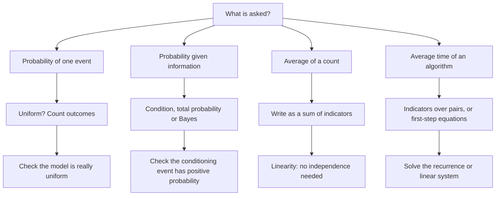

# Discrete Probability

> [Mathematics](../../README.md) › [Discrete Mathematics](../README.md) › Discrete Probability · Level: Intermediate · Prerequisites: [Set Theory](../../00-foundations/03-set-theory/README.md), [Proof Techniques](../../00-foundations/04-proof-techniques/README.md), [Mathematical Induction](../01-mathematical-induction/README.md), [Recurrence Relations](../02-recurrence-relations/README.md), [Exponential and Logarithmic Functions](../../03-algebra/12-exponential-and-logarithmic-functions/README.md) · Estimated time: 480 min

## 1. Introduction

A finite probability space is the one place in probability where nothing can hide. The sample space
is a finite set, every subset is an event, and a probability is just a list of numbers — one mass per
outcome — that adds up to $1$. Every probability is a finite sum, every expectation is a finite sum,
and every theorem is a theorem about finite sums. This makes discrete probability the right place to
learn *why* the rules of probability work, before analysis introduces limits, measures and the
technical machinery needed for continuous models.

The subject is also the working language of computer science. A randomised algorithm has a running
time that is a random variable; a hash table has a collision probability; a network has a load
distribution; a machine-learning model has an error rate estimated from a finite test set. In each
case the question is not "what happens?" but "with what probability, and what is the average over the
randomness?". Many of those questions reduce to counting and to one surprisingly strong identity,
linearity of expectation.

Four ideas organise this tutorial.

**The model comes first.** A probability space is a *choice*. Saying that a die is fair is a modelling
assumption, not a theorem, and the same physical die can be modelled by many different measures. Most
elementary errors come from silently switching models — treating the three outcomes "no heads", "one
head", "two heads" of two coin tosses as equally likely because they are listed as three things.

**Counting gives probabilities only under a uniform model.** The formula $\Pr(A)=\lvert A\rvert/\lvert\Omega\rvert$
is a theorem about the uniform measure, not a definition of probability. Every use of it needs a
symmetry argument: the outcomes must be indistinguishable except for their labels.

**Expectation is linear even when the variables are dependent.** $\mathbb{E}[X+Y]=\mathbb{E}[X]+\mathbb{E}[Y]$
has no hypotheses beyond integrability, which is automatic on a finite space. This single fact proves
the expected number of comparisons in quicksort, the expected time to collect all coupons, and the
expected number of fixed points of a random permutation, without ever computing a joint distribution.

**Randomness is a resource.** Randomised quicksort avoids the worst case of deterministic quicksort
not by being smarter but by making the bad *pivot sequence* unlikely, whatever the input. The analysis
of expected running time is therefore a genuine guarantee about an algorithm, not an approximation.

The tutorial treats finite spaces only. The general theory, including countable additivity, algebras
of events and continuous distributions, is developed in [Probability Foundations](../../10-probability/01-probability-foundations/README.md);
the statistical use of these ideas begins in [Statistics](../../11-statistics/README.md).

## 2. Prerequisites

| Prerequisite | Why it is needed here |
|---|---|
| [Set Theory](../../00-foundations/03-set-theory/README.md) | Events are subsets; unions, intersections, complements, Cartesian products and cardinality are used constantly. |
| [Proof Techniques](../../00-foundations/04-proof-techniques/README.md) | Direct proof, proof by contradiction and proof by contrapositive appear in the theorems on independence and conditioning. |
| [Mathematical Induction](../01-mathematical-induction/README.md) | Finite additivity is extended to $n$ events by induction; the binomial theorem and the Chapman–Kolmogorov identity are also proved by induction. |
| [Recurrence Relations](../02-recurrence-relations/README.md) | The geometric distribution and the coupon-collector analysis produce first-order recurrences; solving them is assumed. |
| [Exponential and Logarithmic Functions](../../03-algebra/12-exponential-and-logarithmic-functions/README.md) | The Poisson limit uses $(1-\lambda/n)^n\to e^{-\lambda}$, and the birthday approximation uses $\ln(1-x)\approx -x$. |
| [Limits](../../07-calculus/01-limits/README.md) | Only for the Poisson limit theorem, where a sequence of probabilities is computed as $n\to\infty$. |

Counting is **not** assumed. Section 7.2 develops the multiplication principle, permutations and
binomial coefficients from scratch, because every one of them is used in the probability calculations.
A fuller treatment, including inclusion–exclusion and the pigeonhole principle, is in
[Counting Principles](../../20-combinatorics/01-counting-principles/README.md); that topic appears later
in the curriculum and can be read afterwards without loss.

## 3. Learning Objectives

By the end of this tutorial you will be able to:

1. Write down a finite probability space for a word problem and justify why a particular measure is
   appropriate.
2. Derive the complement rule, monotonicity and inclusion–exclusion from the axioms.
3. Count outcomes using the multiplication principle, permutations and binomial coefficients, and
   explain why a count is valid only under a symmetry assumption.
4. Compute conditional probabilities, apply the multiplication rule, the total probability theorem
   and Bayes' theorem in finite settings.
5. Decide whether events are independent, pairwise independent or mutually independent, and give
   counterexamples separating the notions.
6. Define a random variable, its mass function and its expectation, and compute expectations by
   grouping outcomes.
7. Prove and use linearity of expectation, including the indicator-variable method.
8. Derive the mean and variance of the Bernoulli, binomial, geometric and Poisson distributions.
9. Derive the birthday-collision formula and the $n^2/(2m)$ heuristic, with an honest error bound.
10. Analyse the expected number of comparisons in randomised quicksort and the expected time of the
    coupon collector.
11. Set up and solve the first-step equations for a finite Markov chain, and find a stationary
    distribution.

## 4. Intuition

**Tickets in a bag.** Imagine a bag containing one ticket per outcome $\omega\in\Omega$. Ticket
$\omega$ has weight $p(\omega)$, and the weights sum to $1$. An event $A$ is a collection of tickets;
its probability is the total weight of the collection. This picture is exact: a finite probability
space *is* a weighted bag of tickets.

**Conditioning is throwing tickets away.** To condition on $B$, remove every ticket not in $B$, then
rescale the remaining weights so that they again sum to $1$. The rescaling is the division by
$\Pr(B)$ in the definition. Nothing else changes, which is why conditional probability satisfies the
same axioms as unconditional probability.

**Independence is invariance under conditioning.** Events $A$ and $B$ are independent when throwing
away the tickets outside $B$ does not change the *fraction* of the remaining weight that lies in $A$.
Equivalently, knowing that $B$ happened tells you nothing about whether $A$ happened. Independence is
a property of the pair of events and the measure, not a causal statement.

**A random variable is a number printed on each ticket.** $X$ assigns a real number to every outcome.
Many tickets may carry the same number; the probability that $X=x$ is the total weight of the tickets
printed with $x$. The mass function is the bag regrouped by printed number.

**Expectation is the balance point.** Put the tickets on a number line at positions $X(\omega)$, with
weight $p(\omega)$ at each position. The expectation is the point where the line balances. It need
not coincide with any printed number, and it is not the "most likely" value.

**Variance is the moment of inertia.** It measures how far the weight is spread from the balance
point, in squared units. Taking a square root returns to the original units.

**Indicators are light switches.** The indicator $\mathbf{1}_A$ is $1$ on the tickets in $A$ and $0$
elsewhere. Its expectation is exactly $\Pr(A)$. Summing indicators counts how many of a list of events
occur, so the expectation of a complicated count becomes a sum of simple probabilities. This is the
most useful computational trick in the subject.

**Randomness in algorithms.** When quicksort chooses a pivot uniformly at random, the pivot is a
random variable on the finite space of pivot choices. The number of comparisons is then a random
variable, and "expected running time" is its expectation. The input is fixed; only the algorithm's
internal coin tosses are random. This distinction matters: a randomised algorithm has no bad inputs,
only unlucky coin tosses.

## 5. Formal Definition

Throughout, $\Omega$ is a nonempty finite set and $2^\Omega$ is its power set.

**Definition 5.1 (finite probability space).** A *probability measure* on $\Omega$ is a function
$\Pr:2^\Omega\to[0,1]$ such that

1. $\Pr(\Omega)=1$;
2. $\Pr(A\cup B)=\Pr(A)+\Pr(B)$ for all disjoint $A,B\subseteq\Omega$.

The pair $(\Omega,\Pr)$ is a *finite probability space*. Elements of $\Omega$ are *outcomes*, subsets
are *events*. Because $\Omega$ is finite, condition 2 extends by induction to any finite family of
pairwise disjoint events; countable additivity, the extra axiom needed for infinite spaces, is
automatic here.

**Definition 5.2 (uniform measure).** If $\lvert\Omega\rvert=N$ and $\Pr(\{\omega\})=1/N$ for every
$\omega$, the space is *uniform*, and then

$$\Pr(A)=\frac{\lvert A\rvert}{\lvert\Omega\rvert}\qquad\text{for every }A\subseteq\Omega.$$

This is a theorem about the uniform measure, not a definition of probability.

**Definition 5.3 (conditional probability).** For $A,B\subseteq\Omega$ with $\Pr(B)>0$,

$$\Pr(A\mid B)=\frac{\Pr(A\cap B)}{\Pr(B)}.$$

If $\Pr(B)=0$ the expression is undefined.

**Definition 5.4 (independence).** Events $A,B$ are *independent* if
$\Pr(A\cap B)=\Pr(A)\Pr(B)$. A family $A_1,\dots,A_n$ is *mutually independent* if, for every subset
of indices $\{i_1,\dots,i_k\}\subseteq\{1,\dots,n\}$ with $k\ge2$,
$\Pr(A_{i_1}\cap\cdots\cap A_{i_k})=\prod_{r=1}^{k}\Pr(A_{i_r})$. It is *pairwise independent* if this
holds for every pair.

**Definition 5.5 (random variable, mass function, distribution function).** A *random variable* is a
function $X:\Omega\to\mathbb{R}$. Its *probability mass function* (PMF) is
$p_X(x)=\Pr(X=x)$, and its *cumulative distribution function* (CDF) is $F_X(x)=\Pr(X\le x)$.

**Definition 5.6 (expectation, variance, covariance).** For a random variable $X$,

$$\mathbb{E}[X]=\sum_{\omega\in\Omega}X(\omega)\Pr(\{\omega\}),\qquad
\operatorname{Var}(X)=\mathbb{E}\bigl[(X-\mathbb{E}[X])^2\bigr],\qquad
\sigma_X=\sqrt{\operatorname{Var}(X)}.$$

For random variables $X,Y$,
$\operatorname{Cov}(X,Y)=\mathbb{E}\bigl[(X-\mathbb{E}X)(Y-\mathbb{E}Y)\bigr]$ and
$\rho(X,Y)=\operatorname{Cov}(X,Y)/(\sigma_X\sigma_Y)$ when $\sigma_X\sigma_Y>0$.

**Definition 5.7 (named distributions).** Let $p\in[0,1]$ and $\lambda>0$.

| Name | Parameters | Support | PMF |
|---|---|---|---|
| Bernoulli | $p$ | $\{0,1\}$ | $\Pr(X=1)=p$, $\Pr(X=0)=1-p$ |
| Binomial | $n\in\mathbb{N}$, $p$ | $\{0,\dots,n\}$ | $\Pr(X=k)=\dbinom{n}{k}p^k(1-p)^{n-k}$ |
| Geometric | $p\in(0,1]$ | $\{1,2,\dots\}$ | $\Pr(T=k)=(1-p)^{k-1}p$ |
| Poisson | $\lambda>0$ | $\{0,1,\dots\}$ | $\Pr(X=k)=e^{-\lambda}\lambda^k/k!$ |

The binomial counts successes in $n$ independent Bernoulli trials; the geometric gives the trial of
the first success. The Poisson is not finitely supported; it is included because it is the limit of
binomial distributions and its algebra is discrete.

**Definition 5.8 (finite Markov chain).** Let $S$ be a finite state set. A sequence $X_0,X_1,\dots$
with values in $S$ is a *Markov chain* if
$\Pr(X_{n+1}=j\mid X_n=i,\dots,X_0=i_0)=\Pr(X_{n+1}=j\mid X_n=i)=P_{ij}$ for all $n$ and all states.
The matrix $P=(P_{ij})$ is *stochastic*: entries are nonnegative and each row sums to $1$. A
probability vector $\pi$ is *stationary* if $\pi P=\pi$.

**Remark 5.9 (what the finite theory avoids).** On a general space one must choose a $\sigma$-algebra
and require countable additivity; not every subset is an event and not every function is measurable.
On a finite space the power set is the only sensible choice, every function is measurable, and every
sum is finite. The general theory is in
[Probability Foundations](../../10-probability/01-probability-foundations/README.md).

## 6. Mathematical Notation

| Symbol | Read as | Meaning |
|---|---|---|
| $\Omega$ | the sample space | the finite set of outcomes |
| $\omega$ | omega | one outcome |
| $\lvert A\rvert$ | cardinality of $A$ | number of elements |
| $A^{\complement}$ | $A$ complement | $\Omega\setminus A$ |
| $\Pr(A)$ | probability of $A$ | a number in $[0,1]$ |
| $\Pr(A\mid B)$ | probability of $A$ given $B$ | $\Pr(A\cap B)/\Pr(B)$ |
| $X,Y$ | random variables | functions $\Omega\to\mathbb{R}$ |
| $p_X$ | mass function of $X$ | $p_X(x)=\Pr(X=x)$ |
| $F_X$ | distribution function | $F_X(x)=\Pr(X\le x)$ |
| $\mathbb{E}[X]$ | expectation | weighted average of $X$ |
| $\operatorname{Var}(X)$ | variance | mean squared deviation |
| $\sigma_X$ | standard deviation | $\sqrt{\operatorname{Var}(X)}$ |
| $\operatorname{Cov}(X,Y)$ | covariance | $\mathbb{E}[XY]-\mathbb{E}[X]\mathbb{E}[Y]$ |
| $\rho(X,Y)$ | correlation | normalised covariance |
| $\mathbf{1}_A$ | indicator of $A$ | $1$ on $A$, $0$ outside |
| $\perp\!\!\!\perp$ | independent | $X\perp\!\!\!\perp Y$ |
| $\operatorname{Bin}(n,p)$ | binomial distribution | $n$ trials, success probability $p$ |
| $\operatorname{Geom}(p)$ | geometric distribution | first-success trial number |
| $\operatorname{Pois}(\lambda)$ | Poisson distribution | rate $\lambda$ |
| $H_n$ | harmonic number | $\sum_{k=1}^{n}1/k$ |
| $P$ | transition matrix | $P_{ij}=\Pr(X_{n+1}=j\mid X_n=i)$ |
| $\pi$ | stationary distribution | $\pi P=\pi$, $\sum_i\pi_i=1$ |

## 7. Core Concepts

### 7.1 Finite sample spaces and the axioms

On a finite space the measure is determined by the weights $p(\omega)=\Pr(\{\omega\})$, since
$\Pr(A)=\sum_{\omega\in A}p(\omega)$. Thus a probability space is exactly a finite set of nonnegative
weights summing to $1$.

**Theorem 7.1 (consequences of the axioms).** For events $A,B,C$:

1. $\Pr(\varnothing)=0$ and $\Pr(A^{\complement})=1-\Pr(A)$.
2. If $A\subseteq B$, then $\Pr(B\setminus A)=\Pr(B)-\Pr(A)$ and $\Pr(A)\le\Pr(B)$.
3. $\Pr(A\cup B)=\Pr(A)+\Pr(B)-\Pr(A\cap B)$.
4. $\Pr(A\cup B\cup C)=\Pr(A)+\Pr(B)+\Pr(C)-\Pr(A\cap B)-\Pr(A\cap C)-\Pr(B\cap C)+\Pr(A\cap B\cap C)$.

**Proof.** (1) $\Omega=\Omega\cup\varnothing$ disjointly, so $1=1+\Pr(\varnothing)$. Also
$1=\Pr(A)+\Pr(A^{\complement})$. (2) $B=A\cup(B\setminus A)$ disjointly, and probabilities are
nonnegative. (3) $A\cup B=A\cup(B\setminus A)$ and $B=(A\cap B)\cup(B\setminus A)$ are disjoint
unions, so both sides equal $\Pr(A)+\Pr(B\setminus A)$. (4) Apply (3) to $A\cup B$ and $C$, then to
$A\cap C$ and $B\cap C$. $\blacksquare$

The general inclusion–exclusion formula is stated in §8.3.

### 7.2 Equally likely outcomes and counting

**Theorem 7.2 (uniform model).** If every outcome has probability $1/\lvert\Omega\rvert$, then
$\Pr(A)=\lvert A\rvert/\lvert\Omega\rvert$.

**Proof.** $A$ is the disjoint union of its $\lvert A\rvert$ singleton events. $\blacksquare$

**Multiplication principle.** A procedure with $r$ stages, where stage $i$ has $n_i$ choices
regardless of earlier choices, has $n_1n_2\cdots n_r$ outcomes. Proof: induction on $r$.

**Permutations and combinations.** An ordered selection without repetition of $k$ objects from $n$ can
be made in

$$P(n,k)=n(n-1)\cdots(n-k+1)=\frac{n!}{(n-k)!}$$

ways. Each $k$-element subset has $k!$ orderings, so the number of unordered selections is

$$\binom{n}{k}=\frac{n!}{k!(n-k)!}.$$

The binomial theorem $(1+x)^n=\sum_{k=0}^{n}\binom{n}{k}x^k$ follows by counting how many ways the
term $x^k$ arises when the $n$ factors are multiplied; setting $x=1$ gives
$\sum_k\binom{n}{k}=2^n$.

| Order matters? | Replacement? | Count |
|---|---|---|
| yes | yes | $n^k$ |
| yes | no | $n!/(n-k)!$ |
| no | no | $\dbinom{n}{k}$ |
| no | yes | $\dbinom{n+k-1}{k}$ |

The last row is stars and bars: a multiset of size $k$ from $n$ types corresponds to a word of $k$
stars and $n-1$ bars.

**Example 7.2.1 (five-card hands).** $\binom{52}{5}=2{,}598{,}960$ hands; four of them are royal
flushes, so that probability is $4/2{,}598{,}960=1/649{,}740$.

**Warning 7.2.2.** Two dice have $36$ equally likely ordered outcomes, not $11$ equally likely sums.
Count atoms, not descriptions; if a description contains several atoms, weight it by their number.

### 7.3 Conditional probability and the multiplication rule

Conditioning restricts to $B$ and renormalises:

$$\Pr(A\mid B)=\frac{\Pr(A\cap B)}{\Pr(B)},\qquad \Pr(B)>0.$$

For fixed $B$, the map $A\mapsto\Pr(A\mid B)$ satisfies the axioms: probabilities are nonnegative,
$\Pr(\Omega\mid B)=1$, and disjointness is preserved by intersection with $B$.

**Multiplication rule.** $\Pr(A\cap B)=\Pr(A\mid B)\Pr(B)$, and for three events
$\Pr(A\cap B\cap C)=\Pr(A\mid B\cap C)\Pr(B\mid C)\Pr(C)$.

**Example 7.3.1 (two aces).** Drawing two cards without replacement,

$$\Pr(\text{both aces})=\frac{3}{51}\cdot\frac{4}{52}=\frac{12}{2652}=\frac{1}{221}.$$

### 7.4 Total probability and Bayes' theorem

**Definition 7.4.1.** Events $B_1,\dots,B_m$ *partition* $\Omega$ if they are pairwise disjoint with
union $\Omega$.

**Theorem 7.4.2 (total probability).** If $B_1,\dots,B_m$ partition $\Omega$ and each has positive
probability, then

$$\Pr(A)=\sum_{i=1}^{m}\Pr(A\mid B_i)\Pr(B_i).$$

**Proof.** The events $A\cap B_i$ are disjoint with union $A$; apply finite additivity and the
multiplication rule. $\blacksquare$

**Theorem 7.4.3 (Bayes).** Under the same hypotheses, if $\Pr(A)>0$,

$$\Pr(B_j\mid A)=\frac{\Pr(A\mid B_j)\Pr(B_j)}{\sum_i\Pr(A\mid B_i)\Pr(B_i)}.$$

**Proof.** $\Pr(B_j\mid A)=\Pr(A\cap B_j)/\Pr(A)$, then use the multiplication rule in the numerator
and total probability in the denominator. $\blacksquare$

In odds form, for two hypotheses,
$\frac{\Pr(B\mid A)}{\Pr(B^{\complement}\mid A)}=\frac{\Pr(B)}{\Pr(B^{\complement})}\cdot\frac{\Pr(A\mid B)}{\Pr(A\mid B^{\complement})}$:
posterior odds equal prior odds times the likelihood ratio.

**Example 7.4.4 (screening).** With prevalence $1\%$, sensitivity $99\%$ and specificity $95\%$,

$$\Pr(\text{disease}\mid+)=\frac{0.99\cdot0.01}{0.99\cdot0.01+0.05\cdot0.99}
=\frac{0.0099}{0.0594}=\frac16\approx0.167.$$

Only one positive in six is genuine, because healthy people vastly outnumber diseased ones. Confusing
$\Pr(+\mid\text{disease})$ with $\Pr(\text{disease}\mid+)$ is the *base-rate fallacy*.

### 7.5 Independence

Events $A,B$ are independent if $\Pr(A\cap B)=\Pr(A)\Pr(B)$, equivalently $\Pr(A\mid B)=\Pr(A)$ when
$\Pr(B)>0$.

**Proposition 7.5.1.** If $A,B$ are independent, then $A,B^{\complement}$ and
$A^{\complement},B^{\complement}$ are independent.

**Proof.** $B=(A\cap B)\cup(A^{\complement}\cap B)$ disjointly, so
$\Pr(A^{\complement}\cap B)=\Pr(B)-\Pr(A)\Pr(B)=\Pr(B)\Pr(A^{\complement})$. Repeat with
$B^{\complement}$. $\blacksquare$

**Disjoint is not independent.** If $A,B$ are disjoint and have positive probability, then
$\Pr(A\cap B)=0\ne\Pr(A)\Pr(B)$: disjointness is negative dependence.

**Example 7.5.2 (pairwise but not mutual).** Toss two fair coins; let $A$ be "first head", $B$ be
"second head", $C$ be "coins match". Each pair satisfies the product rule, but
$\Pr(A\cap B\cap C)=1/4\ne1/8$. Pairwise independence does not suffice for three events.

**Conditional independence.** $A$ and $B$ are conditionally independent given $C$ if
$\Pr(A\cap B\mid C)=\Pr(A\mid C)\Pr(B\mid C)$. Neither independence nor conditional independence
implies the other.

### 7.6 Random variables on finite spaces

A random variable $X:\Omega\to\mathbb{R}$ groups outcomes by value. Its PMF satisfies
$p_X(x)\ge0$ and $\sum_x p_X(x)=1$; the CDF $F_X(x)=\Pr(X\le x)$ is a nondecreasing step function
jumping by $p_X(x)$ at each value.

If $Y=g(X)$, then $p_Y(y)=\sum_{x:g(x)=y}p_X(x)$. For two variables, the joint PMF is
$p_{X,Y}(x,y)=\Pr(X=x,Y=y)$; marginals are obtained by summing over the other variable. The variables
are independent exactly when $p_{X,Y}(x,y)=p_X(x)p_Y(y)$ for all $x,y$, and then

$$p_{X+Y}(z)=\sum_x p_X(x)p_Y(z-x).$$

### 7.7 Expectation and linearity

Grouping outcomes by the value of $X$ gives the two equivalent formulas

$$\mathbb{E}[X]=\sum_{\omega\in\Omega}X(\omega)\Pr(\{\omega\})=\sum_x x\,p_X(x).$$

**Theorem 7.7.1 (linearity).** $\mathbb{E}[aX+bY]=a\mathbb{E}[X]+b\mathbb{E}[Y]$ for all real $a,b$.

**Proof.** Sum $aX(\omega)+bY(\omega)$ against $\Pr(\{\omega\})$ and split the sum. $\blacksquare$

No independence is used.

**Indicators.** For an event $A$, $\mathbf{1}_A=1$ on $A$ and $0$ outside, and
$\mathbb{E}[\mathbf{1}_A]=\Pr(A)$. If $X$ counts how many of $A_1,\dots,A_n$ occur, then
$X=\sum_i\mathbf{1}_{A_i}$, so

$$\mathbb{E}[X]=\sum_{i=1}^{n}\Pr(A_i).$$

**Example 7.7.2.** The number of heads in $10$ fair tosses has expectation $10\cdot(1/2)=5$. The number
of fixed points of a uniformly random permutation of $n$ objects is $\sum_i\mathbf{1}_{F_i}$ with
$\Pr(F_i)=1/n$, so its expectation is $1$ for every $n$.

### 7.8 Variance

**Theorem 7.8.1.** $\operatorname{Var}(X)=\mathbb{E}[X^2]-\mathbb{E}[X]^2$.

**Proof.** With $\mu=\mathbb{E}[X]$, expand $(X-\mu)^2=X^2-2\mu X+\mu^2$ and take expectations.
$\blacksquare$

**Scaling and sums.** $\operatorname{Var}(aX+b)=a^2\operatorname{Var}(X)$, and

$$\operatorname{Var}(X+Y)=\operatorname{Var}(X)+\operatorname{Var}(Y)+2\operatorname{Cov}(X,Y).$$

**Proof of the second identity.** Write $X-\mu_X$ and $Y-\mu_Y$ and expand the square. $\blacksquare$

If $X,Y$ are independent, the joint PMF factorises, so $\mathbb{E}[XY]=\mathbb{E}[X]\mathbb{E}[Y]$,
hence $\operatorname{Cov}(X,Y)=0$ and variances add. The converse fails: let $X$ be uniform on
$\{-1,0,1\}$ and $Y=X^2$. Then $\mathbb{E}[X]=0$ and $\mathbb{E}[XY]=\mathbb{E}[X^3]=0$, so the
covariance is zero, yet $Y$ is determined by $X$. Zero correlation excludes a linear trend, not
dependence. Correlation is always in $[-1,1]$ (Cauchy–Schwarz), with equality exactly for an affine
relationship.

### 7.9 The standard distributions

#### Bernoulli

If $X\sim\operatorname{Bernoulli}(p)$, then
$\mathbb{E}[X]=p$ and $\mathbb{E}[X^2]=p$, so
$\operatorname{Var}(X)=p(1-p)$. Every indicator is a Bernoulli variable.

#### Binomial

For $X\sim\operatorname{Bin}(n,p)$, the event $X=k$ requires a chosen set of $k$ successes and $n-k$
failures, which has probability $p^k(1-p)^{n-k}$; there are $\binom{n}{k}$ such sets, so

$$\Pr(X=k)=\binom{n}{k}p^k(1-p)^{n-k}.$$

Normalisation follows from the binomial theorem. Write
$X=\sum_{i=1}^{n}\mathbf{1}_{A_i}$, where $A_i$ is the event that trial $i$ succeeds. Then
$\mathbb{E}[\mathbf{1}_{A_i}]=p$, so

$$\mathbb{E}[X]=\sum_{i=1}^{n}p=np.$$

The indicators are independent, hence $\operatorname{Cov}(\mathbf{1}_{A_i},\mathbf{1}_{A_j})=0$ for
$i\ne j$, and

$$\operatorname{Var}(X)=\sum_{i=1}^{n}\operatorname{Var}(\mathbf{1}_{A_i})=np(1-p).$$

#### Geometric

For $T\sim\operatorname{Geom}(p)$ on $\{1,2,\dots\}$,

$$\Pr(T=k)=(1-p)^{k-1}p,\qquad \Pr(T>k)=(1-p)^k.$$

Normalisation is the geometric series. *Memorylessness*: for $m,k\ge0$,

$$\Pr(T>m+k\mid T>m)=\frac{(1-p)^{m+k}}{(1-p)^m}=(1-p)^k=\Pr(T>k).$$

The tail-sum formula of §8.4 gives

$$\mathbb{E}[T]=\sum_{k\ge0}\Pr(T>k)=\sum_{k\ge0}(1-p)^k=\frac1p.$$

For the variance, put $q=1-p$. Differentiating $\sum_{k\ge0}q^k=1/(1-q)$ twice gives
$\sum_{k\ge2}k(k-1)q^{k-2}=2/(1-q)^3$, hence

$$\mathbb{E}[T(T-1)]=p\sum_{k\ge2}k(k-1)q^{k-1}=\frac{2pq}{(1-q)^3}=\frac{2q}{p^2}.$$

Therefore

$$\operatorname{Var}(T)=\mathbb{E}[T(T-1)]+\mathbb{E}[T]-\mathbb{E}[T]^2
=\frac{2q}{p^2}+\frac1p-\frac1{p^2}=\frac{2q+p-1}{p^2}=\frac{1-p}{p^2}.$$

#### Poisson

For $X\sim\operatorname{Pois}(\lambda)$,
$\Pr(X=k)=e^{-\lambda}\lambda^k/k!$. Normalisation is the exponential series. For the mean,

$$\mathbb{E}[X]=\sum_{k\ge1}k\,e^{-\lambda}\frac{\lambda^k}{k!}
=\lambda e^{-\lambda}\sum_{j\ge0}\frac{\lambda^j}{j!}=\lambda.$$

For the variance, the factorial moment is

$$\mathbb{E}[X(X-1)]=\sum_{k\ge2}k(k-1)e^{-\lambda}\frac{\lambda^k}{k!}
=\lambda^2e^{-\lambda}\sum_{j\ge0}\frac{\lambda^j}{j!}=\lambda^2,$$

so $\mathbb{E}[X^2]=\lambda^2+\lambda$ and $\operatorname{Var}(X)=\lambda$.

**Theorem 7.9.1 (Poisson limit).** If $X_n\sim\operatorname{Bin}(n,\lambda/n)$ with $\lambda>0$ fixed,
then for each fixed $k\ge0$,
$\Pr(X_n=k)\to e^{-\lambda}\lambda^k/k!$.

**Proof.** Factor

$$\Pr(X_n=k)=\underbrace{\prod_{j=0}^{k-1}\left(1-\frac{j}{n}\right)}_{\to1}
\cdot\frac{\lambda^k}{k!}\cdot
\underbrace{\left(1-\frac{\lambda}{n}\right)^{n}}_{\to e^{-\lambda}}
\cdot\underbrace{\left(1-\frac{\lambda}{n}\right)^{-k}}_{\to1}.$$

Each factor has the indicated limit, so the product converges to the Poisson mass. $\blacksquare$

Thus a binomial with many trials and small success probability is approximately Poisson with
$\lambda=np$. The approximation is good when $n$ is large, $p$ small and $\lambda$ moderate.

### 7.10 The birthday problem and hash collisions

There are $m$ equally likely buckets and $n$ independent uniform items. The first item cannot collide;
the $i$-th avoids the previous $i-1$ with probability $(m-i+1)/m$. Hence

$$\Pr(\text{no collision})=\prod_{i=0}^{n-1}\left(1-\frac{i}{m}\right),$$

which is zero for $n>m$ by the pigeonhole principle. Since $1-x\le e^{-x}$,

$$\Pr(\text{collision})\ge1-\exp\left(-\frac{n(n-1)}{2m}\right),$$

and the reverse inequality $\ln(1-x)\ge-x-x^2$ for $0\le x\le1/2$ shows that the two sides differ by
a relative error of order $n^3/m^2$ when $n^3\ll m^2$. Setting the exponent to $\ln2$ gives the $50\%$
threshold

$$n\approx\sqrt{2m\ln2}.$$

For $m=365$ this is $22.49$, so $23$ people suffice. The exact values are $0.4757$ for $n=22$ and
$0.5073$ for $n=23$; for $n=41$ the probability is $0.9032$, and for $n=57$ it is $0.9901$.

The mechanism is the number of pairs. Let $E_{ij}$ be the event that items $i$ and $j$ collide. Then
$\Pr(E_{ij})=1/m$ and

$$\mathbb{E}\left[\sum_{i<j}\mathbf{1}_{E_{ij}}\right]=\binom{n}{2}\frac1m.$$

At $n=23$ and $m=365$ this expectation is $253/365\approx0.693$, close to $1$, which is why the
collision probability at the threshold is near $1/2$ rather than near $0$.

**Hash collisions.** A $32$-bit hash has $m=2^{32}$, so the birthday threshold is
$\sqrt{2\cdot2^{32}\ln2}\approx77{,}163$ keys. An adversary able to generate that many keys finds a
collision with even odds — the *birthday attack*. The expected number of colliding pairs at that
point is $\binom{n}{2}/m\approx0.693$.

### 7.11 Expected running time of algorithms

#### Randomised quicksort

Quicksort chooses a pivot uniformly at random from the current subarray, partitions the other keys
around it, and recurses. The input is fixed; only the pivots are random.

Order the keys by sorted position. A pair $i<j$ is compared at most once. Consider
$S_{ij}=\{i,i+1,\dots,j\}$. Until a pivot from $S_{ij}$ is chosen, these keys remain together. The
first pivot from $S_{ij}$ is uniformly distributed over its $j-i+1$ elements, and $i$ and $j$ are
compared exactly when that pivot is $i$ or $j$. Hence

$$\Pr(i,j\text{ compared})=\frac{2}{j-i+1}.$$

By linearity, with $C_n$ the number of comparisons,

$$\mathbb{E}[C_n]=\sum_{1\le i<j\le n}\frac{2}{j-i+1}
=\sum_{d=1}^{n-1}(n-d)\frac{2}{d+1}.$$

Putting $k=d+1$,

$$\mathbb{E}[C_n]=2\sum_{k=2}^{n}\frac{n-k+1}{k}
=2\bigl((n+1)(H_n-1)-(n-1)\bigr)=2(n+1)H_n-4n.$$

For $n=10$, $H_{10}=2.928968$, so $\mathbb{E}[C_{10}]=24.4373$, against a worst case of $45$. For
$n=100$, $\mathbb{E}[C_{100}]=647.85$, against $4950$. Since $H_n=\ln n+O(1)$, the expected count is
$2n\ln n+O(n)$, while the worst case is $\Theta(n^2)$. The expectation is over the algorithm's coins
for each fixed input, so no input distribution is assumed.

#### The coupon collector

There are $n$ coupon types, drawn independently and uniformly. After $k-1$ distinct types have been
seen, the probability that the next draw is new is $p_k=(n-k+1)/n$. The waiting time $T_k$ for the
$k$-th new type is geometric with parameter $p_k$, and $T=T_1+\cdots+T_n$. Therefore

$$\mathbb{E}[T]=\sum_{k=1}^{n}\frac1{p_k}=\sum_{k=1}^{n}\frac{n}{n-k+1}=nH_n.$$

For $n=6$, $\mathbb{E}[T]=14.7$; for $n=10$, $29.2897$; for $n=365$, about $2364$. The tail bound

$$\Pr(T>t)\le\sum_{i=1}^{n}\left(1-\frac1n\right)^t\le ne^{-t/n}$$

shows that $T=O(n\log n)$ with high probability, so the expectation and the typical value have the
same order.

### 7.12 Markov chains: a preview

A Markov chain moves among finitely many states; only the current state matters for the next step.
The transition matrix $P$ has $P_{ij}=\Pr(X_{n+1}=j\mid X_n=i)$, nonnegative entries and row sums $1$.

**Example 7.12.1 (weather).** With states sunny and rainy,

$$P=\begin{pmatrix}0.8&0.2\\0.3&0.7\end{pmatrix}.$$

**$n$-step probabilities.** Conditioning on the state at time $n-1$ and using the Markov property gives
$P^{(n)}=P^{(n-1)}P$, hence $P^{(n)}=P^n$ by induction. For this chain,

$$P^n=\begin{pmatrix}
0.6+0.4(0.5)^n & 0.4-0.4(0.5)^n\\
0.6-0.6(0.5)^n & 0.4+0.6(0.5)^n
\end{pmatrix},$$

whose rows both tend to $(0.6,0.4)$.

**Stationary distribution.** Solve $\pi P=\pi$ with $\sum_i\pi_i=1$:

$$\pi_1=0.8\pi_1+0.3\pi_2,\qquad \pi_1+\pi_2=1,$$

so $0.2\pi_1=0.3\pi_2$, giving $\pi=(0.6,0.4)$. The second equation is redundant because the rows of
$P$ sum to $1$.

**Hitting times.** Let $h_i$ be the expected time to reach a target $b$, with $h_b=0$. Conditioning on
the first step gives $h_i=1+\sum_jP_{ij}h_j$. From sunny to rainy,
$h_S=1+0.8h_S$, so $h_S=5$. The mean return time to a state is $1/\pi_i$; for sunny weather this is
$1/0.6=5/3$, which the first-step equations confirm:
$1+0.2\cdot(1/0.3)=5/3$.

**Convergence.** If a finite chain is irreducible (all states communicate) and aperiodic (no state has
a forced return period), the stationary distribution is unique and $P^n$ converges to the matrix with
every row equal to $\pi$. The weather chain is irreducible and aperiodic. Periodic chains may have a
unique stationary distribution without convergence of $P^n$; the distribution then oscillates.

## 8. Formulas and Properties

### 8.1 The four distributions at a glance

| Distribution | PMF | Mean | Variance |
|---|---|---|---|
| $\operatorname{Bernoulli}(p)$ | $p$ at $1$, $1-p$ at $0$ | $p$ | $p(1-p)$ |
| $\operatorname{Bin}(n,p)$ | $\dbinom{n}{k}p^k(1-p)^{n-k}$ | $np$ | $np(1-p)$ |
| $\operatorname{Geom}(p)$ | $(1-p)^{k-1}p$, $k\ge1$ | $1/p$ | $(1-p)/p^2$ |
| $\operatorname{Pois}(\lambda)$ | $e^{-\lambda}\lambda^k/k!$ | $\lambda$ | $\lambda$ |

### 8.2 The law of the unconscious statistician

For any real function $g$ on the values of $X$,

$$\mathbb{E}[g(X)]=\sum_x g(x)p_X(x).$$

**Why.** Group the outcomes by the value $x$ of $X$; on the group $\{X=x\}$ the summand is $g(x)$, and
the total probability of the group is $p_X(x)$. $\blacksquare$

### 8.3 General inclusion–exclusion

For events $A_1,\dots,A_n$,

$$\Pr\left(\bigcup_{i=1}^{n}A_i\right)=\sum_{\varnothing\ne S\subseteq\{1,\dots,n\}}(-1)^{\lvert S\rvert+1}\Pr\left(\bigcap_{i\in S}A_i\right).$$

**Why.** The case $n=2$ is Theorem 7.1(3). Assume the formula for $n-1$ and apply the two-event rule
to $A_1\cup\cdots\cup A_{n-1}$ and $A_n$; the terms regroup into exactly the subsets containing $n$ and
those not containing $n$. Induction completes the proof. $\blacksquare$

### 8.4 The tail-sum formula

If $X$ takes values in $\{0,1,2,\dots\}$, then

$$\mathbb{E}[X]=\sum_{k=1}^{\infty}\Pr(X\ge k).$$

**Why.** Write $X(\omega)=\sum_{k=1}^{X(\omega)}1$ and interchange the finite sums:
$\sum_\omega\sum_{k=1}^{X(\omega)}p(\omega)=\sum_{k\ge1}\sum_{\omega:X(\omega)\ge k}p(\omega)$.
The inner sum is $\Pr(X\ge k)$. $\blacksquare$

### 8.5 Three series identities

For $\lvert q\rvert<1$,

$$\sum_{k\ge0}q^k=\frac1{1-q},\qquad
\sum_{k\ge1}kq^{k-1}=\frac1{(1-q)^2},\qquad
\sum_{k\ge2}k(k-1)q^{k-2}=\frac{2}{(1-q)^3}.$$

Each follows by differentiating the previous identity and multiplying by the appropriate power of $q$.
They are the computational basis of the geometric distribution.

### 8.6 Three inequalities

**Markov.** If $X\ge0$ and $a>0$, then $\Pr(X\ge a)\le\mathbb{E}[X]/a$.

**Why.** $\mathbb{E}[X]\ge\mathbb{E}[X\mathbf{1}_{X\ge a}]\ge a\Pr(X\ge a)$. $\blacksquare$

**Chebyshev.** If $\mu=\mathbb{E}[X]$ and $a>0$, then
$\Pr(\lvert X-\mu\rvert\ge a)\le\operatorname{Var}(X)/a^2$.

**Why.** Apply Markov to $(X-\mu)^2$ with threshold $a^2$. $\blacksquare$

**Union bound.** $\Pr(A_1\cup\cdots\cup A_n)\le\sum_i\Pr(A_i)$.

**Why.** Inclusion–exclusion and nonnegativity, or induction on $n$. $\blacksquare$

### 8.7 Covariance identities

$\operatorname{Cov}(X,Y)=\mathbb{E}[XY]-\mathbb{E}[X]\mathbb{E}[Y]$,
$\operatorname{Cov}(aX+b,cY+d)=ac\operatorname{Cov}(X,Y)$, and
$\operatorname{Var}(X+Y)=\operatorname{Var}(X)+\operatorname{Var}(Y)+2\operatorname{Cov}(X,Y)$.
Cauchy–Schwarz gives $\lvert\operatorname{Cov}(X,Y)\rvert\le\sigma_X\sigma_Y$, so
$\lvert\rho(X,Y)\rvert\le1$.

### 8.8 Which tool to use

| The problem asks for | Use |
|---|---|
| probability of an event in a symmetric model | uniform count, §7.2 |
| probability given information | conditioning, total probability or Bayes, §7.3–7.4 |
| whether information changes a probability | independence test, §7.5 |
| average of a count of many events | indicators and linearity, §7.7 |
| spread around an average | variance and covariance, §7.8 |
| number of successes, first success, rare counts | binomial, geometric, Poisson, §7.9 |
| chance of a repeated value | birthday formula, §7.10 |
| average time of a randomised algorithm | indicators or first-step recurrences, §7.11 |
| long-run behaviour of a state machine | stationary distribution, §7.12 |

## 9. Step-by-Step Examples

### 9.1 Two dice

The $36$ ordered outcomes are equally likely. Sums and counts:

| Sum | 2 | 3 | 4 | 5 | 6 | 7 | 8 | 9 | 10 | 11 | 12 |
|---|---|---|---|---|---|---|---|---|---|---|---|
| Ways | 1 | 2 | 3 | 4 | 5 | 6 | 5 | 4 | 3 | 2 | 1 |

Thus $\Pr(\text{sum}=7)=6/36=1/6$ and
$\Pr(\text{sum}\ge10)=(3+2+1)/36=1/6$. Conditioning on an odd sum (there are $18$ such outcomes),
$\Pr(\text{sum}=7\mid\text{sum odd})=6/18=1/3$.

### 9.2 A contingency table

Among $200$ students, $90$ studied and $110$ did not; $80$ of the studiers passed and $40$ of the
non-studiers passed. Then

$$\Pr(\text{pass}\mid\text{studied})=\frac{80}{90}=\frac89,\qquad
\Pr(\text{pass}\mid\text{did not study})=\frac{40}{110}=\frac4{11}.$$

The overall pass rate is $120/200=0.6$. Since $8/9\ne0.6$, studying and passing are not independent.
Also $\Pr(\text{studied}\mid\text{passed})=80/120=2/3$.

### 9.3 Bayes with two machines

Machine A makes $60\%$ of the items with a $2\%$ defect rate; machine B makes $40\%$ with a $5\%$
defect rate. The overall defect rate is

$$0.6\cdot0.02+0.4\cdot0.05=0.012+0.020=0.032.$$

Given a defective item,

$$\Pr(\text{A}\mid\text{defect})=\frac{0.012}{0.032}=0.375.$$

Although A produces most items, B produces most defects.

### 9.4 Binomial probabilities

For $X\sim\operatorname{Bin}(10,0.2)$,

$$\Pr(X=3)=\binom{10}{3}(0.2)^3(0.8)^7=120\cdot0.008\cdot0.2097152=0.2013.$$

Also $\Pr(X\ge1)=1-0.8^{10}=1-0.1074=0.8926$, and
$\Pr(X\le2)=0.6778$. The mean is $np=2$, the variance $np(1-p)=1.6$, and the standard deviation
$\sqrt{1.6}=1.2649$.

### 9.5 Geometric waiting

A fair die is rolled until a six appears. For $T\sim\operatorname{Geom}(1/6)$,

$$\Pr(T=10)=\left(\frac56\right)^9\frac16=0.0323,\qquad
\Pr(T>6)=\left(\frac56\right)^6=0.3349.$$

By memorylessness,
$\Pr(T>10\mid T>6)=\Pr(T>4)=(5/6)^4=0.4823$. The mean is $6$ and the standard deviation is
$\sqrt{30}=5.4772$.

### 9.6 Poisson approximation

Let $X\sim\operatorname{Bin}(1000,0.003)$ and $Y\sim\operatorname{Pois}(3)$. Then

| Quantity | Binomial | Poisson |
|---|---|---|
| $\Pr(X=0)$ | $0.04956$ | $0.04979$ |
| $\Pr(X=2)$ | $0.22415$ | $0.22404$ |

The agreement is excellent because $n$ is large, $p$ is small and $np=3$ is moderate.

### 9.7 The birthday problem

For $m=365$ and $n=23$, the exact no-collision product is

$$\prod_{i=0}^{22}\left(1-\frac{i}{365}\right)=0.492703\ldots,$$

so the collision probability is $0.507297\ldots$. The exponential approximation gives
$1-e^{-506/730}=1-e^{-0.69315}=0.5000$, within one percentage point. For $n=56$ the exact probability
is $0.9883$, and for $n=57$ it is $0.9901$; thus $57$ people are needed for a $99\%$ chance of a
shared birthday. For a $32$-bit hash, $n\approx\sqrt{2\cdot2^{32}\ln2}\approx77{,}163$.

### 9.8 Quicksort on ten keys

With $H_{10}=2.928968\ldots$,

$$\mathbb{E}[C_{10}]=2\cdot11\cdot H_{10}-4\cdot10=64.4373-40=24.4373.$$

The worst case is $\binom{10}{2}=45$ comparisons, so the average is about $54\%$ of the worst case.
For $100$ keys the expectation is $647.85$, against $4950$ in the worst case.

### 9.9 Coupon collector with six types

$\mathbb{E}[T]=6H_6=6\cdot2.45=14.7$ draws. The exact probability that the collection is still
incomplete after $10$ draws is, by inclusion–exclusion,

$$\Pr(T>10)=\sum_{k=1}^{6}(-1)^{k+1}\binom{6}{k}\left(\frac{6-k}{6}\right)^{10}=0.7282.$$

So even after more than two-thirds of the expected time, there is still a $73\%$ chance of missing a
type.

### 9.10 A two-state Markov chain

For the weather chain with $P=\begin{pmatrix}0.8&0.2\\0.3&0.7\end{pmatrix}$, the stationary
distribution solves $\pi P=\pi$ and is $\pi=(0.6,0.4)$. The expected time from sunny to rainy is
$h_S=1+0.8h_S+0.2\cdot0$, so $h_S=5$ days. The mean return time to sunny is $1/0.6=5/3$ days.

## 10. Visual Explanations

The choice of method is often the hard part. The following decision guide summarises §7.

Two distinctions that are constantly confused:

| Pair | Difference |
|---|---|
| disjoint vs independent | disjoint events exclude each other; independent events do not affect each other's probabilities. Positive-probability disjoint events are never independent. |
| pairwise vs mutual independence | pairwise checks $\binom{n}{2}$ identities; mutual checks all $2^n-n-1$ subfamilies of size at least $2$. |

## 11. Common Mistakes

1. **Counting descriptions instead of atoms.** "The sum of two dice is $7$" is one description but six
   outcomes. Uniform counting requires equally likely atoms.
2. **Using $\lvert A\rvert/\lvert\Omega\rvert$ without uniformity.** A loaded die or a non-uniform
   hash has no such formula. State the symmetry assumption before counting.
3. **Confusing $\Pr(A\mid B)$ with $\Pr(B\mid A)$.** The screening example (§7.4) gives $0.167$ for
   one and $0.99$ for the other. Always write the conditioning event after the bar.
4. **Treating disjoint events as independent.** They are the opposite: occurrence of one rules out the
   other.
5. **Assuming pairwise independence implies mutual independence.** Example 7.5.2 is a three-event
   counterexample; the Poisson limit needs the full product rule.
6. **Thinking $\mathbb{E}[X]$ must be a possible value.** The expected number of heads in one toss is
   $1/2$, which is impossible. Expectation is a balance point, not a prediction of a single outcome.
7. **Adding variances without independence.** $\operatorname{Var}(X+Y)=\operatorname{Var}X+\operatorname{Var}Y$
   needs zero covariance. It fails for $Y=X$.
8. **Confusing zero covariance with independence.** Uncorrelated variables can be functionally
   dependent; see §7.8.
9. **Using $p(1-p)$ for the variance of a count.** That is the Bernoulli variance. A binomial has
   $np(1-p)$; a geometric has $(1-p)/p^2$.
10. **Forgetting the complement in birthday problems.** The direct probability of "at least one
    collision" is a mess; the complement is a product.
11. **The gambler's fallacy.** After six reds, black is not "due". Independent trials have no memory;
    the geometric distribution is memoryless in the precise sense of §7.9.
12. **The base-rate fallacy.** A sensitive test of a rare condition still has a low positive predictive
    value. Sensitivity and PPV are different conditional probabilities.
13. **Off-by-one in the coupon collector.** There are $n$ stages, and the last stage has success
    probability $1/n$, not $0$ or $1$.
14. **Assuming the quicksort analysis needs random input.** It does not: the expectation is over the
    algorithm's pivots for each fixed input.

## 12. Applications

- **Hashing and cryptography.** Birthday collisions determine safe digest lengths and the cost of
  collision attacks; expected chain lengths determine hash-table performance.
- **Randomised algorithms.** Quicksort, quickselect, treaps, randomised min-cut and hashing all use
  expected-time analyses of the kind in §7.11.
- **Load balancing.** Throwing $n$ balls into $n$ bins has expected maximum load $\Theta(\log n/\log\log n)$;
  the analysis begins with indicators and the union bound.
- **Biology.** The birthday model describes the probability that two individuals in a sample share a
  marker, and collision counts arise in genetic fingerprinting.
- **Queueing and reliability.** Finite Markov chains model machines that fail and are repaired, and
  stationary distributions give long-run availability.
- **Statistical mechanics.** The uniform measure on finite configurations is the combinatorial core of
  entropy and the Boltzmann distribution.
- **Finance and insurance.** Expected values of claim counts, with Poisson models for rare events, are
  the discrete skeleton of risk theory.
- **Games and gambling.** Expected payoff calculations, and the analysis of why "systems" cannot beat
  a fair game, are direct applications of linearity and independence.

## 13. Exercises

The problem set is in [exercises.md](exercises.md): 37 problems, graded Beginner → Challenge. Every
problem names the section that supplies the method, and the Beginner section checks fluency with the
axioms and the four distributions.

## 14. Solutions

Full worked solutions, with every algebraic step, are in [solutions.md](solutions.md). Attempt the
problems before reading them; the solutions flag the mistakes that are most likely at each step.

## 15. Summary

- A finite probability space is a finite set of outcomes with nonnegative weights summing to $1$.
  Every probability is a finite sum of weights.
- The uniform formula $\lvert A\rvert/\lvert\Omega\rvert$ requires a symmetry argument; counting
  descriptions rather than atoms is the classic error.
- Conditioning restricts and renormalises. Total probability and Bayes follow from finite additivity
  and the multiplication rule.
- Independence is the product rule; disjointness is not independence, and pairwise independence is
  weaker than mutual independence.
- Expectation is linear always. Indicators turn counts into sums of probabilities, which is how
  complicated expectations are computed without joint distributions.
- $\operatorname{Var}(X)=\mathbb{E}[X^2]-\mathbb{E}[X]^2$; variances add when covariances vanish, and
  zero covariance does not imply independence.
- Bernoulli, binomial, geometric and Poisson have means $p$, $np$, $1/p$, $\lambda$ and variances
  $p(1-p)$, $np(1-p)$, $(1-p)/p^2$, $\lambda$. The Poisson is the limit of binomials with $np\to\lambda$.
- The birthday probability is $1-\prod_{i=0}^{n-1}(1-i/m)$, with threshold $n\approx\sqrt{2m\ln2}$;
  this governs hash collisions.
- Randomised quicksort uses $2(n+1)H_n-4n$ comparisons on average; the coupon collector needs $nH_n$
  draws on average.
- A finite Markov chain is described by a stochastic matrix; stationary distributions solve
  $\pi P=\pi$, and hitting times solve first-step linear equations.

## 16. Further Learning

Within this repository:

- [Conditional Probability and Independence](../../10-probability/02-conditional-probability-and-independence/README.md)
  develops Bayes' theorem and Markov chains at greater length.
- [Random Variables](../../10-probability/03-random-variables/README.md) treats mass functions, densities
  and transformations systematically.
- [Expectation and Variance](../../10-probability/05-expectation-and-variance/README.md) generalises the
  moment machinery to continuous distributions.
- [Counting Principles](../../20-combinatorics/01-counting-principles/README.md) is the full treatment of
  the counting used in §7.2.
- [Recurrence Relations](../02-recurrence-relations/README.md) supplies the recurrence techniques behind
  the first-step equations.
- [Statistics](../../11-statistics/README.md) applies these distributions to data.

Standard texts, in increasing order of difficulty:

- W. Feller, *An Introduction to Probability Theory and Its Applications*, Vol. 1 — the classical
  combinatorial treatment, rich in examples.
- S. Ross, *A First Course in Probability* — the standard undergraduate text, with many exercises.
- M. Mitzenmacher and E. Upfal, *Probability and Computing* — the algorithms side of this topic,
  including quicksort and the coupon collector.
- G. Grimmett and D. Stirzaker, *Probability and Random Processes* — a rigorous bridge to the general
  theory.
- R. Motwani and P. Raghavan, *Randomized Algorithms* — the full-strength treatment of randomised
  computation.
