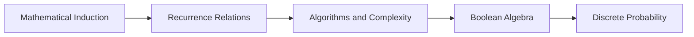

<!-- Generated by tools/build_indexes.py from tools/curriculum.json. Do not edit by hand. -->

# Discrete Mathematics

*Induction, algorithms and finite structures*

[Mathematics](../README.md) › Discrete Mathematics

The mathematics of computer science and of counting: induction, recurrences, complexity, logic circuits and discrete probability.

## At a glance

| | |
|---|---|
| Topics | 5 (2 complete, 0 draft, 3 planned) |
| Estimated study time | ~41 hours |
| Prerequisites | [00-foundations](../00-foundations/README.md) |

## Study order

The numbers are the recommended order. Study a topic only after the ones before it —
the dependency chain below is the shortest safe route through the discipline.

## Topic inventory

| # | Topic | Level | Est. time | Status | Materials |
|---|---|---|---|---|---|
| 1 | [Mathematical Induction](01-mathematical-induction/README.md) | Intermediate | 7 h | Complete | [Tutorial](01-mathematical-induction/README.md) · [Exercises](01-mathematical-induction/exercises.md) · [Solutions](01-mathematical-induction/solutions.md) |
| 2 | [Recurrence Relations](02-recurrence-relations/README.md) | Advanced | 9 h | Complete | [Tutorial](02-recurrence-relations/README.md) · [Exercises](02-recurrence-relations/exercises.md) · [Solutions](02-recurrence-relations/solutions.md) |
| 3 | Algorithms and Complexity | Advanced | 9 h | Planned | — |
| 4 | Boolean Algebra | Intermediate | 8 h | Planned | — |
| 5 | Discrete Probability | Intermediate | 8 h | Planned | — |

### What each topic covers

- **Mathematical Induction** — Weak and strong induction, well-ordering, and writing induction proofs.
- **Recurrence Relations** — Iteration, characteristic equations, master theorem and divide-and-conquer.
- **Algorithms and Complexity** — Big-O, growth rates, sorting bounds, P vs NP and computability preview.
- **Boolean Algebra** — Boolean laws, normal forms, Karnaugh maps and logic circuits.
- **Discrete Probability** — Finite sample spaces, counting with probability, expectation and variance.

## Related disciplines

- [20-combinatorics](../20-combinatorics/README.md)
- [21-graph-theory](../21-graph-theory/README.md)
- [10-probability](../10-probability/README.md)

## Status key

- **Complete** — tutorial, exercises and full solutions exist and the tutorial meets the
  [authoring standard](../CONTRIBUTING.md).
- **Draft** — some material exists but the topic is not finished.
- **Planned** — identified in the curriculum, not written yet.

Overall progress and the full topic inventory live in [ROADMAP.md](../ROADMAP.md).
