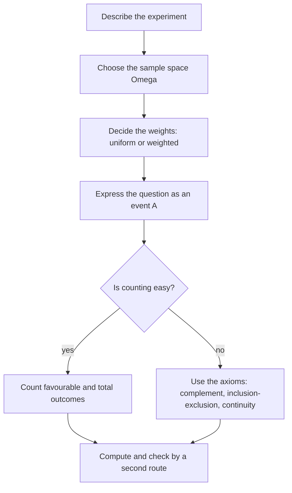

# Probability Foundations

> [Probability](../README.md) · Level: Intermediate · Prerequisites: [Set Theory](../../00-foundations/03-set-theory/README.md), [Proof Techniques](../../00-foundations/04-proof-techniques/README.md), [Calculus](../../07-calculus/README.md) · Estimated time: 540 min

## 1. Introduction

Probability is the mathematics of uncertainty, and it is unusual in that every reader arrives already
holding strong opinions about it. Those opinions are mostly correct, some are badly wrong, and almost
all are held with great confidence. So this tutorial has two jobs: build the machinery — sample spaces,
axioms, counting, areas — with the precision used everywhere else in mathematics, and slow the reader
down at exactly the points where intuition misleads, because in this subject a plausible argument is
the normal way to reach a wrong answer.

Four subtleties run through everything below.

**The model is not the world.** A probability model is a triple: a set of possible outcomes, a family
of events, and a rule assigning numbers to those events. The mathematics studies the triple. "This coin
has probability $1/2$ of heads" is a claim about the model, justified by a symmetry assumption about
the coin, not an observed fact about that coin.

**"Equally likely" is an assumption, not a theorem.** The classical formula
$\Pr(A)=\lvert A\rvert/\lvert\Omega\rvert$ is correct only under a uniform model. Two dice are equally
likely to show each of the $36$ ordered pairs, but their *sums* are not uniform: six ways give $7$,
five give $8$. Most elementary errors come from applying a uniform count to outcomes that are not
uniform.

**Infinite sample spaces need more than counting.** If a point is chosen uniformly from $[0,1]$, the
probability that it equals exactly $1/2$ is $0$, although that outcome is possible. Probability zero
and impossibility are different; making this precise is why Kolmogorov's axioms speak of countably many
operations rather than finitely many.

**Information changes probabilities, and direction matters.** $\Pr(A\mid B)$ is not $\Pr(B\mid A)$;
confusing them produces the base-rate fallacy and a hundred puzzles. That is the subject of the next
topic, and here we build the foundation it rests on.

Historically: Cardano's odds for gamblers in the sixteenth century, the Pascal–Fermat correspondence of
1654 on the problem of points, Jakob Bernoulli's *Ars Conjectandi* (1713) with the first limit theorem,
Laplace's systematisation in 1812, and Kolmogorov's measure-theoretic axioms (1933). This tutorial
follows that arc: model, consequences, counting, geometry, and finally what the numbers mean.

## 2. Prerequisites

* **Sets** — subsets, union, intersection, difference, complement, De Morgan's laws, cardinality
  $\lvert A\rvert$: [Set Theory](../../00-foundations/03-set-theory/README.md).
* **Logic** — "and", "or", "not", quantifiers, so that statements like "for every $n$, if
  $A_n \subseteq A_{n+1}$ then …" can be read precisely:
  [Propositional and First-Order Logic](../../00-foundations/02-logic/README.md).
* **Proof technique** — direct proof, cases, contradiction, induction; several results below are proved
  by induction: [Proof Techniques](../../00-foundations/04-proof-techniques/README.md).
* **Arithmetic of divisibility** — $\lfloor x \rfloor$, and that the multiples of $d$ up to $N$ number
  $\lfloor N/d\rfloor$: [Factors and Multiples](../../02-pre-algebra/03-factors-and-multiples/README.md).
* **Limits and series** — $\lim_{n\to\infty}a_n$, series of non-negative terms, the geometric series
  $\sum_{k\ge1}2^{-k}=1$. Used only in §7.3 and §9.8: [Calculus](../../07-calculus/README.md).
* **Area of plane figures** — squares, triangles, disks, and additivity of area on disjoint pieces;
  needed only in §7.8.

No previous course in probability is assumed; every symbol is defined before use.

## 3. Learning Objectives

After working through this tutorial you will be able to:

1. Describe an experiment by an explicit sample space $\Omega$ and say which subsets are events.
2. State Kolmogorov's three axioms and explain why each is present.
3. Prove the complement rule, monotonicity, the two- and three-event inclusion–exclusion formulas, and
   continuity from below, using only the axioms.
4. Decide whether a proposed assignment is a probability measure, and construct one from a weight
   function on a countable sample space.
5. Use the classical model and explain exactly which assumption it needs and when that assumption
   fails.
6. Apply the multiplication principle, and derive the formulas for $n!$, ordered selections
   $n^{\underline{k}}$, combinations $\binom{n}{k}$ and multinomial coefficients.
7. Count samples drawn with or without replacement and ordered or unordered, without mixing
   conventions between numerator and denominator.
8. Compute geometric probabilities as ratios of areas, and explain why a geometric model must specify
   *how* a point is chosen and not merely *where* it may lie.
9. Prove that no uniform probability exists on a countably infinite set, and explain why the continuum
   needs a measure.
10. Compare the frequentist, Bayesian and propensity interpretations, and explain why the axioms do not
    settle which is right.
11. Recognise the standard traps: overlapping events, non-uniform outcomes, "at least one" phrasing,
    inconsistent counting conventions, and probability zero mistaken for impossibility.

## 4. Intuition

Imagine a raffle. Every possible result is written on a ticket, the tickets go into a drum, and one is
drawn. Three features of this picture are exactly the three ingredients of a probability model.

* A definite list of tickets: the **sample space** $\Omega$, whose elements $\omega$ are **outcomes**.
  Exactly one ticket is drawn.
* A question we may ask — "is the winner a child?", "does the winning number exceed $100$?" — cuts the
  drum into the tickets that answer yes: an **event** $A \subseteq \Omega$.
* The drum is loaded unevenly: each ticket carries a weight, the weights total $1$, and the probability
  of $A$ is the total weight of its tickets.

Only the weights are not pure bookkeeping, and that is where all modelling lives. In a fair raffle
every ticket weighs $1/\lvert\Omega\rvert$, and probability is "favourable tickets over all tickets". In
a loaded drum, counting tells you nothing until you know the weights.

Now let the drum hold infinitely many tickets. With countably many we may still weight each ticket, but
the weights must form a summable series totalling $1$; a fair lottery on the natural numbers is
impossible, since equal positive weights sum to infinity and equal zero weights sum to zero
(Exercise 29). With uncountably many tickets, individual tickets have weight zero and only *regions*
carry weight. Hence the third axiom concerns countable operations, and hence a geometric model assigns
probability to areas rather than to points.

Two habits repay the effort. **Name the sample space before computing:** "the probability that a family
with two children has two boys" has no answer until we fix what we are conditioning on, and the same
words can describe different sample spaces with different answers. **Check every probability by a
second route:** count the complement, use symmetry, enumerate a small case, or argue by simulation.
Every worked example in §9 does this explicitly.

## 5. Formal Definition

**Definition 5.1 (Sample space and outcomes).** A *sample space* is a set $\Omega$ whose elements are
*outcomes*, with the understanding that the experiment produces exactly one $\omega \in \Omega$. An
outcome is also called an *elementary event* or *sample point*.

The sample space is part of the model, not of the world. For a die we may take
$\Omega=\{1,\dots,6\}$, or $\Omega=\{\text{odd},\text{even}\}$ if only parity is observed; the second
is the first with information discarded.

**Definition 5.2 (Event).** An *event* is a subset $A \subseteq \Omega$; it *occurs* if the realised
outcome lies in $A$. The certain event is $\Omega$, the impossible event is $\varnothing$, and $A$ and
$B$ are *disjoint* (mutually exclusive) when $A \cap B = \varnothing$.

| Set expression | Event meaning |
|---|---|
| $A \cup B$ | $A$ or $B$ occurs (possibly both) |
| $A \cap B$ | both occur |
| $A^{\complement} = \Omega\setminus A$ | $A$ does not occur |
| $A \setminus B = A\cap B^{\complement}$ | $A$ occurs and $B$ does not |
| $A \subseteq B$ | whenever $A$ occurs, $B$ occurs |
| $A \cap B = \varnothing$ | they cannot both occur |
| $A \triangle B$ | exactly one of them occurs |

**Definition 5.3 ($\sigma$-algebra).** A family $\mathcal{F}$ of subsets of $\Omega$ is a *$\sigma$-algebra*
if (i) $\Omega \in \mathcal{F}$; (ii) $A \in \mathcal{F} \Rightarrow A^{\complement} \in \mathcal{F}$;
(iii) $A_1,A_2,\dots \in \mathcal{F} \Rightarrow \bigcup_{i\ge1}A_i \in \mathcal{F}$. Its members are
the *measurable* sets, and only they may be events.

Consequences used without comment below: $\varnothing \in \mathcal{F}$; $\mathcal{F}$ is closed under
countable intersections, since $\bigcap_i A_i = \bigl(\bigcup_i A_i^{\complement}\bigr)^{\complement}$;
and closed under differences, since $A \setminus B = A \cap B^{\complement}$. By induction it is closed
under finite unions and intersections. When $\Omega$ is finite or countable we take
$\mathcal{F}=\mathcal{P}(\Omega)$, the set of *all* subsets; when $\Omega=\mathbb{R}$ or
$\mathbb{R}^2$, not every subset can consistently be given a length or area, so one uses a large family
on which measurement works — for $\mathbb{R}$, the *Borel $\sigma$-algebra* generated by intervals.
Every exercise in this topic lives in the discrete case $\mathcal{F}=\mathcal{P}(\Omega)$; the general
definition is stated so that the axioms are not secretly finite.

**Definition 5.4 (Probability measure; Kolmogorov's axioms).** A *probability measure* on
$(\Omega,\mathcal{F})$ is a function $\Pr:\mathcal{F}\to\mathbb{R}$ with

* **(K1) Non-negativity:** $\Pr(A) \ge 0$ for all $A \in \mathcal{F}$;
* **(K2) Normalisation:** $\Pr(\Omega) = 1$;
* **(K3) Countable additivity:** for pairwise disjoint $A_1,A_2,\dots \in \mathcal{F}$,
  $\Pr\bigl(\bigcup_{i\ge1}A_i\bigr) = \sum_{i\ge1}\Pr(A_i)$.

The triple $(\Omega,\mathcal{F},\Pr)$ is a *probability space*. K1 says weights are non-negative, K2
that the total weight is $1$, K3 that the weight of a disjoint pile is the sum of its pieces — extended
to infinitely many pieces so that limits behave. Every theorem in §7 and §8 follows from these three
statements and nothing else.

**Definition 5.5 (Discrete probability space).** If $\Omega$ is finite or countably infinite and
$\mathcal{F}=\mathcal{P}(\Omega)$, a measure is determined by $p(\omega):=\Pr(\{\omega\})$ through
$\Pr(A)=\sum_{\omega\in A}p(\omega)$. The assignment is a measure exactly when $p(\omega)\ge0$ for all
$\omega$ and $\sum_{\omega\in\Omega}p(\omega)=1$; the function $p$ is the *probability mass function*.
If $\Omega$ is finite and $p(\omega)=1/\lvert\Omega\rvert$, the measure is *uniform* and the model is
*classical*. Proposition 7.2 proves that this construction really yields a measure.

**Definition 5.6 (Almost sure).** $A$ occurs *almost surely* if $\Pr(A)=1$; its complement then has
probability $0$. This does not mean "certainly": in the uniform model on $[0,1]$, "the point is
irrational" has probability $1$ and "the point is a prescribed single value" has probability $0$
without being impossible.

**Definition 5.7 (Uniform measure on a region).** For a plane region $\Omega$ of finite area, the
*uniform* measure assigns $\Pr(A)=\operatorname{area}(A)/\operatorname{area}(\Omega)$ to a subregion
$A$; in one dimension, length replaces area. This is a genuine measure on the measurable subsets. §7.8
explains when it is a defensible model, and §7.4 and Exercise 35 why "uniform" is a stronger assumption than it looks.

## 6. Mathematical Notation

| Symbol | Read as | Meaning |
|---|---|---|
| $\Omega$ | omega, the sample space | set of all outcomes |
| $\omega$ | an outcome | element of $\Omega$ |
| $\mathcal{F}$ | script F, the event family | the $\sigma$-algebra of events |
| $A,B,C,A_i$ | events | elements of $\mathcal{F}$, i.e. subsets of $\Omega$ |
| $A^{\complement}$ | $A$ complement | outcomes not in $A$ |
| $\lvert A\rvert$ | cardinality | number of elements of a finite set |
| $A \sqcup B$ | disjoint union | union of sets known to be disjoint |
| $\varnothing$ | empty set | the impossible event |
| $\Pr(A)$ | probability of $A$ | the weight of $A$ |
| $\Pr(A\mid B)$ | probability of $A$ given $B$ | defined in the next topic |
| $n!$ | $n$ factorial | $n(n-1)\cdots2\cdot1$, with $0!=1$ |
| $n^{\underline{k}}$ | $n$ falling factorial $k$ | $n(n-1)\cdots(n-k+1)$, ordered $k$-selections from $n$ |
| $\binom{n}{k}$ | $n$ choose $k$ | $\dfrac{n!}{k!\,(n-k)!}$, the number of $k$-element subsets |
| $\sum_{i\ge1}a_i$ | sum over $i$ | limit of partial sums, for a convergent series |
| $\bigcup_{i\ge1}A_i$, $\bigcap_{i\ge1}A_i$ | union, intersection over $i$ | in at least one; in every |
| $\operatorname{area}(A)$ | area of $A$ | planar area, for geometric probability |
| a.s. | almost surely | with probability $1$ |

Two conventions: $\lvert A\rvert$ is used only for finite $A$; and the falling factorial
$n^{\underline{k}}$ replaces the common $P(n,k)$ because $P$ is reserved for probability in this
repository (some texts write ${}^{n}P_{k}$).

## 7. Core Concepts

### 7.1 The sample space is a modelling choice

Roll two dice and ask for the probability that the sum is $7$. Two sample spaces are available.

* **Ordered pairs.** $\Omega=\{(i,j):1\le i,j\le6\}$, with $36$ equally likely outcomes. The event "sum
  is $7$" is $\{(1,6),(2,5),(3,4),(4,3),(5,2),(6,1)\}$, so the probability is $6/36=1/6$.
* **Sums.** $\Omega'=\{2,3,\dots,12\}$ with eleven outcomes that are *not* equally likely. The event is
  the singleton $\{7\}$; the classical formula would give $1/11$, which is wrong because the outcomes
  are not uniform.

Both descriptions are honest, but only the first supports a uniform count. The lesson is not "always
take ordered pairs"; it is that **the weights belong to the sample space you chose**, and uniformity
must be checked, never assumed. The dice table in §10 makes this visible: sum $7$ occupies six cells,
sum $8$ five, the corner sums one each.

The same trap appears whenever a problem says "choose at random". "Choose a random chord of a circle"
determines no probability until the mechanism is fixed, and Exercise 35 shows three defensible mechanisms with
three different answers.

### 7.2 Consequences of the axioms

**Proposition 7.1 ($\Pr(\varnothing)=0$).** *The empty event has probability $0$.*

*Proof.* Apply K3 to $A_1=A_2=\cdots=\varnothing$. These sets are pairwise disjoint and their union is
$\varnothing$, so $\Pr(\varnothing)=\sum_{i\ge1}\Pr(\varnothing)$. With $c=\Pr(\varnothing)$, the $n$-th
partial sum is $nc$, and these partial sums converge to $c$; a sequence $nc$ converges only when
$c=0$. $\blacksquare$

**Proposition 7.2 (Discrete measures exist).** *Let $\Omega$ be finite or countable, let
$p:\Omega\to[0,\infty)$ satisfy $\sum_{\omega}p(\omega)=1$, and set $\Pr(A)=\sum_{\omega\in A}p(\omega)$
for $A\subseteq\Omega$. Then $\Pr$ is a probability measure on $\mathcal{P}(\Omega)$.*

*Proof.* K1 holds because sums of non-negative terms are non-negative, and K2 by hypothesis. For K3, if
the $A_i$ are pairwise disjoint with union $A$, each $\omega\in A$ lies in exactly one $A_i$, so the
series over $A$ is the sum of the series over the $A_i$; for non-negative terms the order of summation
is irrelevant. Hence $\Pr(A)=\sum_i\Pr(A_i)$. $\blacksquare$

**Theorem 7.3 (Complement rule).** *For every event $A$, $\Pr(A^{\complement})=1-\Pr(A)$.*

*Proof.* $A$ and $A^{\complement}$ are disjoint with union $\Omega$, so by additivity
$1=\Pr(\Omega)=\Pr(A)+\Pr(A^{\complement})$. Subtract. $\blacksquare$

*Finite additivity.* If $A_1,\dots,A_n$ are pairwise disjoint, apply K3 to
$A_1,\dots,A_n,\varnothing,\varnothing,\dots$ and use $\Pr(\varnothing)=0$: the probability of the union
is $\sum_{k=1}^n\Pr(A_k)$.

**Theorem 7.4 (Monotonicity and the difference rule).** *If $A\subseteq B$, then
$\Pr(B\setminus A)=\Pr(B)-\Pr(A)$ and $\Pr(A)\le\Pr(B)$.*

*Proof.* $B=A\sqcup(B\setminus A)$, so $\Pr(B)=\Pr(A)+\Pr(B\setminus A)$; the second term is
non-negative by K1. $\blacksquare$

**Corollary 7.5.** *For every event $A$, $0\le\Pr(A)\le1$.*

*Proof.* Apply monotonicity to $\varnothing\subseteq A\subseteq\Omega$ with $\Pr(\varnothing)=0$ and
$\Pr(\Omega)=1$. $\blacksquare$

**Theorem 7.6 (Inclusion–exclusion, two events).** *For all $A$, $B$,*

$$\Pr(A\cup B)=\Pr(A)+\Pr(B)-\Pr(A\cap B).$$

*Proof.* Use $A\cup B=A\sqcup(B\setminus A)$ and $B=(A\cap B)\sqcup(B\setminus A)$. Additivity gives
$\Pr(A\cup B)=\Pr(A)+\Pr(B\setminus A)$ and $\Pr(B)=\Pr(A\cap B)+\Pr(B\setminus A)$; subtract the second
from the first. $\blacksquare$

If the events overlap, $\Pr(A)+\Pr(B)$ counts the overlap twice and the subtracted term corrects it; if
they are disjoint the last term vanishes and the formula is finite additivity.

**Theorem 7.7 (Inclusion–exclusion, three events).** *For all $A$, $B$, $C$,*

$$\Pr(A\cup B\cup C)=\Pr(A)+\Pr(B)+\Pr(C)-\Pr(A\cap B)-\Pr(A\cap C)-\Pr(B\cap C)+\Pr(A\cap B\cap C).$$

*Proof.* Apply Theorem 7.6 to $A\cup B$ and $C$:

$$\Pr(A\cup B\cup C)=\Pr(A\cup B)+\Pr(C)-\Pr\bigl((A\cup B)\cap C\bigr).$$

By distributivity $(A\cup B)\cap C=(A\cap C)\cup(B\cap C)$, so Theorem 7.6 gives
$\Pr\bigl((A\cap C)\cup(B\cap C)\bigr)=\Pr(A\cap C)+\Pr(B\cap C)-\Pr(A\cap B\cap C)$. Substituting both
expansions, and $\Pr(A\cup B)$ again from Theorem 7.6, gives the formula. $\blacksquare$

The alternating pattern continues; §8.2 proves the general version used in Example 9.7.

**Corollary 7.8 (Union bound, two events).** *$\Pr(A\cup B)\le\Pr(A)+\Pr(B)$, with equality exactly when
$\Pr(A\cap B)=0$.* The proof is immediate from Theorem 7.6 and K1. The general bound
$\Pr\bigl(\bigcup_{i=1}^n A_i\bigr)\le\sum_{i=1}^n\Pr(A_i)$ is Exercise 25; it is the workhorse of the
probabilistic method, where one proves that a random object succeeds with positive probability by
bounding the chance of failure.

### 7.3 Continuity from below

**Theorem 7.9 (Continuity from below).** *If $A_1\subseteq A_2\subseteq\cdots$ and
$A=\bigcup_{n\ge1}A_n$, then $\Pr(A)=\lim_{n\to\infty}\Pr(A_n)$.*

*Proof.* Put $B_1=A_1$ and $B_n=A_n\setminus A_{n-1}$ for $n\ge2$. The $B_n$ are pairwise disjoint,
$\bigcup_{n\ge1}B_n=A$, and $\bigcup_{k=1}^n B_k=A_n$. Countable additivity gives

$$\Pr(A)=\sum_{k\ge1}\Pr(B_k)=\lim_{n\to\infty}\sum_{k=1}^n\Pr(B_k)=\lim_{n\to\infty}\Pr(A_n),$$

the middle equality being the definition of the sum of a series of non-negative terms as the limit of
its partial sums. $\blacksquare$

**Corollary 7.10 (Continuity from above).** *If $A_1\supseteq A_2\supseteq\cdots$, then
$\Pr\bigl(\bigcap_{n\ge1}A_n\bigr)=\lim_{n\to\infty}\Pr(A_n)$.*

*Proof.* The sets $B_n=A_1\setminus A_n$ increase to $A_1\setminus\bigcap_n A_n$, so Theorem 7.9 gives
$\Pr(A_1)-\Pr\bigl(\bigcap_nA_n\bigr)=\lim_n\bigl(\Pr(A_1)-\Pr(A_n)\bigr)$; subtract $\Pr(A_1)$.
$\blacksquare$ (For a general measure the hypothesis $\Pr(A_1)<\infty$ is needed; here it is automatic.)

Continuity from below turns statements about "eventually" into limits; Example 9.8 uses it to show that
a coin tossed forever shows heads with probability $1$, although the all-tails sequence remains an
outcome.

### 7.4 The classical model and its limitations

**Theorem 7.11 (Classical model).** *Let $\Omega$ be a non-empty finite set with
$\Pr(\{\omega\})=1/\lvert\Omega\rvert$ for every $\omega$. Then $\Pr(A)=\lvert A\rvert/\lvert\Omega\rvert$
for every event $A$.*

*Proof.* $A$ is the disjoint union of its singletons, so finite additivity gives
$\Pr(A)=\sum_{\omega\in A}1/\lvert\Omega\rvert=\lvert A\rvert/\lvert\Omega\rvert$. $\blacksquare$

This is the formula everyone learns first, and it is a theorem about *one particular* measure. Its power
comes from symmetry arguments that establish uniformity without computation — a fair die, a shuffled
deck, a lottery. Its limitations matter just as much.

1. **Finiteness.** No uniform measure exists on a countably infinite set: weights $c>0$ sum to infinity,
   weights $c=0$ sum to zero, and K2 fails either way (Exercise 29). For uncountable $\Omega$ one needs
   a genuine measure such as length or area.
2. **Symmetry is a physical claim.** "The die is fair" is not mathematics. A die can be biased; the
   classical formula then gives the wrong answer, and only a weighted model describes it.
3. **Circularity as a definition.** Laplace's principle of insufficient reason treats outcomes about
   which nothing is known as equally likely. As a definition of probability this is circular, and as a
   rule of inference it is inconsistent: the same ignorance applied to different partitions yields
   contradictory uniform assignments. It survives as a modelling heuristic, not as a foundation.
4. **The space must be the uniform one.** Uniform pairs do not give uniform sums (§7.1); the formula is
   only as good as the space it is applied to.
5. **Infinite symmetry is not enough.** The Bertrand paradox (Exercise 35) shows that rotational
   symmetry alone does not pin down a mechanism: several "uniform" choices give different answers.

### 7.5 The multiplication principle

**Theorem 7.12 (Multiplication principle).** *Suppose a procedure has $k$ stages, stage $i$ admitting
$n_i$ choices, and the number of choices at stage $i$ does not depend on earlier choices. Then there are
$n_1n_2\cdots n_k$ complete procedures.*

*Proof.* For $k=2$ the complete procedures are the pairs in $A_1\times A_2$. Grouping by first
coordinate gives $n_1$ groups of $n_2$ pairs each, disjoint and covering, so
$\lvert A_1\times A_2\rvert=n_1n_2$. For $k>2$, identify a procedure with (first stage, remaining $k-1$
stages) and induct. $\blacksquare$

The hypothesis is essential. Choosing a chair then a secretary from the remaining members gives
$n(n-1)$ ways; choosing two members and *then* deciding which is chair gives $\binom n2\cdot2$, the same
number by another route. When a later count does depend on earlier choices, split into cases and add.

### 7.6 Permutations, combinations, factorials

**Proposition 7.13 (Ordered selections without repetition).** *The number of ways to fill $k$ distinct
positions with distinct objects from $n$ is $n^{\underline{k}}=n(n-1)\cdots(n-k+1)$; in particular $n$
objects have $n^{\underline{n}}=n!$ orderings.*

*Proof.* Stage $i$ has $n-(i-1)$ objects left, whatever was chosen before, so the multiplication
principle gives $n(n-1)\cdots(n-k+1)$. $\blacksquare$

Since $n^{\underline{k}}=n!/(n-k)!$, textbooks often write the answer as $n!/(n-k)!$; the falling
factorial makes the case $k=n$ transparent.

**Proposition 7.14 (Unordered selections).** *The number of $k$-element subsets of an $n$-element set is
$\binom nk=n^{\underline{k}}/k!=n!/\bigl(k!\,(n-k)!\bigr)$ for $0\le k\le n$.*

*Proof.* Count pairs (subset $S$ of size $k$, ordering of $S$) in two ways. Choosing an ordering of $k$
distinct objects from $n$ gives $n^{\underline{k}}$ pairs. Choosing $S$ first gives $\binom nk$ choices,
each with $k!$ orderings, so there are $\binom nk k!$ pairs. Equate and divide by $k!$.
$\blacksquare$

Three identities are used repeatedly.

* **Symmetry:** $\binom nk=\binom{n}{n-k}$, because $S\mapsto\Omega\setminus S$ bijects $k$-subsets with
  $(n-k)$-subsets.
* **Pascal's rule:** $\binom nk=\binom{n-1}{k-1}+\binom{n-1}{k}$ for $1\le k\le n-1$. Fix an element
  $x$; a $k$-subset either contains $x$ (choose the rest from the other $n-1$) or does not (choose all
  $k$ from the other $n-1$). The two classes are disjoint and exhaustive.
* **Row sum:** $\sum_{k=0}^n\binom nk=2^n$, by counting all subsets or by the binomial theorem at
  $x=y=1$.

**Proposition 7.15 (Multinomial coefficients).** *The number of ways to split $n$ distinct objects into
labelled groups of sizes $n_1,\dots,n_r$, with $n_1+\cdots+n_r=n$, is
$\dfrac{n!}{n_1!\,n_2!\cdots n_r!}$.*

*Proof.* Choose group $1$ in $\binom{n}{n_1}$ ways, then group $2$ from the remaining $n-n_1$ in
$\binom{n-n_1}{n_2}$ ways, and so on. Multiplying and cancelling factorials gives the stated
coefficient. $\blacksquare$

This also counts distinct arrangements of a word: `STATISTICS` has $10$ letters with multiplicities
$3,3,1,2,1$, hence $10!/(3!\,3!\,1!\,2!\,1!)=50400$ arrangements.

### 7.7 Sampling: the four-cell table

A sample of size $k$ is drawn from $n$ objects. Two independent decisions must be made: ordered or
unordered, and with or without replacement. They give four different counts, and confusing them is the
commonest counting error.

| | Ordered | Unordered |
|---|---|---|
| **With replacement** | $n^k$ | $\binom{n+k-1}{k}$ |
| **Without replacement** | $n^{\underline{k}}$ | $\binom{n}{k}$ |

*Justifications.* Ordered with replacement: each of $k$ positions is filled independently, $n^k$ by the
multiplication principle. Ordered without replacement: Proposition 7.13. Unordered without replacement:
Proposition 7.14. Unordered with replacement: an outcome is a multiset of size $k$ from $n$ types,
equivalently a vector $(x_1,\dots,x_n)$ of non-negative integers summing to $k$, where $x_i$ counts the
draws of type $i$. Encode it as $k$ stars and $n-1$ bars, with $x_1$ stars, a bar, $x_2$ stars, a bar,
and so on; for $n=4$, $k=5$, $(2,0,2,1)$ the code is `**||**|*`. This is a bijection with the
arrangements of $k$ identical stars in $n-1+k$ positions, of which $n-1$ are bars, so there are
$\binom{n+k-1}{k}$ multisets.

**Example 7.16.** An ice-cream shop has $10$ flavours and sells $3$-scoop cones. The number of possible
orders is $10^3=1000$ (ordered, repeats allowed), $10\cdot9\cdot8=720$ (ordered, distinct),
$\binom{12}{3}=220$ (unordered, repeats allowed) and $\binom{10}{3}=120$ (unordered, distinct). All four
answers are right, for four different questions; a probability with $220$ below and $120$ above is
meaningless.

### 7.8 Geometric probability

When an outcome is a point in a region, the natural model is Definition 5.7: probability is a ratio of
areas, or of lengths in one dimension.

**Example 7.17 (meeting problem).** Two people arrive independently and uniformly between noon and
1 p.m. and each waits $15$ minutes. Model the arrival times as a uniform point $(X,Y)$ in
$[0,60]^2$. They meet iff $\lvert X-Y\rvert\le15$. The complement is two right triangles with legs $45$
and area $\tfrac12\cdot45\cdot45=1012.5$ each, total $2025$ out of $3600$, so

$$\Pr(\text{they meet})=1-\frac{2025}{3600}=1-\frac{9}{16}=\frac{7}{16}=0.4375.$$

Geometric probability is not a separate theory; it is a measure built from area. Two warnings.

* **Boundary sets of area zero do not matter.** Adding or removing a line segment changes no area and no
  probability — the geometric face of "probability zero is not impossibility".
* **"Uniform" must be specified, and area is not the only candidate.** Choosing a point uniformly in a
  disk differs from choosing the angle uniformly and the distance from the centre uniformly: the second
  concentrates points near the centre, because the annulus at radius $r$ of width $dr$ has area
  proportional to $r\,dr$, not to $dr$. Exercise 35 turns this into a paradox.

### 7.9 What does probability mean?

The axioms fix how probabilities combine; they say nothing about what the numbers are. Four families of
answers are seriously defended.

**Classical (Laplace).** Probability is the ratio of favourable to total cases, where cases are
"equally possible". Precise for symmetric devices, circular as a foundation, since "equally possible"
means "equally probable". Its modern descendant is the principle of indifference, used as a modelling
assumption rather than a definition.

**Frequentist (Venn, von Mises).** Probability is the limiting relative frequency
$\lim_{n\to\infty}N_n(A)/n$ over independent repetitions. Frequencies are observable, which is the
appeal; but the limit need not exist for an arbitrary sequence, and the law of large numbers — that
frequencies converge *with probability one* — is a theorem inside the theory, so it cannot define the
theory without circularity.

**Subjective or Bayesian (Ramsey, de Finetti, Savage).** Probability is a degree of belief subject to
consistency constraints, which are operational: beliefs violating K1–K3 admit a *Dutch book*, a
combination of bets that loses for sure. The strength is that it applies to single events (an election,
a lawsuit); the cost is that rational agents may disagree. Bayes' theorem, the next topic, is the rule
for updating such beliefs.

**Propensity (Popper and others).** Probability is a dispositional property of the chance setup — a
tendency of the coin, the nucleus, the apparatus — which produces frequencies without being identical to
them. This captures the objectivity of chance, at the price of making propensities hard to define
without appealing to the frequencies they were meant to explain.

None of these has been refuted; the debate is live in philosophy of probability, and each interpretation
is useful in a different context: symmetry for dice and cards, frequencies for insurance and quality
control, degrees of belief for forecasting, propensities in physics. What *is* settled is the
mathematical core, common to all four views: the Kolmogorov axioms, the theorems of §7 and §8, and the
rules of counting and conditioning.

## 8. Formulas and Properties

### 8.1 The results in one table

| Name | Statement | Hypotheses | Why it is true |
|---|---|---|---|
| Empty event | $\Pr(\varnothing)=0$ | K1–K3 | additivity applied to $\varnothing,\varnothing,\dots$ |
| Complement | $\Pr(A^{\complement})=1-\Pr(A)$ | none | $A\sqcup A^{\complement}=\Omega$ and K2 |
| Difference | $\Pr(B\setminus A)=\Pr(B)-\Pr(A)$ | $A\subseteq B$ | $B=A\sqcup(B\setminus A)$ |
| Monotonicity | $\Pr(A)\le\Pr(B)$ | $A\subseteq B$ | difference rule and K1 |
| Two-event IE | $\Pr(A\cup B)=\Pr(A)+\Pr(B)-\Pr(A\cap B)$ | none | remove the double count |
| Three-event IE | Theorem 7.7 | none | apply the two-event formula twice |
| General IE | §8.2 | none | induction |
| Union bound | $\Pr(\bigcup_{i\le n}A_i)\le\sum_{i\le n}\Pr(A_i)$ | none | induction; equality iff overlaps have probability $0$ |
| Continuity below | $\Pr(\bigcup_n A_n)=\lim_n\Pr(A_n)$ | $A_n\subseteq A_{n+1}$ | decompose into disjoint differences |
| Continuity above | $\Pr(\bigcap_n A_n)=\lim_n\Pr(A_n)$ | $A_n\supseteq A_{n+1}$ | complements |
| Classical | $\Pr(A)=\lvert A\rvert/\lvert\Omega\rvert$ | finite uniform $\Omega$ | additivity over singletons |
| Ordered, no replacement | $n^{\underline{k}}$ | $0\le k\le n$ | multiplication principle |
| Unordered, no replacement | $\binom nk=n^{\underline{k}}/k!$ | $0\le k\le n$ | count subsets with orderings |
| Ordered, with replacement | $n^k$ | $k\ge0$ | multiplication principle |
| Unordered, with replacement | $\binom{n+k-1}{k}$ | $n\ge1$ | stars and bars |
| Geometric | $\Pr(A)=\operatorname{area}(A)/\operatorname{area}(\Omega)$ | uniform measure on a region | definition |

### 8.2 General inclusion–exclusion

**Theorem 8.1.** *For events $A_1,\dots,A_n$,*

$$\Pr\Bigl(\bigcup_{i=1}^{n}A_i\Bigr)=\sum_{\varnothing\ne S\subseteq\{1,\dots,n\}}(-1)^{\lvert S\rvert+1}\Pr\Bigl(\bigcap_{i\in S}A_i\Bigr),$$

*the sum running over the $2^n-1$ non-empty subsets $S$.*

*Proof by induction on $n$.* For $n=1$ the sum has the single term $\Pr(A_1)$. Assume the formula for
$n-1$ and put $B=A_1\cup\cdots\cup A_{n-1}$. By Theorem 7.6,
$\Pr(B\cup A_n)=\Pr(B)+\Pr(A_n)-\Pr(B\cap A_n)$. The induction hypothesis gives $\Pr(B)$ as the
alternating sum over non-empty $S\subseteq\{1,\dots,n-1\}$; it also applies to the $n-1$ events
$A_i\cap A_n$, whose union is $B\cap A_n$ by distributivity. Substituting, terms indexed by $S$ not
containing $n$ keep sign $(-1)^{\lvert S\rvert+1}$, the term $\Pr(A_n)$ is the subset $\{n\}$ with sign
$+1$, and terms indexed by $S\subseteq\{1,\dots,n-1\}$ acquire sign
$-(-1)^{\lvert S\rvert+1}=(-1)^{\lvert S\cup\{n\}\rvert+1}$. These are all non-empty subsets of
$\{1,\dots,n\}$ with the correct signs. $\blacksquare$

For $n=3$ this is the three singletons with sign $+$, the three pairs with sign $-$, and the triple with
sign $+$, as in Theorem 7.7.

### 8.3 Continuity and "eventually"

Theorems 7.9 and 7.10 handle "eventually" and "at least once in infinitely many trials" by a fixed
pattern: let $A_n$ be "the event happens by time $n$"; note that the $A_n$ increase (or decrease);
compute $\Pr(A_n)$ for finite $n$; take the limit. Example 9.8 carries this out. The conclusion
$\Pr(\text{heads eventually})=1$ does not exclude the all-tails sequence from the model; it gives it
weight zero.

### 8.4 Counting at a glance

$$\lvert A_1\times\cdots\times A_k\rvert=\prod_{i=1}^k\lvert A_i\rvert,\qquad n^{\underline{k}}=\frac{n!}{(n-k)!},\qquad \binom nk=\frac{n^{\underline{k}}}{k!}.$$

Two checks catch most errors: the answer must be an integer, and it must not exceed the size of the
sample space it is compared with.

## 9. Step-by-Step Examples

Each example ends with an independent check — a second computation, a symmetry argument, or a small-case
enumeration. That habit matters more than any formula.

### 9.1 Two dice: why seven beats eight

**Problem.** Two fair dice are rolled. Find the probability of each sum and explain why $7$ is more
likely than $8$.

**Solution.** Take $\Omega=\{(i,j):1\le i,j\le6\}$ with all $36$ outcomes equally likely. The sum $s$
occurs for $i$ in the range $\max(1,s-6)\le i\le\min(6,s-1)$, giving

| $s$ | 2 | 3 | 4 | 5 | 6 | 7 | 8 | 9 | 10 | 11 | 12 |
|---|---|---|---|---|---|---|---|---|---|---|---|
| count | 1 | 2 | 3 | 4 | 5 | 6 | 5 | 4 | 3 | 2 | 1 |
| $\Pr$ | $\tfrac1{36}$ | $\tfrac2{36}$ | $\tfrac3{36}$ | $\tfrac4{36}$ | $\tfrac5{36}$ | $\tfrac6{36}$ | $\tfrac5{36}$ | $\tfrac4{36}$ | $\tfrac3{36}$ | $\tfrac2{36}$ | $\tfrac1{36}$ |

So $\Pr(7)=6/36=1/6$ while $\Pr(8)=5/36$. The count is largest in the middle because neither die exceeds
$6$: every split $i+(7-i)$ with $1\le i\le6$ is legal, whereas $s=8$ would need a $7$ on the other die
when $i=1$.

**Check.** The counts sum to $36$; the distribution is symmetric about $7$, so
$\Pr(\text{sum}\le6)=\Pr(\text{sum}\ge8)=15/36$ and the remaining $6/36$ is the sum $7$. $\checkmark$

### 9.2 A committee, counted by the complement

**Problem.** A committee of $4$ is chosen uniformly from $6$ men and $4$ women. Find the probability
that it contains at least one woman.

**Solution.** The sample space consists of the $\binom{10}{4}=210$ four-element subsets. "At least one
woman" is the complement of "no woman", and a committee with no woman is a $4$-subset of the $6$ men, of
which there are $\binom64=15$. Hence

$$\Pr(\text{at least one woman})=1-\frac{\binom64}{\binom{10}{4}}=1-\frac{15}{210}=\frac{195}{210}=\frac{13}{14}.$$

**Check by direct count.** Exactly one woman: $\binom41\binom63=4\cdot20=80$; exactly two:
$\binom42\binom62=6\cdot15=90$; exactly three: $\binom43\binom61=4\cdot6=24$; exactly four: $1$. Total
$80+90+24+1=195$. $\checkmark$

**Warning.** $1-(6/10)(5/9)(4/8)(3/7)$ is also correct here, because it counts ordered committees; but
$1-(6/10)^4$ would describe sampling *with* replacement, a different experiment.

### 9.3 Divisibility by 2, 3 or 5

**Problem.** An integer is chosen uniformly from $\{1,\dots,1000\}$. Find the probability that it is
divisible by at least one of $2,3,5$.

**Solution.** Let $A_d$ be "divisible by $d$". In $\{1,\dots,N\}$ the multiples of $d$ number
$\lfloor N/d\rfloor$, so $\Pr(A_2)=500/1000$, $\Pr(A_3)=333/1000$, $\Pr(A_5)=200/1000$. Intersections
are divisibility by the products: $\Pr(A_2\cap A_3)=166/1000$ (multiples of $6$),
$\Pr(A_2\cap A_5)=100/1000$ (of $10$), $\Pr(A_3\cap A_5)=66/1000$ (of $15$), and
$\Pr(A_2\cap A_3\cap A_5)=33/1000$ (of $30$). By Theorem 7.7,

$$\Pr(A_2\cup A_3\cup A_5)=\frac{500+333+200-166-100-66+33}{1000}=\frac{734}{1000}=0.734.$$

**Check by the complement.** The complement is "coprime to $30$". Each block of $30$ consecutive
integers contains $\varphi(30)=30\cdot\tfrac12\cdot\tfrac23\cdot\tfrac45=8$ coprime to $30$. Since
$1000=33\cdot30+10$, the first $990$ contain $33\cdot8=264$, and among $991,\dots,1000$ the coprime
numbers are $991$ and $997$. So $266$ are coprime and $1000-266=734$ are divisible by at least one of
$2,3,5$. $\checkmark$

### 9.4 A lottery: exactly four of six

**Problem.** In a $6/49$ lottery six distinct numbers are drawn from $1,\dots,49$ and a ticket names
six. Find the probability of exactly four matches.

**Solution.** The draw is an unordered $6$-subset, so $\lvert\Omega\rvert=\binom{49}{6}=13\,983\,816$.
Exactly four matches means $4$ of the ticket's numbers are among the $6$ drawn and $2$ among the $43$
not drawn:

$$\Pr(\text{exactly four})=\frac{\binom64\binom{43}{2}}{\binom{49}{6}}=\frac{15\cdot903}{13\,983\,816}=\frac{13\,545}{13\,983\,816}\approx0.0009686.$$

**Check by a sequential computation.** Fix the ticket. The chance that the first four draws are on the
ticket and the last two are not is
$\frac{6}{49}\cdot\frac{5}{48}\cdot\frac{4}{47}\cdot\frac{3}{46}\cdot\frac{43}{45}\cdot\frac{42}{44}$,
and there are $\binom64=15$ positions for the matches; multiplying gives the same ratio. $\checkmark$

### 9.5 The birthday problem

**Problem.** In a group of $23$ people, find the probability that at least two share a birthday, assuming
$365$ equally likely birthdays and independence between people.

**Solution.** Count the complement. Model birthdays as ordered $23$-tuples of days, so
$\lvert\Omega\rvert=365^{23}$; the tuples with distinct entries number
$365\cdot364\cdots343=365^{\underline{23}}$. Hence

$$\Pr(\text{all distinct})=\prod_{k=0}^{22}\Bigl(1-\frac{k}{365}\Bigr)\approx0.4927,\qquad \Pr(\text{a shared birthday})\approx0.5073.$$

**Why this is not tiny.** There are $\binom{23}{2}=253$ pairs, each matching with probability $1/365$, so
the expected number of matching pairs is $253/365\approx0.693$, of order $1$. The approximation
$\Pr(\text{distinct})\approx e^{-253/365}\approx0.500$ is accurate to about $1\%$; Exercise 32 makes it
rigorous.

**Check.** For $n=1$ the empty product is $1$; for $n=366$ a factor is zero, so the probability of
distinct birthdays is $0$ by the pigeonhole principle. $\checkmark$

### 9.6 Two points on a segment

**Problem.** Two points $X,Y$ are chosen independently and uniformly in $[0,1]$. Find
$\Pr\bigl(\lvert X-Y\rvert\le\tfrac13\bigr)$.

**Solution.** The pair is uniform in the unit square, so probability is area. The region
$\lvert x-y\rvert\le\tfrac13$ is the square minus the two triangles $y>x+\tfrac13$ and
$x>y+\tfrac13$. Each has legs $\tfrac23$ and area $\tfrac12\cdot\tfrac23\cdot\tfrac23=\tfrac29$, and they
are disjoint, so

$$\Pr\Bigl(\lvert X-Y\rvert\le\tfrac13\Bigr)=1-2\cdot\frac29=1-\frac49=\frac59\approx0.5556.$$

**Check.** The boundary lines $y=x\pm\tfrac13$ cut the square into a central hexagon and two corner
triangles; the hexagon has area $\tfrac59$ and consists of the unit square minus the two triangles,
which is the computation above. Conditioning on $X=x$ gives the same answer by averaging the length of
the admissible $y$-interval, which is $\tfrac23$ for $x\in[\tfrac13,\tfrac23]$ and shrinks linearly near
the ends. $\checkmark$

### 9.7 Fixed points of a random permutation

**Problem.** Four cards numbered $1$ to $4$ are shuffled uniformly and laid in positions $1$ to $4$.
Find the probability that at least one card is in its own position.

**Solution.** Let $A_i$ be "card $i$ is in position $i$" and apply Theorem 8.1 with $n=4$. There are
$4!=24$ permutations. For a non-empty set $S$ of positions, fixing the cards in $S$ leaves
$4-\lvert S\rvert$ cards free, so $\Pr(\bigcap_{i\in S}A_i)=(4-\lvert S\rvert)!/24$, and there are
$\binom4k$ sets of size $k$. Hence

$$\Pr\Bigl(\bigcup_{i=1}^4A_i\Bigr)=\sum_{k=1}^{4}(-1)^{k+1}\binom4k\frac{(4-k)!}{24}=4\cdot\frac6{24}-6\cdot\frac2{24}+4\cdot\frac1{24}-\frac1{24}=1-\frac12+\frac16-\frac1{24}=\frac{15}{24}=\frac58.$$

**Check by enumeration.** The permutations of $4$ with no fixed point are
$2143,2341,2413,3142,3412,3421,4123,4312,4321$, nine of them, so $24-9=15$ have a fixed point and the
probability is $15/24=5/8$. $\checkmark$

**Remark.** For general $n$ the same computation gives
$\Pr(\text{no fixed point})=\sum_{k=0}^n(-1)^k/k!\to e^{-1}$, so about $63\%$ of large permutations have
a fixed point (Exercise 34).

### 9.8 Tossing until the first head

**Problem.** A fair coin is tossed repeatedly. Find the probability that the first head appears at toss
$k$, and show that heads occurs eventually with probability $1$.

**Solution.** Take $\Omega$ to be the countable set of words $T^{k-1}H$ for $k\ge1$, together with the
all-tails word $TTT\cdots$, and put $p(T^{k-1}H)=2^{-k}$ and $p(TTT\cdots)=0$. The weights are
non-negative and $\sum_{k\ge1}2^{-k}=1$, so by Proposition 7.2 this is a probability measure; the event
"first head at toss $k$" is the singleton $\{T^{k-1}H\}$, of probability $2^{-k}$.

Let $E_n$ be "a head appears among the first $n$ tosses". Its complement is the set of words beginning
with $n$ tails, whose total weight is $\sum_{j\ge n+1}2^{-j}=2^{-n}$, so $\Pr(E_n)=1-2^{-n}$. The $E_n$
increase and their union is "heads eventually occurs", so Theorem 7.9 gives

$$\Pr(\text{heads eventually})=\lim_{n\to\infty}\bigl(1-2^{-n}\bigr)=1.$$

**Check.** The events $F_n$ = "no head in the first $n$ tosses" decrease to the all-tails event and
$\Pr(F_n)=2^{-n}\to0$; Corollary 7.10 gives the same conclusion. $\checkmark$

**Interpretation.** The all-tails sequence is not excluded; it is an outcome of probability zero. A fair
coin almost surely produces a head, but it is not logically certain to.

## 10. Visual Explanations

**Building and using a model.** The flowchart is the order in which §5 is applied; most wrong answers
come from skipping the first box or the uniformity check in the third.

**The $36$ ordered outcomes of two dice.** Each cell is equally likely, and each diagonal is a sum, so
the table is a picture of Example 9.1.

| first die \ second die | 1 | 2 | 3 | 4 | 5 | 6 |
|---|---|---|---|---|---|---|
| **1** | 2 | 3 | 4 | 5 | 6 | 7 |
| **2** | 3 | 4 | 5 | 6 | 7 | 8 |
| **3** | 4 | 5 | 6 | 7 | 8 | 9 |
| **4** | 5 | 6 | 7 | 8 | 9 | 10 |
| **5** | 6 | 7 | 8 | 9 | 10 | 11 |
| **6** | 7 | 8 | 9 | 10 | 11 | 12 |

The diagonal $i+j=7$ has six cells, and $i+j=2$ has one. The four sampling counts of §7.7 also satisfy
$\binom42=6<10=\binom52<12=4^{\underline2}<16=4^2$ for $n=4$, $k=2$: forgetting order can only merge
outcomes, and replacing an object can only add possibilities. A computation whose "unordered" count
exceeds its "ordered" count has gone wrong.

## 11. Common Mistakes

1. **Adding probabilities of overlapping events.** $\Pr(A\cup B)=\Pr(A)+\Pr(B)$ needs
   $A\cap B=\varnothing$. Otherwise subtract the overlap; if your sum exceeds $1$, the events must
   overlap.

2. **Applying the classical formula to non-uniform outcomes.** Sums of two dice, the number of heads in
   three tosses, and "the number of children until the first boy" are not uniform. Work in the
   underlying uniform space, or use weights.

3. **Mixing ordered and unordered counting.** If the denominator is $\binom{52}{5}$, the numerator must
   count unordered hands. This is the commonest arithmetic error in poker and lottery problems.

4. **Forgetting that "at least one" is a complement.** "At least one" is almost always
   $1-\Pr(\text{none})$; direct counting requires summing over "exactly one", "exactly two", … and
   invites double counting.

5. **Treating probability zero as impossible, and one as certain.** A uniform point in $[0,1]$ equals
   $1/2$ with probability $0$; a coin tossed forever shows heads with probability $1$. Both events are
   non-empty as sets of outcomes.

6. **Assuming uniformity on an infinite set.** There is no uniform probability on a countably infinite
   set (Exercise 29). "Choose a random integer" or "a random chord" needs a specified mechanism
   (Exercise 35).

7. **Ignoring the protocol behind the information.** "At least one of my two children is a boy" and
   "this boy is my son" give different conditional probabilities, because the information arose
   differently. The next topic develops this; the trap is already visible in family problems.

8. **Off-by-one errors in ranges.** $\{1,\dots,1000\}$ has $1000$ elements, not $999$; there are
   $\lfloor 1000/3\rfloor=333$ multiples of $3$, not $1000/3$. Write the endpoints down.

9. **Confusing distinguishable patterns with equally likely outcomes.** `AAB` has three arrangements,
   all equally likely under a uniform shuffle of labelled objects; if you treat the two $A$'s as
   distinguishable you must stay consistent. Counting labelled objects is the safe route.

10. **Expecting a small sample to resemble the population.** Three heads in three tosses does not make a
    tail more likely. The law of large numbers says proportions converge; it does not say deficits are
    repaid (the gambler's fallacy, next topic).

11. **Not stating the sample space.** "It is $1/3$" without an $\Omega$ and weights is not a
    mathematical statement. In an examination the sample space carries marks; in applications it is
    where the modelling assumptions become visible.

## 12. Applications

**Statistical mechanics.** The microcanonical ensemble counts microscopic states consistent with a
macroscopic description, and entropy is $S=k_B\ln W$ with $W$ that count. Boltzmann's distribution of
$N$ particles among energy levels is a multinomial coefficient, and the second law reflects the fact
that the overwhelmingly most numerous configurations are the equilibrium ones.

**Genetics.** Mendel's laws are probability statements: each parent contributes one of two alleles, so a
monohybrid cross gives $3:1$ and a dihybrid cross $9:3:3:1$. The Punnett square is the multiplication
principle drawn as a table.

**Reliability engineering.** For independent components in series with reliabilities $p_i$, system
reliability is $\prod p_i$; for parallel systems it is $1-\prod(1-p_i)$. Redundancy is powerful: with
$p=0.99$ per component, two independent copies already give $1-0.01^{2}=0.9999$.

**Algorithms and data structures.** The birthday paradox explains why a hash table of size $365$
collides after about $\sqrt{365}$ insertions rather than after $365$: collisions depend on the
$\binom n2$ pairs. Randomized quicksort, hashing and the probabilistic method rest on the union bound
and on counting.

**Monte Carlo methods.** Sample uniformly from a bounding region and record the fraction of points in
the target; the fraction converges to the geometric probability by the law of large numbers. The same
idea underlies simulation in physics, finance and Bayesian statistics.

**Insurance, cryptography and physics.** Premiums come from estimated claim probabilities; a key space
of $2^{128}$ keys is secure because a guess succeeds with probability $2^{-128}$; and the Born rule
assigns probability $\lvert\psi\rvert^2$ to measurement outcomes, which is why the interpretation
debate of §7.9 has a physical branch.

## 13. Exercises

The problem set is in [exercises.md](exercises.md): $36$ problems in four levels — **Beginner** (1–11),
**Intermediate** (12–23), **Advanced** (24–31) and **Challenge** (32–36). Each problem names the section
it draws on. Attempt it with the tutorial closed.

## 14. Solutions

Full worked solutions are in [solutions.md](solutions.md), with the same numbering: strategy first, then
every significant step, then an independent check. For proof problems the proof is complete. Read a
solution only after a genuine attempt; in this subject the error you make yourself teaches more than a
correct solution read passively.

## 15. Summary

* A probability model is a triple $(\Omega,\mathcal{F},\Pr)$; naming $\Omega$ is part of the answer.
* Kolmogorov's axioms: $\Pr(A)\ge0$, $\Pr(\Omega)=1$, and countable additivity on disjoint events.
  Everything else is a theorem.
* Consequences: $\Pr(\varnothing)=0$, finite additivity, $\Pr(A^{\complement})=1-\Pr(A)$, monotonicity,
  $0\le\Pr(A)\le1$.
* Inclusion–exclusion corrects double counting, with the alternating pattern extending to $n$ events by
  induction.
* Continuity from below converts "eventually" into a limit and is the tool behind almost-sure
  statements.
* The classical formula is a theorem about finite uniform models; it fails for non-uniform outcomes and
  cannot hold on a countably infinite set.
* Counting: $n^{\underline{k}}$ ordered without replacement, $\binom nk$ unordered, $n^k$ ordered with
  replacement, $\binom{n+k-1}{k}$ unordered with replacement.
* Geometric probability is area over total area under an explicitly stated mechanism; the sample space
  alone does not determine the probabilities.
* Probability zero is not impossibility, and probability one is not certainty; "almost surely" is the
  precise term.
* The axioms do not say what probability *is*. Classical, frequentist, Bayesian and propensity views
  accept the same mathematics and disagree about its referent; the debate is not settled.

## 16. Further Learning

**Next in this repository.** [Conditional Probability and Independence](../02-conditional-probability-and-independence/README.md)
adds information to the model: the definition of $\Pr(A\mid B)$, the multiplication rule, the total
probability theorem, Bayes' theorem, independence, and a Markov chain preview.

**Then.** The remaining topics of the discipline — *Random Variables*, *Probability Distributions*,
*Expectation and Variance*, *The Law of Large Numbers and the Central Limit Theorem*, *Stochastic
Processes* — are listed in the [discipline index](../README.md). For the statistical side see
[Statistics](../../11-statistics/README.md); for systematic counting see
[Combinatorics](../../20-combinatorics/README.md); for the analytic background see
[Calculus](../../07-calculus/README.md). Notation conventions are in
[MATHEMATICAL_NOTATION.md](../../MATHEMATICAL_NOTATION.md).

**Standard texts.**

* William Feller, *An Introduction to Probability Theory and Its Applications*, Volume I — the classic
  treatment of combinatorial probability, birthdays and occupancy.
* Sheldon Ross, *A First Course in Probability* — the standard undergraduate text with hundreds of
  worked examples in the style of §9.
* Geoffrey Grimmett and David Stirzaker, *Probability and Random Processes* — rigorous but accessible,
  and the natural bridge to the later topics.
* Patrick Billingsley, *Probability and Measure* — the measure-theoretic development, for when
  Definition 5.3 stops being decorative.
* Andrey Kolmogorov, *Foundations of the Theory of Probability* (1933) — the source of the axioms.
* Ian Hacking, *The Emergence of Probability*, and Bruno de Finetti, *Theory of Probability* — two very
  different accounts of what the numbers mean; read them beside §7.9.

