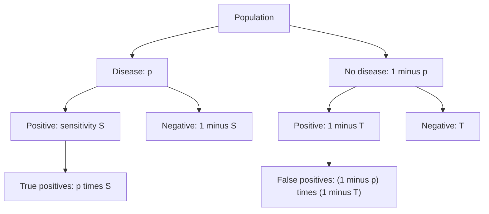
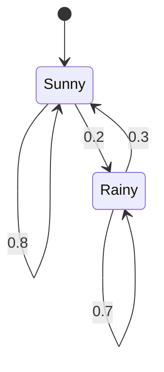

# Conditional Probability and Independence

> [Probability](../README.md) · Level: Intermediate · Prerequisites: [Probability Foundations](../01-probability-foundations/README.md), [Set Theory](../../00-foundations/03-set-theory/README.md), [Calculus](../../07-calculus/README.md) · Estimated time: 480 min

## 1. Introduction

Almost every interesting probability question is a question about information. A diagnostic test is
"accurate" yet a positive result usually means the patient is healthy; a game-show host opens a door and
the contestant's best move changes; a family is said to have "at least one boy" and the probability of
two boys is not $1/2$ but $1/3$. These are not paradoxes. They are the ordinary behaviour of
probabilities when information arrives, and they become routine once one rule is understood:

$$\Pr(A\mid B)=\frac{\Pr(A\cap B)}{\Pr(B)}.$$

This tutorial develops that rule and its consequences. Four ideas organise the material.

**Conditioning is re-weighting, not re-counting.** Given that $B$ occurred, the sample space shrinks to
$B$ and all weights are rescaled so that they again total $1$. Everything about conditional probability
follows from this single picture.

**Direction matters.** $\Pr(A\mid B)$ and $\Pr(B\mid A)$ answer different questions and are related by
Bayes' theorem, which converts one into the other using the prior probability of $B$. Confusing the two
is the base-rate fallacy, and it is the most consequential error in applied probability: it affects
medical screening, criminal trials, spam filters and risk communication.

**Independence is an assumption about the model, not a fact about the world.** Two events are
independent when information about one leaves the probability of the other unchanged. Independence must
be verified, and it can fail in subtle ways: events can be pairwise independent without being mutually
independent, and independence can hold unconditionally but fail conditionally.

**The protocol is part of the information.** "At least one child is a boy" and "the child I met is a
boy" produce different answers from the same family; "the host always opens a goat door" and "the host
opened a door at random which happened to show a goat" produce different answers in the same studio. A
conditional probability depends on *how* the information was obtained, not only on its content.

The topics that follow — random variables, distributions, expectation, limit theorems and stochastic
processes — all use the rules developed here.

## 2. Prerequisites

* **Probability spaces** — sample spaces, events, Kolmogorov's axioms, the complement rule,
  monotonicity, inclusion–exclusion, continuity from below, counting and geometric probability: all of
  [Probability Foundations](../01-probability-foundations/README.md). In particular, this tutorial uses
  the notation $\Pr(A)$, $A^{\complement}$, $\Omega$, $\lvert A\rvert$, $\binom nk$ and the
  multiplication principle.
* **Sets and partitions** — disjoint unions, De Morgan's laws, and the notion of a partition of a set:
  [Set Theory](../../00-foundations/03-set-theory/README.md).
* **Limits and series** — for countable partitions in the total probability theorem, for the Markov
  chain preview, and for "eventually" arguments: [Calculus](../../07-calculus/README.md).
* **Matrix multiplication** — a row vector times a square matrix, and powers of a matrix. Only used in
  §7.13 and Example 9.8.

## 3. Learning Objectives

After working through this tutorial you will be able to:

1. Define $\Pr(A\mid B)$ and explain why it requires $\Pr(B)>0$, both algebraically and as a
   re-weighting of the sample space.
2. Apply the multiplication rule and its extension to $n$ events, and read a tree diagram correctly.
3. State and prove the total probability theorem for finite and countable partitions.
4. State and prove Bayes' theorem, and use the odds form to update beliefs without computing the
   denominator.
5. Compute posterior probabilities in diagnostic-test problems, and explain the base-rate fallacy in
   natural frequencies.
6. Decide whether two events are independent from a model, and prove the standard consequences
   (independence of complements, the union formula for independent events).
7. Define mutual independence of $n$ events, count the required conditions, and distinguish it from
   pairwise independence using the standard counterexample.
8. Define conditional independence and give examples in which it holds without unconditional
   independence, and conversely.
9. Analyse the Monty Hall problem under different host protocols, and explain why the answers differ.
10. Analyse the two-children puzzle, including why "at least one boy" and "a randomly met boy" give
    different answers.
11. Explain the gambler's fallacy in terms of independence, and why the law of large numbers does not
    contradict it.
12. Write down a transition matrix, compute a two-step distribution, and find a stationary distribution
    of a two-state chain.

## 4. Intuition

Conditional probability is what happens when you learn something. Imagine the raffle drum of the
previous topic, with its weighted tickets. Someone tells you that the winning ticket is one of those in
the set $B$. You now know that every ticket outside $B$ has lost. The remaining tickets still carry
their original relative weights, but the total weight in the drum is no longer $1$; it is $\Pr(B)$.
Renormalising — dividing every remaining weight by $\Pr(B)$ — gives a new probability measure, and that
is $\Pr(\cdot\mid B)$. Hence the definition
$\Pr(A\mid B)=\Pr(A\cap B)/\Pr(B)$: the weight of $A$ inside the surviving region, divided by the total
surviving weight.

Three consequences of this picture are worth internalising.

* **Conditioning can raise or lower probabilities.** $\Pr(A\mid B)$ may be larger or smaller than
  $\Pr(A)$. If $B$ is entirely inside $A$, conditioning raises the probability to $1$. If $A$ and $B$
  are disjoint, it lowers it to $0$.
* **Conditioning on a rare event magnifies small errors.** If $\Pr(B)$ is tiny, then $\Pr(A\mid B)$ is
  computed from a small probability divided by another small probability, so the answer is sensitive to
  the precise value of $\Pr(B)$. This is the arithmetic reason behind the base-rate fallacy: a positive
  result on a test for a rare disease is dominated by false positives.
* **Independence means conditioning changes nothing.** $\Pr(A\mid B)=\Pr(A)$ says the information in
  $B$ is irrelevant to $A$. When this holds for every choice of the conditioning event, the model is
  called independent, and probabilities multiply.

A tree diagram is the bookkeeping device for sequential information. Each branch is a conditional
probability given the path so far; multiplying along a path gives the probability of the whole path;
summing over a group of paths gives the probability of the event those paths share. The two theorems at
the centre of this topic — total probability and Bayes — are exactly the rules "sum over the branches
leading to $A$" and "compare the branches leading to $A$".

## 5. Formal Definition

**Definition 5.1 (Conditional probability).** Let $(\Omega,\mathcal{F},\Pr)$ be a probability space and
let $B\in\mathcal{F}$ with $\Pr(B)>0$. For $A\in\mathcal{F}$ the *conditional probability of $A$ given
$B$* is

$$\Pr(A\mid B)=\frac{\Pr(A\cap B)}{\Pr(B)}.$$

If $\Pr(B)=0$ the expression is undefined: the event about which we are conditioning has no tickets
left to renormalise. No theorem below conditions on a null event, and every use of a conditional
probability either assumes $\Pr(B)>0$ or verifies it.

**Definition 5.2 (Independence of two events).** Events $A$ and $B$ are *independent*, written
$A \perp\!\!\!\perp B$, if

$$\Pr(A\cap B)=\Pr(A)\Pr(B).$$

The definition is symmetric in $A$ and $B$, and it makes sense even when one of the events has
probability $0$.

**Definition 5.3 (Mutual independence of $n$ events).** Events $A_1,\dots,A_n$ are *mutually independent*
if, for every subset $S\subseteq\{1,\dots,n\}$ with $\lvert S\rvert\ge2$,

$$\Pr\Bigl(\bigcap_{i\in S}A_i\Bigr)=\prod_{i\in S}\Pr(A_i).$$

There are $2^n-n-1$ such conditions: one for each subset of size at least $2$. For $n=3$ that is four
conditions — three pairwise ones and one triple one — and all four are needed (§7.8).

**Definition 5.4 (Conditional independence).** Let $C\in\mathcal{F}$ with $\Pr(C)>0$. Events $A$ and $B$
are *conditionally independent given $C$* if

$$\Pr(A\cap B\mid C)=\Pr(A\mid C)\,\Pr(B\mid C).$$

Given $\Pr(C)>0$, this is equivalent to $\Pr(A\mid B\cap C)=\Pr(A\mid C)$ whenever $\Pr(B\cap C)>0$
(Exercise 24).

**Definition 5.5 (Partition).** A family $\{B_1,B_2,\dots\}$, finite or countably infinite, is a
*partition* of $\Omega$ if the $B_i$ are pairwise disjoint and $\bigcup_iB_i=\Omega$. If $\Pr(B_i)>0$
for every $i$, the partition is called *proper* for conditioning.

**Definition 5.6 (Stochastic matrix and Markov chain).** A square matrix $P=(p_{ij})$ with non-negative
entries and row sums equal to $1$ is a *stochastic* (or *transition*) matrix. A sequence of random
states $X_0,X_1,X_2,\dots$ taking values in $\{1,\dots,k\}$ is a *Markov chain* with transition matrix
$P$ if

$$\Pr(X_{n+1}=j\mid X_n=i,\,X_{n-1}=i_{n-1},\dots,X_0=i_0)=\Pr(X_{n+1}=j\mid X_n=i)=p_{ij}$$

whenever the conditioning event has positive probability. The middle equality is the *Markov property*:
given the present, the past is irrelevant. A row vector $\pi$ with non-negative entries summing to $1$
is a *distribution*; it is *stationary* if $\pi P=\pi$.

## 6. Mathematical Notation

| Symbol | Read as | Meaning |
|---|---|---|
| $\Pr(A\mid B)$ | probability of $A$ given $B$ | $\Pr(A\cap B)/\Pr(B)$, for $\Pr(B)>0$ |
| $A \perp\!\!\!\perp B$ | $A$ independent of $B$ | $\Pr(A\cap B)=\Pr(A)\Pr(B)$ |
| $\perp\!\!\!\perp$ | independent | conditional versions carry a subscript: $\perp\!\!\!\perp_C$ |
| $\{B_1,\dots,B_n\}$ | partition | disjoint events with union $\Omega$ |
| $P=(p_{ij})$ | transition matrix | $p_{ij}=\Pr(X_{n+1}=j\mid X_n=i)$ |
| $\pi=(\pi_1,\dots,\pi_k)$ | distribution row vector | $\pi_i\ge0$, $\sum_i\pi_i=1$ |
| $\pi P$ | matrix product | the distribution after one step |
| $P^{n}$ | $n$-th power of $P$ | $n$-step transition probabilities |
| $\operatorname{LR}$ | likelihood ratio | $\Pr(A\mid H_1)/\Pr(A\mid H_2)$ |
| $D^{+}$, $D^{-}$ | test positive / negative | diagnostic notation |
| $S$, $T$ | sensitivity, specificity | $\Pr(+ \mid \text{disease})$, $\Pr(-\mid\text{no disease})$ |
| $\text{odds}(A)$ | odds of $A$ | $\Pr(A)/\Pr(A^{\complement})$ |

One typographic note: $\Pr(A\mid B)$ is a single quantity, not the probability of a set "$A\mid B$".
Conditioning is an operation on the measure, not on the set.

## 7. Core Concepts

### 7.1 Conditional probability as a re-weighting

**Theorem 7.1 (Conditional probability is a probability).** *Fix $C$ with $\Pr(C)>0$. The function
$A\mapsto\Pr(A\mid C)$ is a probability measure on $(\Omega,\mathcal{F})$.*

*Proof.* For K1, $\Pr(A\cap C)\ge0$ and $\Pr(C)>0$, so $\Pr(A\mid C)\ge0$. For K2,
$\Pr(\Omega\mid C)=\Pr(\Omega\cap C)/\Pr(C)=\Pr(C)/\Pr(C)=1$. For K3, let $A_1,A_2,\dots$ be pairwise
disjoint. Then the events $A_i\cap C$ are pairwise disjoint with union $(\bigcup_iA_i)\cap C$, so
countable additivity of $\Pr$ gives

$$\Pr\Bigl(\bigcup_iA_i\,\Big|\,C\Bigr)=\frac{\sum_i\Pr(A_i\cap C)}{\Pr(C)}=\sum_i\Pr(A_i\mid C). \qquad\blacksquare$$

Consequently every theorem of the previous topic — complement rule, monotonicity, inclusion–exclusion,
continuity — holds for $\Pr(\cdot\mid C)$. In particular
$\Pr(A^{\complement}\mid C)=1-\Pr(A\mid C)$, a fact used constantly.

**Example 7.2.** Two fair dice are rolled and you are told that the sum is at least $9$. What is the
probability that the first die shows $4$? The conditioning event
$C=\{\text{sum}\ge9\}$ has $4+3+2+1=10$ outcomes. Among them, the first die shows $4$ only for $(4,5)$
and $(4,6)$. Hence

$$\Pr(\text{first die }4\mid\text{sum}\ge9)=\frac{2/36}{10/36}=\frac15.$$

Note that $\Pr(\text{first die }4)=1/6$, so the information raised the probability. The numerator and
denominator are both computed in the original uniform space; conditioning never requires a new sample
space, only a restricted one.

### 7.2 The multiplication rule

**Theorem 7.3 (Multiplication rule).** *If $\Pr(B)>0$, then $\Pr(A\cap B)=\Pr(B)\Pr(A\mid B)$. If
$\Pr(A)>0$, then also $\Pr(A\cap B)=\Pr(A)\Pr(B\mid A)$.*

*Proof.* Both statements are Definition 5.1 rearranged. $\blacksquare$

**Theorem 7.4 (Chain rule).** *If $\Pr(A_1\cap\cdots\cap A_{n-1})>0$, then*

$$\Pr(A_1\cap A_2\cap\cdots\cap A_n)=\Pr(A_1)\,\Pr(A_2\mid A_1)\,\Pr(A_3\mid A_1\cap A_2)\cdots\Pr(A_n\mid A_1\cap\cdots\cap A_{n-1}).$$

*Proof by induction on $n$.* For $n=2$ this is Theorem 7.3. Assume the formula for $n-1$ and put
$B=A_1\cap\cdots\cap A_{n-1}$, so that $\Pr(B)>0$ by hypothesis. Then

$$\Pr(A_1\cap\cdots\cap A_n)=\Pr(B\cap A_n)=\Pr(B)\Pr(A_n\mid B),$$

and substituting the induction hypothesis for $\Pr(B)$ gives the claim. $\blacksquare$

The hypothesis matters: every conditioning event must have positive probability, and if one of them is
null the formula is not defined. In applications the hypothesis is automatic, because each conditional
probability is computed in a model where the preceding event has positive probability.

**Example 7.5.** Three cards are drawn without replacement from a standard deck. The probability that
all three are hearts is

$$\frac{13}{52}\cdot\frac{12}{51}\cdot\frac{11}{50}=\frac{1716}{132\,600}=\frac{11}{850}\approx0.01294.$$

The factors are conditional probabilities: after two hearts have been removed, $11$ of the remaining $50$
cards are hearts. By contrast, drawing *with* replacement would give $(13/52)^3=1/64\approx0.0156$, which
is larger — removing hearts makes further hearts less likely.

### 7.3 Tree diagrams

A tree diagram records a sequential experiment. At each node a branch is drawn for each possible
outcome, labelled with the conditional probability of that outcome *given the path to the node*. Three
rules make the diagram a computation:

1. **Multiply along a path** to get the probability of the intersection of the events on that path
   (Theorem 7.4).
2. **Sum across the ends of a group of paths** to get the probability of the event they share
   (finite additivity).
3. **Condition by restricting** to the subtree below the conditioning event and renormalising by its
   total probability.

The diagram is not a proof, but it is an excellent check: every probability in the model must appear as a
label somewhere, every node's outgoing labels must sum to $1$, and the total of all complete paths must
be $1$.

### 7.4 The total probability theorem

**Theorem 7.6 (Total probability).** *Let $\{B_1,B_2,\dots\}$ be a partition of $\Omega$ with
$\Pr(B_i)>0$ for every $i$, and let $A$ be any event. Then*

$$\Pr(A)=\sum_i\Pr(A\mid B_i)\,\Pr(B_i).$$

*Proof.* The events $A\cap B_i$ are pairwise disjoint, because the $B_i$ are, and their union is
$A\cap\bigcup_iB_i=A$. Countable additivity and the multiplication rule give

$$\Pr(A)=\sum_i\Pr(A\cap B_i)=\sum_i\Pr(A\mid B_i)\Pr(B_i). \qquad\blacksquare$$

For a finite partition the sum is finite and no convergence question arises. The theorem is often
paraphrased as "average the conditional probabilities, weighted by how likely each case is".

**Example 7.7.** Factory A produces $60\%$ of the items and factory B the remaining $40\%$. The defect
rates are $2\%$ and $5\%$. With $B_A$ = "from A", $B_B$ = "from B" and $D$ = "defective",

$$\Pr(D)=0.6\cdot0.02+0.4\cdot0.05=0.012+0.020=0.032.$$

So $3.2\%$ of all items are defective, a weighted average of $2\%$ and $5\%$ that is closer to $2\%$
because factory A supplies more items.

### 7.5 Bayes' theorem

**Theorem 7.8 (Bayes).** *Let $\{B_1,B_2,\dots\}$ be a partition with $\Pr(B_i)>0$ for all $i$, and let
$A$ have $\Pr(A)>0$. Then for every $j$,*

$$\Pr(B_j\mid A)=\frac{\Pr(A\mid B_j)\,\Pr(B_j)}{\sum_i\Pr(A\mid B_i)\,\Pr(B_i)}.$$

*Proof.* By Definition 5.1, $\Pr(B_j\mid A)=\Pr(A\cap B_j)/\Pr(A)$. The numerator is
$\Pr(A\mid B_j)\Pr(B_j)$ by the multiplication rule, and the denominator is $\Pr(A)$ by Theorem 7.6.
$\blacksquare$

The terms have standard names: $\Pr(B_j)$ is the *prior*, $\Pr(A\mid B_j)$ the *likelihood*,
$\Pr(B_j\mid A)$ the *posterior*, and $\Pr(A)$ the *evidence* or *marginal likelihood*. The theorem is
not a philosophical position; it is a theorem about conditional probabilities, valid in any
interpretation.

**Proposition 7.9 (Odds form).** *Under the hypotheses of Theorem 7.8, for any two indices $i,j$,*

$$\frac{\Pr(B_i\mid A)}{\Pr(B_j\mid A)}=\frac{\Pr(A\mid B_i)}{\Pr(A\mid B_j)}\cdot\frac{\Pr(B_i)}{\Pr(B_j)}.$$

*Proof.* Apply Theorem 7.8 to numerator and denominator; the common evidence $\Pr(A)$ cancels, leaving
the product of the likelihood ratio and the prior odds. $\blacksquare$

The odds form is the practical way to update beliefs: multiply the prior odds by the likelihood ratio.
No denominator needs to be computed, so a sequence of updates can be chained by multiplying likelihood
ratios.

### 7.6 Diagnostic tests and the base-rate fallacy

Let $D$ be "the patient has the disease" and $+$ the event "the test is positive". Two numbers describe
a test:

* the *sensitivity* $S=\Pr(+\mid D)$, the fraction of diseased patients who test positive;
* the *specificity* $T=\Pr(-\mid D^{\complement})$, the fraction of healthy patients who test negative.

The number a patient cares about is the *positive predictive value* $\Pr(D\mid+)$, and Bayes' theorem
gives

$$\Pr(D\mid+)=\frac{pS}{pS+(1-p)(1-T)},$$

where $p=\Pr(D)$ is the prevalence. Everything about the base-rate fallacy is visible in this formula.
If $p$ is tiny, the term $(1-p)(1-T)$, which counts false positives among the many healthy people,
dominates the numerator's true positives.

Take $p=0.001$, $S=T=0.99$. Then

$$\Pr(D\mid+)=\frac{0.001\cdot0.99}{0.001\cdot0.99+0.999\cdot0.01}=\frac{0.00099}{0.01098}\approx0.0902,$$

so a "99% accurate" test leaves a positive patient with only about a $9\%$ chance of disease. The
arithmetic is exact but psychologically opaque; *natural frequencies* make it transparent. Out of
$100\,000$ people:

| | diseased | healthy | total |
|---|---|---|---|
| test positive | $99$ | $999$ | $1098$ |
| test negative | $1$ | $98\,901$ | $98\,902$ |
| total | $100$ | $99\,900$ | $100\,000$ |

Of the $1098$ positive results, $99$ are true and $999$ are false, so the predictive value is
$99/1098\approx9\%$. The false positives outnumber the true positives ten to one, because there are
$999$ times as many healthy people and the false-positive rate, though small, applies to them all.

Two morals. First, $\Pr(D\mid+)$ is not $\Pr(+\mid D)$: sensitivity $99\%$ and predictive value $9\%$
are different quantities, and reporting the first while implying the second is the base-rate fallacy.
Second, the predictive value rises steeply with prevalence: at $p=0.1$ the same test gives
$0.099/(0.099+0.009)=0.9167$. Screening programmes therefore target high-prevalence groups.

### 7.7 Independence of two events

**Proposition 7.10.** *If $\Pr(B)>0$, then $A\perp\!\!\!\perp B$ if and only if
$\Pr(A\mid B)=\Pr(A)$.*

*Proof.* $\Pr(A\mid B)=\Pr(A)$ is equivalent to $\Pr(A\cap B)/\Pr(B)=\Pr(A)$, i.e. to
$\Pr(A\cap B)=\Pr(A)\Pr(B)$. $\blacksquare$

**Proposition 7.11 (Complements preserve independence).** *If $A\perp\!\!\!\perp B$, then
$A\perp\!\!\!\perp B^{\complement}$.*

*Proof.* Using $A=(A\cap B)\sqcup(A\cap B^{\complement})$ and additivity,

$$\Pr(A\cap B^{\complement})=\Pr(A)-\Pr(A\cap B)=\Pr(A)-\Pr(A)\Pr(B)=\Pr(A)\bigl(1-\Pr(B)\bigr)=\Pr(A)\Pr(B^{\complement}). \qquad\blacksquare$$

Applying the proposition twice gives $A^{\complement}\perp\!\!\!\perp B^{\complement}$ and
$A^{\complement}\perp\!\!\!\perp B$. So if a coin's first toss is independent of its second, "not heads
on the first" is also independent of the second, as intuition demands.

**Proposition 7.12 (Union of independent events).** *If $A\perp\!\!\!\perp B$, then*

$$\Pr(A\cup B)=1-\bigl(1-\Pr(A)\bigr)\bigl(1-\Pr(B)\bigr).$$

*Proof.* By De Morgan, $\Pr(A\cup B)=1-\Pr(A^{\complement}\cap B^{\complement})$, and
$A^{\complement}\perp\!\!\!\perp B^{\complement}$ by Proposition 7.11, so the last term is
$\Pr(A^{\complement})\Pr(B^{\complement})=(1-\Pr(A))(1-\Pr(B))$. $\blacksquare$

This is the formula behind "at least one succeeds": for $n$ mutually independent events with
probabilities $p_i$, the chance that at least one occurs is $1-\prod_i(1-p_i)$.

**Independence is not disjointness.** Disjoint events with positive probability are *dependent*:
if $A\cap B=\varnothing$ then $\Pr(A\cap B)=0\ne\Pr(A)\Pr(B)>0$. Disjointness says the events cannot
co-occur; independence says information about one does not change the odds of the other. Equally,
an event of probability $0$ or $1$ is independent of every event (Exercise 15), which is a useful
technical fact and a reminder that independence is an algebraic condition, not a causal one.

### 7.8 Independence of several events

Definition 5.3 requires the product rule for *every* subfamily of size at least two. For $n=3$ the four
conditions are

$$\Pr(A\cap B)=\Pr(A)\Pr(B),\quad \Pr(A\cap C)=\Pr(A)\Pr(C),\quad \Pr(B\cap C)=\Pr(B)\Pr(C),\quad \Pr(A\cap B\cap C)=\Pr(A)\Pr(B)\Pr(C).$$

**Pairwise independence does not imply mutual independence.** Toss two fair coins and set

$$A=\{\text{first coin heads}\},\quad B=\{\text{second coin heads}\},\quad C=\{\text{the coins differ}\}.$$

Each event has probability $\tfrac12$. Also $A\cap C=\{\text{first heads, second tails}\}$ has
probability $\tfrac14$, and similarly $B\cap C$ has probability $\tfrac14$; and
$A\cap B=\{\text{both heads}\}$ has probability $\tfrac14$. So all three pairs are independent. But
$A\cap B\cap C=\varnothing$, because differing coins cannot both be heads, so
$\Pr(A\cap B\cap C)=0\ne\tfrac18$. The three events are pairwise independent but not mutually
independent.

**The single triple product is not enough either.** Let $\Omega=\{1,\dots,8\}$ be uniform and put
$A=\{1,2,3,4\}$, $B=\{1,2,3,5\}$, $C=\{1,5,6,7\}$. Then
$A\cap B\cap C=\{1\}$, so $\Pr(A\cap B\cap C)=\tfrac18=\Pr(A)\Pr(B)\Pr(C)$. But
$A\cap B=\{1,2,3\}$ has probability $\tfrac38\ne\tfrac14$, so $A$ and $B$ are not independent. Mutual
independence requires all four conditions, not merely the product over the full family.

**Proposition 7.13.** *If $A_1,\dots,A_n$ are mutually independent, then so is every subfamily; and for
any choice of $A_i$ or $A_i^{\complement}$ in each coordinate, the resulting $n$ events are mutually
independent.*

*Proof.* The first claim is immediate from Definition 5.3, since the conditions for a subfamily are
among the conditions for the whole family. For the second, it suffices to treat one replacement, the
general case following by iteration. Let $A_1,\dots,A_n$ be mutually independent, replace $A_1$ by
$A_1^{\complement}$, and let $S\subseteq\{2,\dots,n\}$. Since
$A_1^{\complement}\cap\bigcap_{i\in S}A_i=\bigl(\bigcap_{i\in S}A_i\bigr)\setminus\bigl(A_1\cap\bigcap_{i\in S}A_i\bigr)$,
the difference rule and mutual independence give

$$\Pr\Bigl(A_1^{\complement}\cap\bigcap_{i\in S}A_i\Bigr)=\prod_{i\in S}\Pr(A_i)-\Pr(A_1)\prod_{i\in S}\Pr(A_i)=\bigl(1-\Pr(A_1)\bigr)\prod_{i\in S}\Pr(A_i),$$

which is $\Pr(A_1^{\complement})\prod_{i\in S}\Pr(A_i)$; for $S=\varnothing$ this reads
$\Pr(A_1^{\complement})=1-\Pr(A_1)$. Iterating the argument handles any pattern of complements.
$\blacksquare$

### 7.9 Conditional independence

Conditional independence is independence *inside* a subpopulation. It is the assumption that makes
naive Bayes classifiers work, and it behaves differently from ordinary independence in both directions.

**Independent but not conditionally independent.** With the two coins above, $A$ and $B$ are independent
($\Pr(A\cap B)=\tfrac14=\tfrac12\cdot\tfrac12$). But given $C$ (the coins differ), knowing $A$ determines
$B$: $\Pr(A\cap B\mid C)=0$ while
$\Pr(A\mid C)\Pr(B\mid C)=\tfrac12\cdot\tfrac12=\tfrac14$.

**Conditionally independent but not independent.** Suppose a disease has prevalence $0.1$. Two
screening tests are run, each with sensitivity $0.9$ and specificity $0.9$, and their results are
independent *given* the disease status. Then

$$\Pr(\text{both positive})=0.1\cdot0.9^2+0.9\cdot0.1^2=0.081+0.009=0.090,$$

while $\Pr(\text{test 1 positive})=0.1\cdot0.9+0.9\cdot0.1=0.18$, so independence would require
$\Pr(\text{both positive})=0.18^2=0.0324$. The tests are unconditionally dependent because both are
driven by the same hidden disease status.

**Why the distinction matters.** Assuming independence when only conditional independence holds
understates the chance of coincident results; assuming conditional independence when it fails
overstates the value of repeated evidence. In the diagnostic setting, two *conditionally independent*
tests are genuinely more informative than one (Example 9.5), whereas two tests that share the same
systematic error are not.

### 7.10 The Monty Hall problem

**The rules.** A prize is behind one of three doors. The contestant picks a door. The host, who knows
where the prize is, opens a different door showing no prize, and offers the contestant the chance to
switch to the remaining closed door. Should the contestant switch?

**Enumeration.** Without loss of generality the contestant picks door $1$. The three placements are
equally likely.

| prize behind | host opens | switch wins? |
|---|---|---|
| door 1 | door 2 or 3 | no |
| door 2 | door 3 | yes |
| door 3 | door 2 | yes |

Switching wins in two of the three equally likely cases, so the probability is $\tfrac23$.

**Bayes.** Let $C_i$ be "prize behind door $i$" and $H_3$ = "host opens door 3". Under the standard
protocol, if the prize is behind door $1$ the host chooses uniformly between doors $2$ and $3$;
if it is behind door $2$ he is forced to open door $3$; if it is behind door $3$ he cannot open door $3$.
Hence

$$\Pr(H_3\mid C_1)=\tfrac12,\qquad \Pr(H_3\mid C_2)=1,\qquad \Pr(H_3\mid C_3)=0,$$

and

$$\Pr(C_1\mid H_3)=\frac{\tfrac13\cdot\tfrac12}{\tfrac13\cdot\tfrac12+\tfrac13\cdot1+\tfrac13\cdot0}=\frac{1/6}{1/2}=\frac13,\qquad \Pr(C_2\mid H_3)=\frac{1/3}{1/2}=\frac23.$$

The contestant's original door keeps probability $\tfrac13$; the whole remaining $\tfrac23$ moves to the
door the host did not open.

**The protocol is essential.** If the host opens one of the two unchosen doors uniformly at random and
it happens to show a goat ("Monty Fall"), the answer is $\tfrac12$ (Exercise 33). If the host opens a
goat door only when the contestant has already chosen the prize, switching wins with probability $0$.
If there are $100$ doors and the host opens $98$ goat doors, switching wins with probability
$\tfrac{99}{100}$. In every case the calculation is the same Bayes computation; only the likelihoods
$\Pr(\text{host's action}\mid C_i)$ change.

### 7.11 The two-children puzzle

**The model.** A family has two children. Assume the sexes are independent with
$\Pr(\text{boy})=\Pr(\text{girl})=\tfrac12$, so the four ordered outcomes $BB,BG,GB,GG$ (elder first)
are equally likely.

**"At least one is a boy."** Conditioning on $\{BB,BG,GB\}$ leaves three equally likely outcomes, of
which one is $BB$:

$$\Pr(BB\mid\text{at least one boy})=\frac{1/4}{3/4}=\frac13.$$

**"The elder is a boy."** Conditioning on $\{BB,BG\}$ leaves two equally likely outcomes:

$$\Pr(BB\mid\text{elder is a boy})=\frac{1/4}{1/2}=\frac12.$$

**"A randomly chosen child is a boy."** Suppose you meet the family and the child in front of you is a
boy, chosen uniformly from the two children. Then

$$\Pr(BB\mid\text{met a boy})=\frac{\Pr(BB)\cdot1}{\Pr(\text{met a boy})}=\frac{1/4}{1/2}=\frac12,$$

because a two-boy family always presents a boy, whereas a one-boy family presents a boy only half the
time. Here the information was obtained by a sampling mechanism that is twice as likely in $BB$ as in
$BG$ or $GB$.

**Why the puzzle is famous.** "At least one is a boy" is ambiguous in ordinary language. If it means
"the family satisfies the predicate *has at least one boy*", the answer is $\tfrac13$; if it means "I
encountered a boy from this family", the answer is $\tfrac12$. Both computations are correct for their
own protocol: a conditional probability is determined by how the information was produced.

### 7.12 The gambler's fallacy

A fair coin has landed tails ten times in a row. What is the probability of heads on the next toss?
Under the model of independent tosses, it is $\tfrac12$: the conditional probability
$\Pr(\text{heads}\mid\text{ten tails})$ equals the unconditional probability, which is exactly what
independence asserts.

The fallacy takes several forms. The **gambler's fallacy** proper claims that a head is "due"; the
**inverse gambler's fallacy** claims that an unlikely run must have had an unlikely cause. Both confuse
the probability of a *sequence* with that of its *next term*: eleven tails has probability $2^{-11}$, but
that was fixed before the first toss, and the remaining factor is still $\tfrac12$.

Independence does not conflict with the law of large numbers; the reconciliation is *dilution*, not
compensation. Suppose the first $10$ tosses were tails and the next $1000$ are fair. The expected total
number of heads is $500$, so the expected proportion over all $1010$ tosses is
$500/1010\approx0.495$, which is close to $\tfrac12$ even though the deficit of $10$ heads has not been
repaid. The absolute deficit stays at $10$; the proportion shrinks because the denominator grows.

### 7.13 Markov chains: a preview

Conditioning on the present is the defining idea of a Markov chain. Let the state be one of
$1,\dots,k$ — the weather, a queue length, a web page — and let $p_{ij}$ be the probability of moving
from state $i$ to state $j$ in one step. The matrix $P=(p_{ij})$ has non-negative entries and each row
sums to $1$, because from state $i$ the chain must go somewhere. A row vector $\pi$ of probabilities is
the distribution of the state.

The Markov property says that, given the present state, the past adds no information. One-step
evolution is matrix multiplication: if $\pi$ is today's distribution, then
$\pi'=\pi P$ has $\pi'_j=\sum_i\pi_ip_{ij}$, the total probability of arriving at $j$. By the Markov
property, the $n$-step transition matrix is the $n$-th power $P^{n}$ (this is the
Chapman–Kolmogorov identity), so the distribution after $n$ steps is $\pi P^{n}$.

**Example.** Let state $1$ be sunny and $2$ rainy, with

$$P=\begin{pmatrix}0.8 & 0.2\\ 0.3 & 0.7\end{pmatrix}.$$

From sunny, tomorrow is sunny with probability $0.8$; from rainy, tomorrow is sunny with probability
$0.3$. If today is sunny, $\pi_0=(1,0)$ and

$$\pi_1=(1,0)P=(0.8,\,0.2),\qquad \pi_2=\pi_1P=(0.8\cdot0.8+0.2\cdot0.3,\ 0.8\cdot0.2+0.2\cdot0.7)=(0.70,\,0.30).$$

A *stationary* distribution satisfies $\pi P=\pi$ and $\sum_i\pi_i=1$. Writing $\pi=(\pi_1,\pi_2)$ and
$\pi_2=1-\pi_1$:

$$\pi_1=0.8\pi_1+0.3(1-\pi_1)\ \Longrightarrow\ 0.5\pi_1=0.3\ \Longrightarrow\ \pi_1=0.6,$$

so $\pi=(0.6,0.4)$. Starting from either state the distribution approaches $(0.6,0.4)$; this convergence
holds under conditions that are studied in the later topic on stochastic processes, not assumed here.

## 8. Formulas and Properties

### 8.1 The results in one table

| Name | Statement | Hypotheses | Why it is true |
|---|---|---|---|
| Conditional measure | $A\mapsto\Pr(A\mid C)$ is a probability | $\Pr(C)>0$ | renormalising preserves K1–K3 |
| Multiplication rule | $\Pr(A\cap B)=\Pr(B)\Pr(A\mid B)$ | $\Pr(B)>0$ | definition rearranged |
| Chain rule | $\Pr(A_1\cap\cdots\cap A_n)=\prod_{k=1}^n\Pr(A_k\mid A_1\cap\cdots\cap A_{k-1})$ | intermediate events have positive probability | induction on $n$ |
| Total probability | $\Pr(A)=\sum_i\Pr(A\mid B_i)\Pr(B_i)$ | $\{B_i\}$ a proper partition | split $A$ into disjoint pieces |
| Bayes | $\Pr(B_j\mid A)=\dfrac{\Pr(A\mid B_j)\Pr(B_j)}{\sum_i\Pr(A\mid B_i)\Pr(B_i)}$ | proper partition, $\Pr(A)>0$ | multiplication rule twice |
| Odds form | posterior odds $=$ likelihood ratio $\times$ prior odds | as for Bayes | the evidence cancels |
| Independence criterion | $A\perp\!\!\!\perp B\iff\Pr(A\mid B)=\Pr(A)$ | $\Pr(B)>0$ | algebra |
| Complements | $A\perp\!\!\!\perp B\Rightarrow A\perp\!\!\!\perp B^{\complement}$ | none | additivity and $1-\Pr(B)$ |
| Union, independent | $\Pr(A\cup B)=1-(1-\Pr(A))(1-\Pr(B))$ | $A\perp\!\!\!\perp B$ | De Morgan plus independence |
| Mutual independence | all $2^n-n-1$ product identities | none | Definition 5.3 |
| Conditional independence | $\Pr(A\cap B\mid C)=\Pr(A\mid C)\Pr(B\mid C)$ | $\Pr(C)>0$ | Definition 5.4 |
| Predictive value | $\Pr(D\mid+)=\dfrac{pS}{pS+(1-p)(1-T)}$ | $0<p<1$, $S,T$ sensitivities | Bayes with the partition $\{D,D^{\complement}\}$ |
| Markov step | $\pi'=\pi P$, i.e. $\pi'_j=\sum_i\pi_ip_{ij}$ | $P$ stochastic | total probability over the previous state |
| Stationary | $\pi=\pi P$ and $\sum_i\pi_i=1$ | $P$ stochastic | definition |

### 8.2 Diagnostic tests in three forms

With $p=\Pr(D)$, sensitivity $S=\Pr(+\mid D)$ and specificity $T=\Pr(-\mid D^{\complement})$:

$$\Pr(D\mid+)=\frac{pS}{pS+(1-p)(1-T)},\qquad \frac{\Pr(D\mid+)}{\Pr(D^{\complement}\mid+)}=\frac{S}{1-T}\cdot\frac{p}{1-p}.$$

The second is the odds form: the *positive likelihood ratio* $S/(1-T)$ multiplies the prior odds. A
test with $S=T=0.99$ has likelihood ratio $99$, which sounds enormous, but a prior odds of $1:999$
becomes $99:999\approx1:10$, a posterior probability of about $1/11\approx0.09$ — exactly the
computation of §7.6.

For two tests whose results are conditionally independent given the disease status, applying the odds
form twice multiplies the prior odds by both likelihood ratios. This is legitimate only under the
conditional independence assumption; two tests that share a mechanism (say, both measuring the same
biomarker with the same assay) are not conditionally independent, and their combined evidence is weaker
than the product suggests.

### 8.3 Markov algebra

If $P$ is stochastic and $\pi$ is a distribution, then $\pi P$ is again a distribution:

$$\sum_j(\pi P)_j=\sum_j\sum_i\pi_ip_{ij}=\sum_i\pi_i\sum_jp_{ij}=\sum_i\pi_i=1,$$

and each entry is a sum of non-negative terms. Iterating, $\pi P^{n}$ is the distribution after $n$
steps. A stationary distribution is a fixed point of the map $\pi\mapsto\pi P$; for a two-state chain it
is found by solving one linear equation together with $\pi_1+\pi_2=1$, as in §7.13.

## 9. Step-by-Step Examples

### 9.1 A contingency table

**Problem.** A firm has $500$ employees: $300$ hold a degree and $200$ do not. Among the graduates, $180$
are managers; among the non-graduates, $40$ are managers. A randomly chosen employee is a manager. Find
the probability that this employee holds a degree.

**Solution.** Build the table:

| | manager | not manager | total |
|---|---|---|---|
| degree | 180 | 120 | 300 |
| no degree | 40 | 160 | 200 |
| total | 220 | 280 | 500 |

The four cells are found by subtraction, e.g. $300-180=120$. All $500$ employees are equally likely, so
conditional probabilities are ratios of cell counts:

$$\Pr(\text{manager})=\frac{220}{500}=0.44,\qquad \Pr(\text{manager}\mid\text{degree})=\frac{180}{300}=0.6,\qquad \Pr(\text{degree}\mid\text{manager})=\frac{180}{220}=\frac9{11}\approx0.818.$$

**Check.** The two conditional probabilities $\Pr(\text{degree}\mid\text{manager})=0.818$ and
$\Pr(\text{manager}\mid\text{degree})=0.6$ are different numbers for the same two events, as they must
be: the first conditions on a smaller group ($220$ managers) than the second ($300$ graduates). Also
$\Pr(\text{manager}\mid\text{no degree})=40/200=0.2$, so the degree is strongly associated with being a
manager in this firm. $\checkmark$

### 9.2 Sampling without replacement: a symmetry

**Problem.** An urn holds $5$ red and $5$ blue balls. Two are drawn without replacement. Show that the
second ball is red with probability $\tfrac12$, and find $\Pr(\text{first red}\mid\text{second red})$.

**Solution.** Condition on the first draw and use total probability with the partition
$\{R_1,B_1\}$:

$$\Pr(R_2)=\Pr(R_2\mid R_1)\Pr(R_1)+\Pr(R_2\mid B_1)\Pr(B_1)=\frac49\cdot\frac12+\frac59\cdot\frac12=\frac12.$$

Then, by the multiplication rule in the other order,

$$\Pr(R_1\mid R_2)=\frac{\Pr(R_2\mid R_1)\Pr(R_1)}{\Pr(R_2)}=\frac{(4/9)(1/2)}{1/2}=\frac49.$$

**Check by symmetry.** The two balls are exchangeable: the pair $\{R_1,R_2\}$ has the same distribution as
$\{R_2,R_1\}$, so each draw has the same marginal probability of red, namely the proportion in the urn,
$\tfrac12$. The conditional probability $4/9$ is smaller than $\tfrac12$, which is right: knowing the
second ball was red means one red is already used, leaving fewer reds for the first. $\checkmark$

### 9.3 Total probability and a reverse question

**Problem.** Factory A makes $60\%$ of the items with a $2\%$ defect rate; factory B makes $40\%$ with a
$5\%$ defect rate. (a) Find the overall defect rate. (b) Given a defective item, find the probability it
came from B. (c) Given a non-defective item, find the probability it came from A.

**Solution.** Let $D$ be "defective", $A$ = "from A", $B$ = "from B".

(a) By total probability,
$$\Pr(D)=0.6\cdot0.02+0.4\cdot0.05=0.012+0.02=0.032.$$

(b) By Bayes,
$$\Pr(B\mid D)=\frac{\Pr(D\mid B)\Pr(B)}{\Pr(D)}=\frac{0.05\cdot0.4}{0.032}=\frac{0.02}{0.032}=0.625.$$

(c) $\Pr(A\cap D^{\complement})=0.6\cdot0.98=0.588$ and $\Pr(D^{\complement})=1-0.032=0.968$, so
$$\Pr(A\mid D^{\complement})=\frac{0.588}{0.968}\approx0.6074.$$

**Check.** The posteriors over the partition $\{A,B\}$ sum to $1$: $0.375+0.625=1$ in part (b), and
$0.6074+0.3926\approx1$ in part (c). Also $\Pr(B\mid D)=0.625$ exceeds $\Pr(B)=0.4$, as it must when B
has the higher defect rate. $\checkmark$

### 9.4 A screening programme

**Problem.** A disease has prevalence $2\%$. A test has sensitivity $90\%$ and specificity $95\%$. Find
the probability that a person who tests positive actually has the disease, and express the computation
in natural frequencies per $10\,000$ people.

**Solution.** With $p=0.02$, $S=0.9$, $T=0.95$,

$$\Pr(D\mid+)=\frac{0.02\cdot0.9}{0.02\cdot0.9+0.98\cdot0.05}=\frac{0.018}{0.018+0.049}=\frac{18}{67}\approx0.2687.$$

Natural frequencies per $10\,000$: $200$ are diseased, of whom $180$ test positive; $9800$ are healthy,
of whom $5\%=490$ test positive falsely. So $670$ positives contain $180$ true ones, and
$180/670=18/67\approx26.9\%$.

**Check.** The same formula at $p=0.5$ gives $0.45/(0.45+0.025)=0.947$, and at $p=0.001$ about $0.018$:
the predictive value is increasing in prevalence, because a rarer disease means more false positives.
$\checkmark$

### 9.5 A second, conditionally independent test

**Problem.** With prevalence $p=0.001$ and a test of sensitivity and specificity $0.99$, a patient
tests positive (posterior $\approx0.0902$ by §7.6). The test is repeated, and the two results are
independent given the disease status. The second test is also positive. Find the posterior.

**Solution.** Apply the odds form. Prior odds after the first test are $0.0902:0.9098\approx1:10.09$;
the likelihood ratio of a positive test is $S/(1-T)=0.99/0.01=99$. After the second positive,

$$\text{odds}=99\cdot\frac{0.0902}{0.9098}\approx99\cdot0.0991\approx9.81,$$

so the posterior probability is $9.81/(1+9.81)\approx0.9075$.

Equivalently, directly from Bayes with two independent tests,

$$\Pr(D\mid++,+)=\frac{pS^2}{pS^2+(1-p)(1-T)^2}=\frac{0.001\cdot0.9801}{0.001\cdot0.9801+0.999\cdot0.0001}=\frac{0.0009801}{0.00108}=0.9075.$$

**Check.** The two expressions agree, and the posterior rises from $9\%$ to $91\%$ — the second test is
far more informative than the first, because it removes most of the false positives. Note the arithmetic
of the second form: $0.0009801/0.00108=0.9075$ exactly, since $9801/10800=0.9075$. $\checkmark$

### 9.6 At least one six: independence across trials

**Problem.** A fair die is rolled four times. Find the probability of at least one six.

**Solution.** The four rolls are independent, so "no six in four rolls" has probability
$(5/6)^4=625/1296$. Hence

$$\Pr(\text{at least one six})=1-\frac{625}{1296}=\frac{671}{1296}\approx0.5177.$$

**Check.** Directly, the probability of exactly $k$ sixes is $\binom4k(1/6)^k(5/6)^{4-k}$, and summing
for $k=1,2,3,4$ gives
$\frac{4\cdot125+6\cdot25+4\cdot5+1}{1296}=\frac{500+150+20+1}{1296}=\frac{671}{1296}$. $\checkmark$

*The de Méré comparison.* The same reasoning for "at least one double six in $24$ throws of two dice"
gives $1-(35/36)^{24}\approx0.4914$, slightly *less* than $\tfrac12$. The two experiments have the same
expected number of successes ($4\cdot\tfrac16=\tfrac23$ and $24\cdot\tfrac1{36}=\tfrac23$), but the
probability of at least one success is not the expectation; the events of a run overlap, and
$1-(1-p)^n<np$.

### 9.7 Monty Hall with a different host rule

**Problem.** In the Monty Hall setup, suppose the host always opens the *lowest-numbered* unchosen door
that shows a goat. The contestant picks door $1$. Find the probability of winning by switching, both
unconditionally and conditional on which door the host opens.

**Solution.** Write $C_i$ for "prize behind door $i$" and $H_j$ for "host opens door $j$". With the
lowest-numbered rule:

* if $C_1$: both unchosen doors are goats, and the lowest is door $2$, so $H_2$;
* if $C_2$: door $2$ has the prize, so the only goat among the unchosen doors is door $3$, so $H_3$;
* if $C_3$: the unchosen doors $2,3$ contain a goat at $2$ and the prize at $3$, so $H_2$.

Hence $\Pr(H_2)=\Pr(C_1)+\Pr(C_3)=\tfrac23$ and $\Pr(H_3)=\Pr(C_2)=\tfrac13$. Given $H_2$,

$$\Pr(C_1\mid H_2)=\frac{1/3}{2/3}=\frac12,\qquad \Pr(C_3\mid H_2)=\frac{1/3}{2/3}=\frac12,$$

so *conditional on the host opening door 2*, switching and staying are equally good. Given $H_3$, the
prize is certainly behind door 2, so switching wins with probability $1$.

Unconditionally, the switch strategy wins whenever $C_2$ or $C_3$, i.e. with probability $\tfrac23$,
exactly as under the standard rule.

**Check.** The law of total probability reconciles the two calculations:
$\Pr(\text{switch wins})=\tfrac23\cdot\tfrac12+\tfrac13\cdot1=\tfrac13+\tfrac13=\tfrac23$. $\checkmark$

**Moral.** The *ex ante* value of switching is a property of the game; the *posterior* after a
particular door is opened depends on the host's protocol.

### 9.8 A two-state Markov chain

**Problem.** Let $P=\begin{pmatrix}0.7&0.3\\0.4&0.6\end{pmatrix}$ describe transitions between state $1$
and state $2$. Starting in state $1$, find the distribution after two steps, and the stationary
distribution.

**Solution.** First step: $\pi_0=(1,0)$, so $\pi_1=(0.7,0.3)$. Second step:

$$\pi_2=\pi_1P=(0.7\cdot0.7+0.3\cdot0.4,\ 0.7\cdot0.3+0.3\cdot0.6)=(0.49+0.12,\ 0.21+0.18)=(0.61,0.39).$$

Equivalently $P^2=\begin{pmatrix}0.61&0.39\\0.52&0.48\end{pmatrix}$, whose first row is $\pi_2$.

For the stationary distribution, solve $\pi=\pi P$ with $\pi_1+\pi_2=1$:

$$\pi_1=0.7\pi_1+0.4\pi_2\ \Longrightarrow\ 0.3\pi_1=0.4(1-\pi_1)\ \Longrightarrow\ 0.7\pi_1=0.4\ \Longrightarrow\ \pi_1=\frac47,\quad \pi_2=\frac37.$$

**Check.** Substitute: $\pi P=\bigl(\tfrac47\cdot0.7+\tfrac37\cdot0.4,\ \tfrac47\cdot0.3+\tfrac37\cdot0.6\bigr)
=\bigl(0.4+\tfrac{1.2}{7},\ \tfrac{1.2}{7}+\tfrac{1.8}{7}\bigr)=\bigl(\tfrac47,\tfrac37\bigr)$. Also
$\pi_2=(0.61,0.39)$ is closer to $(4/7,3/7)\approx(0.571,0.429)$ than $\pi_1=(0.7,0.3)$ was, consistent
with convergence to the stationary distribution. $\checkmark$

## 10. Visual Explanations

**A tree for a diagnostic test.** The two-stage tree encodes the partition $\{D,D^{\complement}\}$ and
the test result. Multiplying along each path and adding the two positive paths reproduces the Bayes
formula of §7.6.

The positive predictive value is the ratio of the "true positives" branch to the sum of the two positive
branches. The picture explains the base-rate fallacy at a glance: when $p$ is small, the left branch is
thin and the right branch, though each individual step is small, starts from a much thicker trunk.

**A Markov chain as a state diagram.** The two-state weather chain of §7.13 has two arrows from each
state, labelled with the transition probabilities; the labels leaving each state sum to $1$.

## 11. Common Mistakes

1. **Confusing $\Pr(A\mid B)$ with $\Pr(B\mid A)$.** They are different numbers, related by Bayes. The
   sensitivity of a test is $\Pr(+\mid D)$; the number a patient needs is $\Pr(D\mid+)$. Reporting the
   first as if it were the second is the base-rate fallacy.

2. **Dividing by the wrong total.** $\Pr(A\mid B)$ has $\Pr(B)$, not $\Pr(A)$, in the denominator. In a
   contingency table, the denominator is the total of the *conditioning* row or column.

3. **Conditioning on a null event.** $\Pr(A\mid B)$ is undefined when $\Pr(B)=0$. Statements like "the
   probability it is $1/2$ given that the point is exactly $1/2$" are meaningless, not zero.

4. **Assuming independence because events look unrelated.** Independence must be derived from the model
   or verified from the probabilities. Two events can be disjoint (and hence strongly dependent), or
   connected only through a common cause (dependent unconditionally, independent conditionally).

5. **Assuming pairwise independence is enough.** Three events can satisfy all three pairwise product
   identities and still fail the triple one; §7.8 gives the standard counterexample.

6. **Forgetting that independence can fail conditionally.** Independent events can become dependent once
   a common effect is conditioned on (explaining away), and dependent events can become independent
   within a stratum.

7. **Using "at least one" as a simple sum.** $\Pr(A\cup B)=\Pr(A)+\Pr(B)$ needs disjointness. For
   independent events use $1-(1-\Pr(A))(1-\Pr(B))$; in general use inclusion–exclusion.

8. **Reversing the direction of a conditional in a sequential experiment.** In a tree, the labels are
   conditional on the path so far; multiplying them in the wrong order computes a different quantity.
   The multiplication rule is asymmetric even though the product is not.

9. **Ignoring the protocol.** "At least one boy" and "a randomly met boy" differ; "the host always opens
   a goat door" and "the host opened a door at random" differ: the same information can hide different
   sampling mechanisms.

10. **Confusing independence with a lack of causation, or dependence with causation.** Independence is a
    statement about probabilities in a model. Correlation induced by a common cause, or by selection,
    produces dependence without any causal link.

11. **Treating repeated tests as independent when they are not.** Two tests sharing an assay, a
    technician or a systematic bias are conditionally dependent given disease status; multiplying their
    likelihood ratios then overstates the evidence.

## 12. Applications

**Medicine and screening.** Sensitivity and specificity describe a test; predictive values describe its
use. The same test has predictive value $9\%$ at prevalence $0.1\%$ and $91\%$ at prevalence $10\%$.

**Law.** The *prosecutor's fallacy* is the confusion of $\Pr(\text{evidence}\mid\text{innocent})$ with
$\Pr(\text{innocent}\mid\text{evidence})$. A DNA match probability of one in a million does not mean a
one-in-a-million chance of innocence when the suspect pool is large; Bayes' theorem with the correct
prior is the remedy. Defence arguments commit the same error in reverse.

**Spam filtering and machine learning.** A naive Bayes classifier assumes that, given the class (spam or
not), the presence of each word is conditionally independent. The assumption is false but useful, and
the classifier's posterior is a direct application of Theorem 7.8. More elaborate models relax the
assumption while keeping the same conditioning structure.

**Genetics.** Carrier probabilities given a family history are conditional probabilities computed from
the pedigree; the two-children puzzle is the simplest such calculation, and its answer depends on how
the family was ascertained.

**Markov chains.** PageRank is a stationary distribution of a stochastic matrix; weather models,
queueing systems and reinforcement learning share the same structure.

## 13. Exercises

The problem set is in [exercises.md](exercises.md): $36$ problems in four levels — **Beginner** (1–10),
**Intermediate** (11–21), **Advanced** (22–31) and **Challenge** (32–36). Each problem names the section
it draws on. Attempt it with the tutorial closed.

## 14. Solutions

Full worked solutions are in [solutions.md](solutions.md), with the same numbering: strategy, every
significant step, and an independent check. For proof problems the proof is complete. Read a solution
only after a genuine attempt.

## 15. Summary

* $\Pr(A\mid B)=\Pr(A\cap B)/\Pr(B)$ for $\Pr(B)>0$; conditioning reweights the sample space and is
  undefined on null events.
* For fixed $C$, $A\mapsto\Pr(A\mid C)$ is itself a probability measure, so every earlier theorem
  applies conditionally.
* Multiplication rule $\Pr(A\cap B)=\Pr(B)\Pr(A\mid B)$, and the chain rule for $n$ events.
* Total probability: for a proper partition, $\Pr(A)=\sum_i\Pr(A\mid B_i)\Pr(B_i)$.
* Bayes: $\Pr(B_j\mid A)=\Pr(A\mid B_j)\Pr(B_j)/\Pr(A)$; in odds form, posterior odds equal likelihood
  ratio times prior odds.
* The base-rate fallacy is the confusion of sensitivity with predictive value. Predictive value depends
  strongly on prevalence, and natural frequencies make the dependence visible.
* $A$ and $B$ are independent iff $\Pr(A\cap B)=\Pr(A)\Pr(B)$; independence is preserved by taking
  complements, and yields $\Pr(A\cup B)=1-(1-\Pr(A))(1-\Pr(B))$.
* Mutual independence of $n$ events requires $2^n-n-1$ product identities; pairwise independence does
  not suffice, and the triple product alone does not imply pairwise independence.
* Conditional independence is a separate notion: independence and conditional independence do not imply
  one another.
* Monty Hall: switching wins with probability $2/3$ under the standard protocol; the posterior after a
  particular door is opened depends on how the host chooses.
* The two-children puzzle: "at least one boy" gives $1/3$ for two boys, "the elder is a boy" gives
  $1/2$, and "a randomly met child is a boy" gives $1/2$; the protocol decides.
* The gambler's fallacy contradicts independence; the law of large numbers dilutes imbalances rather
  than repaying them.
* A Markov chain is described by a stochastic matrix; distributions evolve as $\pi'=\pi P$, and a
  stationary distribution satisfies $\pi=\pi P$.

## 16. Further Learning

**Previous topic.** [Probability Foundations](../01-probability-foundations/README.md) develops the
sample-space and axiom framework used here, including inclusion–exclusion and continuity from below.

**Next in this discipline.** *Random Variables* and *Probability Distributions* build on conditioning
to define conditional distributions; *Stochastic Processes* develops the Markov chains previewed in
§7.13. The discipline index is at [Probability](../README.md); for statistics see
[Statistics](../../11-statistics/README.md) and for notation [MATHEMATICAL_NOTATION.md](../../MATHEMATICAL_NOTATION.md).

**Standard texts.**

* Sheldon Ross, *A First Course in Probability* — chapters on conditional probability and Bayes are
  the standard treatment at this level.
* William Feller, *An Introduction to Probability Theory and Its Applications*, Volume I — the classic
  discussion of independence, the birthday problem and occupancy.
* Geoffrey Grimmett and David Stirzaker, *Probability and Random Processes* — conditional expectation,
  Markov chains and the Chapman–Kolmogorov identity.
* Judea Pearl, *Causality* — the modern treatment of conditional independence, explaining away, and the
  difference between conditioning and intervening.
* Gerd Gigerenzer, *Reckoning with Risk* — natural frequencies and the psychology of the base-rate
  fallacy; useful alongside §7.6.

