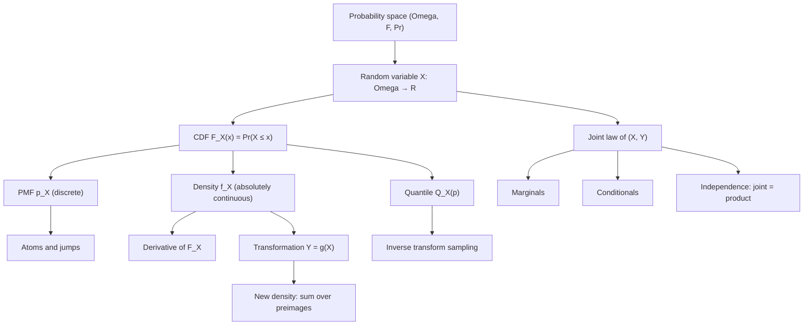
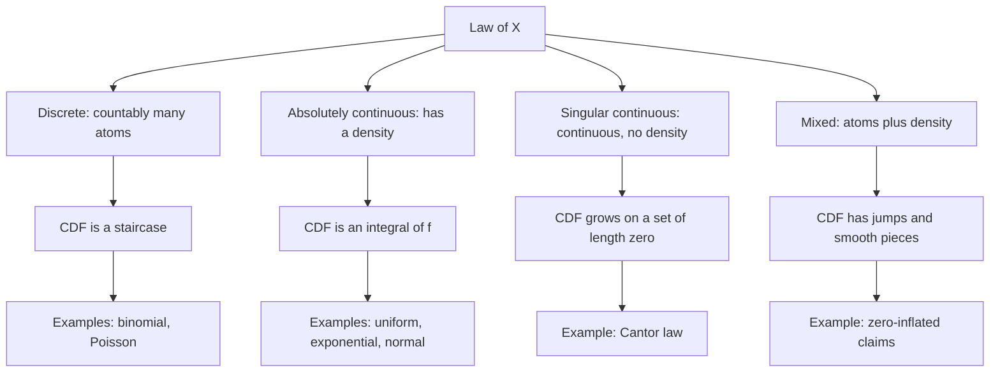

# Random Variables

> [Probability](../README.md) · Level: Advanced · Prerequisites: [Probability Foundations](../01-probability-foundations/README.md), [Set Theory](../../00-foundations/03-set-theory/README.md), [Calculus](../../07-calculus/README.md) · Estimated time: 10 h

## 1. Introduction

[Probability Foundations](../01-probability-foundations/README.md) built a model of an experiment: a sample
space $\Omega$, a $\sigma$-algebra $\mathcal{F}$ of events, and a probability measure $\Pr$. That model can say
"the event $A$ has probability $0.3$"; it cannot say "the average waiting time is four minutes", because
averaging needs numbers and outcomes are not numbers. An outcome is *rain*, or *the third toss is the first
head*, or *a point in the unit square*.

A **random variable** is the device that turns outcomes into numbers: a function $X:\Omega\to\mathbb{R}$,
equipped with the probability pushed forward from $\Omega$. The probability that $X$ lands in a set $B$ is the
probability of the event $\{X\in B\}$. The function and the pushed-forward measure are what one computes with,
and the sample space can then be forgotten — which is both the power and the danger of the subject.

Four subtleties organise the tutorial.

**A random variable is a function, not a number and not a distribution.** "$X=3$" is an event; $X$ is a rule.
Two variables on completely different experiments can share a distribution, and then no probabilistic
computation can tell them apart; conversely, variables with the same distribution need not be equal.

**Discrete and continuous are properties of the distribution, not of the formula.** Mass may sit on countably
many points, or be spread as a density, or both, or — the case usually omitted — as something continuous with
no density at all. The dichotomy taught in first courses is a convenient fiction.

**Densities are not probabilities.** A density is a rate: $f_X(x)\,dx$ approximates the probability of a small
interval. Densities may exceed $1$, may be unbounded, and are not unique. For a continuous $X$,
$\Pr(X=x)=0$ for every $x$, so "probability zero" cannot mean "impossible".

**Transformations need the Jacobian, and non-monotone maps need every preimage.** The change-of-variable
formula carries a factor $\lvert g'(x)\rvert^{-1}$ that records the local stretching of the line; dropping it,
or dropping a branch of a two-to-one map, is the standard error.

Historically the idea of attaching numbers to outcomes is implicit in Pascal and Huygens and became a *function*
only with Kolmogorov's measure-theoretic formulation (1933). The vocabulary of this tutorial — mass, density,
distribution function, quantile — is the vocabulary of that reformulation, and it is what makes the later
topics (expectation, generating functions, the central limit theorem) statable.

## 2. Prerequisites

* **Probability spaces** — sample space, events, $\sigma$-algebra, the three Kolmogorov axioms, continuity from
  below and above, the difference rule: [Probability Foundations](../01-probability-foundations/README.md).
  Used throughout, especially §7.1 and §8.2.
* **Sets and functions** — images, preimages $f^{-1}[B]$, injectivity, countable and uncountable sets:
  [Set Theory](../../00-foundations/03-set-theory/README.md). Needed for measurability (§5) and the general
  change-of-variable formula (§7.6).
* **Limits and continuity** — one-sided limits, right-continuity, monotone functions:
  [Calculus](../../07-calculus/README.md). Needed in §8.2.
* **Differentiation and integration** — the chain rule, the inverse function theorem,
  $\frac{d}{dx}\int_a^xh=h(x)$, substitution, integration by parts, improper integrals, and the gamma integral
  $\int_0^\infty x^ne^{-x}dx=n!$: [Calculus](../../07-calculus/README.md). Used throughout.
* **Conditional probability** — $\Pr(A\mid B)=\Pr(A\cap B)/\Pr(B)$ for $\Pr(B)>0$, and independence of events.
  Restated where needed in §7.8–§7.9; the full treatment is the second topic of the discipline, listed in the
  [discipline index](../README.md).

No measure theory is assumed. The single technical condition (measurability) is explained in §7.1, and a reader
willing to accept it on faith can read everything else unchanged.

## 3. Learning Objectives

After working through this tutorial you will be able to:

1. State the definition of a random variable as a measurable function, and explain why the condition concerns
   preimages.
2. Distinguish a random variable from its distribution, and exhibit two variables that are equal in distribution
   but never equal.
3. Verify that a proposed mass function or density is normalised, and compute probabilities from it.
4. Derive $\Pr(a<X\le b)=F(b)-F(a)$ and $\Pr(X=x)=F(x)-F(x^{-})$ from the axioms.
5. Prove that a CDF is nondecreasing and right-continuous with limits $0$ and $1$ at $\mp\infty$.
6. Compute with quantile functions, prove $Q(p)\le x\iff p\le F(x)$, and generate any distribution from a
   uniform variable.
7. Derive the change-of-variable formula for monotone maps and use the summed form for non-monotone maps.
8. Explain with an example why a density may exceed $1$ and why it is not a probability.
9. Prove that a continuous variable has no atoms, and that countably many points carry no probability.
10. Build a mixture, compute its density, mean and variance, and identify the two-stage experiment it models.
11. Move between a joint law and its marginals and conditionals, and test independence from the joint law.
12. Give a pair of dependent variables with zero covariance, and explain why independence is strictly stronger.

## 4. Intuition

Take the raffle of the previous topic: a drum of tickets, each with a weight, the weights summing to $1$. A
random variable is a **label** written on each ticket. Nothing else. The label is chosen by the experiment, and
what we compute is the total weight of the tickets whose label falls in a given range.

Three consequences follow immediately. The *labelling rule is the variable*: writing the winner's age and
writing the winner's height give two variables on the same drum. The *distribution is the sorted histogram of
labels*: group tickets by label and report the weight of each group; two different drums can produce the same
histogram. And *only sets of labels matter*: "is the label at most $5$?" must name a sub-collection of tickets,
which is exactly the content of measurability.

Now let the drum hold a continuum, say $\Omega=[0,1]$ with length as probability. A label is a curve over the
interval, and the weight of the set where the label is at most $x$ is the length of that set. This is why the
distribution function accumulates: the density records how quickly label-weight piles up as the threshold
moves, exactly as a speedometer records how quickly distance piles up as time moves. A speedometer can read
$200$ without any distance being $200$; a density can read $2$ without any probability being $2$. The mental
substitution to carry through the whole subject is

$$
f_X(x)\,dx\ \text{is a probability};\qquad f_X(x)\ \text{is a probability per unit length,}
$$

so $\Pr(X\in A)=\int_Af_X$ is dimensionless while $f_X$ carries the reciprocal of the units of $X$.

Why insist that $X$ be measurable? Because if $\{X\le x\}$ is not an event, $\Pr(X\le x)$ has no meaning. On a
countable $\Omega$ with $\mathcal{F}$ the family of all subsets every function is measurable and the condition
costs nothing; it bites only on uncountable spaces, where non-measurable sets exist. There it is the difference
between a theorem and a statement that cannot be made.

## 5. Formal Definition

Throughout, $(\Omega,\mathcal{F},\Pr)$ is a probability space as in
[Probability Foundations](../01-probability-foundations/README.md), Definition 5.4.

**Definition 5.1 (Borel sets).** The *Borel $\sigma$-algebra* $\mathcal{B}(\mathbb{R})$ is the smallest
$\sigma$-algebra containing every interval $(-\infty,x]$. Its members are the *Borel sets*. On $\mathbb{R}^n$
the same construction starts from the boxes $(-\infty,x_1]\times\cdots\times(-\infty,x_n]$ and gives
$\mathcal{B}(\mathbb{R}^n)$. Intervals, open and closed sets, countable unions of these, the rationals and the
Cantor set are all Borel; non-Borel sets exist but are never needed here.

**Definition 5.2 (Random variable).** A *random variable* on $(\Omega,\mathcal{F},\Pr)$ is a function
$X:\Omega\to\mathbb{R}$ such that

$$
\{\omega\in\Omega:X(\omega)\le x\}\in\mathcal{F}\quad\text{for every }x\in\mathbb{R},
$$

equivalently $X^{-1}[B]\in\mathcal{F}$ for every Borel $B$ (Proposition 8.1). We abbreviate
$\{\omega:X(\omega)\le x\}$ by $\{X\le x\}$, and $\{\omega:X(\omega)\in B\}$ by $\{X\in B\}$; this shorthand, an
inequality between a function and a number naming a set, is read aloud as "the event that $X$ is at most $x$".

**Definition 5.3 (Distribution, or law).** The *distribution* of $X$ is the push-forward

$$
\Pr_X(B):=\Pr\bigl(X^{-1}[B]\bigr)=\Pr(X\in B),\qquad B\in\mathcal{B}(\mathbb{R}).
$$

It is a probability measure on $(\mathbb{R},\mathcal{B}(\mathbb{R}))$. We write $X\sim\Pr_X$, read "$X$ is
distributed as $\Pr_X$", and call variables with the same distribution *identically distributed*.

**Definition 5.4 (Cumulative distribution function).** $F_X(x):=\Pr(X\le x)$ for $x\in\mathbb{R}$. The CDF
determines the distribution, since $\Pr_X$ is the unique measure with $\Pr_X\bigl((-\infty,x]\bigr)=F_X(x)$;
§7.5 gives the construction $X=Q_X(U)$ that proves existence without quoting an extension theorem.

**Definition 5.5 (Discrete random variable; PMF).** $X$ is *discrete* if some countable $S$ satisfies
$\Pr(X\in S)=1$. Its *probability mass function* is $p_X(x):=\Pr(X=x)$, and then $p_X\ge0$,
$\sum_{x\in S}p_X(x)=1$ and $F_X(x)=\sum_{s\in S,\,s\le x}p_X(s)$. Conversely any $p:S\to[0,\infty)$ on a
countable $S$ with total mass $1$ is the PMF of some variable: take $\Omega=S$, $\mathcal{F}=2^S$,
$\Pr(\{s\})=p(s)$, $X(s)=s$.

**Definition 5.6 (Density; absolutely continuous variable).** $X$ is *absolutely continuous* with *density*
$f_X$ if $f_X:\mathbb{R}\to[0,\infty)$ is Borel, $\int_{\mathbb{R}}f_X=1$, and

$$
\Pr(X\in B)=\int_Bf_X(x)\,dx\quad\text{for every Borel }B,
\qquad\text{equivalently}\qquad F_X(x)=\int_{-\infty}^xf_X(t)\,dt .
$$

In this repository "continuous random variable" means absolutely continuous — the only case with a density;
§7.4 explains the distinction and gives the singular counterexample.

**Definition 5.7 (Joint distribution).** The *joint CDF* of $X_1,\dots,X_n$ is
$F(x_1,\dots,x_n)=\Pr(X_1\le x_1,\dots,X_n\le x_n)$. They have a *joint density* $f$ if
$\Pr\bigl((X_1,\dots,X_n)\in B\bigr)=\int_Bf$ for Borel $B\subseteq\mathbb{R}^n$, and a *joint PMF*
$p(x_1,\dots,x_n)=\Pr(X_1=x_1,\dots,X_n=x_n)$ if they are jointly discrete. For $n=2$ we write $F_{X,Y}$,
$f_{X,Y}$, $p_{X,Y}$.

## 6. Mathematical Notation

| Symbol | Read as | Meaning |
|---|---|---|
| $X,Y,Z$ | random variables | measurable functions $\Omega\to\mathbb{R}$ |
| $X(\omega)$ | value of $X$ at $\omega$ | the label attached to outcome $\omega$ |
| $\{X\le x\}$, $\{X\in B\}$ | events | $\{\omega:X(\omega)\le x\}$, $X^{-1}[B]$ |
| $\Pr_X$ | law of $X$ | $B\mapsto\Pr(X\in B)$, a measure on $\mathbb{R}$ |
| $X\sim F$ | $X$ has distribution $F$ | "is distributed as" |
| $F_X$ | distribution function | $F_X(x)=\Pr(X\le x)$ |
| $F_X(x^{-})$ | left limit at $x$ | $\lim_{t\uparrow x}F_X(t)$ |
| $p_X$ | probability mass function | $p_X(x)=\Pr(X=x)$ |
| $f_X$ | probability density function | integrand of $\Pr(X\in B)$; $F_X'$ where continuous |
| $\operatorname{supp}X$ | support | smallest closed set of probability $1$ |
| $Q_X(p)$ | quantile function | $\inf\{x:F_X(x)\ge p\}$ |
| $f_{X,Y}$ | joint density | density of the pair $(X,Y)$ |
| $f_{X\mid Y}(x\mid y)$ | conditional density | $f_{X,Y}(x,y)/f_Y(y)$ |
| $X\perp\!\!\!\perp Y$ | independent | the joint law is the product of the marginals |
| $\mathbf{1}_A$ | indicator of $A$ | $1$ on $A$, $0$ outside |
| $g^{-1}(y)$ | preimage | the *set* $\{x:g(x)=y\}$ |
| $\overset{d}{=}$ | equal in distribution | same CDF |

One notational warning. For a bijection, $g^{-1}(y)$ is a single point; for a general $g$ it is a *set*, possibly
empty or with several elements. §7.6 uses the second meaning, and writing $g^{-1}(y)$ for a non-injective $g$ as
if it were a number is a frequent source of wrong answers.

## 7. Core Concepts

### 7.1 Measurability: why the condition is about preimages

A probability measure lives on $\mathcal{F}$, not on all subsets of $\Omega$, so a measurement is usable only
if every question "did $X$ land in $B$?" has an answer inside $\mathcal{F}$ — that is, only if
$X^{-1}[B]\in\mathcal{F}$. The condition is about preimages, never images: $\{X\le x\}$ collects outcomes, and
outcomes carry the probability.

Three facts make it manageable. *Checking half-lines suffices*: if $X^{-1}\bigl((-\infty,x]\bigr)\in\mathcal{F}$
for every $x$, then $X^{-1}[B]\in\mathcal{F}$ for every Borel $B$, because the family of such $B$ is a
$\sigma$-algebra containing all $(-\infty,x]$ (Proposition 8.1). *Borel functions preserve randomness*: if $g$ is
Borel and $X$ is a random variable then so is $g(X)$, since $(g\circ X)^{-1}[B]=X^{-1}\bigl[g^{-1}[B]\bigr]$.
*Nothing can go wrong on countable spaces*: if $\Omega$ is countable and $\mathcal{F}=2^\Omega$, as in every
discrete example here, every function is a random variable.

Non-measurable functions require the axiom of choice: a Vitali set $V\subseteq[0,1]$, containing one
representative of each coset of $\mathbb{Q}$, is not Lebesgue measurable, and $\mathbf{1}_V$ is then not a random
variable on $([0,1],\mathcal{B},\text{length})$. No formula in this repository defines such a function. What
matters is *why* the definition is phrased as it is: it is the minimal hypothesis making $\Pr(X\in B)$ defined
for every $B$ we ask about.

### 7.2 Discrete random variables and mass functions

For discrete $X$ everything is in the PMF: $p_X(x)=\Pr(X=x)\ge0$, $\sum_{x\in S}p_X(x)=1$, hence
$\Pr(X\in B)=\sum_{x\in B\cap S}p_X(x)$. The CDF is a *staircase*, constant between support points and jumping by
$p_X(x)$ at each one. A fair die, with $p(x)=1/6$ on $\{1,\dots,6\}$, has $F(x)=k/6$ for $k\le x<k+1$,
$k=0,\dots,6$. The staircase is right-continuous but not left-continuous, and its jumps are exactly the masses;
this is the visual signature of discreteness (§7.4). Mass functions are closed under countable *mixtures* (§7.7). The
sum of two independent discrete variables is again discrete, with PMF the convolution
$p_{X+Y}(z)=\sum_xp_X(x)p_Y(z-x)$; whether it remains inside a *named* family is a separate question, answered family
by family in the next topic.

### 7.3 Continuous random variables and densities

For an absolutely continuous $X$, $\Pr(a<X\le b)=\int_a^bf_X$, and by the fundamental theorem of calculus
$F_X'=f_X$ at every continuity point of $f_X$. The density is the derivative of the CDF: it measures how fast
probability accumulates per unit length. Quantitatively, if $f_X$ is continuous at $x$ then

$$
\Pr(x<X\le x+h)=\int_x^{x+h}f_X(t)\,dt=hf_X(x)+o(h),
\qquad\text{so}\qquad
f_X(x)=\lim_{h\downarrow0}\frac{\Pr(x<X\le x+h)}{h}.
$$

*Derivation.* Given $\varepsilon>0$, continuity gives $\delta>0$ with $\lvert f_X(t)-f_X(x)\rvert\le\varepsilon$
for $\lvert t-x\rvert\le\delta$. For $0<h\le\delta$,
$\bigl\lvert\int_x^{x+h}f_X-hf_X(x)\bigr\rvert=\bigl\lvert\int_x^{x+h}(f_X(t)-f_X(x))dt\bigr\rvert\le\varepsilon h$;
divide by $h$. $\blacksquare$

Three consequences. **A density is a rate**, with units of inverse units of $X$: "density $2$" means "about $2$
probability per unit length", i.e. about $2h$ probability in a window of width $h$; nothing forbids $f>1$
(§7.10). **A density is not unique**: changing it on a set of length zero changes no integral, so statements
about $f_X$ hold *almost everywhere* and "the density at a point" is meaningful only up to such changes.
**Continuous is weaker than absolutely continuous**: the Cantor CDF rises from $0$ to $1$, is continuous, and
has derivative $0$ almost everywhere, so it is the integral of nothing (§7.4).

### 7.4 Cumulative distribution functions

The CDF exists for every variable and determines the distribution. Its four defining properties, proved in
Theorem 8.2, are: $0\le F\le1$; $F$ nondecreasing; $F$ right-continuous, $F(x^+)=F(x)$; and
$\lim_{x\to-\infty}F=0$, $\lim_{x\to+\infty}F=1$. Conversely every function with these properties is a CDF — the
construction is $Q_X(U)$ in §7.5. The properties are not decorative: monotonicity gives one-sided limits,
right-continuity decides which endpoint owns a jump, and the limits say the variable is finite almost surely. A
function such as $F(x)=x/(1+x)$, which rises only to $1$ in the limit, is the CDF of a variable taking the value
$+\infty$ with positive probability; this repository excludes such variables.

**Atoms.** A point with $\Pr(X=x)>0$ is an *atom*, and by Theorem 8.2(f) $\Pr(X=x)=F(x)-F(x^{-})$ is the jump of
$F$ there. So $F$ is continuous at $x$ exactly when $x$ is not an atom, and there are at most countably many
atoms (Proposition 8.3), because jumps of size at least $1/n$ number at most $n$.

**The three pure types.** Every law decomposes uniquely as $F=\alpha_dF_d+\alpha_cF_c+\alpha_sF_s$ with
$\alpha_d,\alpha_c,\alpha_s\ge0$ summing to $1$, where $F_d$ is a pure jump function, $F_c$ is absolutely
continuous, and $F_s$ is continuous but singular: no density, and growth only on a set of length zero. This is
the *Lebesgue decomposition*. A hospital bill is mixed (an atom at $0$, a density above it); the Cantor law is
purely singular; binomial and Poisson laws are purely discrete.

**The Cantor law in a paragraph.** Delete middle thirds from $[0,1]$ and spread mass uniformly on what remains:
$F=\tfrac12$ on $(\tfrac13,\tfrac23)$, $F=\tfrac14$ on $(\tfrac19,\tfrac29)$, $F=\tfrac34$ on
$(\tfrac79,\tfrac89)$, and so on, extended continuously. Then $F$ is continuous, nondecreasing, $F(0)=0$,
$F(1)=1$, and $F'=0$ off the Cantor set, which has length zero. A density would force $f=F'=0$ almost everywhere
and hence $F\equiv0$, contradicting $F(1)=1$. So a continuous CDF need not have a density (Exercise 31).

### 7.5 Quantile functions

**Definition 7.8.** For $0<p<1$, $Q_X(p):=\inf\{x:F_X(x)\ge p\}$. $Q_X(\tfrac12)$ is the *median*,
$Q_X(\tfrac14),Q_X(\tfrac34)$ the *quartiles*, and their difference the *interquartile range*.

The infimum is attained because $F$ is right-continuous, and it is finite because $F\to1$. When $F$ is
continuous and strictly increasing, $Q_X=F_X^{-1}$ and $F_X(Q_X(p))=p$; when $F$ jumps, $Q_X$ has flat stretches
and $F_X(Q_X(p))$ may exceed $p$. Proposition 8.6 proves the two identities used constantly:

$$
Q_X(p)\le x\iff p\le F_X(x),
\qquad
\Pr\bigl(X\le Q_X(p)\bigr)\ge p,
\qquad
\Pr\bigl(X\ge Q_X(p)\bigr)\ge1-p .
$$

**Simulation.** If $U\sim\text{Uniform}(0,1)$ then $X=Q_X(U)$ has CDF $F_X$, because
$\Pr(X\le x)=\Pr\bigl(Q_X(U)\le x\bigr)=\Pr\bigl(U\le F_X(x)\bigr)=F_X(x)$. This is *inverse transform
sampling* (Theorem 8.7), the primitive behind most random-number generators, and it also proves that every
function satisfying the four CDF properties is a CDF.

**The reverse direction.** If $F_X$ is continuous then $F_X(X)\sim\text{Uniform}(0,1)$, since
$\Pr(F_X(X)\le u)=\Pr(X\le Q_X(u))=F_X(Q_X(u))=u$. This *probability integral transform* converts any continuous
variable into a uniform one and underlies goodness-of-fit tests; it fails for discrete $X$, where $F_X(X)$ takes
countably many values (Exercise 30).

### 7.6 Transformations of random variables

Let $Y=g(X)$ with $X$ having density $f_X$. The reliable method: express the CDF of $Y$ as an event about $X$,
then differentiate.

**Strictly increasing $g$.** If $g$ is $C^1$ with $g'>0$ on the support and inverse $h=g^{-1}$, then
$g(X)\le y\iff X\le h(y)$, so $F_Y(y)=F_X(h(y))$ and

$$
f_Y(y)=F_X'\bigl(h(y)\bigr)h'(y)=f_X\bigl(h(y)\bigr)h'(y).
$$

**Strictly decreasing $g$.** Now $g(X)\le y\iff X\ge h(y)$, so $F_Y(y)=1-F_X(h(y))$ and
$f_Y(y)=-f_X(h(y))h'(y)=f_X(h(y))\lvert h'(y)\rvert$, since $h'<0$. The two cases agree once the absolute value is
taken, and in terms of $g$ (using $h'(y)=1/g'(h(y))$ at $x=h(y)$):

$$
\boxed{\;f_Y(y)=f_X(x)\bigl\lvert h'(y)\bigr\rvert=\frac{f_X(x)}{\lvert g'(x)\rvert}\;}
$$

**Non-monotone $g$: sum over preimages.** If $g$ is differentiable with $g'\ne0$ at every solution of $g(x)=y$
and the solutions are $x_1(y),\dots,x_m(y)$, then

$$
f_Y(y)=\sum_{j=1}^{m}\frac{f_X\bigl(x_j(y)\bigr)}{\bigl\lvert g'\bigl(x_j(y)\bigr)\bigr\rvert}.
$$

*Reason.* Split the support at the critical points of $g$; on each piece $g$ is monotone, the events
$\{X\in I_j,\ g(X)\le y\}$ are disjoint, and the monotone formula applies to each. Theorem 8.5 gives the full
proof. The classic case is $Y=X^2$, where the two preimages $\pm\sqrt y$ each contribute a factor
$1/(2\sqrt y)$:

$$
f_Y(y)=\frac{f_X(\sqrt y)+f_X(-\sqrt y)}{2\sqrt y},\qquad y>0 .
$$

**Linear maps.** $Y=aX+b$ with $a\ne0$ has $f_Y(y)=\frac{1}{\lvert a\rvert}f_X\bigl((y-b)/a\bigr)$. A change of
units rescales the density by the reciprocal of the scale factor and leaves every probability unchanged — another
way to see that a density is not a probability.

**Two dimensions.** For a $C^1$ bijection $T$ with $C^1$ inverse $S$ and $(U,V)=T(X,Y)$,
$f_{U,V}(u,v)=f_{X,Y}\bigl(S(u,v)\bigr)\lvert\det DS(u,v)\rvert$: a density is a derivative, and the derivative
of an inverse map carries the reciprocal of the local stretch.

### 7.7 Mixtures

**Definition 7.9.** Given CDFs $F_1,\dots,F_k$ and weights $w_i\ge0$ with $\sum_iw_i=1$, the *mixture* is
$F=\sum_iw_iF_i$; if the components have densities $f_i$ (or PMFs $p_i$), the mixture has density
$f=\sum_iw_if_i$ (or PMF $p=\sum_iw_ip_i$).

The two-stage description is exact: draw $I$ with $\Pr(I=i)=w_i$, then draw $X$ from $F_I$; the law of total
probability gives $F$. Mixtures model heterogeneity — a population of component types, a portfolio of regimes, a
corpus of topics. With $\mu_i$ and $\sigma_i^2$ the component means and variances,

$$
\mathbb{E}[X]=\sum_iw_i\mu_i,
\qquad
\operatorname{Var}(X)=\sum_iw_i\bigl(\sigma_i^2+\mu_i^2\bigr)-\Bigl(\sum_iw_i\mu_i\Bigr)^2
=\sum_iw_i\sigma_i^2+\sum_iw_i(\mu_i-\mu)^2,
$$

where $\mu=\mathbb{E}[X]$. *Derivation.* For the mean, integrate $x$ against $\sum_iw_if_i$. For the second
moment, $\mathbb{E}[X^2]=\sum_iw_i(\sigma_i^2+\mu_i^2)$ because the bracket is the second moment of the $i$-th
component; then subtract $\mu^2$. The last expression follows by expanding the square. $\blacksquare$

So the variance of a mixture has two sources: the average *within-component* variance and the *between-component*
spread. Two warnings: a mixture of normals is not normal (it can be bimodal, §9.7), and a mixture is not a sum —
a sum of independent variables adds variances without a between-component term.

### 7.8 Joint, marginal and conditional distributions

**Joint laws.** $F_{X,Y}(x,y)=\Pr(X\le x,Y\le y)$ is nondecreasing and right-continuous in each argument, with
limits $0$ at $-\infty$ in either slot and $F_X(x)$ as $y\to\infty$. Rectangle probabilities are the alternating
sum

$$
\Pr(a<X\le b,\ c<Y\le d)=F(b,d)-F(a,d)-F(b,c)+F(a,c),
$$

obtained by writing the rectangle as a difference of two vertical strips and each strip as a difference of two
quadrants. If a joint density exists, probabilities are double integrals over the region.

**Marginals.** Discard $Y$: $F_X(x)=\lim_{y\to\infty}F_{X,Y}(x,y)$, and in the density case
$f_X(x)=\int_{-\infty}^{\infty}f_{X,Y}(x,y)\,dy$. "Marginalise" means *integrate out* — never "set $y=0$" and
never "evaluate".

**Conditionals.** For events with $\Pr(B)>0$, $\Pr(A\mid B)=\Pr(A\cap B)/\Pr(B)$. Condition the pair on
$\{x<X\le x+h\}$ and let $h\downarrow0$. For an interval $B$,

$$
\Pr(Y\in B\mid x<X\le x+h)
=\frac{\int_B\int_x^{x+h}f_{X,Y}(u,v)\,du\,dv}{\int_x^{x+h}f_X(u)\,du}
\longrightarrow\frac{\int_Bf_{X,Y}(x,v)\,dv}{f_X(x)}=\int_Bf_{Y\mid X}(v\mid x)\,dv,
$$

by the fundamental theorem applied to numerator and denominator, assuming $f_X(x)>0$ and continuity at $x$. Hence

$$
f_{Y\mid X}(y\mid x):=\frac{f_{X,Y}(x,y)}{f_X(x)},\qquad f_X(x)>0,
\qquad
F_{Y\mid X}(y\mid x)=\int_{-\infty}^yf_{Y\mid X}(v\mid x)\,dv .
$$

The conditional density is defined as a limit of conditional probabilities of events of *positive* probability,
not as a ratio of the probabilities of $\{X=x\}$ and $\{Y=y\}$, which are both zero. For each fixed $x$ it is a
genuine density in $y$. Conditioning on $X=x$ slices the joint law, and the slice need not resemble the marginal
of $Y$: on the triangle $0\le y\le x\le1$ the conditional law of $Y$ given $X=x$ is uniform on $[0,x]$ (§9.8).

### 7.9 Independence of random variables

**Definition 7.10.** $X$ and $Y$ are *independent*, written $X\perp\!\!\!\perp Y$, if
$\Pr(X\in A,\,Y\in B)=\Pr(X\in A)\Pr(Y\in B)$ for all Borel $A,B$. Equivalently
$F_{X,Y}(x,y)=F_X(x)F_Y(y)$ for all $x,y$; equivalently $f_{X,Y}=f_Xf_Y$ almost everywhere when densities exist;
equivalently $p_{X,Y}(x,y)=p_X(x)p_Y(y)$ when the variables are discrete. Proposition 8.8 proves the
equivalences and shows that independence is preserved by Borel maps: $X\perp\!\!\!\perp Y$ implies
$g(X)\perp\!\!\!\perp h(Y)$.

Three distinctions belong here. *Independent versus identically distributed*: independence concerns the joint
law, identical distribution the marginals; $X$ and $X$ are identically distributed but not independent unless
$X$ is constant. *Equal in distribution versus equal*: with $X\sim\text{Uniform}(0,1)$ and $Y=1-X$ on the same
space, $Y\overset{d}{=}X$ but $\Pr(X=Y)=0$. *Pairwise versus mutual independence*: if $X_1,X_2$ are independent
fair bits and $X_3=X_1\oplus X_2$, every pair is independent, yet
$\Pr(X_1=0,X_2=0,X_3=0)=\tfrac14\ne\tfrac18$.

**Independence is stronger than zero correlation.** With
$\operatorname{Cov}(X,Y)=\mathbb{E}[XY]-\mathbb{E}[X]\mathbb{E}[Y]$, independence makes the covariance vanish;
the converse fails. Let $X$ be uniform on $\{-1,0,1\}$ and $Y=X^2$. Then $\mathbb{E}[X]=0$ and
$\mathbb{E}[XY]=\mathbb{E}[X^3]=0$, so $\operatorname{Cov}(X,Y)=0$, yet
$\Pr(Y=1\mid X=0)=0\ne\tfrac23=\Pr(Y=1)$. The exception is the multivariate normal family, where zero covariance
does imply independence — proved in the next topic. Elsewhere "uncorrelated" is much weaker than "independent",
and confusing them is one of the most consequential errors in applied work.

### 7.10 A density can exceed $1$; and $\Pr(X=x)=0$

Both statements feel paradoxical until the density is read as a rate.

**A density above one.** If $X\sim\text{Uniform}(0,\tfrac12)$ then $F(x)=2x$ on $[0,\tfrac12]$, so
$f_X(x)=2$ there and $0$ elsewhere, and $\int_0^{1/2}2\,dx=1$. There is no contradiction: $2$ is a probability
per unit length and the support has length $\tfrac12$. Likewise
$X\sim\text{Beta}\bigl(\tfrac12,\tfrac12\bigr)$ has density $f_X(x)=1/\bigl(\pi\sqrt{x(1-x)}\bigr)$ on $(0,1)$,
unbounded at both endpoints yet integrating to $1$ — a region that is tall and thin. A density cannot, however,
exceed $1$ on an interval of length greater than $1$, since that would integrate to more than $1$
(Exercise 34).

**No atoms.** If $X$ has density $f_X$ then for every $x$,

$$
\Pr(X=x)=\int_{\{x\}}f_X(t)\,dt=0,
$$

because a point has length zero; and $\Pr(X\in C)=0$ for every countable $C$, by countable additivity. Hence

$$
\Pr(a\le X\le b)=\Pr(a<X<b)=\Pr(a<X\le b)=F(b)-F(a),
$$

so interval endpoints can be moved freely, and a continuous variable never lands on a preassigned value: the
probability that a random point of $[0,1]$ equals $\tfrac12$ is $0$, although $\tfrac12$ is possible.

**"Probability zero" is not "impossible".** Probability is a weight on sets, and a set of weight zero can be
non-empty. In a discrete model with all masses positive, only $\varnothing$ has weight zero; in a continuous model
every point does. The precise phrase is *almost surely*: an event of probability $1$ is almost sure, and its
complement is possible set-theoretically but has probability zero.

| | discrete $X$ | continuous $X$ |
|---|---|---|
| object | PMF $p_X(x)=\Pr(X=x)$ | density $f_X(x)=F_X'(x)$ |
| constraint | $0\le p_X\le1$ | $f_X\ge0$, no upper bound |
| point probability | may be positive | always $0$ |
| CDF | staircase with jumps | continuous |
| event probability | sum | integral |
| units | none | inverse units of $X$ |
| typical error | treating $p$ as a density | treating $f$ as a probability |

## 8. Formulas and Properties

### 8.1 Measurability: the working criterion

**Proposition 8.1.** *For $X:\Omega\to\mathbb{R}$ the following are equivalent: (i) $\{X\le x\}\in\mathcal{F}$
for all $x$; (ii) $X^{-1}[B]\in\mathcal{F}$ for every Borel $B$.*

*Proof.* (ii)$\Rightarrow$(i) since $(-\infty,x]$ is Borel. For the converse let
$\mathcal{G}=\{B:X^{-1}[B]\in\mathcal{F}\}$. It is a $\sigma$-algebra: it contains $\mathbb{R}$, and
$X^{-1}[B^{\complement}]=(X^{-1}[B])^{\complement}$, $X^{-1}[\bigcup_nB_n]=\bigcup_nX^{-1}[B_n]$. It contains every
$(-\infty,x]$ by hypothesis, hence contains the $\sigma$-algebra they generate, namely $\mathcal{B}(\mathbb{R})$.
$\blacksquare$

**Corollary.** *If $X$ is a random variable and $g$ Borel, then $g(X)$ is a random variable.* Indeed
$(g\circ X)^{-1}[B]=X^{-1}[g^{-1}[B]]$ with $g^{-1}[B]$ Borel. $\blacksquare$

### 8.2 The four properties of a CDF, with proofs

**Theorem 8.2.** *Let $F=\Pr(X\le x)$. Then (a) $0\le F(x)\le1$; (b) $F$ is nondecreasing; (c) $F$ is
right-continuous; (d) $F(x)\to0$ as $x\to-\infty$ and $F(x)\to1$ as $x\to+\infty$; (e)
$\Pr(a<X\le b)=F(b)-F(a)$; (f) $\Pr(X=x)=F(x)-F(x^{-})$.*

*Proof.* (a) $\{X\le x\}$ is an event. (b) If $x\le y$ then $\{X\le x\}\subseteq\{X\le y\}$, so monotonicity
(Theorem 7.4 of [Probability Foundations](../01-probability-foundations/README.md)) gives $F(x)\le F(y)$.
(c) If $x_n\downarrow x$ with $x_n>x$, the events $\{X\le x_n\}$ decrease to $\{X\le x\}$ — an outcome satisfies
all of them iff $X\le\inf_nx_n=x$ — so continuity from above (Corollary 7.10 there) gives
$F(x_n)\to F(x)$. (d) $\{X\le-n\}\downarrow\varnothing$ and $\{X\le n\}\uparrow\Omega$, so continuity from above
and below give the limits. (e) $\{a<X\le b\}=\{X\le b\}\setminus\{X\le a\}$ and the difference rule applies.
(f) The events $\{x-\tfrac1n<X\le x\}$ decrease to $\{X=x\}$ and have probability $F(x)-F(x-\tfrac1n)$ by (e);
continuity from above gives the limit $F(x)-F(x^{-})$. $\blacksquare$

### 8.3 Atoms are countable

**Proposition 8.3.** *A CDF has at most countably many discontinuities, all of them jumps.*

*Proof.* Let $J_n=\{x:\Pr(X=x)\ge1/n\}$. Distinct points of $J_n$ give disjoint events, so
$k/n\le\sum_j\Pr(X=x_j)\le1$ for any $k$ of them: $J_n$ is finite. Hence the atom set $\bigcup_nJ_n$ is
countable. Since $F$ is nondecreasing and right-continuous, its only possible discontinuities are jumps, and
those occur exactly at atoms. $\blacksquare$

### 8.4 Densities have no atoms

**Proposition 8.4.** *If $X$ has density $f_X$ then $\Pr(X\in C)=0$ for every countable $C$, and $F_X$ is
continuous.*

*Proof.* $\Pr(X=x)=\int_{\{x\}}f_X=0$ because a point has length zero; countable additivity extends this to
countable $C$; Theorem 8.2(f) then gives zero jump everywhere. $\blacksquare$

The converse fails: the Cantor CDF is continuous with no density (§7.4).

### 8.5 Change of variable

**Theorem 8.5.** *Let $X$ have density $f_X$ with $\Pr(X\in I)=1$ for an open interval $I$, and let $g:I\to J$ be
$C^1$ and strictly monotone with $C^1$ inverse $h$. Then*

$$
f_Y(y)=f_X\bigl(h(y)\bigr)\bigl\lvert h'(y)\bigr\rvert\mathbf{1}_J(y).
$$

*If moreover $g'\ne0$ on $I$ and every $y$ has finitely many preimages $x_1(y),\dots,x_m(y)$ in $I$, then*

$$
f_Y(y)=\sum_{j=1}^{m}\frac{f_X\bigl(x_j(y)\bigr)}{\bigl\lvert g'\bigl(x_j(y)\bigr)\bigr\rvert}.
$$

*Proof.* If $g'>0$ then $\{g(X)\le y\}=\{X\le h(y)\}$, so $F_Y(y)=F_X(h(y))$; differentiating and using the
chain rule gives $f_Y(y)=f_X(h(y))h'(y)$. If $g'<0$ then $\{g(X)\le y\}=\{X\ge h(y)\}$, so
$F_Y(y)=1-F_X(h(y))$ and $f_Y(y)=-f_X(h(y))h'(y)=f_X(h(y))\lvert h'(y)\rvert$. For $y\notin J$ the event has
probability $0$. In the general case, split $I$ at the critical points of $g$ and at the endpoints of the ranges;
on each piece $I_j$ the map is strictly monotone, the events $\{X\in I_j,\ g(X)\le y\}$ are disjoint, and
additivity plus the monotone formula on each piece gives the sum. $\blacksquare$

The hypotheses matter: $g$ must be differentiable and monotone *on the part of the line carrying the mass of
$X$*, and a non-monotone $g$ must be split. Differentiability of $h$ is automatic for $C^1$ strictly monotone $g$
with $g'\ne0$, by the inverse function theorem.

### 8.6 Quantiles: the exact statements

**Proposition 8.6.** *Let $F$ be a CDF, $Q(p)=\inf\{x:F(x)\ge p\}$ and $0<p<1$. Then: (i) $Q(p)$ is finite and
$F(Q(p))\ge p$; (ii) $Q(p)\le x\iff p\le F(x)$; (iii) $Q(F(x))\le x$; (iv)
$\Pr(X\le Q(p))\ge p$ and $\Pr(X<Q(p))\le p$; (v) $Q$ is nondecreasing and left-continuous; (vi) if $F$ is
continuous and strictly increasing where the mass sits, then $Q=F^{-1}$ and $F(Q(p))=p$.*

*Proof.* (i) $S_p=\{x:F(x)\ge p\}$ is nonempty and bounded below because $F\to1$ and $F\to0$; taking
$x_n\in S_p$ with $x_n\downarrow Q(p)$, right-continuity gives $F(Q(p))=\lim_nF(x_n)\ge p$, so $Q(p)\in S_p$ and
the infimum is attained. (ii) If $Q(p)\le x$ then $p\le F(Q(p))\le F(x)$; if $p\le F(x)$ then $x\in S_p$ and
$Q(p)\le x$. (iii) $x\in S_{F(x)}$; apply (ii). (iv) The first is (i). For the second, $t<Q(p)$ implies
$t\notin S_p$, i.e. $F(t)<p$, so $\sup_{t<Q(p)}F(t)\le p$. (v) If $p\le q$ then $S_q\subseteq S_p$, hence
$Q(p)\le Q(q)$. For left-continuity let $p_n\uparrow p$: monotonicity gives $\lim_nQ(p_n)\le Q(p)$, while for
$t<Q(p)$ we have $F(t)<p$, so choosing $n$ with $F(t)<p_n<p$ gives $t<Q(p_n)$ and hence
$\lim_nQ(p_n)\ge t$; let $t\uparrow Q(p)$. (vi) Then $S_p=[Q(p),\infty)$ and $F(Q(p))=p$. $\blacksquare$

### 8.7 Sampling from a distribution

**Theorem 8.7 (inverse transform sampling).** *Let $F$ be a CDF with quantile function $Q$ and let
$U\sim\text{Uniform}(0,1)$. Then $Q(U)$ has CDF $F$. Conversely, if $F$ is continuous and $X\sim F$, then
$F(X)\sim\text{Uniform}(0,1)$.*

*Proof.* By Proposition 8.6(ii), $Q(U)\le x\iff U\le F(x)$, so
$\Pr(Q(U)\le x)=\Pr(U\le F(x))=F(x)$. Conversely suppose $F$ is continuous and let $b_u=\max\{x:F(x)=u\}$ for
$0<u<1$, which exists because $F$ is continuous with limits $0$ and $1$. Since $F$ is nondecreasing,
$\{x:F(x)\le u\}=(-\infty,b_u]$, so $\Pr(F(X)\le u)=F(b_u)=u$; the cases $u\le0$ and $u\ge1$ are immediate. Hence
$F(X)\sim\text{Uniform}(0,1)$. $\blacksquare$

### 8.8 Independence: criteria and permanence

**Proposition 8.8.** *For random variables $X,Y$: (i) $X\perp\!\!\!\perp Y$ iff $F_{X,Y}=F_XF_Y$ pointwise;
(ii) if a joint density exists, iff $f_{X,Y}=f_Xf_Y$ almost everywhere; (iii) if discrete, iff
$p_{X,Y}=p_Xp_Y$; (iv) if $X\perp\!\!\!\perp Y$ and $g,h$ are Borel, then $g(X)\perp\!\!\!\perp h(Y)$.*

*Proof.* (i) Apply the definition to $A=(-\infty,x]$, $B=(-\infty,y]$ for the forward direction. Conversely,
let $\mathcal{C}$ be the family of Borel rectangles $A\times B$ on which the product rule holds. It contains all
$(-\infty,x]\times(-\infty,y]$ by hypothesis, and is closed under complements and countable disjoint unions, so
it is a $\lambda$-system; the generating rectangles form a $\pi$-system; Dynkin's theorem gives
$\mathcal{C}=\mathcal{B}(\mathbb{R}^2)$. (ii) Integrate over rectangles and use that two densities with equal
rectangle integrals agree almost everywhere. (iii) Sum over the atoms. (iv)
$\Pr(g(X)\in C,\,h(Y)\in D)=\Pr(X\in g^{-1}[C],\,Y\in h^{-1}[D])=\Pr(X\in g^{-1}[C])\Pr(Y\in h^{-1}[D])$.
$\blacksquare$

### 8.9 Transformations at a glance

| Transformation | Density of $Y$ | Domain |
|---|---|---|
| $Y=aX+b$, $a\ne0$ | $\dfrac{1}{\lvert a\rvert}f_X\!\left(\dfrac{y-b}{a}\right)$ | all $y$ |
| $Y=X^2$ | $\dfrac{f_X(\sqrt y)+f_X(-\sqrt y)}{2\sqrt y}$ | $y>0$ |
| $Y=\lvert X\rvert$ | $f_X(y)+f_X(-y)$ | $y>0$ |
| $Y=e^{X}$ | $\dfrac{f_X(\ln y)}{y}$ | $y>0$ |
| $Y=\ln X$ ($X>0$) | $f_X(e^{y})\,e^{y}$ | all $y$ |
| $Y=X^2$, $X\sim\mathcal{N}(0,1)$ | $\dfrac{1}{\sqrt{2\pi y}}e^{-y/2}$ | $y>0$ |
| $Y=1/X$, $X\ne0$ | $\dfrac{f_X(1/y)}{y^{2}}$ | $y\ne0$ |

Every row is $f_Y(y)=\sum_{x:g(x)=y}f_X(x)/\lvert g'(x)\rvert$ applied mechanically. As a sanity check, a
strictly increasing $g$ transforms quantiles without any Jacobian, $Q_{g(X)}(p)=g(Q_X(p))$: probabilities are
preserved, densities are not.

## 9. Step-by-Step Examples

### 9.1 From a mass function to a distribution function

A fair coin is tossed twice and $X$ counts heads. Then $p_X(0)=\tfrac14$, $p_X(1)=\tfrac12$,
$p_X(2)=\tfrac14$, summing to $1$, and the CDF accumulates these masses:

$$
F_X(x)=\begin{cases}0,&x<0,\\ \tfrac14,&0\le x<1,\\ \tfrac34,&1\le x<2,\\ 1,&x\ge2.\end{cases}
$$

*Quantiles.* $F(0)=\tfrac14<0.5\le\tfrac34=F(1)$, so $Q(0.5)=1$; and $F(1)=\tfrac34<0.8\le1=F(2)$, so
$Q(0.8)=2$. *Check.* $\Pr(0.5<X\le1.5)=F(1.5)-F(0.5)=\tfrac34-\tfrac14=\tfrac12=p_X(1)$, since $1$ is the only
integer in the interval.

### 9.2 A density: normalisation, CDF, interval probability, maximum

Let $f(x)=cx(1-x)$ on $(0,1)$ and $0$ elsewhere. Since
$\int_0^1(x-x^2)dx=\tfrac12-\tfrac13=\tfrac16$, normalisation forces $c=6$. Then for $0\le x\le1$,

$$
F(x)=\int_0^x6t(1-t)\,dt=6\Bigl(\frac{x^2}{2}-\frac{x^3}{3}\Bigr)=3x^2-2x^3,
$$

and $F(0)=0$, $F(1)=1$, $F'=6x-6x^2=f$: a valid CDF with that density. Next,

$$
\Pr(0.4<X<0.6)=F(0.6)-F(0.4)=(0.648)-(0.352)=0.296 .
$$

By the symmetry $x\mapsto1-x$ of $f$, $F(\tfrac12)=3(\tfrac14)-2(\tfrac18)=\tfrac12$, so the median is
$\tfrac12$. Finally $f'(x)=6-12x$ vanishes at $x=\tfrac12$, where $f=\tfrac32$: the density exceeds $1$, as it
must be allowed to. Since $\int_0^1\tfrac32\,dx=\tfrac32>1$, the excess is compensated near the endpoints where
$f\to0$.

### 9.3 A mixed distribution: an atom plus a density

Let $F(x)=0$ for $x<0$, $F(x)=x/2$ for $0\le x<1$, and $F(x)=1$ for $x\ge1$. It is nondecreasing and
right-continuous with the correct limits, so it is a CDF. On $(0,1)$ the derivative is $\tfrac12$, giving a
uniform density component of mass $\tfrac12$; at $x=1$,

$$
\Pr(X=1)=F(1)-F(1^{-})=1-\tfrac12=\tfrac12,
$$

so $F=\tfrac12F_d+\tfrac12F_c$ with $F_d$ the unit mass at $1$ and $F_c$ uniform on $(0,1)$. Then

$$
\Pr(0.5<X<1)=F(1^{-})-F(0.5)=\tfrac12-\tfrac14=\tfrac14,
\qquad
\Pr(0.5<X\le1)=F(1)-F(0.5)=\tfrac34,
$$

the difference being exactly the atom at $1$. Since $F(x)\ge\tfrac12$ requires $x\ge1$, the median is $Q(\tfrac12)=1$
— an atom can be the median.

### 9.4 Change of variable, one-to-one and two-to-one

**(a)** Let $X\sim\text{Uniform}(0,1)$ and $Y=-\ln X$. Here $g$ is strictly decreasing with inverse $h(y)=e^{-y}$
and $\lvert h'\rvert=e^{-y}$, so $f_Y(y)=f_X(e^{-y})e^{-y}=e^{-y}$ for $y>0$: $Y$ is exponential with rate $1$.
*Check by CDF:* for $y>0$, $F_Y(y)=\Pr(X\ge e^{-y})=1-e^{-y}$, whose derivative is $e^{-y}$.

**(b)** Let $X\sim\text{Uniform}(-1,1)$ and $Y=X^2$. The preimages of $y\in(0,1)$ are $\pm\sqrt y$, and
$\lvert g'\rvert=2\sqrt y$ at both, so

$$
f_Y(y)=\frac{\tfrac12+\tfrac12}{2\sqrt y}=\frac{1}{2\sqrt y},\qquad 0<y<1 .
$$

*Check by CDF:* $F_Y(y)=\Pr(-\sqrt y\le X\le\sqrt y)=\sqrt y$ for $0\le y\le1$. Using only the positive branch
would give $1/(4\sqrt y)$ and lose half the mass.

### 9.5 Building the normal density from the standard one

Let $\varphi(z)=\frac{1}{\sqrt{2\pi}}e^{-z^2/2}$ and $Y=\mu+\sigma Z$ with $\sigma>0$. With
$h(y)=(y-\mu)/\sigma$ and $\lvert h'\rvert=1/\sigma$,

$$
f_Y(y)=\frac{1}{\sigma}\varphi\Bigl(\frac{y-\mu}{\sigma}\Bigr)
=\frac{1}{\sigma\sqrt{2\pi}}\exp\Bigl(-\frac{(y-\mu)^2}{2\sigma^2}\Bigr).
$$

*Check.* $F_Y(y)=\Phi\bigl((y-\mu)/\sigma\bigr)$, and the chain rule multiplies the derivative by $1/\sigma$. This
is $\mathcal{N}(\mu,\sigma^2)$ of the next topic: the family is closed under affine maps.

### 9.6 Quantile function and inverse transform sampling

For $X\sim\text{Exponential}(\lambda)$, $F(x)=1-e^{-\lambda x}$ on $[0,\infty)$. Solving $F(x)=u$ gives

$$
Q(u)=-\frac{\ln(1-u)}{\lambda},\qquad
Q(\tfrac12)=\frac{\ln2}{\lambda},\quad
Q(\tfrac14)=\frac{\ln(4/3)}{\lambda},\quad
Q(\tfrac34)=\frac{\ln4}{\lambda},\quad
\operatorname{IQR}=\frac{\ln3}{\lambda}.
$$

Because $F$ is continuous and strictly increasing on $[0,\infty)$, $F(Q(u))=u$; for instance
$F(Q(\tfrac12))=1-e^{-\ln2}=\tfrac12$. By Theorem 8.7, $Q(U)$ has CDF $F$ whenever $U$ is uniform, and since
$1-U$ is also uniform the computational form $X=-\ln(U)/\lambda$ is equally valid.

### 9.7 A mixture of two normals

Let $X$ be $\mathcal{N}(-2,1)$ with probability $0.3$ and $\mathcal{N}(3,1)$ with probability $0.7$. Its density is

$$
f(x)=0.3\,\varphi(x+2)+0.7\,\varphi(x-3),
$$

non-negative and integrating to $0.3+0.7=1$. The mean is $0.3(-2)+0.7(3)=1.5$; the second moment is
$0.3(1+4)+0.7(1+9)=1.5+7=8.5$, so $\operatorname{Var}(X)=8.5-2.25=6.25$ and $\sigma=2.5$. In the decomposition
form the within part is $1$ and the between part $0.3(-3.5)^2+0.7(1.5)^2=3.675+1.575=5.25$, and
$1+5.25=6.25$. ✓ For the tail,

$$
\Pr(X\le0)=0.3\,\Phi(2)+0.7\,\Phi(-3)\approx0.3(0.97725)+0.7(0.00135)\approx0.2941 .
$$

The density is $0.3\varphi(0)+0.7\varphi(-5)\approx0.1197$ at $x=-2$, $0.3\varphi(5)+0.7\varphi(0)\approx0.2793$
at $x=3$, and only $\varphi(2.5)\approx0.0175$ at the midpoint $x=0.5$: two peaks separated by a deep valley, and
emphatically not a normal density.

### 9.8 Joint density on a triangle

Let $f_{X,Y}(x,y)=2$ on $0\le y\le x\le1$. The support has area $\tfrac12$, so
$\int_0^1\int_0^x2\,dy\,dx=\int_0^12x\,dx=1$ ✓. The marginals are

$$
f_X(x)=\int_0^x2\,dy=2x,\qquad f_Y(y)=\int_y^12\,dx=2(1-y),
$$

and the conditional is $f_{Y\mid X}(y\mid x)=2/(2x)=1/x$ for $0\le y\le x$, i.e. $Y\mid X=x$ is uniform on
$[0,x]$. Moreover $\Pr(X\le\tfrac12)=\int_0^{1/2}2x\,dx=\tfrac14$ and
$\Pr(Y\le\tfrac14)=\int_0^{1/4}2(1-y)dy=\tfrac{7}{16}$. For the covariance,
$\mathbb{E}[X]=\tfrac23$, $\mathbb{E}[Y]=\tfrac13$ and

$$
\mathbb{E}[XY]=\int_0^1\!\!\int_0^x2xy\,dy\,dx=\int_0^1x^3dx=\tfrac14,
\qquad
\operatorname{Cov}(X,Y)=\tfrac14-\tfrac29=\tfrac1{36}>0 .
$$

*Check.* $f_Xf_Y=4x(1-y)\ne2=f_{X,Y}$, so the variables are dependent, as the triangular support suggests.

### 9.9 The distribution of a sum, by the CDF method

Let $X,Y$ be independent uniform on $(0,1)$ and $Z=X+Y$. Conditioning on $X$,
$F_Z(z)=\int_0^1\Pr(Y\le z-x)\,dx$. For $0\le z\le1$ the integrand is $z-x$ on $[0,z]$ and $0$ after, so
$F_Z(z)=\int_0^z(z-x)dx=z^2/2$. For $1\le z\le2$,

$$
F_Z(z)=\int_0^{z-1}1\,dx+\int_{z-1}^{1}(z-x)\,dx=(z-1)+\frac{(z-1)^2}{2}=1-\frac{(2-z)^2}{2}.
$$

Differentiating gives the triangular density $f_Z(z)=z$ on $(0,1)$ and $2-z$ on $(1,2)$, zero elsewhere, which
integrates to $\tfrac12+\tfrac12=1$ and is continuous at $z=1$. *Geometric check:* $F_Z(1.5)$ is the area of the
unit square below $x+y=1.5$, i.e. $1$ minus the triangle $\tfrac12(0.5)^2$, giving $0.875$. ✓

## 10. Visual Explanations

The first diagram shows the objects of the theory and how they convert into one another.

The second diagram classifies laws by the shape of their CDF. Only one branch admits a density, and a mixed law
sits on two branches at once.

The table answers the four standard questions and names the object that answers each.

| Question | Answer | Object used |
|---|---|---|
| $\Pr(X\le x)$? | $F_X(x)$ | CDF |
| $\Pr(X=x)$? | $p_X(x)$ or $F_X(x)-F_X(x^{-})$ | PMF or jump of the CDF |
| $\Pr(X\in A)$? | $\sum_{x\in A}p_X(x)$ or $\int_Af_X$ | PMF or density |
| Which $x$ cuts off probability $p$? | $Q_X(p)=\inf\{x:F_X(x)\ge p\}$ | quantile |
| $\Pr(Y\le y)$ for $Y=g(X)$? | differentiate $F_X$ at the preimage | change of variable |

## 11. Common Mistakes

1. **Treating a density value as a probability.** "$f(0)=2$, so $\Pr(X=0)=2$" is wrong twice: a probability
   exceeds $1$, and $\Pr(X=0)=0$ for continuous $X$. Correct: $\Pr(0<X<h)\approx2h$ for small $h$.
2. **Believing densities cannot exceed $1$.** The uniform law on $(0,\tfrac12)$ has density $2$, and the
   beta law with parameters $\tfrac12,\tfrac12$ has unbounded density. The bound $p\le1$ is for mass functions.
3. **Concluding that probability zero means impossible.** For continuous $X$ every single value has probability
   zero; "almost surely" is the precise qualifier.
4. **Dropping the absolute value in the Jacobian.** Using $h'(y)$ instead of $\lvert h'(y)\rvert$ silently yields
   a negative density whenever $g$ is decreasing.
5. **Dropping branches of a non-monotone map.** For $Y=X^2$ the density sums over $x=\pm\sqrt y$; keeping one
   branch halves the answer.
6. **Inverting the conditional.** $f_{Y\mid X}(y\mid x)=f_{X,Y}(x,y)/f_X(x)$, not divided by $f_Y(y)$.
7. **"Marginalising" by substitution.** $f_X(x)=\int f_{X,Y}(x,y)\,dy$, not $f_{X,Y}(x,0)$.
8. **Confusing independence with identical distribution.** $X$ and $1-X$ are identically distributed and
   perfectly dependent.
9. **Confusing independence with zero covariance.** They agree only in the normal family; the pair $X$ uniform on
   $\{-1,0,1\}$, $Y=X^2$ is the standard counterexample.
10. **Checking the CDF factorisation at one point.** $F_{X,Y}(x_0,y_0)=F_X(x_0)F_Y(y_0)$ for one pair proves
    nothing; the identity is required for all $(x,y)$.
11. **Assuming a mixture of normals is normal.** It is a weighted sum of bell curves, may be bimodal, and its
    variance contains a between-component term.
12. **Using $F(b)-F(a)$ for $\Pr(a\le X\le b)$ in general.** That is correct only when $F$ is continuous at $a$;
    in general $\Pr(a\le X\le b)=F(b)-F(a^{-})$.

## 12. Applications

**Simulation and Monte Carlo.** Inverse transform sampling (Theorem 8.7) is the primitive behind most random
number generators: a uniform stream plus a quantile function yields any law, which is how computers produce
exponential, geometric and, with further tricks, normal variates.

**Reliability and survival analysis.** A lifetime is a positive random variable whose density is the failure rate
per unit time and whose CDF is the probability of failing by $t$. The probability of failing *exactly* at $t$ is
zero, and confusing the rate with the probability gives wrong hazard estimates in engineering and medicine.

**Insurance and finance.** Claim sizes are heavy tailed and often modelled as mixtures of small and large claims.
The mixture variance formula of §7.7 separates ordinary variability from portfolio heterogeneity, the discrete
analogue of the law of total variance used in risk aggregation.

**Machine learning.** Likelihoods are densities, so training multiplies density values. Change of variable is the
core computation of normalising flows: a model pushes $Z\sim\mathcal{N}(0,1)$ through an invertible map and the
log-density picks up exactly $\log\lvert\det DS\rvert$. Conditional densities are the object of regression, and
quantile functions the object of quantile regression and conformal prediction.

**Signal processing.** Quantisation error is a continuous variable whose density integrates over a bin to the
probability of that bin; the difference between a histogram and a density is the difference between mass and rate.

**Statistics.** Every $p$-value is the probability integral transform of a test statistic under the null, and
every confidence interval is read off a quantile function; that $F(X)$ is uniform when $F$ is continuous is what
makes $p$-values comparable across statistics with different scales.

## 13. Exercises

The problem set is in [exercises.md](exercises.md): $36$ problems in four levels — **Beginner** (1–12),
**Intermediate** (13–22), **Advanced** (23–30) and **Challenge** (31–36). Each problem names the section it draws
on, and most answers are exact. Attempt them with this tutorial closed.

## 14. Solutions

Complete worked solutions are in [solutions.md](solutions.md), with the same numbering. Each states the strategy,
carries out every significant step and ends with a check; for proof problems the proof is complete, and where a
second method exists it is shown or described. Read a solution only after a genuine attempt.

## 15. Summary

* A random variable is a **measurable function** $X:\Omega\to\mathbb{R}$; measurability means that $\{X\le x\}$
  is an event for every $x$, and it is automatic on countable sample spaces.
* The **distribution** is the push-forward $\Pr_X(B)=\Pr(X\in B)$; variables with the same distribution are
  probabilistically indistinguishable.
* The **CDF** $F_X(x)=\Pr(X\le x)$ exists universally, is nondecreasing and right-continuous with limits $0$ and
  $1$, and determines the law.
* $\Pr(a<X\le b)=F(b)-F(a)$ and $\Pr(X=x)=F(x)-F(x^{-})$: the jump of $F$ at $x$ *is* the mass at $x$.
* A **PMF** assigns masses; a **density** is a rate with $f_X=F_X'$ and $\Pr(X\in A)=\int_Af_X$. Densities may
  exceed $1$, are not unique, and are not probabilities.
* If $X$ has a density then $\Pr(X=x)=0$ for every $x$: countable sets have probability zero, and interval
  endpoints are irrelevant.
* The **quantile function** $Q(p)=\inf\{x:F(x)\ge p\}$ satisfies $Q(p)\le x\iff p\le F(x)$, yields medians and
  quartiles, and powers inverse transform sampling; $F_X(X)$ is uniform when $F_X$ is continuous.
* **Change of variable**: $f_Y(y)=\sum_{x:g(x)=y}f_X(x)/\lvert g'(x)\rvert$. Monotone maps contribute one term,
  non-monotone maps one term per preimage, and the absolute value is indispensable.
* A **mixture** $F=\sum_iw_iF_i$ is a two-stage experiment; its variance is the average within-component variance
  plus the between-component spread.
* **Joint, marginal, conditional**: marginalise by integrating out; the conditional density
  $f_{Y\mid X}(y\mid x)=f_{X,Y}(x,y)/f_X(x)$ is defined by a limit of conditional probabilities of events of
  positive probability.
* **Independence** means $F_{X,Y}=F_XF_Y$, equivalently $f_{X,Y}=f_Xf_Y$ almost everywhere; it survives Borel
  maps and is strictly stronger than zero covariance.

## 16. Further Learning

**Next in this repository.** [Probability Distributions](../04-probability-distributions/README.md) applies this
machinery to the named families — Bernoulli, binomial, geometric, Poisson, uniform, exponential, gamma, beta,
chi-squared, normal — deriving each density, mean and variance and exhibiting the relationships between them.

**Then.** *Expectation and Variance* and *The Law of Large Numbers and the Central Limit Theorem* follow in the
discipline; see the [discipline index](../README.md). For statistics see [Statistics](../../11-statistics/README.md),
for counting [Combinatorics](../../20-combinatorics/README.md), and for the measure-theoretic development
[Real Analysis](../../14-real-analysis/README.md). Notation conventions are in
[MATHEMATICAL_NOTATION.md](../../MATHEMATICAL_NOTATION.md).

**Standard texts.**

* Patrick Billingsley, *Probability and Measure* — the canonical treatment of random variables as measurable
  functions, CDFs, quantiles and the Lebesgue decomposition.
* Rick Durrett, *Probability: Theory and Examples* — concise and rigorous, with change of variable in general form.
* Geoffrey Grimmett and David Stirzaker, *Probability and Random Processes* — the best bridge between the
  computational and the rigorous viewpoints used here.
* Sheldon Ross, *A First Course in Probability* — many transformation and mixture exercises at the level of §9.
* George Casella and Roger Berger, *Statistical Inference* — change of variable, conditional distributions and
  the probability integral transform from the statistician's side.
* David Williams, *Weighing the Odds* — unusually careful prose about what densities and probabilities mean.

