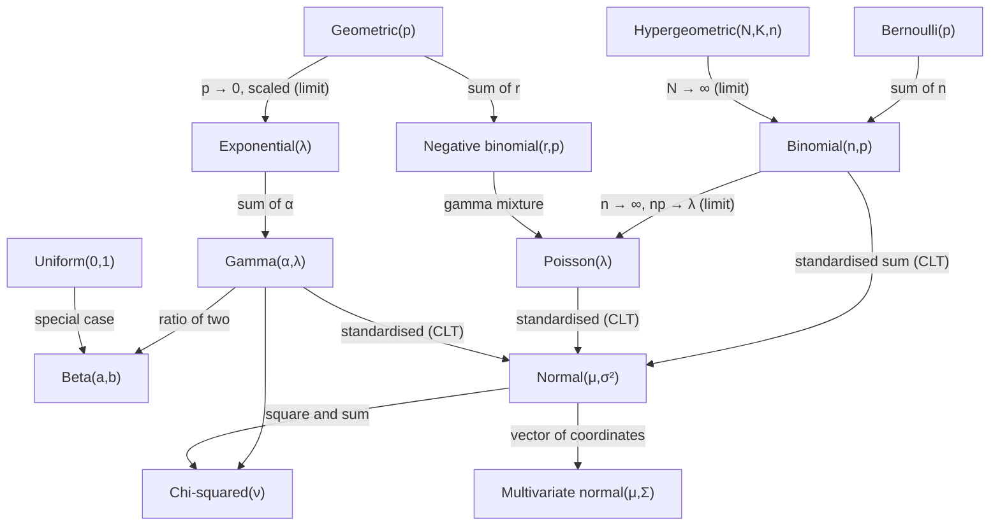

# Probability Distributions

> [Probability](../README.md) · Level: Advanced · Prerequisites: [Probability Foundations](../01-probability-foundations/README.md), [Random Variables](../03-random-variables/README.md), [Calculus](../../07-calculus/README.md) · Estimated time: 12 h

## 1. Introduction

[Random Variables](../03-random-variables/README.md) supplied the machinery: measurable functions, CDFs, mass
functions, densities, quantiles, change of variable, mixtures, joint laws. This topic supplies the *objects* the
machinery is applied to. Thirteen families cover most of what is used in probability, statistics, physics and
machine learning: six discrete (Bernoulli, binomial, geometric, negative binomial, hypergeometric, Poisson) and
seven continuous (uniform, exponential, gamma, beta, chi-squared, normal, multivariate normal).

The aim is not a catalogue. A catalogue is useless, because the point of a named family is that you can
*recognise* it in a problem, *derive* its moments without looking anything up, and know which other families it
turns into under sums and limits. So for every family this tutorial gives

* the definition, its parameters and their admissible range, and the support;
* the mass function or density, with its normalisation *derived*, never asserted;
* the mean and the variance, derived from the definition;
* the moment generating function where it earns its keep;
* what the family models, in the language of the application, and
* where it sits in the web of relationships: which family it is a special case of, which sums reproduce it, and
  which limit it arises from.

Five themes run through the topic.

**Parameters are not probabilities.** $\lambda$ in a Poisson law is a rate, $\alpha,\beta$ in a gamma law are a
shape and a rate, $N,K,n$ in a hypergeometric law are counts of objects. Writing "$\lambda=3$" says nothing about
how likely anything is until the pmf is evaluated.

**Most families arise from others.** A binomial is a sum of Bernoullis, a negative binomial a sum of geometrics,
a Poisson a limit of binomials, a gamma a sum of exponentials, a chi-squared a gamma with rates fixed, a
multivariate normal a linear image of independent normals. Anyone who understands the small families gets the
large ones almost free.

**Support matters as much as the formula.** The same algebraic expression on a different support is a different
distribution, and most errors in applications come from forgetting the support: a rate of $2$ per hour used for a
quantity measured in minutes, a binomial with a trial count that varies, a conditional density used outside its
slice.

**Continuous families need not be symmetric, and symmetric families need not be normal.** The beta family
contains densities that are U-shaped, J-shaped or uniform; the normal family is a single two-parameter curve. The
central limit theorem explains why the normal family is ubiquitous, not why it is universal.

**Mean and variance do not determine a distribution.** They are the first two moments; two families or two
members of a family can share both and differ elsewhere. This is why the moment generating function, when it
exists, is the better summary: it determines the law.

The names attached to the families record their history — Pascal, Fermat and Jacob Bernoulli for the binomial and
geometric; de Moivre and Laplace for the normal; Poisson's 1837 study of wrongful convictions for the Poisson law;
Pearson's biometric programme around 1900 for gamma, beta and chi-squared — but the mathematics is the mathematics
of sums, limits and normalising constants.

## 2. Prerequisites

* **Probability spaces and axioms** — events, $\sigma$-algebras, additivity, continuity:
  [Probability Foundations](../01-probability-foundations/README.md).
* **Random variables** — measurability, PMF, density, CDF, quantiles, change of variable, mixtures, marginals,
  conditionals, independence: [Random Variables](../03-random-variables/README.md), needed throughout.
* **Combinatorics** — factorials, binomial coefficients, the binomial theorem, Vandermonde's identity and the
  negative binomial series: [Combinatorics](../../20-combinatorics/README.md).
* **Calculus** — integration by parts, substitution, improper integrals, and the two standard integrals
  $\int_{\mathbb{R}}e^{-x^2/2}dx=\sqrt{2\pi}$ and $\int_0^\infty x^{a-1}e^{-x}dx=\Gamma(a)$, plus the limits
  $(1+x/n)^n\to e^x$: [Calculus](../../07-calculus/README.md).

## 3. Learning Objectives

After working through this tutorial you will be able to:

1. State the definition, parameters, support and pmf or density of each of the thirteen families.
2. Verify each normalisation constant by an explicit sum, series or integral.
3. Derive the mean and variance of each family from its definition, without consulting a table.
4. Compute and use the moment generating function of the binomial, Poisson, exponential, gamma, chi-squared and
   normal families, and explain why it determines the law.
5. Prove the memorylessness of the geometric and exponential laws, and characterise those laws by it.
6. Derive the Poisson law as the limit of binomial laws with $np_n\to\lambda$, with error control.
7. Explain the Poisson process and derive its three faces: Poisson counts, exponential interarrival times, gamma
   waiting times.
8. Prove that the sum of independent binomials with a common $p$, of independent Poissons, of independent gammas
   with a common rate, and of independent chi-squareds is again in the same family.
9. Derive the chi-squared density from the gamma density, and the normal density from the standard normal by a
   change of scale.
10. Write the multivariate normal density, compute its marginals, its linear images, and its conditional laws in
    the bivariate case.
11. Choose an appropriate family for a modelling problem, and justify the choice by its support and its
    mechanism.
12. Recognise the standard traps: confusing rate and scale, ignoring the support, using a continuous formula for
    a discrete count, and assuming that a limit theorem applies before checking its hypotheses.

## 4. Intuition

Every family in this topic answers one of five questions.

*How many successes in a fixed number of attempts?* Bernoulli for one attempt; binomial for $n$ independent
attempts. *How long until the first success, or until the $r$-th?* Geometric and negative binomial, counting
trials. *How many rare events in a fixed window of time or space?* Poisson. *How many marked items in a sample
drawn without replacement?* Hypergeometric. *How long until something happens, when the hazard is constant?*
Exponential; and the sum of several such waits is gamma. *What proportion of a whole is one part?* Beta.
*What is the distribution of a sum of squares, or of a squared distance?* Chi-squared. *What is the aggregate of
many small independent influences?* Normal; and several correlated quantities together, multivariate normal.

Two ideas unify the list. The first is the **urn**: draw balls, with or without replacement, count colours, and
the binomial and hypergeometric laws fall out. The second is the **clock**: events occur in time at a rate, and
the Poisson, exponential, gamma, negative binomial and geometric laws are five views of the same process.

The continuous families are best remembered by their *shape parameters*. A gamma density is a power times a
decaying exponential; varying the power moves the density from decreasing (shape $\le1$) through unimodal (shape
$>1$), and varying the rate stretches it horizontally. The beta density is a power times a power of $(1-x)$: it
can be U-shaped, bell-shaped, uniform or monotone, which is why it models proportions. The normal density is a
bell curve fixed up to location and scale, and it is *the same* curve for every parameter value once the axis is
standardised.

Finally, one discipline of thought repays everything else: when a formula is needed, **derive it from the
definition, not from memory**. Every mean and variance in this topic follows from a summation identity or one
integration by parts. A reader who can do those five or six computations never needs the table.

## 5. Formal Definition

**Definition 5.1 (Parametric family).** A *parametric family* of distributions is a set
$\{P_\theta:\theta\in\Theta\}$ of probability measures on $(\mathbb{R},\mathcal{B}(\mathbb{R}))$ indexed by a
*parameter* $\theta$ ranging over a *parameter space* $\Theta$. A random variable $X$ *belongs to the family*, or
*has that law*, written $X\sim P_\theta$, if its distribution is $P_\theta$. The *support* of $P_\theta$ is the
smallest closed set carrying probability $1$.

Parameters are *identifiable* if distinct parameter values give distinct distributions; all families below are
identifiable, with one caveat noted for mixtures of binomials in §7.12. Statements such as "$X$ is binomial with
$n$ trials and success probability $p$", written $X\sim\operatorname{Bin}(n,p)$, specify both the family and the
parameter.

**Definition 5.2 (The six discrete families).** In the table, $k$ ranges over the support shown, $q:=1-p$, and
$\binom{n}{k}:=0$ when $k\notin\{0,\dots,n\}$.

| Family | Parameters | Support | Mass function |
|---|---|---|---|
| Bernoulli$(p)$ | $p\in[0,1]$ | $\{0,1\}$ | $p^kq^{1-k}$ |
| Binomial$(n,p)$ | $n\in\mathbb{N}$, $p\in[0,1]$ | $\{0,\dots,n\}$ | $\binom{n}{k}p^kq^{n-k}$ |
| Geometric$(p)$ | $p\in(0,1]$ | $\{1,2,3,\dots\}$ | $q^{k-1}p$ |
| Negative binomial$(r,p)$ | $r\in\mathbb{N}$, $p\in(0,1]$ | $\{r,r+1,\dots\}$ | $\binom{k-1}{r-1}p^rq^{k-r}$ |
| Hypergeometric$(N,K,n)$ | $N\in\mathbb{N}$, $K,n\in\{0,\dots,N\}$ | $\{\max(0,n+K-N),\dots,\min(n,K)\}$ | $\dfrac{\binom{K}{k}\binom{N-K}{n-k}}{\binom{N}{n}}$ |
| Poisson$(\lambda)$ | $\lambda>0$ | $\{0,1,2,\dots\}$ | $e^{-\lambda}\dfrac{\lambda^k}{k!}$ |

Each is a mass function: the entries are non-negative and sum to $1$ over the support, by the binomial theorem
(rows 1, 2), the geometric series (row 3), the negative binomial series (row 4), Vandermonde's identity (row 5),
and the exponential series (row 6). These verifications are carried out in §7.

**Definition 5.3 (The seven continuous families).** Here $x$ ranges over the support and $f$ is the density; the
normalising constants are derived in §7.

| Family | Parameters | Support | Density |
|---|---|---|---|
| Uniform$(a,b)$ | $a<b$ | $(a,b)$ | $\dfrac{1}{b-a}$ |
| Exponential$(\lambda)$ | $\lambda>0$ | $(0,\infty)$ | $\lambda e^{-\lambda x}$ |
| Gamma$(\alpha,\lambda)$ | $\alpha,\lambda>0$ | $(0,\infty)$ | $\dfrac{\lambda^\alpha x^{\alpha-1}e^{-\lambda x}}{\Gamma(\alpha)}$ |
| Beta$(a,b)$ | $a,b>0$ | $(0,1)$ | $\dfrac{x^{a-1}(1-x)^{b-1}}{B(a,b)}$ |
| Chi-squared$(\nu)$ | $\nu>0$ | $(0,\infty)$ | $\dfrac{x^{\nu/2-1}e^{-x/2}}{2^{\nu/2}\Gamma(\nu/2)}$ |
| Normal$(\mu,\sigma^2)$ | $\mu\in\mathbb{R}$, $\sigma>0$ | $\mathbb{R}$ | $\dfrac{1}{\sigma\sqrt{2\pi}}e^{-(x-\mu)^2/(2\sigma^2)}$ |
| Multivariate normal$(\mu,\Sigma)$ | $\mu\in\mathbb{R}^d$, $\Sigma$ positive definite | $\mathbb{R}^d$ | $\dfrac{e^{-\frac12(x-\mu)^{\mathsf{T}}\Sigma^{-1}(x-\mu)}}{(2\pi)^{d/2}\sqrt{\det\Sigma}}$ |

The *gamma function* is $\Gamma(\alpha)=\int_0^\infty x^{\alpha-1}e^{-x}dx$ for $\alpha>0$, with
$\Gamma(\alpha+1)=\alpha\Gamma(\alpha)$, $\Gamma(n)=(n-1)!$ for $n\in\mathbb{N}$ and $\Gamma(\tfrac12)=\sqrt\pi$.
The *beta function* is $B(a,b)=\int_0^1x^{a-1}(1-x)^{b-1}dx=\Gamma(a)\Gamma(b)/\Gamma(a+b)$.

Two conventions fixed once and for all. **Geometric and negative binomial count trials up to and including the
last success**, so both supports start at $1$ (respectively $r$), and $\mathbb{E}[\text{Geometric}(p)]=1/p$. Many
software packages count *failures* instead, which subtracts $1$ from every value and changes the mean to $q/p$; the
formulas here are not those. **The gamma family is parametrised by a rate** $\lambda$, not a scale
$\theta=1/\lambda$; a scale parametrisation replaces $\lambda^\alpha x^{\alpha-1}e^{-\lambda x}$ by
$x^{\alpha-1}e^{-x/\theta}/\theta^\alpha$.

**Definition 5.4 (Independence and samples).** Random variables $X_1,\dots,X_n$ are *independent and identically
distributed* (iid) with law $P$ if they are independent and each has law $P$. A *Bernoulli trial* is an
experiment with two outcomes, success of probability $p$ and failure of probability $q=1-p$; a *sequence of
trials* is a sequence of independent copies.

## 6. Mathematical Notation

| Symbol | Read as | Meaning |
|---|---|---|
| $X\sim\operatorname{Bin}(n,p)$ | $X$ is binomial | family and parameter values |
| $q$ | complement of $p$ | $q=1-p$ |
| $\binom{n}{k}$ | $n$ choose $k$ | $n!/(k!(n-k)!)$ |
| $\lambda$ | lambda | a rate: events or arrivals per unit time |
| $\alpha,\beta$ (gamma) | shape, rate | gamma parameters, both positive |
| $\theta=1/\lambda$ | scale | the mean of an exponential law |
| $a,b$ (beta) | shape parameters | positive |
| $\nu$ | degrees of freedom | chi-squared parameter |
| $\mu,\sigma^2$ | mean, variance | normal parameters |
| $\Sigma$ | covariance matrix | symmetric positive definite, $d\times d$ |
| $\Gamma(\alpha)$, $B(a,b)$ | gamma, beta functions | normalising constants |
| $M_X(t)$ | moment generating function | $\mathbb{E}[e^{tX}]$, defined near $t=0$ |
| $\Phi,\varphi$ | standard normal CDF, density | $\mu=0$, $\sigma=1$ |
| $\operatorname{Pois}(\lambda t)$ | Poisson with mean $\lambda t$ | counts in a window of length $t$ |
| $\overset{d}{\to}$ | convergence in distribution | $F_n(x)\to F(x)$ at continuity points |
| iid | independent, identically distributed | independent copies of one law |
| $X\perp\!\!\!\perp Y$ | independent | joint law factorises |

## 7. Core Concepts

### 7.1 Bernoulli: the indicator family

$X\sim\text{Bernoulli}(p)$ takes the values $1$ (success) and $0$ (failure) with probabilities $p$ and $q=1-p$.
Every indicator $\mathbf{1}_A$ is Bernoulli with $p=\Pr(A)$, and conversely every Bernoulli variable is an
indicator of the event $\{X=1\}$. The moments follow by direct computation:

$$
\mathbb{E}[X]=0\cdot q+1\cdot p=p,\qquad
\mathbb{E}[X^2]=p,\qquad
\operatorname{Var}(X)=p-p^2=p(1-p)=pq .
$$

The MGF is $M(t)=q+pe^{t}$, and the Bernoulli family is the atom from which the binomial, geometric, negative
binomial and hypergeometric families are assembled. Its variance is largest at $p=\tfrac12$ (value $\tfrac14$)
and vanishes at $p=0$ and $p=1$, where the variable is degenerate.

### 7.2 Binomial: successes in a fixed number of trials

Let $X$ be the number of successes in $n$ independent Bernoulli trials of probability $p$. Then

$$
\Pr(X=k)=\binom{n}{k}p^kq^{n-k},\qquad k=0,\dots,n,
$$

because each sequence of $k$ successes and $n-k$ failures has probability $p^kq^{n-k}$ by independence, and there
are $\binom{n}{k}$ such sequences.

*Normalisation.* $\sum_{k=0}^n\binom{n}{k}p^kq^{n-k}=(p+q)^n=1$ by the binomial theorem.

*Mean.* For $1\le k\le n$ use $k\binom{n}{k}=n\binom{n-1}{k-1}$. Then

$$
\mathbb{E}[X]=\sum_{k=0}^nk\binom{n}{k}p^kq^{n-k}
=np\sum_{k=1}^{n}\binom{n-1}{k-1}p^{k-1}q^{n-k}
=np(p+q)^{n-1}=np .
$$

*Variance.* Similarly $k(k-1)\binom{n}{k}=n(n-1)\binom{n-2}{k-2}$, so

$$
\mathbb{E}[X(X-1)]=n(n-1)p^2(p+q)^{n-2}=n(n-1)p^2,
\qquad
\operatorname{Var}(X)=n(n-1)p^2+np-n^2p^2=np-np^2=npq .
$$

*MGF.* $\mathbb{E}[e^{tX}]=\sum_k\binom{n}{k}(pe^t)^kq^{n-k}=(q+pe^t)^n$.

*Sums.* If $X\sim\text{Bin}(m,p)$ and $Y\sim\text{Bin}(n,p)$ are independent, then $X+Y\sim\text{Bin}(m+n,p)$,
because the MGFs multiply: $(q+pe^t)^m(q+pe^t)^n=(q+pe^t)^{m+n}$, and the MGF determines the law (§8.1). The common
$p$ is essential: binomials with different success probabilities sum to a law outside the family.

*What it models.* The number of heads in $n$ tosses; the number of defective items in a batch under independent
inspection; the number of visits to a website from $n$ independent visitors; the number of correct guesses in a
multiple-choice test. The binomial is also the exact law behind the normal and Poisson approximations of §7.6 and
§7.12.

### 7.3 Geometric: waiting for the first success

Let $X$ be the number of trials up to and including the first success. Then $X=k$ means $k-1$ failures followed
by a success, so

$$
\Pr(X=k)=q^{k-1}p,\qquad k=1,2,\dots
$$

*Normalisation.* $\sum_{k\ge1}q^{k-1}p=p/(1-q)=1$.

*Mean.* Using $\sum_{k\ge1}kr^{k-1}=1/(1-r)^2$,
$\mathbb{E}[X]=p/(1-q)^2=p/p^2=1/p$.

*Variance.* Using $\sum_{k\ge1}k^2r^{k-1}=(1+r)/(1-r)^3$,
$$
\mathbb{E}[X^2]=\frac{p(1+q)}{(1-q)^3}=\frac{1+q}{p^2},
\qquad
\operatorname{Var}(X)=\frac{1+q}{p^2}-\frac{1}{p^2}=\frac{q}{p^2}.
$$

*MGF.* $\mathbb{E}[e^{tX}]=\sum_{k\ge1}pe^{tk}q^{k-1}=\dfrac{pe^t}{1-qe^t}$, valid for $qe^t<1$.

*Memorylessness.* For integers $n,k\ge1$,
$$
\Pr(X>n+k\mid X>n)=\frac{\Pr(X>n+k)}{\Pr(X>n)}=\frac{q^{n+k}}{q^n}=q^k=\Pr(X>k),
$$
using $\Pr(X>m)=q^m$, which follows from the geometric series. The geometric law is the *only* law on
$\{1,2,\dots\}$ with this property (Exercise 25): having waited $n$ trials without success, the remaining wait has
exactly the original law.

*What it models.* The number of items inspected until the first defective one; the number of shots until the first
hit; the index of the first success in a Bernoulli sequence. In a Poisson process, the geometric law is the
discrete-time shadow of the exponential: successes per trial correspond to events per unit time.

### 7.4 Negative binomial: waiting for the $r$-th success

Let $X$ be the number of trials up to and including the $r$-th success. Then the last trial is a success and the
preceding $k-1$ trials contain $r-1$ successes, so

$$
\Pr(X=k)=\binom{k-1}{r-1}p^rq^{k-r},\qquad k=r,r+1,\dots
$$

*Normalisation.* Put $j=k-r$ and use $(1-x)^{-r}=\sum_{j\ge0}\binom{j+r-1}{j}x^j$ at $x=q$:
$$
\sum_{k\ge r}\binom{k-1}{r-1}p^rq^{k-r}=p^r(1-q)^{-r}=p^rp^{-r}=1 .
$$

*MGF.* Summing directly as above, $\mathbb{E}[e^{tX}]=p^re^{tr}(1-qe^t)^{-r}=\Bigl(\dfrac{pe^t}{1-qe^t}\Bigr)^{r}$,
which is the $r$-th power of the geometric MGF. By uniqueness of the MGF, **the negative binomial law is the law of
the sum of $r$ iid geometric variables**: the total wait for $r$ successes is the sum of $r$ separate waits.

*Mean and variance.* Differentiating $\log M(t)=r\bigl(t+\log p-\log(1-qe^t)\bigr)$,
$$
(\log M)'(t)=\frac{r}{1-qe^t},\qquad
(\log M)''(t)=\frac{rqe^t}{(1-qe^t)^2},
$$
so $\mathbb{E}[X]=r/p$ and $\operatorname{Var}(X)=rq/p^2$ (Lemma 8.1).

*What it models.* The number of trials to achieve $r$ successes; the number of customers to reach $r$ sales; the
number of days until $r$ accidents. Because $r$ need not be an integer, the same formula defines a
*polya* family for real $r>0$, which is the continuous mixture of Poisson laws by a gamma rate (§7.14).

### 7.5 Hypergeometric: sampling without replacement

An urn contains $N$ items, $K$ of them marked. Draw $n$ without replacement and let $X$ be the number of marked
items drawn. Counting favourable draws,

$$
\Pr(X=k)=\frac{\binom{K}{k}\binom{N-K}{n-k}}{\binom{N}{n}},
\qquad \max(0,n+K-N)\le k\le\min(n,K).
$$

*Normalisation.* $\sum_k\binom{K}{k}\binom{N-K}{n-k}=\binom{N}{n}$ is Vandermonde's identity: the coefficient of
$x^n$ in $(1+x)^K(1+x)^{N-K}$ is both $\binom{N}{n}$ and the stated convolution.

*Mean.* Using $k\binom{K}{k}=K\binom{K-1}{k-1}$ and Vandermonde's identity again,
$$
\mathbb{E}[X]=K\sum_k\frac{\binom{K-1}{k-1}\binom{N-K}{n-k}}{\binom{N}{n}}
=K\frac{\binom{N-1}{n-1}}{\binom{N}{n}}=K\cdot\frac{n}{N}=\frac{nK}{N}.
$$
So the mean equals the binomial mean $np$ with $p=K/N$: without replacement the average is unchanged.

*Variance.* Using $k(k-1)\binom{K}{k}=K(K-1)\binom{K-2}{k-2}$ similarly,
$\mathbb{E}[X(X-1)]=K(K-1)\binom{N-2}{n-2}\big/\binom{N}{n}=K(K-1)\frac{n(n-1)}{N(N-1)}$, hence

$$
\operatorname{Var}(X)=\frac{nK(N-K)(N-n)}{N^2(N-1)}
=np(1-p)\cdot\frac{N-n}{N-1},\qquad p=\frac KN .
$$

The factor $\frac{N-n}{N-1}$ is the *finite population correction*: it is $1$ when $n=1$ and $0$ when $n=N$,
reflecting the certainty of a census. Since the factor is below $1$, sampling without replacement is *less*
variable than sampling with replacement — the hypergeometric variance is smaller than the binomial variance.

*What it models.* Quality control by sampling a batch without replacement; the number of aces in a poker hand;
capture–recapture estimates; the composition of a sample from a finite population. Its limit as $N\to\infty$ with
$K/N\to p$ and $n$ fixed is $\operatorname{Bin}(n,p)$ (Exercise 28).

### 7.6 Poisson: rare events in a continuum

$$
\Pr(X=k)=e^{-\lambda}\frac{\lambda^k}{k!},\qquad k=0,1,2,\dots
$$

*Normalisation.* $\sum_{k\ge0}\lambda^k/k!=e^{\lambda}$.

*Mean.* $\mathbb{E}[X]=\sum_{k\ge1}ke^{-\lambda}\lambda^k/k!=\lambda e^{-\lambda}\sum_{k\ge1}\lambda^{k-1}/(k-1)!=\lambda$.

*Variance.* Using $k(k-1)\lambda^k/k!=\lambda^2\lambda^{k-2}/(k-2)!$,
$\mathbb{E}[X(X-1)]=\lambda^2$, so $\operatorname{Var}(X)=\lambda^2+\lambda-\lambda^2=\lambda$: the Poisson family
is equidispersed, with variance equal to mean.

*MGF.* $M(t)=e^{-\lambda}\sum_k(\lambda e^t)^k/k!=\exp\bigl(\lambda(e^t-1)\bigr)$.

*Sums.* $M_{X+Y}=e^{\lambda_1(e^t-1)}e^{\lambda_2(e^t-1)}=e^{(\lambda_1+\lambda_2)(e^t-1)}$: independent Poissons
add rates.

**The binomial limit.** Let $X_n\sim\operatorname{Bin}(n,p_n)$ with $np_n\to\lambda$. For fixed $k$,

$$
\Pr(X_n=k)=\underbrace{\frac{n(n-1)\cdots(n-k+1)}{n^k}}_{\to\,1}\cdot
\frac{\lambda_n^k}{k!}\cdot
\underbrace{\Bigl(1-\frac{\lambda_n}{n}\Bigr)^{n}}_{\to\,e^{-\lambda}}\cdot
\underbrace{\Bigl(1-\frac{\lambda_n}{n}\Bigr)^{-k}}_{\to\,1}
\longrightarrow e^{-\lambda}\frac{\lambda^k}{k!},
$$

where $\lambda_n=np_n$. The first factor is a product of $k$ terms $(1-j/n)\to1$; the third converges to
$e^{-\lambda}$ by the standard limit $(1-x/n)^n\to e^{-x}$. Hence *rare events with many trials and small success
probability are approximately Poisson*, and the approximation error is $O(1/n)$ for fixed $k$ (Exercise 26 makes
this quantitative).

**The Poisson process.** A *Poisson process* of rate $\lambda$ is a counting process $N(t)$ with independent
increments, $N(0)=0$, and, for small $h$,
$$
\Pr\bigl(N(h)=1\bigr)=\lambda h+o(h),\qquad \Pr\bigl(N(h)\ge2\bigr)=o(h).
$$
Write $p_k(t)=\Pr(N(t)=k)$. Splitting the interval $[0,t+h]$ at $t$ and using independent increments,
$$
p_k(t+h)=p_k(t)\bigl(1-\lambda h+o(h)\bigr)+p_{k-1}(t)\bigl(\lambda h+o(h)\bigr)+o(h),
$$
so $p_k'(t)=\lambda p_{k-1}(t)-\lambda p_k(t)$ with $p_0(0)=1$ and $p_k(0)=0$ for $k\ge1$. The solution is
$p_k(t)=e^{-\lambda t}(\lambda t)^k/k!$: **counts in a window of length $t$ are Poisson with mean $\lambda t$**.

Three consequences follow. The waiting time $T$ to the first event satisfies
$\Pr(T>t)=\Pr(N(t)=0)=e^{-\lambda t}$, so $T\sim\text{Exponential}(\lambda)$; by memorylessness the successive
interarrival times are independent exponentials. The waiting time $S_r$ to the $r$-th event is the sum of $r$
independent exponentials, hence $\text{Gamma}(r,\lambda)$. And the count in disjoint windows is independent
Poisson. Conversely, these three properties characterise the process, so "Poisson counts", "exponential waits" and
"independent increments" are three faces of one object.

*What it models.* Radioactive decays, calls to a switchboard, typos per page, stars in a telescope field,
mutations along a genome, claims arriving at an insurer. The two modelling conditions are *rarity* (events do not
cluster) and *independence* (no contagion).

### 7.7 Uniform: no information on an interval

$$
f(x)=\frac{1}{b-a},\quad a<x<b .
$$

*Mean.* By symmetry $f(x)=f(a+b-x)$, the centre of mass is the midpoint: $\mathbb{E}[X]=(a+b)/2$. Directly,
$\int_a^b\frac{x}{b-a}dx=\frac{b^2-a^2}{2(b-a)}=\frac{a+b}{2}$.

*Variance.*
$$
\mathbb{E}[X^2]=\frac{1}{b-a}\int_a^bx^2dx=\frac{b^3-a^3}{3(b-a)}=\frac{a^2+ab+b^2}{3},
$$
and
$$
\operatorname{Var}(X)=\frac{a^2+ab+b^2}{3}-\frac{(a+b)^2}{4}
=\frac{4(a^2+ab+b^2)-3(a^2+2ab+b^2)}{12}=\frac{(b-a)^2}{12}.
$$

*MGF.* $M(t)=\dfrac{e^{tb}-e^{ta}}{t(b-a)}$ for $t\ne0$, by integrating $e^{tx}$.

*What it models.* A completely unknown point in a bounded interval; rounding error; the quantile transform
$X=Q(U)$ of Theorem 8.7 in the previous topic. Uniform$(0,1)$ is also Beta$(1,1)$ (§7.10) and is the raw material
of simulation.

### 7.8 Exponential: waiting when the hazard is constant

$$
f(x)=\lambda e^{-\lambda x},\quad x>0 .
$$

*Normalisation.* $\int_0^\infty\lambda e^{-\lambda x}dx=\bigl[-e^{-\lambda x}\bigr]_0^\infty=1$.

*Mean.* Integrating by parts with $u=x$, $dv=\lambda e^{-\lambda x}dx$,
$$
\mathbb{E}[X]=\bigl[-xe^{-\lambda x}\bigr]_0^\infty+\int_0^\infty e^{-\lambda x}dx=0+\frac1\lambda .
$$

*Variance.* Integrating by parts twice, $\mathbb{E}[X^2]=2/\lambda^2$, so
$\operatorname{Var}(X)=2/\lambda^2-1/\lambda^2=1/\lambda^2$. The standard deviation equals the mean: the
coefficient of variation is $1$, a signature of the exponential's heavy right tail.

*MGF.* $\mathbb{E}[e^{tX}]=\int_0^\infty\lambda e^{-(\lambda-t)x}dx=\dfrac{\lambda}{\lambda-t}$ for $t<\lambda$.

*Memorylessness.* For $s,t\ge0$,
$$
\Pr(X>s+t\mid X>s)=\frac{\Pr(X>s+t)}{\Pr(X>s)}=\frac{e^{-\lambda(s+t)}}{e^{-\lambda s}}=e^{-\lambda t}=\Pr(X>t),
$$
using $\Pr(X>u)=e^{-\lambda u}$. The exponential is the only continuous law on $(0,\infty)$ with this property
(Exercise 29), which is why it, and not the normal, is the default model for lifetimes under a constant hazard.

*Constant hazard.* The *hazard rate* of a lifetime $T$ with density $f$ and survival $S(t)=\Pr(T>t)$ is
$h(t)=f(t)/S(t)$. For the exponential, $h(t)=\lambda e^{-\lambda t}/e^{-\lambda t}=\lambda$: the chance of failing
in the next instant does not depend on how long the item has already survived. Conversely, a constant hazard forces
the exponential law.

*What it models.* Radioactive decay, the time between Poisson events, the lifetime of a memoryless component, the
length of a telephone call in a crude model, the time until the next customer.

### 7.9 Gamma: sums of exponential waits, and general shapes

$$
f(x)=\frac{\lambda^\alpha x^{\alpha-1}e^{-\lambda x}}{\Gamma(\alpha)},\quad x>0,\ \alpha,\lambda>0 .
$$

*Normalisation.* Substitute $u=\lambda x$:
$\int_0^\infty\frac{\lambda^\alpha x^{\alpha-1}e^{-\lambda x}}{\Gamma(\alpha)}dx
=\frac{1}{\Gamma(\alpha)}\int_0^\infty u^{\alpha-1}e^{-u}du=1$.

*Mean and variance.* The same substitution, or the gamma integral $\int_0^\infty x^{s-1}e^{-\lambda x}dx=\Gamma(s)/\lambda^s$,
gives
$$
\mathbb{E}[X^s]=\frac{\lambda^\alpha}{\Gamma(\alpha)}\cdot\frac{\Gamma(\alpha+s)}{\lambda^{\alpha+s}}
=\frac{\Gamma(\alpha+s)}{\lambda^s\Gamma(\alpha)} .
$$
Hence $\mathbb{E}[X]=\Gamma(\alpha+1)/(\lambda\Gamma(\alpha))=\alpha/\lambda$ and
$\mathbb{E}[X^2]=\Gamma(\alpha+2)/(\lambda^2\Gamma(\alpha))=\alpha(\alpha+1)/\lambda^2$, so
$$
\operatorname{Var}(X)=\frac{\alpha(\alpha+1)-\alpha^2}{\lambda^2}=\frac{\alpha}{\lambda^2}.
$$
The ratio variance/mean is $1/\lambda$, independent of the shape: gamma laws are overdispersed relative to the
Poisson with the same mean when $\lambda<1$.

*MGF.* $\mathbb{E}[e^{tX}]=\Bigl(\dfrac{\lambda}{\lambda-t}\Bigr)^{\alpha}$ for $t<\lambda$, by the same
substitution with rate $\lambda-t$.

*Sums.* The MGF multiplies, so independent $\text{Gamma}(\alpha_1,\lambda)$ and $\text{Gamma}(\alpha_2,\lambda)$
variables add to $\text{Gamma}(\alpha_1+\alpha_2,\lambda)$. In particular the sum of $n$ iid
$\text{Exponential}(\lambda)$ variables is $\text{Gamma}(n,\lambda)$, since $\Gamma(1,\lambda)$ is the exponential
and $\alpha$ adds. This is the continuous analogue of "negative binomial is a sum of geometrics", and it is the law
of the waiting time to the $n$-th event of a Poisson process.

*Shapes.* For $\alpha\le1$ the density is decreasing (unbounded at $0$ if $\alpha<1$); for $\alpha>1$ it rises to a
mode at $(\alpha-1)/\lambda$ and then decays. So the family interpolates between the exponential and a bell-shaped
curve with a right tail; the chi-squared family is the special case $\lambda=\tfrac12$.

*What it models.* Total waiting time for several Poisson events; aggregate insurance claims in a period; rainfall
accumulation; the conjugate prior for a Poisson rate in Bayesian inference.

### 7.10 Beta: distributions on proportions

$$
f(x)=\frac{x^{a-1}(1-x)^{b-1}}{B(a,b)},\quad 0<x<1,\ a,b>0,
\qquad B(a,b)=\int_0^1x^{a-1}(1-x)^{b-1}dx .
$$

*Normalisation* is the definition of $B$. The identity $B(a,b)=\Gamma(a)\Gamma(b)/\Gamma(a+b)$ follows from the
gamma integral by the substitution $(u,v)\mapsto(u/(u+v),u+v)$, or from the convolution of gamma densities
(§7.14).

*Mean.* Using $B(a+1,b)=\dfrac{\Gamma(a+1)\Gamma(b)}{\Gamma(a+b+1)}=\dfrac{a}{a+b}B(a,b)$,
$$
\mathbb{E}[X]=\frac{1}{B(a,b)}\int_0^1x^{a}(1-x)^{b-1}dx=\frac{B(a+1,b)}{B(a,b)}=\frac{a}{a+b}.
$$

*Variance.* Similarly $B(a+2,b)=\dfrac{a(a+1)}{(a+b)(a+b+1)}B(a,b)$, so
$$
\mathbb{E}[X^2]=\frac{a(a+1)}{(a+b)(a+b+1)},\qquad
\operatorname{Var}(X)=\frac{a(a+1)}{(a+b)(a+b+1)}-\frac{a^2}{(a+b)^2}
=\frac{ab}{(a+b)^2(a+b+1)}.
$$

*Shapes.* With $a=b=1$ the density is constant: Beta$(1,1)=$ Uniform$(0,1)$. With $a=b<1$ it is U-shaped and
unbounded at both ends; with $a=b>1$ it is unimodal and symmetric about $\tfrac12$; with $a\ne b$ it is skewed, and
with $a<1<b$ it is J-shaped. So a single two-parameter family covers almost every shape a proportion can take.

*What it models.* A proportion or probability of unknown value: the click-through rate of an advertisement, the
fraction of a genome that is coding, the fairness $p$ of a coin in Bayesian inference. Its role there is as the
conjugate prior for a binomial success probability: a Beta$(a,b)$ prior updated by $k$ successes in $n$ trials
gives Beta$(a+k,b+n-k)$.

### 7.11 Chi-squared: squared distances

For $\nu>0$, the $\chi^2_\nu$ law has density
$$
f(x)=\frac{x^{\nu/2-1}e^{-x/2}}{2^{\nu/2}\Gamma(\nu/2)},\quad x>0 .
$$
Comparing with §7.9, this is exactly $\text{Gamma}\bigl(\alpha=\nu/2,\ \lambda=\tfrac12\bigr)$: the chi-squared
family is the gamma family with the rate fixed at one half. Hence

$$
\mathbb{E}[X]=\frac{\nu/2}{1/2}=\nu,\qquad
\operatorname{Var}(X)=\frac{\nu/2}{(1/2)^2}=2\nu,\qquad
M(t)=(1-2t)^{-\nu/2}\ \ (t<\tfrac12).
$$

*Construction.* If $Z_1,\dots,Z_\nu$ are iid standard normal, then $\sum_{i=1}^\nu Z_i^2\sim\chi^2_\nu$. Indeed
$Z^2\sim\text{Gamma}(\tfrac12,\tfrac12)$ by the change-of-variable computation of the previous topic (the density
$e^{-y/2}/\sqrt{2\pi y}$ is precisely $\text{Gamma}(\tfrac12,\tfrac12)$), and the gamma family adds shapes at fixed
rate.

*Sums.* Independent chi-squareds add their degrees of freedom, which is immediate from the MGF:
$(1-2t)^{-\nu_1/2}(1-2t)^{-\nu_2/2}=(1-2t)^{-(\nu_1+\nu_2)/2}$.

*What it models.* Sums of squared errors; the sampling distribution of a sample variance,
$(n-1)S^2/\sigma^2\sim\chi^2_{n-1}$ for normal data; Pearson's goodness-of-fit statistic, which is asymptotically
chi-squared under the null; the distribution of a squared Mahalanobis distance.

### 7.12 Normal: the shape of aggregates

$$
f(x)=\frac{1}{\sigma\sqrt{2\pi}}e^{-(x-\mu)^2/(2\sigma^2)},\qquad x\in\mathbb{R}.
$$

*Normalisation.* Substituting $z=(x-\mu)/\sigma$ reduces the integral to $\int_{\mathbb{R}}\varphi(z)dz$ with
$\varphi(z)=e^{-z^2/2}/\sqrt{2\pi}$. To compute it, write $I=\int e^{-z^2/2}dz$; then
$I^2=\int\!\int e^{-(x^2+y^2)/2}dx\,dy=\int_0^{2\pi}\!\int_0^\infty e^{-r^2/2}r\,dr\,d\theta=2\pi$, so
$I=\sqrt{2\pi}$. Hence $f$ integrates to $1$.

*Mean.* With $z=(x-\mu)/\sigma$, $\mathbb{E}[X]=\mu+\sigma\int z\varphi(z)dz=\mu$, since $z\varphi(z)$ is odd and
integrable.

*Variance.* Substituting,
$$
\operatorname{Var}(X)=\sigma^2\int_{\mathbb{R}}z^2\varphi(z)dz
=\sigma^2\Bigl(\bigl[-z\varphi(z)\bigr]_{-\infty}^{\infty}+\int_{\mathbb{R}}\varphi(z)dz\Bigr)=\sigma^2,
$$
the middle step being integration by parts with $u=z$, $dv=z\varphi(z)dz=-d\varphi$.

*MGF.* Completing the square in the exponent,
$$
\mathbb{E}[e^{tX}]=e^{\mu t+\sigma^2t^2/2},\qquad t\in\mathbb{R}.
$$

*Linear maps and sums.* If $X\sim\mathcal{N}(\mu,\sigma^2)$ then $aX+b\sim\mathcal{N}(a\mu+b,a^2\sigma^2)$ (change
of variable, §9.5 of the previous topic). If $X\sim\mathcal{N}(\mu_1,\sigma_1^2)$ and
$Y\sim\mathcal{N}(\mu_2,\sigma_2^2)$ are independent, the MGF of $X+Y$ is
$e^{(\mu_1+\mu_2)t+(\sigma_1^2+\sigma_2^2)t^2/2}$, so $X+Y\sim\mathcal{N}(\mu_1+\mu_2,\sigma_1^2+\sigma_2^2)$: the
normal family is closed under addition, and the parameters add. The same argument gives that any linear combination
of independent normals is normal.

*The empirical rule.* For $Z\sim\mathcal{N}(0,1)$, $\Pr(\lvert Z\rvert\le1)\approx0.6827$,
$\Pr(\lvert Z\rvert\le2)\approx0.9545$ and $\Pr(\lvert Z\rvert\le3)\approx0.9973$.

*What it models.* Measurement error; the sum of many small independent contributions (the central limit theorem);
log returns in finance after transformation; noise in signal processing; the sampling distribution of means. It is
*not* a good default for lifetimes (symmetric support) or for counts (continuous support).

### 7.13 Multivariate normal: correlated coordinates

**Definition 7.11.** A random vector $X\in\mathbb{R}^d$ is *multivariate normal* with mean $\mu\in\mathbb{R}^d$ and
covariance matrix $\Sigma$ (symmetric positive semidefinite) if $X=\mu+AZ$ for some matrix $A$ with $AA^{\mathsf{T}}=\Sigma$
and $Z=(Z_1,\dots,Z_k)$ iid standard normal. When $\Sigma$ is positive definite and $A$ is invertible, $X$ has the
density of Definition 5.3.

The MGF is $\mathbb{E}\bigl[e^{t^{\mathsf{T}}X}\bigr]=\exp\bigl(t^{\mathsf{T}}\mu+\tfrac12t^{\mathsf{T}}\Sigma t\bigr)$
for $t\in\mathbb{R}^d$: substitute $X=\mu+AZ$ and complete the square coordinate by coordinate in $Z$.

**Marginals and linear maps.** Reading off coordinates, $X_i\sim\mathcal{N}(\mu_i,\Sigma_{ii})$; and if $B$ is a
$k\times d$ matrix then $BX+c\sim\mathcal{N}(B\mu+c,B\Sigma B^{\mathsf{T}})$. Both follow from the definition, since
$BX+c=(B\mu+c)+(BA)Z$.

**Uncorrelated implies independent.** If $\Sigma$ is block diagonal, $\Sigma=\operatorname{diag}(\Sigma_{11},\Sigma_{22})$,
the MGF factorises into the product of the two block MGFs, so the blocks are independent. For jointly normal
variables only, zero covariance *is* independence — the exception noted in the previous topic.

**Conditional laws.** Split $X=(X_1,X_2)$ with means $\mu_1,\mu_2$ and blocks $\Sigma_{11},\Sigma_{12},\Sigma_{21},\Sigma_{22}$
with $\Sigma_{22}$ invertible. Then
$$
X_1\mid X_2=x_2\ \sim\ \mathcal{N}\bigl(\mu_1+\Sigma_{12}\Sigma_{22}^{-1}(x_2-\mu_2),\
\Sigma_{11}-\Sigma_{12}\Sigma_{22}^{-1}\Sigma_{21}\bigr).
$$
For the standardised bivariate case ($\mu=0$, unit variances, correlation $\rho$) the derivation is short. The joint
density is proportional to
$$
\exp\Bigl(-\frac{z_1^2-2\rho z_1z_2+z_2^2}{2(1-\rho^2)}\Bigr)
=\exp\Bigl(-\frac{(z_1-\rho z_2)^2}{2(1-\rho^2)}\Bigr)\exp\Bigl(-\frac{z_2^2}{2}\Bigr),
$$
using $z_1^2-2\rho z_1z_2=(z_1-\rho z_2)^2-\rho^2z_2^2$. The second factor is the marginal density of $z_2$, so the
conditional density of $z_1$ given $z_2$ is normal with mean $\rho z_2$ and variance $1-\rho^2$. Rescaling by
$\sigma_1,\sigma_2$ gives the general formula.

*What it models.* Several correlated measurements: height and weight, the vector of returns on several assets, the
weights of a neural network layer under a Gaussian prior, errors in a multivariate regression. Its three
conveniences — closure under linear maps, explicit conditionals, and equivalence of independence and zero
correlation — are why it dominates multivariate statistics.

### 7.14 The web of relationships

The families are connected in three ways.

**As special cases.** Bernoulli$(p)$ is Binomial$(1,p)$. Exponential$(\lambda)$ is Gamma$(1,\lambda)$.
Chi-squared$(\nu)$ is Gamma$(\nu/2,\tfrac12)$. Uniform$(a,b)$ is Beta$(1,1)$ after rescaling; Uniform$(0,1)$ is
Beta$(1,1)$. The standard normal is Normal$(0,1)$, and the multivariate normal with diagonal $\Sigma$ is a vector
of independent normals.

**As sums of independent variables.** Binomials with a common $p$ add trial counts; Poissons add rates; gammas
with a common rate add shapes; chi-squareds add degrees of freedom; normals add means and variances; $r$ iid
geometric variables sum to a negative binomial; $n$ iid exponentials sum to a gamma. Each statement is a
one-line proof from the MGF.

**As limits.** Binomial$(n,\lambda/n)\to$ Poisson$(\lambda)$ as $n\to\infty$. Hypergeometric$(N,K,n)$ with
$K/N\to p$ and $n$ fixed $\to$ Binomial$(n,p)$ as $N\to\infty$. Scaled geometrics converge to the exponential:
if $X\sim\text{Geometric}(p)$ then $pX\overset{d}{\to}\text{Exponential}(1)$ as $p\downarrow0$, since
$\Pr(pX>x)=(1-p)^{\lfloor x/p\rfloor}\to e^{-x}$. And the central limit theorem sends standardised sums of iid
variables to the standard normal, which is why the normal law approximates binomial, Poisson (for large $\lambda$)
and gamma laws.

**A mixture identity.** If $\Lambda\sim\text{Gamma}(\alpha,\beta)$ and $N\mid\Lambda\sim\text{Poisson}(\Lambda)$,
then $N$ has the negative binomial (polya) law with parameters $\alpha$ and $p=\beta/(\beta+1)$. This *gamma–Poisson
mixture* explains overdispersion in count data: the counts inherit the variability of the rate. The computation is
Exercise 34.

## 8. Formulas and Properties

### 8.1 The moment generating function as a tool

**Lemma 8.1 (MGF calculus).** *If $M_X(t)=\mathbb{E}[e^{tX}]$ is finite for $\lvert t\rvert<\varepsilon$, then
$M_X(0)=1$, $M_X'(0)=\mathbb{E}[X]$, $M_X''(0)=\mathbb{E}[X^2]$, and
$\operatorname{Var}(X)=(\log M_X)''(0)$.*

*Proof.* Differentiating under the expectation is legitimate by dominated convergence, since
$\lvert Xe^{tX}\rvert\le\lvert X\rvert e^{\varepsilon\lvert X\rvert}$, which is integrable for small
$\varepsilon$. So $M_X'(t)=\mathbb{E}[Xe^{tX}]$, giving $M_X'(0)=\mathbb{E}[X]$; differentiating again gives
$M_X''(0)=\mathbb{E}[X^2]$. For the last identity, differentiate $\log M$ twice:
$(\log M)'=M'/M$ and $(\log M)''=M''/M-(M'/M)^2$, whose value at $0$ is
$\mathbb{E}[X^2]-\mathbb{E}[X]^2$. $\blacksquare$

**Proposition 8.2 (uniqueness).** *If $M_X(t)=M_Y(t)$ for all $t$ in an open interval about $0$, then
$X\overset{d}{=}Y$.*

This is the standard uniqueness theorem for moment generating functions; it is what licenses the phrase "the MGF
determines the law" in the arguments of §7. Its hypotheses cannot be dropped: there are distinct distributions with
the same sequence of moments, but not with the same MGF near zero.

**Proposition 8.3 (affine maps and sums).** *For constants $a,b$ and independent $X,Y$,*
$$
M_{aX+b}(t)=e^{bt}M_X(at),\qquad M_{X+Y}(t)=M_X(t)M_Y(t).
$$

*Proof.* $\mathbb{E}[e^{t(aX+b)}]=e^{bt}\mathbb{E}[e^{(at)X}]$; and by independence
$\mathbb{E}[e^{t(X+Y)}]=\mathbb{E}[e^{tX}e^{tY}]=\mathbb{E}[e^{tX}]\mathbb{E}[e^{tY}]$. $\blacksquare$

### 8.2 Means, variances and MGFs at a glance

| Family | Parameters | Mean | Variance | MGF |
|---|---|---|---|---|
| Bernoulli | $p$ | $p$ | $pq$ | $q+pe^{t}$ |
| Binomial | $n,p$ | $np$ | $npq$ | $(q+pe^t)^n$ |
| Geometric | $p$ | $1/p$ | $q/p^2$ | $\dfrac{pe^t}{1-qe^t}$ |
| Negative binomial | $r,p$ | $r/p$ | $rq/p^2$ | $\Bigl(\dfrac{pe^t}{1-qe^t}\Bigr)^r$ |
| Hypergeometric | $N,K,n$ | $np$ | $npq\dfrac{N-n}{N-1}$ | — |
| Poisson | $\lambda$ | $\lambda$ | $\lambda$ | $e^{\lambda(e^t-1)}$ |
| Uniform | $a,b$ | $\dfrac{a+b}{2}$ | $\dfrac{(b-a)^2}{12}$ | $\dfrac{e^{tb}-e^{ta}}{t(b-a)}$ |
| Exponential | $\lambda$ | $1/\lambda$ | $1/\lambda^2$ | $\dfrac{\lambda}{\lambda-t}$ |
| Gamma | $\alpha,\lambda$ | $\alpha/\lambda$ | $\alpha/\lambda^2$ | $\Bigl(\dfrac{\lambda}{\lambda-t}\Bigr)^\alpha$ |
| Beta | $a,b$ | $\dfrac{a}{a+b}$ | $\dfrac{ab}{(a+b)^2(a+b+1)}$ | — |
| Chi-squared | $\nu$ | $\nu$ | $2\nu$ | $(1-2t)^{-\nu/2}$ |
| Normal | $\mu,\sigma^2$ | $\mu$ | $\sigma^2$ | $e^{\mu t+\sigma^2t^2/2}$ |
| Multivariate normal | $\mu,\Sigma$ | $\mu$ | $\Sigma$ | $e^{t^{\mathsf{T}}\mu+\frac12t^{\mathsf{T}}\Sigma t}$ |

Here $q=1-p$ and, in the hypergeometric row, $p=K/N$. The entries without an MGF have no simple closed form (the
hypergeometric MGF exists but does not simplify; the beta MGF is a confluent hypergeometric function).

### 8.3 Closure under sums

**Theorem 8.4.** *Each of the following families is closed under sums of independent members:*

*(i) $\operatorname{Bin}(m,p)+\operatorname{Bin}(n,p)\sim\operatorname{Bin}(m+n,p)$, the same $p$ required;*
*(ii) $\operatorname{Pois}(\lambda_1)+\operatorname{Pois}(\lambda_2)\sim\operatorname{Pois}(\lambda_1+\lambda_2)$;*
*(iii) $\operatorname{Gamma}(\alpha_1,\lambda)+\operatorname{Gamma}(\alpha_2,\lambda)\sim\operatorname{Gamma}(\alpha_1+\alpha_2,\lambda)$,
the same rate required;*
*(iv) $\chi^2_{\nu_1}+\chi^2_{\nu_2}\sim\chi^2_{\nu_1+\nu_2}$;*
*(v) $\mathcal{N}(\mu_1,\sigma_1^2)+\mathcal{N}(\mu_2,\sigma_2^2)\sim\mathcal{N}(\mu_1+\mu_2,\sigma_1^2+\sigma_2^2)$.*

*Proof.* In each case multiply the MGFs of §8.2 and recognise the MGF of the asserted law, then apply
Proposition 8.2. For (i):
$(q+pe^t)^m(q+pe^t)^n=(q+pe^t)^{m+n}$. For (ii):
$e^{\lambda_1(e^t-1)}e^{\lambda_2(e^t-1)}=e^{(\lambda_1+\lambda_2)(e^t-1)}$. For (iii):
$(\lambda/(\lambda-t))^{\alpha_1+\alpha_2}$. For (iv): $(1-2t)^{-\nu_1/2}(1-2t)^{-\nu_2/2}$. For (v): add the
exponents. $\blacksquare$

Theorem 8.4 fails without the matching parameters: the sum of a Bin$(n,0.2)$ and a Bin$(n,0.5)$ is not binomial,
and the sum of exponentials with different rates is not gamma.

### 8.4 Limits between families

**Theorem 8.5.** *(i) If $X_n\sim\operatorname{Bin}(n,\lambda/n)$ then $X_n\overset{d}{\to}\operatorname{Pois}(\lambda)$.
(ii) If $X\sim\operatorname{Hypergeometric}(N,K,n)$ with $K/N\to p$ and $n$ fixed, then
$X\overset{d}{\to}\operatorname{Bin}(n,p)$. (iii) If $X_p\sim\text{Geometric}(p)$ then
$pX_p\overset{d}{\to}\text{Exponential}(1)$ as $p\downarrow0$.*

*Proof.* (i) is the computation of §7.6. (ii) Write
$\Pr(X=k)=\dfrac{\binom{K}{k}\binom{N-K}{n-k}}{\binom{N}{n}}$; for fixed $k$, each binomial coefficient ratio tends to
the corresponding power of $p$:
$\binom{K}{k}/\binom{N}{k}\to p^k$ and
$\binom{N-K}{n-k}/\binom{N-k}{n-k}\to(1-p)^{n-k}$, while
$\binom{N}{k}\binom{N-k}{n-k}/\binom{N}{n}=1$ identically. Multiplying gives $\binom{n}{k}p^k(1-p)^{n-k}$. (iii) For
$x>0$, $\Pr(pX_p>x)=\Pr(X_p>\lfloor x/p\rfloor)=(1-p)^{\lfloor x/p\rfloor}\to e^{-x}$, using
$(1-p)^{1/p}\to e^{-1}$ and $\lfloor x/p\rfloor p\to x$. $\blacksquare$

### 8.5 Memorylessness

**Proposition 8.6.** *(i) If $X\sim\text{Geometric}(p)$ and $n,k\in\mathbb{N}$ then
$\Pr(X>n+k\mid X>n)=\Pr(X>k)$. (ii) If $X\sim\text{Exponential}(\lambda)$ and $s,t\ge0$ then
$\Pr(X>s+t\mid X>s)=\Pr(X>t)$. (iii) Conversely, a distribution on $\{1,2,\dots\}$ with (i) is geometric, and a
distribution on $(0,\infty)$ with (ii) and a right-continuous survival function is exponential.*

*Proof.* (i) and (ii) are the computations of §7.3 and §7.8. For the converse in (ii), let $S(t)=\Pr(X>t)$; the
identity says $S(s+t)=S(s)S(t)$. A right-continuous solution of this functional equation on $(0,\infty)$ that is
non-increasing and satisfies $S(0)=1$ is $S(t)=e^{-\lambda t}$ with $\lambda=-\log S(1)$ (Exercise 29). The discrete
case is the same argument with $S(n)=q^n$. $\blacksquare$

## 9. Step-by-Step Examples

### 9.1 A binomial calculation

Let $X\sim\operatorname{Bin}(10,0.2)$. Then
$$
\Pr(X=3)=\binom{10}{3}(0.2)^3(0.8)^7=120\cdot0.008\cdot0.2097152\approx0.2013 .
$$
The mean is $np=2$ and the variance $npq=10(0.2)(0.8)=1.6$, so the standard deviation is about $1.265$.
*Check.* $\Pr(X=0)=0.8^{10}\approx0.1074$ and $\Pr(X=1)=10(0.2)(0.8)^9\approx0.2684$; the three probabilities
$0.1074+0.2684+0.2013\approx0.577$ are plausible for a law with mean $2$. ✓

### 9.2 Waiting for the third success

A player has success probability $0.3$ per attempt, independently. The probability that the third success occurs on
attempt $8$ is, by the negative binomial pmf with $r=3$, $k=8$,
$$
\binom{7}{2}(0.3)^3(0.7)^5=21\cdot0.027\cdot0.16807\approx0.0953 .
$$
The expected number of attempts is $r/p=10$ and the variance is $rq/p^2=3(0.7)/0.09\approx23.33$. *Check.* The
geometric wait for the first success alone has mean $1/0.3\approx3.33$; three such waits give $10$, matching
$r/p$. ✓

### 9.3 Sampling a batch without replacement

A batch contains $50$ items, $10$ of them defective. Five are inspected. With $X$ the number of defectives found,
$X\sim\text{Hypergeometric}(50,10,5)$ and
$$
\Pr(X=1)=\frac{\binom{10}{1}\binom{40}{4}}{\binom{50}{5}}=\frac{10\cdot91390}{2118760}\approx0.4313 .
$$
The mean is $nK/N=5(0.2)=1$ and the variance is
$npq\frac{N-n}{N-1}=5(0.2)(0.8)\frac{45}{49}\approx0.7347$, slightly below the binomial variance $0.8$. *Check.*
$\Pr(X=0)=\binom{40}{5}/\binom{50}{5}\approx0.3106$; the two probabilities are consistent with a mean of $1$. ✓

### 9.4 Poisson counts and the binomial approximation

Calls arrive at a rate of $3$ per hour, and the Poisson model is assumed. Then
$$
\Pr(X=0)=e^{-3}\approx0.0498,\qquad
\Pr(X\ge2)=1-e^{-3}(1+3)\approx1-0.1991=0.8009 .
$$
If instead $1000$ independent customers each call with probability $0.003$, the exact binomial has mean $3$ and
$$
\Pr(X=0)=(0.997)^{1000}\approx0.0496,
$$
within $0.0002$ of the Poisson value: with $n$ large, $p$ small and $np=3$, the two laws are nearly identical.
*Check.* The approximation is exact in the limit $n\to\infty$ with $np\to3$ (Theorem 8.5(i)). ✓

### 9.5 Memorylessness in practice

A component's lifetime is exponential with mean $5$ years, so $\lambda=0.2$ per year. Given that it has already
worked for $5$ years, the probability that it works $3$ more years is
$$
\Pr(T>8\mid T>5)=\frac{e^{-0.2\cdot8}}{e^{-0.2\cdot5}}=e^{-0.6}\approx0.5488,
$$
exactly the unconditional probability $\Pr(T>3)=e^{-0.6}$. By contrast, a wear-out model would give a smaller
value. The median lifetime is $\ln2/0.2\approx3.47$ years, well below the mean $5$ — a reminder that for skewed
laws the mean is not the typical value. *Check.* $\Pr(T>5)=e^{-1}\approx0.3679$ and
$\Pr(T>8)=e^{-1.6}\approx0.2019$; the ratio is $0.2019/0.3679\approx0.5488$. ✓

### 9.6 Gamma waits and Poisson counts are the same statement

Events of a Poisson process have rate $0.5$ per hour. The time $S_3$ to the third event is
$\text{Gamma}(3,0.5)$, with mean $3/0.5=6$ hours and variance $3/0.25=12$. The probability of waiting at most four
hours is
$$
\Pr(S_3\le4)=1-e^{-2}\Bigl(1+2+\frac{2^2}{2}\Bigr)=1-5e^{-2}\approx0.3233 .
$$
*Check.* $\{S_3\le4\}=\{N(4)\ge3\}$ and $N(4)\sim\text{Pois}(2)$, so the probability is
$1-\Pr(N(4)\le2)=1-e^{-2}(1+2+2)$, the same number. The gamma and Poisson families describe the same process from
the two sides of the clock. ✓

### 9.7 A beta proportion

A proportion $P$ is modelled as Beta$(2,3)$. Then
$$
\mathbb{E}[P]=\frac{2}{5}=0.4,\qquad
\operatorname{Var}(P)=\frac{2\cdot3}{5^2\cdot6}=0.04,\qquad
f(p)=12p(1-p)^2 .
$$
The density at $p=0.5$ is $12(0.5)(0.25)=1.5$, and
$$
\Pr(P\le0.5)=\int_0^{1/2}12p(1-p)^2dp=12\Bigl[\frac{p^2}{2}-\frac{2p^3}{3}+\frac{p^4}{4}\Bigr]_0^{1/2}
=12\Bigl(\frac18-\frac1{12}+\frac1{64}\Bigr)=\frac{11}{16}=0.6875 .
$$
*Check.* The mean $0.4<0.5$, so the median should be below the mean for this left-skewed density; indeed
$\Pr(P\le0.5)=0.6875>\tfrac12$ implies the median is below $0.5$. ✓

### 9.8 Conditional laws in the bivariate normal

Let $(X_1,X_2)$ be bivariate normal with $\mu=(1,2)$, $\sigma_1=2$, $\sigma_2=3$ and correlation $\rho=0.5$. Then
$\operatorname{Cov}(X_1,X_2)=\rho\sigma_1\sigma_2=3$ and, given $X_2=5$,
$$
\mathbb{E}[X_1\mid X_2=5]=1+\frac{3}{9}(5-2)=2,\qquad
\operatorname{Var}(X_1\mid X_2=5)=4-\frac{3^2}{9}=3 .
$$
So $X_1\mid X_2=5\sim\mathcal{N}(2,3)$, with a smaller variance than the marginal variance $4$: knowing $X_2$
removes part of the uncertainty. *Check.* The reduction is $\rho^2\sigma_1^2=0.25\cdot4=1$, and $4-1=3$. ✓ If
$\rho=0$ the conditional law would equal the marginal, as independence would require.

## 10. Visual Explanations

The family tree records the three kinds of arrow: special case (solid), sum of independent copies (labelled "sum"),
and limit (dashed).

The second table is a decision aid: read the mechanism in the left column and the family in the right.

| Mechanism | Family |
|---|---|
| one yes/no outcome | Bernoulli |
| fixed number of independent trials, count successes | binomial |
| trials until the first success | geometric |
| trials until the $r$-th success | negative binomial |
| sample without replacement from a finite population | hypergeometric |
| counts of rare events in a fixed window | Poisson |
| a point with no preferred location in an interval | uniform |
| wait for the next event, constant hazard | exponential |
| wait for the $r$-th event, or a sum of waits | gamma |
| a proportion or probability | beta |
| sum of squared standard normal coordinates | chi-squared |
| sum of many small independent effects | normal |
| several correlated measurements | multivariate normal |

## 11. Common Mistakes

1. **Confusing rate and scale.** Writing $f(x)=e^{-x/\lambda}/\lambda$ for the exponential with *rate* $\lambda$ is
   the scale parametrisation. With rate $\lambda$ the mean is $1/\lambda$, not $\lambda$.
2. **Confusing the geometric conventions.** Counting failures instead of trials shifts the support by one and
   replaces $1/p$ by $q/p$. Fix the convention before computing.
3. **Using a common $p$ when summing binomials.** $\operatorname{Bin}(n,0.3)+\operatorname{Bin}(n,0.4)$ is not
   binomial. The same applies to gamma sums with different rates.
4. **Forgetting the finite population correction.** Sampling without replacement has variance
   $npq(N-n)/(N-1)$, not $npq$.
5. **Treating a Poisson rate as a probability.** $\lambda=3$ is not a probability; the probability of an event is
   $1-e^{-3}\approx0.95$ and the probability of exactly three events is $e^{-3}3^3/3!\approx0.224$.
6. **Applying the Poisson limit without checking rarity and independence.** Clustered events (epidemics,
   bursts of trades) violate the independence axiom and produce overdispersion, for which the negative binomial is
   the standard replacement.
7. **Using the normal density for a positive quantity.** The normal law has support $\mathbb{R}$; for lifetimes or
   incomes use gamma, lognormal or exponential.
8. **Mixing up $\chi^2$ and gamma parameters.** $\chi^2_\nu$ is $\text{Gamma}(\nu/2,\tfrac12)$: the rate is
   $\tfrac12$, not $1$, and the shape is $\nu/2$, not $\nu$.
9. **Believing the memoryless property applies to everything.** It characterises the geometric and exponential
   laws; a wear-out component or a fatigue crack does not have it.
10. **Assuming uncorrelated means independent outside the normal family.** Only for jointly normal variables is
    zero covariance equivalent to independence.
11. **Reading a density as a probability.** $f(x)$ may exceed $1$; the beta density near an endpoint often does.
12. **Reporting a mean as a typical value for skewed data.** The exponential with mean $5$ has median $3.47$; the
    gamma with shape $2$ has its mode at $(\alpha-1)/\lambda$, not at $\alpha/\lambda$.

## 12. Applications

**Queueing and operations.** Arrivals and service times are Poisson and exponential; the negative binomial counts
customers until $r$ successes, the gamma the total busy period. These are the building blocks of queueing theory
and reliability engineering.

**Insurance and risk.** Claim counts are Poisson or negative binomial when overdispersed; claim sizes are gamma or
lognormal; aggregate claims are compound Poisson, whose moments follow from §7.14.

**Biology, medicine and physics.** Offspring counts are Poisson (negative binomial when clumped); survival times
are exponential or Weibull; the beta models allele frequencies; the hypergeometric appears in gene-set enrichment;
radioactive decay is Poisson and molecular speeds follow a chi distribution.

**Statistical inference and machine learning.** Chi-squared underlies goodness-of-fit and likelihood-ratio tests;
the normal underlies $z$- and $t$-statistics; the beta is the conjugate prior for a binomial proportion and the
gamma for a Poisson rate; the multivariate normal is the backbone of linear models and Gaussian processes; dropout
is Bernoulli masking and variational autoencoders use normal latents.

## 13. Exercises

The problem set is in [exercises.md](exercises.md): $36$ problems in four levels — **Beginner** (1–12),
**Intermediate** (13–23), **Advanced** (24–30) and **Challenge** (31–36). Each problem names the section it draws
on. Attempt the problems with this tutorial closed.

## 14. Solutions

Complete worked solutions are in [solutions.md](solutions.md), with the same numbering: strategy, every significant
step, and a check. Proofs are complete.

## 15. Summary

* A **parametric family** is a set of laws indexed by a parameter; specifying a family and its parameter values
  specifies the law. The support is part of the specification.
* **Discrete**: Bernoulli (one trial), binomial (successes in $n$ trials), geometric (wait for one success),
  negative binomial (wait for $r$), hypergeometric (sample without replacement), Poisson (rare counts).
* **Continuous**: uniform (no information), exponential (constant hazard), gamma (sums of exponentials), beta
  (proportions), chi-squared (sums of squares), normal (aggregates), multivariate normal (correlated coordinates).
* Every mean and variance in the table of §8.2 follows from one summation identity or one integration by parts;
  the derivations are in §7.
* The **MGF** $M(t)=\mathbb{E}[e^{tX}]$ has $M(0)=1$, gives moments by differentiation, multiplies under sums of
  independent variables, and determines the law.
* **Closure under sums** holds within the binomial (common $p$), Poisson, gamma (common rate), chi-squared and
  normal families, and for geometrics summing to a negative binomial.
* **Limits**: binomial $\to$ Poisson for rare events; hypergeometric $\to$ binomial for large populations; scaled
  geometric $\to$ exponential; standardised sums $\to$ normal by the central limit theorem.
* The geometric and exponential laws are **memoryless**, and no others are.
* The **Poisson process** is one object with three faces: Poisson counts in windows, exponential interarrival
  times, gamma waiting times.
* $\chi^2_\nu=\text{Gamma}(\nu/2,\tfrac12)$; a squared standard normal is $\chi^2_1$; chi-squareds add degrees of
  freedom.
* For **jointly normal** variables, zero covariance is equivalent to independence, and the conditional laws are
  normal with the explicit mean and variance of §7.13.

## 16. Further Learning

**Next in this repository.** *Expectation and Variance*, and then *The Law of Large Numbers and the Central Limit
Theorem*, are the following topics of the discipline; see the [discipline index](../README.md). The first proves
the moment machinery of §8.1 in general and treats covariance and generating functions systematically; the second
proves the limit theorems that §7.14 and §8.4 only sketch.

**Related.** [Statistics](../../11-statistics/README.md) uses every family here for estimation and testing;
[Combinatorics](../../20-combinatorics/README.md) supplies the counting identities behind the binomial,
hypergeometric and negative binomial pmfs; [Random Variables](../03-random-variables/README.md) supplies the
change-of-variable and mixture tools used throughout.

**Standard texts.**

* William Feller, *An Introduction to Probability Theory and Its Applications*, Volume I — the classic account of
  the discrete families and the Poisson process, with unmatched motivation.
* Geoffrey Grimmett and David Stirzaker, *Probability and Random Processes* — the families plus the Poisson
  process, in one coherent development.
* George Casella and Roger Berger, *Statistical Inference* — the families as models, with the derivations of
  means, variances and MGFs.
* Norman Johnson, Samuel Kotz and N. Balakrishnan, *Continuous Univariate Distributions* — the encyclopaedia, for
  properties not covered here.
* John Kingman, *Poisson Processes* — a short, rigorous treatment of §7.6 and its continuous-time extensions.

