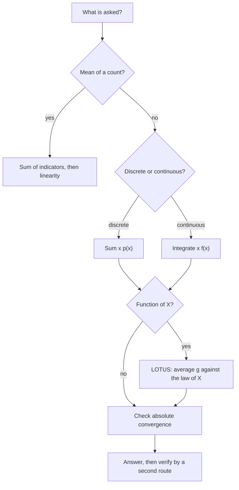
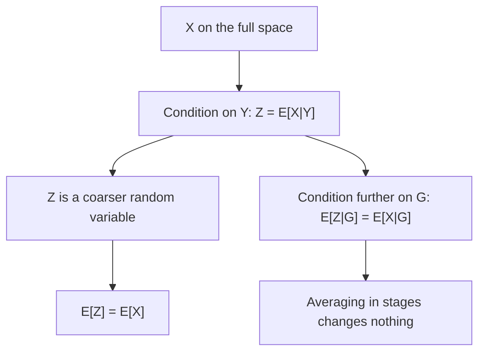

# Expectation and Variance

> [Probability](../README.md) · Level: Advanced · Prerequisites: [Probability Foundations](../01-probability-foundations/README.md), [Limits](../../07-calculus/01-limits/README.md), [Integrals](../../07-calculus/06-integrals/README.md), [Techniques of Integration](../../07-calculus/08-techniques-of-integration/README.md), [Linear Algebra](../../08-linear-algebra/README.md) · Estimated time: 540 min

## 1. Introduction

A distribution can be an unwieldy object: a table with a thousand rows, or a density nobody wants to
integrate. In practice we summarise it by a few numbers — an average, a spread, a tendency to move with
something else — and reason with those. This topic is the mathematics of that summary, and it is where
probability stops being bookkeeping and becomes an instrument of calculation, because one of its
results, **linearity of expectation**, dissolves problems that look hopeless by counting.

Here is the phenomenon that justifies a whole chapter. Put $n$ letters into $n$ addressed envelopes at
random. What is the expected number of correct letters? The distribution of that number is a nightmare
of derangements and alternating factorials. Its expectation is $1$ — for every $n$, exactly $1$ — and
the proof takes three lines (Example 9.2). No independence, no distribution, no enumeration.

Five ideas carry the topic.

**Expectation is a weighted average, and it may fail to exist.** For discrete $X$ it is
$\sum_x x\,p_X(x)$; for continuous $X$, $\int x f_X(x)\,dx$. Both formulas require *absolute*
convergence. Without it a symmetric heavy-tailed "mean" can be rearranged to any value, so it is not a
number at all — which is exactly the Cauchy distribution's situation.

**Linearity needs no independence.** $\mathbb{E}[aX+bY]=a\mathbb{E}[X]+b\mathbb{E}[Y]$ holds for any two
integrable variables on one probability space. Independence enters only when multiplying, and in the
behaviour of variances.

**Indicators convert counting into expectation.** Write the count as a sum of $0$–$1$ variables and add
their probabilities. This is the most useful computational trick in the subject.

**Variance measures spread, covariance measures joint movement.** Variance is the mean squared deviation
from the mean: non-negative, additive for independent variables, and minimised at the mean. Correlation
is covariance rescaled to $[-1,1]$ by the Cauchy–Schwarz inequality.

**Inequalities replace distributions with bounds.** Markov, Chebyshev and Jensen turn moments into tail
bounds and convexity inequalities with no distributional assumption. They are why the law of large
numbers has a five-line proof, and why risk statements survive incomplete models.

A sixth idea deserves separate billing: **conditional expectation**. Given partial information,
$\mathbb{E}[X\mid Y]$ is a random variable — the best mean-square guess of $X$ — not a number. Its tower
property $\mathbb{E}\bigl[\mathbb{E}[X\mid Y]\bigr]=\mathbb{E}[X]$ drives the law of total variance and
every martingale argument in later topics.

Historically, expectation came first: Pascal and Fermat priced games in 1654, Huygens published the first
textbook in 1657, Laplace systematised generating functions in 1812, Chebyshev proved his inequality in
1867 and Markov his in 1886, Jensen's inequality appeared in 1906, Kolmogorov axiomatised probability in
1933, and Shannon showed in 1948 that entropy — an expectation of $-\log p(X)$ — measures information.

## 2. Prerequisites

* **Events, axioms, conditional probability** — sample spaces, Kolmogorov's axioms, independence,
  $\Pr(A\mid B)=\Pr(A\cap B)/\Pr(B)$: [Probability Foundations](../01-probability-foundations/README.md).
* **Sets and families of events** — countable unions, complements, De Morgan's laws:
  [Set Theory](../../00-foundations/03-set-theory/README.md).
* **Proof technique** — direct proof, induction, contradiction, and "almost surely":
  [Proof Techniques](../../00-foundations/04-proof-techniques/README.md).
* **Series** — convergence of non-negative series, absolute versus conditional convergence, rearrangement:
  [Limits](../../07-calculus/01-limits/README.md).
* **Integration** — definite integrals, integration by parts, improper integrals, substitution:
  [Integrals](../../07-calculus/06-integrals/README.md) and
  [Techniques of Integration](../../07-calculus/08-techniques-of-integration/README.md).
* **Inner products** — for the geometric reading of covariance:
  [Linear Algebra](../../08-linear-algebra/README.md).

No measure theory is assumed. Where a proof needs a measure-theoretic fact (Fubini, monotone
convergence, Radon–Nikodym) it is named and stated in words, and the discrete or density proof is given
in full. Random variables are defined in §5.1–5.3 so that the topic is self-contained.

## 3. Learning Objectives

After working through this tutorial you will be able to:

1. Compute $\mathbb{E}[X]$ from a mass function or a density, and say precisely when it does not exist.
2. Decide by direct computation whether a variable is integrable, and explain why absolute convergence is
   the hypothesis rather than a technicality.
3. Prove linearity, and use indicator variables to compute means of counts (fixed points, occupancy,
   coupon collector, hypergeometric) without finding a distribution.
4. State and justify the law of the unconscious statistician, including the case of a non-injective $g$.
5. Derive $\operatorname{Var}(X)=\mathbb{E}[X^{2}]-(\mathbb{E}X)^{2}$ and prove the scaling, additivity
   and minimisation properties of variance.
6. Compute covariances and correlations, and prove the Cauchy–Schwarz bound $\lvert\rho\rvert\le1$ with
   its equality case.
7. Define conditional expectation, prove the tower property, and use the law of total variance.
8. Compute moment generating functions, extract moments by differentiation, and identify a distribution
   from its MGF.
9. Prove and apply Markov's, Chebyshev's and Jensen's inequalities, and say what each costs in sharpness.
10. Express entropy as an expectation and prove it is maximised by the uniform distribution.
11. Recognise the standard errors: thinking linearity needs independence, writing
    $\mathbb{E}[g(X)]=g(\mathbb{E}X)$, adding variances under dependence, and reading $\rho=0$ as
    independence.

## 4. Intuition

Think of a distribution as a mass distribution on the line, total mass $1$, more mass where $X$ is more
likely. Then $\mathbb{E}[X]$ is the **centre of mass** and $\operatorname{Var}(X)$ the **moment of
inertia** about it. The analogy is exact: first and second moments of a measure. A distribution bunched
near one point has small variance; mass far out contributes heavily even when unlikely, because squared
distance is what counts.

Two consequences follow.

**The balance point need not be likely.** A die balances at $3.5$, which it never shows. An exponential
variable with mean $1$ exceeds its own mean with probability $e^{-1}\approx0.368$. "Expected value" names
an average, not a prediction.

**Rare huge values drag the mean.** Push this to the limit and the mean diverges although every outcome
is finite — the St Petersburg game of Exercise 32.

Now spread mass over the integers as $c/k^{2}$. Each side has infinite lever arm,
$\sum_k\lvert k\rvert c/k^{2}=\infty$. Symmetry suggests the balance point $0$; a rearrangement suggests
any other point. Because the answer depends on the order of summation, there is no balance point: that
is what "$\mathbb{E}[X]$ does not exist" means, and why the definition below demands
$\mathbb{E}\lvert X\rvert<\infty$ before naming a value.

For computations, remember the three facts: averaging is linear; averaging is order-independent for
non-negative weights; multiplying is where independence earns its keep.

## 5. Formal Definition

Throughout, $(\Omega,\mathcal{F},\Pr)$ is a probability space as in
[Probability Foundations](../01-probability-foundations/README.md).

### 5.1 Random variables and their distributions

**Definition 5.1 (Random variable).** A *random variable* is a function $X:\Omega\to\mathbb{R}$ such that
$\{X\le x\}$ is an event for every $x\in\mathbb{R}$. Its *distribution* is the map
$B\mapsto\Pr(X\in B)$.

**Definition 5.2 (Distribution function).** $F_X(x)=\Pr(X\le x)$ is the *CDF*; it is non-decreasing and
right-continuous with limits $0$ and $1$ at $\mp\infty$.

**Definition 5.3 (Discrete).** $X$ is *discrete* if its range is countable. Its *mass function* is
$p_X(x)=\Pr(X=x)$, with $\sum_x p_X(x)=1$.

**Definition 5.4 (Continuous).** $X$ is *continuous* if some $f_X\ge0$ satisfies
$F_X(x)=\int_{-\infty}^{x}f_X(t)\,dt$; $f_X$ is the *density*. Then
$\Pr(a\le X\le b)=\int_a^bf_X$ and $\Pr(X=x)=0$ for every $x$. A density is not a probability: it may
exceed $1$.

**Definition 5.5 (Independence).** $X$ and $Y$ are *independent* if
$\Pr(X\in A,Y\in B)=\Pr(X\in A)\Pr(Y\in B)$ for all $A,B$; equivalently $p_{X,Y}(x,y)=p_X(x)p_Y(y)$ in
the discrete case, or a joint density that factorises in the continuous case.

### 5.2 Expectation of a discrete variable

**Definition 5.6.** Let $X$ be discrete with mass function $p_X$ on a countable set $S$. If
$\sum_{x\in S}\lvert x\rvert p_X(x)<\infty$ then $X$ is *integrable* and

$$\mathbb{E}[X]:=\sum_{x\in S}x\,p_X(x).$$

If $X\ge0$ and the sum diverges we write $\mathbb{E}[X]=+\infty$. If $X$ has both signs and
$\sum_x\lvert x\rvert p_X(x)=\infty$, the expectation is **undefined** — not infinite, undefined.

### 5.3 Expectation of a continuous variable

**Definition 5.7.** If $X$ has density $f_X$ and $\int_{\mathbb{R}}\lvert x\rvert f_X(x)\,dx<\infty$, then
$X$ is *integrable* and

$$\mathbb{E}[X]:=\int_{\mathbb{R}}x\,f_X(x)\,dx,$$

with the same conventions on divergence and undefinedness. Both definitions are the single object
$\mathbb{E}[X]=\int_{\mathbb{R}}x\,dF_X(x)$; Definitions 5.6 and 5.7 are its two computational faces.

### 5.4 Integrability and the absolute-convergence caveat

**Definition 5.8.** $X$ is *integrable*, written $X\in L^{1}$, if $\mathbb{E}\lvert X\rvert<\infty$.

Absolute convergence is required because a conditionally convergent series depends on the order of
summation (Riemann's rearrangement theorem), and a countable sum has no canonical order. Two
enumerations of one mass function would give two "means", so the object would not be a function of the
distribution. Absolute convergence makes rearrangement and grouping legitimate.

**Example 5.9 (A distribution with no mean).** Put mass $c/k^{2}$ on each integer $k\ne0$, with
$c=3/\pi^{2}$ so the total is $1$. Then
$\sum_{k\ne0}\lvert k\rvert c/k^{2}=2c\sum_{k\ge1}1/k=\infty$, so $\mathbb{E}\lvert X\rvert=\infty$ and
$\mathbb{E}[X]$ is undefined, although $\Pr(\lvert X\rvert<\infty)=1$ and the law is symmetric. Summing
positives first and negatives first gives a difference of infinities; interleavings give different
finite values. Symmetry suggests $0$ but does not define it.

**Proposition 5.10.** *If $X\ge0$ then $\mathbb{E}[X]$ exists, possibly equal to $+\infty$.*

*Proof.* Partial sums (or integrals) of non-negative terms increase, so their supremum in $[0,\infty]$
exists. $\blacksquare$

### 5.5 Variance and standard deviation

**Definition 5.11.** If $\mathbb{E}[X^{2}]<\infty$ (that is $X\in L^{2}$), the *variance* is
$\operatorname{Var}(X):=\mathbb{E}\bigl[(X-\mathbb{E}X)^{2}\bigr]$ and the *standard deviation* is
$\sigma_X:=\sqrt{\operatorname{Var}(X)}$. Variance is measured in squared units; it is never negative.
Since $\lvert x\rvert\le1+x^{2}$, a variable with a variance has a mean, but not conversely (Exercise 24).

### 5.6 Covariance and correlation

**Definition 5.12.** For $X,Y\in L^{2}$,
$\operatorname{Cov}(X,Y):=\mathbb{E}\bigl[(X-\mathbb{E}X)(Y-\mathbb{E}Y)\bigr]=\mathbb{E}[XY]-\mathbb{E}[X]\mathbb{E}[Y]$.

**Definition 5.13.** If $\sigma_X>0$ and $\sigma_Y>0$, the *correlation* is
$\rho(X,Y):=\operatorname{Cov}(X,Y)/(\sigma_X\sigma_Y)\in[-1,1]$, the inclusion being Theorem 7.20.
Correlation is dimensionless, covariance is not.

### 5.7 Conditional expectation

**Definition 5.14 (Given an event).** For $\Pr(B)>0$,
$\mathbb{E}[X\mid B]:=\mathbb{E}[X\mathbf{1}_B]/\Pr(B)$ when $X\mathbf{1}_B$ is integrable.

**Definition 5.15 (Given a discrete variable).** With $\varphi(y):=\mathbb{E}[X\mid Y=y]$, the random
variable $\mathbb{E}[X\mid Y]$ equals $\varphi(Y)$; it takes the value $\varphi(y)$ on $\{Y=y\}$.

**Definition 5.16 (General).** Let $\mathcal{G}\subseteq\mathcal{F}$ represent available information. A
*conditional expectation of $X$ given $\mathcal{G}$* is a random variable $Z$ such that (i) $\{Z\le z\}\in\mathcal{G}$
for every $z$, (ii) $\mathbb{E}[Z\mathbf{1}_A]=\mathbb{E}[X\mathbf{1}_A]$ for every $A\in\mathcal{G}$, and
(iii) $Z$ is integrable. It exists for integrable $X$ (Radon–Nikodym) and is unique almost surely. We
write $\mathbb{E}[X\mid\mathcal{G}]$, and $\mathbb{E}[X\mid Y]$ when $\mathcal{G}=\sigma(Y)$.

Condition (ii) is the content: *on every observable event, the conditional expectation reproduces the
average of $X$*. In the discrete case it reads
$\mathbb{E}[X\mid Y=y]=\sum_x x\,p_{X\mid Y}(x\mid y)$ with $p_{X\mid Y}(x\mid y)=\Pr(X=x,Y=y)/\Pr(Y=y)$.

### 5.8 Moment generating functions

**Definition 5.17.** The *MGF* of $X$ is $M_X(t):=\mathbb{E}[e^{tX}]$, defined where the expectation is
finite. If $M_X<\infty$ on some $(-\delta,\delta)$, the MGF *exists*; then all moments are finite and
$M_X^{(k)}(0)=\mathbb{E}[X^{k}]$ (Theorem 7.26).

### 5.9 Entropy

**Definition 5.18.** For discrete $X$ with mass function $p$,
$H(X):=-\sum_x p(x)\log p(x)=\mathbb{E}\bigl[-\log p(X)\bigr]$, with $0\log0=0$. Base $2$ gives bits,
base $e$ nats, and $1$ bit $=\ln2$ nats.

## 6. Mathematical Notation

| Symbol | Read as | Meaning |
|---|---|---|
| $\mathbb{E}[X]$ | expectation of $X$ | mean of the distribution of $X$ |
| $\mathbb{E}[X\mid Y]$ | expectation of $X$ given $Y$ | a random variable, a function of $Y$ |
| $L^{1}$, $L^{2}$ | ell-one, ell-two | $\mathbb{E}\lvert X\rvert<\infty$, $\mathbb{E}[X^{2}]<\infty$ |
| $\operatorname{Var}(X)$, $\sigma_X$ | variance, standard deviation | $\mathbb{E}[(X-\mu)^{2}]$ and its square root |
| $\operatorname{Cov}(X,Y)$ | covariance | $\mathbb{E}[(X-\mu_X)(Y-\mu_Y)]$ |
| $\rho(X,Y)$ | correlation | $\operatorname{Cov}(X,Y)/(\sigma_X\sigma_Y)$ |
| $M_X(t)$ | moment generating function | $\mathbb{E}[e^{tX}]$ |
| $H(X)$ | entropy | $\mathbb{E}[-\log p(X)]$ |
| $\mathbf{1}_A$ | indicator of $A$ | $1$ on $A$, $0$ outside; $\mathbb{E}[\mathbf{1}_A]=\Pr(A)$ |
| $X^{+},X^{-}$ | positive, negative parts | $\max(X,0)$, $\max(-X,0)$ |
| $X\perp\!\!\!\perp Y$ | independent | joint law factorises |
| $\mathcal{N}(\mu,\sigma^{2})$, $\Phi$, $\phi$ | normal law, its CDF, its density | used in §7.7 and Example 9.7 |
| $\blacksquare$ | end of proof | the argument is complete |

Read $\mathbb{E}[X\mid Y]$ as "expectation of $X$ given $Y$" and remember it is a random variable;
$\mathbb{E}[X\mid Y=y]$ is the number obtained by conditioning on one value.

## 7. Core Concepts

### 7.1 Linearity of expectation

**Lemma 7.1 (Non-negative double series).** *If $a_{mn}\ge0$ then
$\sum_m\sum_n a_{mn}=\sum_n\sum_m a_{mn}=\sup_{M,N}\sum_{m\le M}\sum_{n\le N}a_{mn}$, possibly
$+\infty$.* The proof is that every finite rectangle sits inside a product of finite ranges, so the
iterated suprema agree; no term is negative, so nothing cancels.

**Theorem 7.2 (Linearity).** *Let $X,Y$ be integrable on the same probability space and $a,b\in\mathbb{R}$.
Then $aX+bY$ is integrable and $\mathbb{E}[aX+bY]=a\mathbb{E}[X]+b\mathbb{E}[Y]$.*

*Proof (discrete case, in full).* Let $p(x,y)=\Pr(X=x,Y=y)$ on the countable set $S$, with marginals
$p_X(x)=\sum_y p(x,y)$ and $p_Y(y)=\sum_x p(x,y)$. First, $\lvert ax+by\rvert\le\lvert a\rvert\lvert x\rvert+\lvert b\rvert\lvert y\rvert$,
so by Lemma 7.1

$$\mathbb{E}\lvert aX+bY\rvert\le\lvert a\rvert\sum_x\lvert x\rvert p_X(x)+\lvert b\rvert\sum_y\lvert y\rvert p_Y(y)=\lvert a\rvert\,\mathbb{E}\lvert X\rvert+\lvert b\rvert\,\mathbb{E}\lvert Y\rvert<\infty,$$

and the double series for $\mathbb{E}[aX+bY]$ is absolutely convergent. Hence grouping and splitting are
legitimate:

$$\mathbb{E}[aX+bY]=\sum_{x,y}(ax+by)p(x,y)=a\sum_x x\,p_X(x)+b\sum_y y\,p_Y(y)=a\mathbb{E}[X]+b\mathbb{E}[Y].$$

*Continuous case.* With a joint density, the same estimate justifies Fubini, and the two steps are
identical with integrals. In general one approximates by simple functions and passes to the limit.
$\blacksquare$

**Nothing in the proof used independence**, and the statement cannot require it. Applying the theorem
repeatedly gives $\mathbb{E}\bigl[\sum_ia_iX_i\bigr]=\sum_ia_i\mathbb{E}[X_i]$ for integrable $X_i$.
Taking $Y=1$ gives the affine rule $\mathbb{E}[aX+b]=a\mathbb{E}[X]+b$ (Corollary 7.3).

**Example 7.4 (Extreme dependence).** Let $X$ be uniform on $\{0,1\}$ and $Y=1-X$, so the pair is as
dependent as possible. Then $\mathbb{E}[X+Y]=\mathbb{E}[1]=1=\tfrac12+\tfrac12$; linearity holds anyway.

### 7.2 The power of linearity: indicator variables

Since $\mathbb{E}[\mathbf{1}_A]=\Pr(A)$, any variable of the form $X=\sum_{i=1}^nc_i\mathbf{1}_{A_i}$
satisfies $\mathbb{E}[X]=\sum_ic_i\Pr(A_i)$, **whether or not the $A_i$ are independent**. So "expected
number of something" becomes "sum of probabilities".

**Example 7.5 (Fixed points).** For a uniformly random permutation $\pi$ of $\{1,\dots,n\}$ let
$A_i=\{\pi(i)=i\}$. By symmetry $\Pr(A_i)=1/n$, so the expected number of fixed points is
$\sum_{i\le n}\Pr(A_i)=n\cdot\tfrac1n=1$, independent of $n$. The exact law
$\Pr(X=k)=\frac1{k!}\sum_{j=0}^{n-k}\frac{(-1)^{j}}{j!}$ would make this painful; the $A_i$ are heavily
dependent ($X=1$ almost excludes $X=2$), which changes nothing.

**Example 7.6 (Hypergeometric mean).** An urn has $N$ balls, $K$ red; draw $n$ without replacement and
let $X$ count reds. With $A_i=\{i\text{th draw red}\}$, symmetry gives $\Pr(A_i)=K/N$, hence
$\mathbb{E}[X]=nK/N$ — the same mean as with replacement. The variance is smaller by the
finite-population factor $(N-n)/(N-1)$ (Exercise 13).

**Example 7.7 (Coupon collector).** Draw uniformly from $n$ coupons until all appear. With $j$ coupons
held, the next draw is new with probability $p_j=(n-j)/n$, so the waiting time $G_j$ satisfies
$\mathbb{E}[G_j]=1/p_j=n/(n-j)$. Since $T=\sum_{j=0}^{n-1}G_j$,

$$\mathbb{E}[T]=\sum_{j=0}^{n-1}\frac{n}{n-j}=n\sum_{k=1}^{n}\frac1k=nH_n,$$

which is $6\cdot2.45=14.7$ for $n=6$ and about $224.96$ for $n=50$. The $G_j$ happen to be independent,
but linearity does not need that.

### 7.3 Expectation of a function of a variable

**Theorem 7.8 (Law of the unconscious statistician).** *Let $X$ have mass function $p_X$ or density $f_X$,
and let $g:\mathbb{R}\to\mathbb{R}$. Then*

$$\mathbb{E}[g(X)]=\sum_x g(x)p_X(x)\qquad\text{or}\qquad\mathbb{E}[g(X)]=\int_{\mathbb{R}}g(x)f_X(x)\,dx,$$

*whenever $\mathbb{E}\lvert g(X)\rvert<\infty$; if $g\ge0$ both sides may be $+\infty$.*

*Proof (discrete).* Let $S$ be the range of $X$ and $g[S]$ that of $Y=g(X)$. For $y\in g[S]$, the event
$\{Y=y\}$ is the disjoint union of $\{X=x\}$ over $S_y=\{x:g(x)=y\}$, so
$\Pr(Y=y)=\sum_{x\in S_y}p_X(x)$ by countable additivity. Therefore

$$\mathbb{E}[Y]=\sum_{y\in g[S]}y\Pr(Y=y)=\sum_{y\in g[S]}\sum_{x\in S_y}g(x)p_X(x)=\sum_{x\in S}g(x)p_X(x),$$

the last step grouping the non-negative terms $\lvert g(x)\rvert p_X(x)$ (Lemma 7.1) and then splitting
positive and negative parts, which absolute convergence permits. Each $x$ lies in exactly one $S_y$.
$\blacksquare$

*Proof (continuous, sketch).* For step functions the identity is immediate; a general $g$ with
$\mathbb{E}\lvert g(X)\rvert<\infty$ is a difference of monotone limits of step functions, and monotone
convergence passes the identity to the limit. For piecewise monotone differentiable $g$ the substitution
rule gives it directly, piece by piece.

The point: **no distribution of $g(X)$ is needed**, and $g$ need not be injective or monotone.

**Example 7.9 (Non-injective $g$).** Let $X$ be uniform on $\{-1,0,1\}$ and $g(x)=x^{2}$. Then $g(X)=1$
with probability $\tfrac23$, so $\mathbb{E}[g(X)]=\tfrac23$; LOTUS gives
$\tfrac13(1+0+1)=\tfrac23$ with no density of $X^{2}$ computed.

**Corollary 7.10.** For integrable $g(X,Y)$, average $g$ against the joint law; in particular
$\mathbb{E}[XY]=\sum_{x,y}xy\,p(x,y)$ in the discrete case.

**Warning.** $\mathbb{E}[g(X)]\ne g(\mathbb{E}[X])$ in general. For $X$ uniform on $\{1,2\}$ and
$g(x)=1/x$: $\mathbb{E}[X]=\tfrac32$ so $1/\mathbb{E}[X]=\tfrac23$, while
$\mathbb{E}[1/X]=\tfrac34$. Example 9.4 makes the gap infinite.

### 7.4 Variance and its properties

**Theorem 7.11 (Computing formula).** *If $\mathbb{E}[X^{2}]<\infty$ and $\mu=\mathbb{E}[X]$ then
$\operatorname{Var}(X)=\mathbb{E}[X^{2}]-\mu^{2}$.*

*Proof.* Expanding and using linearity for the integrable variables $X^{2}$ and $X$,
$\mathbb{E}[(X-\mu)^{2}]=\mathbb{E}[X^{2}]-2\mu\mathbb{E}[X]+\mu^{2}=\mathbb{E}[X^{2}]-\mu^{2}$.
$\blacksquare$

**Theorem 7.12 (Scaling).** *$\operatorname{Var}(aX+b)=a^{2}\operatorname{Var}(X)$.*

*Proof.* $\mathbb{E}[aX+b]=a\mu+b$, so
$\operatorname{Var}(aX+b)=\mathbb{E}[(aX+b-a\mu-b)^{2}]=a^{2}\mathbb{E}[(X-\mu)^{2}]$.
$\blacksquare$

Shifting does not change spread; reflection does not either.

**Theorem 7.13 (Zero variance).** *$\operatorname{Var}(X)=0$ if and only if $\Pr(X=\mu)=1$.*

*Proof.* If $\Pr((X-\mu)^{2}\ge\varepsilon)>0$ then
$\mathbb{E}[(X-\mu)^{2}]\ge\varepsilon\Pr((X-\mu)^{2}\ge\varepsilon)>0$. So zero variance forces
$\Pr((X-\mu)^{2}\ge1/m)=0$ for every $m$, hence $X=\mu$ a.s. The converse is immediate. $\blacksquare$

**Theorem 7.14 (Variance of a sum).** *$\operatorname{Var}(X+Y)=\operatorname{Var}(X)+\operatorname{Var}(Y)+2\operatorname{Cov}(X,Y)$.*

*Proof.* With $U=X-\mathbb{E}X$ and $V=Y-\mathbb{E}Y$, both of mean $0$,
$\mathbb{E}[(U+V)^{2}]=\mathbb{E}[U^{2}]+\mathbb{E}[V^{2}]+2\mathbb{E}[UV]$. $\blacksquare$

**Corollary 7.15.**
$\operatorname{Var}\bigl(\sum_{i\le n}X_i\bigr)=\sum_{i\le n}\operatorname{Var}(X_i)+2\sum_{i<j}\operatorname{Cov}(X_i,X_j)$.

**Theorem 7.16 (Products, independence).** *If $X,Y$ are independent and integrable then $XY$ is integrable
and $\mathbb{E}[XY]=\mathbb{E}[X]\mathbb{E}[Y]$. Hence $\operatorname{Cov}(X,Y)=0$ and, when second moments
exist, $\operatorname{Var}(X+Y)=\operatorname{Var}(X)+\operatorname{Var}(Y)$.*

*Proof (discrete).* Since $p(x,y)=p_X(x)p_Y(y)$,
$\mathbb{E}\lvert XY\rvert=\bigl(\sum_x\lvert x\rvert p_X(x)\bigr)\bigl(\sum_y\lvert y\rvert p_Y(y)\bigr)<\infty$
by Lemma 7.1, and the same computation without absolute values gives the product rule. The continuous
case uses Fubini with the same estimate. $\blacksquare$

**The converse fails.** If $X$ is uniform on $\{-1,0,1\}$ and $Y=X^{2}$ then
$\mathbb{E}[XY]=\mathbb{E}[X^{3}]=0=\mathbb{E}[X]\mathbb{E}[Y]$, so the covariance vanishes although $Y$ is
a deterministic function of $X$ (Exercise 16). Uncorrelated is weaker than independent.

**Theorem 7.17 (Least mean squared error).** *For $\mathbb{E}[X^{2}]<\infty$ and any constant $c$,*

$$\mathbb{E}\bigl[(X-c)^{2}\bigr]=\operatorname{Var}(X)+(\mathbb{E}[X]-c)^{2}\ge\operatorname{Var}(X),$$

*with equality exactly when $c=\mathbb{E}[X]$.*

*Proof.* Write $(X-c)^{2}=(X-\mu)^{2}+2(\mu-c)(X-\mu)+(\mu-c)^{2}$ with $\mu=\mathbb{E}[X]$; the middle
term has expectation $2(\mu-c)\mathbb{E}[X-\mu]=0$. $\blacksquare$

### 7.5 Covariance, correlation and the Cauchy–Schwarz bound

**Theorem 7.18 (Bilinearity).** *$\operatorname{Cov}(aX+b,cY+d)=ac\operatorname{Cov}(X,Y)$ and
$\operatorname{Cov}(X,Y+Z)=\operatorname{Cov}(X,Y)+\operatorname{Cov}(X,Z)$.*

*Proof.* The first follows because $aX+b-(a\mathbb{E}X+b)=a(X-\mathbb{E}X)$ and similarly for $Y$; the
second from bilinearity of the product of centred variables and linearity of expectation. $\blacksquare$

Since $\operatorname{Cov}(X,X)=\operatorname{Var}(X)$, covariance is the inner product on centred $L^{2}$
variables of which variance is the squared norm.

**Theorem 7.19 (Cauchy–Schwarz).** *For $X,Y\in L^{2}$,
$\bigl(\mathbb{E}[XY]\bigr)^{2}\le\mathbb{E}[X^{2}]\mathbb{E}[Y^{2}]$, with equality if and only if $X$ and
$Y$ are linearly dependent a.s.*

*Proof.* For every $t$, $0\le\mathbb{E}[(X+tY)^{2}]=\mathbb{E}[X^{2}]+2t\mathbb{E}[XY]+t^{2}\mathbb{E}[Y^{2}]$.
If $\mathbb{E}[Y^{2}]=0$ then $Y=0$ a.s. by Theorem 7.13 and the claim is trivial. Otherwise the quadratic
never becomes negative, so its discriminant is at most $0$:
$4(\mathbb{E}[XY])^{2}-4\mathbb{E}[X^{2}]\mathbb{E}[Y^{2}]\le0$. Equality means the quadratic has a real
root $t_0$, i.e. $\mathbb{E}[(X+t_0Y)^{2}]=0$, i.e. $X=-t_0Y$ a.s. $\blacksquare$

**Theorem 7.20 (Correlation bound).** *If $\sigma_X,\sigma_Y>0$ then $-1\le\rho(X,Y)\le1$. Moreover
$\rho=1$ exactly when $Y=aX+b$ a.s. with $a>0$, and $\rho=-1$ exactly when $Y=aX+b$ a.s. with $a<0$.*

*Proof.* Apply Theorem 7.19 to $X-\mathbb{E}X$ and $Y-\mathbb{E}Y$ and divide by $\sigma_X^{2}\sigma_Y^{2}>0$.
Equality gives $Y-\mathbb{E}Y=-t_0(X-\mathbb{E}X)$ a.s., an affine relation with slope $a=-t_0$, and
$\operatorname{Cov}(X,aX+b)=a\sigma_X^{2}$ has the sign of $a$. $\blacksquare$

Correlation measures **linear** association. A perfect parabola with symmetric $X$ has $\rho=0$, so a zero
correlation is never evidence of independence.

### 7.6 Conditional expectation and the tower property

**Theorem 7.21 (Double expectation, discrete case).** *If $X$ is integrable and $Y$ discrete then
$\mathbb{E}\bigl[\mathbb{E}[X\mid Y]\bigr]=\mathbb{E}[X]$.*

*Proof.* With $\varphi(y)=\mathbb{E}[X\mid Y=y]$,
$\mathbb{E}[\varphi(Y)]=\sum_y\varphi(y)\Pr(Y=y)=\sum_y\sum_x x\Pr(X=x,Y=y)$, since the factors $\Pr(Y=y)$
cancel. Lemma 7.1 allows the interchange (absolute summability follows from integrability of $X$), so
this equals $\sum_x x\sum_y\Pr(X=x,Y=y)=\sum_x x\Pr(X=x)=\mathbb{E}[X]$. $\blacksquare$

**Theorem 7.22 (Tower property).** *If $\mathcal{G}_1\subseteq\mathcal{G}_2$ then
$\mathbb{E}\bigl[\mathbb{E}[X\mid\mathcal{G}_2]\bigm|\mathcal{G}_1\bigr]=\mathbb{E}[X\mid\mathcal{G}_1]$ a.s.*

*Proof.* Let $W=\mathbb{E}[X\mid\mathcal{G}_2]$ and $Z=\mathbb{E}[W\mid\mathcal{G}_1]$. Then $Z$ is
$\mathcal{G}_1$-measurable and integrable, and for $A\in\mathcal{G}_1\subseteq\mathcal{G}_2$,
$\mathbb{E}[Z\mathbf{1}_A]=\mathbb{E}[W\mathbf{1}_A]=\mathbb{E}[X\mathbf{1}_A]$, using the defining
properties of $Z$ then $W$. So $Z$ meets the characterisation of $\mathbb{E}[X\mid\mathcal{G}_1]$, and
uniqueness (a.s.) gives the claim. $\blacksquare$

Read it as: *averaging out information you have not used gives the same answer as never having had it.*

**Theorem 7.23 (Taking out what is known).** *If $Z$ is bounded and determined by $\mathcal{G}$ then
$\mathbb{E}[ZX\mid\mathcal{G}]=Z\,\mathbb{E}[X\mid\mathcal{G}]$ a.s.* The proof is a direct check of
Definition 5.16: approximate $Z$ by indicators of events in $\mathcal{G}$, where the identity is the
definition itself.

**Theorem 7.24 (Law of total variance).** *If $\mathbb{E}[X^{2}]<\infty$ then
$\operatorname{Var}(X)=\mathbb{E}\bigl[\operatorname{Var}(X\mid Y)\bigr]+\operatorname{Var}\bigl(\mathbb{E}[X\mid Y]\bigr)$.*

*Proof.* Put $Z=\mathbb{E}[X\mid Y]$ and $\mu=\mathbb{E}[X]$. Inside the conditional world,
$\operatorname{Var}(X\mid Y)=\mathbb{E}[X^{2}\mid Y]-Z^{2}$, so taking expectations and using
Theorem 7.21, $\mathbb{E}[\operatorname{Var}(X\mid Y)]=\mathbb{E}[X^{2}]-\mathbb{E}[Z^{2}]$. Also
$\operatorname{Var}(Z)=\mathbb{E}[Z^{2}]-\mu^{2}$ because $\mathbb{E}[Z]=\mu$. Adding telescopes to
$\mathbb{E}[X^{2}]-\mu^{2}=\operatorname{Var}(X)$. $\blacksquare$

The terms are the *within-group* and *between-group* variation; total variation is their sum.

**Theorem 7.25 (Best predictor).** *Among functions $g$ with $\mathbb{E}[g(Y)^{2}]<\infty$, the minimum of
$\mathbb{E}\bigl[(X-g(Y))^{2}\bigr]$ is attained at $g(Y)=\mathbb{E}[X\mid Y]$, and the minimum value is
$\mathbb{E}[\operatorname{Var}(X\mid Y)]$.* Exercise 36 proves it by expanding
$\mathbb{E}[(X-g(Y))^{2}]=\mathbb{E}[\operatorname{Var}(X\mid Y)]+\mathbb{E}\bigl[(\mathbb{E}[X\mid Y]-g(Y))^{2}\bigr]$,
where only the second term depends on $g$.

### 7.7 Moment generating functions

**Theorem 7.26 (Moments by differentiation).** *If $M_X(t)<\infty$ for $\lvert t\rvert<\delta$ then
$\mathbb{E}\lvert X\rvert^{k}<\infty$ for all $k$, $M_X$ is smooth on $(-\delta,\delta)$, and
$M_X^{(k)}(0)=\mathbb{E}[X^{k}]$. In particular $\mathbb{E}[X]=M_X'(0)$ and
$\operatorname{Var}(X)=M_X''(0)-\bigl(M_X'(0)\bigr)^{2}$.*

*Proof (discrete case).* Fix $\lvert t\rvert<\delta$. For $\lvert s\rvert\le\lvert t\rvert$ and $x\ne0$,
$\lvert x\rvert^{k}e^{sx}\le k!\bigl(e^{tx}+e^{-tx}\bigr)/\lvert t\rvert^{k}$, an integrable dominating
function. Dominated convergence therefore permits differentiating $M_X(s)=\sum_xe^{sx}p_X(x)$ term by term
any number of times, and setting $s=0$ gives the result. The continuous case replaces sums by integrals.
$\blacksquare$

**Theorem 7.27 (Uniqueness).** *If $M_X(t)=M_Y(t)<\infty$ for all $t\in(-\delta,\delta)$ then $X$ and $Y$
have the same distribution.* This is a classical theorem — the MGF is the Laplace transform of the law, and
Laplace transforms determine measures — quoted here rather than proved. The finiteness hypothesis is
essential: equal moments alone do not determine a law (Exercise 33).

**Theorem 7.28 (Affine change).** *$M_{aX+b}(t)=e^{bt}M_X(at)$.* *Proof:*
$M_{aX+b}(t)=\mathbb{E}[e^{t(aX+b)}]=e^{bt}\mathbb{E}[e^{(at)X}]$. $\blacksquare$

**Theorem 7.29 (Independent sums).** *If $X,Y$ are independent and their MGFs are finite at $t$ then
$M_{X+Y}(t)=M_X(t)M_Y(t)$.* *Proof:* $e^{t(X+Y)}=e^{tX}e^{tY}$ and Theorem 7.16 factorises the
expectation, both factors being integrable at $t$. $\blacksquare$

**The catalogue.** Every entry is computed from the definition; moments follow from Theorem 7.26.

| Distribution | Mass or density | $\mathbb{E}[X]$ | $\operatorname{Var}(X)$ | $M_X(t)$ |
|---|---|---|---|---|
| Bernoulli $p$ | $\Pr(1)=p$, $\Pr(0)=1-p$ | $p$ | $p(1-p)$ | $1-p+pe^{t}$ |
| Binomial $(n,p)$ | $\binom nk p^{k}(1-p)^{n-k}$ | $np$ | $np(1-p)$ | $\bigl(1-p+pe^{t}\bigr)^{n}$ |
| Geometric $(p)$ | $(1-p)^{k-1}p$, $k\ge1$ | $1/p$ | $(1-p)/p^{2}$ | $pe^{t}/\bigl(1-(1-p)e^{t}\bigr)$ |
| Poisson $(\lambda)$ | $e^{-\lambda}\lambda^{k}/k!$ | $\lambda$ | $\lambda$ | $\exp\bigl(\lambda(e^{t}-1)\bigr)$ |
| Uniform $(a,b)$ | $1/(b-a)$ on $(a,b)$ | $(a+b)/2$ | $(b-a)^{2}/12$ | $\bigl(e^{bt}-e^{at}\bigr)/\bigl((b-a)t\bigr)$ |
| Exponential $(\lambda)$ | $\lambda e^{-\lambda x}$, $x\ge0$ | $1/\lambda$ | $1/\lambda^{2}$ | $\lambda/(\lambda-t)$, $t<\lambda$ |
| Gamma $(\alpha,\lambda)$ | $\lambda^{\alpha}x^{\alpha-1}e^{-\lambda x}/\Gamma(\alpha)$ | $\alpha/\lambda$ | $\alpha/\lambda^{2}$ | $\bigl(\lambda/(\lambda-t)\bigr)^{\alpha}$ |
| Normal $(\mu,\sigma^{2})$ | $\frac{1}{\sigma\sqrt{2\pi}}e^{-(x-\mu)^{2}/(2\sigma^{2})}$ | $\mu$ | $\sigma^{2}$ | $\exp\bigl(\mu t+\tfrac12\sigma^{2}t^{2}\bigr)$ |

Three consequences. *Reproduction:* the MGF of a sum of independent Poissons is
$\exp\bigl((\lambda_1+\lambda_2)(e^{t}-1)\bigr)$, so by Theorem 7.27 the sum is Poisson; similarly
Binomial with common $p$, and Gamma with common rate. *Normality:* by Theorems 7.28 and 7.29 affine maps
and independent sums of normal variables are normal. *Limits:* the MGF is finite only where it is — the
Cauchy law has no finite MGF at $t\ne0$ and the lognormal has none for $t>0$, despite all moments being
finite.

### 7.8 Markov, Chebyshev and Jensen

**Theorem 7.30 (Markov).** *If $X\ge0$ then $\Pr(X\ge a)\le\mathbb{E}[X]/a$ for every $a>0$.*

*Proof.* Pointwise $X\ge a\mathbf{1}_{\{X\ge a\}}$: on the event the right side is $a\le X$, elsewhere it is
$0\le X$. Taking expectations, $\mathbb{E}[X]\ge a\Pr(X\ge a)$. $\blacksquare$

The bound uses only the mean, so it cannot be sharp in general: for $X\sim\operatorname{Exp}(1)$ and $a=5$
it gives $0.2$ against the truth $e^{-5}\approx0.0067$. It is attained when $\Pr(X=a)=1/a$ and
$\Pr(X=0)=1-1/a$.

**Theorem 7.31 (Chebyshev).** *If $\operatorname{Var}(X)=\sigma^{2}<\infty$ then
$\Pr(\lvert X-\mathbb{E}X\rvert\ge a)\le\sigma^{2}/a^{2}$ for every $a>0$.*

*Proof.* Apply Theorem 7.30 to $(X-\mu)^{2}\ge0$ with threshold $a^{2}$ and note
$\{(X-\mu)^{2}\ge a^{2}\}=\{\lvert X-\mu\rvert\ge a\}$. $\blacksquare$

With $a=k\sigma$: $\Pr(\lvert X-\mu\rvert\ge k\sigma)\le1/k^{2}$, and equality holds for the three-point
law with mass $\tfrac1{2k^{2}}$ at $\pm k\sigma$ and the rest at $0$.

**Theorem 7.32 (Jensen).** *Let $\varphi:I\to\mathbb{R}$ be convex, let $X$ take values in $I$ with
$\mathbb{E}\lvert X\rvert<\infty$ and $\mathbb{E}\lvert\varphi(X)\rvert<\infty$ (or $\varphi\ge0$). Then
$\varphi(\mathbb{E}X)\le\mathbb{E}\varphi(X)$.*

*Proof.* Put $m=\mathbb{E}[X]\in I$. Convexity gives a supporting line: there is $\beta$ with
$\varphi(x)\ge\varphi(m)+\beta(x-m)$ for all $x\in I$ (take $\beta=\varphi'(m)$ when differentiable,
otherwise a subgradient, and a one-sided slope at an endpoint). Substituting $x=X$ and taking expectations,
$\mathbb{E}\varphi(X)\ge\varphi(m)+\beta(\mathbb{E}X-m)=\varphi(m)$. $\blacksquare$

Equality holds iff $X=m$ a.s. or $\varphi$ is affine on the range of $X$. Two special cases: with
$\varphi(x)=x^{2}$, $(\mathbb{E}X)^{2}\le\mathbb{E}[X^{2}]$; with $\varphi(x)=-\log x$ on $(0,\infty)$,
$-\log\mathbb{E}X\le\mathbb{E}[-\log X]$, which applied to a uniform draw from $\{a_1,\dots,a_n\}$ is the
AM–GM inequality $(a_1\cdots a_n)^{1/n}\le(a_1+\cdots+a_n)/n$, with equality iff all $a_i$ agree.

### 7.9 Entropy as an expectation

$H(X)=\mathbb{E}[-\log p(X)]$ is the mean *surprise*: rare outcomes are more surprising, and a uniform
draw on two points gives surprise $\log2$, i.e. $1$ bit.

**Proposition 7.33 (Non-negativity).** *$H(X)\ge0$, with equality iff $X$ is a.s. constant.*

*Proof.* Each $p(x)\in(0,1]$ has $-\log p(x)\ge0$. The expectation is zero only if $-\log p(X)=0$ a.s.,
i.e. $p(X)=1$ a.s., which is a single atom of mass $1$. $\blacksquare$

**Theorem 7.34 (Maximum entropy).** *If $X$ takes at most $n$ values then $H(X)\le\log n$, with equality
iff $X$ is uniform on its support.*

*Proof.* Apply Jensen (Theorem 7.32) to the concave $\log$ and $Y=1/p(X)>0$, whose mean is
$\sum_xp(x)\cdot\frac1{p(x)}=n$:

$$H(X)=\mathbb{E}\Bigl[\log\frac{1}{p(X)}\Bigr]\le\log\mathbb{E}\Bigl[\frac{1}{p(X)}\Bigr]=\log n.$$

Strict concavity forces $Y$ constant, i.e. $p\equiv1/n$. $\blacksquare$

A fair coin carries $1$ bit, a fair die $\log_26\approx2.585$ bits, and nothing on six outcomes carries
more.

## 8. Formulas and Properties

### 8.1 The results in one table

| Name | Statement | Hypotheses | Proved |
|---|---|---|---|
| Linearity | $\mathbb{E}[aX+bY]=a\mathbb{E}[X]+b\mathbb{E}[Y]$ | $X,Y\in L^{1}$; **no independence** | 7.2 |
| Indicator mean | $\mathbb{E}[\mathbf{1}_A]=\Pr(A)$ | none | §7.2 |
| LOTUS | $\mathbb{E}[g(X)]=\sum_xg(x)p_X(x)$ or $\int g f_X$ | $\mathbb{E}\lvert g(X)\rvert<\infty$ or $g\ge0$ | 7.8 |
| Variance identity | $\operatorname{Var}(X)=\mathbb{E}[X^{2}]-\mu^{2}$ | $X\in L^{2}$ | 7.11 |
| Scaling | $\operatorname{Var}(aX+b)=a^{2}\operatorname{Var}(X)$ | $X\in L^{2}$ | 7.12 |
| Zero variance | $\operatorname{Var}(X)=0\iff X=\mu$ a.s. | $X\in L^{2}$ | 7.13 |
| Variance of sum | $\operatorname{Var}(X+Y)=\operatorname{Var}X+\operatorname{Var}Y+2\operatorname{Cov}(X,Y)$ | $X,Y\in L^{2}$ | 7.14 |
| Product rule | $\mathbb{E}[XY]=\mathbb{E}[X]\mathbb{E}[Y]$ | independent, integrable | 7.16 |
| Additive variance | $\operatorname{Var}(\sum X_i)=\sum\operatorname{Var}(X_i)$ | independent, $X_i\in L^{2}$ | 7.16 |
| Best constant | $\min_c\mathbb{E}[(X-c)^{2}]=\operatorname{Var}(X)$, $c=\mu$ | $X\in L^{2}$ | 7.17 |
| Covariance bilinear | $\operatorname{Cov}(aX+b,cY+d)=ac\operatorname{Cov}(X,Y)$ | $X,Y\in L^{2}$ | 7.18 |
| Cauchy–Schwarz | $(\mathbb{E}[XY])^{2}\le\mathbb{E}[X^{2}]\mathbb{E}[Y^{2}]$ | $X,Y\in L^{2}$ | 7.19 |
| Correlation | $\lvert\rho\rvert\le1$, equality iff affine | $\sigma_X,\sigma_Y>0$ | 7.20 |
| Tower | $\mathbb{E}[\mathbb{E}[X\mid\mathcal{G}_2]\mid\mathcal{G}_1]=\mathbb{E}[X\mid\mathcal{G}_1]$ | $\mathcal{G}_1\subseteq\mathcal{G}_2$, $X\in L^{1}$ | 7.22 |
| Total variance | $\operatorname{Var}(X)=\mathbb{E}[\operatorname{Var}(X\mid Y)]+\operatorname{Var}(\mathbb{E}[X\mid Y])$ | $X\in L^{2}$ | 7.24 |
| Moments from MGF | $M_X^{(k)}(0)=\mathbb{E}[X^{k}]$ | $M_X<\infty$ near $0$ | 7.26 |
| MGF product | $M_{X+Y}=M_XM_Y$ | independent, finite at $t$ | 7.29 |
| Markov | $\Pr(X\ge a)\le\mathbb{E}[X]/a$ | $X\ge0$, $a>0$ | 7.30 |
| Chebyshev | $\Pr(\lvert X-\mu\rvert\ge a)\le\sigma^{2}/a^{2}$ | $X\in L^{2}$, $a>0$ | 7.31 |
| Jensen | $\varphi(\mathbb{E}X)\le\mathbb{E}\varphi(X)$ | $\varphi$ convex, integrability | 7.32 |
| Max entropy | $H(X)\le\log n$ | at most $n$ values | 7.34 |

### 8.2 The tail-sum formula

**Theorem 8.1 (Layer cake).** *If $X\ge0$ then $\mathbb{E}[X]=\int_0^\infty\Pr(X>t)\,dt$; if in addition
$X$ takes values in $\{0,1,2,\dots\}$ then $\mathbb{E}[X]=\sum_{k\ge1}\Pr(X\ge k)$.*

*Proof.* In the continuous case,
$\int_0^\infty\Pr(X>t)\,dt=\int_0^\infty\!\int_t^\infty f(x)\,dx\,dt=\int_0^\infty\!\int_0^x dt\,f(x)\,dx=\int_0^\infty xf(x)\,dx$,
the interchange being Tonelli's theorem for the non-negative integrand $\mathbf{1}_{t<x}f(x)$. In the
integer case, $\sum_{k\ge1}\Pr(X\ge k)=\sum_{k\ge1}\sum_{j\ge k}p(j)=\sum_{j\ge1}jp(j)$, again by
interchanging non-negative sums. $\blacksquare$

For geometric $X$, $\Pr(X\ge k)=(1-p)^{k-1}$ and the series sums to $1/p$. Applying the theorem to
$X^{2}$ and substituting $t=s^{2}$ gives the second-moment version
$\mathbb{E}[X^{2}]=\int_0^\infty2s\Pr(\lvert X\rvert>s)\,ds$.

### 8.3 Identities worth memorising

$$\mathbb{E}[X^{2}]=\operatorname{Var}(X)+\mu^{2},\qquad \operatorname{Cov}(X,Y)=\tfrac12\bigl(\operatorname{Var}(X+Y)-\operatorname{Var}(X)-\operatorname{Var}(Y)\bigr),$$

$$\operatorname{Var}(X-Y)=\operatorname{Var}X+\operatorname{Var}Y-2\operatorname{Cov}(X,Y),\qquad \operatorname{Var}(X+Y)+\operatorname{Var}(X-Y)=2\operatorname{Var}X+2\operatorname{Var}Y.$$

The last is the parallelogram law of the inner-product space of centred $L^{2}$ variables.

## 9. Step-by-Step Examples

### 9.1 A die, from the definition

A fair die shows $X$. Then

$$\mathbb{E}[X]=\frac{1+2+3+4+5+6}{6}=\frac{21}{6}=3.5,\qquad \mathbb{E}[X^{2}]=\frac{1+4+9+16+25+36}{6}=\frac{91}{6}\approx15.1667,$$

so $\operatorname{Var}(X)=\frac{91}{6}-\bigl(\frac72\bigr)^{2}=\frac{182-147}{12}=\frac{35}{12}\approx2.9167$ and
$\sigma_X\approx1.7078$. By LOTUS with $g(x)=1/(x+1)$,

$$\mathbb{E}\Bigl[\frac1{X+1}\Bigr]=\frac16\Bigl(\frac12+\frac13+\frac14+\frac15+\frac16+\frac17\Bigr)=\frac{669}{2520}\approx0.2655.$$

*Check.* The mean is the midpoint of the support; the variance is positive and below the Popoviciu bound
$\tfrac14(6-1)^{2}=6.25$; and $1/(x+1)$ is convex, so Jensen predicts
$\mathbb{E}[1/(X+1)]\ge1/(3.5+1)\approx0.2222$, which holds.

### 9.2 Indicators: empty boxes

Ten balls are thrown independently and uniformly into five boxes. Box $j$ is empty with probability
$(4/5)^{10}=0.107374\ldots$, so the expected number of empty boxes is $5\cdot0.107374=0.536872\ldots$

*Check.* The five events are dependent (four empty boxes force the fifth to be full), so the count is not
binomial, yet linearity still applies. Sanity: with one ball the answer would be $5\cdot\tfrac45=4$, and
it decreases to $0$ as balls are added.

### 9.3 The exponential distribution from scratch

For $\lambda>0$ and $f(x)=\lambda e^{-\lambda x}$ on $x\ge0$,
$\int_0^\infty\lambda e^{-\lambda x}dx=[-e^{-\lambda x}]_0^\infty=1$, so $f$ is a density. Integrating by
parts,

$$\mathbb{E}[X]=\int_0^\infty x\lambda e^{-\lambda x}dx=\Bigl[-xe^{-\lambda x}\Bigr]_0^\infty+\int_0^\infty e^{-\lambda x}dx=\frac1\lambda,$$

$$\mathbb{E}[X^{2}]=\int_0^\infty x^{2}\lambda e^{-\lambda x}dx=\Bigl[-x^{2}e^{-\lambda x}\Bigr]_0^\infty+2\int_0^\infty xe^{-\lambda x}dx=\frac{2}{\lambda^{2}}.$$

Hence $\operatorname{Var}(X)=2/\lambda^{2}-1/\lambda^{2}=1/\lambda^{2}$.

*Check with $\lambda=2$.* Mean $0.5$, variance $0.25$, and the median $\ln2/2\approx0.3466$ lies below the
mean, as right skew requires. Also $\Pr(X>\mathbb{E}X)=e^{-1}\approx0.368$, so the mean is not a typical
value.

### 9.4 When $\mathbb{E}[1/X]\ne1/\mathbb{E}[X]$

For $U$ uniform on $(0,1)$, LOTUS gives
$\mathbb{E}[1/U]=\int_0^1\frac{dx}{x}=\lim_{\varepsilon\downarrow0}(-\ln\varepsilon)=+\infty$, while
$1/\mathbb{E}[U]=2$. The integral diverges because the mass in $(0,\varepsilon)$ is $\varepsilon$ and there
$1/U>\varepsilon^{-1}$, so the contribution is at least $1$ for every $\varepsilon$; summing over dyadic
shells gives a divergent series.

For a finite comparison, let $X$ be uniform on $\{1,2\}$: $\mathbb{E}[X]=1.5$,
$\mathbb{E}[1/X]=\tfrac12(1+\tfrac12)=0.75$ and $1/\mathbb{E}[X]=\tfrac23\approx0.667$; Jensen with the
convex $1/x$ predicts the observed direction $\mathbb{E}[1/X]\ge1/\mathbb{E}[X]$.

### 9.5 Covariance and correlation from a joint table

Let $(X,Y)\in\{0,1\}^{2}$ with $p(0,0)=0.10$, $p(0,1)=0.20$, $p(1,0)=0.30$, $p(1,1)=0.40$. Then
$\Pr(X=1)=0.7$ and $\Pr(Y=1)=0.6$, so $\mathbb{E}[X]=0.7$, $\mathbb{E}[Y]=0.6$ and, both being indicators,
$\operatorname{Var}(X)=0.21$, $\operatorname{Var}(Y)=0.24$. Since $XY=1$ only at $(1,1)$,
$\mathbb{E}[XY]=0.40$ and

$$\operatorname{Cov}(X,Y)=0.40-0.42=-0.02,\qquad \rho=\frac{-0.02}{\sqrt{0.0504}}\approx-0.0891.$$

*Check.* $\lvert\rho\rvert\le1$ with room to spare. The sign is right: $\Pr(Y=1\mid X=1)=0.4/0.7\approx0.571$
is less than $\Pr(Y=1\mid X=0)=0.2/0.3\approx0.667$. And $\rho^{2}\approx0.0079$, so the linear share of
variance is under $1\%$.

### 9.6 Two-stage experiment: conditioning and total variance

A coin is fair with probability $\tfrac12$ and has $\Pr(\text{heads})=\tfrac34$ otherwise; it is tossed
twice and $X$ counts heads. With $P$ the chosen bias, $X\mid P\sim\operatorname{Bin}(2,P)$, so
$\mathbb{E}[X\mid P]=2P$ and $\operatorname{Var}(X\mid P)=2P(1-P)$. By the tower property,

$$\mathbb{E}[X]=\mathbb{E}[2P]=2\cdot\tfrac58=\tfrac54.$$

For the variance, $\mathbb{E}[\operatorname{Var}(X\mid P)]=\tfrac12\cdot\tfrac12+\tfrac12\cdot\tfrac38=\tfrac{7}{16}$,
and since $\mathbb{E}[P^{2}]=\tfrac12(\tfrac14+\tfrac{9}{16})=\tfrac{13}{32}$ and
$\mathbb{E}[P]=\tfrac58$ give $\operatorname{Var}(P)=\tfrac1{64}$,
$\operatorname{Var}(\mathbb{E}[X\mid P])=4\operatorname{Var}(P)=\tfrac1{16}$. Hence
$\operatorname{Var}(X)=\tfrac{7}{16}+\tfrac1{16}=\tfrac12$.

*Check from the mixture.* $\Pr(X=0)=\tfrac12\cdot\tfrac14+\tfrac12\cdot\tfrac1{16}=\tfrac5{32}$,
$\Pr(X=2)=\tfrac{13}{32}$, so $\Pr(X=1)=\tfrac{14}{32}$; then $\mathbb{E}[X]=\tfrac{40}{32}=\tfrac54$ and
$\mathbb{E}[X^{2}]=\tfrac{14}{32}+4\cdot\tfrac{13}{32}=\tfrac{33}{16}$, giving
$\operatorname{Var}=\tfrac{33}{16}-\tfrac{25}{16}=\tfrac12$. Agreement.

### 9.7 Identifying a distribution from its MGF

Suppose $M(t)=e^{3(e^{t}-1)}\bigl(0.4+0.6e^{t}\bigr)$. The first factor is the MGF of
$\operatorname{Pois}(3)$, the second that of a Bernoulli$(0.6)$, so by Theorem 7.29,
$X=P+B$ with $P\perp\!\!\!\perp B$. Hence $\mathbb{E}[X]=3.6$ and
$\operatorname{Var}(X)=3+0.24=3.24$, while
$\Pr(X=0)=e^{-3}\cdot0.4=0.019915\ldots$

*Check.* With $M(0)=1$, $(\log M)'(0)=\mathbb{E}[X]$ and $(\log M)''(0)=\operatorname{Var}(X)$. Here
$\frac{d}{dt}\log M=3e^{t}+\frac{0.6e^{t}}{0.4+0.6e^{t}}$ and
$\frac{d^{2}}{dt^{2}}\log M=3e^{t}+\frac{0.24e^{t}}{(0.4+0.6e^{t})^{2}}$; at $t=0$ these are $3.6$ and
$3.24$. Also $\mathbb{E}[X^{2}]=\mathbb{E}[P^{2}]+2\mathbb{E}[P]\mathbb{E}[B]+\mathbb{E}[B^{2}]=12+3.6+0.6=16.2$, and
$3.24+3.6^{2}=16.2$.

### 9.8 Bounds versus the truth

For $X\sim\operatorname{Exp}(1)$, Markov gives $\Pr(X\ge5)\le\mathbb{E}[X]/5=0.2$, while the truth is
$e^{-5}=0.006738$. Chebyshev with $\mu=\sigma=1$ and $a=3$ gives $1/9=0.1111$ for
$\Pr(\lvert X-1\rvert\ge3)$; since $X\ge0$, that event is $\{X\ge4\}$, whose probability is
$e^{-4}=0.018316$.

*Reading the numbers.* Markov is loose by a factor $30$, Chebyshev by a factor $6$. Both are still
correct, and they need no knowledge of $\lambda$ beyond the mean and variance: they are bounds for the
worst case, not estimates for this one.

### 9.9 Entropy of a binary source

For $\Pr(1)=p$, $H(p)=-p\log_2p-(1-p)\log_2(1-p)$. At $p=\tfrac12$, $H=1$ bit; at $p=\tfrac14$,
$H=\tfrac14\cdot2+\tfrac34\log_2\tfrac43=0.5+0.3113=0.8113$ bits; at $p=\tfrac1{10}$,
$H=0.1\cdot3.3219+0.9\cdot0.1520=0.4690$ bits.

*Shape.* $H$ is symmetric about $\tfrac12$, vanishes at $0$ and $1$, and
$H'(p)=\log_2\frac{1-p}{p}$ vanishes only at $p=\tfrac12$, so Theorem 7.34's maximum of $1$ bit is
attained there. That a $90/10$ source still carries about half a bit reflects the surprise of the rare
symbol.

## 10. Visual Explanations

**Which formula to use.** The tree follows §7; the last box is where most errors occur.

**Conditioning is not a one-way door.** Averaging conditional averages returns the unconditional average.

**Moment of inertia for the die.** Each row is a weighted sum; the last row attributes most of the
variance to the two extreme faces.

| $x$ | $1$ | $2$ | $3$ | $4$ | $5$ | $6$ | total |
|---|---|---|---|---|---|---|---|
| $p(x)$ | $1/6$ | $1/6$ | $1/6$ | $1/6$ | $1/6$ | $1/6$ | $1$ |
| $xp(x)$ | $0.1667$ | $0.3333$ | $0.5$ | $0.6667$ | $0.8333$ | $1.0$ | $3.5$ |
| $(x-3.5)^{2}p(x)$ | $1.0417$ | $0.375$ | $0.0417$ | $0.0417$ | $0.375$ | $1.0417$ | $2.9167$ |

## 11. Common Mistakes

1. **Thinking linearity needs independence.** It never does; independence is for products and for adding
   variances.

2. **Writing $\mathbb{E}[g(X)]=g(\mathbb{E}[X])$.** False for every nonlinear $g$, sometimes infinitely so
   (Example 9.4). Only affine $g$ commutes with expectation; Jensen gives the direction otherwise.

3. **Summing $x\,p(x)$ without absolute convergence.** If $\sum_x\lvert x\rvert p(x)=\infty$ the mean does
   not exist, even if symmetry "suggests" zero.

4. **Dropping the hypothesis $\mathbb{E}[X^{2}]<\infty$.** Chebyshev, covariance and correlation need second
   moments; for Cauchy variables every such bound is vacuous.

5. **Adding variances under dependence.** Write $\operatorname{Var}(X+Y)=\operatorname{Var}X+\operatorname{Var}Y+2\operatorname{Cov}(X,Y)$
   first, then decide whether the cross term vanishes.

6. **Confusing zero covariance with independence.** Uncorrelated means no *linear* relation; $Y=X^{2}$ with
   symmetric $X$ is uncorrelated and totally dependent.

7. **Expecting $\rho=\pm1$ to be typical.** Equality in Cauchy–Schwarz is degenerate: it holds exactly when
   the variables are affine functions of each other a.s.

8. **Treating $\mathbb{E}[X\mid Y]$ as a number.** It is a random variable; only
   $\mathbb{E}[X\mid Y=y]$ is a number, and only for $y$ with $\Pr(Y=y)>0$.

9. **Forgetting the finiteness condition in the MGF uniqueness theorem.** Equal moments do not determine a
   law; equal MGFs near zero do.

10. **Believing the MGF always exists.** Cauchy has $M(t)=\infty$ for every $t\ne0$; the lognormal has
    $M(t)=\infty$ for every $t>0$ while all its moments are finite.

11. **Reporting variance in the wrong units.** A length in metres has variance in square metres; report
    $\sigma$ when a quantity in the original units is wanted.

## 12. Applications

**Statistics: bias and variance.** An estimator $\hat\theta$ has
$\mathbb{E}[(\hat\theta-\theta)^{2}]=\operatorname{Var}(\hat\theta)+\operatorname{bias}^{2}$, which is
Theorem 7.17 with $c=\theta$. Unbiasedness alone is not enough: a stable, slightly biased estimator can beat
an unbiased, wild one. The sample mean has variance $\sigma^{2}/n$, the origin of every standard error.

**Finance: portfolio risk.** Portfolio variance is $\sum_i\sum_jw_iw_j\operatorname{Cov}(R_i,R_j)$. With $n$
uncorrelated equal-weighted assets it falls like $1/n$; with a common factor it saturates at that factor's
variance. The correlation matrix, not the list of individual variances, governs the risk of a large book.

**Information theory.** Entropy is expected surprise, and the source-coding theorem says a source with
entropy $H$ bits per symbol cannot be compressed below $H$ bits per symbol on average. The
maximum-entropy principle — maximise $H$ subject to known constraints — is Theorem 7.34 put to work, and it
produces the uniform, exponential and normal laws under support, mean and variance constraints.

**Statistical mechanics.** The mean energy in thermal equilibrium is an expectation under the Gibbs law
$p_i\propto e^{-\beta E_i}$, and $\operatorname{Var}(E)=k_BT^{2}C_V$ identifies its variance with the heat
capacity — a fluctuation formula that lets macroscopic thermodynamics be derived from microscopic averages.

**Machine learning, signal processing, algorithms.** The bias–variance decomposition of a learner is
Theorem 7.24 with the target and the training set in the roles of $X$ and $Y$; the Kalman filter is
conditional expectation under Gaussian assumptions; randomised quicksort runs in expected $O(n\log n)$ by
linearity over pairs of elements, with no independence between comparisons required.

## 13. Exercises

The problem set is in [exercises.md](exercises.md): $36$ problems in four levels — **Beginner** (1–11),
**Intermediate** (12–23), **Advanced** (24–31) and **Challenge** (32–36). Each problem names the section it
draws on. Attempt it with the tutorial closed, and check every numerical answer twice: once by formula,
once by symmetry, a small case, or a simulation.

## 14. Solutions

Full worked solutions are in [solutions.md](solutions.md), with the same numbering: strategy first, every
significant step, then an independent check. Proofs are complete, including their hypotheses. Read a
solution only after a genuine attempt.

## 15. Summary

* $\mathbb{E}[X]=\sum_xx\,p_X(x)$ or $\int xf_X(x)dx$, defined **only under absolute convergence**; for
  $X\ge0$ it always exists in $[0,\infty]$.
* Absolute convergence is a hypothesis because conditionally convergent sums depend on the summation order,
  so without it the "mean" is not a function of the distribution.
* Linearity $\mathbb{E}[aX+bY]=a\mathbb{E}[X]+b\mathbb{E}[Y]$ needs no independence and is proved by
  grouping an absolutely convergent double series.
* Indicators turn counts into expectations: the fixed-point mean is $1$, the hypergeometric mean $nK/N$, the
  coupon-collector mean $nH_n$.
* LOTUS averages $g$ against the law of $X$; no law of $g(X)$ is needed and $g$ need not be injective. In
  general $\mathbb{E}[g(X)]\ne g(\mathbb{E}X)$.
* $\operatorname{Var}(X)=\mathbb{E}[X^{2}]-\mu^{2}$, $\operatorname{Var}(aX+b)=a^{2}\operatorname{Var}(X)$,
  and $\operatorname{Var}(X)=0$ iff $X$ is a.s. constant.
* $\operatorname{Var}(X+Y)=\operatorname{Var}X+\operatorname{Var}Y+2\operatorname{Cov}(X,Y)$; the cross term
  vanishes under independence, which is where independence is actually used.
* $\lvert\operatorname{Cov}(X,Y)\rvert\le\sigma_X\sigma_Y$ is Cauchy–Schwarz, so $\lvert\rho\rvert\le1$ with
  equality exactly for affine relations; zero correlation does not imply independence.
* $\mathbb{E}[X\mid Y]$ is a random variable with $\mathbb{E}[\mathbb{E}[X\mid Y]]=\mathbb{E}[X]$; nested
  conditioning is governed by the tower property, and total variance splits into within- and between-group
  parts.
* MGFs generate moments by $M^{(k)}(0)=\mathbb{E}[X^{k}]$ and, when finite near zero, identify the law;
  products of MGFs correspond to independent sums.
* Markov, Chebyshev and Jensen convert moments into bounds; each is sharp in the worst case and loose for any
  particular distribution.
* Entropy is $\mathbb{E}[-\log p(X)]$, non-negative, and at most $\log n$ with equality exactly for the
  uniform law.

## 16. Further Learning

**Next in this repository.** The
[Law of Large Numbers and the Central Limit Theorem](../06-law-of-large-numbers-and-central-limit-theorem/README.md)
puts these tools to work: Chebyshev proves the weak law, MGFs prove the central limit theorem, and the
normal law emerges from almost any sum. Background on events and conditioning is in
[Probability Foundations](../01-probability-foundations/README.md), and the whole discipline is indexed at
[Probability](../README.md).

**Adjacent material.** [Statistics](../../11-statistics/README.md) for sample means and estimators;
[Techniques of Integration](../../07-calculus/08-techniques-of-integration/README.md) for the continuous
computations; [Combinatorics](../../20-combinatorics/README.md) for indicator counting;
[Linear Algebra](../../08-linear-algebra/README.md) for the inner-product view. Conventions are in
[MATHEMATICAL_NOTATION.md](../../MATHEMATICAL_NOTATION.md).

**Standard texts.**

* Sheldon Ross, *A First Course in Probability* — expectation, variance and conditional expectation with
  many worked examples.
* Geoffrey Grimmett and David Stirzaker, *Probability and Random Processes* — Chapters 3 and 4 give the
  rigorous version, including conditional expectation as a Radon–Nikodym derivative.
* David Williams, *Probability with Martingales* — the clearest short account of the tower property.
* Thomas Cover and Joy Thomas, *Elements of Information Theory* — entropy and the maximum-entropy principle.
* William Feller, *An Introduction to Probability Theory and Its Applications*, Volume II — generating
  functions and the classical limit theorems.
