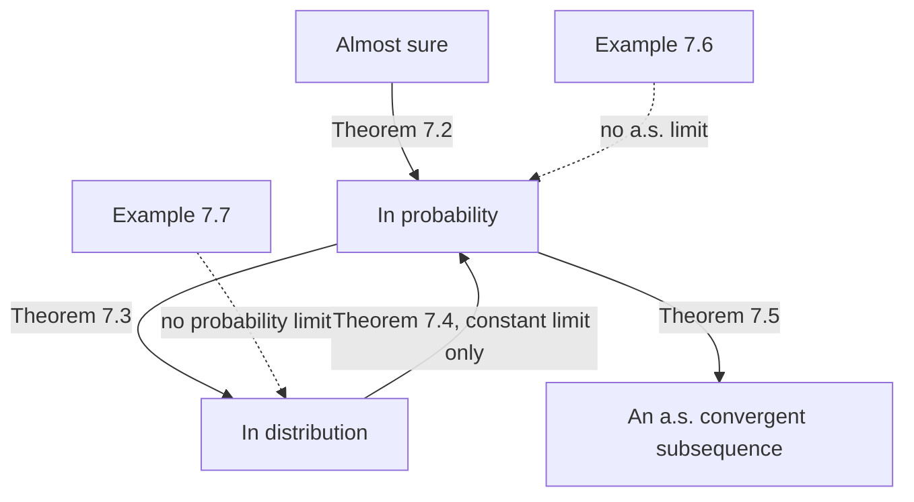

# Law of Large Numbers and the Central Limit Theorem

> [Probability](../README.md) · Level: Advanced · Prerequisites: [Probability Foundations](../01-probability-foundations/README.md), [Expectation and Variance](../05-expectation-and-variance/README.md), [Limits](../../07-calculus/01-limits/README.md), [Integrals](../../07-calculus/06-integrals/README.md) · Estimated time: 480 min

## 1. Introduction

Two theorems explain why probability is usable. The **law of large numbers** says that averages of
repeated independent trials settle down at the expected value: the noise averages out. The **central
limit theorem** says something far more surprising — the *shape* of the remaining noise is always the
same, a bell curve, whatever the underlying distribution. Coin flips, dice, measurement errors, insurance
claims and the heights of strangers all produce the same limiting histogram.

That combination is the reason statistics works with two numbers, a mean and a standard error, and the
reason simulation is a computational method rather than a curiosity: to estimate an integral to three
digits, we need $10^{6}$ samples, and the central limit theorem tells us so in advance.

Five ideas organise the topic.

**"Converges" needs a definition — three of them.** A sequence of random variables can converge in
probability (the chance of any fixed deviation vanishes), almost surely (every outcome of a null set
excluded converges), or in distribution (the CDFs converge). Almost sure implies in probability implies
in distribution, and neither implication reverses. The counterexamples are not pathology; they are the
reason the three notions are kept separate.

**Chebyshev gives the weak law in five lines.** With independent trials of variance $\sigma^{2}$,
$\operatorname{Var}(\bar X_n)=\sigma^{2}/n$, so Chebyshev bounds the deviation of $\bar X_n$ from $\mu$
by $\sigma^{2}/(n\varepsilon^{2})$. The strong law needs more work but says the same thing path by path.

**The central limit theorem identifies the fluctuation.** The law of large numbers says the error
$\bar X_n-\mu$ tends to zero; the central limit theorem rescales it by $\sqrt{n}$ and finds a normal
limit. The two statements are about different scales: $1$ versus $1/\sqrt{n}$. Confusing them is the
most common error in the subject.

**The normal approximation needs a correction when the variable is discrete.** A lattice variable lives on
points, so the interval $[a,b]$ should be replaced by $[a-\tfrac12,b+\tfrac12]$. Without it the
approximation to $\Pr(S_n=k)$ can be off by a factor of $20$ (Example 9.3).

**The theorem is not a law of nature.** It needs finite variance, and it needs a form of independence or
at least weak dependence. Stable laws with infinite variance, single dominant terms, and long memory all
produce different limits or none. Knowing when it fails is part of knowing the theorem.

Historically: Jakob Bernoulli's *Ars Conjectandi* (1713) proved the first weak law for Bernoulli trials;
Abraham de Moivre (1733) obtained the normal approximation to the binomial, the first central limit
theorem; Laplace extended it; Chebyshev (1867) and Markov (1886) introduced the moment method;
Lyapunov (1901) and Lindeberg (1922) gave general conditions; Kolmogorov's strong law (1933) and the
Berry–Esseen bound (1941–42) completed the classical picture. Gnedenko and Kolmogorov's *Limit
Distributions for Sums of Independent Random Variables* (1954) describes the stable laws that take over
when variance fails.

## 2. Prerequisites

* **Expectation, variance, covariance** — linearity, $\operatorname{Var}(\bar X_n)=\sigma^{2}/n$,
  Chebyshev and Markov, MGFs and their uniqueness: [Expectation and Variance](../05-expectation-and-variance/README.md).
* **Events, independence, conditioning** — the axioms, independence of events,
  $\Pr(A\mid B)$, continuity from below and above:
  [Probability Foundations](../01-probability-foundations/README.md).
* **Limits of real sequences and series** — $\lim_{n\to\infty}a_n$, the comparison test for series:
  [Limits](../../07-calculus/01-limits/README.md).
* **Taylor expansions** — $e^{z}=1+z+O(z^{2})$, $\log(1+z)=z+O(z^{2})$:
  [Integrals](../../07-calculus/06-integrals/README.md) and the standard catalogue of §7.7 of the
  previous topic.
* **Normal distribution and its CDF** — $\Phi$, $\phi$, standardisation: defined in §5.4 below.

Notation for random variables, densities and independence is recalled in §5 so that the topic is
self-contained; the previous topic is the place to look for proofs of the moment identities used here.

## 3. Learning Objectives

After working through this tutorial you will be able to:

1. State the three modes of convergence precisely, and prove the implications
   almost sure $\Rightarrow$ in probability $\Rightarrow$ in distribution.
2. Produce counterexamples showing that none of those implications reverses, and that convergence in
   distribution to a constant is equivalent to convergence in probability to it.
3. Prove the weak law of large numbers from Chebyshev's inequality, and state the hypotheses that can be
   relaxed.
4. State Kolmogorov's strong law, prove the fourth-moment case, and explain what "almost surely" adds.
5. State the central limit theorem under its minimal hypotheses and explain the roles of $\sqrt n$,
   $\mu$ and $\sigma$.
6. Give the moment generating function proof and identify exactly which extra assumption it needs.
7. Apply the normal approximation to the binomial, with and without the continuity correction, and
   quantify the gain.
8. State the De Moivre–Laplace theorem and the Berry–Esseen bound, and use the latter to judge how
   accurate an approximation is at a given $n$.
9. Recognise when the central limit theorem fails — heavy tails, dependence, dominance, lattices — and
   describe the limiting behaviour instead.
10. Design and interpret a simulation, including the $\sigma/\sqrt n$ error and a confidence interval.
11. Avoid the standard mistakes: assuming almost sure convergence from convergence in probability,
    dropping the continuity correction, applying the CLT to infinite-variance data, and describing the
    theorem as "everything becomes normal".

## 4. Intuition

Toss a fair coin $n$ times and let $\bar X_n$ be the proportion of heads. Two things happen at once, and
they live on different scales.

At the scale of the proportion, $\bar X_n$ closes in on $\tfrac12$: the spread of $\bar X_n$ is
$\sigma/\sqrt n=\tfrac{1}{2\sqrt n}$, which tends to $0$. With a thousand tosses the proportion is
typically within about $0.016$ of one half. That is the law of large numbers, and it is why a poll of a
thousand people can say something about millions.

At the scale of the *count*, the number of heads still wanders. It equals $n/2$ plus an error of order
$\sqrt n$, and that error, divided by $\sqrt n$, has a distribution that does not change with $n$: it is
approximately $\mathcal{N}(0,\tfrac14)$. That is the central limit theorem, and it is why the same
bell-shaped histogram appears whether we count heads, roll dice, sum insurance claims or average
measurement errors.

The picture to hold in mind is a magnifying glass. Zoom out — divide by $n$ — and the curve collapses to
a point at $\mu$. Zoom in with the right power — multiply the error by $\sqrt n$ — and the curve is a
bell that never changes shape. The law of large numbers describes the collapse; the central limit theorem
describes the shape seen through the lens.

The three modes of convergence describe *how* the collapse happens. "In probability" allows occasional
large errors as long as they become rare. "Almost surely" forbids them, for every outcome outside a null
set: the sequence must eventually stay close. "In distribution" forgets the joint structure entirely and
compares only one-dimensional laws, which is why it can hold for a sequence that does not converge in any
pathwise sense. The distinctions matter in practice: a Monte Carlo estimate may converge almost surely
while its running average still makes large excursions, and a Bayesian posterior may converge in
distribution without any of its sample paths settling down.

Finally, the honest caveat: the bell curve is a limit for *sums of small, comparable, weakly dependent
terms*. When one term dominates, or when the terms have no variance, the limit changes or disappears.
Finance learned this in the 1960s when Mandelbrot pointed out that price changes have far heavier tails
than the normal law allows.

## 5. Formal Definition

Throughout, $(\Omega,\mathcal{F},\Pr)$ is a probability space and $X,X_1,X_2,\dots$ are random variables
on it. Random variables, densities, independence and expectation are as in
[Expectation and Variance](../05-expectation-and-variance/README.md).

### 5.1 Convergence in probability

**Definition 5.1.** $X_n\to X$ *in probability*, written $X_n\xrightarrow{p}X$, if for every
$\varepsilon>0$,

$$\Pr\bigl(\lvert X_n-X\rvert\ge\varepsilon\bigr)\longrightarrow0\qquad(n\to\infty).$$

The limit $X$ is a random variable on the same space. The requirement is that *each fixed* deviation
becomes unlikely; no statement is made about the joint behaviour of the errors.

### 5.2 Almost sure convergence

**Definition 5.2.** $X_n\to X$ *almost surely*, written $X_n\xrightarrow{\text{a.s.}}X$, if the set of
outcomes for which the numerical sequence converges has probability $1$:

$$\Pr\Bigl(\lim_{n\to\infty}X_n=X\Bigr)=1.$$

Equivalently, for every $\varepsilon>0$,

$$\Pr\Bigl(\bigcup_{m\ge n}\{\lvert X_m-X\rvert\ge\varepsilon\}\Bigr)\longrightarrow0\quad\text{as }n\to\infty,$$

i.e. the probability that *some later* term deviates by $\varepsilon$ tends to zero. This is strictly
stronger than Definition 5.1, which looks at one term at a time.

### 5.3 Convergence in distribution

**Definition 5.3.** Let $F_n$ and $F$ be the CDFs of $X_n$ and $X$. Then $X_n\to X$ *in distribution*,
written $X_n\xrightarrow{d}X$ (or $F_n\Rightarrow F$), if

$$F_n(x)\longrightarrow F(x)\qquad\text{for every }x\text{ at which }F\text{ is continuous.}$$

Equivalently (the portmanteau theorem), $\mathbb{E}[f(X_n)]\to\mathbb{E}[f(X)]$ for every bounded
continuous $f$. The variables need not live on the same probability space; only their laws are compared.
Continuity points are excluded because a limit law can have atoms, and at an atom the CDFs need not
converge (see the remark after Theorem 7.3).

### 5.4 The laws and the limit theorem

**Definition 5.4 (Sample mean and standardised sum).** For $X_1,\dots,X_n$ with finite mean,
$\bar X_n=\frac1n\sum_{i=1}^nX_i$ and $S_n=\sum_{i=1}^nX_i=n\bar X_n$. If the $X_i$ are i.i.d. with mean
$\mu$ and variance $\sigma^{2}\in(0,\infty)$, the *standardised sum* is

$$Z_n=\frac{S_n-n\mu}{\sigma\sqrt n}=\frac{\sqrt n\,(\bar X_n-\mu)}{\sigma}.$$

**Definition 5.5 (Standard normal law).** $\mathcal{N}(0,1)$ has density
$\phi(x)=\frac{1}{\sqrt{2\pi}}e^{-x^{2}/2}$, CDF
$\Phi(x)=\int_{-\infty}^{x}\phi(t)\,dt$, mean $0$ and variance $1$. A variable
$X\sim\mathcal{N}(\mu,\sigma^{2})$ equals $\mu+\sigma Z$ with $Z\sim\mathcal{N}(0,1)$.

**Theorem 5.6 (Weak law of large numbers, Chebyshev form).** *Let $X_1,X_2,\dots$ be i.i.d. with
$\mathbb{E}[X_i]=\mu$ and $\operatorname{Var}(X_i)=\sigma^{2}<\infty$. Then
$\bar X_n\xrightarrow{p}\mu$.*

**Theorem 5.7 (Strong law of large numbers, Kolmogorov).** *Let $X_1,X_2,\dots$ be i.i.d. with
$\mathbb{E}\lvert X_1\rvert<\infty$ and $\mathbb{E}[X_1]=\mu$. Then
$\bar X_n\xrightarrow{\text{a.s.}}\mu$. Conversely, if $\bar X_n$ converges almost surely to a finite
limit, then $\mathbb{E}\lvert X_1\rvert<\infty$ and the limit is $\mathbb{E}[X_1]$ almost surely.*

**Theorem 5.8 (Central limit theorem, Lindeberg–Lévy).** *Let $X_1,X_2,\dots$ be i.i.d. with
$\mathbb{E}[X_i]=\mu$ and $\operatorname{Var}(X_i)=\sigma^{2}\in(0,\infty)$. Then*

$$Z_n=\frac{S_n-n\mu}{\sigma\sqrt n}\xrightarrow{d}\mathcal{N}(0,1),$$

*that is, $\Pr(Z_n\le x)\to\Phi(x)$ for every $x\in\mathbb{R}$.*

No moment beyond the second is assumed: the variance is the only hypothesis. The three theorems are
proved, or proved in a representative case, in §7.

### 5.5 What is *not* assumed

* The $X_i$ need not be bounded, discrete, continuous or symmetric.
* The limit in Theorem 5.8 is a *distribution*, not a random variable: no statement is made about
  $Z_n(\omega)$ converging for a fixed $\omega$.
* Theorem 5.7 does not require a variance; Theorem 5.8 does. A finite mean alone gives a law of large
  numbers but not a central limit theorem.

## 6. Mathematical Notation

| Symbol | Read as | Meaning |
|---|---|---|
| $\xrightarrow{p}$ | converges in probability | every fixed deviation becomes unlikely |
| $\xrightarrow{\text{a.s.}}$ | converges almost surely | the sequence converges outside a null set |
| $\xrightarrow{d}$ | converges in distribution | the CDFs converge at continuity points |
| $\Rightarrow$ | weak convergence | the same as $\xrightarrow{d}$ |
| $\bar X_n$ | sample mean | $\frac1n\sum_{i=1}^nX_i$ |
| $S_n$ | partial sum | $X_1+\cdots+X_n$ |
| $Z_n$ | standardised sum | $(S_n-n\mu)/(\sigma\sqrt n)$ |
| $\mu,\sigma^{2}$ | mean, variance | of a single $X_i$ |
| $\sigma/\sqrt n$ | standard error | standard deviation of $\bar X_n$ |
| $\Phi,\phi$ | standard normal CDF, density | see Definition 5.5 |
| $z_{1-\alpha/2}$ | normal quantile | $\Phi(z_{1-\alpha/2})=1-\alpha/2$; $1.96$ at $95\%$ |
| $\rho=\mathbb{E}\lvert X-\mu\rvert^{3}$ | third absolute central moment | enters Berry–Esseen |
| $\text{i.o.}$ | infinitely often | $\{A_n\text{ i.o.}\}=\bigcap_n\bigcup_{m\ge n}A_m$ |

Read $X_n\xrightarrow{p}X$ as "$X_n$ converges to $X$ in probability", and $\xrightarrow{d}$ as
"converges in distribution". The symbol $\Rightarrow$ is traditional in the limit-theorem literature and
means the same as $\xrightarrow{d}$.

## 7. Core Concepts

### 7.1 The three modes and their relations

**Lemma 7.1 (Borel–Cantelli).** *(i) If $\sum_n\Pr(A_n)<\infty$ then $\Pr(A_n\text{ i.o.})=0$.
(ii) If the $A_n$ are independent and $\sum_n\Pr(A_n)=\infty$ then $\Pr(A_n\text{ i.o.})=1$.*

*Proof.* (i) By subadditivity, $\Pr\bigl(\bigcup_{m\ge n}A_m\bigr)\le\sum_{m\ge n}\Pr(A_m)\to0$. The events
$\bigcup_{m\ge n}A_m$ decrease to $\{A_n\text{ i.o.}\}$, so continuity from above gives probability $0$.
(ii) For $N>n$, independence gives
$\Pr\bigl(\bigcap_{m=n}^{N}A_m^{\complement}\bigr)=\prod_{m=n}^{N}\bigl(1-\Pr(A_m)\bigr)\le\exp\bigl(-\sum_{m=n}^{N}\Pr(A_m)\bigr)$,
which tends to $0$ as $N\to\infty$ because the exponent diverges. Hence
$\Pr\bigl(\bigcup_{m\ge n}A_m\bigr)=1$ for every $n$, and intersecting over $n$ gives the claim.
$\blacksquare$

**Theorem 7.2 (Almost sure implies in probability).** *If $X_n\xrightarrow{\text{a.s.}}X$ then
$X_n\xrightarrow{p}X$.*

*Proof.* Fix $\varepsilon>0$ and put $B_n=\bigcup_{m\ge n}\{\lvert X_m-X\rvert\ge\varepsilon\}$. The $B_n$
decrease, and their intersection is contained in the null set where convergence fails, so
$\Pr(B_n)\to0$ by continuity from above. Since
$\{\lvert X_n-X\rvert\ge\varepsilon\}\subseteq B_n$, we get
$\Pr(\lvert X_n-X\rvert\ge\varepsilon)\le\Pr(B_n)\to0$. $\blacksquare$

**Theorem 7.3 (In probability implies in distribution).** *If $X_n\xrightarrow{p}X$ then
$X_n\xrightarrow{d}X$.*

*Proof.* Fix a continuity point $x$ of $F$ and $\varepsilon>0$. Two inclusions give

$$F_n(x)=\Pr(X_n\le x)\le\Pr(X\le x+\varepsilon)+\Pr(\lvert X_n-X\rvert>\varepsilon)=F(x+\varepsilon)+a_n,$$

$$F_n(x)\ge\Pr(X\le x-\varepsilon)-\Pr(\lvert X_n-X\rvert>\varepsilon)=F(x-\varepsilon)-a_n,$$

where $a_n=\Pr(\lvert X_n-X\rvert>\varepsilon)\to0$. Hence
$F(x-\varepsilon)-\limsup_na_n\le\liminf_nF_n(x)\le\limsup_nF_n(x)\le F(x+\varepsilon)+\limsup_na_n$.
Letting $n\to\infty$ and then $\varepsilon\downarrow0$, and using continuity of $F$ at $x$,
$\lim_nF_n(x)=F(x)$. $\blacksquare$

*Remark (why continuity points).* Take $X\equiv0$ and $X_n=1/n$: then $X_n\to0$ in probability, yet
$F_n(0)=0$ for every $n$ while $F(0)=1$. Convergence of CDFs fails exactly at the atom of the limit law,
which is why Definition 5.3 excludes that point — and why a sequence of continuous laws can converge to a
degenerate one.

**Theorem 7.4 (Distribution limit at a constant is probability).** *If $c$ is a constant and
$X_n\xrightarrow{d}c$ then $X_n\xrightarrow{p}c$.*

*Proof.* Fix $\varepsilon>0$. Since $c\pm\varepsilon$ and $c+\varepsilon/2$ are continuity points of the
degenerate CDF at $c$,

$$\Pr(\lvert X_n-c\rvert\ge\varepsilon)\le\Pr(X_n\le c-\varepsilon)+\Pr\bigl(X_n\ge c+\varepsilon\bigr)\le F_n(c-\varepsilon)+1-F_n(c+\varepsilon/2),$$

and the right side tends to $F(c-\varepsilon)+1-F(c+\varepsilon/2)=0+1-1=0$. $\blacksquare$

**Theorem 7.5 (A subsequence converges almost surely).** *If $X_n\xrightarrow{p}X$ then there is a
subsequence $n_1<n_2<\cdots$ with $X_{n_k}\xrightarrow{\text{a.s.}}X$.*

*Proof.* Choose $n_k$ increasing so that $\Pr(\lvert X_{n_k}-X\rvert\ge1/k)\le2^{-k}$. Since
$\sum_k2^{-k}<\infty$, Lemma 7.1(i) gives $\Pr(\lvert X_{n_k}-X\rvert\ge1/k\text{ i.o.})=0$; outside that
null set, for all large $k$ we have $\lvert X_{n_k}-X\rvert<1/k$, hence convergence. $\blacksquare$

**Example 7.6 (In probability but not almost surely).** On $\Omega=[0,1]$ with Lebesgue measure, write
each $n\ge1$ uniquely as $n=2^{k}+j$ with $0\le j<2^{k}$ and set
$X_n=\mathbf{1}_{[j/2^{k},(j+1)/2^{k})}$. Then $\Pr(X_n=1)=2^{-k}\le2/n\to0$, so $X_n\xrightarrow{p}0$.
But every $\omega\in[0,1)$ lies in $I_n$ for infinitely many $n$ and outside it for infinitely many
others, so $X_n(\omega)$ oscillates between $0$ and $1$ and never converges. The intervals march across
$[0,1]$ at finer and finer scales, so the "bad set" at each scale is spread everywhere.

**Example 7.7 (In distribution but not in probability).** Let $X$ be a fair coin variable and set
$X_n=1-X$ for every $n$. Each $X_n$ has the same law as $X$, so $F_n=F$ and $X_n\xrightarrow{d}X$. But
$\Pr(\lvert X_n-X\rvert\ge\tfrac12)=\Pr(X_n\ne X)=1$ for every $n$, so $X_n$ does not converge to $X$ in
probability. (It converges in probability to $1-X$, its own value.) Distributional convergence compares
laws only; it cannot see that $X_n$ and $X$ are always on opposite sides.

**Example 7.8 (Almost sure but not in mean).** Let $U$ be uniform on $(0,1)$ and $X_n=n\mathbf{1}_{\{U\le1/n\}}$.
For each $\omega$ with $U(\omega)>0$ we have $U(\omega)>1/n$ eventually, so $X_n(\omega)=0$ eventually;
the single point $U=0$ has probability $0$. Hence $X_n\xrightarrow{\text{a.s.}}0$. But
$\mathbb{E}[X_n]=n\cdot\frac1n=1$ for every $n$, so $\mathbb{E}\lvert X_n-0\rvert=1\not\to0$: no
convergence in $L^{1}$.

**The hierarchy.** Combining Theorems 7.2–7.4 with the examples:

| Statement | True? | Reason |
|---|---|---|
| a.s. $\Rightarrow$ probability | yes | Theorem 7.2 |
| probability $\Rightarrow$ distribution | yes | Theorem 7.3 |
| distribution $\Rightarrow$ a.s. | no | Example 7.7 |
| probability $\Rightarrow$ a.s. | no | Example 7.6 |
| a.s. $\Rightarrow$ $L^{1}$ | no | Example 7.8 |
| distribution to a constant $\Rightarrow$ probability | yes | Theorem 7.4 |
| probability $\Rightarrow$ a.s. subsequence | yes | Theorem 7.5 |
| $L^{1}$ $\Rightarrow$ probability | yes | Markov's inequality |

### 7.2 The weak law of large numbers

**Proof of Theorem 5.6.** By linearity, $\mathbb{E}[\bar X_n]=\mu$. Independence gives
$\operatorname{Cov}(X_i,X_j)=0$ for $i\ne j$, so by Corollary 7.15 of the previous topic

$$\operatorname{Var}(\bar X_n)=\frac{1}{n^{2}}\sum_{i=1}^{n}\operatorname{Var}(X_i)=\frac{\sigma^{2}}{n}.$$

Chebyshev's inequality (Theorem 7.31 of the previous topic) with $a=\varepsilon>0$ gives

$$\Pr\bigl(\lvert\bar X_n-\mu\rvert\ge\varepsilon\bigr)\le\frac{\sigma^{2}}{n\varepsilon^{2}}\longrightarrow0. \qquad\blacksquare$$

Only pairwise zero correlation was used, not full independence: the hypothesis can be weakened to
pairwise uncorrelated variables with uniformly bounded variances. The conclusion is a statement about the
*scale* $1$: the deviation threshold $\varepsilon$ is fixed, so the bound is about the bulk of the
distribution, not its tail.

**Theorem 7.9 (Khinchin's weak law).** *If the $X_i$ are i.i.d. with $\mathbb{E}\lvert X_1\rvert<\infty$
and $\mu=\mathbb{E}[X_1]$, then $\bar X_n\xrightarrow{p}\mu$.*

The proof truncates at level $n$ and applies Chebyshev to the truncated variables; the truncation
removes the variance hypothesis at the cost of an argument showing that the discarded mass is negligible.
We state it because it marks the exact boundary: a finite mean is enough for a weak law, but not, as
§7.8 shows, for a central limit theorem.

### 7.3 The strong law of large numbers

The strong law is genuinely stronger: it asserts convergence of the whole sequence for almost every
outcome, not just that each fixed deviation becomes rare. It also has a sharp hypothesis — a finite mean,
with no variance needed.

**Proof of the finite fourth-moment case of Theorem 5.7.** Assume $\mathbb{E}[X_i]=0$ (otherwise subtract
$\mu$) and $M=\mathbb{E}[X_1^{4}]<\infty$; put $\sigma^{2}=\mathbb{E}[X_1^{2}]$. Expand

$$S_n^{4}=\sum_iX_i^{4}+4\sum_{i\ne j}X_i^{3}X_j+6\sum_{i<j}X_i^{2}X_j^{2}+(\text{terms with three distinct indices}).$$

Every term containing an index exactly once has expectation $0$ by independence and $\mathbb{E}[X_i]=0$.
The surviving terms are the $n$ fourth powers, with expectation $nM$, and the $6\binom n2=3n(n-1)$ products
$X_i^{2}X_j^{2}$, each with expectation $\sigma^{4}$. Hence

$$\mathbb{E}[S_n^{4}]=nM+3n(n-1)\sigma^{4}\le nM+3n^{2}\sigma^{4}.$$

Markov's inequality with threshold $(n\varepsilon)^{4}$ gives

$$\Pr\bigl(\lvert S_n\rvert\ge n\varepsilon\bigr)\le\frac{\mathbb{E}[S_n^{4}]}{n^{4}\varepsilon^{4}}\le\frac{M}{n^{3}\varepsilon^{4}}+\frac{3\sigma^{4}}{n^{2}\varepsilon^{4}}.$$

The series $\sum_nn^{-2}$ converges, so by Lemma 7.1(i),
$\Pr(\lvert S_n\rvert\ge n\varepsilon\text{ i.o.})=0$; that is, almost surely $\lvert S_n\rvert<n\varepsilon$
for all large $n$. Since $\varepsilon>0$ was arbitrary, $S_n/n\to0$ almost surely. $\blacksquare$

The general case needs a truncation argument (Etemadi's proof, 1981, is the standard elementary one): one
applies the fourth-moment result to $X_i\mathbf{1}_{\{\lvert X_i\rvert\le i\}}$ and controls the discarded
terms with the first-moment hypothesis. The converse in Theorem 5.7 shows that no weaker hypothesis
suffices: if the mean does not exist, the average cannot converge to a finite limit.

**What the strong law adds.** Example 7.6 satisfies the weak law but not the strong law, so the two
theorems are not equivalent. In practice the strong law is what justifies statements such as "the
empirical frequency converges to the probability" for a *particular* infinite sequence of trials, and it
is the hypothesis behind consistency of estimators.

### 7.4 The central limit theorem and its conditions

The theorem identifies the *fluctuation* that the law of large numbers sends to zero.

**Theorem (Lindeberg–Feller).** *Let $X_i$ be independent with $\mathbb{E}[X_i]=\mu_i$ and
$\operatorname{Var}(X_i)=\sigma_i^{2}\in(0,\infty)$, and put $s_n^{2}=\sum_{i\le n}\sigma_i^{2}$. If for
every $\varepsilon>0$*

$$\frac{1}{s_n^{2}}\sum_{i=1}^{n}\mathbb{E}\Bigl[(X_i-\mu_i)^{2}\mathbf{1}_{\{\lvert X_i-\mu_i\rvert>\varepsilon s_n\}}\Bigr]\longrightarrow0,$$

*then $(S_n-\sum_{i\le n}\mu_i)/s_n\xrightarrow{d}\mathcal{N}(0,1)$.*

The *Lindeberg condition* says that no single term contributes a non-negligible share of the total
variance. For i.i.d. variables with finite variance it holds automatically: each term has variance
$\sigma^{2}$ and $s_n^{2}=n\sigma^{2}$, so the indicator vanishes identically once
$\varepsilon s_n>\lvert X_1-\mu\rvert$, which happens eventually.

**Corollary (Lyapunov).** *If $\sum_{i\le n}\mathbb{E}\lvert X_i-\mu_i\rvert^{2+\delta}=o\bigl(s_n^{2+\delta}\bigr)$
for some $\delta>0$, the conclusion holds.*

For i.i.d. variables the variance hypothesis is also necessary: if $(S_n-b_n)/a_n$ converges in
distribution to $\mathcal{N}(0,1)$ with $a_n\to\infty$, then $\mathbb{E}[X_1^{2}]<\infty$ and
$a_n^{2}\sim n\sigma^{2}$ (Feller). So Theorem 5.8 is sharp in its own terms: within the i.i.d. world,
finite variance is exactly the condition for a normal limit with $\sqrt n$ scaling.

### 7.5 The moment generating function proof

**Lemma 7.10 (Taylor expansion of an MGF).** *Let $Y$ have $\mathbb{E}[Y]=0$, $\mathbb{E}[Y^{2}]=1$ and
$M_Y(t)<\infty$ for $\lvert t\rvert<\delta$. Then $M_Y(t)=1+\tfrac12t^{2}+o(t^{2})$ as $t\to0$.*

*Proof.* By Theorem 7.26 of the previous topic $M_Y$ is twice differentiable on $(-\delta,\delta)$ with
$M_Y'(0)=\mathbb{E}[Y]=0$ and $M_Y''(0)=\mathbb{E}[Y^{2}]=1$. Taylor's theorem with Peano remainder gives
$M_Y(t)=M_Y(0)+M_Y'(0)t+\tfrac12M_Y''(0)t^{2}+o(t^{2})=1+\tfrac12t^{2}+o(t^{2})$. $\blacksquare$

**Proof of Theorem 5.8 (assuming MGFs exist).** Put $Y_i=(X_i-\mu)/\sigma$, so the $Y_i$ are i.i.d. with
mean $0$, variance $1$ and MGF $M$ finite on $(-\delta,\delta)$. Then
$Z_n=\frac{1}{\sqrt n}\sum_{i\le n}Y_i$ and, by independence,

$$M_{Z_n}(t)=\prod_{i=1}^{n}\mathbb{E}\bigl[e^{tY_i/\sqrt n}\bigr]=\Bigl[M\Bigl(\frac{t}{\sqrt n}\Bigr)\Bigr]^{n}.$$

Fix $t$ and let $n\to\infty$. For large $n$, $u=t/\sqrt n$ satisfies $\lvert u\rvert<\delta$, so Lemma 7.10
gives $M(u)=1+\frac{t^{2}}{2n}+o\bigl(\frac1n\bigr)$. Using $\log(1+z)=z+O(z^{2})$,

$$\log M_{Z_n}(t)=n\log\Bigl(1+\frac{t^{2}}{2n}+o\bigl(\tfrac1n\bigr)\Bigr)=n\Bigl(\frac{t^{2}}{2n}+o\bigl(\tfrac1n\bigr)\Bigr)\longrightarrow\frac{t^{2}}{2}.$$

Hence $M_{Z_n}(t)\to e^{t^{2}/2}$, the MGF of $\mathcal{N}(0,1)$. By the continuity theorem for moment
generating functions (if MGFs converge on an interval around $0$ to the MGF of a law, the laws converge),
$Z_n\xrightarrow{d}\mathcal{N}(0,1)$. $\blacksquare$

**The extra hypothesis, and how to remove it.** The argument needs $M$ finite in a neighbourhood of $0$,
which fails for heavy-tailed variables — including some with finite variance. The general proof replaces
the MGF by the *characteristic function* $\varphi_Y(t)=\mathbb{E}[e^{itY}]$, which exists for every
variable, and uses $\varphi_Y(t)=1-\tfrac12t^{2}+o(t^{2})$; the algebra above is unchanged, and Lévy's
continuity theorem supplies the conclusion. So Theorem 5.8 needs only finite variance; the MGF version is
a proof for the convenient case, and it is the one to remember because every step is visible.

### 7.6 The binomial case and the continuity correction

**Theorem 7.11 (De Moivre–Laplace).** *Let $S_n\sim\operatorname{Bin}(n,p)$ with $0<p<1$ and
$q=1-p$. Then*

$$\frac{S_n-np}{\sqrt{npq}}\xrightarrow{d}\mathcal{N}(0,1).$$

This is Theorem 5.8 applied to Bernoulli summands, and historically it came first: de Moivre proved the
case $p=\tfrac12$ in 1733, a century before the general theorem.

The approximation in practice, with $z=(k-np)/\sqrt{npq}$:

$$\Pr(S_n\le k)\approx\Phi\Bigl(\frac{k+\tfrac12-np}{\sqrt{npq}}\Bigr),\qquad \Pr(a\le S_n\le b)\approx\Phi\Bigl(\frac{b+\tfrac12-np}{\sqrt{npq}}\Bigr)-\Phi\Bigl(\frac{a-\tfrac12-np}{\sqrt{npq}}\Bigr).$$

**Why the half-unit.** Because $S_n$ is integer-valued, the event $\{a\le S_n\le b\}$ is the same as
$\{a-\tfrac12\le S_n\le b+\tfrac12\}$, and the latter interval is the one whose endpoints should be
matched to the normal curve. Equivalently, each integer $k$ represents the unit-wide block
$[k-\tfrac12,k+\tfrac12)$, so the probability at $k$ corresponds to the area of a bar of width $1$
centred at $k$. The correction is not cosmetic:

| Quantity, $S\sim\operatorname{Bin}(100,\tfrac12)$ | Exact | With correction | Without correction |
|---|---|---|---|
| $\Pr(45\le S\le55)$ | $0.728747$ | $0.728668$ | $0.682689$ |
| $\Pr(S\le40)$ | $0.028443$ | $0.028716$ | $0.022750$ |
| $\Pr(S=50)$ | $0.079589$ | $0.079656$ | $0$ |

The last row is decisive: without the correction, a normal density assigned to a single point
approximates nothing, while with it the error is $7\times10^{-5}$.

**When to use it.** The classical rule of thumb is $np\ge5$ and $nq\ge5$; the approximation degrades as
$p$ moves toward $0$ or $1$, where the binomial is skewed. For $p$ small and $n$ large with $np$ moderate,
the Poisson limit is the better approximation, and the two agree because a Poisson with large mean is
approximately normal.

### 7.7 The Berry–Esseen bound

Convergence in distribution is a statement about a limit; Berry–Esseen says how fast.

**Theorem 7.12 (Berry–Esseen).** *Let $X_i$ be i.i.d. with $\mathbb{E}[X_i]=\mu$,
$\operatorname{Var}(X_i)=\sigma^{2}\in(0,\infty)$ and $\rho=\mathbb{E}\lvert X_i-\mu\rvert^{3}<\infty$.
Let $F_n$ be the CDF of $Z_n=(S_n-n\mu)/(\sigma\sqrt n)$. Then there is a universal constant $C$ with*

$$\sup_{x\in\mathbb{R}}\bigl\lvert F_n(x)-\Phi(x)\bigr\rvert\le\frac{C\rho}{\sigma^{3}\sqrt n},$$

*and one may take any $C>0.4748$, while no $C<0.4097$ works.*

Three features matter.

* **Uniform in $x$.** The bound controls the whole CDF at once, unlike the pointwise statement of the CLT.
* **Rate $1/\sqrt n$.** To halve the error one needs four times as many observations. The rate cannot be
  improved: for two-point laws the supremum error is genuinely of order $n^{-1/2}$ (Exercise 32).
* **Third moment, not fourth.** Skewness enters. A symmetric law can have $\rho$ much smaller than a
  skewed law with the same variance, and its normal approximation is correspondingly better.

For Bernoulli$(\tfrac12)$: $\rho=\tfrac12(\tfrac12)^{3}+\tfrac12(\tfrac12)^{3}=0.25$ and
$\sigma^{3}=0.125$, so the bound is $2C/\sqrt n\le0.9496/\sqrt n$; at $n=100$ this is $0.095$, while the
true supremum error is about $0.04$. For the exponential law, $\sigma=1$ and
$\rho=\mathbb{E}\lvert X-1\rvert^{3}=-2+12e^{-1}=2.4146$, so the bound is $2.4146C/\sqrt n\le1.147/\sqrt n$
— looser, as the skewness suggests.

### 7.8 When the CLT fails

**(a) Infinite variance.** Let $X$ have the standard Cauchy density $\frac{1}{\pi(1+x^{2})}$. Then
$\mathbb{E}\lvert X\rvert=\infty$ and, as Exercise 33 shows, the average of $n$ independent Cauchy
variables is again standard Cauchy. So $\bar X_n$ has the *same* distribution for every $n$: it does not
concentrate, and $\Pr(\lvert\bar X_n\rvert\le1)=\tfrac12$ for all $n$, whereas a law of large numbers
would force this to tend to $1$. Normalised sums do converge in distribution, but to a Cauchy law, not a
normal one — the general limit objects are the *stable laws*, and only the normal law has finite
variance.

**(b) Finite mean, infinite variance.** Pareto-type laws with tail exponent $1<\alpha<2$ have a mean but
no variance. Khinchin's weak law still holds, so the average converges to the mean, but the fluctuations
are of order $n^{1/\alpha}$ rather than $\sqrt n$, and the limit after that rescaling is an $\alpha$-stable
law. Using a normal confidence interval here understates the error dramatically.

**(c) Dependence.** If $Y_i=X_1$ for every $i$, then $\bar Y_n=X_1$ for all $n$: no concentration, no
limit theorem. With constant positive correlation $\rho$ between distinct terms,
$\operatorname{Var}(\bar Y_n)=\frac{\sigma^{2}}{n}+\bigl(1-\frac1n\bigr)\rho\sigma^{2}\to\rho\sigma^{2}>0$,
so the average retains a random limit. Long-memory sequences can have
$\operatorname{Var}(S_n)\sim n^{2H}L(n)$ with $H>\tfrac12$, and the limit is a fractional Brownian
functional, not a normal law. Independence can be replaced by weak dependence (mixing), but not by
nothing.

**(d) A dominant term.** Let $X_n$ take the values $\pm2^{n}$ with probability $\tfrac12$ each, independently.
Then

$$\frac{S_n}{2^{n}}=\sum_{j=0}^{n-1}\varepsilon_{n-j}2^{-j}\xrightarrow{d}\sum_{j\ge0}\varepsilon_j2^{-j},$$

where $\varepsilon_j=\pm1$ are independent signs. The characteristic function of the limit is
$\prod_{j\ge0}\cos(2^{-j}t)=\frac{\sin 2t}{2t}$, which is the characteristic function of the uniform law on
$[-2,2]$: the limit is uniform, not normal. The Lindeberg condition fails because the last term
$\pm2^{n}$ carries essentially all the variance, so no single summand is negligible.

**(e) Lattices and local approximations.** The CDF-level CLT holds for lattice variables, but the
*density-level* statement does not: if $X$ takes values in $h\mathbb{Z}$, then
$\Pr(S_n=k)\approx\frac{h}{\sigma\sqrt n}\phi\bigl((k-n\mu)/(\sigma\sqrt n)\bigr)$ requires using the true
span $h$. With span $2$ and the wrong span, every probability is off by a factor of $2$; and a variable on
even integers has $\Pr(S_n\text{ odd})=0$, which no normal density reproduces. This is the deeper reason
for the continuity correction: it is the span-$1$ version of the local limit theorem.

**(f) Small $n$ and strong skewness.** For $X\sim\operatorname{Exp}(1)$ and $n=100$, the exact value of
$\Pr(\bar X_n\le1.2)$ is $0.97214$ against the normal approximation $\Phi(2)=0.97725$; the error $0.005$
is harmless in a rough calculation and unacceptable in a regulatory one. Berry–Esseen tells you the
order; a skewness correction (Edgeworth) tells you the sign.

### 7.9 Simulation and the standard error

The CLT is the theoretical basis of simulation. Suppose we want
$\mu=\mathbb{E}[g(U)]$ for a uniform $U$ and estimate it by
$\hat\mu_n=\frac1n\sum_{i\le n}g(U_i)$. Then $\hat\mu_n$ is unbiased, its standard error is
$\sigma_g/\sqrt n$, and for large $n$

$$\Pr\Bigl(\lvert\hat\mu_n-\mu\rvert\le1.96\,\frac{\hat\sigma_g}{\sqrt n}\Bigr)\approx0.95.$$

Three practical consequences.

* **Quadratic cost.** Halving the error requires four times the work. This is why variance reduction
  (antithetic variables, control variates, importance sampling) matters more than raw speed.
* **The estimate of the error is itself an estimate.** Replacing $\sigma_g$ by the sample standard
  deviation introduces a further error of relative order $1/\sqrt{2n}$; for $n=10^{4}$ that is about
  $0.7\%$.
* **Distributional convergence is not pathwise.** A histogram of $10^{4}$ standardised sums looks normal
  even when individual trajectories of $Z_n$ do not converge; the theorem is about laws, and simulations
  display laws.

Example 9.9 carries out the arithmetic for estimating $\pi$ by sampling points in a square.

## 8. Formulas and Properties

### 8.1 The results in one table

| Name | Statement | Hypotheses | Rate or constant |
|---|---|---|---|
| Chebyshev WLLN | $\bar X_n\xrightarrow{p}\mu$ | i.i.d. (or pairwise uncorrelated), $\sigma^{2}<\infty$ | bound $\sigma^{2}/(n\varepsilon^{2})$ |
| Khinchin WLLN | $\bar X_n\xrightarrow{p}\mu$ | i.i.d., $\mathbb{E}\lvert X_1\rvert<\infty$ | no variance needed |
| Kolmogorov SLLN | $\bar X_n\xrightarrow{\text{a.s.}}\mu$ | i.i.d., $\mathbb{E}\lvert X_1\rvert<\infty$ | sharp |
| Lindeberg–Lévy CLT | $(S_n-n\mu)/(\sigma\sqrt n)\xrightarrow{d}\mathcal{N}(0,1)$ | i.i.d., $0<\sigma^{2}<\infty$ | exact limit |
| Lindeberg–Feller | same, non-identical | independence plus Lindeberg condition | exact limit |
| Lyapunov | same | independence plus $(2+\delta)$-moment condition | exact limit |
| De Moivre–Laplace | $(S_n-np)/\sqrt{npq}\xrightarrow{d}\mathcal{N}(0,1)$ | $S_n\sim\operatorname{Bin}(n,p)$, $0<p<1$ | exact limit |
| Berry–Esseen | $\sup_x\lvert F_n(x)-\Phi(x)\rvert\le C\rho/(\sigma^{3}\sqrt n)$ | i.i.d., $\rho=\mathbb{E}\lvert X-\mu\rvert^{3}<\infty$ | $0.4097\le C<0.4748$ |
| Continuity correction | add $\pm\tfrac12$ to the endpoints | integer-valued $S_n$ | improves $O(1/\sqrt n)$ to $o(1/\sqrt n)$ in practice |
| Standard error | $\operatorname{Var}(\bar X_n)=\sigma^{2}/n$ | i.i.d., finite variance | sd $\sigma/\sqrt n$ |
| Normal interval | $\bar X_n\pm z_{1-\alpha/2}\sigma/\sqrt n$ | CLT applies | coverage $1-\alpha$ asymptotically |
| Sample size | $n\approx z^{2}\sigma^{2}/\varepsilon^{2}$ | CLT applies | for proportions, $n\approx z^{2}/(4\varepsilon^{2})$ |

### 8.2 Two derivations worth keeping

**The $1/\sqrt n$ is forced by the variance.** For i.i.d. variables,
$\operatorname{Var}(S_n)=n\sigma^{2}$, so the standard deviation of $S_n$ grows like $\sqrt n$; dividing
by $n$ to get the average gives $\sigma/\sqrt n$, and dividing the centred sum by $\sigma\sqrt n$ gives a
quantity of variance $1$. Any other rescaling either collapses to $0$ (too much division) or diverges (too
little): the CLT's scale is the unique one at which a non-degenerate limit exists.

**Margin of error of a poll.** With a sample proportion $\hat p_n$ from $n$ independent draws,
$\operatorname{Var}(\hat p_n)=p(1-p)/n\le1/(4n)$. A $95\%$ interval has half-width
$1.96\sqrt{p(1-p)/n}$, at most $1.96/(2\sqrt n)=0.98/\sqrt n$. Solving $1.96/(2\sqrt n)\le\varepsilon$
gives $n\ge(0.98/\varepsilon)^{2}$; for $\varepsilon=0.03$ this is $n\ge1068$.

### 8.3 The exact constants used in the examples

$$\Phi(1)=0.8413,\quad \Phi(1.96)=0.9750,\quad \Phi(2)=0.97725,\quad \Phi(2.125)=0.98321,\quad \Phi(2.663)=0.99613.$$

The quantiles $z_{0.975}=1.9600$ and $z_{0.995}=2.5758$ are the two used most often.

## 9. Step-by-Step Examples

### 9.1 The law of large numbers in numbers

A fair die is rolled $n=1000$ times and $\bar X_n$ is the average. Then $\mu=3.5$,
$\sigma^{2}=35/12=2.9167$ and $\operatorname{Var}(\bar X_n)=2.9167/1000=0.0029167$. Chebyshev with
$\varepsilon=0.5$ gives

$$\Pr(\lvert\bar X_n-3.5\rvert\ge0.5)\le\frac{2.9167}{1000(0.25)}=0.011667.$$

*Check with the CLT.* The standard error is $\sqrt{0.0029167}=0.05401$, so $0.5$ is $9.26$ standard errors.
The true probability is about $2(1-\Phi(9.26))\approx2\times10^{-20}$, and the Chebyshev bound is smaller
than $1$ but larger than the truth by eighteen orders of magnitude. Both statements are correct; they
answer different questions.

### 9.2 The normal approximation to the binomial

For $S\sim\operatorname{Bin}(100,\tfrac12)$, $\mu=50$ and $\sigma=5$. Then

$$\Pr(45\le S\le55)\approx\Phi\Bigl(\frac{55.5-50}{5}\Bigr)-\Phi\Bigl(\frac{44.5-50}{5}\Bigr)=\Phi(1.1)-\Phi(-1.1)=2(0.864334)-1=0.728668.$$

The exact value is $0.728747$, so the error is $8\times10^{-5}$. Without the correction one would compute
$\Phi(1)-\Phi(-1)=0.682689$, an error of $0.046$ — $580$ times larger.

*Check.* The mean and variance are exact, and the approximation is symmetric about $50$; the exact
distribution is also symmetric, so the errors at the two tails cancel. The correction helps because the
binomial mass at $k$ is spread over $[k-\tfrac12,k+\tfrac12)$.

### 9.3 One atom: where the correction is everything

For the same $S$, $\Pr(S=50)=\binom{100}{50}2^{-100}=0.079589$. With the correction,

$$\Pr(S=50)\approx\Phi\Bigl(\frac{50.5-50}{5}\Bigr)-\Phi\Bigl(\frac{49.5-50}{5}\Bigr)=\Phi(0.1)-\Phi(-0.1)=2(0.539828)-1=0.079656,$$

an absolute error of $7\times10^{-5}$. Without it the interval is $[50,50]$, of width $0$ and probability
$0$ under a continuous law: a $100\%$ relative error.

*Check.* By the local limit theorem the mass should approximate $\frac{1}{\sigma}\phi(0)=\frac{1}{5\sqrt{2\pi}}=0.079577$;
the correction gives $0.079656$ and the density value $0.079577$, agreeing to four digits.

### 9.4 Sizing a poll

A poll estimates a proportion with a $95\%$ interval. With $\hat p$ near $\tfrac12$ the worst-case
half-width is $1.96\sqrt{0.25/n}=0.98/\sqrt n$.

* For a $3\%$ margin: $n\ge(0.98/0.03)^{2}=1067.1$, so $n=1068$.
* For a $2\%$ margin: $n\ge(0.98/0.02)^{2}=2401$.
* With $n=1000$ the margin is $0.98/\sqrt{1000}=0.031$, i.e. $3.1\%$; the familiar "thousand people, three
  percent" is exactly this computation, not a convention.

*Check.* Halving the margin quadruples the sample, as the $\sqrt n$ scaling demands: $2401\approx4\times600$,
and indeed a $1.5\%$ margin needs $4268$.

### 9.5 A skewed law: how large must $n$ be?

Let $X_i\sim\operatorname{Exp}(1)$, so $\mu=\sigma=1$ and $\bar X_{100}$ has mean $1$ and standard error
$0.1$. The CLT gives

$$\Pr(\bar X_{100}\le1.2)\approx\Phi\Bigl(\frac{1.2-1}{0.1}\Bigr)=\Phi(2)=0.97725.$$

Exactly, $\bar X_{100}\le1.2$ if and only if $S_{100}\le120$, and $S_{100}\sim\operatorname{Gamma}(100,1)$;
the exact value is $0.97214$. The error is $0.0051$, about $0.5$ percentage points.

*Check.* The exponential is right-skewed, so the sample mean is right-skewed too and the normal
approximation should overstate the lower tail probability near the mean, which it does. Berry–Esseen with
$\rho=-2+12e^{-1}=2.4146$ and $\sigma=1$ gives an error bound of $1.147/\sqrt{100}=0.115$: correct but
pessimistic by a factor of $20$.

### 9.6 Sums of dice

Forty-eight dice are rolled; let $S$ be the total. Then $\mu=48(3.5)=168$ and
$\sigma^{2}=48(35/12)=140$, so $\sigma=11.832$. With the continuity correction,

$$\Pr(S\ge200)\approx1-\Phi\Bigl(\frac{199.5-168}{11.832}\Bigr)=1-\Phi(2.663)=0.003872.$$

The exact value is $0.003732$, an error of $4\%$ of the probability itself.

*Check.* Also $\Pr(160\le S\le176)$: the standardised endpoints are
$(159.5-168)/11.832=-0.7184$ and $(176.5-168)/11.832=0.7184$, giving $2\Phi(0.7184)-1=0.5275$. The exact
value is $0.526392$, so the approximation is off by $0.0011$ — the same order as in the tail, as the CLT
predicts.

### 9.7 Berry–Esseen in practice

For Bernoulli$(\tfrac12)$, $\rho=0.25$, $\sigma^{3}=0.125$ and the bound is $0.9496/\sqrt n$:

| $n$ | Berry–Esseen bound | Actual supremum error |
|---|---|---|
| $10$ | $0.300$ | $0.123$ |
| $20$ | $0.212$ | $0.088$ |
| $50$ | $0.134$ | $0.056$ |
| $100$ | $0.095$ | $0.040$ |
| $200$ | $0.067$ | $0.028$ |
| $500$ | $0.042$ | $0.018$ |

*Check.* The ratio bound/actual is about $2.4$ throughout, and the actual errors follow $0.398/\sqrt n$:
$0.398/\sqrt{500}=0.0178$, matching the last row. The bound is pessimistic by a constant factor — as it
must be, since it must hold for every distribution with the given third moment.

### 9.8 Where it all breaks: the Cauchy average

Let $X_i$ be i.i.d. standard Cauchy. Their density is symmetric and heavy-tailed,
$\Pr(\lvert X_i\rvert>t)\approx2/(\pi t)$ for large $t$, so $\mathbb{E}\lvert X_i\rvert=\infty$. The average
$\bar X_n$ is again standard Cauchy (Exercise 33), hence

$$\Pr(\lvert\bar X_n\rvert\le1)=\frac{2}{\pi}\arctan(1)=\frac12\qquad\text{for every }n.$$

A law of large numbers would force this probability to tend to $1$ if a finite mean existed; it does not
move at all. Ten thousand observations are worth no more than one.

*Check.* The median of the average is $0$ for every $n$, and its quartiles are $\pm1$: the "standard
error" of the mean does not shrink, because there is no standard error. Any confidence interval based on
$\sigma/\sqrt n$ is meaningless here.

### 9.9 Simulation: estimating $\pi$ and its error bar

Sample $n$ points uniformly in the unit square and let $\hat p_n$ be the fraction inside the quarter
disk, so $\mathbb{E}[\hat p_n]=\pi/4=0.785398$ and $\operatorname{Var}(\hat p_n)=p(1-p)/n$. The estimate of
$\pi$ is $4\hat p_n$, with standard error $4\sqrt{p(1-p)/n}$.

* With $n=10^{6}$: $\sqrt{0.785398(0.214602)/10^{6}}=0.000411$, so the standard error of $4\hat p_n$ is
  $0.001642$ and a $95\%$ interval is $\pm0.00322$.
* To reach a standard error of $0.001$ in $\pi$ itself, one needs
  $n=(4)^{2}(0.1686)/(0.001)^{2}=2.70\times10^{6}$ points.

*Check.* The error scales as $1/\sqrt n$: going from $10^{6}$ to $2.7\times10^{6}$ reduces the standard
error by a factor $\sqrt{2.7}=1.64$, from $0.00164$ to $0.00100$. ✓

## 10. Visual Explanations

**The hierarchy of convergence.** Arrows are implications proved in §7.1; the dashed marked arrows are the
counterexamples.

**Two scales, one picture.** The law of large numbers and the CLT describe the same sum at different
magnifications.

| Object | Mean | Standard deviation | Behaviour |
|---|---|---|---|
| $S_n$ | $n\mu$ | $\sigma\sqrt n$ | grows without bound |
| $\bar X_n=S_n/n$ | $\mu$ | $\sigma/\sqrt n$ | collapses to $\mu$ (LLN) |
| $Z_n=(S_n-n\mu)/(\sigma\sqrt n)$ | $0$ | $1$ | keeps a fixed law (CLT) |

**The error of the normal approximation decays like $1/\sqrt n$.** The table of Example 9.7, plotted
mentally, is a curve through $(10,0.123)$, $(100,0.040)$, $(500,0.018)$ — each tenfold increase in $n$
reduces the error by about $3.2=\sqrt{10}$.

**The continuity correction as a bar chart.** Each integer $k$ owns the unit interval
$[k-\tfrac12,k+\tfrac12)$; the binomial mass at $k$ is the area of a bar of height $\Pr(S=k)$ and width
$1$. Approximating the bar by the normal density at its centre is the corrected rule; evaluating the
density at the left edge and calling it a probability is what the uncorrected rule does, and it is why
that rule assigns probability $0$ to a single point.

## 11. Common Mistakes

1. **Confusing the two scales.** The law of large numbers says $\bar X_n-\mu\to0$; the CLT says
   $\sqrt n(\bar X_n-\mu)$ has a normal limit. The deviation itself does not become normal — it becomes
   zero.

2. **Claiming almost sure convergence from convergence in probability.** Example 7.6 is a sequence that
   converges in probability and nowhere almost surely. Only a subsequence is guaranteed.

3. **Assuming convergence in distribution gives convergence in probability.** It does so only when the
   limit is a constant (Theorem 7.4). Example 7.7 shows the failure for a non-degenerate limit.

4. **Comparing densities instead of CDFs.** Convergence in distribution is about CDFs at continuity
   points; densities or mass functions need not converge, and cannot converge to a density when the limit
   is discrete.

5. **Dropping the continuity correction.** For a lattice variable the uncorrected approximation can be off
   by $O(1/\sqrt n)$ in the CDF and by $100\%$ for a single mass (Example 9.3).

6. **Using the normal approximation where it does not apply.** Needs finite variance; Cauchy and
   Pareto-with-$\alpha<2$ data have neither a normal limit nor a shrinking standard error.

7. **Applying the theorems to dependent data.** Constant positive correlation leaves the average random
   in the limit; long memory changes the rate from $\sqrt n$ to $n^{H}$.

8. **Reading "the data are approximately normal".** The CLT is about sums and averages, not about
   individual observations. Averages of exponential data are approximately normal; the data are not.

9. **Reporting $\sigma$ as the standard error.** The standard error of $\bar X_n$ is $\sigma/\sqrt n$, and
   it shrinks with $n$. Quoting $\sigma$ makes every estimate look $30$ times worse at $n=1000$.

10. **Believing the law of large numbers repays deficits.** After ten heads, a tail is not "due". The law
    says proportions converge, not that counts equalise; the gambler's fallacy is the confusion of
    $\lvert S_n-np\rvert$ (which grows like $\sqrt n$) with $S_n/n$ (which shrinks).

11. **Treating "converges in distribution" as "the distributions become close in total variation".** Two
    discrete laws can converge weakly to a continuous one while remaining singular with respect to it.

## 12. Applications

**Polling and clinical trials.** A sample proportion has standard error $\sqrt{p(1-p)/n}$, and the CLT
turns it into a confidence interval. The same calculation sizes a trial: to detect a difference of $d$
standard deviations with $80\%$ power one needs roughly $16/d^{2}$ observations per arm, a direct
consequence of the $\sqrt n$ scaling.

**Monte Carlo and simulation.** Numerical integration, option pricing, particle physics and Bayesian
posterior sampling all rest on the pair (LLN, CLT): the average converges, and its error is
$\sigma/\sqrt n$ with a normal distribution. Variance reduction techniques are attempts to lower $\sigma$,
since lowering $n$ is expensive.

**Insurance and risk aggregation.** An insurer's aggregate claims over $n$ independent policies have mean
$n\mu$ and standard deviation $\sigma\sqrt n$, so relative fluctuations shrink like $1/\sqrt n$. This is
why premiums are predictable in aggregate while individual claims are not — and why the CLT fails for
catastrophe covers, where claims are dependent and heavy-tailed.

**Statistical mechanics.** The relative fluctuation of the energy of $N$ particles is of order
$1/\sqrt N$, which is why thermodynamics is deterministic at macroscopic $N\sim10^{23}$: the fluctuation is
about $10^{-11.5}$ of the total.

**Signal processing and machine learning.** Averaging $n$ independent noisy measurements reduces the noise
by $\sqrt n$; stochastic gradient descent is an average of noisy gradients and inherits the same scaling;
bootstrap confidence intervals are justified by the CLT for the empirical distribution.

**Finance, with a warning.** The classical theory of diversified portfolios uses $\sigma/\sqrt n$, and it
works while variances are finite. Mandelbrot's observation that price changes have Pareto-like tails with
$\alpha\approx1.7$ means the variance is infinite, the CLT does not apply, and risk does not diversify at
the $\sqrt n$ rate. The correct limit theory is that of stable laws (§7.8).

## 13. Exercises

The problem set is in [exercises.md](exercises.md): $36$ problems in four levels — **Beginner** (1–11),
**Intermediate** (12–23), **Advanced** (24–31) and **Challenge** (32–36). Each problem names the section it
draws on. Several problems ask you to simulate; do so, and compare the simulated error with the CLT
prediction.

## 14. Solutions

Full worked solutions are in [solutions.md](solutions.md), with the same numbering: strategy first, every
significant step, then an independent check. Proofs are complete, with hypotheses stated.

## 15. Summary

* Convergence in probability, almost surely and in distribution are different: a.s. $\Rightarrow$
  probability $\Rightarrow$ distribution, and neither arrow reverses.
* Convergence in distribution to a constant is equivalent to convergence in probability to that constant.
* The weak law follows from $\operatorname{Var}(\bar X_n)=\sigma^{2}/n$ and Chebyshev:
  $\Pr(\lvert\bar X_n-\mu\rvert\ge\varepsilon)\le\sigma^{2}/(n\varepsilon^{2})$.
* Khinchin's weak law needs only a finite mean; Kolmogorov's strong law needs only a finite mean and gives
  pathwise convergence.
* The central limit theorem needs finite variance: $(S_n-n\mu)/(\sigma\sqrt n)\xrightarrow{d}\mathcal{N}(0,1)$.
* The MGF proof expands $M_Y(t)=1+t^{2}/2+o(t^{2})$ and shows $[M_Y(t/\sqrt n)]^{n}\to e^{t^{2}/2}$; the
  general proof uses characteristic functions, so only the variance is required.
* For lattice variables, add $\pm\tfrac12$ before standardising; the correction is what makes a single
  mass approximable at all.
* De Moivre–Laplace is the binomial case; Berry–Esseen bounds the error uniformly by
  $C\rho/(\sigma^{3}\sqrt n)$, so accuracy improves only like $1/\sqrt n$.
* The CLT fails for infinite variance (Cauchy, stable laws), for strongly dependent data, when one term
  dominates, and at the density level for lattices.
* Simulation error is $\sigma/\sqrt n$; quadrupling $n$ halves it, and the CLT supplies the confidence
  interval.

## 16. Further Learning

**Next in this repository.** The discipline index [Probability](../README.md) lists the remaining topics;
the moment machinery used throughout is in
[Expectation and Variance](../05-expectation-and-variance/README.md), and the event-level foundations are
in [Probability Foundations](../01-probability-foundations/README.md). For the statistical use of these
theorems — estimators, confidence intervals, tests — see [Statistics](../../11-statistics/README.md). For
the integral estimates behind the normal density see
[Techniques of Integration](../../07-calculus/08-techniques-of-integration/README.md); for the analytic
background on limits see [Limits](../../07-calculus/01-limits/README.md).

**Standard texts.**

* William Feller, *An Introduction to Probability Theory and Its Applications*, Volume II — the classical
  treatment of the laws of large numbers and the CLT, with the sharpest statements.
* Geoffrey Grimmett and David Stirzaker, *Probability and Random Processes* — Chapters 5 and 7 give these
  results with full proofs at the level of this tutorial.
* Patrick Billingsley, *Probability and Measure* — characteristic functions, Lindeberg–Feller and the
  stable laws.
* Boris Gnedenko and Andrey Kolmogorov, *Limit Distributions for Sums of Independent Random Variables* —
  the definitive account of what happens when the variance fails.
* Rick Durrett, *Probability: Theory and Examples* — Etemadi's proof of the strong law and the modern
  treatment of dependence.
* Larry Wasserman, *All of Statistics* — the applied counterpart: standard errors, the delta method and
  the bootstrap.

