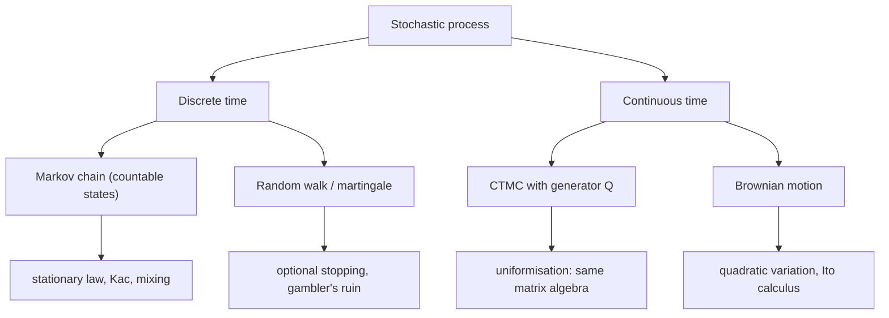
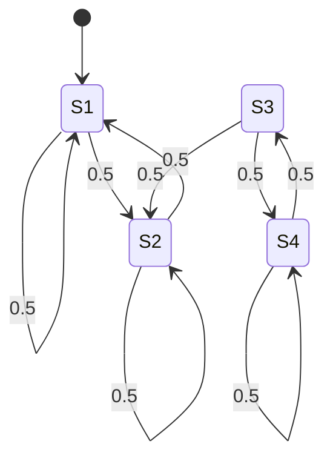

# Stochastic Processes

> [Probability](../README.md) · Level: Advanced · Prerequisites: [Probability Foundations](../01-probability-foundations/README.md), [Conditional Probability and Independence](../02-conditional-probability-and-independence/README.md), [Random Variables](../03-random-variables/README.md), [Probability Distributions](../04-probability-distributions/README.md), [Expectation and Variance](../05-expectation-and-variance/README.md), [Law of Large Numbers and the Central Limit Theorem](../06-law-of-large-numbers-and-central-limit-theorem/README.md), [Eigenvalues and Eigenvectors](../../08-linear-algebra/07-eigenvalues-and-eigenvectors/README.md) · Estimated time: 720 min

## 1. Introduction

Probability up to this point has been about one random object at a time. This topic adds the ingredient that
turns probability into a description of the world: **a time axis**. A stochastic process is a family of
random variables indexed by time, and the questions change character. Instead of "what is
$\Pr(X\le3)$?" we ask where the system drifts, whether it settles down, whether it ever comes back, and how
long we must wait.

Four families carry almost all applications, and they are best understood together, because each is a limit
or a special case of the others.

* **Markov chains** are the discrete skeleton: a token jumps between states and the future depends on the
  present only. A transition matrix is data you can estimate, which is why chains model web links, credit
  ratings, gene frequencies and board games.
* **Poisson processes** count random arrivals. Their analytic core is one fact — waiting times are
  exponential, and exponential is memoryless — which explains why arrivals are bursty yet the count is
  perfectly regular in distribution.
* **Random walks and martingales** are the language of fair games. Gambler's ruin is the first genuinely
  probabilistic question about such a walk and has a closed-form answer in both the fair and biased case.
* **Brownian motion** is the continuous-time limit of a random walk, and the reason the central limit
  theorem is a universal law of fluctuations rather than merely an approximation for averages.

Five ideas organise the topic. **A process is a random function**: two processes with the same
one-dimensional marginals can behave completely differently, so the object of study is the family of
finite-dimensional distributions. **The Markov property is conditional independence**: given the present, past
and future decouple, and everything reduces to a matrix and to first-step analysis. **Long-run behaviour
splits in two**: existence and uniqueness of a stationary distribution, then convergence towards it.
**Fairness has a name, martingale**, and the optional stopping theorem is the precise sense in which a fair
game stays fair when you choose when to quit. **Brownian motion is where the theory becomes continuous**:
continuous paths, infinite variation, and a quadratic variation equal to time, which is why ordinary
calculus must give way to Itô's.

Historically: Markov introduced chains in 1906 to show that the law of large numbers does not need
independence; Chapman (1928) and Kolmogorov (1931) gave the composition law for transition probabilities;
Poisson's distribution dates from 1837; Pólya proved in 1921 that the planar random walk returns to its
origin; Bachelier (1900) priced options with Brownian motion five years before Einstein's diffusion paper,
and Wiener (1923) gave the first rigorous construction; Ville (1939) and Doob (1953) built martingale
theory; Itô (1944) created the calculus that makes continuous-time models usable; Brin and Page (1998)
turned the stationary distribution of the web graph into a search engine.

## 2. Prerequisites

* **Axioms, conditioning, independence** — $\Pr(A\mid B)$, total probability, independence:
  [Probability Foundations](../01-probability-foundations/README.md) and
  [Conditional Probability and Independence](../02-conditional-probability-and-independence/README.md).
* **Random variables, PMFs, PDFs, CDFs** — including transformations:
  [Random Variables](../03-random-variables/README.md).
* **Named distributions** — binomial, geometric, Poisson, exponential, gamma, normal:
  [Probability Distributions](../04-probability-distributions/README.md). The two used constantly are
  $\Pr(\operatorname{Pois}(\lambda)=k)=e^{-\lambda}\lambda^{k}/k!$ and the exponential density
  $\lambda e^{-\lambda x}$ on $x\ge0$.
* **Expectation, variance, covariance, indicators, MGFs, Chebyshev**:
  [Expectation and Variance](../05-expectation-and-variance/README.md).
* **Modes of convergence, the strong law and the central limit theorem** — the strong law drives the ergodic
  theorem of §7.7, the CLT drives the local limit theorem of §7.11:
  [Law of Large Numbers and the Central Limit Theorem](../06-law-of-large-numbers-and-central-limit-theorem/README.md).
* **Matrices, powers, eigenvalues** — a transition matrix is a stochastic matrix and $P^{n}$ controls
  $n$-step behaviour: [Eigenvalues and Eigenvectors](../../08-linear-algebra/07-eigenvalues-and-eigenvectors/README.md).

Two analytic facts are used repeatedly and recalled where needed: the geometric series
$\sum_{n\ge0}r^{n}=1/(1-r)$ for $\lvert r\rvert<1$, and Stirling's formula
$n!\sim\sqrt{2\pi n}\,(n/e)^{n}$.

## 3. Learning Objectives

After this tutorial you will be able to:

1. Define a stochastic process, its paths and its finite-dimensional distributions; state what Kolmogorov's
   extension theorem gives and what it does not.
2. Define filtrations, adaptedness and stopping times, and explain why the first hitting time of a set is a
   stopping time while the last exit time is not.
3. Prove the Chapman–Kolmogorov equations and compute $n$-step transitions as matrix powers.
4. Classify states (transient, recurrent, periodic, aperiodic), find communicating and closed classes, and
   prove that recurrence is a class property.
5. Prove existence, strict positivity and uniqueness of the stationary distribution for a finite irreducible
   chain, and prove that Cesàro averages of $P^{n}$ converge to it.
6. State the convergence theorem for aperiodic chains, define total variation distance and mixing time, and
   explain why periodicity is the only obstruction to convergence.
7. Solve first-step equations for absorption probabilities and expected hitting times, and justify
   uniqueness with the fundamental matrix.
8. Derive the exponential law of interarrival times, construct the Poisson process from i.i.d. exponential
   waits, and use superposition and thinning.
9. Describe a continuous-time chain by its generator, solve $\pi Q=0$, and read off holding times and the
   jump chain.
10. State and use the recurrence/transience dichotomy for random walks on $\mathbb{Z}^{d}$, solve gambler's
    ruin, define martingales, and apply optional stopping.
11. Define Brownian motion, explain two constructions, and prove the quadratic-variation identity that rules
    out differentiability.
12. Recognise the standard applications — queueing, PageRank, genetics, finance — in the language of this
    topic.

## 4. Intuition

**A process is a random path, not a random number.** Roll a die every second and record the running total.
At each fixed time $n$ you have a random variable $S_n$, but the object of interest is the whole staircase
$n\mapsto S_n$, chosen at random from all possible staircases. One outcome $\omega$ of the experiment
produces one path; the probability space is the set of paths, and the measure says how likely each family of
paths is.

**The Markov property is structured amnesia.** A token moves on a board by a rule that depends only on where
it is now. Amnesia by design: a queue remembers only its current length, a board-game square only its label.
That compression is what makes computation possible — the past is summarised by one state, so the entire
future is a function of that state.

**Stationarity is a shape that reproduces itself.** Feed a leaky bucket at a random rate: the level
fluctuates forever, but its *distribution* can be constant. That distribution answers "what do I see after a
long time?" and, more usefully, "what fraction of time is spent in each state?".

**Waiting times are memoryless, so arrivals bunch.** In a Poisson stream, having waited ten minutes tells
you nothing: the residual wait is again exponential with the same mean. This sits happily beside "the mean
gap is $1/\lambda$" once one notices the inspection paradox: a randomly chosen *instant* is more likely to
fall in a long gap than in a short one.

**Martingales are fair games.** Your fortune in a fair game is a martingale: conditionally on everything
known, tomorrow's expected fortune equals today's. Optional stopping says no quitting rule based on the past
gives a positive expected gain — and when it appears to, one of its hypotheses has failed, which is usually
the whole content of the problem.

**Brownian motion is the shadow of coin flipping.** Flip a coin $n$ times per second, move up or down by
$n^{-1/2}$, and speed the clock by $n$; the staircase becomes finer while its height stays of order one.
The limit is a continuous curve that is random at every scale, universal for the same reason the bell curve
is: sums of many small independent increments.

## 5. Formal Definition

Throughout, $(\Omega,\mathcal{F},\Pr)$ is a probability space and all random variables live on it.

**Definition 5.1 (stochastic process).** Let $T$ be an index set and $(S,\mathcal{S})$ a measurable space. A
*stochastic process* with index set $T$ and state space $S$ is a family $X=(X_t)_{t\in T}$ of random
variables $X_t:\Omega\to S$. For fixed $\omega$, the function $t\mapsto X_t(\omega)$ is the *sample path*.
If $T=\mathbb{N}_0$ the process is in *discrete time*; if $T=[0,\infty)$ it is in *continuous time*. If $S$
is countable it is *discrete-state*.

**Definition 5.2 (finite-dimensional distributions).** For $t_1<\cdots<t_n$ let $\mu_{t_1,\dots,t_n}$ be the
law of $(X_{t_1},\dots,X_{t_n})$ on $S^{n}$. The family of all such laws is the family of
*finite-dimensional distributions* (f.d.d.); it is *consistent* if marginalising the last coordinate
returns $\mu_{t_1,\dots,t_{n-1}}$.

**Theorem 5.3 (Kolmogorov extension).** *Let $S$ be a Polish space with its Borel $\sigma$-algebra and
$T\subseteq\mathbb{R}$. Every consistent family of probability measures on $S^{n}$ is the family of
f.d.d. of some process.*

**Theorem 5.4 (Kolmogorov–Chentsov).** *If
$\mathbb{E}\lVert X_t-X_s\rVert^{\beta}\le C\lvert t-s\rvert^{1+\alpha}$ for constants
$C,\alpha,\beta>0$ and all $s,t$, then $X$ has a modification with continuous paths, locally
Hölder of every exponent $\gamma<\alpha/\beta$.*

Both are quoted without proof (Billingsley, *Probability and Measure*; Karatzas–Shreve, Chapter 2).
Theorem 5.3 alone gives no path regularity — it does not even make $t\mapsto X_t$ measurable — and every
construction of Brownian motion in §7.13 uses Theorem 5.4, or a series, to repair this.

**Definition 5.5 (filtration; adapted process).** A *filtration* $(\mathcal{F}_t)_{t\in T}$ is a
family of sub-$\sigma$-algebras of $\mathcal{F}$ with $\mathcal{F}_s\subseteq\mathcal{F}_t$ for
$s\le t$; it models the information available at time $t$. A process is *adapted* if $X_t$ is
$\mathcal{F}_t$-measurable for every $t$. The *natural filtration* is
$\mathcal{F}^{X}_t=\sigma(X_s:s\le t)$. Every process is adapted to its own natural filtration, so
adaptedness constrains only relative to a given filtration. In continuous time we assume the
*usual conditions*: right-continuity of $t\mapsto\mathcal{F}_t$ and
$\mathcal{N}\subseteq \mathcal{F}_0$ for the null sets.

**Definition 5.6 (stopping time).** A map $T:\Omega\to T\cup\{\infty\}$ is a *stopping time* if
$\{T\le t\}\in\mathcal{F}_t$ for every $t$; in discrete time this is $\{T=n\}\in\mathcal{F}_n$ for every
$n$. The content is that you can decide whether $T$ has occurred using only information up to the present.
For a process $X$ and a set $A$, the hitting time $T_A=\inf\{t:X_t\in A\}$ is a stopping time, whereas the
last exit time $\sup\{t\le1:X_t\in A\}$ is not. At a stopping time one defines
$\mathcal{F}_T=\{A:A\cap\{T\le t\}\in\mathcal{F}_t\ \text{for all }t\}$.

**Definition 5.7 (Markov chain).** Let $S$ be countable. A process $(X_n)_{n\ge0}$ with values in $S$ is a
*time-homogeneous Markov chain* with *transition matrix* $P=(p_{ij})$ if $p_{ij}\ge0$,
$\sum_j p_{ij}=1$ for every $i$, and for all $n$ and all states $i_0,\dots,i_{n-1},i,j$ with positive
conditioning probability,
$$\Pr\bigl(X_{n+1}=j\mid X_n=i,X_{n-1}=i_{n-1},\dots,X_0=i_0\bigr)=p_{ij}.$$
Equivalently, the *Markov property* holds: $\Pr(X_{n+1}=j\mid\mathcal{F}^{X}_n)=p_{X_nj}$ a.s. We write
$\Pr_i(\cdot)=\Pr(\cdot\mid X_0=i)$ and $\mathbb{E}_i$ for the corresponding expectation; the *initial
distribution* is the law $\mu_0$ of $X_0$.

**Definition 5.8 ($n$-step transitions).** $p^{(n)}_{ij}=\Pr_i(X_n=j)$, with $p^{(0)}_{ij}=\delta_{ij}$ and
matrix $P^{(n)}=(p^{(n)}_{ij})=P^{n}$ (Theorem 7.2).

**Definition 5.9 (classification of states).** (i) $i\to j$ if $p^{(n)}_{ij}>0$ for some $n\ge0$, and
$i\leftrightarrow j$ if both directions hold; the classes of $\leftrightarrow$ are the *communicating
classes*, and the chain is *irreducible* if there is only one. (ii) A class $C$ is *closed* if $i\in C$ and
$i\to j$ imply $j\in C$. (iii) $i$ is *recurrent* if $\Pr_i(T_i<\infty)=1$, where
$T_i=\inf\{n\ge1:X_n=i\}$, and *transient* otherwise. (iv) The *period* of $i$ is
$d(i)=\gcd\{n\ge1:p^{(n)}_{ii}>0\}$ when this set is non-empty; $i$ is *aperiodic* if $d(i)=1$. In
particular $p_{ii}>0$ makes $i$ aperiodic.

**Definition 5.10 (stationary distribution).** A probability vector $\pi$ with $\pi P=\pi$, that is
$\pi_j=\sum_i\pi_ip_{ij}$ for every $j$. If $X_0\sim\pi$ then $X_n\sim\pi$ for every $n$.

**Definition 5.11 (Poisson process).** A counting process $(N(t))_{t\ge0}$ is a *Poisson process of rate
$\lambda>0$* if $N(0)=0$; its paths are non-decreasing, right-continuous and jump by $1$; increments over
disjoint intervals are independent; $N(t+s)-N(s)$ has the law of $N(t)$; and
$N(t)\sim\operatorname{Pois}(\lambda t)$.

**Definition 5.12 (CTMC and generator).** A family $(X_t)_{t\ge0}$ on a countable $S$ is a *continuous-time
Markov chain* if $\Pr(X_{s+t}=j\mid\mathcal{F}_s)=p_{ij}(t)$ a.s. on $\{X_s=i\}$, with $p_{ij}(t)$
independent of $s$. Then $P(0)=I$, each $P(t)$ is stochastic and $P(s+t)=P(s)P(t)$. Under the *standard*
assumption $p_{ij}(t)\to\delta_{ij}$ as $t\downarrow0$, the *generator* is
$$Q=\lim_{t\downarrow0}\frac{P(t)-I}{t},\qquad q_{ij}\ge0\ (i\ne j),\qquad q_{ii}=-\sum_{j\ne i}q_{ij},$$
so every row of $Q$ sums to $0$, and $P(t)=e^{Qt}=\sum_{n\ge0}t^{n}Q^{n}/n!$.

**Definition 5.13 (martingale).** An adapted process with $\mathbb{E}\lvert X_t\rvert<\infty$ and
$\mathbb{E}[X_t\mid\mathcal{F}_s]=X_s$ for all $s\le t$ (a submartingale has $\ge$, a supermartingale
$\le$). In discrete time $\mathbb{E}[X_{n+1}\mid\mathcal{F}_n]=X_n$ for all $n$ suffices, by the tower
property.

**Definition 5.14 (Brownian motion).** A process with (i) $B_0=0$; (ii) independent increments;
(iii) $B_t-B_s\sim\mathcal{N}(0,t-s)$ for $t>s$; (iv) continuous paths almost surely. Conditions
(i)–(iii) determine the f.d.d.; (iv) is an additional pathwise requirement, not a consequence.

## 6. Mathematical Notation

| Symbol | Read as | Meaning |
|---|---|---|
| $X=(X_t)_{t\in T}$ | the process $X$ | a family of random variables on one probability space |
| $\omega$; $t\mapsto X_t(\omega)$ | outcome; the path of $\omega$ | one realised trajectory |
| $S$, $\lvert S\rvert$ | state space, its size | countable in most of §7, finite in the matrix theory |
| $P=(p_{ij})$ | transition matrix | $p_{ij}=\Pr(X_{n+1}=j\mid X_n=i)$; rows sum to $1$ |
| $P^{n}$, $p^{(n)}_{ij}$ | $n$-step matrix, $n$-step probability | $\Pr_i(X_n=j)$; never $(p_{ij})^{n}$ |
| $\mu_0$, $\mu_n=\mu_0P^{n}$ | initial law, law at time $n$ | row vectors |
| $\pi=(\pi_j)$ | stationary distribution | probability vector with $\pi P=\pi$ |
| $\Pr_i$, $\mathbb{E}_i$ | probability, expectation given $X_0=i$ | start the chain at $i$ |
| $T_A$, $T_i$, $T^{+}_i$ | hitting time, return time | $T_A=\inf\{n\ge0:X_n\in A\}$; $T_i=\inf\{n\ge1:X_n=i\}$ |
| $Q=(q_{ij})$ | generator | $q_{ij}\ge0$ off the diagonal; rows sum to $0$ |
| $P(t)=e^{Qt}$ | transition semigroup | $p_{ij}(t)=\Pr(X_t=j\mid X_0=i)$ |
| $N(t)$, $\lambda$ | counting process, rate | arrivals in $[0,t]$; mean rate $\lambda$ |
| $T_n$, $A_n$ | interarrival time, arrival epoch | $A_n=T_1+\cdots+T_n$ |
| $S_n$ | random walk | $S_0=0$, $S_n=X_1+\cdots+X_n$ |
| $\mathcal{F}_t$, $\mathcal{F}^{X}_t$, $\mathcal{F}_T$ | filtration, natural filtration, $\sigma$-algebra at $T$ | information available |
| $M=(M_n)$ | martingale | $\mathbb{E}[M_{n+1}\mid\mathcal{F}_n]=M_n$ |
| $B=(B_t)$, $[B]_t$ | Brownian motion, quadratic variation | $B_t-B_s\sim\mathcal{N}(0,t-s)$; $[B]_t=t$ |
| $\lVert\mu-\nu\rVert_{TV}$ | total variation distance | $\sup_A\lvert\mu(A)-\nu(A)\rvert=\tfrac12\sum_j\lvert\mu_j-\nu_j\rvert$ |
| $t_{\mathrm{mix}}(\varepsilon)$ | mixing time | first $n$ with all rows within $\varepsilon$ of $\pi$ |

## 7. Core Concepts

### 7.1 A process is a random function

Two processes can share all one-dimensional marginals and still be different objects. If
$\xi\sim\mathcal{N}(0,1)$ and $X_t=\xi$ for all $t$, every marginal is standard normal and every path is
constant; if the $Y_t$ are independent standard normals, every marginal is again standard normal and almost
every path is wild. Marginals do not determine a process; the joint laws do. That is why Definition 5.2 is
stated over all finite-dimensional distributions, and why model builders specify a *mechanism* — a matrix, a
rate matrix, a stochastic differential equation — rather than the f.d.d. Three dichotomies organise the zoo:
discrete or continuous time, discrete or continuous state space, and memoryless (Markov) or not. This topic
lives mostly on the Markov side, where exact computation is possible.

### 7.2 Filtrations, adaptedness and stopping times

A filtration records what is known. Adaptedness says the present does not depend on the future. Every
process is adapted to its own natural filtration, so the notion matters when the filtration is given
externally — "adapted to the market's information", say.

A stopping time is a random time you can recognise when it arrives. Hitting times are the model example, and
the reason they matter is the strong Markov property: the chain can be restarted at a stopping time.

**Theorem (strong Markov property, discrete time).** *Let $X$ be a Markov chain with transition matrix $P$
and $T$ a stopping time with $\Pr(T<\infty)=1$. Conditionally on $X_T=i$, the process $(X_{T+n})_{n\ge0}$ is
a Markov chain with matrix $P$ started at $i$ and is independent of $\mathcal{F}_T$.*

This is standard (Norris, *Markov Chains*, §1.4) and is used as a black box in §7.7 and §7.11.

### 7.3 Markov chains and transition matrices

A Markov chain is a stochastic matrix together with a starting point; conversely every stochastic matrix
defines a chain (Ionescu Tulcea). Two running examples: the *weather chain* on $\{$sun, rain$\}$ with
$p_{\text{sun},\text{sun}}=0.8$ and $p_{\text{rain},\text{rain}}=0.6$, and the *simple random walk* on
$\mathbb{Z}$ with $p_{i,i+1}=p$, $p_{i,i-1}=q=1-p$. A third, the *Ehrenfest urn* ($n$ balls in two boxes,
one ball moved uniformly at random, state $=$ number on the left), is the classical periodic reversible
chain.

**Theorem 7.1 (two forms of the Markov property).** *Let $P$ be stochastic and $X$ a process satisfying
$\Pr(X_{n+1}=j\mid X_n=i,\dots,X_0=i_0)=p_{ij}$ whenever the conditioning event has positive probability.
Then $\Pr(X_{n+1}=j\mid\mathcal{F}^{X}_n)=p_{X_nj}$ a.s., and conversely.*

*Proof.* The conditional probability $\Pr(X_{n+1}=j\mid\mathcal{F}^{X}_n)$ is
$\sigma(X_0,\dots,X_n)$-measurable, and on the atom $\{X_0=i_0,\dots,X_n=i_n\}$ it equals $p_{i_nj}$ by
hypothesis, hence equals $p_{X_nj}$ everywhere. The converse is immediate by conditioning on an atom.
$\square$

The practical content: "the future depends on the past only through the present" is a conditional
independence statement, and conditional independence is what makes the multiplication rule available.

### 7.4 The Chapman–Kolmogorov equations

**Theorem 7.2 (Chapman–Kolmogorov).** *For a chain with transition matrix $P$, all $m,n\ge0$ and all states
$i,j$,*
$$p^{(m+n)}_{ij}=\sum_{k\in S}p^{(m)}_{ik}p^{(n)}_{kj},\qquad\text{that is}\qquad P^{(m+n)}=P^{(m)}P^{(n)}.$$

*Proof.* Condition on the state at the intermediate time and use the Markov property:
$$\begin{aligned}
p^{(m+n)}_{ij}
&=\Pr_i(X_{m+n}=j)=\sum_k\Pr_i(X_{m+n}=j,\ X_m=k)\\
&=\sum_k\Pr_i(X_m=k)\,\Pr_i(X_{m+n}=j\mid X_m=k)=\sum_k p^{(m)}_{ik}p^{(n)}_{kj}.
\end{aligned}$$
The last step uses time homogeneity: given $X_m=k$, the law of $X_{m+n}$ is that of $X_n$ started at $k$.
For infinite $S$ all terms are non-negative, so the sum converges without further justification. $\square$

**Corollary 7.3.** *For all $n\ge0$, $P^{(n)}=P^{n}$, and the law of $X_n$ is $\mu_0P^{n}$.*

*Proof.* Induction on $n$: $P^{(n)}=P^{(n-1)}P=PP^{n-1}=P^{n}$, and
$\Pr(X_n=j)=\sum_i\Pr(X_0=i)p^{(n)}_{ij}=(\mu_0P^{n})_j$. $\square$

Two warnings: $p^{(n)}_{ij}$ is a matrix-power entry, never $(p_{ij})^{n}$; and the same proof, with
"condition on the intermediate state", gives the continuous-time semigroup law $P(s+t)=P(s)P(t)$.

### 7.5 Classification of states

**Theorem 7.4 (recurrence criterion).** *For a state $i$ put $T_i=\inf\{n\ge1:X_n=i\}$ and
$f^{(n)}_i=\Pr_i(T_i=n)$. Then*
$$\sum_{n\ge0}p^{(n)}_{ii}=\infty \iff \Pr_i(T_i<\infty)=1,$$
*so $i$ is recurrent exactly when the series diverges; if it converges, the sum equals
$1/\bigl(1-\Pr_i(T_i<\infty)\bigr)$.*

*Proof.* Decompose a return at time $n$ by the time of the first return:
$p^{(0)}_{ii}=1$ and $p^{(n)}_{ii}=\sum_{k=1}^{n}f^{(k)}_ip^{(n-k)}_{ii}$ for $n\ge1$ (if the chain is at $i$
at time $n$, it was there first at some time $k\le n$, then returned in $n-k$ steps; the Markov property
applies at the first return). Multiplying by $z^{n}$ and summing,
$$U(z)=1+F(z)U(z),\qquad U(z)=\sum_{n\ge0}p^{(n)}_{ii}z^{n},\quad F(z)=\sum_{n\ge1}f^{(n)}_iz^{n},$$
so $U(z)=1/(1-F(z))$ for $\lvert z\rvert<1$. All coefficients are non-negative, so both sides increase as
$z\uparrow1$ and the limits exist in $[0,\infty]$; passing to the limit gives $U(1)=1/(1-F(1))$ in
$[0,\infty]$. Hence $U(1)=\infty$ exactly when $F(1)=1$. $\square$

**Theorem 7.5 (class properties).** *If $i\leftrightarrow j$ then $i$ is recurrent if and only if $j$ is, and
$d(i)=d(j)$.*

*Proof.* Choose $r,s$ with $p^{(r)}_{ij}>0$ and $p^{(s)}_{ji}>0$. By Chapman–Kolmogorov,
$$p^{(r+n+s)}_{ii}\ge p^{(r)}_{ij}p^{(n)}_{jj}p^{(s)}_{ji},\qquad
p^{(s+n+r)}_{jj}\ge p^{(s)}_{ji}p^{(n)}_{ii}p^{(r)}_{ij},$$
so the two series $\sum_n p^{(n)}_{ii}$ and $\sum_n p^{(n)}_{jj}$ converge or diverge together; Theorem 7.4
gives the first claim. For periods, $p^{(r+s)}_{ii}>0$ shows $d(i)\mid r+s$, and for any $n$ with
$p^{(n)}_{jj}>0$ we get $p^{(r+n+s)}_{ii}>0$, so $d(i)\mid r+n+s$ and hence $d(i)\mid d(j)$; reversing the
roles gives $d(j)\mid d(i)$. $\square$

Periodicity is visible: a chain of period $d$ moves inside $d$ cyclic subclasses, so returns to a state are
possible only at multiples of $d$. Example 9.2 shows the consequence — $p^{(n)}_{ii}$ vanishes on a whole
arithmetic progression and cannot converge.

**Theorem 7.6 (finite irreducible chains are recurrent).** *If $S$ is finite and the chain is irreducible,
every state is recurrent.*

*Proof.* At least one state is recurrent. Suppose all were transient; then
$\sum_n p^{(n)}_{jj}<\infty$ for every $j$ by Theorem 7.4. Fix $i$. For $j\ne i$, decomposing at the first
visit to $j$ and summing over $n$ gives
$\sum_n p^{(n)}_{ij}=\bigl(\sum_k g^{(k)}_{ij}\bigr)\bigl(\sum_m p^{(m)}_{jj}\bigr)\le\sum_m p^{(m)}_{jj}<\infty$,
where $g^{(k)}_{ij}=\Pr_i(T_j=k)$. But $\sum_{j\in S}p^{(n)}_{ij}=1$ for every $n$, so for every $N$
$$N+1=\sum_{n=0}^{N}\sum_{j\in S}p^{(n)}_{ij}=\sum_{j\in S}\sum_{n=0}^{N}p^{(n)}_{ij}
\le\sum_{j\in S}\sum_{n\ge0}p^{(n)}_{ij}<\infty,$$
and the left side is unbounded. Contradiction, so some state is recurrent, and by Theorem 7.5 recurrence
propagates through the single class. $\square$

On infinite spaces the classification is finer: the walk on $\mathbb{Z}$ is recurrent but *null* (the mean
return time is infinite), while the Ehrenfest chain is *positive* recurrent (finite mean return time).

### 7.6 Stationary distributions

**Theorem 7.7 (existence for finite chains).** *Every stochastic matrix on a finite state space has a
stationary distribution.*

*Proof.* Let $\mu$ be a probability vector and $\nu_n=\frac1n\sum_{k=0}^{n-1}\mu P^{k}$. The simplex
$\Delta_S=\{\nu:\nu_j\ge0,\ \sum_j\nu_j=1\}$ is compact, so a subsequence $\nu_{n_m}$ converges to some
$\pi\in\Delta_S$. Since
$$\nu_nP-\nu_n=\frac1n\bigl(\mu P^{n}-\mu\bigr),\qquad
\lVert\nu_nP-\nu_n\rVert_1\le\frac2n\longrightarrow0,$$
continuity of $\nu\mapsto\nu P$ gives $\pi P-\pi=0$. $\square$

The proof shows that every limit point of the Cesàro averages is stationary; if there is only one stationary
distribution, the whole sequence converges (Corollary 7.10).

**Proposition 7.8 (positivity).** *If $P$ is irreducible on finite $S$ and $\pi$ is stationary, then
$\pi_j>0$ for every $j$.*

*Proof.* Some $\pi_i>0$; irreducibility gives $n$ with $p^{(n)}_{ij}>0$; then
$\pi_j=\sum_k\pi_kp^{(n)}_{kj}\ge\pi_ip^{(n)}_{ij}>0$. $\square$

**Theorem 7.9 (uniqueness).** *If $P$ is irreducible on finite $S$, the stationary distribution is unique.*

*Proof.* Let $\pi,\tilde\pi$ be stationary. By Proposition 7.8 all $\pi_j>0$, so
$c=\min_j\tilde\pi_j/\pi_j$ is well defined and $c\le1$. Then $\rho_j=\tilde\pi_j-c\pi_j\ge0$ satisfies
$\rho P=\rho$, and $\rho\ne0$ unless $\tilde\pi=c\pi$. If $\rho\ne0$, then $\rho/\sum_j\rho_j$ is a
stationary distribution of the same irreducible $P$, so by Proposition 7.8 all its entries are positive,
hence all $\rho_j>0$; but $c$ was chosen so that some $\rho_{j_0}=0$. Therefore $\rho=0$, so
$\tilde\pi=c\pi$, and summing coordinates gives $c=1$. $\square$

**Corollary 7.10 (Cesàro convergence).** *If $P$ is irreducible on finite $S$, then for every initial law
$\mu$,*
$$\frac1n\sum_{k=0}^{n-1}\mu P^{k}\longrightarrow\pi,\qquad\text{hence}\qquad
\frac1n\sum_{k=0}^{n-1}P^{k}\longrightarrow\Pi,$$
*where $\Pi$ has every row equal to $\pi$.*

*Proof.* Every limit point is stationary by Theorem 7.7 and there is only one stationary distribution by
Theorem 7.9; a sequence in a compact set with a unique limit point converges. Apply with $\mu=e_i$. $\square$

**Proposition 7.11 (detailed balance).** *If a probability vector satisfies $\pi_ip_{ij}=\pi_jp_{ji}$ for all
$i,j$, then it is stationary. Conversely, for the random walk on an undirected graph the stationary law
satisfies detailed balance.*

*Proof.* Sum over $i$: $\sum_i\pi_ip_{ij}=\pi_j\sum_ip_{ji}=\pi_j$. The converse is checked edge by edge.
$\square$

Detailed balance is the calculation shortcut of the subject: $n$ equations collapse into two-term relations.
Chains satisfying it are *reversible*. Birth–death chains and random walks on graphs are reversible; most
chains are not. For the simple random walk on a connected undirected graph, moving to a uniformly chosen
neighbour, $\pi_v=\deg(v)/(2\lvert E\rvert)$, since
$\pi_up_{uv}=1/(2\lvert E\rvert)=\pi_vp_{vu}$. This is the undamped core of PageRank (§12).

### 7.7 Convergence to stationarity and mixing

**Definition 7.12 (total variation).** For probability vectors on a countable $S$,
$\lVert\mu-\nu\rVert_{TV}=\sup_A\lvert\mu(A)-\nu(A)\rvert=\tfrac12\sum_j\lvert\mu_j-\nu_j\rvert$; the second
equality comes from taking $A=\{j:\mu_j>\nu_j\}$.

**Lemma 7.13 (uniform positivity).** *If $P$ is irreducible and aperiodic on finite $S$, there is $N$ with
$p^{(n)}_{ij}>0$ for all $i,j$ and all $n\ge N$.*

*Proof.* For fixed $i$ the set $S_i=\{n\ge1:p^{(n)}_{ii}>0\}$ is closed under addition and has gcd $1$. Such
a set contains all sufficiently large integers: writing $u-v=1$ with $u,v\in S_i$ (from an integer
combination of elements of $S_i$), every $n\ge v(v-1)$ is $n=qv+r$ with $q\ge r$, $0\le r<v$, hence
$n=(q-r)v+ru\in S_i$. For $i\ne j$ pick $r_{ij}$ with $p^{(r_{ij})}_{ij}>0$; then for
$n\ge v(v-1)+r_{ij}$, $p^{(n)}_{ij}\ge p^{(n-r_{ij})}_{ii}p^{(r_{ij})}_{ij}>0$. Take the maximum over the
finitely many pairs. $\square$

**Theorem 7.14 (convergence by coupling).** *If $P$ is irreducible and aperiodic on finite $S$ with
stationary law $\pi$, there are $C<\infty$ and $\rho<1$ with
$\lVert p^{(n)}_{i\cdot}-\pi\rVert_{TV}\le C\rho^{n}$ for all $i$ and $n$; in particular
$p^{(n)}_{ij}\to\pi_j$.*

*Proof.* Let $X,Y$ be independent chains with matrix $P$, started at $X_0=i$ and $Y_0\sim\pi$ (so
$Y_n\sim\pi$), and let $T=\inf\{n:X_n=Y_n\}$. With $N$ from Lemma 7.13 and
$\delta=\min_{a,c}p^{(N)}_{ac}>0$, conditionally on $X_{mN}=a$, $Y_{mN}=b$,
$$\Pr\bigl(T\le(m+1)N\mid X_{mN}=a,Y_{mN}=b\bigr)\ge\sum_c p^{(N)}_{ac}p^{(N)}_{bc}
\ge\delta\sum_c p^{(N)}_{bc}=\delta,$$
so $\Pr(T>mN)\le(1-\delta)^{m}$. Before $T$ the chains differ; after $T$ run them together (strong Markov
property). For any $A$,
$\lvert\Pr(X_n\in A)-\pi(A)\rvert=\lvert\Pr(X_n\in A)-\Pr(Y_n\in A)\rvert\le\Pr(X_n\ne Y_n)=\Pr(T>n)\le(1-\delta)^{\lfloor n/N\rfloor}$.
$\square$

**Definition 7.15 (mixing time).**
$t_{\mathrm{mix}}(\varepsilon)=\min\{n:\max_i\lVert p^{(n)}_{i\cdot}-\pi\rVert_{TV}\le\varepsilon\}$.
Theorem 7.14 gives
$t_{\mathrm{mix}}(\varepsilon)\le N\lceil\ln(1/\varepsilon)/\ln(1/(1-\delta))\rceil$: mixing is
geometrically fast.

Two remarks. **Periodicity is the only obstruction**: if the period is $d\ge2$ then
$p^{(n)}_{ii}=0$ off a progression, so no limit exists, while the Cesàro averages still converge
(Corollary 7.10). **Spectral control**: for reversible $P$ with eigenvalues
$1=\lambda_1>\lvert\lambda_2\rvert\ge\cdots$, the rate is
$\lambda_*=\max_{k\ge2}\lvert\lambda_k\rvert$ and
$\lVert p^{(n)}_{i\cdot}-\pi\rVert_{TV}^{2}\le\frac{1}{4}\sum_j(p^{(n)}_{ij}-\pi_j)^{2}/\pi_j\le \lambda_*^{2n}/(4\pi_{\min})$;
this is the quantity studied in
[Spectral Graph Theory](../../21-graph-theory/06-spectral-graph-theory/README.md).

**Theorem 7.16 (ergodic theorem and Kac's formula).** *If $P$ is irreducible on finite $S$ with stationary
law $\pi$, then almost surely*
$$\frac1n\sum_{k=0}^{n-1}\mathbf{1}\{X_k=j\}\longrightarrow\pi_j,$$
*and $\mathbb{E}_j[T^{+}_j]=1/\pi_j<\infty$ for every $j$.*

*Proof.* Start at $j$ and let $\tau_1=T^{+}_j$, $\tau_{m+1}=\inf\{n>\tau_m:X_n=j\}$. By the strong Markov
property the cycles $\tau_{m+1}-\tau_m$ are i.i.d. with the law of $T^{+}_j$, and the number of visits up to
$n$ is $M(n)=\max\{m:\tau_m\le n\}$. The strong law gives $M(n)/n\to1/\mathbb{E}_j[T^{+}_j]$, and the left
side is the average of the indicators. Taking expectations and using Corollary 7.10 identifies the limit as
$\pi_j$, which is positive, so $\mathbb{E}_j[T^{+}_j]=1/\pi_j<\infty$. $\square$

Kac's formula says what a stationary distribution *is*: the reciprocal of a mean return time. On infinite
spaces $\pi$ may fail to be a probability law, and then the mean return time is infinite.

### 7.8 Absorbing chains and hitting times

Let $A\subseteq S$ be absorbing (each $a\in A$ has $p_{aa}=1$), $T=T_A=\inf\{n:X_n\in A\}$ and
$Q=(p_{ij})_{i,j\notin A}$.

**Theorem 7.17 (fundamental matrix).** *Let $S$ be finite, $A\ne\varnothing$, and suppose every state reaches
$A$. Then*

1.  *$\Pr_i(T<\infty)=1$ for every $i$;* 2. *$N=(I-Q)^{-1}$ exists with non-negative entries and
   $N=\sum_{n\ge0}Q^{n}$;* 3. *$k_i=\mathbb{E}_i[T]$ is the unique solution of
   $k_i=1+\sum_{j\notin A}p_{ij}k_j$ $(i\notin A)$, $k_i=0$ $(i\in A)$, and $k=N\mathbf{1}$;* 4.
   *for $a\in A$, $h_i=\Pr_i(X_T=a)$ is the unique solution of
   $h_i=\sum_{j\notin A}p_{ij}h_j+p_{ia}$ $(i\notin A)$ with $h_a=1$ and $h_b=0$ for
   $b\in A\setminus\{a\}$.*

*Proof.* (1) Finiteness and reachability give $m$ and $\varepsilon>0$ such that from every
$i\notin A$ the probability of hitting $A$ within $m$ steps is at least $\varepsilon$; then
$\Pr_i(T>km)\le(1-\varepsilon)^{k}\to0$. (2) Since $\Pr_i(T>n)=\sum_{j\notin A}(Q^{n})_{ij}$, the
sum $\sum_nQ^{n}$ has entries $\mathbb{E}_i[T]<\infty$; and
$(I-Q)\sum_{n=0}^{M}Q^{n}=I-Q^{M+1}\to I$ because
$\lVert Q^{M+1}\rVert_\infty\le(1-\varepsilon)^{\lfloor (M+1)/m\rfloor}$. (3) First-step analysis
gives $(I-Q)k=\mathbf 1$, and $I-Q$ is invertible; the true expectation satisfies the same
equations and is finite by (1), so it is that solution. (4) Identical argument. $\square$

When absorption is not certain the system has several non-negative solutions, and the correct one is the
*minimal* solution — the maximum principle for harmonic functions. The entry $N_{ij}$ is the expected number
of visits to $j$ before absorption.

### 7.9 Poisson processes

**Theorem 7.18 (exponential interarrival times).** *Let $N$ be Poisson of rate $\lambda$ and let
$T_1, T_2,\dots$ be its interarrival times. Then the $T_n$ are i.i.d. exponential with rate
$\lambda$.*

*Proof.* $\Pr(T_1>t)=\Pr(N(t)=0)=e^{-\lambda t}$. Given $T_1=s$, the event $\{T_2>t\}$ says there are no
arrivals in $(s,s+t]$, so by independent stationary increments
$\Pr(T_2>t\mid T_1=s)=e^{-\lambda t}$, independent of $s$: $T_2$ is exponential and independent of $T_1$.
Iterating gives joint density $\prod_{k\le n}\lambda e^{-\lambda(t_k-t_{k-1})}$ on $0<t_1<\cdots<t_n$.
$\square$

**Theorem 7.19 (construction from exponentials).** *Let $T_1,T_2,\dots$ be i.i.d. $\operatorname{Exp}(\lambda)$,
$A_n=T_1+\cdots+T_n$ and $N(t)=\max\{n:A_n\le t\}$. Then $N$ is a Poisson process of rate $\lambda$.*

*Proof.* $A_n$ has the gamma density $\lambda e^{-\lambda x}(\lambda x)^{n-1}/(n-1)!$. For $n\ge1$,
$$\Pr(N(t)=n)=\Pr(A_n\le t<A_n+T_{n+1})
=\int_0^{t}\frac{\lambda^{n}s^{n-1}e^{-\lambda s}}{(n-1)!}e^{-\lambda(t-s)}ds
=e^{-\lambda t}\frac{(\lambda t)^{n}}{n!},$$
and $\Pr(N(t)=0)=e^{-\lambda t}$; independent increments follow from memorylessness, since the residual wait
at any time $s$ is again exponential and independent of the past. $\square$

**Proposition 7.20 (arrival times given the count).** *Conditionally on $N(t)=n$, the arrival epochs are the
order statistics of $n$ independent uniform variables on $[0,t]$.*

*Proof.* For $0<a_1<\cdots<a_n<t$ the joint density of $(A_1,\dots,A_n,\,N(t)=n)$ is the product of the
gap densities times $e^{-\lambda(t-a_n)}$, namely $\lambda^{n}e^{-\lambda t}$, constant on the simplex.
Dividing by $\Pr(N(t)=n)=e^{-\lambda t}(\lambda t)^{n}/n!$ gives $n!/t^{n}$, the order-statistic density.
$\square$

**Theorem 7.21 (superposition).** *Independent Poisson processes of rates $\lambda_1,\lambda_2$ add to a
Poisson process of rate $\lambda_1+\lambda_2$.*

*Proof.*
$\mathbb{E}[z^{N_1(t)+N_2(t)}]=e^{\lambda_1t(z-1)}e^{\lambda_2t(z-1)} =e^{(\lambda_1+\lambda_2)t(z-1)}$,
the generating function of $\operatorname{Pois}((\lambda_1+\lambda_2)t)$; generating functions
determine laws on $\mathbb{N}_0$, and increments are inherited. $\square$

**Theorem 7.22 (thinning).** *Colour each arrival of a rate-$\lambda$ Poisson process independently type $1$
with probability $p$ and type $2$ otherwise. Then the type counts $N_1,N_2$ are independent Poisson processes
of rates $p\lambda$ and $(1-p)\lambda$.*

*Proof.* For $0\le z_1,z_2\le1$, conditioning on $N(t)=n$,
$$\begin{aligned}
\mathbb{E}\bigl[z_1^{N_1(t)}z_2^{N_2(t)}\bigr]
&=\sum_{n\ge0}e^{-\lambda t}\frac{(\lambda t)^{n}}{n!}\sum_{k=0}^{n}\binom{n}{k}(pz_1)^{k}
\bigl((1-p)z_2\bigr)^{n-k}\\
&=\exp\bigl\{\lambda t\bigl(pz_1+(1-p)z_2-1\bigr)\bigr\}
=\exp\{p\lambda t(z_1-1)\}\exp\{(1-p)\lambda t(z_2-1)\}.
\end{aligned}$$
The joint generating function factorises, proving both marginals and independence; increments are handled
identically. $\square$

Two consequences: the rate is not the mean wait (the mean interarrival time is $1/\lambda$), and independent
Poisson streams merge and split without losing the Poisson property, which is why Poisson models compose in
queueing networks and in genetics. The compensated process $M(t)=N(t)-\lambda t$ is a martingale (§7.12).

### 7.10 Continuous-time Markov chains

A CTMC is a chain whose clock runs continuously; the generator collects the rates.

**Theorem 7.23 (Kolmogorov equations).** *For a standard CTMC with generator $Q$, $P(t)=e^{Qt}$ satisfies
$P'(t)=P(t)Q$ and $P'(t)=QP(t)$, and each $P(t)$ is stochastic.*

*Proof.* Differentiate $P(t+h)=P(t)P(h)$ at $h=0$:
$(P(t+h)-P(t))/h=P(t)(P(h)-I)/h\to P(t)Q$; using $P(t+h)=P(h)P(t)$ gives the backward equation. The power
series gives $\frac{d}{dt}P(t)=\sum_{n\ge1}t^{n-1}Q^{n}/(n-1)!=P(t)Q$. Finally $P(t)\mathbf 1=\mathbf 1$
because $Q\mathbf 1=0$. $\square$

**Proposition 7.24 (holding times and jumps).** *From $i$ the chain waits an exponential time of rate
$-q_{ii}$, then jumps to $j\ne i$ with probability $q_{ij}/(-q_{ii})$, independently of the past.*

*Proof.* Let $g(t)=\Pr(\text{no jump in }[0,t]\mid X_0=i)$. For small $h$,
$g(t+h)=g(t)(1+q_{ii}h+o(h))$, so $g'=q_{ii}g$ with $g(0)=1$ and $g(t)=e^{q_{ii}t}$, an exponential tail of
rate $-q_{ii}$. Since $p_{ij}(h)=q_{ij}h+o(h)$ for $j\ne i$,
$\Pr(X_{T_1}=j)=\lim_{h\downarrow0}p_{ij}(h)/\sum_{k\ne i}p_{ik}(h)=q_{ij}/(-q_{ii})$. $\square$

**Proposition 7.25 (stationary law).** *A probability vector is stationary for $P(t)$, for all $t$, exactly
when $\pi Q=0$; for a finite irreducible CTMC this $\pi$ is unique and $p_{ij}(t)\to\pi_j$.*

*Proof.* If $\pi Q=0$ then $\frac{d}{dt}\pi P(t)=\pi QP(t)=0$, so $\pi P(t)=\pi$. Conversely, differentiate
$\pi P(t)=\pi$ at $t=0$. Uniqueness and convergence follow by uniformisation (Proposition 7.26). $\square$

**Proposition 7.26 (uniformisation).** *Let $\Lambda\ge\max_i(-q_{ii})$ and $R=I+Q/\Lambda$. Then $R$ is
stochastic and $P(t)=\sum_{n\ge0}e^{-\Lambda t}(\Lambda t)^{n}R^{n}/n!$.*

*Proof.* $R\ge0$ because $q_{ij}\ge0$ for $i\ne j$ and $1+q_{ii}/\Lambda\ge0$; its rows sum to $1$ because
$Q\mathbf 1=0$; and $e^{Qt}=e^{-\Lambda t}e^{\Lambda Rt}=\sum_ne^{-\Lambda t}(\Lambda t)^{n}R^{n}/n!$.
$\square$

So a CTMC is a discrete chain $R$ observed at the jump times of a rate-$\Lambda$ Poisson process,
and all discrete-time theorems transfer. Birth–death chains are solved by detailed balance
$\pi_iq_{i,i+1}= \pi_{i+1}q_{i+1,i}$; the M/M/1 queue with arrival rate $\lambda$ and service rate
$\mu$ has $\pi_n=(1-\rho)\rho^{n}$ with $\rho=\lambda/\mu$, which is a probability law exactly
when $\rho<1$ (Example 9.8).

### 7.11 Random walks on $\mathbb{Z}^{d}$ and gambler's ruin

Let $X_1,X_2,\dots$ be i.i.d. uniform on $\{\pm e_1,\dots,\pm e_d\}$ and $S_n=X_1+\cdots+X_n$; this is the
*simple symmetric random walk*. It is irreducible on $\mathbb{Z}^{d}$, has period $2$, and its return
probabilities $u_n=\Pr(S_n=0)$ decide recurrence.

**Theorem 7.27 (Pólya).** *The simple symmetric random walk is recurrent for $d=1,2$ and transient for
$d\ge3$.*

*Proof.* By Theorem 7.4 and irreducibility, recurrence is equivalent to $\sum_n u_n=\infty$. In one
dimension $u_{2n}=\binom{2n}{n}4^{-n}\sim(\pi n)^{-1/2}$ by Stirling, and $\sum_n n^{-1/2}=\infty$. In two
dimensions the coordinates are independent one-dimensional walks, so
$u_{2n}=\binom{2n}{n}^{2}4^{-2n}\sim(\pi n)^{-1}$ and $\sum_n n^{-1}=\infty$. For $d\ge3$ the local central
limit theorem for lattice variables with finite variance (including the lattice-span factor) gives
$u_{2n}\sim C_dn^{-d/2}$ with $C_d>0$, and $d/2>1$, so the series converges; Theorem 7.4 makes the walk
transient. (The local limit theorem is from §7.4 of
[Law of Large Numbers and the Central Limit Theorem](../06-law-of-large-numbers-and-central-limit-theorem/README.md);
the cases $d=1,2$ above are self-contained.) $\square$

The walk on $\mathbb{Z}$ and on $\mathbb{Z}^{2}$ is null recurrent: $\mathbb{E}_0[T^{+}_0]=\infty$. Were it
finite, the regenerative argument of Theorem 7.16 would make the Cesàro averages of $u_n$ converge to a
positive number, contradicting $u_n\to0$.

**Theorem 7.28 (gambler's ruin, absorption probability).** *On $\{0,\dots,N\}$ move up with probability $p$
and down with $q=1-p$, absorbing at $0$ and $N$. Let $h_i=\Pr_i(\text{hit }N\text{ before }0)$. For $p\ne q$,
with $\rho=q/p$,*
$$h_i=\frac{1-\rho^{i}}{1-\rho^{N}},\qquad\text{and for }p=q=\tfrac12:\quad h_i=\frac{i}{N}.$$

*Proof.* First-step analysis gives $h_i=ph_{i+1}+qh_{i-1}$ for $1\le i\le N-1$, $h_0=0$, $h_N=1$. The
characteristic equation $pr^{2}-r+q=0$ has roots $1$ and $q/p$, so $h_i=A+B\rho^{i}$; the boundary
conditions give $A+B=0$ and $A+B\rho^{N}=1$, hence the formula. For $p=q$ the root $1$ is double,
$h_i=A+Bi$, and the boundary conditions give $h_i=i/N$. $\square$

**Theorem 7.29 (gambler's ruin, expected duration).** *With $T=\inf\{n:S_n\in\{0,N\}\}$ and
$\rho=q/p$: for $p\ne q$,*
$$k_i=\mathbb{E}_i[T]=\frac{i}{q-p}-\frac{N}{q-p}\cdot\frac{1-\rho^{i}}{1-\rho^{N}},
\qquad\text{and for }p=q=\tfrac12:\quad k_i=i(N-i).$$

*Proof.* First-step analysis: $k_i=1+pk_{i+1}+qk_{i-1}$ with $k_0=k_N=0$. The trial $k_i=ci$ gives
$ci=1+pc(i+1)+qc(i-1)=ci+1+c(p-q)$, so $c=1/(q-p)$; adding the homogeneous solution gives
$k_i=\frac{i}{q-p}+A+B\rho^{i}$, and the boundary conditions give $A+B=0$ and
$B=\frac{N}{(q-p)(1-\rho^{N})}$. For $p=q$ the trial $k_i=-i^{2}+Ai+B$ with $k_0=k_N=0$ gives $k_i=i(N-i)$,
which the identity $1+\tfrac12\bigl((i+1)(N-i-1)+(i-1)(N-i+1)\bigr)=i(N-i)$ verifies. $\square$

Sanity checks: $h_i=i/N$ in the fair case is the martingale answer; $k_i=i(N-i)$ is maximal at the centre;
for $p<q$ the probability $h_i$ decays geometrically and ruin is certain as $N\to\infty$; for $p>q$ and $N$
large, $h_i\to1-\rho^{i}$.

### 7.12 Martingales and optional stopping

**Examples 7.30.** Each row is a martingale for the natural filtration.

| Process | Martingale | Why |
|---|---|---|
| walk with $\mathbb{E}X_i=\mu$ | $S_n-n\mu$ | increments have zero conditional mean |
| walk with $\mathbb{E}X_i=0$, $\operatorname{Var}X_i=\sigma^{2}$ | $S_n^{2}-n\sigma^{2}$ | $\mathbb{E}[(S_n+X)^{2}\mid\mathcal{F}_n]=S_n^{2}+\sigma^{2}$ |
| simple walk, $p\ne q$ | $(q/p)^{S_n}$ | $p(q/p)+q(p/q)=1$ |
| Poisson process | $N(t)-\lambda t$ | independent stationary increments |
| Brownian motion | $B_t$, $B_t^{2}-t$, $e^{\theta B_t-\theta^{2}t/2}$ | Gaussian moments |
| likelihood ratio | $\prod_{k\le n}f_1(X_k)/f_0(X_k)$ | $\mathbb{E}[L_{n+1}\mid\mathcal{F}_n]=L_n$ |

**Theorem 7.31 (optional stopping, bounded horizon).** *If $(M_n)$ is a martingale and $T\le K$ is a
stopping time, then $\mathbb{E}[M_T]=\mathbb{E}[M_0]$.*

*Proof.* $M_T=M_0+\sum_{k=0}^{K-1}(M_{k+1}-M_k)\mathbf{1}\{T>k\}$, and $\{T>k\}\in\mathcal{F}_k$,
so each term has zero expectation:
$\mathbb{E}\bigl[(M_{k+1}-M_k)\mathbf{1}\{T>k\}\bigr] =\mathbb{E}\bigl[\mathbf{1}\{T>k\}\mathbb{E}[M_{k+1}-M_k\mid\mathcal{F}_k]\bigr]=0$.
Sum over $k$. $\square$

**Theorem 7.32 (optional stopping, dominated version).** *If $T<\infty$ a.s. and
$\lvert M_{n\wedge T}\rvert\le Y$ with $\mathbb{E}Y<\infty$, then $\mathbb{E}[M_T]=\mathbb{E}[M_0]$.*

*Proof.* Apply Theorem 7.31 to $T\wedge n$ and let $n\to\infty$; $M_{T\wedge n}\to M_T$ a.s. and dominated
convergence applies with dominating variable $Y$. $\square$

**Corollary 7.33.** *If $T<\infty$ a.s., $\mathbb{E}T<\infty$ and $\lvert M_{n+1}-M_n\rvert\le C$, then
$\mathbb{E}[M_T]=\mathbb{E}[M_0]$.*

*Proof.* $\lvert M_{n\wedge T}\rvert\le\lvert M_0\rvert+CT$ is integrable; apply Theorem 7.32. $\square$

**Why the hypotheses matter.** For the symmetric walk and $T=\inf\{n:S_n=1\}$ we have $T<\infty$ a.s. but
$\mathbb{E}T=\infty$, and indeed $\mathbb{E}[S_T]=1\ne0$. There is no integrable dominating variable, and the
long excursions below zero break the conclusion. Every "martingale paradox" is a failed hypothesis.

**Application 7.34 (gambler's ruin by martingales).** On $\{0,\dots,N\}$ with $p=q=\tfrac12$ and start $i$,
$S_{n\wedge T}$ is bounded by $N$, so Theorem 7.32 gives $\mathbb{E}[S_T]=i$, that is $Nh_i=i$ and
$h_i=i/N$. Applying it to $S_n^{2}-n$ gives $\mathbb{E}[S_T^{2}]-\mathbb{E}[T]=i^{2}$, and
$\mathbb{E}[S_T^{2}]=N^{2}h_i=iN$ yields $\mathbb{E}[T]=i(N-i)$ — the duration formula with no algebra. This
is why martingales are the right tool: they replace solving recurrences by finding the right observable.

### 7.13 Brownian motion

**Theorem 7.35 (structure).** *A standard Brownian motion is a Gaussian process with $\mathbb{E}B_t=0$ and
$\operatorname{Cov}(B_s,B_t)=\min(s,t)$; conversely a continuous Gaussian process with that mean and
covariance is a standard Brownian motion.*

*Proof.* For $s<t$, $B_s$ and $B_t-B_s$ are independent, so
$\operatorname{Cov}(B_s,B_t)=\operatorname{Cov}(B_s,B_s)+0=s$. Finite vectors are linear images of
independent Gaussian increments, hence Gaussian. Conversely, the covariance forces
$B_t-B_s\sim\mathcal{N}(0,t-s)$ and forces distinct increments to be uncorrelated, hence independent by
joint Gaussianity. $\square$

**Theorem 7.36 (quadratic variation).** *Along the dyadic partition of $[0,t]$ into $2^{n}$ pieces,*
$$Q_n=\sum_{k=1}^{2^{n}}\bigl(B_{kt/2^{n}}-B_{(k-1)t/2^{n}}\bigr)^{2}\longrightarrow t
\quad\text{in }L^{2}\text{, and a.s.\ along a subsequence.}$$

*Proof.* Each summand has mean $t/2^{n}$ and variance $2(t/2^{n})^{2}$, using $\mathbb{E}Z^{4}=3\sigma^{4}$
for centred Gaussian $Z$. The increments are independent, so $\mathbb{E}Q_n=t$ and
$\operatorname{Var}(Q_n)=2^{n}\cdot2t^{2}4^{-n}=2t^{2}2^{-n}\to0$; $L^{2}$ convergence follows, and so does
almost sure convergence along a subsequence. $\square$

**Proposition 7.37 (paths are not $C^{1}$).** *Almost surely $t\mapsto B_t$ is not continuously differentiable
on any interval.*

*Proof.* If $B$ were $C^{1}$ on $[0,t]$ with $\lvert B'\rvert\le M$, then for a partition of mesh $\delta$,
the mean value theorem gives
$\sum_k(\Delta_kB)^{2}\le\max_k\lvert\Delta_kB\rvert\sum_k\lvert\Delta_kB\rvert\le M\delta\cdot Mt\to0$,
contradicting Theorem 7.36. $\square$

The sharper statement — that $B$ is almost surely nowhere differentiable — is the
Paley–Wiener–Zygmund theorem; the argument above already excludes the classically differentiable case.

**Theorem 7.38 (reflection principle).** *For $a>0$ and $t>0$,*
$$\Pr\Bigl(\sup_{s\le t}B_s\ge a\Bigr)=\Pr(T_a\le t)=2\Pr(B_t\ge a)
=2\Bigl(1-\Phi\Bigl(\frac{a}{\sqrt t}\Bigr)\Bigr).$$

*Proof.* By continuity, $\{\sup_{s\le t}B_s\ge a\}=\{T_a\le t\}$. On $\{T_a\le t\}$ the strong Markov
property at $T_a$ makes $B_t-B_{T_a}$ a centred Gaussian, independent of $\mathcal{F}_{T_a}$, so
$\Pr(B_t\ge a)=\Pr(B_t\ge a,\,T_a\le t)=\Pr(T_a\le t)\cdot\tfrac12$. $\square$

**Proposition 7.39 (hitting-time density).** *$T_a$ has density
$f_{T_a}(t)=\frac{a}{\sqrt{2\pi}}t^{-3/2}e^{-a^{2}/(2t)}$ on $t>0$, and $\mathbb{E}[T_a]=\infty$.*

*Proof.* Differentiating the CDF gives
$2\phi(a/\sqrt t)\cdot\frac{a}{2t^{3/2}}=\frac{a}{\sqrt{2\pi}}t^{-3/2}e^{-a^{2}/(2t)}$. Then
$\mathbb{E}[T_a]=\frac{a}{\sqrt{2\pi}}\int_0^\infty t^{-1/2}e^{-a^{2}/(2t)}dt$, which diverges at infinity
like $\int t^{-1/2}dt$. $\square$

**Scaling.** For $c>0$, $t\mapsto c^{-1/2}B_{ct}$ is again Brownian motion: time rescales like space squared.

**Construction.** Three routes lead to the same object. (i) Specify centred Gaussian f.d.d. with covariance
$\min(s,t)$; Theorem 5.3 gives a process, and $\mathbb{E}\lvert B_t-B_s\rvert^{4}=3(t-s)^{2}$ meets the
Chentsov criterion with $\alpha=1$, $\beta=4$, so a continuous modification exists (Hölder of every exponent
$<1/4$; the sharp exponent $1/2$ needs the law of the iterated logarithm). (ii) *Donsker's theorem*: for
i.i.d. $X_i$ with mean $0$ and variance $1$, the interpolated processes
$B^{(n)}_t=n^{-1/2}S_{\lfloor nt\rfloor}$ converge in distribution to $B$ in $C[0,1]$ — the reason Brownian
motion is universal. (iii) *Series*: Lévy–Ciesielski expand $B$ in random Haar/Fourier series, and Lévy's
interpolation inserts independent Brownian bridges on dyadic grids; both converge uniformly with elementary
estimates.

**Where it comes from.** Einstein (1905) derived diffusion from independent random kicks and identified
$\mathbb{E}[B_t^{2}]=t$ with $2Dt$; Bachelier (1900) had already used the process for prices. The analytic
link is exact: the transition density $p_t(x,y)=(2\pi t)^{-1/2}e^{-(y-x)^{2}/(2t)}$ solves the heat equation
$\partial_tp=\tfrac12\partial_{xx}p$, and the generator is $\mathcal{L}=\tfrac12\frac{d^{2}}{dx^{2}}$. Itô's
calculus extends the chain rule: $df(B_t)=f'(B_t)dB_t+\tfrac12f''(B_t)dt$, the extra term being precisely
the quadratic variation of Theorem 7.36.

## 8. Formulas and Properties

| Result | Hypotheses | Why it holds |
|---|---|---|
| $\Pr(X_{n+1}=j\mid\mathcal{F}_n)=p_{X_nj}$ | $P$ stochastic | Markov property (§7.3) |
| $p^{(m+n)}_{ij}=\sum_kp^{(m)}_{ik}p^{(n)}_{kj}$ | any chain | condition on $X_m$ (§7.4) |
| $P^{(n)}=P^{n}$; law of $X_n$ is $\mu_0P^{n}$ | any chain | induction from Chapman–Kolmogorov |
| $i$ recurrent $\iff\sum_np^{(n)}_{ii}=\infty$ | any chain | first-return convolution, $U=1/(1-F)$ (§7.5) |
| finite and irreducible $\Rightarrow$ recurrent | $\lvert S\rvert<\infty$ | one recurrent state exists; class property |
| a stationary $\pi$ exists | $\lvert S\rvert<\infty$ | Cesàro averages have a stationary limit point |
| $\pi$ unique and $\pi_j>0$ | finite, irreducible | positivity, then the min-ratio argument (§7.6) |
| $\frac1n\sum_{k<n}P^{k}\to\Pi$ | finite, irreducible | every limit point is stationary; $\pi$ is unique |
| $p^{(n)}_{ij}\to\pi_j$ | finite, irreducible, aperiodic | coupling, geometric rate $C\rho^{n}$ (§7.7) |
| $\mathbb{E}_i[T^{+}_i]=1/\pi_i$ | finite, irreducible | regeneration plus the strong law (§7.7) |
| $(I-Q)^{-1}=\sum_nQ^{n}$ | absorption certain | uniform hitting bound gives $\lVert Q^{m}\rVert\le1-\varepsilon$ |
| $T_n$ i.i.d. $\operatorname{Exp}(\lambda)$ | Poisson process | $\Pr(T_1>t)=e^{-\lambda t}$, then independence (§7.9) |
| superposition, thinning | independent streams | generating functions factorise |
| $\pi Q=0$, $P(t)=e^{Qt}$ | standard CTMC | differentiate the semigroup at $0$ (§7.10) |
| $h_i$ and $k_i$ for gambler's ruin | walk on $\{0,\dots,N\}$ | recurrence, or the martingales $S_n$, $S_n^{2}-n$ |
| $\mathbb{E}[M_T]=\mathbb{E}[M_0]$ | $\lvert M_{n\wedge T}\rvert\le Y$, $\mathbb{E}Y<\infty$ | bounded case plus dominated convergence |
| $\operatorname{Cov}(B_s,B_t)=s\wedge t$, $[B]_t=t$ | Brownian motion | independent Gaussian increments (§7.13) |

**Four identities to carry away.**
$$\pi_j=\sum_i\pi_ip_{ij},\qquad \mathbb{E}_i[T^{+}_i]=\frac{1}{\pi_i},\qquad
k_i=1+\sum_{j\notin A}p_{ij}k_j\quad(i\notin A),\qquad
\Pr(N(t)=n)=e^{-\lambda t}\frac{(\lambda t)^{n}}{n!}.$$
The first is stationarity, the second says $\pi$ is a reciprocal mean return time, the third is the universal
hitting-time recursion, and the fourth is the Poisson law with mean and variance $\lambda t$.

**Gambler's ruin, all four formulas.** With $\rho=q/p$ and $p\ne q$,
$$h_i=\frac{1-\rho^{i}}{1-\rho^{N}},\qquad
k_i=\frac{i}{q-p}-\frac{N}{q-p}\cdot\frac{1-\rho^{i}}{1-\rho^{N}};$$
for $p=q=\tfrac12$ they degenerate to $h_i=i/N$ and $k_i=i(N-i)$.

**Hypothesis checklist.** Four things are assumed far more often than they are proved: (i) *finite* state
space; (ii) *irreducible*; (iii) *aperiodic*, needed for plain convergence but never for stationarity or for
Cesàro convergence; (iv) *integrability and domination*, needed for optional stopping and for exchanging
limits with expectations.

## 9. Step-by-Step Examples

**Example 9.1 (a two-state chain end to end — easy).** A day is sunny or rainy; after sun the next day is
sunny with probability $0.8$, after rain sunny with probability $0.4$. So
$P=\begin{pmatrix}0.8&0.2\\0.4&0.6\end{pmatrix}$.

*(a) Two-day forecast.* By Chapman–Kolmogorov, $p^{(2)}_{11}=0.8\cdot0.8+0.2\cdot0.4=0.72$ and
$p^{(2)}_{12}=0.8\cdot0.2+0.2\cdot0.6=0.28$; likewise $p^{(2)}_{21}=0.56$, $p^{(2)}_{22}=0.44$.

*(b) Stationary law.* From $\pi_1=0.8\pi_1+0.4\pi_2$ and $\pi_1+\pi_2=1$ we get $0.2\pi_1=0.4\pi_2$, hence
$\pi_1=2\pi_2$ and $\pi=(2/3,1/3)$.

*(c) All powers.* The eigenvalues are $1$ and $\operatorname{tr}P-1=0.4$. Since $\Pi$ (both rows equal to
$\pi$) satisfies $\Pi P=P\Pi=\Pi^{2}=\Pi$, we have $P=\Pi+0.4(I-\Pi)$ and therefore
$P^{n}=\Pi+0.4^{n}(I-\Pi)$ for $n\ge0$. Check $n=1$: the first row of $\Pi+0.4(I-\Pi)$ is
$(2/3+0.4/3,\ 1/3-0.4/3)=(0.8,0.2)$.

*(d) Mixing.* From state $1$,
$\lVert p^{(n)}_{1\cdot}-\pi\rVert_{TV}=\tfrac12\cdot0.4^{n}\cdot\tfrac23 =\tfrac13 0.4^{n}$; from
state $2$ it is $\tfrac23 0.4^{n}$. This is below $0.01$ once $0.4^{n}<0.015$, i.e. from $n=5$
($0.00683$; at $n=4$ it is $0.01707$).

**Example 9.2 (a periodic chain never settles — easy).** For
$P=\begin{pmatrix}0&1&0\\ \tfrac12&0&\tfrac12\\ 0&1&0\end{pmatrix}$ every return to state $1$ takes an even
number of steps, so $p^{(2n+1)}_{11}=0$ and the period is $2$. Direct multiplication gives
$$P^{2}=\begin{pmatrix}\tfrac12&0&\tfrac12\\ 0&1&0\\ \tfrac12&0&\tfrac12\end{pmatrix},\qquad P^{3}=P,$$
so $P^{2n}=P^{2}$ and $P^{2n+1}=P$: there is no limit. Detailed balance, $\pi_1=\tfrac12\pi_2$ and
$\pi_3=\tfrac12\pi_2$, gives $\pi=(\tfrac14,\tfrac12,\tfrac14)$. At even times from state $1$ the law is
$(\tfrac12,0,\tfrac12)$, at distance $\tfrac12$ from $\pi$ for every $n$: stationary in Cesàro mean, never
mixing. Note that $\tfrac12(P^{2}+P^{3})$ has all rows equal to $\pi$, as Corollary 7.10 predicts.

**Example 9.3 (classify and price absorption — easy–medium).** On $\{1,2,3,4\}$ let
$$P=\begin{pmatrix}0.5&0.5&0&0\\ 0.5&0.5&0&0\\ 0&0.5&0&0.5\\ 0&0&0.5&0.5\end{pmatrix}.$$
The communicating classes are $\{1,2\}$, which is closed, and $\{3,4\}$, which leaks into it through
$3\to2$; so $\{1,2\}$ is recurrent and $3,4$ are transient. Since $p_{11}=0.5>0$ and $p_{44}=0.5>0$ both
classes are aperiodic. The stationary law is $\pi=(\tfrac12,\tfrac12,0,0)$: mass must vanish on transient
states, and $(\tfrac12,\tfrac12)$ is stationary on the closed class. It is unique despite reducibility,
because the only closed class carries all the mass.

Absorption is certain. With $h_i=\Pr_i(\text{ever reach }\{1,2\})$: $h_3=0.5+0.5h_4$ and
$h_4=0.5h_3+0.5h_4$, so $h_4=h_3$ and $h_3=0.5+0.5h_3$, giving $h_3=h_4=1$. For the times, $k_3=1+0.5k_4$
and $k_4=1+0.5k_3+0.5k_4$ give $k_4=2+k_3$ and then $k_3=1+0.5(2+k_3)$, so $k_3=4$ and $k_4=6$.

**Example 9.4 (gambler's ruin as an absorbing chain — medium).** Fair game on $\{0,1,2,3,4\}$ absorbing at
$0$ and $4$. The transient block and its fundamental matrix are
$$Q=\begin{pmatrix}0&\tfrac12&0\\ \tfrac12&0&\tfrac12\\ 0&\tfrac12&0\end{pmatrix},\qquad
(I-Q)^{-1}=\begin{pmatrix}1.5&1&0.5\\ 1&2&1\\ 0.5&1&1.5\end{pmatrix}.$$
Row sums give $(3,4,3)$, so from state $2$ the game lasts $4$ rounds on average, matching $k_i=i(4-i)$. The
absorption probabilities are $h_i=i/4$, that is $(0.25,0.5,0.75)$, and the entry $N_{13}=0.5$ says that from
state $1$ the expected number of visits to $3$ before absorption is one half.

**Example 9.5 (Poisson arithmetic — medium).** Calls arrive as a Poisson process of rate $\lambda=4$ per hour.

*(a)* $\Pr(N(1.5)=3)=e^{-6}6^{3}/3!=36e^{-6}=0.0892$.

*(b)* Given $N(2)=5$, Proposition 7.20 makes the arrival times the order statistics of five uniforms on
$[0,2]$: the expected first arrival is $2/6=1/3$ hour, and the probability that all five arrive within the
first hour is $(1/2)^{5}=1/32$.

*(c) Thinning.* If each caller is a sales call with probability $0.3$ independently, sales calls form a
Poisson process of rate $1.2$, independent of the rest.

*(d) Superposition.* Merging the rate-$4$ stream with an independent rate-$6$ stream gives rate $10$, and the
next arrival is from the first stream with probability $4/10$.

*(e) Waiting.* The fifth arrival has mean time $5/4=1.25$ hours, and the first arrival takes more than half
an hour with probability $e^{-2}=0.1353$.

**Example 9.6 (biased gambler's ruin — medium–hard).** A gambler starts with $\$2$, stakes $\$1$ per round
and wins with probability $p=0.4$, stopping at $\$0$ or $\$5$. Then $q=0.6$, $\rho=1.5$, and Theorem 7.28
gives
$$h_2=\frac{1-1.5^{2}}{1-1.5^{5}}=\frac{1-2.25}{1-7.59375}=\frac{-1.25}{-6.59375}=0.1896,$$
so the gambler reaches $\$5$ before ruin with probability about $19\%$. By Theorem 7.29,
$$k_2=\frac{2}{0.2}-\frac{5}{0.2}(0.1896)=10-25(0.1896)=5.26,$$
about $5.3$ rounds against $i(N-i)=6$ in the fair case: the bias both shortens the game and makes ruin much
more likely. As $N\to\infty$ with $p<q$, $h_2\to0$: against a subfair game, ruin is certain.

**Example 9.7 (Brownian exit from an interval — hard).** Let $B$ be standard Brownian motion and
$T=\inf\{t:B_t\in\{-1,2\}\}$ with $B_0=0$.

*(a) Which side?* $B_{n\wedge T}$ is bounded, so optional stopping gives $\mathbb{E}[B_T]=0$, that is
$2p-(1-p)=0$ for $p=\Pr(B_T=2)$, hence $p=1/3$.

*(b) Expected exit time.* The same argument with $B_t^{2}-t$ gives
$\mathbb{E}[B_T^{2}]-\mathbb{E}[T]=0$. Now $\mathbb{E}[B_T^{2}]=4\cdot\tfrac13+1\cdot\tfrac23=2$, so
$\mathbb{E}[T]=2=ab$. On a symmetric interval $(-a,a)$ this reads $a^{2}$; on $[0,\infty)$ the mean is
infinite by Proposition 7.39 — the boundary matters.

*(c) Reflection.* $\Pr(T\le t)=2(1-\Phi(2/\sqrt t))$, which at $t=4$ is $2(1-\Phi(1))=0.3173$; the density
$f_T(t)=\frac{2}{\sqrt{2\pi}}t^{-3/2}e^{-2/t}$ integrates to $1$.

*(d) Roughness.* Over $[0,1]$ the dyadic squared increments sum to $1$ in $L^{2}$, so the path has quadratic
variation $1$ and is not $C^{1}$ by Proposition 7.37. That is the source of the Itô correction in
$df(B_t)=f'(B_t)dB_t+\tfrac12f''(B_t)dt$.

**Example 9.8 (an M/M/1 queue — hard).** Customers arrive at rate $\lambda=2$ per hour and one server works
at rate $\mu=3$. The generator acts by $Qf(n)=\lambda(f(n+1)-f(n))+\mu(f(n-1)-f(n))$ for $n\ge1$ and
$Qf(0)=\lambda(f(1)-f(0))$. Detailed balance (Proposition 7.11 applied to the birth–death structure) gives
$\pi_n\lambda=\pi_{n+1}\mu$, so $\pi_{n+1}=\rho\pi_n$ with $\rho=\lambda/\mu=2/3$, and normalisation gives
$$\pi_n=(1-\rho)\rho^{n}=\tfrac13\bigl(\tfrac23\bigr)^{n}.$$
Checks: the server is busy with probability $1-\pi_0=2/3$; the mean number in the system is
$\rho/(1-\rho)=2$; the mean time in the system is $1/(\mu-\lambda)=1$ hour; Little's law $L=\lambda W$ reads
$2=2\cdot1$; and $\Pr(\text{at least }3\text{ customers})=\rho^{3}=8/27=0.296$. If $\lambda\ge\mu$ the
geometric series diverges and no stationary law exists: the queue grows without bound, the continuous-time
analogue of transience.

## 10. Visual Explanations

The hierarchy of the subject and the tool attached to each box:

The chain of Example 9.3. The recurrent class $\{1,2\}$ is closed; the transient class $\{3,4\}$ leaks into it
and never comes back:

Which conclusion is available under which hypothesis:

| Chain | Stationary $\pi$ | $p^{(n)}\to\pi$ | Cesàro convergence |
|---|---|---|---|
| finite, irreducible, aperiodic | unique | yes, geometrically fast | yes |
| finite, irreducible, periodic | unique | no | yes |
| finite, reducible | may be several | not in general | towards a mixture over closed classes |
| infinite, positive recurrent | unique probability law | yes if aperiodic | yes |
| infinite, null recurrent or transient | no probability law | no | mass spreads out or escapes |

## 11. Common Mistakes

1. **Reading $p^{(n)}_{ij}$ as $(p_{ij})^{n}$.** It is a matrix-power entry, involving all intermediate
   states. In the weather chain $p^{(2)}_{\text{rain},\text{sun}}=0.68$, not $(0.4)^{2}=0.16$.

2. **Confusing $p_{ij}$ with $p_{ji}$.** Matrices are stochastic by *rows*. Detailed balance is not symmetry;
   it says $\pi$ corrects the asymmetry.

3. **Expecting periodic chains to converge.** If the period is $d\ge2$ then $p^{(n)}_{ii}=0$ on an
   arithmetic progression, so no limit exists; only Cesàro averages converge (Example 9.2).

4. **Assuming uniqueness without irreducibility.** A chain with two absorbing states is finite and has a
   whole segment of stationary distributions, one per mixture of the closed classes.

5. **Putting mass on transient states in equilibrium.** If $\pi$ is stationary then
   $\pi_j=\sum_i\pi_ip^{(n)}_{ij}$, so mass lives only on closed classes; this is why $\pi_3=\pi_4=0$ in
   Example 9.3.

6. **Treating recurrence as a property of a single state.** It is a class property: within a communicating
   class either every state is recurrent or none is (Theorem 7.5).

7. **Using $(I-Q)^{-1}$ when absorption is uncertain.** On an infinite space with positive probability of
   never being absorbed, $I-Q$ may be singular and the solution of the linear system is not the hitting
   probability; the minimal non-negative solution is.

8. **Confusing rate with mean wait.** Rate $\lambda$ means mean interarrival time $1/\lambda$; mixing the two
   inverts every answer by a factor $\lambda^{2}$.

9. **Believing Poisson arrivals are evenly spaced.** They are exponential and hence bursty; and given
   $N(t)=n$ the arrival times are *uniform* order statistics — not a contradiction, a change of conditioning.

10. **Applying optional stopping without its hypotheses.** What is needed is domination, or bounded
    increments with finite mean. The first-passage time in §7.12 has $\mathbb{E}T=\infty$ and breaks the
    conclusion.

11. **Assuming martingales converge, or that constant mean implies convergence.** Constant expectation is the
    definition; almost sure convergence needs extra hypotheses.

12. **Treating Brownian paths as smooth.** They have infinite variation on every interval and are nowhere
    differentiable; $\int f\,dB$ is not a Riemann–Stieltjes integral and the chain rule gains
    $\tfrac12f''dt$.

## 12. Applications

**Queueing.** An M/M/1 queue is a birth–death chain (Example 9.8). Its stability condition $\rho<1$ is
exactly the existence of a stationary law, and the mean queue length $\rho/(1-\rho)$ blows up as
$\rho\uparrow1$. Little's law $L=\lambda W$ links the mean number in the system to the mean time in it with
no distributional assumption, and is proved by the renewal argument behind Kac's formula. Networks compose
because Poisson streams superpose and split (Theorems 7.21–7.22); call centres, manufacturing lines, server
farms and hospital wards are sized with these formulas.

**PageRank.** Model the web as a directed graph and let a surfer follow a random outgoing link. The raw
matrix $P$ ($p_{ij}=1/\text{outdeg}(i)$ for $i\to j$) is usually reducible and periodic, so it may have no
unique stationary law. The damped matrix $G=dP+(1-d)\frac1n\mathbf{1}\mathbf{1}^{\mathsf T}$, with $d=0.85$,
is irreducible (the uniform jump reaches every page) and aperiodic (positive diagonal), so Theorem 7.9 gives
a unique stationary vector — the PageRank vector — computed by the power iteration $x\mapsto xG$ at a
geometric rate set by the spectral gap. Personalised PageRank replaces $\frac1n\mathbf 1$ by a preference
vector $v$.

**Genetics.** Wright–Fisher: in a population of $2N$ genes, the number of copies of an allele in the next
generation is $\operatorname{Bin}(2N,X_n/2N)$, a chain on $\{0,\dots,2N\}$ absorbing at $0$ (loss) and $2N$
(fixation). Moran: one birth and one death per step, the birth–death version. In both, the allele frequency
is a martingale, so a neutral allele fixes with probability equal to its initial frequency — optional
stopping of exactly the kind in §7.12. Galton–Watson branching processes add the extinction question, the
extinction probability being the smallest root of $q=G(q)$ for the offspring generating function $G$.
Coalescent theory runs these chains backwards to build trees.

**Finance.** Bachelier (1900) modelled prices as Brownian motion; the modern version is geometric Brownian
motion $dS_t=\mu S_t\,dt+\sigma S_t\,dB_t$, whose solution
$S_t=S_0\exp\bigl((\mu-\tfrac12\sigma^{2})t+\sigma B_t\bigr)$ is lognormal, so prices stay positive. The
Black–Scholes price of an option is an expectation under a measure that makes the discounted price a
martingale: martingale theory is the language of no-arbitrage pricing, and the Itô term $\tfrac12\sigma^{2}$
sits in the drift because $[B]_t=t$.

**Elsewhere.** Markov chain Monte Carlo (Metropolis–Hastings, Gibbs sampling) builds a chain whose stationary
law is a target posterior, so the ergodic theorem of §7.7 is what makes Bayesian computation work. Epidemic
models are CTMCs on counts of susceptibles, infecteds and removed individuals. Reliability theory, credit
migration, weather models, board games and reinforcement learning all use the same transition-matrix
machinery.

## 13. Exercises

The problem set is in [exercises.md](exercises.md): $40$ problems in four levels — **Beginner** (1–13),
**Intermediate** (14–24), **Advanced** (25–34) and **Challenge** (35–40). Each problem names the section it
draws on. Do the beginner problems with the tutorial closed; the later ones require reproducing the proofs
of §7.5–§7.13 in your own words.

## 14. Solutions

Full worked solutions are in [solutions.md](solutions.md), with the same numbering: strategy first, then
every significant step, then an independent check — a symmetry, a boundary case, or a simulation.

## 15. Summary

*  A process is a family $(X_t)$; its law is the family of finite-dimensional distributions, and a
  transition mechanism makes it computable. * Filtrations encode information; adaptedness forbids
  seeing the future; a stopping time is a random time you can recognise on arrival, which is what
  the strong Markov property needs. * Chapman–Kolmogorov makes $n$-step behaviour a matrix power,
  and the law of $X_n$ is $\mu_0P^{n}$. * $i$ is recurrent iff $\sum_np^{(n)}_{ii}=\infty$;
  recurrence and period are class properties; every finite irreducible chain is recurrent. * Every
  finite chain has a stationary law; if irreducible it is unique and strictly positive; Cesàro
  averages of $P^{n}$ always converge to it. * Convergence itself needs aperiodicity and is then
  geometric; Kac's formula $\mathbb{E}_i[T^{+}_i]=1/\pi_i$ is the interpretation of $\pi$. *
  Hitting probabilities and expected times solve first-step systems; $(I-Q)^{-1}$ solves them when
  absorption is certain, and the minimal non-negative solution is right otherwise. * Poisson
  processes have i.i.d. exponential interarrival times; superposition adds rates, thinning
  multiplies them, and conditioned arrival times are uniform order statistics. * A CTMC is a
  discrete chain on a Poisson clock; its generator satisfies $\pi Q=0$, and birth–death chains are
  solved by detailed balance. * Random walks on $\mathbb{Z}^{d}$ are recurrent for $d=1,2$ and
  transient for $d\ge3$; gambler's ruin has the closed forms of Theorems 7.28–7.29. * Optional
  stopping converts martingales into exact identities at random times — under domination. *
  Brownian motion is the scaling limit of walks, with covariance $s\wedge t$, quadratic variation
  $t$, nowhere-differentiable paths, and the reflection principle
  $\Pr(\sup_{s\le t}B_s\ge a)=2\Pr(B_t\ge a)$.

## 16. Further Learning

**Next in this repository.** Continue with [Statistics](../../11-statistics/README.md), where estimation and
testing rest on these limit theorems and on Markov chain Monte Carlo. For the spectral side of mixing,
[Spectral Graph Theory](../../21-graph-theory/06-spectral-graph-theory/README.md) develops the eigenvalue
bounds quoted in §7.7. The analytic background for the generator and the heat equation is in
[Multivariable Calculus](../../07-calculus/12-multivariable-calculus/README.md) and
[First-Order ODEs](../../16-differential-equations/01-first-order-odes/README.md); the measure theory behind
Kolmogorov's extension theorem is in [Real Analysis](../../14-real-analysis/README.md).

**Standard texts.**

* J. R. Norris, *Markov Chains* — the canonical short treatment of discrete and continuous-time chains at
  this level, including the strong Markov property and Kac's formula.
* Geoffrey Grimmett and David Stirzaker, *Probability and Random Processes* — broad, with Poisson processes,
  random walks and martingales developed together.
* Rick Durrett, *Probability: Theory and Examples* — rigorous proofs of optional stopping, the ergodic
  theorem and Donsker's theorem.
* David Levin, Yuval Peres and Elizabeth Wilmer, *Markov Chains and Mixing Times* — coupling, spectral gaps
  and the modern theory of mixing.
* Sheldon Ross, *Stochastic Processes* — the most applied of these, with queueing, reliability and branching
  processes worked in detail.
* Ioannis Karatzas and Steven Shreve, *Brownian Motion and Stochastic Calculus* — Brownian motion, quadratic
  variation and Itô's formula done properly.
* Peter Mörters and Yuval Peres, *Brownian Motion* — a readable modern account, including constructions and
  nowhere-differentiability.
* Olle Häggström, *Finite Markov Chains and Algorithmic Applications* — MCMC and PageRank-style chains from
  first principles.

