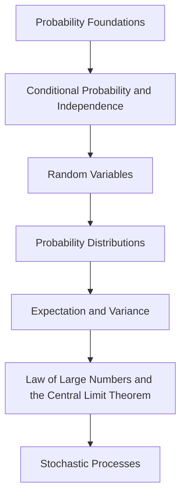

<!-- Generated by tools/build_indexes.py from tools/curriculum.json. Do not edit by hand. -->

# Probability

*Uncertainty made rigorous*

[Mathematics](../README.md) › Probability

From coin flips to measure-theoretic foundations, probability is the mathematics of uncertainty and the foundation of statistics, physics and machine learning.

## At a glance

| | |
|---|---|
| Topics | 7 (7 complete, 0 draft, 0 planned) |
| Estimated study time | ~68 hours |
| Prerequisites | [07-calculus](../07-calculus/README.md) |

## Study order

The numbers are the recommended order. Study a topic only after the ones before it —
the dependency chain below is the shortest safe route through the discipline.

## Topic inventory

| # | Topic | Level | Est. time | Status | Materials |
|---|---|---|---|---|---|
| 1 | [Probability Foundations](01-probability-foundations/README.md) | Intermediate | 9 h | Complete | [Tutorial](01-probability-foundations/README.md) · [Exercises](01-probability-foundations/exercises.md) · [Solutions](01-probability-foundations/solutions.md) |
| 2 | [Conditional Probability and Independence](02-conditional-probability-and-independence/README.md) | Intermediate | 8 h | Complete | [Tutorial](02-conditional-probability-and-independence/README.md) · [Exercises](02-conditional-probability-and-independence/exercises.md) · [Solutions](02-conditional-probability-and-independence/solutions.md) |
| 3 | [Random Variables](03-random-variables/README.md) | Advanced | 10 h | Complete | [Tutorial](03-random-variables/README.md) · [Exercises](03-random-variables/exercises.md) · [Solutions](03-random-variables/solutions.md) |
| 4 | [Probability Distributions](04-probability-distributions/README.md) | Advanced | 12 h | Complete | [Tutorial](04-probability-distributions/README.md) · [Exercises](04-probability-distributions/exercises.md) · [Solutions](04-probability-distributions/solutions.md) |
| 5 | [Expectation and Variance](05-expectation-and-variance/README.md) | Advanced | 9 h | Complete | [Tutorial](05-expectation-and-variance/README.md) · [Exercises](05-expectation-and-variance/exercises.md) · [Solutions](05-expectation-and-variance/solutions.md) |
| 6 | [Law of Large Numbers and the Central Limit Theorem](06-law-of-large-numbers-and-central-limit-theorem/README.md) | Advanced | 8 h | Complete | [Tutorial](06-law-of-large-numbers-and-central-limit-theorem/README.md) · [Exercises](06-law-of-large-numbers-and-central-limit-theorem/exercises.md) · [Solutions](06-law-of-large-numbers-and-central-limit-theorem/solutions.md) |
| 7 | [Stochastic Processes](07-stochastic-processes/README.md) | Advanced | 12 h | Complete | [Tutorial](07-stochastic-processes/README.md) · [Exercises](07-stochastic-processes/exercises.md) · [Solutions](07-stochastic-processes/solutions.md) |

### What each topic covers

- **Probability Foundations** — Sample spaces, axioms, inclusion-exclusion, counting and conditional probability.
- **Conditional Probability and Independence** — Bayes' theorem, independence, the base-rate fallacy and Markov chains.
- **Random Variables** — Discrete and continuous variables, PMFs, PDFs, CDFs and transformations.
- **Probability Distributions** — Binomial, Poisson, geometric, normal, exponential, gamma and friends.
- **Expectation and Variance** — Linearity, moments, generating functions, covariance and inequalities.
- **Law of Large Numbers and the Central Limit Theorem** — Modes of convergence and why the normal distribution is universal.
- **Stochastic Processes** — Markov chains, Poisson processes, random walks, martingales and Brownian motion.

## Related disciplines

- [11-statistics](../11-statistics/README.md)
- [24-advanced-topics](../24-advanced-topics/README.md)

## Status key

- **Complete** — tutorial, exercises and full solutions exist and the tutorial meets the
  [authoring standard](../CONTRIBUTING.md).
- **Draft** — some material exists but the topic is not finished.
- **Planned** — identified in the curriculum, not written yet.

Overall progress and the full topic inventory live in [ROADMAP.md](../ROADMAP.md).
