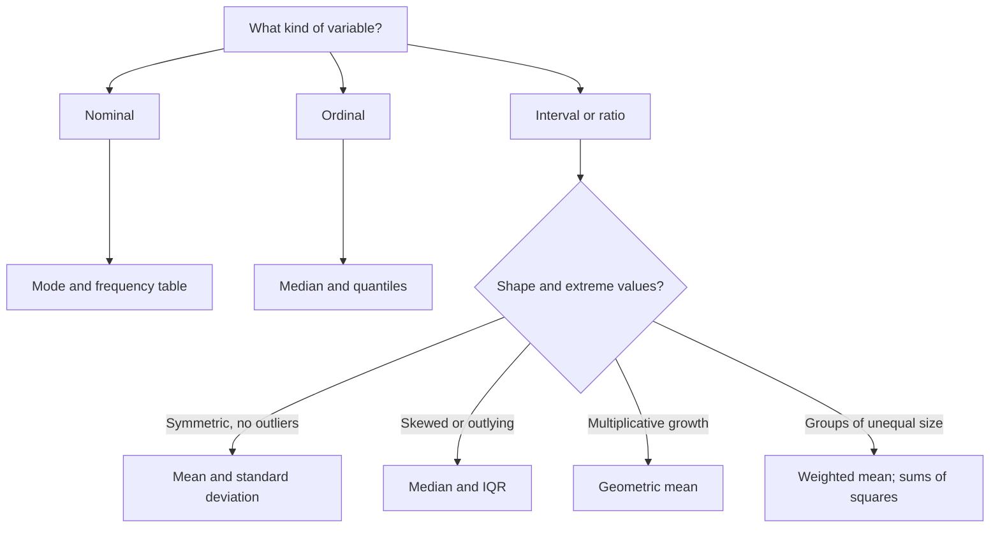

# Descriptive Statistics

> [Statistics](../README.md) · Level: Beginner · Prerequisites: [Percentages](../../01-arithmetic/05-percentages/README.md), [Ratios and Proportions](../../01-arithmetic/06-ratios-and-proportions/README.md), [The Coordinate Plane](../../02-pre-algebra/05-the-coordinate-plane/README.md) · Estimated time: 480 min

## 1. Introduction

Descriptive statistics replaces a long list of numbers by a short, honest summary. A hospital records
every waiting time, a company every salary, a laboratory every batch yield; nobody can read ten thousand
numbers, and nobody needs to. A centre, a spread, a shape and a list of unusual cases carry most of what
a decision requires. The subject is easy to underestimate: computing an average is a button, but deciding
*whether the average is the right summary* is a mathematical judgement with consequences. The mean of a
salary distribution is not a typical salary, and a cleverly chosen axis can make a one-per-cent change
look like a doubling.

Five questions organise the topic. Where is the centre? How far is the data from it? What shape does the
data have? Are some observations different in kind? And what exactly is being summarised — a population
or a sample, a nominal label or a ratio measurement? Every section below answers one of these, states the
assumption it needs, and describes the way it fails.

The history explains why conventions coexist. Graunt summarised London mortality bills in 1662; Quetelet
applied statistics to human measurements in the 1830s; Galton and Pearson introduced correlation and
regression; Gossett and Fisher built small-sample theory; Tukey's *Exploratory Data Analysis* (1977) made
robust summaries and the boxplot standard. The $n-1$ denominator (§7.5) and the $1.5\times\operatorname{IQR}$
fence (§7.7) are historical choices, not laws, and different software implements different ones. This
tutorial states every convention it uses.

Descriptive statistics is also the grammar of inference. [Sampling and Estimation](../02-sampling-and-estimation/README.md)
asks what a sample mean says about a population mean, and answers with the sample mean and variance;
hypothesis testing compares summaries, regression models conditional means, and machine-learning pipelines
standardise inputs with the $z$-scores of §7.10.

## 2. Prerequisites

* **Fractions and percentages** — relative frequencies $f/n$ and percentages:
  [Percentages](../../01-arithmetic/05-percentages/README.md).
* **Ratios and proportions** — weighted averages and scaling:
  [Ratios and Proportions](../../01-arithmetic/06-ratios-and-proportions/README.md).
* **The coordinate plane** — axes, scales and plotting:
  [The Coordinate Plane](../../02-pre-algebra/05-the-coordinate-plane/README.md).
* **Squares and square roots** — $\sqrt{x}$ for $x\ge0$ and order of operations:
  [Exponents and Roots](../../01-arithmetic/07-exponents-and-roots/README.md).
* **Optional: probability** — §7.10 and §9.5 mention the normal distribution. The $z$-score can be computed
  without it; the full theory is in
  [Probability Foundations](../../10-probability/01-probability-foundations/README.md).

No statistics is assumed; every symbol is defined before use.

## 3. Learning Objectives

After this tutorial you will be able to:

1. Distinguish population from sample, parameter from statistic, and census from sample survey.
2. Classify a variable as nominal, ordinal, interval or ratio, and as discrete or continuous.
3. Compute and justify a mean, trimmed mean, weighted mean, geometric mean, median or mode.
4. Prove that the mean uniquely minimises the sum of squared deviations and that a median minimises the
   sum of absolute deviations.
5. Compute the range, IQR, variance, standard deviation, mean absolute deviation and median absolute
   deviation, and interpret each in context.
6. Explain why the sample variance divides by $n-1$, and prove unbiasedness under independent sampling.
7. Compute quartiles and a five-number summary under a stated convention, and draw the boxplot.
8. Apply the $1.5\times\operatorname{IQR}$ rule and explain the masking of ordinary $z$-scores.
9. Describe shape and compute a moment coefficient of skewness.
10. Construct a density histogram with unequal bins and explain bin-width effects.
11. Standardise observations and state precisely what the empirical rule does and does not claim.
12. Identify misleading graphs, the ecological fallacy and Simpson's paradox.

## 4. Intuition

**A crowd on a field.** Put a unit mass at each observation's position. The mean is the balance point of
the resulting load — its centre of mass. The median is the middle person after everyone lines up: half
the crowd on each side. The mode is the most crowded position, and the only sensible centre when the
values are labels. Spread is the width of the crowd. Two couriers with the same mean delivery time can
have completely different reliability: $8,9,10,11,12$ minutes and $1,5,10,15,19$ minutes both average
$10$, but the first has standard deviation $1.58$ and the second $7.28$.

**Why square the deviations?** Signed deviations cancel, so they cannot measure spread. Squaring removes
the signs, makes the function differentiable, and identifies the mean as the unique minimiser of
$\sum(x_i-c)^2$. More importantly, variances of independent sources add, while standard deviations do
not; this additivity is the engine of all later inference. The price is sensitivity: one distant
observation can make the variance arbitrarily large. The median absolute deviation answers the same
question without that sensitivity.

**Why $n-1$?** The deviations from the sample mean sum to zero, so only $n-1$ of them are free. Dividing
by $n$ treats them as $n$ independent pieces of information and underestimates the population variance by
the factor $(n-1)/n$. Dividing by $n-1$ corrects exactly this; §7.5 proves it.

**Standardisation.** A $z$-score says how many standard deviations an observation sits from the mean. A
mark of $86$ in a class with mean $68$ and standard deviation $12$ has $z=1.5$; a mark of $80$ in a class
with mean $74$ and standard deviation $6$ has $z=1.0$. The first student is further above their class
despite the lower raw mark.

**Aggregation can reverse a comparison.** Hospital A can beat Hospital B in mild cases and in severe
cases, yet lose overall, because A treats mostly severe cases and its overall rate is dominated by that
low-success stratum. This is Simpson's paradox: not an arithmetic error, but a weighted average with
different weights.

## 5. Formal Definition

**Definition 5.1 (Unit, variable, observation, dataset).** A *unit* is the object measured (a patient, a
day, a machine). A *variable* is a characteristic recorded for each unit. An *observation* is its value
on one unit. A *dataset* is the collection of observations, one row per unit.

**Definition 5.2 (Population, sample, parameter, statistic).** The *population* is the complete set of
units of interest; its size is $N$ and may be infinite when the population is conceptual (all future
output of a process). A *sample* is a subset of size $n$; a *census* is the case $n=N$. A *parameter* is
a numerical characteristic of the population ($\mu$, $\sigma$, a proportion $p$). A *statistic* is a
numerical function of the sample alone ($\bar{x}$, $s^2$); it may not depend on unknown parameters. The
*sampling frame* is the list from which the sample is actually drawn.

**Definition 5.3 (Scales of measurement).** *Nominal* values are labels with no order (blood group,
country); only equality and counting are meaningful. *Ordinal* values have an order but no meaningful
distances (pain scale, education level). *Interval* values have meaningful differences but an arbitrary
zero (temperature in °C, IQ). *Ratio* values have meaningful differences and ratios, because zero means
absence (height, income, time). *Discrete* data take separated values (counts); *continuous* data are
modelled as taking any value in an interval (lengths, times). The scale determines which summaries are
meaningful: modes for nominal, medians for ordinal, means and standard deviations for interval and ratio
data.

**Definition 5.4 (Mean, weighted mean, trimmed mean).** The *sample mean* is

$$\bar{x}=\frac1n\sum_{i=1}^{n}x_i .$$

The *weighted mean* with weights $w_i>0$ is $\bar{x}_w=\sum_i w_i x_i/\sum_i w_i$. The *$\alpha$-trimmed
mean* deletes the fraction $\alpha$ at each end: with $g=\lfloor\alpha n\rfloor$,

$$\bar{x}_\alpha=\frac{1}{n-2g}\sum_{i=g+1}^{n-g}x_{(i)},$$

where $x_{(1)}\le\cdots\le x_{(n)}$ are the order statistics.

**Definition 5.5 (Median and quantiles).** The *median* is

$$\tilde{x}=\begin{cases}x_{((n+1)/2)}, & n\text{ odd},\\[2pt]
\tfrac12\bigl(x_{(n/2)}+x_{(n/2+1)}\bigr), & n\text{ even}.\end{cases}$$

For $0<p<1$ the *$p$-quantile* under the linear interpolation rule is obtained from $h=1+(n-1)p$: writing
$h=j+g$ with $j=\lfloor h\rfloor$ and $0\le g<1$,

$$Q(p)=x_{(j)}+g\bigl(x_{(j+1)}-x_{(j)}\bigr).$$

The *quartiles* are $Q_1=Q(0.25)$, $Q_2=Q(0.50)=\tilde{x}$ and
$Q_3=Q(0.75)$. Other conventions exist and are compared in §7.6.

**Definition 5.6 (Mode).** A *mode* is a value of maximal frequency. A dataset is unimodal, bimodal or
multimodal according to its number of distinct modes, and has no mode if all values are distinct. For
grouped data the *modal class* is the class of greatest frequency, and the *grouped-mode estimate* is

$$\hat M=L+\frac{f_1-f_0}{2f_1-f_0-f_2}\,h,$$

with $L$ the lower boundary of the modal class, $h$ its width, $f_1$ its frequency, and $f_0,f_2$ the
frequencies below and above.

**Definition 5.7 (Spread).** The *range* is $x_{(n)}-x_{(1)}$ and the *interquartile range* is
$\operatorname{IQR}=Q_3-Q_1$. For a finite population of size $N$ with mean $\mu$, the *population
variance* is $\sigma^2=\frac1N\sum_{i=1}^{N}(x_i-\mu)^2$, and $\sigma$ is the population standard
deviation. For a sample, the *sample variance* is

$$s^2=\frac{1}{n-1}\sum_{i=1}^{n}(x_i-\bar{x})^2,\qquad s=\sqrt{s^2}.$$

The *mean absolute deviation* and *median absolute deviation* are

$$\operatorname{MeanAD}=\frac1n\sum_{i=1}^{n}\lvert x_i-\bar{x}\rvert,\qquad
\operatorname{MedAD}=\operatorname{median}\bigl(\lvert x_1-\tilde{x}\rvert,\dots,\lvert x_n-\tilde{x}\rvert\bigr).$$

The variance is in squared units; the others are in the units of the data.

**Definition 5.8 (Five-number summary, boxplot, outlier).** The *five-number summary* is
$(\min,Q_1,\tilde{x},Q_3,\max)$. A *boxplot* draws a box from $Q_1$ to $Q_3$ with a line at the median,
whiskers to the most extreme non-flagged observations, and separate points for flagged observations. An
observation is *flagged* by the $1.5\times\operatorname{IQR}$ rule when it lies outside

$$\bigl[Q_1-1.5\,\operatorname{IQR},\ Q_3+1.5\,\operatorname{IQR}\bigr].$$

Values outside the same interval with $3$ in place of $1.5$ are called *far-out* or *extreme*. "Outlier"
is a rule-dependent description, not an intrinsic property.

**Definition 5.9 (Histogram and density).** Partition the data into consecutive bins $[a_{j-1},a_j)$ of
widths $h_j$, with counts $f_j$. The *density* of bin $j$ is

$$\hat f_j=\frac{f_j}{n\,h_j}.$$

A density histogram draws a rectangle of height $\hat f_j$ over bin $j$; its area is $f_j/n$, so the total
area is $1$. With equal widths, counts, relative frequencies and densities give the same picture up to a
constant factor; with unequal widths only the density is comparable.

**Definition 5.10 (Standard score).** For numerical data with mean $\bar{x}$ and $s>0$,
$z_i=(x_i-\bar{x})/s$. When the population mean and standard deviation are known, $\mu$ and $\sigma$
replace $\bar{x}$ and $s$.

**Definition 5.11 (Skewness).** With $m_k=\frac1n\sum_i(x_i-\bar{x})^k$, the *moment coefficient of
skewness* is $g_1=m_3/m_2^{3/2}$. It is positive for a longer right tail, negative for a longer left tail,
and zero for a symmetric distribution with finite third moment. Software often reports the adjusted
Fisher–Pearson coefficient $G_1=\frac{\sqrt{n(n-1)}}{n-2}g_1$, which has the same sign.

**Definition 5.12 (Simpson's paradox; ecological fallacy).** *Simpson's paradox* occurs when a comparison
favours one group within every stratum but favours the other group after the strata are combined. The
*ecological fallacy* is the inference of an individual-level relationship from a relationship between
group averages.

## 6. Mathematical Notation

| Symbol | Read as | Meaning |
|---|---|---|
| $n$, $N$ | en, capital en | sample size; population size |
| $x_i$ | $x$ sub $i$ | the $i$-th observation |
| $x_{(i)}$ | $x$ sub parenthesised $i$ | the $i$-th smallest observation |
| $\bar{x}$, $\mu$ | $x$ bar, mu | sample mean; population mean |
| $\tilde{x}$ | $x$ tilde | median |
| $\bar{x}_w$, $\bar{x}_\alpha$ | weighted mean, alpha-trimmed mean | weighted average; trimmed average |
| $s^2$, $s$ | $s$ squared, $s$ | sample variance and standard deviation (divisor $n-1$) |
| $\sigma^2$, $\sigma$ | sigma squared, sigma | population variance and standard deviation |
| $m_k$ | $m$ sub $k$ | $k$-th central moment, divisor $n$ |
| $g_1$, $G_1$ | $g$ one, capital $G$ one | moment skewness; adjusted skewness |
| $Q(p)$, $Q_1,Q_2,Q_3$ | quantile, quartiles | $p$-quantile; $Q(0.25)$, $Q(0.50)$, $Q(0.75)$ |
| $\operatorname{IQR}$ | I-Q-R | $Q_3-Q_1$ |
| $\operatorname{MeanAD}$, $\operatorname{MedAD}$ | mean A-D, median A-D | mean and median absolute deviations |
| $f_j$, $h_j$, $\hat f_j$ | frequency, width, density | bin count, bin width, density |
| $w_i$ | $w$ sub $i$ | weight of observation $i$ |
| $z_i$ | $z$ sub $i$ | standard score |
| $r$ | $r$ | Pearson correlation (§7.11) |
| $\alpha$ | alpha | trimming proportion; tail probability in later topics |
| $\lvert x\rvert$, $\lfloor x\rfloor$ | absolute value, floor | distance to zero; greatest integer $\le x$ |

## 7. Core Concepts

### 7.1 Populations and samples

The population is what the question is about; the sample is what is observed. A hospital reporting the
mean waiting time of last week's patients has computed a *statistic*; a regulator asking what the mean
*would be* for all patients this year asks about a *parameter*. The first is description, the second
inference, and inference needs assumptions about how the sample was obtained.

The *target population* is the set of units of interest; the *sampling frame* is the list actually used
(the electoral register, the patient list); a frame that omits part of the target population produces
*undercoverage*. A *census* observes the whole population. Samples are taken because a census is
expensive, slow, impossible (measuring every light bulb's lifetime destroys them) or infinite (all future
output of a machine). The price is **sampling error**, the variation of a statistic from sample to sample.
There is also **non-sampling error** — measurement error, non-response, data entry, biased questions —
which does not shrink with $n$ and is often the larger problem. A large sample does not repair a biased
frame: a million volunteers from one website are still one website's volunteers.

### 7.2 Types of data

| Scale | Structure | Examples | Centre | Spread |
|---|---|---|---|---|
| Nominal | equality only | blood group, country, colour | mode, frequencies | variety measures (not covered) |
| Ordinal | order | pain scale, education, Likert | median, quantiles | range, IQR |
| Interval | order and differences | °C, IQ, calendar year | mean, median | sd, IQR |
| Ratio | order, differences, ratios | height, income, time, counts | mean, median, geometric mean | sd, IQR, CV |

A binary variable coded $1/0$ is nominal, but its mean is the proportion of ones, so proportions obey the
same formulas as means. The scale is a property of the meaning, not of the numerals: a department coded
$1,2,3$ is nominal, and a "mean department" is meaningless. Order does not imply equal spacing: a
five-point satisfaction scale need not have equal steps, so reporting its mean treats the scale as
interval and must be declared as a modelling assumption. Discrete versus continuous is also about the
model: a count is discrete, while a recorded length is modelled as continuous even though it is rounded.
Other structures — time series, repeated measures, compositional data, censored data — violate the
assumptions of the simple summaries below and need their own treatment.

### 7.3 Measures of centre

**Mean.** The mean is the balance point: the deviations from it sum to zero (§8.1). It is equivariant
under changes of origin and scale, and it uniquely minimises the sum of squared deviations (§8.2). It uses
every observation, so it is efficient for well-behaved random samples and fragile when one value is wrong:
changing one observation by $\Delta$ changes the mean by $\Delta/n$, which is unbounded.

**Weighted mean.** When observations carry different importance,
$\bar{x}_w=\sum_i w_i x_i/\sum_i w_i$. This covers category weights, price indices and frequency tables
($w_i=f_i$). It also warns that the mean of group means is not the overall mean unless the groups have
equal sizes: if group $g$ has $n_g$ observations and mean $\bar{x}_g$, then
$\bar{x}=\sum_g(n_g/n)\bar{x}_g$ with $n=\sum_g n_g$.

**Trimmed mean.** Delete $g=\lfloor\alpha n\rfloor$ values from each end and average the rest. As
$\alpha\to0$ it tends to the mean; as $\alpha\to1/2$ it tends to the median. It is a continuous compromise
with breakdown point approximately $\alpha$.

**Median.** The middle order statistic. It requires only an order, so it is defined for ordinal data, and
it minimises the sum of absolute deviations (§8.6). It ignores the magnitude of extremes, so it is robust,
with a breakdown point of about $50\%$. The price is a loss of efficiency for normal data (its variance is
about $\pi/2\approx1.571$ times that of the mean) and a dependence on the convention for even $n$.

**Mode.** The most frequent value. It is the only centre for nominal data, but may not exist or may not
be unique; for continuous data exact modes are uninformative, so a modal class or density estimate is
used. Its advantage is revealing structure that mean and median hide: a bimodal distribution with peaks
at $20$ and $80$ can have mean and median near $50$, a value no observation takes.

**Geometric mean.** For positive multiplicative data, $\bar{x}_G=(x_1\cdots x_n)^{1/n}$. Growth factors
$1.10,1.20,0.90$ have product $1.188$, so $\bar{x}_G=\sqrt[3]{1.188}\approx1.059$, an average growth of
$5.9\%$ per period; the arithmetic mean of the factors, $1.0667$, overstates the compound rate.

**Choosing.** Nominal → mode; ordinal → median; symmetric interval or ratio data without outliers →
mean; skewed data or outliers → median or trimmed mean; multiplicative growth → geometric mean; unequal
groups combined → weighted mean. For a symmetric distribution with finite mean, mean and median coincide;
for a unimodal symmetric distribution the mode does too. For right-skewed data the mean is *typically*
above the median and for left-skewed data *typically* below, but this is a tendency, not a theorem. Report
both and look at a graph.

### 7.4 Measures of spread

**Range.** $x_{(n)}-x_{(1)}$. Trivial to compute, uses two observations, extremely sensitive to one
outlier. Useful for controlled processes and error detection, not for describing populations.

**IQR.** $Q_3-Q_1$, the width of the middle half. It ignores the tails by construction, so moving the
largest observation does not change it. It is the natural companion of the median and the scale of the
boxplot, but it hides heavy tails; report it with the median and the extremes.

**Variance and standard deviation.** The variance is the average squared deviation (divisor $n-1$ for a
sample); the standard deviation is its square root, in the original units. It is the root mean square
deviation. Squaring removes signs, makes the function differentiable, pairs the mean with its natural
minimiser, and makes variances of independent sources add. The price is sensitivity: the variance has
breakdown point zero, and one distant point can make it arbitrarily large.

For a normal distribution about $68.3\%$ of observations lie within one standard deviation of the mean,
$95.4\%$ within two and $99.7\%$ within three. These are exact statements about the normal distribution,
not about an arbitrary dataset. For any distribution with finite variance, Chebyshev's inequality
$\Pr(\lvert X-\mu\rvert\ge k\sigma)\le1/k^2$ guarantees only $75\%$ within two standard deviations and
$88.9\%$ within three.

**Mean absolute deviation.** $\operatorname{MeanAD}=\frac1n\sum_i\lvert x_i-\bar{x}\rvert$. It is in the
original units, less sensitive to extremes than the standard deviation, and matches absolute loss. It is
still not robust (one extreme can make it arbitrarily large) and is not differentiable at zero.

**Median absolute deviation.** $\operatorname{MedAD}=\operatorname{median}_i\lvert x_i-\tilde{x}\rvert$.
It is robust, with breakdown point about $50\%$, and is the natural scale companion of the median. Under
normality $\operatorname{MedAD}=0.6745\sigma$, so multiplying by $1.4826$ makes it comparable with a
standard deviation. The literature uses "MAD" for both versions; this tutorial writes $\operatorname{MeanAD}$
and $\operatorname{MedAD}$.

**Coefficient of variation.** $\mathrm{CV}=s/\bar{x}$, dimensionless, useful for comparing relative
variability across units, but meaningless when $\bar{x}$ is near zero and for interval-scale data (a
change of temperature unit changes it).

| Measure | Uses | Robust? | Units | Best for |
|---|---|---|---|---|
| Range | min, max | no | data units | quick checks, control charts |
| IQR | $Q_1,Q_3$ | yes | data units | skewed data, boxplots |
| Variance $s^2$ | all values | no | squared units | theory, additivity, inference |
| Standard deviation $s$ | all values | no | data units | symmetric data, empirical rule |
| MeanAD | all values | partly | data units | absolute-loss summaries |
| MedAD | median deviation | yes | data units | robust scale, outlier-heavy data |

A standard deviation is not a standard error: the first describes observations, the second describes a
statistic such as the sample mean and shrinks like $1/\sqrt{n}$ (next topic). A spread computed after
removing outliers is a different quantity from the spread of the full data, and the difference must be
reported.

### 7.5 Why the sample variance divides by $n-1$

The deviations from the sample mean satisfy $\sum_i(x_i-\bar{x})=0$ (§8.1), so once $n-1$ of them are
known the last is forced. The data therefore contain only $n-1$ independent pieces of information about
variability, not $n$. Dividing by $n$ treats the deviations as independent and underestimates $\sigma^2$
on average by the factor $(n-1)/n$; dividing by $n-1$ corrects exactly this.

The proof uses the identity (Exercise 24)

$$\sum_{i=1}^{n}(X_i-\bar{X})^2=\sum_{i=1}^{n}(X_i-\mu)^2-n(\bar{X}-\mu)^2 .$$

Taking expectations with $\mathbb{E}[(X_i-\mu)^2]=\sigma^2$ and $\operatorname{Var}(\bar{X})=\sigma^2/n$
gives $(n-1)\sigma^2$, so $\mathbb{E}[s^2]=\sigma^2$; the divisor-$n$ estimator has expectation
$\frac{n-1}{n}\sigma^2$ and bias $-\sigma^2/n$. The bias is $-2.5\%$ of $\sigma^2$ at $n=40$ and $-0.5\%$
at $n=200$, which is why the distinction matters most in small samples.

Unbiasedness is a property of the procedure averaged over repeated samples, not of a particular dataset.
The standard deviation $s$ is itself *not* unbiased for $\sigma$: for normal data $\mathbb{E}[s]=c_4\sigma$
with $c_4<1$, for example $c_4\approx0.940$ at $n=5$. If the population mean $\mu$ is known independently
of the data, the divisor $n$ is correct, because the deviations $x_i-\mu$ are independent; and for a
complete finite population the divisor $N$ is the definition. The correction exists precisely because
$\bar{x}$ is estimated from the same data.

### 7.6 Quartiles and boxplots

Quartiles divide the ordered data into four parts of roughly equal count. They are the natural summary
for ordinal data and for skewed numerical data, and they build the boxplot and the outlier rule.

A quantile depends on an interpolation convention, and different conventions give different numbers. This
tutorial uses $h=1+(n-1)p$ (Definition 5.5), the default in R and in Excel's `QUARTILE.INC`. Two
alternatives are the *exclusive* rule $h=(n+1)p$ (Excel's `QUARTILE.EXC`, undefined for small $n$ when
$h<1$) and the nearest-rank rule $x_{(\lceil np\rceil)}$. Tukey's hinges — the medians of the two halves,
the median included in both when $n$ is odd — agree with the linear rule for odd $n$ but can differ for
even $n$.

The conventions can change a conclusion. For

$$3,\ 5,\ 6,\ 8,\ 9,\ 11,\ 12,\ 15,\ 18,\ 21,\ 33,$$

the linear rule gives $Q_1=7$, $Q_3=16.5$, $\operatorname{IQR}=9.5$ and an upper fence of $30.75$, so
$33$ is flagged. The exclusive rule gives $Q_1=6$, $Q_3=18$, $\operatorname{IQR}=12$ and an upper fence
of $36$, so $33$ is not flagged. The data have not changed; the definition has.

The five-number summary is $(\min,Q_1,\tilde{x},Q_3,\max)$. A boxplot draws a box from $Q_1$ to $Q_3$ with
a median line, whiskers to the most extreme non-flagged values, and separate points for flagged values.
The box contains the middle half; the whiskers show the non-outlying range. A boxplot hides the sample
size, gaps and bimodality — a bimodal dataset can produce the same box as a unimodal one — so pair it
with a dot plot or histogram when shape matters. If the median is closer to $Q_1$, the upper box half and
the upper whisker are longer, the picture suggests right skew; these are impressions, not tests.

### 7.7 Outliers and the $1.5\times$IQR rule

An outlier is an observation unusually far from the bulk. "Unusually far" has no absolute meaning, so
every rule is a convention. The standard exploratory convention flags values outside
$[Q_1-1.5\operatorname{IQR},\,Q_3+1.5\operatorname{IQR}]$; Tukey chose $1.5$ because it flags about
$0.7\%$ of normal observations (Proposition 8.7). Values beyond $3\operatorname{IQR}$ are *far out*.

The competing $z$-score rule flags $\lvert z_i\rvert>3$. It fails where outliers matter most: the mean and
standard deviation in the denominator are computed from the same data, so an extreme value inflates both
and shrinks its own $z$-score. This is **masking**. For the eleven values
$3,5,6,8,9,11,12,15,18,21,47$, the largest has $z\approx2.69$ with all data but $z\approx6.23$ when the
standard deviation is computed without it: the outlier hides itself. A robust alternative is the modified
$z$-score
$M_i=0.6745(x_i-\tilde{x})/\operatorname{MedAD}$, with threshold $\lvert M_i\rvert>3.5$ (Iglewicz and
Hoaglin); the constant matches its scale to an ordinary $z$-score under normality, and the robust
denominator cannot be masked.

Being flagged is not evidence of error. Check, in order: recording or data-entry error; membership of a
different population or process; a genuine extreme value; a heavy-tailed distribution. The defensible
response is to report the analysis with and without the flagged values, use methods whose conclusions do
not depend on the decision, or model the tail explicitly. Automatic deletion is a serious error when the
outliers are the largest values of a right-skewed variable: it biases the mean downward and understates
risk.

### 7.8 Skewness and shape

| Shape | Description | Typical mean vs median |
|---|---|---|
| Symmetric unimodal | one mirrored peak | mean $\approx$ median $\approx$ mode |
| Right-skewed | long tail of large values | mean typically above median |
| Left-skewed | long tail of small values | mean typically below median |
| Uniform | flat over an interval | mean = median, no mode |
| Bimodal | two peaks with a trough | mean and median may lie in the trough |
| Heavy-tailed | more extremes than normal | mean and sd unstable |

The moment coefficient is $g_1=m_3/m_2^{3/2}$ (Definition 5.11). The cube preserves the sign, and the
coefficient is scale-free: adding a constant or multiplying by a positive constant does not change it,
while reflection reverses it (§8.10). Software often reports the adjusted Fisher–Pearson coefficient
$G_1=\frac{\sqrt{n(n-1)}}{n-2}g_1$ with the same sign. Two simpler coefficients are Pearson's first,
$(\bar{x}-\text{mode})/s$, and Pearson's second, $3(\bar{x}-\tilde{x})/s$; neither equals $g_1$ and they
can disagree in small or multimodal samples.

Skewness is moment-based and therefore sensitive to extremes: one large value can create large positive
skewness in otherwise symmetric data. It measures asymmetry, not non-normality — a symmetric distribution
with a finite third moment has $g_1=0$, and so does a symmetric bimodal one — and says nothing about the number of
peaks. Report it with a histogram. The ordering mode $<$ median $<$ mean for right-skewed data is a rule
of thumb, not a theorem; it fails for some multimodal or mixture distributions. A large gap between mean
and median is a signal to look at the shape, not a proof of skewness.

Right-skewed positive data are often summarised on a log or square-root scale, which can restore symmetry
and stabilise variance. This is a modelling decision: a mean on the log scale is a geometric mean on the
original scale, and it must be reported. Never transform and then describe the result as if it were in
the original units.

### 7.9 Histograms, density and bin width

A histogram counts observations in bins. Choose boundaries $a_0<\cdots<a_k$, count $f_j$ in
$[a_{j-1},a_j)$, and draw a rectangle of height $\hat f_j=f_j/(nh_j)$ over bin $j$. Its area is
$f_j/n$, the proportion in that bin, and the total area is $1$. With equal widths, counts, relative
frequencies and densities give the same picture up to a constant factor; with unequal widths, plotting
counts makes wide bins look important even when they are sparse per unit, and only the density is fair.

For bins $[0,5)$, $[5,15)$, $[15,30)$ with frequencies $20,25,5$ from $n=50$, the densities are
$20/(50\cdot5)=0.080$, $25/(50\cdot10)=0.050$ and $5/(50\cdot15)=0.0067$, with areas $0.40,0.50,0.10$
summing to $1$. A count histogram suggests the middle bin is the tallest; the density histogram shows
that the first bin has the highest concentration per unit. The two answer different questions.

A histogram is an estimator of density and has a bias–variance trade-off. Wide bins smooth away real
features; narrow bins show noise and can manufacture peaks; changing the bin origin can change the
picture of a small dataset. Two rules of thumb are Sturges' rule $k\approx1+\log_2 n$ (often too few for
large data) and the Freedman–Diaconis width $h\approx2\operatorname{IQR}n^{-1/3}$ (resistant to outliers).
Neither is a law: try several reasonable choices and report whether the shape is stable. When comparing
groups, use the same bins and plot densities or relative frequencies, not counts, unless the groups have
equal sizes; state the sample size. For small data, dot plots, stem-and-leaf displays and the empirical
distribution function avoid binning altogether. A bar chart is not a histogram: categorical bars have gaps,
no natural order, and heights that are counts or proportions, not densities.

### 7.10 Standardisation and $z$-scores

For $s>0$ computed with divisor $n-1$, the standard scores $z_i=(x_i-\bar{x})/s$ satisfy
$\sum_i z_i=0$ and $\frac{1}{n-1}\sum_i z_i^2=1$: they have mean $0$ and sample standard deviation $1$
exactly (§8.9), and $x_i=\bar{x}+sz_i$. This is not min–max scaling to $[0,1]$, which is a different and
outlier-sensitive transformation.

A $z$-score of $+2$ means two standard deviations above the mean; the sign gives direction and the
magnitude the distance in units of a typical deviation. The interpretation is only as good as the mean
and standard deviation: for skewed or outlier-heavy data, $z$-scores are distorted and the modified
$z$-score of §7.7 is preferable.

If the data are approximately normal, the empirical rule gives approximate percentiles: $68.3\%$ in
$[-1,1]$, $95.4\%$ in $[-2,2]$, $99.7\%$ in $[-3,3]$; $z=1.5$ is roughly the $93$rd percentile, and
$\lvert z\rvert>3$ is unusual (about $0.27\%$ in two tails). For non-normal data none of these
percentages is guaranteed. Chebyshev gives only $75\%$ within two standard deviations and $88.9\%$ within
three; the gap between $75\%$ and $95.4\%$ is the price of making no distributional assumption.

Standardisation compares across scales: $86$ in a class with mean $68$ and standard deviation $12$ is
$z=1.5$, while $80$ in a class with mean $74$ and standard deviation $6$ is $z=1.0$. It is used in IQ
scores (mean $100$, standard deviation $15$), risk-adjusted returns, control charts and machine-learning
preprocessing. It does not make data normal, remove skewness or outliers, or create independence; it
changes location and scale only. In prediction, the mean and standard deviation must come from the
training data alone, or information leaks from the test set.

### 7.11 Misleading graphs, the ecological fallacy and Simpson's paradox

**Truncated axes.** Bars of values $100$ and $105$ on an axis from $0$ to $110$ have lengths in the ratio
$100:105$, a $5\%$ difference. On an axis from $95$ to $110$ they have lengths $5$ and $10$, a ratio of
$1:2$, so the difference looks like $100\%$. The data are unchanged; the axis manufactures the
impression. Bar length encodes the whole value, so bars need a zero baseline; line charts of quantities
that do not start near zero may use a non-zero baseline if it is labelled and justified. The visual
quantity must be proportional to the data.

**Area and volume.** If height and width both double, area quadruples; if all three dimensions double,
volume grows eightfold. Scaling a symbol in two dimensions to represent a doubled value exaggerates by a
factor of two. Scale one dimension only, or use a dot plot with a legend.

**Other traps.** Dual axes with independently chosen scales make unrelated series look correlated;
cherry-picked time windows and cumulative rather than period data distort trends; percentages on small
denominators ($1/2\to2/2$ is a $100\%$ increase on two observations) exaggerate; 3-D pies and truncated
histograms mislead. The checklist: what is the baseline, what is the denominator, what is the sample size,
and what would the graph show if the omitted category were included?

**Ecological fallacy.** Group and individual relationships can differ in sign. Take group 1 with points
$(0,10)$ and $(10,0)$ (mean $(5,5)$) and group 2 with $(5,11)$ and $(15,1)$ (mean $(10,6)$). Within each
group the relationship is perfectly negative ($r=-1$); between the group means it is positive; across all
four points $r\approx-0.845$. An analyst seeing the group means concludes that $x$ and $y$ increase
together; an analyst seeing the individuals concludes the opposite. Neither computation is wrong; the
inference from aggregate to individual is. This is why "countries with higher chocolate consumption have
more Nobel laureates" cannot support "chocolate makes people smarter".

**Simpson's paradox.** Compare two treatments stratified by severity:

| Stratum | Treatment A | Treatment B |
|---|---|---|
| Mild | $9/10=90\%$ | $8/10=80\%$ |
| Severe | $40/90\approx44.4\%$ | $4/10=40\%$ |
| Overall | $49/100=49\%$ | $12/20=60\%$ |

A wins in both strata and loses overall. The reason is the case mix: $90\%$ of A's patients are severe,
but only $50\%$ of B's are. The overall rate is the weighted average
$\sum_h(n_h/n)p_h$, and changing the weights $n_h/n$ can reverse the comparison even when every $p_h$
favours the same treatment. This is the *Yule–Simpson effect*, an extreme form of confounding, not a
logical contradiction.

The correct comparison depends on the question. For "which treatment for this patient?", the relevant
stratum answers. For "what if the whole population were treated with A rather than B?", standardise both
groups to a common severity distribution; comparing observed overall rates confounds treatment with case
mix, because the rates reflect both. The stratifying variable must be measured, and when it is not, the
aggregate comparison is all that is available and its direction is unreliable. Stratify, show the stratum
counts, and never compare weighted averages without their weights.

## 8. Formulas and Properties

Each result is stated with its hypotheses and a proof or derivation.

**Proposition 8.1 (Deviations sum to zero).** For any $x_1,\dots,x_n$ with mean $\bar{x}$,
$\sum_i(x_i-\bar{x})=0$.

*Proof.* $\sum_i(x_i-\bar{x})=\sum_i x_i-n\bar{x}=n\bar{x}-n\bar{x}=0$. $\blacksquare$

**Proposition 8.2 (The mean minimises squared error).** $Q(c)=\sum_i(x_i-c)^2$ has a unique global
minimum at $c=\bar{x}$, with value $\sum_i(x_i-\bar{x})^2$.

*Proof.* $Q(c)=\sum_i x_i^2-2c\sum_i x_i+nc^2$, so $Q'(c)=2n(c-\bar{x})$ and $Q''=2n>0$. The stationary
point is the unique minimum. Alternatively,
$\sum_i(x_i-c)^2=\sum_i(x_i-\bar{x})^2+n(\bar{x}-c)^2\ge\sum_i(x_i-\bar{x})^2$, with equality iff
$c=\bar{x}$. $\blacksquare$

**Proposition 8.3 (Computational formula).**

$$\sum_{i=1}^{n}(x_i-\bar{x})^2=\sum_{i=1}^{n}x_i^2-\frac{\left(\sum_i x_i\right)^2}{n}
=\sum_i x_i^2-n\bar{x}^2 .$$

*Proof.* Expand: $\sum_i(x_i-\bar{x})^2=\sum_i x_i^2-2\bar{x}\sum_i x_i+n\bar{x}^2
=\sum_i x_i^2-2n\bar{x}^2+n\bar{x}^2$. $\blacksquare$

The formula is exact but can lose precision in floating point when the mean is large relative to the
spread; centring first is safer.

**Proposition 8.4 (Equivariance).** If $y_i=a+bx_i$ with $b\ne0$, then
$\bar{y}=a+b\bar{x}$, $\tilde{y}=a+b\tilde{x}$, $s_y^2=b^2s_x^2$, $s_y=\lvert b\rvert s_x$, and the
range and IQR scale by $\lvert b\rvert$. For quantiles, $Q_y(p)=a+bQ_x(p)$ if $b>0$ and
$Q_y(p)=a+bQ_x(1-p)$ if $b<0$.

*Proof.* Linearity of summation gives the mean; $y_i-\bar{y}=b(x_i-\bar{x})$ gives the variance; order
statistics reverse when $b<0$. $\blacksquare$

This is why a change of units cannot change a $z$-score, and why a standard deviation in °F is $9/5$ times
one in °C while the mean shifts by $+32$.

**Proposition 8.5 (Unbiasedness of $s^2$).** Let $X_1,\dots,X_n$ be independent with
$\mathbb{E}[X_i]=\mu$ and $\operatorname{Var}(X_i)=\sigma^2<\infty$. Then $\mathbb{E}[s^2]=\sigma^2$.

*Proof.* Since $\sum_i(X_i-\mu)=n(\bar{X}-\mu)$,

$$\sum_i(X_i-\bar{X})^2=\sum_i(X_i-\mu)^2-n(\bar{X}-\mu)^2 .$$

Independence gives $\operatorname{Var}(\bar{X})=\sigma^2/n$, so taking expectations yields
$n\sigma^2-n(\sigma^2/n)=(n-1)\sigma^2$. Divide by $n-1$. $\blacksquare$

Only $\operatorname{Var}(\bar{X})=\sigma^2/n$ is needed; uncorrelated observations suffice.

**Proposition 8.6 (A median minimises absolute error).** Every median of $x_1,\dots,x_n$ minimises
$A(c)=\sum_i\lvert x_i-c\rvert$.

*Proof.* $A$ is convex. Where differentiable,
$A'(c)=\#\{x_i<c\}-\#\{x_i>c\}=2j(c)+e(c)-n$, where $j(c)$ counts values below $c$ and $e(c)$ those
equal to $c$. Moving $c$ rightwards increases $j$ by the multiplicity of each value. If $n=2k+1$, then
just below $x_{(k+1)}$ we have $A'\le-1$ and just above $A'\ge1$, so the minimum is at $x_{(k+1)}$. If
$n=2k$, then $A'=0$ between $x_{(k)}$ and $x_{(k+1)}$ and changes sign there, so every point of that
interval is a minimiser. $\blacksquare$

The contrast with Proposition 8.2 is the mathematics of robustness: squaring makes a large deviation
expensive, so the minimiser moves towards it; absolute values make the cost linear, so only counts matter.

**Proposition 8.7 (Normal outlier rate of the $1.5\times$IQR rule).** If $X\sim\mathcal N(\mu,\sigma^2)$,
then $Q_1=\mu-0.6745\sigma$, $Q_3=\mu+0.6745\sigma$, $\operatorname{IQR}=1.3490\sigma$, and the probability
outside the fences is about $0.0070$.

*Proof.* $\Phi^{-1}(0.75)=0.67449$; by symmetry $Q_1=\mu-\sigma\Phi^{-1}(0.75)$ and
$\operatorname{IQR}=2(0.67449)\sigma=1.34898\sigma$. The upper fence is
$\mu+\sigma(0.67449+1.5\cdot1.34898)=\mu+2.69796\sigma$; the two-tail probability is
$2(1-\Phi(2.69796))=2(0.003488)=0.00698$. $\blacksquare$

The number is a property of the normal distribution, not a guarantee: heavy-tailed data flag far more,
bounded data may flag none.

**Proposition 8.8 (Weighted mean and total-variance decomposition).** For $G$ groups with sizes $n_g$,
means $\bar{x}_g$ and sample variances $s_g^2$, $n=\sum_g n_g$,

$$\bar{x}=\sum_g\frac{n_g}{n}\bar{x}_g,\qquad
\underbrace{\sum_g\sum_i(x_{gi}-\bar{x})^2}_{\text{SST}}
=\underbrace{\sum_g(n_g-1)s_g^2}_{\text{SSW}}+\underbrace{\sum_g n_g(\bar{x}_g-\bar{x})^2}_{\text{SSB}}.$$

*Proof.* The mean identity follows by summing $n_g\bar{x}_g$ and dividing by $n$. For the decomposition,
write $x_{gi}-\bar{x}=(x_{gi}-\bar{x}_g)+(\bar{x}_g-\bar{x})$. Squaring and summing, the cross term
$2\sum_g(\bar{x}_g-\bar{x})\sum_i(x_{gi}-\bar{x}_g)$ vanishes by Proposition 8.1. $\blacksquare$

The decomposition explains why a combined standard deviation is not a weighted average of group standard
deviations: the between-group term adds the variation of the group means.

**Proposition 8.9 ($z$-scores have mean $0$ and variance $1$).** With $z_i=(x_i-\bar{x})/s$ and divisor
$n-1$, $\bar{z}=0$ and the sample variance of the $z_i$ is $1$.

*Proof.* $\sum_i z_i=s^{-1}\sum_i(x_i-\bar{x})=0$, and
$\sum_i z_i^2=s^{-2}\sum_i(x_i-\bar{x})^2=(n-1)s^2/s^2=n-1$. $\blacksquare$

**Proposition 8.10 (Skewness under affine maps).** If $y_i=a+bx_i$ with $b\ne0$, then
$g_1(y)=\operatorname{sign}(b)g_1(x)$.

*Proof.* $m_k(y)=b^km_k(x)$, so
$g_1(y)=b^3m_3(x)/(\lvert b\rvert^3m_2(x)^{3/2})=\operatorname{sign}(b)g_1(x)$. $\blacksquare$

## 9. Step-by-Step Examples

### 9.1 A first dataset

The delivery times, in minutes, were $4,6,7,9,11,11,22$. Their sum is $70$, so
$\bar{x}=70/7=10$. In order the fourth value is $9$, so $\tilde{x}=9$; the mode is $11$, which occurs
twice; the range is $22-4=18$.

| $x_i$ | $4$ | $6$ | $7$ | $9$ | $11$ | $11$ | $22$ |
|---|---|---|---|---|---|---|---|
| $x_i-\bar{x}$ | $-6$ | $-4$ | $-3$ | $-1$ | $1$ | $1$ | $12$ |
| $(x_i-\bar{x})^2$ | $36$ | $16$ | $9$ | $1$ | $1$ | $1$ | $144$ |

The deviations sum to $0$ and their squares to $208$, so $s^2=208/6=34.67$ and $s=5.89$ minutes. The
$20\%$ trimmed mean deletes one value at each end, leaving $6,7,9,11,11$ with mean $44/5=8.8$.

Replace $22$ by $12$: the sum falls to $60$, the mean to $8.571$ (a change of $10/7=1.43=\Delta/n$), the
median stays $9$, and the sum of squares falls to $53.71$, so $s^2=8.952$ and $s=2.992$. One observation
of $10$ minutes moved the mean by $1.43$ and reduced $s^2$ by a factor of $3.87$, while leaving the median
untouched. The mean and variance respond to the size of a change; the median responds only to its
position.

### 9.2 Quartiles, fences and a boxplot

For the eleven ordered values $3,5,6,8,9,11,12,15,18,21,47$, the median is $x_{(6)}=11$. The linear rule
gives $h=1+10(0.25)=3.5$, so

$$Q_1=6+0.5(8-6)=7,$$

and $h=1+10(0.75)=8.5$, so

$$Q_3=15+0.5(18-15)=16.5.$$

Hence $\operatorname{IQR}=9.5$ and the fences are $7-14.25=-7.25$ and $16.5+14.25=30.75$. The value $47$
is flagged; everything else is inside. The five-number summary is $(3,7,11,16.5,47)$; the box runs from
$7$ to $16.5$, the lower whisker reaches $3$, the upper whisker reaches $21$, and $47$ is plotted alone.
The upper box half ($16.5-11=5.5$) is longer than the lower ($11-7=4$), and the mean $155/11=14.09$
exceeds the median, both consistent with right skew.

With the exclusive rule $h=(n+1)p$, $Q_1=x_{(3)}=6$ and $Q_3=x_{(9)}=18$, so $\operatorname{IQR}=12$ and
the upper fence is $36$: $47$ is still flagged. In the variant of §7.6 the value $33$ lies between the two
fences, and the conclusion changes with the convention.

### 9.3 The two variance formulas

For $2,3,5,6,9$: $n=5$, $\sum x_i=25$, $\bar{x}=5$, $\sum x_i^2=155$, and
$(\sum x_i)^2/n=625/5=125$, so

$$\sum(x_i-\bar{x})^2=155-125=30.$$

Directly, the deviations are $-3,-2,0,1,4$ and their squares sum to $9+4+0+1+16=30$. Hence
$s^2=30/4=7.5$, $s=2.739$, while the population variance of these five values would be
$\sigma^2=30/5=6$, $\sigma=2.449$. The Bessel correction is a factor $1.25$ here; reporting $7.5$ when $6$
was intended, or the reverse, is a common error, and the divisor should always be stated.

### 9.4 Standard deviation versus median absolute deviation

For $1,2,3,4,100$: the mean is $110/5=22$, the median is $3$, and the deviations from the mean are
$-21,-20,-19,-18,78$. Their squares sum to $7610$, so $\sigma=\sqrt{7610/5}=39.01$ and
$s=\sqrt{7610/4}=43.62$. The interval $22\pm2(43.62)$ is $[-65.2,109.2]$: correct and useless.

The mean absolute deviation is $(21+20+19+18+78)/5=156/5=31.2$. The absolute deviations from the median
are $2,1,0,1,97$, whose median is $1$, so $\operatorname{MedAD}=1$: a typical observation is one unit from
the median. The standard deviation answers "average squared distance"; the MedAD answers "typical absolute
distance". For describing the bulk, the second is far more informative; for squared-error theory, the
first is the right quantity.

### 9.5 Standard scores across two tests

A student scores $86$ in a class with mean $72$ and standard deviation $8$, and $51$ in a class with mean
$40$ and standard deviation $5$. Then

$$z_A=\frac{86-72}{8}=1.75,\qquad z_B=\frac{51-40}{5}=2.20.$$

The student is further above the second class despite the lower raw mark. If the scores are approximately
normal, the percentiles are $\Phi(1.75)\approx0.960$ and $\Phi(2.20)\approx0.986$, roughly the $96$th and
$99$th; without normality, only the position in standard-deviation units is known.

Applying the same formula to §9.1 with $\bar{x}=10$ and $s=5.8878$ gives $z=-1.019,-0.679,-0.510,-0.170,
0.170,0.170,2.038$. The $z$-scores sum to $0$ and have sample variance $1$ (§8.9). The largest value is
$2.04$ standard deviations above the mean — unusual but not extreme by the normal benchmark ($2.1\%$
above), and its own $z$-score is pulled towards zero because it inflates $s$ (§7.7).

### 9.6 A histogram with unequal bins

From $n=50$ observations:

| Bin | Width | Count | Density | Area |
|---|---|---|---|---|
| $[0,5)$ | $5$ | $20$ | $20/(50\cdot5)=0.080$ | $0.40$ |
| $[5,15)$ | $10$ | $25$ | $25/(50\cdot10)=0.050$ | $0.50$ |
| $[15,30)$ | $15$ | $5$ | $5/(50\cdot15)=0.0067$ | $0.10$ |

The areas sum to $1$. A count histogram draws $20,25,5$ and suggests that the middle bin is the most
concentrated; the density shows that the first bin is. The middle bin has more observations only because
it is twice as wide. Assuming uniformity within bins, the grouped mean is

$$\frac{20(2.5)+25(10)+5(22.5)}{50}=\frac{50+250+112.5}{50}=8.25.$$

The estimate depends on the binning and is not the exact mean of the fifty observations.

### 9.7 Skewness and its sensitivity

For $1,1,2,2,2,3,10$ the mean is $3$ and the deviations are $-2,-2,-1,-1,-1,0,7$. Their squares sum to
$60$ and their cubes to $324$, so

$$m_2=\frac{60}{7}=8.571,\qquad m_3=\frac{324}{7}=46.286,\qquad
g_1=\frac{46.286}{(8.571)^{3/2}}=\frac{46.286}{25.094}=1.844.$$

The positive sign means a longer right tail, produced by the isolated $10$. Pearson's second coefficient is
$3(3-2)/2.928=1.025$, with the same sign and a different magnitude — hence the coefficient must be named.
Under $y=2x+5$, $m_2$ is multiplied by $4$ and $m_3$ by $8$, so $g_1$ is unchanged at $1.844$; under
$y=-x$ it becomes $-1.844$, as Proposition 8.10 requires. If $10$ is removed, the skewness of the
remaining six values falls to about $0.23$: the coefficient is dominated by one observation, a warning
that it describes the data including their extremes.

### 9.8 Simpson's paradox

| Stratum | A | B |
|---|---|---|
| Mild | $9/10=0.900$ | $8/10=0.800$ |
| Severe | $40/90=0.444$ | $4/10=0.400$ |
| Overall | $49/100=0.490$ | $12/20=0.600$ |

A is better in both strata and worse overall. Its overall rate is the weighted average
$0.490=(10/100)(0.900)+(90/100)(0.444)$: $90\%$ of its patients are severe. B's is
$0.600=(10/20)(0.800)+(10/20)(0.400)$, with equal weights. Standardising both to a common $50/50$ mix gives
$0.5(0.900)+0.5(0.444)=0.672$ for A and $0.5(0.800)+0.5(0.400)=0.600$ for B, so on a common mix A wins.
The marginal rates answer "what happened here?"; the standardised rates answer "which treatment is better
for a given patient?". Report both, with stratum sizes.

## 10. Visual Explanations

The diagram is a checklist for choosing a summary; a report usually contains more than one branch.

| Shape | Histogram appearance | Informative summaries | Avoid relying on |
|---|---|---|---|
| Symmetric unimodal | one mirrored peak | mean, sd, $z$-scores | — |
| Right-skewed | long right tail | median, IQR, geometric mean | the mean alone |
| Left-skewed | long left tail | median, IQR | the mean alone |
| Uniform | flat top | range, mean, sd | the mode |
| Bimodal | two peaks | modes, group-wise summaries | mean and sd (may fall in the gap) |
| Heavy-tailed | sharp peak, long tails | median, MedAD, quantiles | sd and $z$-scores |

## 11. Common Mistakes

1. **Averaging nominal or ordinal codes.** A "mean department" or a mean of $1,2,3$ satisfaction codes is
   an artefact of the coding. Use frequencies or the median, and declare any interval-scale assumption.
2. **Dividing by $n$ for a sample variance.** The divisor $n$ applies to a population or a sample with
   known mean; $n-1$ is unbiased when the mean is estimated from the same data. State the divisor.
3. **Averaging standard deviations to combine groups.** Convert to sums of squares, add within and
   between components, then take the square root (§8.8).
4. **Believing a truncated bar chart.** Bars encode length, so a non-zero baseline exaggerates
   differences; check the axis before trusting the visual ratio.
5. **Deleting outliers automatically.** A flagged value is a question, not a verdict. Deleting the largest
   values of a right-skewed variable biases every summary downward (§7.7).
6. **Confusing standard deviation with standard error.** The first describes observations, the second a
   statistic, and the second shrinks like $1/\sqrt n$.
7. **Using the mode on continuous data.** Exact values rarely repeat; use a modal class or density (§7.9).
8. **Reading a $z$-score as a percentile without normality.** Only standard-deviation units are
   assumption-free; percentiles need a distribution (§7.10).
9. **Forgetting the quartile convention.** Two defensible rules can disagree about an outlier (§7.6).
10. **Comparing counts rather than rates.** Twice the sample size gives roughly twice the count at equal
    risk; compare proportions and report denominators.
11. **Calling the mean "the typical value".** For skewed data it can lie where no observation lies (§7.8).
12. **Inferring individual behaviour from group averages.** This is the ecological fallacy, and its
    cousin Simpson's paradox arises from ignoring the weights (§7.11).

## 12. Applications

* **Public health.** Incidence and mortality rates are means over populations; age-standardisation is the
  weighted-average calculation of §9.8, and comparing crude rates without it is a classic route to
  Simpson's paradox.
* **Economics and finance.** Income distributions are right-skewed, so mean income exceeds median income;
  the coefficient of variation compares volatility across price levels, and value-at-risk is a quantile of
  a loss distribution.
* **Engineering and quality control.** Processes are monitored with subgroup means and standard
  deviations; capability compares the tolerance width with $6\sigma$, and confusing the standard deviation
  of measurements with the standard error of a subgroup mean causes false alarms.
* **Machine learning.** Standardisation is a default preprocessing step for distance-based methods and
  regularised regression; robust summaries drive data cleaning, and computing the standardisation
  constants on the whole dataset rather than the training split leaks information.
* **Education and psychology.** Test scores are reported as standard scores and percentile ranks; IQ is a
  standard score with mean $100$ and standard deviation $15$, comparable across tests only when the
  reference populations are comparable.
* **Official statistics and medicine.** Price indices are weighted means of price relatives; reference
  ranges and growth charts are quantile-based intervals containing a stated proportion of a reference
  population. None of these is an individual diagnosis.

## 13. Exercises

There are **36 problems** in [exercises.md](exercises.md), grouped as Beginner (1–12), Intermediate
(13–22), Advanced (23–30) and Challenge (31–36), covering computation, interpretation, proof and critique.
Attempt each problem before reading its solution.

## 14. Solutions

Complete worked solutions for all 36 problems are in [solutions.md](solutions.md), each with the strategy,
every significant step, the pitfalls and a check where one exists.

## 15. Summary

* A **population** is what a parameter describes; a **sample** is what a statistic is computed from.
  Inference passes from the second to the first and needs a sampling mechanism.
* **Scales constrain arithmetic:** nominal → mode; ordinal → median and quantiles; interval → mean and
  standard deviation; ratio → additionally ratios and the coefficient of variation.
* The **mean** is the balance point and the unique minimiser of $\sum(x_i-c)^2$; the **median** is the
  middle order statistic and minimises $\sum\lvert x_i-c\rvert$; the **mode** is the most frequent value.
* The **sample variance** uses divisor $n-1$ and is unbiased for $\sigma^2$ under independent sampling;
  the divisor-$n$ version is biased low by $\sigma^2/n$.
* The **standard deviation** has the data's units and is not robust; the **IQR** and **MedAD** are.
* **Quartiles depend on a convention.** State it when an outlier conclusion depends on it. The
  **$1.5\times\operatorname{IQR}$ rule** flags about $0.7\%$ of normal observations; investigate flagged
  values, never delete them automatically, and note that ordinary $z$-scores hide outliers through masking.
* **Skewness** measures asymmetry; reflection reverses its sign, and changes of location or positive scale
  leave it unchanged. Mean–median ordering is a rule of thumb, not a theorem.
* A **histogram with unequal bins** must plot densities; shape depends on bin width and origin, so check
  several choices.
* A **$z$-score** is a signed distance in standard-deviation units, with mean $0$ and standard deviation
  $1$. Percentile readings need normality; Chebyshev gives only a bound.
* **Aggregation** can reverse comparisons (Simpson's paradox) and can suggest individual relationships
  that do not hold (ecological fallacy). Stratify, standardise and report stratum sizes.
* Every summary is lossy; a table of summaries and a graph of the raw data say more than either alone.

## 16. Further Learning

* **Next:** [Sampling and Estimation](../02-sampling-and-estimation/README.md) builds sampling
  distributions, standard errors and confidence intervals on these summaries.
* **Probability behind the formulas:** [Probability Foundations](../../10-probability/01-probability-foundations/README.md)
  for expectation, variance, independence and the normal distribution.
* **Reference:** [Reference: Formulas](../../reference/formulas/README.md).
* **Books.** Tukey, *Exploratory Data Analysis* (1977), for the boxplot and robust summaries; Moore, *The
  Basic Practice of Statistics*; Freedman, Pisani and Purves, *Statistics*, for what statistical claims
  mean; Huff, *How to Lie with Statistics* (1954), for graphical distortion; Hampel, Ronchetti, Rousseeuw
  and Stahel, *Robust Statistics* (1986), for the theory.
* **After this discipline:** hypothesis testing, regression, Bayesian statistics and experimental design,
  the remaining topics of [Statistics](../README.md).

