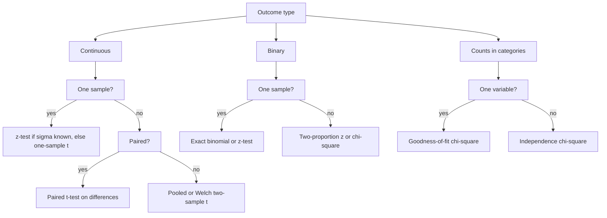

# Hypothesis Testing

> [Mathematics](../../README.md) › [Statistics](../README.md) › Hypothesis Testing · Level: Intermediate · Prerequisites: [Probability Foundations](../../10-probability/01-probability-foundations/README.md), [Random Variables](../../10-probability/03-random-variables/README.md), [Expectation and Variance](../../10-probability/05-expectation-and-variance/README.md), [Discrete Probability](../../09-discrete-mathematics/05-discrete-probability/README.md) · Estimated time: 600 min

## 1. Introduction

A hypothesis test is a procedure that decides, from data, whether a proposed explanation of those data
is tenable. The explanation is called the *null hypothesis*, and the procedure is calibrated so that
it rejects a true null hypothesis only rarely — at a rate chosen in advance, the *significance level*.
Everything else in the subject is elaboration: which statistic to use, how to compute its distribution,
how to measure the chance of missing a real effect, and how to keep the error rate under control when
many tests are performed at once.

The *p-value*, the central quantity, is routinely misinterpreted by people who use it daily. It is not
the probability that the null hypothesis is true, not the probability that the result happened "by
chance", and not one minus the probability of replication. It is a conditional probability: the
probability, *computed under the null hypothesis and the model's other assumptions*, of obtaining a
test statistic at least as extreme as the one observed. The first job of this tutorial is to make that
sentence precise, and to show what follows from it and what does not.

The second job is to present the standard tests and their assumptions honestly. The $z$-test assumes a
known standard deviation or a large sample; the $t$-test assumes independent observations and, in small
samples, approximate normality; the chi-squared tests assume independent observations and adequate
expected counts. A test applied outside its assumptions is not a test of the hypothesis the reader
thinks it is testing.

The third job is to connect the mathematics to scientific practice. Statistical significance is not
scientific importance: a large sample can make a trivial effect significant, and a small sample can
hide a large one. Testing many hypotheses without adjustment produces false positives at a predictable
rate, and choosing the analysis after seeing the data, stopping when the result becomes significant, or
reporting only the favourable outcome all invalidate the nominal error rate. These are ordinary
research behaviours, and they are why replication is a separate scientific virtue from publication.

The tutorial uses the frequentist framework: parameters are fixed unknown numbers, data are random, and
probability statements describe the procedure over repeated samples. Bayesian alternatives, which assign
probabilities to hypotheses, are a different framework with different answers; they are not treated
here beyond a pointer in §16.

## 2. Prerequisites

| Prerequisite | Why it is needed here |
|---|---|
| [Probability Foundations](../../10-probability/01-probability-foundations/README.md) | Sample spaces, conditional probability and independence underlie every test. |
| [Random Variables](../../10-probability/03-random-variables/README.md) | Test statistics are random variables; their distributions under the null are the core computational object. |
| [Expectation and Variance](../../10-probability/05-expectation-and-variance/README.md) | Means, variances, covariance and the normal distribution are used throughout. |
| [Discrete Probability](../../09-discrete-mathematics/05-discrete-probability/README.md) | Exact binomial tests and chi-squared statistics are discrete computations; the binomial and Poisson distributions appear repeatedly. |
| [Descriptive Statistics](../01-descriptive-statistics/README.md) and [Sampling and Estimation](../02-sampling-and-estimation/README.md) | Sample mean, variance and standard error are the inputs to every test statistic; confidence intervals are the dual of tests. |

The normal, $t$, and chi-squared distributions are introduced here at the level needed for the tests;
no prior exposure is assumed. Familiarity with the standard normal table or with a calculator that
evaluates $\Phi$ is assumed.

## 3. Learning Objectives

By the end of this tutorial you will be able to:

1. State a null and alternative hypothesis for a scientific question, and choose a one- or two-sided
   test before seeing the data.
2. Explain precisely what a p-value is and identify the five most common misreadings of it.
3. Distinguish Type I error, Type II error, significance level and power, and describe the trade-offs
   among them.
4. Conduct and interpret one-sample and two-sample $z$- and $t$-tests, paired $t$-tests, and tests for
   one and two proportions, stating the assumptions of each.
5. Conduct chi-squared goodness-of-fit and independence tests, with the correct degrees of freedom.
6. State the Neyman–Pearson lemma and explain why likelihood ratios produce most powerful tests.
7. Control the family-wise error rate with the Bonferroni and Holm procedures, and explain the
   difference between FWER and FDR.
8. Distinguish statistical significance from effect size, and report confidence intervals alongside
   p-values.
9. Recognise p-hacking, HARKing, optional stopping and other questionable research practices, and
   explain how preregistration and replication address them.
10. Perform a power calculation and choose a sample size for a specified effect and power.

## 4. Intuition

**Proof by contradiction, with uncertainty.** A mathematical proof by contradiction assumes a
statement, derives an impossibility, and concludes that the statement is false. A hypothesis test
assumes the null hypothesis, computes how surprising the data would be, and concludes that the null is
*implausible* if the surprise is extreme. The difference is that the derivation is probabilistic: even a
true null can produce surprising data, so the conclusion is a controlled risk rather than a proof.

**The courtroom.** A criminal trial presumes innocence. The prosecution presents evidence; the jury
convicts only if the evidence is incompatible with innocence beyond a reasonable doubt. Two errors are
possible: convicting an innocent defendant (a Type I error) and acquitting a guilty one (a Type II
error). The standard "beyond reasonable doubt" sets the tolerable rate of wrongful convictions, just as
the significance level sets the tolerable rate of false rejections. Lowering that rate makes
convictions harder and acquittals of the guilty more likely: the trade-off between the two errors is
unavoidable. "Not guilty" is not a finding of innocence; it means the evidence was insufficient. The
parallel with "not significant" is exact.

**The fire alarm.** A smoke detector tests "there is a fire". Its sensitivity determines how often it
catches a real fire (power) and its threshold how often it cries wolf (Type I error). Making it more
sensitive catches more fires and produces more false alarms; making it less sensitive does the reverse.
The only way to improve both is better evidence — a second sensor, a larger sample — not a new
threshold.

**The surprise index.** Imagine computing, before the experiment, the probability that the data would be
at least as extreme as what you eventually observe, *assuming the null model is exactly right*. That is
the p-value. A small value means the data are unusual under the null; a large value means they are
unremarkable. It measures compatibility between data and model, not the probability of the model.

**The null is a straw man.** The null is usually "no effect", which is almost certainly false in the
population: some effect, however tiny, usually exists. Rejecting it shows that the study was large
enough to detect something, not that the effect matters. This is why effect sizes and confidence
intervals are essential companions to p-values.

**Significance is a decision, not a measurement.** The 0.05 threshold is a convention, adopted because
it gave a reasonable balance in the small agricultural experiments where modern testing developed. A
p-value of 0.049 and one of 0.051 are adjacent points on a continuous scale, not qualitatively different
outcomes; treating the threshold as a sharp boundary invites gaming.
## 5. Formal Definition

**Definition 5.1 (statistical model).** A statistical model is a family of probability distributions
$\{P_\theta:\theta\in\Theta\}$ on a sample space $\mathcal{X}$, indexed by a parameter $\theta$ in a
parameter space $\Theta$. The data $X$ are a random element of $\mathcal{X}$ with distribution
$P_{\theta_0}$ for some unknown true parameter $\theta_0$.

**Definition 5.2 (null and alternative hypotheses).** A hypothesis is a subset of $\Theta$. The null
hypothesis $H_0$ is a subset $\Theta_0\subseteq\Theta$ and the alternative $H_1$ is its complement
$\Theta_1=\Theta\setminus\Theta_0$. A hypothesis is *simple* if it contains exactly one parameter value
and *composite* otherwise.

**Definition 5.3 (test, rejection region).** A non-randomised test is a function
$\varphi:\mathcal{X}\to\{0,1\}$, where $\varphi(x)=1$ means "reject $H_0$". Its rejection region is
$R=\{x:\varphi(x)=1\}$. A randomised test is a function $\varphi:\mathcal{X}\to[0,1]$, where
$\varphi(x)$ is the probability of rejecting after observing $x$.

**Definition 5.4 (level and size).** A test has *level* $\alpha$ if

$$\sup_{\theta\in\Theta_0}\Pr_\theta(X\in R)\le\alpha.$$

Its *size* is the supremum on the left-hand side. When the supremum is attained, the size is the
maximum Type I error probability.

**Definition 5.5 (power function; Type I and Type II errors).** The *power function* of a test is

$$\beta(\theta)=\Pr_\theta(X\in R),\qquad \theta\in\Theta.$$

For $\theta\in\Theta_0$, $\beta(\theta)$ is the probability of rejecting a true null — a **Type I
error**. For $\theta\in\Theta_1$, $\beta(\theta)$ is the **power** at that alternative, and
$1-\beta(\theta)$ is the probability of failing to reject a false null — a **Type II error**. The
significance level is an upper bound on the Type I error; power is the complement of the Type II error
at a specified alternative.

**Definition 5.6 (p-value).** Let $\{R_\alpha:0<\alpha<1\}$ be a family of rejection regions that is
nested, $R_\alpha\subseteq R_{\alpha'}$ for $\alpha\le\alpha'$, and has level $\alpha$. For observed
data $x$, the p-value is

$$p(x)=\inf\{\alpha:x\in R_\alpha\}.$$

For a test that rejects for large values of a statistic $T$, this becomes

$$p(x)=\sup_{\theta\in\Theta_0}\Pr_\theta\bigl(T(X)\ge T(x)\bigr).$$

For a two-sided test that rejects for large $\lvert T\rvert$,
$p(x)=\sup_{\theta\in\Theta_0}\Pr_\theta(\lvert T(X)\rvert\ge\lvert T(x)\rvert)$.

**Definition 5.7 (valid p-value).** A function $p:\mathcal{X}\to[0,1]$ is a *valid p-value* for $H_0$
if, for every $\alpha\in(0,1)$ and every $\theta\in\Theta_0$,

$$\Pr_\theta\bigl(p(X)\le\alpha\bigr)\le\alpha.$$

For a continuous test statistic with a simple null and a test that rejects in a tail of exact size
$\alpha$, equality holds and $p(X)$ is uniformly distributed on $[0,1]$ under $H_0$.

**Definition 5.8 (randomised test).** For a discrete statistic, a non-randomised test usually cannot
attain a prescribed level exactly. A randomised test rejects with probability $1$ for large values of
the statistic and with a suitable probability $\gamma$ at the boundary value, chosen so that the level
is exactly $\alpha$. Randomised tests are theoretically important (the Neyman–Pearson lemma uses them)
but rarely used in practice, where conservative non-randomised tests are preferred.

**Remark 5.9 (p-value as a statistic).** Before the data are observed, $p(X)$ is a random variable. It
is not a fixed property of the hypothesis, and it is not the probability that $H_0$ is true. Under a
continuous null model it is uniform on $[0,1]$; under an alternative with a useful test it tends to be
concentrated near $0$.

**Remark 5.10 (duality with confidence intervals).** For a family of level-$\alpha$ two-sided tests of
$H_0:\theta=\theta_0$, the set

$$C(x)=\{\theta_0:x\text{ is not rejected by the test of }H_0:\theta=\theta_0\}$$

is a $1-\alpha$ confidence set: $\Pr_\theta(\theta\in C(X))\ge1-\alpha$ for every $\theta$. Thus a
95% confidence interval is exactly the set of null values that a two-sided 5% test would not reject.
This duality is used constantly: a confidence interval conveys the same decision information as a
p-value, plus the magnitude and precision of the estimate.

## 6. Mathematical Notation

| Symbol | Read as | Meaning |
|---|---|---|
| $\Theta$ | capital theta | the parameter space |
| $\Theta_0,\Theta_1$ | — | parameter sets for $H_0$ and $H_1$ |
| $H_0,H_1$ | null and alternative hypotheses | $H_0:\theta\in\Theta_0$, $H_1:\theta\in\Theta_1$ |
| $\alpha$ | alpha | significance level; maximum Type I error rate |
| $\beta(\theta)$ | beta of theta | power function |
| $1-\beta$ | — | Type II error rate at a given alternative |
| $\varphi$ | phi | test function, $1$ for reject |
| $R$ | rejection region | $\{x:\varphi(x)=1\}$ |
| $T$ | test statistic | a function of the data |
| $p$ | p-value | tail probability under $H_0$ |
| $\bar x$ | x-bar | sample mean |
| $s^2,s$ | — | sample variance and standard deviation |
| $\operatorname{SE}$ | standard error | estimated standard deviation of an estimator |
| $\mathrm{df}$ | degrees of freedom | parameter of the $t$ or $\chi^2$ distribution |
| $z$ | z-score | standardised normal statistic |
| $t$ | t-statistic | standardised statistic with estimated variance |
| $\chi^2$ | chi-squared | sum of squared standardised differences |
| $\Phi$ | capital phi | standard normal CDF |
| $z_{1-\alpha}$ | — | the $1-\alpha$ quantile of $N(0,1)$ |
| $\delta$ | delta | a difference between means, or an effect size |
| $d$ | Cohen's $d$ | standardised mean difference |

## 7. Core Concepts

### 7.1 The logic of falsification

A hypothesis that forbids nothing is untestable. The null hypothesis is valuable precisely because,
together with the model, it specifies a probability distribution for the data, and that distribution
forbids some observations as very unlikely. The test asks whether the observed data lie in the region
the null makes improbable.

Two asymmetries follow. First, rejection is evidence *against* the null; failure to reject is not
evidence *for* it, only evidence that the study did not distinguish it from the alternative. Second,
the null is usually a straw man: "the treatment has exactly no effect" is almost never literally true,
so a sufficiently large study will reject it. The scientific question is usually not "is there an
effect?" but "how large is it, and is it large enough to matter?".

This is the Popperian picture: science proceeds by conjectures and refutations, and a hypothesis earns
credibility by surviving attempts to falsify it. The statistical version replaces certainty with a
controlled error rate.

### 7.2 Null and alternative hypotheses

The pair $(H_0,H_1)$ must be fixed before the data are examined. $H_1$ determines the direction of the
test: $H_1:\mu>\mu_0$ gives a one-sided upper-tail test, $H_1:\mu<\mu_0$ a one-sided lower-tail test,
and $H_1:\mu\ne\mu_0$ a two-sided test. Choosing the direction after seeing whether the sample mean is
above or below $\mu_0$ doubles the effective Type I error rate and invalidates the p-value.

Hypotheses are statements about parameters, not about observed statistics. "$H_0:\bar x=10$" is not a
hypothesis about a population; it is a statement about the data. The null must also be a statement that
can be true: $H_0:\mu=10$ and $H_1:\mu\ne10$ partition the parameter space, whereas
$H_0:\mu\le10$ and $H_1:\mu\ge10$ overlap and are not a valid pair.

Failure to reject does not establish equivalence. If a study of a new drug finds $p=0.4$ for the
difference from placebo, it has not shown that the drug is equivalent to placebo; it has shown that the
study was compatible with a range of effects, possibly including large ones. Establishing equivalence
requires a different null, such as $H_0:\lvert\mu-\mu_0\rvert\ge\Delta$, and a test designed for it
(equivalence testing, §12).

### 7.3 Test statistics

A test statistic $T(X)$ compresses the data into one number whose distribution under $H_0$ is known, at
least approximately. The standard construction standardises an estimator:

$$T=\frac{\hat\theta-\theta_0}{\operatorname{SE}(\hat\theta)},$$

where $\operatorname{SE}$ is the standard error of the estimator. If $\hat\theta$ is approximately
normal and the standard error is known or well estimated, $T$ has a $z$ or $t$ distribution under
$H_0$.

Three requirements matter. The statistic must be *pivotal* or have a distribution free of unknown
nuisance parameters under $H_0$; otherwise the p-value cannot be computed. The rejection region must be
chosen to give the test power against the alternative of interest. And the statistic must be computed
from the data in a way that was fixed in advance; choosing among several statistics after looking at
the data is a form of multiple testing.

### 7.4 Significance level and p-values

**The significance level $\alpha$** is the maximum probability of rejecting a true null, fixed before
the study. It is a property of the *procedure*, not of the particular data. "$\alpha=0.05$" means that
if $H_0$ and the model are true and the experiment were repeated indefinitely, at most $5\%$ of those
repetitions would produce a rejection.

**The p-value** is computed after the data. For an upper-tail test,

$$p=\Pr_{H_0}(T\ge t_{\text{obs}}),$$

where the probability is evaluated under the null distribution and the model's other assumptions. It is
the probability, under $H_0$, of a result at least as extreme as the one observed. "At least as extreme"
is defined by the alternative: for a two-sided test it means $\lvert T\rvert\ge\lvert t_{\text{obs}}\rvert$.

The decision rule is: reject $H_0$ if $p\le\alpha$. Equivalently, reject if the observed statistic lies
in the rejection region.

**What a p-value is.** It is a measure of compatibility between the data and the null model. Small
values indicate that the data are unusual under the null; large values indicate that they are
unremarkable.

**What a p-value is not.**

| Misreading | Correct statement |
|---|---|
| $p=\Pr(H_0\mid\text{data})$ | The p-value is $\Pr(\text{data as extreme}\mid H_0)$, not the reverse. A small $p$ does not give the probability that $H_0$ is true. |
| $p=\Pr(\text{data}\mid H_0)$ | It is a tail probability, not the probability of the exact observed data. For continuous data, the probability of the exact data is zero. |
| $p=\Pr(\text{result is due to chance})$ | "Chance" is not a well-defined hypothesis separate from the model. The p-value conditions on $H_0$ and on the model. |
| $1-p=\Pr(\text{replication})$ | Replication probability depends on power, effect size and the replication design; it is not $1-p$. |
| $p$ measures the size of the effect | A tiny effect can give a tiny p-value in a huge sample; a large effect can give a large p-value in a small sample. |
| $p>0.05$ proves $H_0$ | It shows only that the data are compatible with $H_0$ at the chosen level; the confidence interval may still include substantial effects. |

**Distribution under the null.** If $T$ is continuous with CDF $F$ under $H_0$ and the test rejects for
large $T$, then $p=1-F(T)$, so for $0\le a\le1$,

$$\Pr_{H_0}(p\le a)=\Pr_{H_0}(1-F(T)\le a)=\Pr_{H_0}(F(T)\ge1-a)=\Pr_{H_0}(T\ge F^{-1}(1-a))=a.$$

Thus $p$ is uniformly distributed on $[0,1]$ under a continuous null. This is why "5% of null tests
give $p\le0.05$" is not a coincidence; it is the definition of validity. Under an alternative, the
distribution of $p$ shifts toward $0$, and the amount of shift is the power.

**Variability.** Because $p$ is a random variable, it varies from replication to replication. A study
that reports $p=0.03$ may well be followed by one that reports $p=0.4$ even if the true effect is
unchanged. The p-value is not a stable property of the phenomenon.

**The 0.05 convention.** The threshold is a convention, not a theorem. It became standard through
Fisher's influential examples and has been institutionalised in regulation and publishing. It is not a
boundary between true and false, and reporting $p=0.051$ as "no effect" while reporting $p=0.049$ as
"an effect" is a decision-theoretic choice, not a scientific discovery.

### 7.5 Type I and Type II errors, power

| | $H_0$ true | $H_0$ false |
|---|---|---|
| Reject $H_0$ | Type I error, probability $\le\alpha$ | correct rejection, probability $=1-\beta(\theta)$ (power) |
| Do not reject $H_0$ | correct non-rejection, probability $\ge1-\alpha$ | Type II error, probability $=\beta(\theta)$ |

Power is the probability of detecting an effect of a specified size. It depends on four quantities:

1. the significance level $\alpha$ (lower $\alpha$ means lower power, other things equal);
2. the sample size $n$ (larger $n$ means higher power);
3. the effect size $\delta$ (larger effects are easier to detect);
4. the variability $\sigma$ of the measurements (noise reduces power).

For fixed $n$, $\alpha$ and $\sigma$, there is a trade-off: lowering $\alpha$ raises the Type II error
rate. The only way to improve both is to increase $n$ or reduce $\sigma$, or to study a larger effect.
A power calculation before the study chooses $n$ to make the Type II error acceptably small for the
smallest effect that matters.

**Post hoc power is uninformative.** Computing power after the study using the observed effect
typically produces a value closely related to the observed p-value; it does not tell you what the study
was capable of detecting. Power is a property of the design, computed before the data, for a specified
alternative. If a study is non-significant, the useful question is "what effects remain compatible with
the data?", answered by a confidence interval, not "what was the observed power?".

### 7.6 One- and two-sided tests

A one-sided test puts all of $\alpha$ in one tail. It is appropriate when an effect in the other
direction would be treated as "no effect" or would be impossible on scientific grounds, and when that
choice is made before the data. A two-sided test splits $\alpha$ between the two tails and detects
departures in either direction.

For a statistic with a symmetric null distribution, the two-sided p-value is exactly twice the
one-sided p-value computed in the direction of the observed effect. For asymmetric statistics, the
two-sided p-value must be defined by the extremeness ordering, not by naive doubling.

One-sided tests are more powerful in the specified direction, but they cannot detect an effect in the
opposite direction, and a significant result in the "wrong" direction is reported as non-significant.
Switching from two-sided to one-sided after seeing the data is a form of p-hacking; the nominal
$\alpha$ no longer holds.

### 7.7 The $z$-test for a mean

**Model.** $X_1,\dots,X_n$ are independent observations with mean $\mu$ and known standard deviation
$\sigma$. Either the observations are normal, or $n$ is large enough for the central limit theorem to
make $\bar X$ approximately normal.

**Hypotheses.** $H_0:\mu=\mu_0$ against one of $H_1:\mu\ne\mu_0$, $H_1:\mu>\mu_0$, $H_1:\mu<\mu_0$.

**Statistic.** Under $H_0$,

$$Z=\frac{\bar X-\mu_0}{\sigma/\sqrt n}\sim N(0,1).$$

**p-values.** For $z_{\text{obs}}$:

- upper-tail: $p=\Pr(Z\ge z_{\text{obs}})=1-\Phi(z_{\text{obs}})$;
- lower-tail: $p=\Pr(Z\le z_{\text{obs}})=\Phi(z_{\text{obs}})$;
- two-sided: $p=2\Pr(Z\ge\lvert z_{\text{obs}}\rvert)=2(1-\Phi(\lvert z_{\text{obs}}\rvert))$.

**Assumptions.** Independence is essential; the known $\sigma$ is rare in practice, so the $z$-test is
mostly a large-sample approximation with $s$ substituted for $\sigma$, or a teaching model. Outliers
and dependence invalidate the standard error.

**Confidence interval.** The dual $1-\alpha$ interval is
$\bar x\pm z_{1-\alpha/2}\sigma/\sqrt n$.

### 7.8 The $t$-test for a mean

When $\sigma$ is unknown, estimate it by the sample standard deviation

$$s=\sqrt{\frac{1}{n-1}\sum_{i=1}^{n}(x_i-\bar x)^2}.$$

The standard error is $\operatorname{SE}=s/\sqrt n$, and the test statistic is

$$t=\frac{\bar x-\mu_0}{s/\sqrt n}.$$

Under $H_0$ and the assumption that the observations are independent normal random variables,

$$t\sim t_{n-1},$$

Student's $t$ distribution with $n-1$ degrees of freedom. The construction is

$$t=\frac{(\bar X-\mu_0)/(\sigma/\sqrt n)}{\sqrt{\frac{(n-1)s^2}{\sigma^2}\big/(n-1)}}=\frac{Z}{\sqrt{V/(n-1)}},$$

where $Z\sim N(0,1)$, $V=(n-1)s^2/\sigma^2\sim\chi^2_{n-1}$, and $Z$ and $V$ are independent. The
independence is a theorem about normal samples (Cochran's theorem); it is not automatic.

The $t$ distribution is symmetric with heavier tails than the normal. Its critical values are larger,
especially for small $n$: for a two-sided 5% test, $t_{0.975,9}=2.262$ while $z_{0.975}=1.960$. As
$n\to\infty$, $t_{n-1}$ converges to $N(0,1)$.

**Assumptions.** Independence, approximate normality (or a large sample via the CLT), and no extreme
outliers. The $t$-test is fairly robust to moderate skew for $n\ge30$, but not to outliers, because
both $\bar x$ and $s$ are sensitive to them. If the data are clearly non-normal and $n$ is small, a
rank-based or bootstrap test may be preferable.

**Paired design.** For paired data, apply the one-sample $t$-test to the differences $d_i=x_i-y_i$.
The parameter is the mean difference $\mu_d$, and the test has $n-1$ degrees of freedom, where $n$ is
the number of *pairs*, not the number of measurements.

### 7.9 Tests for proportions

**One-sample exact test.** If $X\sim\operatorname{Bin}(n,p)$ and $H_0:p=p_0$, the exact two-sided
p-value is the sum of the probabilities of all outcomes with likelihood at most that of the observed
count. For an upper-tailed alternative, $p=\Pr_{p_0}(X\ge x_{\text{obs}})$. Exact tests are valid for any
$n$ but conservative, because the binomial distribution is discrete: the achievable levels are a
discrete set, and the actual Type I error is usually below $\alpha$.

**Normal approximation.** For large $n$,

$$Z=\frac{\hat p-p_0}{\sqrt{p_0(1-p_0)/n}},\qquad \hat p=\frac{X}{n},$$

is approximately $N(0,1)$ under $H_0$. The usual rule is that $np_0\ge10$ and $n(1-p_0)\ge10$; some
texts use $5$. The approximation can be poor near the boundary or when $p_0$ is extreme.

**Continuity correction.** Replacing $\lvert\hat p-p_0\rvert$ by
$\lvert\hat p-p_0\rvert-1/(2n)$ (and truncating at $0$) makes the normal approximation more conservative
and closer to the exact binomial. Near $\alpha$, the correction can change the decision; the exact test
is then preferable.

**Confidence interval.** The Wald interval
$\hat p\pm z_{1-\alpha/2}\sqrt{\hat p(1-\hat p)/n}$ is the textbook interval but performs badly when
$\hat p$ is near $0$ or $1$. The Wilson (score) interval is more reliable and is the default in good
software.

**Two proportions.** For independent samples of sizes $n_1,n_2$ with counts $x_1,x_2$, the pooled
estimate under $H_0:p_1=p_2$ is $\hat p=(x_1+x_2)/(n_1+n_2)$, and

$$Z=\frac{\hat p_1-\hat p_2}{\sqrt{\hat p(1-\hat p)\left(\frac1{n_1}+\frac1{n_2}\right)}}.$$

Under $H_0$, $Z$ is approximately $N(0,1)$. The square of this statistic equals the chi-squared
statistic for the $2\times2$ table of counts (without continuity correction), a useful check.

### 7.10 Paired and unpaired designs

**Paired design.** Each unit is measured twice, or units are matched on relevant variables. Let
$d_i=x_i-y_i$ be the difference for pair $i$. The $d_i$ are assumed independent and approximately
normal, and the test is the one-sample $t$-test of $H_0:\mu_d=0$ on the differences:

$$t=\frac{\bar d}{s_d/\sqrt n},\qquad \mathrm{df}=n-1.$$

Pairing removes the between-unit variability from the comparison. If units differ greatly from one
another, this can make the paired test far more powerful than an unpaired comparison of the same
observations. Pairing must be part of the design; it cannot be added after seeing which pairing gives a
significant result.

**Unpaired design.** Two independent samples. The pooled two-sample $t$-test assumes equal variances:

$$s_p^2=\frac{(n_1-1)s_1^2+(n_2-1)s_2^2}{n_1+n_2-2},\qquad
t=\frac{\bar x_1-\bar x_2}{s_p\sqrt{1/n_1+1/n_2}},\qquad \mathrm{df}=n_1+n_2-2.$$

The Welch test does not assume equal variances:

$$t=\frac{\bar x_1-\bar x_2}{\sqrt{s_1^2/n_1+s_2^2/n_2}},\qquad
\mathrm{df}=\frac{\left(s_1^2/n_1+s_2^2/n_2\right)^2}{\frac{(s_1^2/n_1)^2}{n_1-1}+\frac{(s_2^2/n_2)^2}{n_2-1}}.$$

The degrees of freedom need not be an integer; software uses the Welch–Satterthwaite approximation.
Welch's test is the safer default, because the pooled test can have inflated Type I error when the
variances differ and the sample sizes are unequal.

Both tests assume independent observations within and between groups, and approximate normality of the
group means (or large samples). They do not assume equal sample sizes.

### 7.11 The chi-squared goodness-of-fit test

Data are counts $O_1,\dots,O_k$ in $k$ categories, with total $n=\sum_iO_i$. Under $H_0$, the category
probabilities are $p_1,\dots,p_k$ (fixed, not estimated from the data). The expected counts are
$E_i=np_i$. The statistic is

$$\chi^2=\sum_{i=1}^{k}\frac{(O_i-E_i)^2}{E_i}.$$

Under $H_0$, as $n\to\infty$, $\chi^2$ converges in distribution to $\chi^2_{k-1}$ — provided the
observations are independent and the expected counts are not too small. A common rule is $E_i\ge5$ for
all $i$; otherwise categories should be merged. The test is one-sided: only large values of $\chi^2$
are evidence against $H_0$.

If $s$ parameters are estimated from the data before computing the expected counts, the degrees of
freedom become $k-1-s$. Estimating a parameter uses up one degree of freedom per estimated parameter.
The estimation must be by maximum likelihood or another efficient method for the asymptotic
distribution to remain $\chi^2$.

The test is an *omnibus* test: rejection says that the observed distribution differs from the
hypothesised one somewhere, not which categories are responsible. Inspecting the standardised residuals
$(O_i-E_i)/\sqrt{E_i}$ suggests where the discrepancy lies, but those inspections are themselves
multiple comparisons if formalised.

### 7.12 The chi-squared test of independence

Data are counts $O_{ij}$ in an $r\times c$ contingency table, with row totals $R_i$, column totals
$C_j$ and grand total $n$. Under $H_0$ (the row and column variables are independent), the expected
count in cell $(i,j)$ is

$$E_{ij}=\frac{R_iC_j}{n}.$$

The statistic is

$$\chi^2=\sum_{i=1}^{r}\sum_{j=1}^{c}\frac{(O_{ij}-E_{ij})^2}{E_{ij}},$$

which is approximately $\chi^2_{(r-1)(c-1)}$ under $H_0$ when the observations are independent and the
expected counts are adequate. The degrees of freedom count the number of cell probabilities that can
vary once the margins are fixed.

The test detects association, not causation. A significant result says that the two variables are not
independent in the population sampled; it does not say that one causes the other, and it does not
describe the strength or shape of the association. For a $2\times2$ table, the statistic equals the
square of the two-proportion $z$-statistic (without continuity correction). For small expected counts,
Fisher's exact test is preferable.

### 7.13 The Neyman–Pearson lemma

Consider a simple null $H_0:\theta=\theta_0$ against a simple alternative $H_1:\theta=\theta_1$, with
densities or mass functions $f_0$ and $f_1$.

**Lemma (Neyman–Pearson).** For a given level $\alpha$, the most powerful test rejects $H_0$ for large
values of the likelihood ratio

$$\Lambda(x)=\frac{f_1(x)}{f_0(x)}.$$

More precisely, a test of the form

$$\varphi^*(x)=\begin{cases}1,&\Lambda(x)>k,\\ \gamma,&\Lambda(x)=k,\\ 0,&\Lambda(x)<k,\end{cases}$$

with $k$ and $\gamma$ chosen so that $\mathbb{E}_{\theta_0}[\varphi^*(X)]=\alpha$, is most powerful at
level $\alpha$ among all tests of level at most $\alpha$.

**Proof idea.** Let $\varphi$ be any other test with
$\mathbb{E}_{\theta_0}[\varphi]\le\alpha$. For the threshold $k$,

$$(\varphi-\varphi^*)(f_1-kf_0)\le0$$

pointwise: when $\Lambda>k$, $\varphi^*=1\ge\varphi$ and $f_1-kf_0>0$; when $\Lambda<k$,
$\varphi^*=0\le\varphi$ and $f_1-kf_0<0$; at $\Lambda=k$ the factor is zero. Integrating,

$$\mathbb{E}_{\theta_1}[\varphi]-\mathbb{E}_{\theta_1}[\varphi^*]
\le k\bigl(\mathbb{E}_{\theta_0}[\varphi]-\mathbb{E}_{\theta_0}[\varphi^*]\bigr)
\le k(\alpha-\alpha)=0.$$

Hence no level-$\alpha$ test has greater power at $\theta_1$. $\blacksquare$

The lemma explains why the standard tests use the statistics they do: for normal models with known
variance, the likelihood ratio is monotone in $\bar x$, so the most powerful test rejects for large
$\bar x$. For composite alternatives, a uniformly most powerful (UMP) test exists when the family has a
monotone likelihood ratio; the one-sided $z$- and $t$-tests are of this form. For two-sided alternatives
or non-monotone families, no UMP test generally exists, and the choice of test involves a trade-off
between power in different directions.

The lemma does not remove the need to choose $\alpha$, and it does not say that the most powerful test
is scientifically appropriate. It is a statement about power within a specified model.

### 7.14 Multiple comparisons and the Bonferroni correction

When $m$ hypotheses are tested, each at level $\alpha$, the probability of at least one false rejection
can be much larger than $\alpha$. If the tests are independent and all nulls are true,

$$\Pr(\text{at least one rejection})=1-(1-\alpha)^m.$$

For $m=20$ and $\alpha=0.05$ this is $1-0.95^{20}=0.6415$.

**Family-wise error rate (FWER).** The probability of at least one false rejection among the family of
tests. **Bonferroni procedure:** test each hypothesis at level $\alpha/m$. Then, by the union bound,

$$\Pr(\text{any false rejection})\le\sum_{i=1}^{m}\Pr(\text{false rejection of }H_i)\le m\cdot\frac{\alpha}{m}=\alpha.$$

The bound holds for any dependence structure, which makes Bonferroni universally applicable but often
conservative.

**Holm step-down.** Sort the p-values $p_{(1)}\le\cdots\le p_{(m)}$. Reject $H_{(i)}$ if
$p_{(j)}\le\alpha/(m-j+1)$ for all $j\le i$. Holm's procedure controls the FWER and is uniformly at
least as powerful as Bonferroni.

**False discovery rate (FDR).** The expected proportion of false rejections among all rejections. The
Benjamini–Hochberg procedure controls the FDR at $q$ under independence (and some forms of positive
dependence) by rejecting the largest $k$ for which $p_{(k)}\le kq/m$. FDR control is appropriate for
screening thousands of hypotheses, where some false discoveries are acceptable; FWER control is
appropriate for confirmatory claims.

The simplest defence is design: pre-specify one primary outcome, and treat the rest as exploratory.

### 7.15 Effect size versus statistical significance

A p-value combines the size of an effect with the precision of the estimate. A tiny effect measured
with great precision can produce a tiny p-value; a large effect measured with little precision can
produce a large one. Statistical significance is therefore not a measure of importance.

Common effect sizes:

- **Cohen's $d$** for a mean difference: $d=(\bar x-\mu_0)/s$ for one sample, or
  $d=(\bar x_1-\bar x_2)/s_p$ for two samples. Rough benchmarks are $0.2$ small, $0.5$ medium, $0.8$
  large, but they depend on context.
- **$r^2$ or $\eta^2$** for the proportion of variance explained.
- **Risk difference, relative risk and odds ratio** for binary outcomes.

A confidence interval reports the estimate and its uncertainty on the original scale. It is more
informative than a p-value because it shows both the direction and the range of plausible magnitudes.
"$p<0.001$" with a 95% CI of $(0.01,0.02)$ may describe a trivial effect; "$p=0.06$" with a CI of
$(-0.1,2.0)$ may describe an important but imprecisely estimated one.

### 7.16 Reproducibility and questionable research practices

The nominal error rate assumes the analysis was fixed before the data were seen. Common violations:

- **p-hacking:** trying many analyses, subgroups or covariates until $p<0.05$. Each attempt is a test,
  so the effective number of tests is the number of attempts, not the one reported.
- **HARKing:** hypothesising after the results are known, then presenting the finding as if predicted.
  The p-value is computed for a hypothesis chosen because it fit the data, so it is no longer valid.
- **Optional stopping:** checking repeatedly and stopping when the result becomes significant. Five
  independent looks at $\alpha=0.05$ give $1-0.95^5=0.2262$. Sequential designs can control the rate,
  but they must be planned.
- **Garden of forking paths:** many reasonable analytic choices (outcomes, exclusions, transformations,
  models) create multiplicity even without deliberate hacking. If the choice depends on the data, the
  reported p-value is selected.
- **Selective reporting and publication bias:** significant results are more likely to be published, so
  the literature over-represents false positives and overestimates effect sizes.
- **Winner's curse:** with low power, significant studies are those with unusually large observed
  effects; the first estimate is biased upward and replication regresses toward the truth.

Remedies are procedural as much as statistical: preregistration, registered reports, reporting all
outcomes and exclusions, open data and code, multiverse analyses, replication, and a clear separation
of confirmatory from exploratory work. None guarantees truth; together they make the nominal error rate
meaningful.

### 7.17 A worked power calculation

Suppose $X_1,\dots,X_n$ are independent $N(\mu,\sigma^2)$ with known $\sigma=10$, and we test
$H_0:\mu=100$ against $H_1:\mu\ne100$ at $\alpha=0.05$. We want the power at $\mu_1=105$ with $n=25$.

The standard error is $\sigma/\sqrt n=10/5=2$. The two-sided test rejects when

$$\lvert\bar X-100\rvert>1.96\cdot2=3.92,$$

that is, when $\bar X<96.08$ or $\bar X>103.92$. Under $\mu=105$, $\bar X\sim N(105,4)$, so

$$\Pr(\text{reject})=\Pr(\bar X>103.92)+\Pr(\bar X<96.08)
=\Pr\left(Z>\frac{103.92-105}{2}\right)+\Pr\left(Z<\frac{96.08-105}{2}\right).$$

The second probability is $\Pr(Z<-4.46)\approx4\times10^{-6}$, negligible. The first is
$\Pr(Z>-0.54)=0.7054$. Thus the power is about $0.705$: there is a $29.5\%$ chance of failing to detect
a $5$-unit effect with $25$ observations.

To obtain power $0.80$, solve for $n$:

$$n=\frac{(z_{1-\alpha/2}+z_{1-\beta})^2\sigma^2}{\delta^2}
=\frac{(1.960+0.8416)^2\cdot100}{25}=31.40,$$

so $n=32$ (round up). At $n=32$ the power is $0.8074$.

The power curve for this design (fixed $n=25$, $\sigma=10$, $\alpha=0.05$) is:

| $\delta$ | 2 | 4 | 6 | 8 | 10 |
|---|---|---|---|---|---|
| power | 0.170 | 0.516 | 0.851 | 0.979 | 0.999 |

The calculation is pre-data and depends on the assumed $\sigma$ and on the specific alternative. It is
a design tool, not a description of the observed study.

## 8. Formulas and Properties

### 8.1 The standard tests in one table

| Test | Statistic | Null distribution | Main assumptions |
|---|---|---|---|
| one-sample $z$ | $\dfrac{\bar x-\mu_0}{\sigma/\sqrt n}$ | $N(0,1)$ | known $\sigma$ or large $n$; independent observations |
| one-sample $t$ | $\dfrac{\bar x-\mu_0}{s/\sqrt n}$ | $t_{n-1}$ | normal population or large $n$; independent observations |
| paired $t$ | $\dfrac{\bar d}{s_d/\sqrt n}$ | $t_{n-1}$ | normal differences; independent pairs |
| two-sample pooled $t$ | $\dfrac{\bar x_1-\bar x_2}{s_p\sqrt{1/n_1+1/n_2}}$ | $t_{n_1+n_2-2}$ | normal, independent samples; equal variances |
| Welch $t$ | $\dfrac{\bar x_1-\bar x_2}{\sqrt{s_1^2/n_1+s_2^2/n_2}}$ | $t_\nu$ | normal, independent samples; $\nu$ from Welch–Satterthwaite |
| one proportion, exact | $X$ | $\operatorname{Bin}(n,p_0)$ | independent Bernoulli trials |
| one proportion, $z$ | $\dfrac{\hat p-p_0}{\sqrt{p_0(1-p_0)/n}}$ | $N(0,1)$ | $np_0\ge10$, $n(1-p_0)\ge10$ |
| two proportions, $z$ | $\dfrac{\hat p_1-\hat p_2}{\sqrt{\hat p(1-\hat p)(1/n_1+1/n_2)}}$ | $N(0,1)$ | independent samples; adequate counts |
| chi-squared GOF | $\sum_i\dfrac{(O_i-E_i)^2}{E_i}$ | $\chi^2_{k-1-s}$ | independent counts; $E_i\ge5$; $s$ estimated parameters |
| chi-squared independence | $\sum_{i,j}\dfrac{(O_{ij}-E_{ij})^2}{E_{ij}}$ | $\chi^2_{(r-1)(c-1)}$ | independent counts; $E_{ij}\ge5$ |

### 8.2 Why the $t$ statistic has a $t$ distribution

For a normal sample, $\bar X\sim N(\mu,\sigma^2/n)$ and
$V=(n-1)s^2/\sigma^2\sim\chi^2_{n-1}$, and $\bar X$ and $s^2$ are independent. Therefore

$$t=\frac{(\bar X-\mu)/(\sigma/\sqrt n)}{\sqrt{V/(n-1)}}$$

is a standard normal variable divided by the square root of an independent chi-squared variable divided
by its degrees of freedom, which is the definition of $t_{n-1}$. The independence of $\bar X$ and $s^2$
is special to the normal distribution; it fails for most other distributions.

### 8.3 Chi-squared and the two-proportion $z$ test

For a $2\times2$ table with counts $a,b,c,d$, the chi-squared statistic without continuity correction
equals the square of the two-proportion $z$ statistic:

$$\chi^2=\frac{n(ad-bc)^2}{(a+b)(c+d)(a+c)(b+d)}=z^2.$$

**Why.** Both statistics are the squared standardised difference of the two proportions; expanding the
square of $z$ and clearing denominators gives the displayed identity. Consequently the two tests have
the same p-value when the alternative is two-sided, and the chi-squared test with one degree of freedom
is equivalent to the two-sided $z$-test.

### 8.4 Uniformity of the p-value under a continuous null

If $T$ is continuous with CDF $F$ under $H_0$ and the test rejects for large $T$, then $p=1-F(T)$ and
$\Pr_{H_0}(p\le a)=a$ for every $a\in[0,1]$. Hence $p\sim\operatorname{Uniform}(0,1)$ under $H_0$.
For a discrete statistic the distribution is stochastically larger than uniform, so the test is
conservative: $\Pr(p\le a)\le a$.

### 8.5 Power and sample size for the two-sided $z$ test

For $H_0:\mu=\mu_0$, $H_1:\mu=\mu_1$, known $\sigma$, level $\alpha$, the power is

$$1-\beta=\Phi\left(\frac{\lvert\delta\rvert\sqrt n}{\sigma}-z_{1-\alpha/2}\right),$$

where $\delta=\mu_1-\mu_0$ (the small lower-tail term is negligible). Setting the power equal to
$1-\beta$ and solving gives

$$n=\frac{(z_{1-\alpha/2}+z_{1-\beta})^2\sigma^2}{\delta^2}.$$

Always round up. The formula is derived by standardising the critical value
$\mu_0+z_{1-\alpha/2}\sigma/\sqrt n$ under the alternative distribution $N(\mu_1,\sigma^2/n)$.

### 8.6 Multiplicity procedures

| Procedure | Criterion | Controls |
|---|---|---|
| Bonferroni | reject $H_i$ if $p_i\le\alpha/m$ | FWER $\le\alpha$ |
| Holm | sorted $p_{(i)}$; reject while $p_{(j)}\le\alpha/(m-j+1)$ | FWER $\le\alpha$ |
| Benjamini–Hochberg | largest $k$ with $p_{(k)}\le kq/m$ | FDR $\le q$ (independence or positive dependence) |

Bonferroni follows from the union bound and needs no dependence assumption. Holm is uniformly more
powerful than Bonferroni and also distribution-free. Benjamini–Hochberg controls a different, less
stringent error rate and is intended for screening.

### 8.7 Effect-size formulas

For one sample, $d=(\bar x-\mu_0)/s$. For two samples with pooled standard deviation $s_p$,
$d=(\bar x_1-\bar x_2)/s_p$. For a $2\times2$ table, the risk difference is $p_1-p_2$, the relative risk
is $p_1/p_2$, and the odds ratio is $\dfrac{p_1/(1-p_1)}{p_2/(1-p_2)}$. Each should be reported with a
confidence interval, because the point estimate alone hides the uncertainty.

## 9. Step-by-Step Examples

### 9.1 A one-sample $z$-test

A filling machine should produce $500$ ml with known $\sigma=8$ ml. A sample of $n=25$ gives
$\bar x=496$. For $H_0:\mu=500$ versus $H_1:\mu\ne500$, the standard error is $8/5=1.6$ and
$z=(496-500)/1.6=-2.5$. The two-sided p-value is $2(1-\Phi(2.5))=0.0124$, so reject at $\alpha=0.05$.
The 95% interval $496\pm1.96(1.6)=(492.86,499.14)$ excludes $500$, consistent with the test. The
estimated shortfall is $4$ ml, with a range of about $0.9$ to $7.1$ ml.

### 9.2 A one-sample $t$-test

For the ten observations $12,14,13,15,16,12,14,13,15,14$, $\bar x=13.8$, $\sum(x_i-\bar x)^2=15.6$,
$s^2=1.7333$, $s=1.3166$, and $\operatorname{SE}=0.4163$. Testing $H_0:\mu=13$ gives
$t=(13.8-13)/0.4163=1.9215$ with $\mathrm{df}=9$ and two-sided $p=0.0868$; do not reject at $0.05$.
The 95% interval is $13.8\pm2.262(0.4163)=(12.858,14.742)$, which includes $13$ but also effects up to
$1.74$. The data are compatible with a meaningful positive effect; non-rejection is not proof that
$\mu=13$.

### 9.3 One-sided versus two-sided

The $z=-2.5$ of §9.1 gives one-sided $p=\Phi(-2.5)=0.0062$, exactly half the two-sided value. If
"the machine underfills" was specified beforehand, the one-sided test is valid and rejects at
$\alpha=0.01$; if the direction was chosen after observing $\bar x<500$, it is invalid. Use two-sided
unless the other direction is impossible or irrelevant, and document the choice in advance.

### 9.4 A two-sample $t$-test

The treatment group has $n_1=10$, $\bar x_1=25.5$, $s_1^2=2.5$; the control group has
$n_2=10$, $\bar x_2=20.8$, $s_2^2=1.7333$. The pooled variance is
$s_p^2=(9\cdot2.5+9\cdot1.7333)/18=2.1167$, $s_p=1.4549$, and
$\operatorname{SE}=s_p\sqrt{2/10}=0.6506$. Then $t=4.7/0.6506=7.2236$ with $\mathrm{df}=18$ and
$p=1.02\times10^{-6}$. The 95% interval for the difference is $4.7\pm2.101(0.6506)=(3.33,6.07)$.
Welch's test gives $\mathrm{df}=17.43$ and $p=1.23\times10^{-6}$, so the conclusion is unchanged.

### 9.5 A paired $t$-test

For the five before/after pairs $(200,190),(210,200),(220,208),(230,220),(240,228)$, the differences
$10,10,12,10,12$ have $\bar d=10.8$ and $s_d^2=1.2$, so $\operatorname{SE}=1.0954/\sqrt5=0.4899$.
Then $t=10.8/0.4899=22.045$ with $\mathrm{df}=4$ and $p=2.5\times10^{-5}$. Treating the rows as
independent samples gives means $220$ and $209.2$, pooled $\operatorname{SE}=9.81$, $t=1.10$ with
$\mathrm{df}=8$, and $p=0.303$. The same data are decisive when paired and inconclusive when the
pairing is discarded, because pairing removes the large between-subject variation.

### 9.6 A test for a proportion

With $232$ successes in $400$ trials, $\hat p=0.58$. For $H_0:p=0.5$, the null standard error is
$\sqrt{0.25/400}=0.025$, so $z=0.08/0.025=3.2$ and the two-sided p-value is $0.00137$. The exact
binomial p-value is $0.0016$. The 95% Wald interval is
$0.58\pm1.96\sqrt{0.58\cdot0.42/400}=(0.532,0.628)$, which excludes $0.5$. All three agree that the
success rate exceeds one half.

### 9.7 A chi-squared goodness-of-fit test

A die is rolled $120$ times with counts $15,22,24,19,18,22$. The expected count is $20$ in each
category, so

$$\chi^2=\frac{25+4+16+1+4+4}{20}=2.7.$$

With $6$ categories and no estimated parameter, $\mathrm{df}=5$ and
$p=\Pr(\chi^2_5\ge2.7)=0.746$; there is no evidence against fairness. The 5% critical value is
$11.07$.

### 9.8 A chi-squared test of independence

For the table with treatment $40$ improved and $10$ not, control $25$ improved and $25$ not, all four
expected counts are $32.5$ or $17.5$. Then

$$\chi^2=\frac{(40-32.5)^2}{32.5}+\frac{(10-17.5)^2}{17.5}
+\frac{(25-32.5)^2}{32.5}+\frac{(25-17.5)^2}{17.5}=9.890.$$

With $\mathrm{df}=(2-1)(2-1)=1$, $p=0.00166$. The improvement rates are $80\%$ and $50\%$, a difference
of $30$ percentage points. The test establishes association in this sample, not causation.

### 9.9 The power calculation

For $\alpha=0.05$ two-sided, $\sigma=10$, $n=25$, $\mu_0=100$, $\mu_1=105$, the critical values are
$100\pm1.96(2)=100\pm3.92$. Under $\mu=105$, the power is
$\Pr(Z>(103.92-105)/2)=0.7054$. For power $0.80$, $n=((1.960+0.842)^2\cdot100)/25=31.40$, so use
$32$; the power at $32$ is $0.8074$. Halving the effect to $2$ units would require $197$ observations.

### 9.10 Multiplicity in practice

Twenty independent null tests at $\alpha=0.05$ have probability $1-0.95^{20}=0.6415$ of at least one
false rejection. The Bonferroni threshold is $0.05/20=0.0025$, so $p=0.01$ is not significant after
correction. If the twenty tests are confirmatory, correct them; if they are exploratory, label them as
such and use an FDR procedure or a replication study.

## 10. Visual Explanations

Choosing a test is mostly a matter of identifying the outcome type and the design.

The error matrix is the other diagram worth memorising:

| | $H_0$ true | $H_0$ false |
|---|---|---|
| Reject | Type I, rate $\alpha$ | correct, rate $1-\beta$ |
| Do not reject | correct, rate $1-\alpha$ | Type II, rate $\beta$ |

## 11. Common Mistakes

1. **"$p=0.03$ means a 3% chance the null is true."** No: it is the probability of data at least this
   extreme under the null. The probability of the null needs a prior and Bayes' theorem.
2. **"$p=0.03$ means a 97% chance of replication."** Replication probability depends on power, the true
   effect and the design; it is not $1-p$.
3. **"$p>0.05$ proves no effect."** It shows compatibility with the null at the chosen level; the
   confidence interval may still include large effects.
4. **"Significant means important."** Significance combines effect size and precision; report both.
5. **Peeking.** Stopping when $p<0.05$ inflates the Type I error; plan sequential analyses instead.
6. **HARKing.** Presenting a data-suggested hypothesis as pre-specified invalidates the p-value.
7. **Choosing the test after seeing the data.** Direction, subgroups and transformations must be fixed
   in advance.
8. **Ignoring multiplicity.** Many outcomes, subgroups or models produce false positives predictably.
9. **Using a one-sample test on paired data.** The observations are dependent; analyse the differences.
10. **Using a pooled $t$-test with unequal variances and unequal $n$.** Use Welch's test.
11. **Using chi-squared with tiny expected counts.** Merge categories or use an exact test.
12. **Forgetting the degrees-of-freedom penalty.** Each estimated parameter costs one degree of freedom.
13. **Reporting observed power after a non-significant result.** It adds nothing; report the interval.
14. **Treating 0.05 as a law of nature.** It is a convention; justify the level and report the estimate.

## 12. Applications

- **Clinical trials:** powered primary endpoints; exploratory secondary endpoints corrected.
- **A/B testing:** randomised comparisons of rates or means, threatened mainly by peeking and many
  metrics.
- **Quality control:** charts and acceptance sampling are sequential tests with a chosen false-alarm
  rate.
- **Genomics:** thousands of tests at once, FDR control and replication against winner's curse.
- **Particle physics:** $5\sigma$ discovery thresholds, because a false discovery is very costly.
- **Psychology and social science:** preregistration, open data and effect-size reporting after the
  replication crisis.
- **Forensics and law:** evidential reasoning, still debated in courts.

## 13. Exercises

The problem set is in [exercises.md](exercises.md): 36 problems, graded Beginner → Challenge. Several
problems require full computations with $z$, $t$ and $\chi^2$ tables; others ask for proofs or for
critical reading of a reported analysis.

## 14. Solutions

Complete worked solutions are in [solutions.md](solutions.md), with every step and the assumptions
stated. Attempt each problem before reading the solution; the solutions flag the errors most likely at
each stage.

## 15. Summary

- A test compares data with a null model; the p-value is the probability, under the null and model, of
  a statistic at least as extreme as observed. It is not the probability that the null is true.
- The significance level $\alpha$ is the procedure's maximum Type I error rate, fixed in advance. Power
  is $1-$ Type II error at a specified alternative and rises with effect size, $n$ and $\alpha$.
- One-sided tests concentrate power in one direction and must be chosen before the data. $z$-tests
  assume known $\sigma$ or large samples; $t$-tests estimate $\sigma$; chi-squared tests assume
  independent counts and adequate expected counts.
- Paired designs analyse differences; unpaired designs compare independent groups. Pairing can change
  the conclusion dramatically.
- The Neyman–Pearson lemma identifies likelihood-ratio tests as most powerful for simple alternatives.
  Multiple testing inflates the error rate; Bonferroni and Holm control FWER, Benjamini–Hochberg FDR.
- Significance is not effect size or practical importance. p-hacking, HARKing, optional stopping and
  selective reporting invalidate nominal rates; preregistration and replication are the remedies.

## 16. Further Learning

Within this repository:

- [Sampling and Estimation](../02-sampling-and-estimation/README.md) develops standard errors,
  confidence intervals and the bootstrap that underpin every test here.
- [Descriptive Statistics](../01-descriptive-statistics/README.md) covers the summaries used as inputs.
- [Probability Foundations](../../10-probability/01-probability-foundations/README.md) and
  [Random Variables](../../10-probability/03-random-variables/README.md) supply the distribution theory.
- [Discrete Probability](../../09-discrete-mathematics/05-discrete-probability/README.md) treats the
  binomial and Poisson models used in exact tests.

Standard texts:

- L. Wasserman, *All of Statistics* — a compact, rigorous tour of estimation and testing.
- G. Casella and R. Berger, *Statistical Inference* — the standard theory, including Neyman–Pearson.
- D. Freedman, R. Pisani and R. Purves, *Statistics* — an accessible conceptual introduction.
- J. Cohen, *Statistical Power Analysis for the Behavioral Sciences* — effect sizes and power.
- J. Ioannidis, "Why most published research findings are false", *PLoS Medicine* 2(8), 2005.
