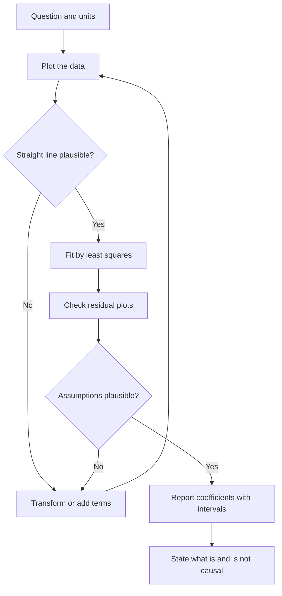
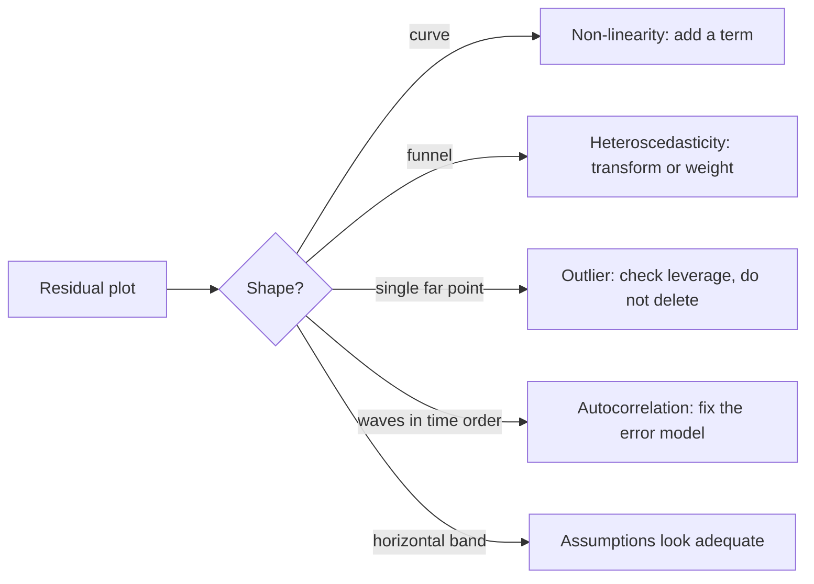

# Linear Regression

> [Statistics](../README.md) · Level: Intermediate · Prerequisites: [Descriptive Statistics](../01-descriptive-statistics/README.md), [Sampling and Estimation](../02-sampling-and-estimation/README.md), [Hypothesis Testing](../03-hypothesis-testing/README.md), [Expectation and Variance](../../10-probability/05-expectation-and-variance/README.md), [Inner Product Spaces](../../08-linear-algebra/08-inner-product-spaces/README.md) · Estimated time: 540 min

## 1. Introduction

Regression answers a question descriptive statistics cannot: *how does one variable behave when another
moves?* A doctor wants to know how blood pressure changes with age; an engineer wants to predict beam
strength from thickness; an economist wants to know how much of a wage gap survives after controlling for
education. In each case we observe pairs $(x_i,y_i)$ and want a function describing the systematic part of
the relationship.

The simplest and most used such function is a straight line, $\hat{y} = b_0+b_1x$. Fitting one requires a
criterion: Legendre (1805) and Gauss (1809) proposed the one that survived — choose the line minimising the
sum of squared vertical deviations. Gauss also supplied the probabilistic theory, and in 1886 Francis Galton
coined *regression* after noticing that sons of tall fathers were on average shorter than their fathers:
they "regressed to mediocrity". The word names a fitting procedure, not a claim that anything moves
backwards.

Two ideas make the subject more than curve fitting. **Inference**: the line is estimated from a sample, so
its slope is random, and its uncertainty must be quantified — the distribution theory built by Fisher and
Pearson between 1922 and 1930, and the reason regression output always carries standard errors,
$t$-statistics and $p$-values. **Geometry**: least squares is orthogonal projection of the data vector onto
the plane spanned by the predictors. This is not a metaphor but the operation studied in
[Inner Product Spaces](../../08-linear-algebra/08-inner-product-spaces/README.md), and it explains in one
line why the normal equations take the form they do.

A warning belongs here rather than at the end. A regression coefficient measures an *association adjusted
for the variables in the model*. It is a causal effect only when additional, usually untestable assumptions
hold. Most bad science done with regression comes from forgetting this; §7.14 returns to it and
[Experimental Design](../06-experimental-design/README.md) treats the question properly.

## 2. Prerequisites

* **Descriptive statistics** — sample mean, sample variance with divisor $n-1$, correlation, population
  versus sample: [Descriptive Statistics](../01-descriptive-statistics/README.md).
* **Expectation and variance** — linearity of expectation, $\operatorname{Var}(aX+bY)$, covariance:
  [Expectation and Variance](../../10-probability/05-expectation-and-variance/README.md).
* **Sampling distributions and tests** — standard errors, the $t$ distribution, confidence intervals, the
  logic of a $p$-value: [Sampling and Estimation](../02-sampling-and-estimation/README.md) and
  [Hypothesis Testing](../03-hypothesis-testing/README.md).
* **Normal, $t$, $\chi^2$ and $F$ distributions** — densities, quantiles, and the relations between them:
  [Probability Distributions](../../10-probability/04-probability-distributions/README.md).
* **Partial derivatives and minimisation** — differentiating a quadratic in two variables:
  [Multivariable Calculus](../../07-calculus/12-multivariable-calculus/README.md).
* **Linear algebra** — transpose, inverse, rank, orthogonal projection, the normal equations for a linear
  system: [Matrices](../../08-linear-algebra/02-matrices/README.md),
  [Systems of Linear Equations](../../08-linear-algebra/03-systems-of-linear-equations/README.md),
  [Inner Product Spaces](../../08-linear-algebra/08-inner-product-spaces/README.md).
* **Proof technique** — proving an identity by expanding sums; proving unbiasedness by taking expectations:
  [Proof Techniques](../../00-foundations/04-proof-techniques/README.md).

## 3. Learning Objectives

After this tutorial you will be able to:

1. Write the simple linear regression model and state its four working assumptions precisely.
2. Derive the least-squares estimators twice: by calculus and by orthogonal projection.
3. Solve the normal equations $X^{\mathsf{T}}Xb = X^{\mathsf{T}}y$ for a small data set by hand.
4. Interpret intercepts, slopes and multiple-regression coefficients in the units of the data.
5. Compute $R^2$, explain what it measures, and list four things it does not measure.
6. Construct residual plots and name the assumption each one checks.
7. Derive $\operatorname{Var}(b_1)=\sigma^2/S_{xx}$ and build standard errors, $t$-tests and intervals from it.
8. Distinguish a confidence interval for the mean response from a prediction interval, and derive both.
9. Diagnose multicollinearity with variance inflation factors.
10. Use log, semi-log and polynomial transformations and interpret their coefficients.
11. Compute leverage and Cook's distance; distinguish an outlier from an influential point.
12. State which conclusions a given regression cannot support.

## 4. Intuition

Imagine a scatter plot. We want a ruler laid across the cloud. Many lines are plausible, so we need a rule
that picks one. Least squares says: slide the ruler until the total area of the squares built on the vertical
gaps between points and line is as small as possible. Vertical gaps, not perpendicular distances, because
$y$ is being predicted from $x$ and the $x$-values are treated as given.

Why squares rather than absolute values? Squares are differentiable, so the minimiser solves a linear system
and has a closed form; they penalise large errors much more heavily, which is usually what we want; and sums
of squares of normal variables have $\chi^2$ and $F$ distributions, which is what makes the inference work.

Two properties explain most of the formulas that follow. *The line passes through the centre*
$(\bar x,\bar y)$, so the intercept is not "the value of $y$ at $x=0$" in any deep sense but the number that
makes the line pass through the centre with the fitted slope. *The residuals balance*: $\sum e_i = 0$ and
$\sum x_ie_i = 0$, so the line sits on the data like a see-saw — push one end up and the other goes down.

The geometric picture is the deepest. Put the $n$ responses into a vector $\mathbf{y}\in\mathbb{R}^n$ and
place the constant vector $\mathbf{1}$ and the predictor vector $\mathbf{x}$ beside it. All possible fitted
vectors $b_0\mathbf{1}+b_1\mathbf{x}$ form a plane through the origin. The closest point of that plane to
$\mathbf{y}$ is its orthogonal projection, and the residual vector is the perpendicular dropped onto it.
"Closest" in the Euclidean sense is exactly "smallest sum of squared residuals", so least squares *is*
orthogonal projection. Perpendicularity then gives $\sum e_i=0$, the normal equations, and Pythagoras
$\mathrm{SST}=\mathrm{SSR}+\mathrm{SSE}$ with no extra work.

## 5. Formal Definition

Throughout, data are $(x_1,y_1),\dots,(x_n,y_n)$ with $n\ge 2$ and not all $x_i$ equal.

**Definition 5.1 (Simple linear regression model).** For $i=1,\dots,n$,

$$y_i = \beta_0 + \beta_1 x_i + \varepsilon_i,$$

where $\beta_0,\beta_1\in\mathbb{R}$ are unknown parameters and $\varepsilon_1,\dots,\varepsilon_n$ are
unobservable random errors. The *systematic part* $\beta_0+\beta_1x_i$ is the conditional mean
$\mathbb{E}[y_i\mid x_i]$; the error is what the model does not explain.

**Definition 5.2 (The four working assumptions).**

| Label | Assumption | Formal statement | Needed for |
|---|---|---|---|
| **A1** Linearity | the mean of $y$ is linear in $x$ | $\mathbb{E}[\varepsilon_i\mid x_i]=0$ | unbiasedness, interpretation |
| **A2** Independence | errors carry no information about each other | $\varepsilon_i \perp\!\!\!\perp \varepsilon_j$, $i\ne j$ | variances of $\hat{y}$, intervals |
| **A3** Homoscedasticity | the error variance does not depend on $x$ | $\operatorname{Var}(\varepsilon_i\mid x_i)=\sigma^2$ | Gauss–Markov, standard errors |
| **A4** Normality | errors are normally distributed | $\varepsilon_i\mid x_i\sim\mathcal{N}(0,\sigma^2)$ | exact $t$- and $F$-tests |

A4 is not needed for unbiasedness or for Gauss–Markov; it is needed for the exact finite-sample
distribution of $b_1$. For large $n$ the central limit theorem substitutes for it.

**Definition 5.3 (Fitted values and residuals).** Given estimates $b_0,b_1$, the *fitted value* at $x_i$ is
$\hat{y}_i=b_0+b_1x_i$ and the *residual* is $e_i=y_i-\hat{y}_i$. Residuals are observable; errors
$\varepsilon_i$ are not. Confusing the two causes many mistakes.

**Definition 5.4 (Least-squares estimators).**

$$(b_0,b_1) = \operatorname*{arg\,min}_{(\beta_0,\beta_1)\in\mathbb{R}^2}\sum_{i=1}^{n}\bigl(y_i-\beta_0-\beta_1x_i\bigr)^2 .$$

**Definition 5.5 (Multiple linear regression).** With $p-1$ predictors and an intercept,
$y_i=\beta_0+\beta_1x_{i1}+\cdots+\beta_{p-1}x_{i,p-1}+\varepsilon_i$, or
$\mathbf{y}=X\boldsymbol{\beta}+\boldsymbol{\varepsilon}$, where the $n\times p$ *design matrix* $X$ has
first column $\mathbf{1}$ and $i$-th row $(1,x_{i1},\dots,x_{i,p-1})$.

**Definition 5.6 (Estimand).** In Definition 5.1 the target is $(\beta_0,\beta_1)$, or a function of it such
as $\mathbb{E}[y\mid x=x_0]=\beta_0+\beta_1x_0$. The estimator $(b_0,b_1)$ is random because it depends on
the sample.

## 6. Mathematical Notation

| Symbol | Read as | Meaning |
|---|---|---|
| $n$, $p$ | en, pee | number of observations; number of parameters including the intercept |
| $\beta_0,\beta_1$ | beta nought, beta one | unknown population intercept and slope |
| $b_0,b_1$ | bee nought, bee one | least-squares estimates of $\beta_0,\beta_1$ |
| $\hat{y}_i$, $e_i$ | y hat sub $i$, e sub $i$ | fitted value; residual $y_i-\hat{y}_i$ |
| $\varepsilon_i$ | epsilon sub $i$ | unobservable model error |
| $s^2$, $s$ | s squared, s | residual variance $\mathrm{SSE}/(n-2)$; residual standard error $\sqrt{s^2}$ |
| $\bar{x},\bar{y}$ | x bar, y bar | sample means |
| $S_{xx},S_{xy},S_{yy}$ | S sub x x, S sub x y, S sub y y | $\sum(x_i-\bar x)^2$, $\sum(x_i-\bar x)(y_i-\bar y)$, $\sum(y_i-\bar y)^2$ |
| $\mathrm{SST},\mathrm{SSR},\mathrm{SSE}$ | total, regression, error sum of squares | $S_{yy}$, $\sum(\hat y_i-\bar y)^2$, $\sum e_i^2$ |
| $R^2$, $r$ | R squared; r | coefficient of determination; Pearson correlation |
| $\sigma^2$ | sigma squared | error variance (unknown) |
| $\operatorname{se}(b_1)$ | standard error of b one | estimated standard deviation of $b_1$ |
| $X$, $\boldsymbol{\beta}$, $\mathbf{b}$ | capital ex; beta, bee (bold) | design matrix; parameter vector; its estimate |
| $H$, $h_{ii}$ | aitch; h sub i i | hat matrix $X(X^{\mathsf{T}}X)^{-1}X^{\mathsf{T}}$; leverage of point $i$ |
| $D_i$ | dee sub $i$ | Cook's distance of point $i$ |
| $t_{n-2,1-\alpha/2}$ | t critical value | upper $\alpha/2$ quantile of Student's $t$ with $n-2$ df |
| $\operatorname{VIF}_j$ | vee-eye-eff | variance inflation factor of predictor $j$ |

Conventions below: sums run over $i=1,\dots,n$; "significant" means two-sided at level $\alpha$; $R^2$ uses
$\mathrm{SST}=S_{yy}$, the version every package reports when the model has an intercept.

## 7. Core Concepts

### 7.1 The model, and what the error term is for

The error collects everything relevant to $y_i$ that is not $x_i$: omitted variables, measurement error,
genuine randomness. Writing it is not decoration — it is what lets us ask whether an estimate is close to
the truth, because it describes what a new sample would look like. Keep four objects apart: the population
line $\beta_0+\beta_1x$; the fitted line $b_0+b_1x$, which changes from sample to sample; the prediction
$\hat y_i$; and the residual $e_i$. An estimator is a random variable, an estimate is a number, and claims
such as $\mathbb{E}[b_1]=\beta_1$ are about estimators — they cannot be checked on one sample.

### 7.2 Reading the assumptions

**A1 Linearity** gives meaning to "the slope". If the true mean is curved, a straight line still has a
least-squares slope, but it is an average of local slopes weighted by the spread of $x$ and need not describe
any part of the curve. *Diagnostic:* residual-versus-fitted plot shows no pattern.

**A2 Independence** is the assumption most often violated, because data arrive in time, space or clusters.
Positively correlated errors make standard errors too small — sometimes dramatically — so $t$-statistics are
inflated and intervals too narrow. *Diagnostic:* residuals against order of collection; Durbin–Watson
statistic $d=\sum_{i=2}^{n}(e_i-e_{i-1})^2/\sum_ie_i^2$ (near $2$: no first-order autocorrelation; near $0$:
strong positive).

**A3 Homoscedasticity** makes a single $s^2$ meaningful. If the error variance grows with $x$ (a fan), the
slope stays unbiased but standard errors are wrong and the fit inefficient. *Diagnostic:* funnel shape in
the residual plot.

**A4 Normality** concerns the *errors*, not the variables and not the marginal distribution of the residuals.
It matters for exact small-sample inference; with $n$ in the hundreds $t$-tests tolerate moderate
non-normality. *Diagnostic:* normal quantile–quantile plot.

Two design conditions are separate from the error assumptions: the $x_i$ must not all be equal (else
$S_{xx}=0$ and no slope exists), and in multiple regression the columns of $X$ must be linearly independent
(else $X^{\mathsf{T}}X$ is singular). The second failure is *perfect* collinearity; the interesting case is
*near*-collinearity, §7.11.

### 7.3 Least squares by calculus

Minimise

$$Q(\beta_0,\beta_1)=\sum_{i=1}^{n}\bigl(y_i-\beta_0-\beta_1x_i\bigr)^2 .$$

$Q$ is a quadratic with positive definite Hessian, so a stationary point is the unique global minimum.
Differentiating,

$$\frac{\partial Q}{\partial\beta_0}=-2\sum_{i=1}^{n}\bigl(y_i-\beta_0-\beta_1x_i\bigr),\qquad
\frac{\partial Q}{\partial\beta_1}=-2\sum_{i=1}^{n}x_i\bigl(y_i-\beta_0-\beta_1x_i\bigr).$$

Setting both to zero and dividing by $-2$ gives the **normal equations**

$$\sum_{i=1}^{n}\bigl(y_i-\beta_0-\beta_1x_i\bigr)=0,\qquad \sum_{i=1}^{n}x_i\bigl(y_i-\beta_0-\beta_1x_i\bigr)=0 .$$

The first expands to $n\beta_0+\beta_1\sum x_i=\sum y_i$, so $\beta_0=\bar y-\beta_1\bar x$. Substituting
into the second and using $\sum x_i=n\bar x$, $\sum x_i^2=S_{xx}+n\bar x^2$ and
$\sum x_iy_i=S_{xy}+n\bar x\bar y$:

$$S_{xy}+n\bar x\bar y-n\bar x\bar y+\beta_1n\bar x^2-\beta_1\bigl(S_{xx}+n\bar x^2\bigr)=0
\quad\Longrightarrow\quad \beta_1S_{xx}=S_{xy}.$$

Hence

$$b_1=\frac{S_{xy}}{S_{xx}}=\frac{\sum_{i=1}^{n}(x_i-\bar x)(y_i-\bar y)}{\sum_{i=1}^{n}(x_i-\bar x)^2},
\qquad b_0=\bar y-b_1\bar x .$$

The Hessian $\begin{pmatrix}2n & 2\sum x_i\\ 2\sum x_i & 2\sum x_i^2\end{pmatrix}$ has determinant
$4nS_{xx}>0$ and positive leading entry, confirming a minimum.

*Sanity checks.* The slope has the sign of $S_{xy}$, hence of the correlation. If $x$ is measured in a unit
$k$ times smaller, $S_{xx}$ scales by $k^2$ and $S_{xy}$ by $k$, so $b_1$ scales by $1/k$ while fitted values
do not change. The line always passes through $(\bar x,\bar y)$.

### 7.4 Least squares by orthogonal projection

Now the same result without calculus. Let $\mathbf{y}=(y_1,\dots,y_n)^{\mathsf{T}}$,
$\mathbf{1}=(1,\dots,1)^{\mathsf{T}}$, $\mathbf{x}=(x_1,\dots,x_n)^{\mathsf{T}}$, and let

$$\mathcal{M}=\{\,b_0\mathbf{1}+b_1\mathbf{x}: b_0,b_1\in\mathbb{R}\,\}=\operatorname{col}(X)$$

be the plane spanned by the two vectors. With $\hat{\mathbf{y}}=b_0\mathbf{1}+b_1\mathbf{x}\in\mathcal{M}$
and $\mathbf{e}=\mathbf{y}-\hat{\mathbf{y}}$,

$$\lVert\mathbf{e}\rVert^2=\sum_{i=1}^{n}(y_i-b_0-b_1x_i)^2=Q(b_0,b_1),$$

so minimising $Q$ *is* minimising the distance from $\mathbf{y}$ to $\mathcal{M}$. The nearest-point theorem
of [Inner Product Spaces](../../08-linear-algebra/08-inner-product-spaces/README.md) identifies that nearest
point as the orthogonal projection, characterised by $\mathbf{e}\perp\mathcal{M}$, i.e.

$$\mathbf{e}\cdot\mathbf{1}=0,\qquad \mathbf{e}\cdot\mathbf{x}=0 .$$

These are exactly the two normal equations in vector form. In matrix notation
$X^{\mathsf{T}}(\mathbf{y}-X\mathbf{b})=\mathbf{0}$, that is,

$$X^{\mathsf{T}}X\mathbf{b}=X^{\mathsf{T}}\mathbf{y},\qquad \hat{\mathbf{y}}=H\mathbf{y},\qquad
H=X(X^{\mathsf{T}}X)^{-1}X^{\mathsf{T}}.$$

$H$ is symmetric and idempotent ($H^2=H$) — the algebraic signature of a projection — and
$\operatorname{tr}H=\operatorname{rank}H=p=2$ here, the dimension of the plane. That identity, $\sum_ih_{ii}=p$,
is used in §7.13. Because $\mathbf{e}\perp\hat{\mathbf{y}}$,

$$\lVert\mathbf{y}\rVert^2=\lVert\hat{\mathbf{y}}\rVert^2+\lVert\mathbf{e}\rVert^2 ,$$

and since $\mathbf{1}\in\mathcal{M}$ we also have $\hat{\mathbf{y}}-\bar y\mathbf{1}\perp\mathbf{e}$;
subtracting $n\bar y^2$ gives $\mathrm{SST}=\mathrm{SSR}+\mathrm{SSE}$ (§8.3). The geometry also explains the
degrees of freedom: the plane has dimension $2$, so the residual space has dimension $n-2$, which is why $s^2$
divides by $n-2$.

*Computation.* By hand, form $n,\sum x,\sum y,\sum x^2,\sum xy$, solve the two normal equations, and verify
$\sum e_i=0$ and $\sum x_ie_i=0$. By computer, use a $QR$ decomposition rather than forming
$(X^{\mathsf{T}}X)^{-1}$, because squaring the condition number of $X$ loses accuracy — a numerical point, not
a statistical one ([Numerical Analysis](../../19-numerical-analysis/README.md)).

### 7.5 Interpreting the coefficients

**Slope.** $b_1$ estimates the change in the conditional mean of $y$ per one-unit increase in $x$, in units
of $y$ per unit of $x$. It is not the change for any individual, who also moves for reasons outside the model.

**Intercept.** $b_0$ estimates the mean of $y$ at $x=0$. If $x=0$ lies outside the observed range or is
impossible, this is an extrapolation and should not be reported as a finding. The intercept is still needed:
forcing the line through the origin changes the slope, usually badly.

**Multiple regression.** $b_j$ estimates the change in the mean of $y$ per unit increase in $x_j$ with all
other predictors **held fixed** — a comparison of two units with the same values of the other predictors. When
two predictors cannot vary independently in reality (age and years of experience), the coefficient describes a
hypothetical comparison that no real pair of units realises.

**Scaling and centring.** Multiplying $x_j$ by $c$ divides $b_j$ by $c$ and leaves fitted values, $R^2$ and
$t$-statistics unchanged. Centring $x_j$ changes the intercept and its standard error, not the slope.
Standardised coefficients, $b_js_{x_j}/s_y$, allow a rough comparison across predictors but depend on the
sample spread, so they are not measures of importance.

### 7.6 $R^2$ and its limitations

Split the variation of $y$ about its mean:

$$\underbrace{\sum_{i=1}^{n}(y_i-\bar y)^2}_{\mathrm{SST}}
=\underbrace{\sum_{i=1}^{n}(\hat y_i-\bar y)^2}_{\mathrm{SSR}}+\underbrace{\sum_{i=1}^{n}(y_i-\hat y_i)^2}_{\mathrm{SSE}} .$$

The identity holds whenever the model has an intercept (proof in §8.3), so

$$R^2=\frac{\mathrm{SSR}}{\mathrm{SST}}=1-\frac{\mathrm{SSE}}{\mathrm{SST}}\in[0,1],$$

the proportion of sample variation explained by the fitted values. For simple regression $R^2=r^2$
exactly (§8.4).

What $R^2$ does **not** tell you:

1. **Whether the model is right.** A line fitted to a strong parabola can reach $R^2=0.9$ while every
   residual plot is damning.
2. **Whether the slope is meaningful.** $R^2$ depends on the range of $x$: narrow the range and $R^2$ can
   collapse although the relationship is unchanged; widen it and $R^2$ rises.
3. **Whether predictions are accurate.** $R^2$ is relative and in-sample. A model with $R^2=0.95$ and
   $s=250$ may predict worse absolutely than one with $R^2=0.6$ and $s=2$.
4. **Whether adding a predictor helps.** $R^2$ never falls when a column is added, even a column of random
   numbers; use $R^2_{\text{adj}}=1-(1-R^2)\frac{n-1}{n-p}$, $s$, or cross-validation.
5. **Anything causal.** It is a statement about co-variation in one sample.

Two more traps: $R^2$ values from models with different response transformations are not comparable (a
log-transformed $y$ has a different $\mathrm{SST}$), and a high $R^2$ can coexist with strongly
autocorrelated errors, in which case much of the apparent fit is an artefact.

### 7.7 Residual analysis and diagnostic plots

| Plot | Axes | Detects |
|---|---|---|
| Residuals vs fitted | $\hat y_i$ vs $e_i$ | non-linearity, heteroscedasticity, outliers |
| Normal Q–Q | theoretical normal quantiles vs ordered $e_i$ | heavy tails, skewness |
| Scale–location | $\hat y_i$ vs $\sqrt{\lvert e_i\rvert}$ | variance growing with the mean |
| Residuals vs leverage | $h_{ii}$ vs standardised $e_i$ | influential observations |
| Residuals vs order | index $i$ vs $e_i$ | autocorrelation, drift |

Patterns to recognise: **curvature** (a U or an arch) means A1 fails — add a term or transform; a **funnel**
means A3 fails — transform $y$ (often $\log$) or use weighted least squares; a **single point far from the
band** is a possible outlier — check its leverage before drawing conclusions; **long tails with a straight
middle** in the Q–Q plot indicate heavy-tailed errors, for which $t$-tests remain approximately valid but
intervals are optimistic; **slow waves in time order** indicate autocorrelation, and the reported standard
errors are too small.

Numerical companions: the residual standard error $s$; standardised residuals $e_i/(s\sqrt{1-h_{ii}})$,
which should lie mostly within $\pm2$ and rarely beyond $\pm3$; and, for designed experiments, a plot of
residuals against run order to expose drift.

### 7.8 Inference for the coefficients

Under A1–A4,

$$b_1\sim\mathcal{N}\!\left(\beta_1,\frac{\sigma^2}{S_{xx}}\right),\qquad
\frac{(n-2)s^2}{\sigma^2}\sim\chi^2_{n-2},$$

and the two are independent, so

$$t=\frac{b_1-\beta_1}{\operatorname{se}(b_1)}\sim t_{n-2},\qquad
\operatorname{se}(b_1)=\frac{s}{\sqrt{S_{xx}}} .$$

A $100(1-\alpha)\%$ interval is $b_1\pm t_{n-2,1-\alpha/2}\operatorname{se}(b_1)$, and $H_0\colon\beta_1=\beta_1^{(0)}$
is rejected when $\lvert t\rvert>t_{n-2,1-\alpha/2}$. The interval describes the *procedure*: in repeated
samples about $100(1-\alpha)\%$ of intervals so built contain $\beta_1$. It is not a statement that this
interval contains the fixed number $\beta_1$ with probability $0.95$.

The intercept has $\operatorname{se}(b_0)=s\sqrt{1/n+\bar x^2/S_{xx}}$, so it is estimated worst when
$\bar x$ is far from $0$: the line pivots about the centre of the data, and the intercept sits at the end of
the lever. For the model as a whole,

$$F=\frac{\mathrm{SSR}/(p-1)}{\mathrm{SSE}/(n-p)}\sim F_{p-1,n-p}$$

tests $H_0\colon\beta_1=\cdots=\beta_{p-1}=0$; in simple regression $F=t^2$. A significant overall $F$ with no
significant coefficient (correlated predictors) and the reverse both occur, because they answer different
questions.

### 7.9 Confidence intervals for the mean, prediction intervals for an observation

Two questions hide behind "predict $y$ at $x_0$".

*What is the average $y$ among units with $x=x_0$?* Estimate $\hat y_0=b_0+b_1x_0$, with

$$\operatorname{Var}(\hat y_0)=\sigma^2\left(\frac{1}{n}+\frac{(x_0-\bar x)^2}{S_{xx}}\right).$$

*What will one new unit with $x=x_0$ have?* Its response is $\hat y_0$ plus its own error, independent of
the fit, so

$$\operatorname{Var}(y_0-\hat y_0)=\sigma^2+\operatorname{Var}(\hat y_0)
=\sigma^2\left(1+\frac{1}{n}+\frac{(x_0-\bar x)^2}{S_{xx}}\right).$$

Hence

$$\text{CI: }\hat y_0\pm t\,s\sqrt{\tfrac1n+\tfrac{(x_0-\bar x)^2}{S_{xx}}},\qquad
\text{PI: }\hat y_0\pm t\,s\sqrt{1+\tfrac1n+\tfrac{(x_0-\bar x)^2}{S_{xx}}},$$

with $t=t_{n-2,1-\alpha/2}$. The prediction interval is always wider and, as $n\to\infty$, settles at
$\pm1.96\sigma$ while the confidence interval shrinks to zero. Both widen away from $\bar x$, and both are
extrapolations outside the observed range: the arithmetic still works, but the model is unsupported there.

### 7.10 Multiple regression

With $p-1$ predictors the algebra is the matrix version of §7.3–7.4:

$$\mathbf{b}=(X^{\mathsf{T}}X)^{-1}X^{\mathsf{T}}\mathbf{y},\qquad
\widehat{\operatorname{Var}}(\mathbf{b})=s^2(X^{\mathsf{T}}X)^{-1},\qquad s^2=\frac{\mathrm{SSE}}{n-p}.$$

Diagonal entries give squared standard errors; off-diagonal entries give covariances needed for testing
linear combinations such as $\beta_1-\beta_2=0$. "Holding the others fixed" has an exact meaning: by the
Frisch–Waugh–Lovell theorem (§8.9), $b_j$ is the slope from regressing $y$ — purged of its linear dependence
on the other predictors — on $x_j$ purged the same way. That is why the precision of $b_j$ depends on the
*residual* variation of $x_j$: a predictor that is nearly a combination of the others leaves little
independent variation to work with. Each added predictor also costs one degree of freedom, reducing the divisor
$n-p$; this is why $R^2_{\text{adj}}$ and $s$ can move in opposite directions when a predictor is added.

### 7.11 Multicollinearity

**Perfect** collinearity means the columns of $X$ are linearly dependent: $X^{\mathsf{T}}X$ is singular and
$\mathbf{b}$ is not unique; software drops a column or fails. **Near** collinearity means high but not perfect
correlation; then $X^{\mathsf{T}}X$ is invertible but ill-conditioned, with these consequences:

* large standard errors, hence wide intervals and small $t$-statistics;
* coefficients that change erratically, even in sign, when another predictor is added or removed;
* a strong overall $F$ with no individually significant coefficient;
* stable fitted values — the model may predict well while no single coefficient is precisely estimable.

The diagnostic is the variance inflation factor. Regress $x_j$ on the other predictors, let $R_j^2$ be the
resulting coefficient of determination, and let $S_{jj}=\sum_i(x_{ij}-\bar x_j)^2$. Then

$$\operatorname{VIF}_j=\frac{1}{1-R_j^2},\qquad
\operatorname{Var}(b_j)=\frac{\sigma^2}{S_{jj}(1-R_j^2)}
=\operatorname{VIF}_j\cdot\frac{\sigma^2}{S_{jj}},$$

so $\operatorname{VIF}_j$ is literally the factor by which variance is inflated relative to an orthogonal
design with the same spread, and the standard error is inflated by $\sqrt{\operatorname{VIF}_j}$. Values above
$5$ or $10$ are conventional warnings, not theorems: what matters is whether the interval is wide enough to
answer the scientific question.

Remedies, in order of preference: collect more data (broadens the spread and never hurts); drop or combine
redundant predictors that measure the same thing; use an index or principal components when the goal is
prediction rather than interpretation; centre variables for numerical stability (which does not remove the
collinearity). Ridge regression trades bias for variance; see [Optimization](../../18-optimization/README.md).

### 7.12 Transformations and nonlinear fits

When A1 or A3 fails, a transformation can restore linearity and constant variance, and can make coefficients
interpretable.

| Model | Fitted form | Interpretation of $b$ | Typical use |
|---|---|---|---|
| linear | $y=b_0+b_1x$ | change in mean $y$ per unit $x$ | constant marginal effect |
| log–log | $\ln y=b_0+b_1\ln x$ | $1\%$ in $x$ ↔ $b_1\%$ in $y$ (elasticity) | multiplicative processes |
| log–linear | $\ln y=b_0+b_1x$ | one unit of $x$ multiplies mean $y$ by $e^{b_1}$ | growth, decay |
| linear–log | $y=b_0+b_1\ln x$ | $1\%$ in $x$ changes mean $y$ by about $b_1/100$ | diminishing returns |
| reciprocal | $y=b_0+b_1/x$ | asymptote $b_0$ | saturation |
| quadratic | $y=b_0+b_1x+b_2x^2$ | marginal effect $b_1+2b_2x$ | one turning point |

Two cautions. A transformation changes the error structure: fitting $\ln y$ assumes multiplicative errors,
and $e^{\widehat{\ln y}}$ estimates a conditional *median*, not the mean — a bias correction such as the
smearing estimator is needed for means. And adding powers of $x$ creates collinearity between $x$ and $x^2$;
centring first fixes the numerics without changing the fitted curve. The Box–Cox family
$y^{(\lambda)}=(y^\lambda-1)/\lambda$ (with $\ln y$ at $\lambda=0$) offers a systematic choice of power by
maximum likelihood, but it is a convenience, not a substitute for thinking about the science.

### 7.13 Leverage, influence and outliers

**Leverage** measures how unusual a point's $x$-value is:

$$h_{ii}=\frac{1}{n}+\frac{(x_i-\bar x)^2}{S_{xx}}\ \text{(simple regression)},\qquad
0<h_{ii}\le1,\qquad \sum_{i=1}^{n}h_{ii}=p .$$

The average leverage is $p/n$, so a point above $2p/n$ or $3p/n$ is called high-leverage. Such a point need
not be an outlier in $y$, but it pulls hard on the line, because $\hat y_i=h_{ii}y_i+$ terms from the other
points: at high leverage the fitted value largely reproduces $y_i$ itself.

**Outliers** are points with large residuals. **Influence** combines both: a point is influential when
deleting it changes the fit appreciably. The standard measure is Cook's distance

$$D_i=\frac{e_i^2}{p\,s^2}\cdot\frac{h_{ii}}{(1-h_{ii})^2},$$

which is, up to a constant, the squared Euclidean distance between the fitted values with and without point
$i$. Values above $1$ are conventionally influential; values near $4/n$ are worth a look.

Deleting a point because it weakens a desired conclusion is fabrication. Ask instead whether the value is a
recording error (then correct it and say so); if not, report the fit with and without the point and describe
what changes.

### 7.14 What regression does not tell you about causation

A coefficient answers: *among units differing by one unit in $x_j$ and agreeing on the other predictors in the
model, how much do their mean responses differ?* That is an adjusted association. Reading it causally requires
at least: no unmeasured confounder affecting both $x_j$ and $y$; no reverse causation; correct functional form;
no selection on the outcome; positivity, so that every covariate pattern occurs with a range of $x_j$; and no
differential measurement error. None of these is testable from the regression output.

Two specific traps recur. **Adding a variable can create bias**: controlling for a *mediator* removes part of
the effect you want to measure, and controlling for a *collider* — a common effect of $x$ and $y$ — introduces
an association that is not there. **Significance is not importance**: with large $n$ a trivial coefficient is
"significant", with small $n$ an important one may not be. Report effect sizes with intervals and say what a
difference of that size would mean.

[Experimental Design](../06-experimental-design/README.md) develops the alternative: randomised assignment,
which removes confounding by construction rather than by modelling.

## 8. Formulas and Properties

Each result is stated with its hypotheses, then proved.

### 8.1 The centroid, and orthogonality of residuals

**Proposition.** If $S_{xx}>0$ and $b_0,b_1$ solve the normal equations, then
$\bar y=b_0+b_1\bar x$, $\sum_i e_i=0$ and $\sum_i x_ie_i=0$.

*Proof.* The first is the definition of $b_0$. For the second,
$\sum_i e_i=n\bar y-nb_0-b_1n\bar x=n(\bar y-b_0-b_1\bar x)=0$. The third is the second normal equation
itself. $\blacksquare$

Both sums require the intercept. A regression forced through the origin generally has $\sum_ie_i\ne0$, and
then $\mathrm{SST}=\mathrm{SSR}+\mathrm{SSE}$ fails too — the reason packages report a different $R^2$ for
no-intercept models.

### 8.2 Unbiasedness of the slope

**Proposition.** Under A1, with fixed $x$ and $S_{xx}>0$, $\mathbb{E}[b_1]=\beta_1$ and
$\mathbb{E}[b_0]=\beta_0$.

*Proof.* With $c_i=(x_i-\bar x)/S_{xx}$ we have $\sum_ic_i=0$ and $\sum_ic_ix_i=1$, so

$$b_1=\frac{\sum_i(x_i-\bar x)(y_i-\bar y)}{S_{xx}}=\sum_ic_i(y_i-\bar y)=\sum_ic_iy_i
=\beta_0\sum_ic_i+\beta_1\sum_ic_ix_i+\sum_ic_i\varepsilon_i=\beta_1+\sum_ic_i\varepsilon_i .$$

Taking expectations gives $\mathbb{E}[b_1]=\beta_1$, and
$\mathbb{E}[b_0]=\mathbb{E}[\bar y]-\bar x\mathbb{E}[b_1]=\beta_0+\beta_1\bar x-\bar x\beta_1=\beta_0$.
$\blacksquare$

The estimator is a fixed linear combination of the responses, with weights depending only on the $x$'s.
Unbiasedness holds for every $n\ge2$; what small samples threaten is precision, not centring.

### 8.3 The analysis-of-variance identity

**Proposition.** With an intercept, $\sum_i(y_i-\bar y)^2=\sum_i(\hat y_i-\bar y)^2+\sum_i(y_i-\hat y_i)^2$.

*Proof (algebraic).* Put $d_i=\hat y_i-\bar y$ and $e_i=y_i-\hat y_i$, so $y_i-\bar y=d_i+e_i$ and

$$\sum_i(y_i-\bar y)^2=\sum_id_i^2+2\sum_id_ie_i+\sum_ie_i^2 .$$

Since $d_i=b_1(x_i-\bar x)$ by §8.1, the cross term is
$b_1\bigl(\sum_ix_ie_i-\bar x\sum_ie_i\bigr)=b_1(0-0)=0$. $\blacksquare$

*Proof (geometric).* $\mathbf{1}\in\mathcal{M}$ gives
$\hat{\mathbf{y}}-\bar y\mathbf{1}\in\mathcal{M}$ and $\mathbf{e}\perp\mathcal{M}$; Pythagoras in
$\mathbb{R}^n$ then yields the identity. $\blacksquare$

### 8.4 $R^2=r^2$ in simple regression

$\mathrm{SSR}=b_1^2S_{xx}=(S_{xy}/S_{xx})^2S_{xx}=S_{xy}^2/S_{xx}$, so
$R^2=\mathrm{SSR}/\mathrm{SST}=S_{xy}^2/(S_{xx}S_{yy})=r^2$. $\blacksquare$

This is special to one predictor: with more, $R^2$ is not the square of any single correlation and exceeds the
squared correlation with any one predictor.

### 8.5 Variances and covariance of the estimators

**Proposition.** Under A1–A3 with fixed $x$,

$$\operatorname{Var}(b_1)=\frac{\sigma^2}{S_{xx}},\qquad
\operatorname{Var}(b_0)=\sigma^2\left(\frac1n+\frac{\bar x^2}{S_{xx}}\right),\qquad
\operatorname{Cov}(b_0,b_1)=-\frac{\sigma^2\bar x}{S_{xx}} .$$

*Proof.* From §8.2, $b_1=\beta_1+\sum_ic_i\varepsilon_i$ with $\sum_ic_i^2=1/S_{xx}$, so independent errors
give $\operatorname{Var}(b_1)=\sigma^2\sum_ic_i^2=\sigma^2/S_{xx}$. Also
$\operatorname{Cov}(\bar\varepsilon,\sum_ic_i\varepsilon_i)=\frac{\sigma^2}{n}\sum_ic_i=0$, hence $\bar y$
and $b_1$ are uncorrelated, and with $b_0=\bar y-\bar xb_1$:

$$\operatorname{Var}(b_0)=\operatorname{Var}(\bar y)+\bar x^2\operatorname{Var}(b_1)
=\frac{\sigma^2}{n}+\frac{\bar x^2\sigma^2}{S_{xx}},\qquad
\operatorname{Cov}(b_0,b_1)=0-\bar x\operatorname{Var}(b_1)=-\frac{\sigma^2\bar x}{S_{xx}} . \;\blacksquare$$

The negative covariance is the see-saw in algebra: a slope estimated too high is compensated by an intercept
estimated too low, by an amount growing with $\bar x$.

### 8.6 Sampling distribution, tests and intervals

**Proposition.** Under A1–A4, $\dfrac{b_1-\beta_1}{\operatorname{se}(b_1)}\sim t_{n-2}$ with
$\operatorname{se}(b_1)=s/\sqrt{S_{xx}}$, and likewise for $b_0$.

*Sketch.* $b_1$ is linear in independent normal errors, hence normal with the moments of §8.5. The residuals
are $\mathbf{e}=(I-H)\boldsymbol\varepsilon$ with $I-H$ symmetric, idempotent and of trace $n-2$, so
$\mathrm{SSE}/\sigma^2\sim\chi^2_{n-2}$. Moreover $\operatorname{Cov}(b_1,\mathbf{e})=0$, because the
coefficient vector $\mathbf{c}$ of $b_1$ lies in $\mathcal{M}$ and $(I-H)\mathbf{c}=\mathbf{0}$; joint normality
with zero covariance gives independence. A standard normal divided by the square root of an independent
$\chi^2/\text{df}$ is $t_{n-2}$ by definition. $\blacksquare$

### 8.7 Confidence and prediction intervals

**Proposition.** Under A1–A4, with $x_0$ fixed and a new observation independent of the sample,

$$\operatorname{Var}(\hat y_0)=\sigma^2\Bigl(\tfrac1n+\tfrac{(x_0-\bar x)^2}{S_{xx}}\Bigr),\qquad
\operatorname{Var}(y_0-\hat y_0)=\sigma^2\Bigl(1+\tfrac1n+\tfrac{(x_0-\bar x)^2}{S_{xx}}\Bigr).$$

*Proof.* Write $\hat y_0=\bar y+b_1(x_0-\bar x)$; since $\operatorname{Cov}(\bar y,b_1)=0$,
$\operatorname{Var}(\hat y_0)=\sigma^2/n+(x_0-\bar x)^2\sigma^2/S_{xx}$. The new error $\varepsilon_0$ is
independent of $(\bar y,b_1)$, so $\operatorname{Var}(y_0-\hat y_0)=\sigma^2+\operatorname{Var}(\hat y_0)$.
$\blacksquare$

As $n\to\infty$ the first variance tends to $0$ and the second to $\sigma^2$: no amount of data makes a
single future observation predictable beyond the noise.

### 8.8 Multiple regression

**Proposition.** If $X$ has full column rank $p$, then
$\mathbf{b}=(X^{\mathsf{T}}X)^{-1}X^{\mathsf{T}}\mathbf{y}$ minimises
$\lVert\mathbf{y}-X\boldsymbol\beta\rVert^2$, $\mathbb{E}[\mathbf{b}]=\boldsymbol\beta$ and
$\operatorname{Var}(\mathbf{b})=\sigma^2(X^{\mathsf{T}}X)^{-1}$.

*Proof.* The gradient of the objective is $-2X^{\mathsf{T}}(\mathbf{y}-X\boldsymbol\beta)$, vanishing exactly
when $X^{\mathsf{T}}X\boldsymbol\beta=X^{\mathsf{T}}\mathbf{y}$. Full rank makes $X^{\mathsf{T}}X$ positive
definite, hence invertible, and the Hessian $2X^{\mathsf{T}}X$ confirms a minimum. With
$\mathbf{y}=X\boldsymbol\beta+\boldsymbol\varepsilon$,
$\mathbb{E}[\mathbf{b}]=\boldsymbol\beta+(X^{\mathsf{T}}X)^{-1}X^{\mathsf{T}}\mathbb{E}[\boldsymbol\varepsilon]=\boldsymbol\beta$
and $\operatorname{Var}(\mathbf{b})=(X^{\mathsf{T}}X)^{-1}X^{\mathsf{T}}(\sigma^2I)X(X^{\mathsf{T}}X)^{-1}=\sigma^2(X^{\mathsf{T}}X)^{-1}$.
$\blacksquare$

The divisor $n-p$ in $s^2$ is the dimension of the residual space, so that $\mathbb{E}[s^2]=\sigma^2$.

### 8.9 Why the variance inflation factor appears

**Proposition (Frisch–Waugh–Lovell).** Partition $X=[X_1\ \ \mathbf{x}_j]$. Let
$\tilde{\mathbf y}$, $\tilde{\mathbf x}_j$ be the residuals from regressing $\mathbf{y}$, $\mathbf{x}_j$ on
$X_1$. Then $b_j=\tilde{\mathbf x}_j^{\mathsf{T}}\tilde{\mathbf y}/\tilde{\mathbf x}_j^{\mathsf{T}}\tilde{\mathbf x}_j$.

*Sketch.* The normal equations in the $X_1$ block say $\mathbf{b}_1$ is the coefficient vector of
$\mathbf{y}-\mathbf{x}_jb_j$ on $X_1$. Substituting into the last normal equation and using idempotence of the
projection onto $\operatorname{col}(X_1)$ gives
$\tilde{\mathbf x}_j^{\mathsf{T}}(\tilde{\mathbf y}-\tilde{\mathbf x}_jb_j)=0$. $\blacksquare$

Then $\operatorname{Var}(b_j)=\sigma^2/\lVert\tilde{\mathbf x}_j\rVert^2$ and, because regressing
$\mathbf{x}_j$ on $X_1$ leaves the unexplained part of $S_{jj}$,
$\lVert\tilde{\mathbf x}_j\rVert^2=S_{jj}(1-R_j^2)$. Hence $\operatorname{VIF}_j=1/(1-R_j^2)$.

### 8.10 The Gauss–Markov theorem

**Theorem.** Under A1–A3, with non-random regressors of full column rank, least squares is the best linear
unbiased estimator of $\boldsymbol\beta$: among all $C\mathbf{y}$ with $\mathbb{E}[C\mathbf{y}]=\boldsymbol\beta$
for every $\boldsymbol\beta$, it has the smallest covariance matrix in the positive-semidefinite ordering.

*Sketch.* Unbiasedness for all $\boldsymbol\beta$ forces $CX=I$. Writing
$C=(X^{\mathsf{T}}X)^{-1}X^{\mathsf{T}}+D$ gives $DX=0$ and
$\operatorname{Var}(C\mathbf{y})=\sigma^2[(X^{\mathsf{T}}X)^{-1}+DD^{\mathsf{T}}]$; since $DD^{\mathsf{T}}\succeq0$,
the OLS covariance is minimal. $\blacksquare$

"Best" is relative to linear unbiased estimators and to the stated error structure: if A3 fails a weighted
estimator wins, and normality plays no part in the theorem.

### 8.11 Summary of formulas

| Quantity | Formula | Condition |
|---|---|---|
| Slope, intercept | $b_1=S_{xy}/S_{xx}$, $b_0=\bar y-b_1\bar x$ | $S_{xx}>0$ |
| Residual variance | $s^2=\mathrm{SSE}/(n-2)$ | intercept, $n\ge3$ |
| Decomposition, fit | $\mathrm{SST}=\mathrm{SSR}+\mathrm{SSE}$, $R^2=1-\mathrm{SSE}/\mathrm{SST}=r^2$ | intercept |
| Slope standard error | $\operatorname{se}(b_1)=s/\sqrt{S_{xx}}$ | A1–A3 |
| Intercept standard error | $\operatorname{se}(b_0)=s\sqrt{1/n+\bar x^2/S_{xx}}$ | A1–A3 |
| Slope interval | $b_1\pm t_{n-2,1-\alpha/2}\operatorname{se}(b_1)$ | A1–A4 |
| Mean-response interval | $\hat y_0\pm t\,s\sqrt{1/n+(x_0-\bar x)^2/S_{xx}}$ | A1–A4 |
| Prediction interval | $\hat y_0\pm t\,s\sqrt{1+1/n+(x_0-\bar x)^2/S_{xx}}$ | A1–A4 |
| Overall test | $F=\dfrac{\mathrm{SSR}/(p-1)}{\mathrm{SSE}/(n-p)}$ | A1–A4 |
| Leverage, influence | $h_{ii}=\frac1n+\frac{(x_i-\bar x)^2}{S_{xx}}$, $D_i=\frac{e_i^2}{ps^2}\frac{h_{ii}}{(1-h_{ii})^2}$ | any $p$ |
| Inflation | $\operatorname{VIF}_j=1/(1-R_j^2)$ | multiple regression |

## 9. Step-by-Step Examples

### 9.1 Reading a fitted line in context

A fit for crop yield $y$ (kg per plot) against mean temperature $x$ (°C) is $\hat y=12.4+0.85x$, with data
covering $10\le x\le30$.

*Slope.* A one-degree higher mean temperature is associated with $0.85$ kg more yield on average — "on
average", because individual plots vary for many other reasons. *Intercept.* At $0\,^{\circ}\mathrm{C}$ the
model predicts $12.4$ kg; since the data stop at $10\,^{\circ}\mathrm{C}$, that is an extrapolation and should
not be reported as a finding, though it is the correct intercept for this line. *Prediction.* At $x=20$,
$\hat y=12.4+17.0=29.4$ kg. *Invalid statement.* "Raising the temperature by one degree raises yield by
$0.85$ kg." The fit is an association; a causal reading needs randomised assignment of temperature, or another
identification argument ([Experimental Design](../06-experimental-design/README.md)).

### 9.2 The running example: fitting, inference, diagnostics

Ten students record weekly study hours $x$ and a test score $y$:

| $x$ | 1 | 2 | 3 | 4 | 5 | 6 | 7 | 8 | 9 | 10 |
|---|---|---|---|---|---|---|---|---|---|---|
| $y$ | 42 | 47 | 47 | 54 | 56 | 57 | 63 | 62 | 67 | 70 |

*Coefficients.* $\bar x=5.5$, $\bar y=56.5$, $S_{xx}=82.5$, $S_{xy}=247.5$, so $b_1=247.5/82.5=3$ and
$b_0=56.5-3(5.5)=40$; the fit is $\hat y=40+3x$.

*Residuals.* Fitted values are $(43,46,49,52,55,58,61,64,67,70)$, so
$e=(-1,1,-2,2,1,-1,2,-2,0,0)$, $\mathrm{SSE}=20$ and $\mathrm{SSR}=762.5-20=742.5$.

*Fit.* $R^2=742.5/762.5=0.9738$, $s^2=20/8=2.5$, $s=1.5811$.

*Inference.* $\operatorname{se}(b_1)=\sqrt{2.5/82.5}=0.17408$, so $t=3/0.17408=17.23$ on $8$ df and
$p<10^{-6}$. The $95\%$ interval is $3\pm2.3060(0.17408)=3\pm0.4014=(2.599,\,3.401)$. For the intercept,
$\operatorname{se}(b_0)=\sqrt{2.5(0.1+30.25/82.5)}=1.0801$ and the interval is
$40\pm2.3060(1.0801)=(37.51,\,42.49)$.

*Overall test.* $F=742.5/2.5=297$ on $(1,8)$ df, and indeed $t^2=17.23^2=297$. ✓

*Diagnostics.* The residuals alternate in sign with magnitudes $1$–$2$ and no trend, and their sums satisfy
$\sum e_i=0$ and $\sum x_ie_i=0$. Nothing suggests a violated assumption, though with $n=10$ the power to
detect one is low.

### 9.3 Two intervals at the same point

Using §9.2 at $x_0=8$: $\hat y_0=64$ and $(x_0-\bar x)^2/S_{xx}=2.5^2/82.5=0.075758$.

*Confidence interval for the mean response.*

$$64\pm2.3060(1.5811)\sqrt{0.1+0.075758}=64\pm2.3060(0.66287)=64\pm1.5286=(62.47,\,65.53).$$

*Prediction interval for a new student.*

$$64\pm2.3060(1.5811)\sqrt{1+0.1+0.075758}=64\pm2.3060(1.71447)=64\pm3.9536=(60.05,\,67.95).$$

The prediction interval is about $2.6$ times wider. The ratio is not fixed: both widen away from $\bar x$, but
the prediction interval never narrows below roughly $\pm1.96s$.

### 9.4 Multiple regression with two predictors

Eight students report weekly study hours $x_1$, a prior-test score $x_2$ and a final score $y$:

| $x_1$ | 2 | 3 | 4 | 5 | 6 | 7 | 8 | 9 |
|---|---|---|---|---|---|---|---|---|
| $x_2$ | 50 | 55 | 52 | 60 | 58 | 65 | 62 | 70 |
| $y$ | 55 | 60 | 62 | 70 | 72 | 78 | 80 | 88 |

Solving $X^{\mathsf{T}}X\mathbf{b}=X^{\mathsf{T}}\mathbf{y}$ gives
$\hat y=22.171+3.2208\,x_1+0.5210\,x_2$, with $\mathrm{SSE}=1.2057$, $s^2=1.2057/5=0.2411$, $s=0.4911$,
$R^2=0.99863$ and $R^2_{\text{adj}}=0.99808$.

| Term | Estimate | Std. error | $t$ | $p$ (two-sided) |
|---|---|---|---|---|
| intercept | 22.171 | 3.2812 | 6.76 | 0.00108 |
| $x_1$ | 3.2208 | 0.19695 | 16.35 | $1.6\times10^{-5}$ |
| $x_2$ | 0.5210 | 0.07203 | 7.23 | 0.000788 |

A $95\%$ interval for $\beta_1$ is $3.2208\pm2.5706(0.19695)=(2.715,\,3.727)$: with $x_2$ fixed, one extra
hour per week is associated with between $2.7$ and $3.7$ more points on average.

*Why the coefficient changed.* Regressing $y$ on $x_1$ alone gives $4.536$, not $3.221$. Part of what $x_1$
appeared to explain was really $x_2$, with which it correlates at $r_{12}=0.92303$. This is the next example.

### 9.5 Multicollinearity in the same data

With $r_{12}=0.92303$,

$$\operatorname{VIF}_1=\operatorname{VIF}_2=\frac{1}{1-0.92303^2}=\frac{1}{1-0.8520}=6.756,$$

so every standard error in §9.4 is inflated by $\sqrt{6.756}=2.599$ relative to an orthogonal design with the
same spreads. Predictions are unaffected — fitted values are stable — but individual coefficients cannot be
pinned down, and one more collinear predictor could flip a sign. The remedy here is conceptual: hours studied
and prior score measure overlapping things, and no arithmetic separates their contributions with $n=8$.

### 9.6 A log–log (constant-elasticity) model

A fit for quantity sold $q$ against price $p$ is $\ln q=2.30-0.62\ln p$.

*Elasticity.* $b_1=-0.62$: a $1\%$ higher price is associated with about $0.62\%$ lower quantity, so demand is
inelastic in this range.

*Prediction at $p=100$.* $\ln q=2.30-0.62(4.60517)=2.30-2.8552=-0.5552$, so $q=e^{-0.5552}=0.574$.

*Check.* The same model written multiplicatively is $q\approx9.97\,p^{-0.62}$, and
$9.97\times100^{-0.62}=9.97\times0.0575=0.573$. ✓

*Caution.* $e^{\widehat{\ln q}}$ estimates a conditional median under log-normal errors, not a mean; predicting
means requires a correction such as the smearing factor.

### 9.7 One point, a different line

Add an eleventh student with $x=11$, $y=44$ to the data of §9.2. Recomputing gives
$b_1=1.6818$ (down from $3.0000$), $b_0=45.273$, $s=8.120$, leverage $h_{11,11}=0.3182$ and
$D_{11}=2.03$.

The new point has high leverage ($0.318$ against an average of $2/11=0.182$) and lies far below the line: its
residual from the original fit would have been $44-73=-29$, enormous compared with $s=1.58$. The slope falls
by $44\%$ and Cook's distance exceeds the conventional threshold $1$. The lesson is not that the point is
"wrong" — it may be perfectly valid — but that ten observations never pinned the slope down tightly, and that
an outlier with leverage is exactly the combination that moves a line.

## 10. Visual Explanations

The order in which a regression analysis should proceed:

What each violation changes:

| Violation | Stays correct | Breaks | Typical repair |
|---|---|---|---|
| A1 linearity | $R^2$, fitted values | interpretation of the slope | transform, add $x^2$, spline |
| A2 independence | point estimates | standard errors, $p$-values, intervals | cluster-robust or time-series errors |
| A3 homoscedasticity | unbiased slopes | standard errors, efficiency | weighted least squares, $\log y$ |
| A4 normality | slopes | exact $p$-values in small samples | bootstrap, larger $n$ |
| perfect collinearity | nothing | uniqueness of the fit | drop or combine predictors |

Diagnostic plots as a decision map:

The geometry of §7.4 in words: $\mathbf{y}$ is a point of $\mathbb{R}^n$, $\mathcal{M}$ is the plane of all
straight lines, $\hat{\mathbf{y}}$ is the foot of the perpendicular, and $\mathbf{e}$ is that perpendicular.
Every identity in §8 restates this single fact.

## 11. Common Mistakes

1. **Treating $R^2$ as proof of a good model.** It measures one sample, one model, one range of $x$; it is
   not evidence of correctness, usefulness or causation.
2. **Interpreting the intercept outside the data range.** $x=0$ is often impossible — age, price, absolute
   temperature. Report the intercept only when $x=0$ is meaningful.
3. **Reading a coefficient as a causal effect.** "Each hour adds $3$ points" claims more than the fit
   supports unless assignment was random or a defensible identification strategy was used.
4. **Comparing $R^2$ across different responses or samples.** A model for $\ln y$ and one for $y$ are not
   comparable, nor are models fitted to different subsets.
5. **Choosing predictors by $R^2$.** It never falls when a column is added; use $R^2_{\text{adj}}$, $s$,
   cross-validation or an information criterion.
6. **Deleting outliers to improve the fit.** An outlier is often the most informative observation.
   Investigate, report both fits, and justify deletion by a data error rather than by the result.
7. **Treating residuals as errors.** Residuals are constrained by $\sum e_i=0$ and $\sum x_ie_i=0$, hence
   slightly smaller and slightly correlated by construction; standardised residuals account for this.
8. **Reading a $p$-value as the probability that $H_0$ is true.** It is
   $\Pr(\text{data at least this extreme}\mid H_0)$, under a model that is itself an approximation.
9. **Confusing a confidence interval with a prediction interval.** The first concerns an average, the second
   a single future observation, which is far less predictable.
10. **Ignoring autocorrelation in time-ordered data.** Drifting residuals make $n$ look larger than it is;
    the effective sample size can be a small fraction of the nominal one.
11. **Treating standardised coefficients as effect sizes.** They depend on the sample spread of each predictor.
12. **Adding every variable "to control for confounding".** Controlling for a mediator removes part of the
    effect; controlling for a collider creates a spurious one.
13. **Extrapolating confidently.** Outside the observed range there is no evidence that the relationship
    stays linear, and the interval formulas grow without bound.

## 12. Applications

* **Science and engineering.** Calibration curves (reading against known concentration), Arrhenius plots
  ($\ln k$ against $1/T$) and empirical formulas in materials testing; regression is the standard way to
  interpolate a calibration table.
* **Medicine and epidemiology.** Risk scores such as the Framingham model estimate associations between risk
  factors and outcomes. They are excellent for prediction and, without further assumptions, silent about
  intervention effects.
* **Economics and social science.** Wage equations, demand estimation and policy evaluation use multiple
  regression constantly; the credibility of a coefficient rests on the identification strategy —
  instrumental variables, differences-in-differences, regression discontinuity — not on the software.
* **Machine learning.** Linear regression is the simplest supervised model and the building block of logistic
  regression, generalised linear models, ridge and lasso regularisation and neural networks; the
  bias–variance trade-off behind §7.11 reappears there with regularisation as the remedy.
* **Industry and quality control.** Trend lines on control charts, degradation modelling for reliability, and
  the analysis of designed experiments, which is regression with categorical predictors
  ([Experimental Design](../06-experimental-design/README.md)).

## 13. Exercises

The problem set is in [exercises.md](exercises.md): 36 problems, from interpreting a fitted line to proving
Gauss–Markov and analysing omitted-variable bias.

## 14. Solutions

Full worked solutions, with every significant step and second approaches where they exist, are in
[solutions.md](solutions.md). Attempt each problem in writing first.

## 15. Summary

* The model is $y_i=\beta_0+\beta_1x_i+\varepsilon_i$ with zero-mean errors, constant variance, independence
  and, for exact inference, normality.
* Least squares minimises $\sum e_i^2$; by calculus $b_1=S_{xy}/S_{xx}$ and $b_0=\bar y-b_1\bar x$; by
  geometry it is orthogonal projection onto $\operatorname{col}(X)$, with normal equations $X^{\mathsf{T}}X\mathbf{b}=X^{\mathsf{T}}\mathbf{y}$.
* The line passes through $(\bar x,\bar y)$; residuals sum to zero and are orthogonal to the predictors.
* $\mathrm{SST}=\mathrm{SSR}+\mathrm{SSE}$ and $R^2=r^2$ in simple regression; $R^2$ is an in-sample relative
  measure only.
* $\operatorname{Var}(b_1)=\sigma^2/S_{xx}$, estimated by $s^2/S_{xx}$; inference uses $t_{n-2}$.
* Confidence intervals for means shrink with $n$; prediction intervals for observations do not, and are wider
  by the extra $\sigma^2$.
* Multiple regression uses $\mathbf{b}=(X^{\mathsf{T}}X)^{-1}X^{\mathsf{T}}\mathbf{y}$ with
  $\operatorname{Var}(\mathbf{b})=\sigma^2(X^{\mathsf{T}}X)^{-1}$; near-collinearity inflates variances by
  $\operatorname{VIF}_j$.
* Transformations restore linearity and interpretability at the price of a different error structure.
* Leverage measures unusual $x$; influence combines leverage and residual size.
* A coefficient is an adjusted association; a causal reading needs an identification argument, not a better
  fit.

## 16. Further Learning

* [Experimental Design](../06-experimental-design/README.md) — randomisation, blocking and factorial designs,
  which produce data that can support causal conclusions.
* [Hypothesis Testing](../03-hypothesis-testing/README.md) — the logic of $p$-values and intervals used here.
* [Sampling and Estimation](../02-sampling-and-estimation/README.md) — standard errors and the sampling
  distribution of an estimator.
* [Inner Product Spaces](../../08-linear-algebra/08-inner-product-spaces/README.md) — projection and
  orthogonality behind §7.4.
* [Numerical Analysis](../../19-numerical-analysis/README.md) — why $QR$ beats the normal equations in
  floating point, and how regularisation stabilises ill-conditioned fits.
* [Mathematical Modeling](../../22-mathematical-modeling/README.md) — where regression sits among ways of
  building a model from data.

Standard references, in increasing order of difficulty: G. James, D. Witten, T. Hastie and R. Tibshirani,
*An Introduction to Statistical Learning*, chapters 3 and 6; D. C. Montgomery, E. A. Peck and G. G. Vining,
*Introduction to Linear Regression Analysis*; S. Weisberg, *Applied Linear Regression*; A. Gelman and
J. Hill, *Data Analysis Using Regression and Multilevel/Hierarchical Models*; J. Angrist and J.-S. Pischke,
*Mostly Harmless Econometrics* for the causal-inference reading of the same algebra.

