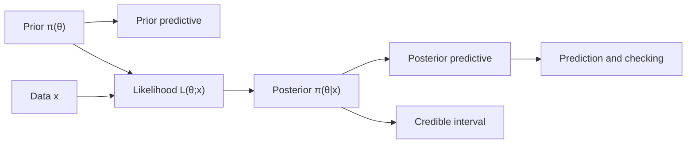

# Bayesian Statistics

> [Mathematics](../../README.md) › [Statistics](../README.md) › Bayesian Statistics · Level: Advanced · Prerequisites: [Probability Foundations](../../10-probability/01-probability-foundations/README.md), [Conditional Probability and Independence](../../10-probability/02-conditional-probability-and-independence/README.md), [Probability Distributions](../../10-probability/04-probability-distributions/README.md), [Sampling and Estimation](../02-sampling-and-estimation/README.md), [Hypothesis Testing](../03-hypothesis-testing/README.md) · Estimated time: 600 min
## 1. Introduction

Bayesian statistics treats an unknown parameter as a random quantity and updates a probability
distribution for it in the light of data. The update rule is Bayes' theorem. Before the data arrive we
encode what we know — or are willing to assume — in a *prior distribution*. The data enter through
the *likelihood*, the probability (or density) of the observations as a function of the parameter.
Multiplying the two and renormalising produces the *posterior distribution*, which is the complete
Bayesian answer to the question "what do we now believe about the parameter?".

This is a different starting point from classical, or frequentist, statistics. A frequentist treats the
parameter as a fixed but unknown number and studies the sampling distribution of an estimator over
repeated experiments. A Bayesian treats the parameter as a random variable and studies its conditional
distribution given the one data set actually observed. Neither starting point is logically forced by
the mathematics of probability; they answer different questions and make different assumptions.

The Bayesian framework is old — Bayes and Laplace used it in the eighteenth century — but it became
computationally practical only in the late twentieth century, when Markov chain Monte Carlo made
high-dimensional posterior distributions accessible. It is now standard in clinical trials, ecology,
genetics, astronomy, machine learning, and anywhere a principled combination of prior knowledge and
evidence is needed.

This tutorial develops the framework carefully: the definitions, the conjugate families with complete
derivations, credible and predictive intervals, the role of the prior, hierarchical models, the two
workhorse algorithms of Bayesian computation, and model comparison. It ends with an honest comparison
with frequentist inference, including the places where each approach is stronger.
## 2. Prerequisites

You should be comfortable with the following material before starting.

* **Probability axioms and conditional probability.** Events, conditional probability, independence,
  the law of total probability, and Bayes' theorem for events. See
  [Probability Foundations](../../10-probability/01-probability-foundations/README.md) and
  [Conditional Probability and Independence](../../10-probability/02-conditional-probability-and-independence/README.md).
* **Random variables and distributions.** Discrete and continuous random variables, probability mass
  functions, densities, cumulative distribution functions, and the standard families: Bernoulli,
  binomial, Poisson, uniform, exponential, gamma, beta, and normal. See
  [Random Variables](../../10-probability/03-random-variables/README.md) and
  [Probability Distributions](../../10-probability/04-probability-distributions/README.md).
* **Expectation and variance.** Linearity of expectation, variance, covariance, and the moments of the
  standard distributions. See [Expectation and Variance](../../10-probability/05-expectation-and-variance/README.md).
* **Likelihood and estimation.** The distinction between a probability and a likelihood, maximum
  likelihood estimation, standard errors, and confidence intervals. See
  [Sampling and Estimation](../02-sampling-and-estimation/README.md).
* **Hypothesis testing.** Null and alternative hypotheses, p-values, significance levels, power, and
  the idea of a test statistic. See [Hypothesis Testing](../03-hypothesis-testing/README.md).
* **Calculus.** Integration by parts, completing the square, gamma and beta integrals, and Taylor
  expansion. See [Techniques of Integration](../../07-calculus/08-techniques-of-integration/README.md)
  and [Sequences and Series](../../07-calculus/11-sequences-and-series-in-calculus/README.md).
* **Linear algebra.** Matrix notation, positive definite matrices, and multivariate normal densities
  are used only in the final sections and in the exercises marked as advanced. See
  [Linear Algebra](../../08-linear-algebra/README.md).
## 3. Learning Objectives

After working through this tutorial and the exercises you will be able to:

1. State the Bayesian model, prior, likelihood, marginal likelihood, and posterior precisely, and
   explain the role of each.
2. Derive the posterior for the beta-binomial, normal-normal, and gamma-Poisson models, including the
   normalising constants and the posterior predictive distributions.
3. Distinguish a credible interval from a confidence interval and explain what each does and does not
   guarantee.
4. Use and interpret prior and posterior predictive distributions.
5. Explain prior sensitivity, derive Jeffreys priors for simple models, and describe the dangers of
   improper priors.
6. Write down a hierarchical model, explain exchangeability and partial pooling, and compute simple
   shrinkage estimates.
7. Derive the Metropolis-Hastings acceptance ratio from detailed balance and explain why Gibbs sampling
   is a special case.
8. Compute and interpret Bayes factors, and identify their main pitfalls.
9. Compare Bayesian and frequentist inference fairly, naming the assumptions and strengths of each.
## 4. Intuition

Imagine you are trying to determine the bias of a coin. You have some initial impression: perhaps you
believe most coins are nearly fair, or perhaps you have no idea and are willing to consider any bias
equally. That impression is a *prior distribution* over the possible biases.

You flip the coin and observe data. A bias of $0.9$ would make the observed sequence much more likely
than a bias of $0.1$ would; that relative plausibility is the *likelihood*. Bayes' theorem says:
reweight your initial impression by how well each possible bias explains the data, then rescale so the
weights sum (or integrate) to one. What remains is the *posterior distribution*.

The posterior is not a decision; it is a summary of belief. From it you can extract a point estimate
(the posterior mean, median, or mode), an interval that contains the parameter with high posterior
probability, or the predictive distribution of a future observation. If you then collect more data,
the posterior becomes the prior for the next update. This is the *sequential* view of Bayesian
learning: today's posterior is tomorrow's prior.

A useful analogy is a courtroom. The prior is what the jury believed before the trial; the likelihood
is how well the evidence fits each hypothesis; the posterior is the verdict. A second analogy is a
medical test: the prior prevalence of a disease and the test's sensitivity and specificity combine to
give the probability of disease after a positive result. Bayesian statistics applies the same logic to
a continuum of possible parameter values.

The frequentist approach asks a different question. It does not ask "given the data, how likely is
each parameter value?" — that requires a prior. It asks "if the parameter had this fixed value, how
likely would data like these be?" and then controls error rates over repeated experiments. Both
questions are meaningful; they are simply not the same question.
## 5. Formal Definition
### 5.1 Statistical model
Let $\Theta$ be a parameter space. A *parametric statistical model* is a family of probability
distributions $\{P_\theta : \theta \in \Theta\}$ on a sample space $\mathcal{X}$. We assume that each
$P_\theta$ has a density $p(x \mid \theta)$ with respect to a fixed $\sigma$-finite measure $\nu$ on
$\mathcal{X}$ (counting measure for discrete data, Lebesgue measure for continuous data). For an
independent and identically distributed sample $x_{1:n} = (x_1,\dots,x_n)$, the *likelihood* is

$$ L(\theta; x_{1:n}) = p(x_{1:n} \mid \theta) = \prod_{i=1}^{n} p(x_i \mid \theta). $$

The likelihood is a function of $\theta$ for fixed data; it is not a probability distribution in
$\theta$ and need not integrate to one.
### 5.2 Prior distribution
A *prior distribution* is a probability distribution $\Pi$ on $\Theta$. When it has a density
$\pi(\theta)$ with respect to a dominating measure $\lambda$ on $\Theta$ (in §7.4, $\lambda$ instead
denotes a Poisson rate), we call $\pi$ the *prior density*. A prior is *proper* if $\int_\Theta \pi(\theta)\,d\lambda(\theta) = 1$. A non-negative
measurable function with infinite integral is called an *improper prior*; it is not a probability
distribution, but it can still produce a proper posterior if the likelihood decays quickly enough.
### 5.3 Posterior distribution
The *marginal likelihood*, also called the *evidence*, is

$$ m(x_{1:n}) = \int_\Theta L(\theta; x_{1:n})\,\pi(\theta)\,d\lambda(\theta). $$

If $0 < m(x_{1:n}) < \infty$, the *posterior distribution* is the probability distribution on $\Theta$
with density

$$ \pi(\theta \mid x_{1:n}) = \frac{L(\theta; x_{1:n})\,\pi(\theta)}{m(x_{1:n})}. $$

This is Bayes' theorem applied to the parameter: the posterior density is proportional to the
likelihood times the prior,

$$ \pi(\theta \mid x_{1:n}) \propto L(\theta; x_{1:n})\,\pi(\theta), $$

with the constant of proportionality $1/m(x_{1:n})$ depending on the data but not on $\theta$. The
posterior is a probability distribution because the numerator is non-negative and the denominator
normalises it:

$$ \int_\Theta \pi(\theta \mid x_{1:n})\,d\lambda(\theta) = \frac{1}{m(x_{1:n})}\int_\Theta L(\theta; x_{1:n})\pi(\theta)\,d\lambda(\theta) = 1. $$

The symbol $\propto$ is used only when the omitted factor is a positive constant with respect to
$\theta$. It is not a licence to drop factors that depend on $\theta$.
### 5.4 Bayesian point estimates
A *loss function* $L(\theta,a)$ measures the cost of reporting the action $a$ when the true parameter
is $\theta$. The *Bayes estimator* under $L$ is

$$ \hat\theta_L(x) = \arg\min_{a} \int_\Theta L(\theta,a)\,\pi(\theta \mid x)\,d\lambda(\theta). $$

Three choices are standard:

* squared-error loss $L(\theta,a) = (\theta-a)^2$ gives the posterior mean
  $\mathbb{E}[\theta \mid x]$;
* absolute-error loss $L(\theta,a) = \lvert\theta-a\rvert$ gives a posterior median;
* zero-one loss $L(\theta,a) = \mathbf{1}\{\lvert\theta-a\rvert > \varepsilon\}$, in the limit
  $\varepsilon \to 0$, gives a posterior mode (a maximum a posteriori estimate, MAP).

The posterior mean, median, and mode generally differ when the posterior is skewed. Reporting one
without saying which one is reporting an incomplete answer.
### 5.5 Credible regions
A *credible region* at level $1-\alpha$ is a set $C(x) \subseteq \Theta$ with

$$ \Pr\bigl(\theta \in C(x) \mid x\bigr) \ge 1-\alpha. $$

An *equal-tailed* credible interval is $[q_{\alpha/2}(x), q_{1-\alpha/2}(x)]$, where $q_p(x)$ is the
$p$-quantile of the posterior. A *highest posterior density* (HPD) region is a set of the form
$\{\theta : \pi(\theta \mid x) \ge k\}$ chosen so that its posterior probability is $1-\alpha$; among
all such sets it has the smallest volume when the posterior is unimodal. HPD regions need not be
intervals when the posterior is multimodal.
### 5.6 Predictive distributions
The *prior predictive distribution* of a new observation $\tilde x$ is

$$ p(\tilde x) = \int_\Theta p(\tilde x \mid \theta)\,\pi(\theta)\,d\lambda(\theta). $$

The *posterior predictive distribution* is

$$ p(\tilde x \mid x) = \int_\Theta p(\tilde x \mid \theta)\,\pi(\theta \mid x)\,d\lambda(\theta). $$

The posterior predictive is the distribution of a future observation after integrating out the
uncertainty in $\theta$. It is usually more spread out than $p(\tilde x \mid \hat\theta)$ at a point
estimate, because it includes parameter uncertainty as well as sampling variability.
### 5.7 Bayes factors
For two models $M_0$ and $M_1$ with parameter spaces $\Theta_0$ and $\Theta_1$, priors $\pi_0$ and
$\pi_1$, and marginal likelihoods

$$ m_k(x) = \int_{\Theta_k} p(x \mid \theta_k, M_k)\,\pi_k(\theta_k)\,d\lambda_k(\theta_k), \qquad k=0,1, $$

the *Bayes factor* in favour of $M_1$ over $M_0$ is

$$ \operatorname{BF}_{10}(x) = \frac{m_1(x)}{m_0(x)}. $$

If the prior model probabilities are $\Pr(M_0)$ and $\Pr(M_1)$, then the posterior odds are

$$ \frac{\Pr(M_1 \mid x)}{\Pr(M_0 \mid x)} = \operatorname{BF}_{10}(x)\cdot \frac{\Pr(M_1)}{\Pr(M_0)}. $$

The Bayes factor is the factor by which the data change the odds between the models.

### 5.8 Exchangeability
A sequence $X_1,X_2,\dots$ is *exchangeable* if the joint distribution of every finite block is
invariant under permutations of its indices. Exchangeability is weaker than independence. De
Finetti's theorem says that an exchangeable sequence of Bernoulli variables is a mixture of iid
Bernoulli sequences: there is a random parameter $\theta$ such that, conditional on $\theta$, the
variables are iid Bernoulli$(\theta)$. This theorem is the formal justification for using a prior on
$\theta$ when the observations are judged exchangeable but not independent.
## 6. Mathematical Notation

| Symbol | Read as | Meaning |
|---|---|---|
| $\Theta$ | capital theta | parameter space |
| $\theta$ | theta | a generic parameter value |
| $\pi(\theta)$ | prior density of theta | prior distribution before data |
| $L(\theta;x)$ | likelihood of theta given x | $p(x\mid\theta)$ viewed as a function of $\theta$ |
| $m(x)$ | marginal likelihood or evidence | $\int L(\theta;x)\pi(\theta)\,d\theta$ |
| $\pi(\theta\mid x)$ | posterior density of theta given x | the updated distribution |
| $\propto$ | proportional to | equality up to a positive constant not depending on $\theta$ |
| $\hat\theta$ | theta hat | an estimator of $\theta$ |
| $\mathbb{E}[\theta\mid x]$ | posterior mean | centre of the posterior under squared error |
| $\operatorname{Mode}(\theta\mid x)$ | posterior mode | maximiser of the posterior density |
| $q_p(x)$ | posterior p-quantile | $\Pr(\theta\le q_p\mid x)=p$ |
| $C(x)$ | credible region | set with high posterior probability |
| $1-\alpha$ | credibility level | posterior coverage, usually $0.95$ |
| $p(\tilde x\mid x)$ | posterior predictive density | distribution of a future observation |
| $\operatorname{BF}_{10}$ | Bayes factor for M1 against M0 | ratio of marginal likelihoods |
| $\operatorname{Beta}(\alpha,\beta)$ | beta distribution | density proportional to $\theta^{\alpha-1}(1-\theta)^{\beta-1}$ |
| $\operatorname{Gamma}(\alpha,\beta)$ | gamma distribution | density proportional to $\lambda^{\alpha-1}e^{-\beta\lambda}$, rate $\beta$ |
| $\mathcal{N}(\mu,\sigma^2)$ | normal distribution | mean $\mu$, variance $\sigma^2$ |
| $B(\alpha,\beta)$ | beta function | $\Gamma(\alpha)\Gamma(\beta)/\Gamma(\alpha+\beta)$ |
| $\Gamma(\alpha)$ | gamma function | $\int_0^\infty t^{\alpha-1}e^{-t}\,dt$ |
| $I(\theta)$ | Fisher information | $\mathbb{E}[-\partial^2\log p(X\mid\theta)/\partial\theta^2]$ |
| $q(\theta'\mid\theta)$ | proposal density | MCMC transition proposal |
| $\alpha(\theta,\theta')$ | acceptance probability | Metropolis-Hastings acceptance probability |
| $R(\theta,\theta')$ | acceptance ratio | Metropolis-Hastings ratio |
| $\operatorname{ESS}$ | effective sample size | effective number of independent draws |
| $\hat R$ | R-hat | Gelman-Rubin convergence diagnostic |
## 7. Core Concepts

### 7.1 The Bayesian recipe and sequential updating
The recipe has four steps.

1. **Model.** Specify $p(x\mid\theta)$ and $\Theta$.
2. **Prior.** Specify $\pi(\theta)$.
3. **Posterior.** Compute $\pi(\theta\mid x)\propto p(x\mid\theta)\pi(\theta)$ and normalise.
4. **Summarise and check.** Compute posterior summaries, predictive distributions, and diagnostics.

For independent observations the likelihood factorises, so the posterior is

$$ \pi(\theta\mid x_{1:n}) \propto \pi(\theta)\prod_{i=1}^{n}p(x_i\mid\theta). $$

If the data arrive in two batches $x_{1:m}$ and $x_{m+1:n}$, then

$$ \pi(\theta\mid x_{1:n}) \propto p(x_{m+1:n}\mid\theta)\,p(x_{1:m}\mid\theta)\,\pi(\theta) \propto p(x_{m+1:n}\mid\theta)\,\pi(\theta\mid x_{1:m}). $$

Thus updating with the first batch and then the second gives the same posterior as updating with all
the data at once. This is *sequential updating*. It follows directly from the product rule and does
not require conjugacy; it is a consequence of probability, not an extra assumption.

The normalising constant $m(x)$ is often analytically intractable. It is not needed for many
summaries if one can sample from the posterior, and MCMC methods do exactly that. It is needed for
Bayes factors, which is one reason model comparison is harder than parameter estimation.

### 7.2 Conjugacy: the beta-binomial model
A prior family is *conjugate* to a likelihood if the posterior belongs to the same family. Conjugacy
is a computational convenience, not a statement about which prior is scientifically correct.

Let $\theta\in(0,1)$ be a success probability. The prior is

$$ \theta \sim \operatorname{Beta}(\alpha,\beta), \qquad \pi(\theta) = \frac{\theta^{\alpha-1}(1-\theta)^{\beta-1}}{B(\alpha,\beta)}, \quad \alpha,\beta>0. $$

Given $\theta$, let $X$ be the number of successes in $n$ independent Bernoulli trials. Then

$$ p(X=x\mid\theta) = \binom{n}{x}\theta^{x}(1-\theta)^{n-x}, \qquad x=0,1,\dots,n. $$

Multiplying prior and likelihood gives

$$ \pi(\theta\mid x) \propto \theta^{x}(1-\theta)^{n-x}\cdot\theta^{\alpha-1}(1-\theta)^{\beta-1} = \theta^{\alpha+x-1}(1-\theta)^{\beta+n-x-1}. $$

The right-hand side has the kernel of a $\operatorname{Beta}(\alpha+x,\beta+n-x)$ density. Therefore

$$ \theta\mid x \sim \operatorname{Beta}(\alpha+x,\beta+n-x), $$

and the normalising constant is

$$ m(x) = \binom{n}{x}\frac{B(\alpha+x,\beta+n-x)}{B(\alpha,\beta)}. $$

The posterior parameters are the prior parameters plus the counts: $\alpha$ increases by the number of
successes, $\beta$ by the number of failures. This additive update is the reason the beta-binomial
model is the standard first example of conjugacy.

The posterior mean and mode are

$$ \mathbb{E}[\theta\mid x] = \frac{\alpha+x}{\alpha+\beta+n}, \qquad \operatorname{Mode}(\theta\mid x) = \frac{\alpha+x-1}{\alpha+\beta+n-2}, $$

where the mode formula requires $\alpha+x>1$ and $\beta+n-x>1$. The posterior variance is

$$ \operatorname{Var}(\theta\mid x) = \frac{(\alpha+x)(\beta+n-x)}{(\alpha+\beta+n)^2(\alpha+\beta+n+1)}. $$

The posterior mean is a weighted average of the prior mean $\alpha/(\alpha+\beta)$ and the sample
proportion $x/n$:

$$ \mathbb{E}[\theta\mid x] = \frac{\alpha+\beta}{\alpha+\beta+n}\cdot\frac{\alpha}{\alpha+\beta} + \frac{n}{\alpha+\beta+n}\cdot\frac{x}{n}. $$

As $n\to\infty$ with $x/n\to p$, the weight on the data tends to one and the posterior mean tends to
$p$. The prior's influence is diluted by data at rate $n$.

Jeffreys prior for this model is $\operatorname{Beta}(1/2,1/2)$ (derived in §7.7), and the uniform
prior is $\operatorname{Beta}(1,1)$. The uniform prior gives the posterior mean $(x+1)/(n+2)$, not
$x/n$; the difference is the "add one success and one failure" smoothing.

### 7.3 Conjugacy: the normal-normal model
Suppose

$$ \mu \sim \mathcal{N}(\mu_0,\tau^2), \qquad x_i\mid\mu \sim \mathcal{N}(\mu,\sigma^2),\quad i=1,\dots,n, $$

with $\sigma^2$ known. The likelihood is

$$ p(x_{1:n}\mid\mu) = (2\pi\sigma^2)^{-n/2} \exp\left(-\frac{1}{2\sigma^2}\sum_{i=1}^{n}(x_i-\mu)^2\right). $$

Using $\sum_i(x_i-\mu)^2 = n(\bar x-\mu)^2 + \sum_i(x_i-\bar x)^2$, where
$\bar x = n^{-1}\sum_i x_i$, the part depending on $\mu$ is
$\exp(-n(\bar x-\mu)^2/(2\sigma^2))$. The prior contributes
$\exp(-(\mu-\mu_0)^2/(2\tau^2))$. Combining the exponents,

$$ -\frac{1}{2}\left[\frac{(\mu-\mu_0)^2}{\tau^2} + \frac{n(\bar x-\mu)^2}{\sigma^2}\right] = -\frac{1}{2}\left[\left(\frac{1}{\tau^2}+\frac{n}{\sigma^2}\right)(\mu-\mu_n)^2 + \frac{n(\bar x-\mu_0)^2}{\sigma^2+n\tau^2}\right], $$

where

$$ \frac{1}{\tau_n^2} = \frac{1}{\tau^2}+\frac{n}{\sigma^2}, \qquad \mu_n = \tau_n^2\left(\frac{\mu_0}{\tau^2}+\frac{n\bar x}{\sigma^2}\right) = \frac{\sigma^2\mu_0+n\tau^2\bar x}{\sigma^2+n\tau^2}. $$

Therefore

$$ \mu\mid x_{1:n}\sim\mathcal{N}(\mu_n,\tau_n^2), \qquad \tau_n^2 = \frac{\sigma^2\tau^2}{\sigma^2+n\tau^2}. $$

The posterior precision is the sum of the prior precision and the data precision $n/\sigma^2$.
Equivalently, the posterior mean is the convex combination

$$ \mu_n = (1-w)\mu_0+w\bar x, \qquad w = \frac{n\tau^2}{\sigma^2+n\tau^2}, $$

so the data receive weight increasing with $n$ and with the prior variance $\tau^2$. If $\tau^2\to \infty$ with $n$ fixed, $w\to1$ and $\mu_n\to\bar x$; if $\tau^2\to0$, $w\to0$ and the prior wins.

The posterior predictive distribution of a new observation is

$$ \tilde x\mid x_{1:n}\sim\mathcal{N}(\mu_n,\sigma^2+\tau_n^2), $$

because $\tilde x = \mu+\varepsilon$ with $\mu$ and $\varepsilon$ independent, and the variances add.
The marginal likelihood of the data is the density of $\bar x$ under
$\mathcal{N}(\mu_0,\tau^2+\sigma^2/n)$:

$$ m(x_{1:n}) = \left(2\pi(\tau^2+\sigma^2/n)\right)^{-1/2} \exp\left(-\frac{(\bar x-\mu_0)^2}{2(\tau^2+\sigma^2/n)}\right). $$

When $\sigma^2$ is unknown, the conjugate prior is normal-inverse-gamma:
$\sigma^2\sim\operatorname{InvGamma}(\alpha_0,\beta_0)$ and
$\mu\mid\sigma^2\sim\mathcal{N}(\mu_0,\sigma^2/\kappa_0)$. The posterior has the same form with

$$ \kappa_n=\kappa_0+n,\qquad \mu_n=\frac{\kappa_0\mu_0+n\bar x}{\kappa_n},\qquad \alpha_n=\alpha_0+\frac n2, $$

$$ \beta_n=\beta_0+\frac12\sum_{i=1}^{n}(x_i-\bar x)^2 +\frac{\kappa_0 n}{2\kappa_n}(\bar x-\mu_0)^2. $$

Integrating out $\sigma^2$ gives a Student $t$ posterior for $\mu$; this is the Bayesian analogue of
the one-sample $t$ interval.

### 7.4 Conjugacy: the gamma-Poisson model
Let $\lambda>0$ be a rate. The prior is

$$ \lambda\sim\operatorname{Gamma}(\alpha,\beta), \qquad \pi(\lambda)=\frac{\beta^\alpha}{\Gamma(\alpha)}\lambda^{\alpha-1}e^{-\beta\lambda}, $$

where $\beta$ is a rate parameter. Given $\lambda$, let $X_1,\dots,X_n$ be independent
Poisson$(\lambda)$ counts. With $s=\sum_i x_i$,

$$ p(x_{1:n}\mid\lambda) = \prod_{i=1}^{n}\frac{e^{-\lambda}\lambda^{x_i}}{x_i!} \propto \lambda^{s}e^{-n\lambda}. $$

Multiplying by the prior gives

$$ \pi(\lambda\mid x_{1:n}) \propto \lambda^{\alpha+s-1}e^{-(\beta+n)\lambda}, $$

so

$$ \lambda\mid x_{1:n}\sim\operatorname{Gamma}(\alpha+s,\beta+n). $$

If the observations are counts over a total exposure $T$ with rate $\lambda$ per unit exposure, the
likelihood is proportional to $\lambda^s e^{-T\lambda}$ and the posterior is
$\operatorname{Gamma}(\alpha+s,\beta+T)$. The posterior mean, mode, and variance are

$$ \mathbb{E}[\lambda\mid x]=\frac{\alpha+s}{\beta+T}, \qquad \operatorname{Mode}(\lambda\mid x)=\frac{\alpha+s-1}{\beta+T}, \qquad \operatorname{Var}(\lambda\mid x)=\frac{\alpha+s}{(\beta+T)^2}. $$

The posterior mean is again a weighted average of the prior mean $\alpha/\beta$ and the empirical rate
$s/T$, with weights $\beta/(\beta+T)$ and $T/(\beta+T)$.

The posterior predictive distribution of a future count $Y$ over one unit of exposure is obtained by
integrating a Poisson density against the gamma posterior:

$$ p(y\mid x) = \int_0^\infty \frac{e^{-\lambda}\lambda^y}{y!} \frac{(\beta')^{\alpha'}}{\Gamma(\alpha')}\lambda^{\alpha'-1}e^{-\beta'\lambda}\,d\lambda = \frac{\Gamma(\alpha'+y)}{\Gamma(\alpha')y!} \left(\frac{\beta'}{\beta'+1}\right)^{\alpha'} \left(\frac{1}{\beta'+1}\right)^{y}, $$

where $\alpha'=\alpha+s$ and $\beta'=\beta+T$. This is a negative binomial distribution. Its mean is
$\alpha'/\beta'$, and its variance is

$$ \frac{\alpha'}{\beta'}+\frac{\alpha'}{(\beta')^2}, $$

which exceeds the Poisson variance $\alpha'/\beta'$. The extra term is the variance due to uncertainty
about $\lambda$; ignoring it understates predictive uncertainty.

### 7.5 Credible intervals versus confidence intervals
A $95\%$ credible interval $C(x)$ satisfies

$$ \Pr(\theta\in C(x)\mid x)=0.95 $$

for the observed data $x$, with the probability taken over the posterior distribution of $\theta$. It
is a statement about the parameter given the data and the prior. If the prior is proper, the
statement is mathematically well defined.

A $95\%$ confidence interval $C(X)$ satisfies

$$ \Pr_\theta(\theta\in C(X))=0.95 $$

for every fixed $\theta$, with the probability taken over repeated samples $X$ from $P_\theta$. The
parameter is fixed; the interval is random. It is a statement about the procedure, not about the
particular realised interval.

The two intervals can coincide numerically in some models, especially with flat or Jeffreys priors
and large samples, but they answer different questions. A Bayesian posterior interval computed from a
strong prior can be far from any frequentist confidence interval, and its frequentist coverage at a
fixed $\theta$ can be poor. Conversely, a confidence interval need not have high posterior probability
under a particular prior.

A concrete binomial comparison makes the difference visible. With $n=20$, $x=15$ successes, and a
uniform prior, the posterior is $\operatorname{Beta}(16,6)$. Its equal-tailed $95\%$ credible interval
is approximately $[0.528,0.887]$. The Wald $95\%$ confidence interval is
$0.75\pm1.96\sqrt{0.75\cdot0.25/20}=[0.560,0.940]$. The intervals are close but not identical: the
Bayesian interval uses the prior, the frequentist interval uses a normal approximation and a
variance estimated at the null-free MLE. Neither is "the" correct interval; the appropriate choice
depends on the question and on the assumptions one is prepared to defend.

Credible intervals have a coverage property when averaged over the prior. If $\theta\sim\pi$ and
$X\sim p(\cdot\mid\theta)$, then for a continuous posterior the equal-tailed interval has prior
predictive coverage exactly $1-\alpha$:

$$ \Pr_{\theta\sim\pi,\,X\sim p(\cdot\mid\theta)} \bigl(\theta\in[q_{\alpha/2}(X),q_{1-\alpha/2}(X)]\bigr)=1-\alpha. $$

This is a frequentist statement about a Bayesian procedure, averaged over the prior. It does not imply
coverage at each fixed $\theta$.

### 7.6 Predictive distributions
The prior predictive distribution answers "what data should we expect before the experiment?" It is
used for prior predictive checks: if the prior implies implausible datasets, the prior is badly
calibrated, even if it is mathematically proper. The posterior predictive distribution answers "what
should we expect next, given what we have seen?" It is used for posterior predictive checks and for
forecasting.

For the beta-binomial model, the posterior predictive of $\tilde X$ successes in $\tilde n$ future
trials is

$$ p(\tilde x\mid x) = \binom{\tilde n}{\tilde x} \frac{B(\alpha+x+\tilde x,\ \beta+n-x+\tilde n-\tilde x)} {B(\alpha+x,\ \beta+n-x)}. $$

This is a beta-binomial distribution. Its mean is
$\tilde n(\alpha+x)/(\alpha+\beta+n)$: the future success probability is the posterior mean. Its
variance is larger than the binomial variance with $\theta$ fixed at that mean, again because
$\theta$ is uncertain.

For the gamma-Poisson model, the posterior predictive is negative binomial, as derived in §7.4. The
predictive mean is the posterior mean rate, but the predictive variance has an extra
over-dispersion term.

Predictive distributions are not the same as plug-in distributions. Replacing $\theta$ by
$\hat\theta$ and using $p(\tilde x\mid\hat\theta)$ ignores parameter uncertainty. The error is small
when the posterior is concentrated and large when it is diffuse.

### 7.7 Prior sensitivity and objective priors
Every Bayesian analysis depends on the prior. *Prior sensitivity analysis* repeats the analysis under
several scientifically plausible priors and reports how much the conclusions change. If a conclusion
is stable across reasonable priors, it is robust; if not, the prior is doing important work and must
be defended.

For the beta-binomial model, the posterior mean with prior $\operatorname{Beta}(\alpha,\beta)$ is

$$ \mathbb{E}[\theta\mid x] = \frac{\alpha+x}{\alpha+\beta+n} = \frac{\alpha+\beta}{\alpha+\beta+n}\cdot\frac{\alpha}{\alpha+\beta} + \frac{n}{\alpha+\beta+n}\cdot\frac{x}{n}. $$

The prior's weight is $(\alpha+\beta)/(\alpha+\beta+n)$. With $n=10$ and a prior with
$\alpha+\beta=20$, the prior still carries two-thirds of the weight; with $n=1000$ it carries about
$2\%$. This formula is the simplest quantitative guide to when prior sensitivity matters.

An *objective prior* is intended to represent little or no information, or to have a well-defined
frequentist calibration. There is no unique objective prior, because "no information" is not a
probability distribution and because information is parameterisation-dependent. Three standard
choices are:

* **Flat prior.** $\pi(\theta)\propto1$. It is invariant under adding a constant but not under
  nonlinear transformations: a flat prior on $\theta$ is not flat on $\theta^2$.
* **Jeffreys prior.** $\pi(\theta)\propto\sqrt{I(\theta)}$, where
  $I(\theta)=\mathbb{E}[-\partial^2\log p(X\mid\theta)/\partial\theta^2]$ is the Fisher information.
  It is invariant under smooth reparameterisation, because the Fisher information transforms with the
  square of the Jacobian and the square root cancels the Jacobian in the density transformation.
* **Reference priors.** Constructed by maximising an expected Kullback-Leibler divergence; they
  generalise Jeffreys priors to multiparameter problems and often produce matching posterior
  probabilities.

For the Bernoulli model, $I(\theta)=1/[\theta(1-\theta)]$, so the Jeffreys prior is
$\pi(\theta)\propto\theta^{-1/2}(1-\theta)^{-1/2}$, which is $\operatorname{Beta}(1/2,1/2)$. For the
Poisson model, $I(\lambda)=1/\lambda$, so the Jeffreys prior is $\pi(\lambda)\propto\lambda^{-1/2}$,
an improper prior whose posterior $\operatorname{Gamma}(s+1/2,T)$ is proper whenever $s>0$. For a
normal mean with known variance, $I(\mu)=1/\sigma^2$ is constant, so the Jeffreys prior is flat.

Improper priors can produce proper posteriors, but they require care. An improper prior has an
arbitrary multiplicative constant, and that constant cancels in posterior summaries but not
necessarily in marginal likelihoods. This is why Bayes factors with improper priors are generally
undefined unless the constants are fixed by a limiting argument or the prior is proper. An improper
prior can also produce an improper posterior if the likelihood does not decay fast enough; one must
always check that $\int L(\theta)\pi(\theta)\,d\theta<\infty$.

The Jeffreys prior is not a universal "non-informative" prior. In multiparameter models it depends on
which parameters are of interest, and in hierarchical models it can be improper in a way that makes
posterior sampling difficult. It is a useful default, not a law of nature.

### 7.8 Hierarchical models
A *hierarchical model* introduces a prior for the parameters of a prior. A simple normal hierarchy is

$$ y_{ij}\mid\theta_j,\sigma^2 \sim \mathcal{N}(\theta_j,\sigma^2), \qquad j=1,\dots,J,\quad i=1,\dots,n_j, $$

$$ \theta_j\mid\mu,\tau^2 \sim \mathcal{N}(\mu,\tau^2), \qquad \mu\sim\mathcal{N}(\mu_0,\tau_0^2), \qquad \tau^2\sim\operatorname{HalfNormal}(s^2). $$

Here the $\theta_j$ are group means, $\mu$ is the overall mean, and $\tau^2$ is the between-group
variance. The model has three levels: data, group parameters, and hyperparameters. The word
*hyperparameter* refers to $\mu$ and $\tau^2$, which govern the distribution of the $\theta_j$.

Conditional on $\mu$ and $\tau^2$, the normal-normal update gives

$$ \mathbb{E}[\theta_j\mid\mu,\tau^2,y] = \frac{\mu/\tau^2+n_j\bar y_j/\sigma^2}{1/\tau^2+n_j/\sigma^2} = (1-B_j)\bar y_j+B_j\mu, \qquad B_j=\frac{\sigma^2}{\sigma^2+n_j\tau^2}. $$

This is *partial pooling*. If $\tau^2$ is large, $B_j$ is small and each group mean is estimated
mostly from its own data (no pooling). If $\tau^2$ is small, $B_j$ is near one and all groups are
pulled towards the common mean (complete pooling). The shrinkage is stronger for small groups, which
is exactly what one wants: a group with little data should borrow strength from the others.

Hierarchical models are natural when the groups are exchangeable — when, before seeing the data, we
have no reason to treat one group as fundamentally different from another. Exchangeability justifies
a common prior for the $\theta_j$; it does not imply that the $\theta_j$ are equal. De Finetti's
theorem (§5.8) explains why exchangeability leads to a mixture model.

The price of hierarchy is computation. The posterior is usually not available in closed form once
$\tau^2$ is unknown, and one must use MCMC or variational approximation. The benefit is a principled
compromise between underfitting (pooling everything) and overfitting (estimating each group in
isolation).

### 7.9 Markov chain Monte Carlo
When the posterior is not conjugate, we often sample from it. Markov chain Monte Carlo constructs a
Markov chain whose stationary distribution is the posterior. The normalising constant $m(x)$ is not
needed: the algorithms use only ratios of unnormalised posterior densities.

#### Metropolis-Hastings
Let $\pi(\theta)$ be a target density known up to a positive constant, and let $q(\theta'\mid\theta)$
be a proposal density from which we can sample. Starting from $\theta_0$, at iteration $t$:

1. Propose $\theta'\sim q(\cdot\mid\theta_t)$.
2. Compute the acceptance ratio
$$ R(\theta_t,\theta') = \frac{\pi(\theta')\,q(\theta_t\mid\theta')}{\pi(\theta_t)\,q(\theta'\mid\theta_t)}. $$
3. Accept with probability $\alpha(\theta_t,\theta')=\min\{1,R(\theta_t,\theta')\}$; otherwise set
   $\theta_{t+1}=\theta_t$.

The ratio is a ratio of posterior odds to proposal odds. If the proposal is symmetric,
$q(\theta'\mid\theta)=q(\theta\mid\theta')$, the proposal terms cancel and the acceptance probability
is $\min\{1,\pi(\theta')/\pi(\theta)\}$. If the proposal is an independence proposal
$q(\theta'\mid\theta)=g(\theta')$, the ratio becomes
$\pi(\theta')g(\theta_t)/[\pi(\theta_t)g(\theta')]$.

To derive the acceptance ratio, require *detailed balance*:

$$ \pi(\theta)q(\theta'\mid\theta)\alpha(\theta,\theta') = \pi(\theta')q(\theta\mid\theta')\alpha(\theta',\theta) \qquad\text{for all }\theta,\theta'. $$

Assume without loss of generality that
$\pi(\theta')q(\theta\mid\theta')\ge\pi(\theta)q(\theta'\mid\theta)$. Then set
$\alpha(\theta,\theta')=1$ and
$\alpha(\theta',\theta)=\pi(\theta)q(\theta'\mid\theta)/[\pi(\theta')q(\theta\mid\theta')]$.
Both sides of detailed balance equal $\pi(\theta)q(\theta'\mid\theta)$. The other case is symmetric.
Thus the choice $\alpha=\min\{1,R\}$ satisfies detailed balance. Summing detailed balance over
$\theta$ (or integrating, in the continuous case) shows that $\pi$ is invariant for the chain: if
$\theta_t\sim\pi$, then $\theta_{t+1}\sim\pi$. Under irreducibility, aperiodicity, and positive
recurrence, the chain converges to $\pi$ from almost every starting point. These conditions are
assumptions, not automatic consequences of the algorithm.

Practical issues include choosing the proposal scale. A random-walk proposal that is too narrow
accepts often but moves slowly; one that is too wide proposes far away and is rejected often. In one
dimension a common rule of thumb is an acceptance rate near $0.4$ to $0.45$; in higher dimensions it
is lower. These are heuristics, not theorems.

#### Gibbs sampling
Gibbs sampling updates one coordinate at a time from its *full conditional* distribution, the
conditional distribution of that coordinate given all the others and the data. For
$\theta=(\theta_1,\dots,\theta_d)$, the algorithm cycles through coordinates:

$$ \theta_1^{(t+1)}\sim\pi(\theta_1\mid\theta_2^{(t)},\dots,\theta_d^{(t)},x), $$
$$ \theta_2^{(t+1)}\sim\pi(\theta_2\mid\theta_1^{(t+1)},\theta_3^{(t)},\dots,\theta_d^{(t)},x), $$
and so on.

Gibbs sampling is Metropolis-Hastings with the full conditional as proposal. Suppose the current state
is $\theta$ and we propose $\theta_i'$ from $\pi(\theta_i\mid\theta_{-i})$, keeping the other
coordinates fixed. The acceptance ratio is

$$ R = \frac{\pi(\theta_i',\theta_{-i})\,\pi(\theta_i\mid\theta_{-i})} {\pi(\theta_i,\theta_{-i})\,\pi(\theta_i'\mid\theta_{-i})} = 1, $$

because $\pi(\theta_i,\theta_{-i})=\pi(\theta_i\mid\theta_{-i})\pi(\theta_{-i})$ and the marginal
$\pi(\theta_{-i})$ cancels. Hence every Gibbs update is accepted. Gibbs is convenient when the full
conditionals are standard distributions, but it can mix slowly when coordinates are strongly
correlated; then block updates or Hamiltonian Monte Carlo are preferable.

#### Convergence and diagnostics
MCMC output is a dependent sequence, not an iid sample. Standard diagnostics include trace plots,
autocorrelation functions, multiple chains started from dispersed values, the Gelman-Rubin statistic
$\hat R$ (values near $1.0$ suggest agreement between chains), and effective sample size
$\operatorname{ESS}$ (the number of independent draws to which the correlated sample is roughly
equivalent). None of these proves convergence. A chain can appear stable while failing to explore a
separated mode. Reparameterisation, better proposals, and comparing inferences under different
priors are more valuable than staring at a single trace plot.

### 7.10 Model comparison with Bayes factors
The Bayes factor compares the marginal likelihoods of two models. It is the Bayesian analogue of a
likelihood ratio test, but it integrates over parameter uncertainty rather than maximising.

Jeffreys' widely used verbal scale is:

| $\operatorname{BF}_{10}$ | Evidence for $M_1$ over $M_0$ |
|---|---|
| $1$ to $3$ | barely worth mentioning |
| $3$ to $10$ | substantial |
| $10$ to $30$ | strong |
| $30$ to $100$ | very strong |
| above $100$ | decisive |

The scale is a convention, not a theorem. It is also symmetric: $\operatorname{BF}_{01}=1/\operatorname{BF}_{10}$.

Bayes factors have several pitfalls.

* **Improper priors.** If $\pi_0$ or $\pi_1$ is improper, the marginal likelihood is defined only up
  to an arbitrary constant, so the Bayes factor is undefined unless the constants are fixed by a
  limiting procedure. Two analysts using different improper priors can reach different conclusions
  from the same data.
* **Sensitivity to the prior spread.** A very diffuse proper prior puts little mass near plausible
  parameter values. This can make a complex model look bad even when it fits well. The extreme case
  is *Lindley's paradox*: for a point null versus a very diffuse alternative, the Bayes factor can
  favour the null even when the data are far from it in standard-error units.
* **Prior model probabilities.** A Bayes factor is not a posterior probability. To obtain
  $\Pr(M_1\mid x)$ one must also specify $\Pr(M_1)/\Pr(M_0)$. A "decisive" Bayes factor can still
  leave the posterior probability near one half if the prior odds were tiny.
* **Non-nested and differently dimensioned models.** Bayes factors automatically penalise complexity
  through the prior mass, but the penalty depends on the prior, not only on dimension. Comparing
  models with different response transformations requires a Jacobian adjustment.
* **Data-dependent model choice.** If the same data are used to choose the models and to compute the
  Bayes factor, the calibration is lost. Model choice is part of the analysis, not an external
  preliminary.
* **Approximations.** The Bayesian information criterion (BIC) is a large-sample approximation to
  $-2\log m(x)$ and can be used as a rough surrogate, but it assumes regular models and a unit
  information prior. It is not a Bayes factor.

A Bayes factor measures relative predictive performance under the two priors. It does not measure
which model is "true"; all models are approximations. It is best reported with a sensitivity analysis
over reasonable priors, and alongside posterior predictive checks.

### 7.11 A balanced comparison with frequentist inference
The two frameworks answer different questions and rest on different assumptions.

**What Bayesian inference gives you.**

* A posterior distribution, which is a complete description of uncertainty about the parameter given
  the model and prior.
* Credible intervals with a direct probability interpretation.
* Natural handling of hierarchical structure, missing data, and complex dependence through latent
  variables.
* Decision-theoretic optimality once a prior and a loss are specified.
* The likelihood principle: the posterior depends on the data only through the likelihood, so
  stopping rules that do not affect the likelihood do not affect the inference.

**What frequentist inference gives you.**

* Procedures with guaranteed long-run error rates under the model, without a prior.
* Confidence intervals and tests whose coverage or size holds for every fixed parameter value.
* A clear separation between model assumptions and the data-generating process.
* Asymptotic theory (consistency, asymptotic normality, efficiency) that often needs no prior.
* Widely accepted standards and regulatory familiarity in many applied fields.

**Where Bayesian inference is strong.** Hierarchical and multilevel data, small samples with genuine
prior information, sequential updating, prediction, and problems where a probability statement about
the parameter is required. Bayesian methods also handle nuisance parameters by integration rather
than by profiling or plug-in approximations.

**Where frequentist inference is strong.** Large-sample settings with minimal prior information,
procedures that must be calibrated by repeated-sampling guarantees, and regulatory or legal settings
where a prior would be contested. Frequentist methods are also simpler to audit when the model is
standard.

**Where each can go wrong.** A Bayesian analysis can be dominated by an unexamined prior, can produce
a posterior that is mathematically proper but scientifically absurd, and can be computationally
unreliable if the MCMC has not converged. A frequentist analysis can misinterpret a p-value, can
condition on a stopping rule that is not part of the model, and can give intervals with poor coverage
in small samples or near boundaries.

**Agreement.** Under regularity conditions, as $n\to\infty$ the posterior concentrates near the true
parameter and is approximately normal with covariance the inverse Fisher information
(Bernstein-von Mises theorem). The posterior mean is then asymptotically efficient, and credible
intervals with well-behaved priors agree with confidence intervals to first order. Jeffreys priors are
often chosen to improve this agreement. The frameworks are not enemies; they are two languages for
uncertainty, and in regular large-sample problems they usually tell the same story.
## 8. Formulas and Properties

All formulas assume the hypotheses stated in §7; in particular, the prior is proper unless an improper prior is explicitly allowed, and $0<m(x)<\infty$.

* **Posterior.** $\pi(\theta\mid x)=p(x\mid\theta)\pi(\theta)/m(x)$ with $m(x)=\int_\Theta p(x\mid\theta)\pi(\theta)\,d\lambda(\theta)$.
* **Beta-binomial.** If $\theta\sim\operatorname{Beta}(\alpha,\beta)$ and $X\sim\operatorname{Bin}(n,\theta)$, then $\theta\mid X=x\sim\operatorname{Beta}(\alpha+x,\beta+n-x)$, with mean $(\alpha+x)/(\alpha+\beta+n)$ and variance $(\alpha+x)(\beta+n-x)/[(\alpha+\beta+n)^2(\alpha+\beta+n+1)]$.
* **Normal-normal.** With $\mu\sim\mathcal{N}(\mu_0,\tau^2)$ and known $\sigma^2$, $\mu\mid x\sim\mathcal{N}(\mu_n,\tau_n^2)$ where $\tau_n^{-2}=\tau^{-2}+n\sigma^{-2}$ and $\mu_n=(\sigma^2\mu_0+n\tau^2\bar x)/(\sigma^2+n\tau^2)$.
* **Gamma-Poisson.** With $\lambda\sim\operatorname{Gamma}(\alpha,\beta)$ and total count $s$ over exposure $T$, $\lambda\mid x\sim\operatorname{Gamma}(\alpha+s,\beta+T)$; the posterior mean is $(\alpha+s)/(\beta+T)$.
* **Predictive.** $p(\tilde x\mid x)=\int p(\tilde x\mid\theta)\pi(\theta\mid x)\,d\theta$. The beta-binomial predictive is beta-binomial; the gamma-Poisson predictive is negative binomial with $r=\alpha+s$, $p=(\beta+T)/(\beta+T+1)$.
* **Credible region.** A set $C(x)$ with $\Pr(\theta\in C(x)\mid x)\ge1-\alpha$; equal-tailed means $[q_{\alpha/2}(x),q_{1-\alpha/2}(x)]$, and HPD means $\{\theta:\pi(\theta\mid x)\ge k\}$ with posterior mass $1-\alpha$.
* **Bayes factor.** $\operatorname{BF}_{10}=m_1(x)/m_0(x)$ and posterior odds equal $\operatorname{BF}_{10}$ times prior odds.
* **Metropolis-Hastings.** $R(\theta,\theta')=\pi(\theta')q(\theta\mid\theta')/[\pi(\theta)q(\theta'\mid\theta)]$, accepted with probability $\min\{1,R\}$. Gibbs uses a full conditional proposal, so $R=1$.
* **Jeffreys prior.** $\pi(\theta)\propto\sqrt{I(\theta)}$; Bernoulli gives $\operatorname{Beta}(1/2,1/2)$, Poisson gives $\lambda^{-1/2}$, and a normal mean with known variance gives a flat prior.
## 9. Step-by-Step Examples

### Example 9.1: A beta-binomial update
A coin is tossed four times and lands heads three times. The prior on the probability of heads is
uniform, $\theta\sim\operatorname{Beta}(1,1)$. Find the posterior, its mean and mode, and the posterior
probability that $\theta>1/2$.

**Solution.** The likelihood is $\binom43\theta^3(1-\theta)=\allowbreak4\theta^3(1-\theta)$. The
prior is $\pi(\theta)=1$ on $(0,1)$. Therefore

$$ \pi(\theta\mid x)\propto\theta^3(1-\theta), $$

which is the kernel of $\operatorname{Beta}(4,2)$. Hence $\theta\mid x\sim\operatorname{Beta}(4,2)$.
The posterior mean is

$$ \mathbb{E}[\theta\mid x]=\frac{4}{4+2}=\frac23, $$

and the posterior mode is

$$ \frac{4-1}{4+2-2}=\frac34. $$

For the probability, use the beta density with parameters $4$ and $2$:

$$ \Pr(\theta>1/2\mid x) =\int_{1/2}^{1}\frac{\theta^{3}(1-\theta)}{B(4,2)}\,d\theta, \qquad B(4,2)=\frac{\Gamma(4)\Gamma(2)}{\Gamma(6)}=\frac{6\cdot1}{120}=\frac1{20}. $$

Thus

$$ \Pr(\theta>1/2\mid x) =20\int_{1/2}^{1}(\theta^3-\theta^4)\,d\theta =20\left[\frac{\theta^4}{4}-\frac{\theta^5}{5}\right]_{1/2}^{1}. $$

At $\theta=1$ the bracket is $1/4-1/5=1/20$. At $\theta=1/2$ it is
$1/64-1/160=5/320-2/320=3/320$. Therefore

$$ \Pr(\theta>1/2\mid x)=20\left(\frac1{20}-\frac{3}{320}\right) =1-\frac{60}{320} =\frac{13}{16}=0.8125. $$

The posterior says there is about an $81\%$ chance that the coin is biased towards heads, but the
data are too few to be confident about the magnitude.

### Example 9.2: A normal-normal update with five observations
The prior for a mean is $\mu\sim\mathcal{N}(0,1)$. Five independent observations with known standard
deviation $\sigma=2$ have sample mean $\bar x=2$. Find the posterior, a $95\%$ credible interval, and
the posterior predictive distribution of a sixth observation.

**Solution.** The prior precision is $1/\tau^2=1$, and the data precision is
$n/\sigma^2=5/4$. Hence

$$ \frac{1}{\tau_n^2}=1+\frac54=\frac94, \qquad \tau_n^2=\frac49. $$

The posterior mean is

$$ \mu_n=\frac{\sigma^2\mu_0+n\tau^2\bar x}{\sigma^2+n\tau^2} =\frac{4\cdot0+5\cdot1\cdot2}{4+5} =\frac{10}{9}. $$

Thus $\mu\mid x\sim\mathcal{N}(10/9,4/9)$. The posterior standard deviation is $2/3$, so the
equal-tailed $95\%$ credible interval is

$$ \frac{10}{9}\pm1.96\cdot\frac23 =[-0.196,\,2.418] $$

to three decimal places. For a sixth observation $\tilde x$, the predictive variance is
$\sigma^2+\tau_n^2=4+4/9=40/9$, so

$$ \tilde x\mid x\sim\mathcal{N}\left(\frac{10}{9},\frac{40}{9}\right). $$

The predictive standard deviation is $\sqrt{40}/3\approx2.108$, larger than the observation standard
deviation $2$ because it includes uncertainty about $\mu$.

### Example 9.3: A gamma-Poisson update with exposure
A Poisson process has rate $\lambda$ per hour. The prior is $\lambda\sim\operatorname{Gamma}(2,1)$
(shape $2$, rate $1$). Over three hours the observed counts are $3$, $5$, and $4$. Find the posterior,
its mean and mode, and the posterior predictive probability of zero events in the next hour.

**Solution.** The total count is $s=3+5+4=12$ and the total exposure is $T=3$. The posterior is

$$ \lambda\mid x\sim\operatorname{Gamma}(2+12,1+3) =\operatorname{Gamma}(14,4). $$

The posterior mean is $14/4=3.5$ events per hour, and the posterior mode is
$(14-1)/4=13/4=3.25$. The posterior variance is $14/4^2=0.875$.

For one future hour, the posterior predictive is negative binomial with $r=14$ and
$p=(\beta+T)/(\beta+T+1)=4/5$. Hence

$$ \Pr(Y=0\mid x)=p^r=\left(\frac45\right)^{14}\approx0.04398. $$

The predictive mean is $r(1-p)/p=14\cdot(1/5)/(4/5)=14/4=3.5$, matching the posterior mean rate, and
the predictive variance is $14\cdot(1/5)/(4/5)^2=14\cdot5/16=4.375$, much larger than the Poisson
variance $3.5$ at the posterior mean.

### Example 9.4: Credible versus confidence, numerically
With a uniform prior and $n=20$ Bernoulli trials, $x=15$ successes are observed. Compare the
equal-tailed $95\%$ posterior credible interval with the Wald $95\%$ confidence interval.

**Solution.** The posterior is $\operatorname{Beta}(1+15,1+5)=\operatorname{Beta}(16,6)$. Using the
beta quantile function, the $2.5\%$ and $97.5\%$ quantiles are approximately $0.5283$ and $0.8872$.
Thus the credible interval is approximately $[0.528,0.887]$.

The MLE is $\hat p=15/20=0.75$, and the Wald interval is

$$ 0.75\pm1.96\sqrt{\frac{0.75\cdot0.25}{20}} =0.75\pm1.96(0.09682) =[0.560,0.940]. $$

The intervals differ in both centre and width. The Bayesian interval is pulled left because the
uniform prior adds one success and one failure, giving a posterior mean $16/22=0.7273$ rather than
$0.75$. The Wald interval is centred at the MLE but uses a normal approximation that is imperfect at
$n=20$. Neither interval is universally preferable: the Bayesian one has a direct posterior
interpretation under the uniform prior, while the Wald one has approximate repeated-sampling
coverage.

### Example 9.5: Prior sensitivity
In ten Bernoulli trials, seven successes are observed. Compute the posterior mean under three priors:
$\operatorname{Beta}(1,1)$, $\operatorname{Beta}(10,10)$, and $\operatorname{Beta}(2,8)$. Comment on
the sensitivity.

**Solution.** The posterior is $\operatorname{Beta}(\alpha+7,\beta+3)$ in each case.

* Uniform $\operatorname{Beta}(1,1)$: posterior $\operatorname{Beta}(8,4)$, mean $8/12=0.6667$.
* Concentrated near $1/2$: $\operatorname{Beta}(10,10)$ gives $\operatorname{Beta}(17,13)$, mean
  $17/30=0.5667$.
* Concentrated near $0.2$: $\operatorname{Beta}(2,8)$ gives $\operatorname{Beta}(9,11)$, mean
  $9/20=0.45$.

The data proportion is $0.7$, but the posterior means range from $0.45$ to $0.667$. The prior with
$\alpha+\beta=20$ carries weight $20/30=2/3$, so it dominates the ten observations. With $n=1000$ and
$700$ successes, the same priors would give means approximately $0.699$, $0.697$, and $0.695$: the
data would overwhelm the prior. This is the quantitative version of "the prior matters most when the
data are few".

### Example 9.6: One Metropolis-Hastings step
The target density is $\pi(\theta)\propto e^{-\theta^2/2}$, the standard normal. The proposal is a
symmetric random walk $\theta'\sim\mathcal{N}(\theta,1)$. At $\theta=0$ the proposal is
$\theta'=1$. Compute the acceptance probability. If the uniform draw is $u=0.4$, is the proposal
accepted? If $u=0.8$?

**Solution.** The proposal is symmetric, so

$$ R(\theta,\theta')=\frac{\pi(\theta')}{\pi(\theta)} =\frac{e^{-1^2/2}}{e^{-0^2/2}} =e^{-1/2}\approx0.6065. $$

Thus $\alpha=\min\{1,0.6065\}=0.6065$. With $u=0.4\le0.6065$ the proposal is accepted. With $u=0.8$
it is rejected, and the chain stays at $\theta=0$. A rejection is not an error: it is part of the
algorithm and is what keeps the chain at high-density regions often enough to reproduce the target.

### Example 9.7: A Bayes factor for a coin
Ten tosses produce seven heads. Compare $M_0:\theta=1/2$ with $M_1:\theta\sim\operatorname{Beta}(1,1)$.
Assume equal prior model probabilities. Compute the Bayes factor and the posterior probability of
$M_1$.

**Solution.** Under $M_0$, the probability of seven heads is

$$ m_0=\binom{10}{7}\left(\frac12\right)^{10} =\frac{120}{1024} =\frac{15}{128}\approx0.1172. $$

Under $M_1$, the marginal likelihood is

$$ m_1=\int_0^1\binom{10}{7}\theta^7(1-\theta)^3\,d\theta =\binom{10}{7}B(8,4). $$

Now $B(8,4)=\Gamma(8)\Gamma(4)/\Gamma(12)=5040\cdot6/39916800=1/1320$. Hence

$$ m_1=120\cdot\frac1{1320}=\frac1{11}\approx0.09091. $$

The Bayes factor in favour of $M_1$ is

$$ \operatorname{BF}_{10}=\frac{m_1}{m_0} =\frac{1/11}{15/128} =\frac{128}{165}\approx0.7758. $$

Thus $\operatorname{BF}_{01}=165/128\approx1.289$: the data favour the fair-coin model by a factor of
about $1.29$, which is "barely worth mentioning" on Jeffreys' scale. With equal prior odds, the
posterior probability of $M_1$ is

$$ \Pr(M_1\mid x)=\frac{\operatorname{BF}_{10}}{1+\operatorname{BF}_{10}} =\frac{128/165}{293/165} =\frac{128}{293}\approx0.437. $$

The example shows that a result that might look like evidence for a biased coin is weak evidence once
the alternative is allowed to be any bias and the prior mass is spread over the whole interval.
## 10. Visual Explanations

The workflow is prior $\to$ prior predictive check $\to$ likelihood $\to$ posterior $\to$ posterior predictive check.

| Family | Prior | Posterior | Predictive |
|---|---|---|---|
| Beta-binomial | $\operatorname{Beta}(\alpha,\beta)$ | $\operatorname{Beta}(\alpha+x,\beta+n-x)$ | beta-binomial |
| Normal-normal | $\mathcal{N}(\mu_0,\tau^2)$ | $\mathcal{N}(\mu_n,\tau_n^2)$ | normal |
| Gamma-Poisson | $\operatorname{Gamma}(\alpha,\beta)$ | $\operatorname{Gamma}(\alpha+s,\beta+T)$ | negative binomial |

The posterior mean minimises squared error, the median minimises absolute error, and the mode maximises the posterior density; they coincide only for symmetric unimodal posteriors.
## 11. Common Mistakes

1. **Misreading a confidence interval.** "There is a $95\%$ probability that $\theta$ lies in this confidence interval" is not a frequentist statement; it is a Bayesian statement requiring a prior.
2. **Treating a flat prior as no information.** A flat prior on $\theta$ is not flat on $\theta^2$ or $\log\theta$; use Jeffreys or reference priors when invariance matters.
3. **Using improper priors in Bayes factors.** The arbitrary constant in an improper prior does not cancel in a marginal likelihood, so the Bayes factor is undefined unless the prior is proper or defined by a limit.
4. **Confusing posterior and likelihood.** The likelihood is not a distribution in $\theta$; plotting it as the posterior ignores the prior and the normalising constant.
5. **Reporting only a skewed posterior's mean.** The mean can lie in a low-density region; report an interval and say which summary is used.
6. **Skipping posterior predictive checks.** A proper posterior can still fit badly; compare replicated data with observed data.
7. **Treating MCMC draws as independent.** Report effective sample size and $\hat R$; iid standard errors are too small for correlated draws.
8. **Declaring convergence from one chain.** A stable trace can hide a separated mode; use multiple dispersed chains and diagnostics.
9. **Over-reading a Bayes factor.** A factor of $10$ is relative predictive evidence, not a $10$-fold posterior probability; prior model odds also matter.
10. **Reusing the data to choose the prior.** A prior chosen after seeing the data is not the prior used in the posterior; account for selection or use a sensitivity analysis.
## 12. Applications

* **Diagnosis and screening.** Prevalence is the prior; sensitivity and specificity form the likelihood; the posterior is the probability of disease after a test. See [Conditional Probability and Independence](../../10-probability/02-conditional-probability-and-independence/README.md).
* **Clinical trials.** Adaptive designs update the probability of superiority as data accumulate and can stop early for efficacy or futility.
* **A/B testing.** A beta-binomial model gives the posterior probability that one variant beats another, which is often more useful to a decision-maker than a p-value.
* **Hierarchical data.** Students in schools, patients in hospitals, and repeated measures in subjects are modelled with partial pooling.
* **Genetics and phylogenetics.** Priors encode allele frequencies, mutation rates, and tree topologies; posteriors quantify uncertainty.
* **Astronomy and physics.** Cosmological parameters, gravitational-wave sources, and exoplanets are inferred with posterior sampling and credible intervals.
* **Machine learning.** Gaussian processes, Bayesian neural networks, and Bayesian optimisation use posterior predictive uncertainty.
* **Reliability and ecology.** Gamma-Poisson and beta-binomial models describe failure and defect rates; occupancy and capture-recapture models are hierarchical Bayes models.
* **Decision analysis.** Given a posterior and a loss, the Bayes action minimises posterior expected loss.
## 13. Exercises

The problem set is in [exercises.md](exercises.md). It contains 36 problems in four levels, from
direct conjugate updates to proofs about posterior concentration, decision theory, and Lindley's
paradox. Attempt each problem in writing before consulting [solutions.md](solutions.md).

The exercises are designed to be solved with the material in this tutorial. Problems marked
"Challenge" may require combining several sections and are intended for readers who want a deeper
understanding of the foundations.
## 14. Solutions

Complete solutions, with the strategy and every significant step, are in [solutions.md](solutions.md).
Each solution states which section of this tutorial supplies the method.
## 15. Summary

* A Bayesian model is a likelihood plus a prior; the posterior is proportional to their product.
* Beta-binomial, normal-normal, and gamma-Poisson are the core conjugate families; their posterior parameters add prior parameters and sufficient statistics.
* Credible intervals have a posterior probability interpretation; confidence intervals have a repeated-sampling interpretation.
* Prior and posterior predictive distributions integrate parameter uncertainty and are used for prediction and checking.
* Prior sensitivity is measured by the prior's weight relative to the data; Jeffreys priors are invariant but not uniquely non-informative.
* Hierarchical models use exchangeability and partial pooling to share information across groups.
* Metropolis-Hastings accepts with probability $\min\{1,R\}$ derived from detailed balance; Gibbs is the full-conditional special case with acceptance one.
* Bayes factors compare marginal likelihoods, depend on priors, and require prior model odds for posterior probabilities.
* Bayesian and frequentist inference answer different questions and agree asymptotically in regular models.
## 16. Further Learning

Within this repository: [Sampling and Estimation](../02-sampling-and-estimation/README.md), [Hypothesis Testing](../03-hypothesis-testing/README.md), [Linear Regression](../04-linear-regression/README.md), [Experimental Design](../06-experimental-design/README.md), [Probability Distributions](../../10-probability/04-probability-distributions/README.md), and [Law of Large Numbers and the Central Limit Theorem](../../10-probability/06-law-of-large-numbers-and-central-limit-theorem/README.md).

Standard texts: A. Gelman et al., *Bayesian Data Analysis* (3rd ed.); C. P. Robert, *The Bayesian Choice*; D. J. C. MacKay, *Information Theory, Inference, and Learning Algorithms*; J. O. Berger, *Statistical Decision Theory and Bayesian Analysis*; R. E. Kass and A. E. Raftery, "Bayes Factors", *JASA* 90 (1995); A. Gelman and D. B. Rubin, "Inference from Iterative Simulation Using Multiple Sequences", *Statistical Science* 7 (1992).
