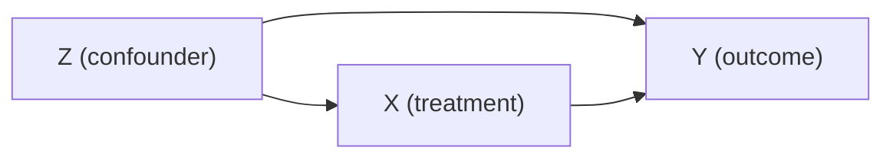
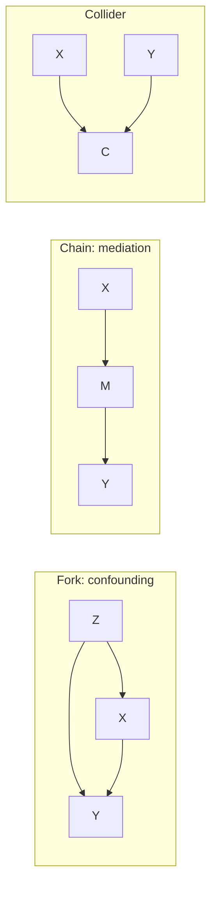

# Experimental Design

> [Statistics](../README.md) · Level: Intermediate · Prerequisites: [Sampling and Estimation](../02-sampling-and-estimation/README.md), [Hypothesis Testing](../03-hypothesis-testing/README.md), [Linear Regression](../04-linear-regression/README.md), [Conditional Probability and Independence](../../10-probability/02-conditional-probability-and-independence/README.md) · Estimated time: 420 min

## 1. Introduction

Every empirical claim of the form "doing $A$ causes $B$" rests on a comparison. The comparison is easy to
compute and hard to justify: the groups being compared usually differ in many ways besides $A$, and any of
those differences could produce the effect attributed to $A$. Experimental design is the body of ideas that
makes the comparison credible *before* the data are collected, rather than by hoping that a model will repair
it afterwards.

The central device is randomisation: assigning treatments by a coin toss (or its computer equivalent) makes
the groups comparable in expectation, including in ways nobody thought to measure. That single trick, and the
machinery built on it — blocking, pairing, factorial arrangements, blinding, power analysis — is the reason
medicine can say that a drug works rather than that patients who took it did better. The alternative, an
observational study, is not useless: nobody will randomise people to smoke or to live in a polluted city, so
for those questions we need explicit reasoning about what would have happened under a different exposure,
formalised in the potential-outcomes framework and in causal graphs (§7.12).

Three cautions organise the topic. First, **randomisation is not the same as balance**: any single experiment
can produce groups that differ on a confounder, and randomisation only guarantees balance *on average over
repetitions*. Second, **statistical significance is not causal evidence**: a small $p$-value from a confounded
comparison is a precise estimate of the wrong quantity. Third, **the effect estimated is the effect of the
assignment actually made**; if half the treated participants do not take the treatment, the experiment
estimates the effect of being *offered* it.

## 2. Prerequisites

* **Sampling and estimation** — random samples, standard errors, the distinction between a parameter and an
  estimate: [Sampling and Estimation](../02-sampling-and-estimation/README.md).
* **Hypothesis testing** — null and alternative hypotheses, $p$-values, power, type I and type II errors:
  [Hypothesis Testing](../03-hypothesis-testing/README.md).
* **Linear regression** — differences of means as regression on an indicator, adjusted comparisons,
  interaction terms: [Linear Regression](../04-linear-regression/README.md).
* **Conditional probability and independence** — $\Pr(A\mid B)$, independence, the multiplication rule, and
  the law of total probability, used in every stratified analysis here:
  [Conditional Probability and Independence](../../10-probability/02-conditional-probability-and-independence/README.md).
* **Expectation and variance** — linearity of expectation, $\operatorname{Var}(X\pm Y)$ with covariance:
  [Expectation and Variance](../../10-probability/05-expectation-and-variance/README.md).
* **Combinatorics** — counting assignments $\binom{n}{n_T}$, permutations, the multiplication principle:
  [Combinatorics](../../20-combinatorics/README.md).
* **Proof technique** — expectation by conditioning on the assignment, and the law of total expectation:
  [Proof Techniques](../../00-foundations/04-proof-techniques/README.md).

## 3. Learning Objectives

After this tutorial you will be able to:

1. Distinguish a causal claim from an association and say what each requires.
2. Define units, treatments, outcomes, factors and levels for a described study.
3. Write a potential-outcomes table and define the average treatment effect and the sample analogue.
4. Prove that under complete randomisation the difference in means is unbiased for the average treatment
   effect.
5. Explain confounding, and identify confounders, mediators and colliders in a causal diagram.
6. Design a completely randomised experiment, a randomised block design and a $2^2$ factorial, and analyse
   each.
7. Explain how blocking and pairing reduce variance, and when they fail to.
8. Compute the sample size needed for a two-group comparison at a given power and effect size.
9. Explain the purpose of blinding and of placebo controls.
10. Describe matching and propensity scores, and the assumptions they need.
11. Recognise Simpson's paradox and resolve it correctly.
12. State the assumptions behind a causal claim in a DAG (exchangeability, positivity, consistency) and what
    the backdoor criterion adds.
13. Explain what cannot be randomised and what alternatives exist.
14. Interpret a meta-analysis, including heterogeneity statistics.

## 4. Intuition

Ask what would have happened. For each person in a study there are two possible outcomes: the one under
treatment and the one under control. We can observe at most one of them — the other is *counterfactual*. The
causal effect for a person is the difference between the two, which is therefore never observed for anyone.
Everything in this topic is about estimating an average of these unobservable differences.

The obstacle is that whoever receives the treatment is usually different from whoever does not. Patients given
a new drug may be sicker, or richer, or younger, or more motivated. Any of those differences also affects the
outcome, so a simple comparison mixes the effect of the drug with the effect of the differences.

Randomisation removes the mixing. If a coin decides who gets what, then the two groups are drawn from the same
distribution of *everything* — age, severity, motivation, genes, and variables nobody recorded. They are not
identical in any one experiment, but they are comparable in expectation, and the difference in means estimates
the average causal effect without bias.

Randomisation does not make the estimate precise. A coin can produce an unlucky split, and with small samples
it often does. **Blocking** attacks precision: if a variable is known to matter (sex, site, batch), form
homogeneous groups and randomise *within* them, so that comparisons never cross those boundaries.
**Factorial** designs attack efficiency from a different direction: vary several factors at once, so that
every unit contributes information about every factor and about their interactions. When randomisation is
impossible, the comparison is reconstructed by **adjusting** for variables that differ — by matching,
stratification or regression — and adjustment is only as good as the list of variables, since some
adjustments make things worse (§7.12).

## 5. Formal Definition

**Definition 5.1 (Unit, treatment, outcome).** A *unit* is the object to which a treatment is applied (a
patient, a plot, a machine, a school). A *treatment* is any intervention whose effect is of interest; a
*control* is the comparison condition. The *outcome* is the measured response, fixed in advance.

**Definition 5.2 (Potential outcomes).** For unit $i$ let $Y_i(1)$ be the outcome that would be observed if
unit $i$ received the treatment and $Y_i(0)$ the outcome that would be observed if it received the control.
The *individual treatment effect* is $\tau_i=Y_i(1)-Y_i(0)$.

**Definition 5.3 (Observed outcome and assignment).** Let $T_i\in\{0,1\}$ be the assignment indicator. The
observed outcome is

$$Y_i = T_i\,Y_i(1) + (1-T_i)\,Y_i(0).$$

This is the *consistency* assumption: the observed outcome equals the potential outcome corresponding to the
treatment actually received. It rules out versions of the treatment that differ in ways not specified.

**Definition 5.4 (Estimands).** For a finite population of $N$ units,

$$\text{SATE}=\frac1N\sum_{i=1}^{N}\bigl(Y_i(1)-Y_i(0)\bigr), \qquad
\text{ATE}=\mathbb{E}\bigl[Y(1)-Y(0)\bigr],$$

the *sample* and *population* average treatment effects. A *conditional* average treatment effect
$\text{CATE}(x)=\mathbb{E}[Y(1)-Y(0)\mid X=x]$ is the effect within a subgroup.

**Definition 5.5 (Assignment mechanism).** The probability distribution of the assignment vector
$\mathbf{T}=(T_1,\dots,T_N)$.
*Complete randomisation* fixes $n_T$ treated units and gives each of the $\binom{N}{n_T}$ assignments equal
probability $1/\binom{N}{n_T}$. *Bernoulli randomisation* assigns each unit independently with probability $p$.
A *blocked* mechanism randomises independently inside each block.

**Definition 5.6 (Designs).** A *completely randomised design* (CRD) has one factor and no restrictions beyond
randomisation. A *randomised block design* (RBD) partitions units into blocks and randomises within each. A
*factorial design* crosses two or more factors, so that every combination of levels appears.

**Definition 5.7 (Confounder, mediator, collider).** Relative to the effect of $X$ on $Y$: a *confounder* $Z$
affects both $X$ and $Y$; a *mediator* $M$ lies on the path from $X$ to $Y$; a *collider* $C$ is affected by
both $X$ and $Y$ (or by their causes).

**Definition 5.8 (Exchangeability).** Treatment and control groups are *exchangeable* if, had the control group
received the treatment, its outcomes would have been distributed as the treated group's, and vice versa.
Randomisation makes groups exchangeable in expectation; the assumption cannot be verified from observed data.

## 6. Mathematical Notation

| Symbol | Read as | Meaning |
|---|---|---|
| $N$, $n$ | en, en | number of units in the population; number of units in the study |
| $n_T$, $n_C$ | en tee, en see | number of treated and control units; $n_T+n_C=n$ |
| $T_i$ | tee sub $i$ | assignment indicator, $1$ if treated |
| $Y_i(1)$, $Y_i(0)$ | why sub $i$ of one, of zero | potential outcomes under treatment and control |
| $Y_i$ | why sub $i$ | observed outcome |
| $\tau_i$ | tau sub $i$ | individual effect $Y_i(1)-Y_i(0)$ |
| $\text{SATE}$, $\text{ATE}$ | ess-ay-tee-ee, ay-tee-ee | sample and population average treatment effects |
| $\bar Y_T$, $\bar Y_C$ | y bar tee, y bar see | sample means of treated and control groups |
| $\hat\tau$ | tau hat | an estimate of $\tau$ |
| $Z$, $M$, $C$ | zed, em, see | confounder, mediator, collider |
| $\sigma^2$ | sigma squared | outcome variance within a group |
| $\Delta$ | delta | the smallest difference worth detecting |
| $\alpha$, $\beta$ | alpha, beta | type I error rate; type II error rate; power $=1-\beta$ |
| $z_{1-\alpha/2}$, $z_{1-\beta}$ | z quantiles | standard normal quantiles used in power calculations |
| $d$ | dee | standardised effect size $\Delta/\sigma$ |
| $e(x)$ | e of x | propensity score $\Pr(T=1\mid X=x)$ |
| $w_i$ | w sub $i$ | weight (inverse-variance weight in meta-analysis) |
| $Q$, $I^2$, $\tau^2$ | cue, eye squared, tau squared | heterogeneity statistics in meta-analysis |

Conventions: $T$ is the assignment actually made, not the treatment a unit happened to take; "effect" without
qualification means the average causal effect for the units studied; all intervals are $95\%$ unless stated.

## 7. Core Concepts

### 7.1 Correlation versus causation

Two variables are correlated when they vary together. One causes the other when an intervention on the first
would change the distribution of the second. Three things can produce correlation without causation, and one
can produce causation without correlation:

1. **Common cause (confounding).** Ice-cream sales and drowning deaths rise together; hot weather causes both.
2. **Reverse causation.** A correlation between hospital spending and patient severity may reflect severity
   driving spending rather than the reverse.
3. **Selection.** Conditioning on a common effect — restricting to hospital patients, say — can create
   association between two unrelated causes.
4. **Causation without correlation** arises when effects cancel in the aggregate (a drug helps some and harms
   others equally overall) or when the causal effect is non-monotone over the range studied.

The practical consequence: correlation is evidence about association, and causation needs a *design* — either
randomisation, or an argument that the observed association would not exist without the causal link.

### 7.2 Potential outcomes, and why the naive comparison fails

For each unit only one of $Y_i(1)$, $Y_i(0)$ is observed; this is the *fundamental problem of causal
inference*. The naive estimator is the difference in group means:

$$\hat\tau_{\text{naive}}=\bar Y_T-\bar Y_C
=\frac{1}{n_T}\sum_{i:T_i=1}Y_i(1)-\frac{1}{n_C}\sum_{i:T_i=0}Y_i(0).$$

Decompose it. Let $\overline{Y(1)}$ and $\overline{Y(0)}$ be the averages of the potential outcomes over the
whole sample. Then

$$\hat\tau_{\text{naive}}=\underbrace{\overline{Y(1)}-\overline{Y(0)}}_{\text{SATE}}
+\underbrace{\bigl(\bar Y_{T}-\overline{Y(1)}\bigr)}_{\text{selection bias, treated}}
-\underbrace{\bigl(\bar Y_{C}-\overline{Y(0)}\bigr)}_{\text{selection bias, control}} .$$

The two selection-bias terms vanish in expectation exactly when the treated group is a random sample of the
units — which is what randomisation arranges, and what observational comparisons must argue for.

**The estimand belongs in the sentence.** "The drug reduces blood pressure by $6$ mmHg" is incomplete without
saying: by $6$ mmHg *among the trial participants*, compared with what alternative, over what period. The
difference between the effect among trial participants and the effect in a different population is a
*transportability* question that randomisation does not answer.

### 7.3 Why randomisation works

**Proposition.** Under complete randomisation with $n_T$ treated units and $n_C=n-n_T$ control units, and with
the potential outcomes treated as fixed features of the units (SUTVA: no interference between units, one
version of each treatment),

$$\mathbb{E}[\bar Y_T]=\overline{Y(1)},\qquad \mathbb{E}[\bar Y_C]=\overline{Y(0)},\qquad
\mathbb{E}[\hat\tau_{\text{naive}}]=\text{SATE}.$$

*Proof.* For each unit $\Pr(T_i=1)=n_T/n$, so

$$\mathbb{E}[\bar Y_T]=\mathbb{E}\Bigl[\frac{1}{n_T}\sum_{i=1}^{n}T_iY_i(1)\Bigr]
=\frac{1}{n_T}\sum_{i=1}^{n}Y_i(1)\Pr(T_i=1)
=\frac{1}{n_T}\cdot\frac{n_T}{n}\sum_{i=1}^{n}Y_i(1)=\overline{Y(1)} .$$

The same argument with $1-T_i$ and $n_C$ gives $\mathbb{E}[\bar Y_C]=\overline{Y(0)}$, and linearity of
expectation gives the result. $\blacksquare$

Nothing in the proof assumes normality, equal variances, or large samples. It uses only the assignment
probabilities, which the experimenter chose. That is what "the design guarantees it" means: the guarantee is
about the procedure, not about the realised data.

Two consequences follow immediately and are often forgotten. First, the reasoning is *finite-sample*: it holds
for $n=8$. Second, randomisation makes the estimator unbiased, not accurate: the variance of $\hat\tau$ for a
given $n$ can still be large, which is the subject of §7.8.

### 7.4 Confounding

A confounder is a variable that affects both the treatment assignment and the outcome. In a randomised
experiment the assignment mechanism is known and independent of everything else, so no confounder exists by
construction. In an observational study, the comparison is

$$\underbrace{\bar Y_T-\bar Y_C}_{\text{association}}=\underbrace{\tau}_{\text{effect}}
+\underbrace{\text{bias from all imbalances}}_{\text{confounding}} .$$

Classic examples: **hormone replacement therapy**. Observational studies found that women taking HRT had less
coronary disease. A randomised trial (WHI, 2002) found the opposite for the population studied, because women
who took HRT were healthier, wealthier and better monitored than those who did not. **Vitamin supplements**:
people who take vitamins are healthier for reasons that have nothing to do with the vitamins. **School
choice**: pupils at selective schools do better, but selection is based on prior attainment.

Confounding is a property of a *question*, not of a variable: age confounds the effect of exercise on
mortality, but is a perfectly good treatment when the question is about ageing. And a confounder need not be
measured — unmeasured confounding is the main threat in observational work, and its direction can sometimes be
bounded by sensitivity analysis (§7.10).

### 7.5 Completely randomised design

The CRD is the template: $n$ units, two (or more) treatments, random allocation, no restrictions. Analysis is
a difference of means (two treatments) or a one-way analysis of variance (more), which is regression on
indicator variables ([Linear Regression](../04-linear-regression/README.md)).

Under a normal model with equal variances, the two-sample $t$ statistic

$$t=\frac{\bar Y_T-\bar Y_C}{s_p\sqrt{1/n_T+1/n_C}},\qquad
s_p^2=\frac{(n_T-1)s_T^2+(n_C-1)s_C^2}{n_T+n_C-2},$$

has a $t_{n-2}$ distribution under the null of no effect. The randomisation test of §8.2 is an alternative that
needs no normal assumption and is exact for any $n$.

Two design decisions matter more than the analysis: the unit of randomisation (patient, clinic, classroom) and
the unit of analysis must match, or the standard errors will be too small; and the randomisation must be
recorded, so that the analysis can be reproduced.

### 7.6 Randomised block design

If units fall into groups that are known to differ in baseline level (litter, site, sex, batch), randomise
*within* each group rather than across all units. Each group is a *block*; every treatment appears once per
block (or in fixed proportions). The analysis compares treatments *within* blocks and then averages the
comparisons, so block differences never contaminate the treatment comparison.

For $b$ blocks and $t$ treatments the model is additive,

$$y_{ij}=\mu+\beta_i+\tau_j+\varepsilon_{ij},\qquad \varepsilon_{ij}\sim\mathcal{N}(0,\sigma^2),$$

and the treatment sum of squares is computed after removing the block sum of squares:

$$\mathrm{SS}_{\text{treat}}=\sum_{j=1}^{t}b(\bar y_{\cdot j}-\bar y_{\cdot\cdot})^2,\qquad
\mathrm{SS}_{\text{block}}=\sum_{i=1}^{b}t(\bar y_{i\cdot}-\bar y_{\cdot\cdot})^2,\qquad
\mathrm{SS}_{\text{error}}=\mathrm{SS}_{\text{total}}-\mathrm{SS}_{\text{treat}}-\mathrm{SS}_{\text{block}},$$

with $F=\mathrm{MS}_{\text{treat}}/\mathrm{MS}_{\text{error}}$ on $(t-1,\,(b-1)(t-1))$ degrees of freedom.
The block effect need not be of interest; it is a nuisance parameter removed for the sake of precision.

**Pairing** is the extreme case: two units per block, one per treatment. Pairing is enormously effective when
the within-pair correlation is high, and it costs degrees of freedom, which is why it is not always best.

### 7.7 Factorial designs

A factorial experiment varies several factors at once. With two factors at two levels each (a $2^2$ design)
there are four treatment combinations: $(0,0)$, $(1,0)$, $(0,1)$, $(1,1)$. Each unit is assigned to one
combination, and the analysis estimates

* the **main effect** of $A$: the average change in response when $A$ moves from low to high, averaging over
  $B$;
* the **main effect** of $B$: likewise;
* the **interaction** $AB$: how much the effect of $A$ depends on the level of $B$.

With cell means $\bar y_{00},\bar y_{10},\bar y_{01},\bar y_{11}$,

$$\text{effect}_A=\tfrac12\bigl(\bar y_{10}+\bar y_{11}\bigr)-\tfrac12\bigl(\bar y_{00}+\bar y_{01}\bigr),\qquad
\text{effect}_B=\tfrac12\bigl(\bar y_{01}+\bar y_{11}\bigr)-\tfrac12\bigl(\bar y_{00}+\bar y_{10}\bigr),$$
$$\text{interaction}_{AB}=\bigl(\bar y_{11}-\bar y_{01}\bigr)-\bigl(\bar y_{10}-\bar y_{00}\bigr).$$

The interaction is a difference of differences: the effect of $A$ at high $B$ minus the effect of $A$ at low
$B$. If it is non-zero, "the effect of $A$" is not a single number, and reporting a main effect alone is
misleading.

The efficiency comes from *hidden replication*: every unit contributes to the estimate of every effect, so a
$2^2$ design with $n$ replicates per cell uses $4n$ units to estimate three effects and the error variance. A
one-factor-at-a-time programme would need three separate experiments to learn the same thing.

### 7.8 Sample size and power

Power is the probability of detecting an effect of a specified size when it is really there. For a two-sided
test at level $\alpha$ comparing two groups of equal size with outcome variance $\sigma^2$ and true difference
$\Delta$, the normal approximation gives

$$n_{\text{per group}}=\frac{2\sigma^2\bigl(z_{1-\alpha/2}+z_{1-\beta}\bigr)^2}{\Delta^2}
=\frac{2\bigl(z_{1-\alpha/2}+z_{1-\beta}\bigr)^2}{d^2},$$

where $d=\Delta/\sigma$ is the standardised effect size. For $\alpha=0.05$ and power $0.80$,
$z_{0.975}+z_{0.80}=1.960+0.8416=2.8016$, so $n\approx15.70/d^2$ per group — and about $12.37/d^2$ for a
one-sided test, where $z_{0.95}=1.645$ replaces $z_{0.975}$.

The formula is a planning device, and it has three uses. It forces the investigator to say what effect size is
worth detecting. It exposes studies that are too small to answer their own question. And it prevents the
pernicious practice of computing power *after* the data ("observed power"), which is a monotone function of
the $p$-value and adds no information beyond it.

Inflation for non-compliance, dropout and clustering is applied on top: divide by $(1-\text{dropout})$, and for
cluster randomisation multiply by the design effect $1+(m-1)\rho$ where $m$ is the cluster size and $\rho$ the
intra-cluster correlation.

### 7.9 Blinding and placebo effects

**Blinding** conceals the assignment from people who could bias the measurement: participants (single blind),
participants and assessors (double blind), and sometimes analysts too. It matters because expectations change
behaviour and because assessors grade ambiguous outcomes favourably for the treatment they expect to work.

**Placebo controls** give the control group an inert treatment that is indistinguishable from the active one, so
that the comparison isolates the active ingredient rather than the ritual of being treated. The placebo effect
is real but usually modest and highly variable; the point of a placebo is not to measure it but to remove it
from the comparison. For surgical and psychological interventions, sham procedures and active comparators serve
the same purpose.

Blinding is not always possible: physiotherapy, surgery and educational interventions are hard to disguise. Then
the design should blind the *assessor* and pre-register the outcome definitions, and the report should say what
was and was not blinded.

### 7.10 Observational studies: matching and propensity scores

When assignment cannot be controlled, the analyst tries to compare like with like.

**Exact matching** pairs each treated unit with a control having identical values of the confounders. This is
transparent but feasible only with few, discrete covariates.

**Propensity scores.** The propensity score is $e(x)=\Pr(T=1\mid X=x)$, the probability of treatment given
covariates. It has two properties that make it the workhorse of observational studies.

*Balancing.* Conditional on $e(X)$, treatment is independent of the covariates:
$X \perp\!\!\!\perp T \mid e(X)$. So units with the same propensity score have, on average, the same covariate
distribution whether treated or not, and a single scalar replaces a high-dimensional covariate vector.

*Unconfoundedness given the score.* If potential outcomes are independent of treatment given $X$, then they are
independent of treatment given $e(X)$.

Neither property removes the need for the untestable assumption of *no unmeasured confounding*; they reduce a
modelling problem to a one-dimensional one. Matching on the score, stratifying on it, or weighting by
$w=1/e(x)$ for treated and $1/(1-e(x))$ for controls (inverse-probability-of-treatment weighting) are the usual
implementations.

**Diagnostics are mandatory.** Check covariate balance after matching (standardised mean differences below
about $0.1$), check overlap (positivity: every score value must occur in both groups), and report how many
units were discarded. A matched analysis that silently drops most of the treated group answers a different
question from the one asked.

### 7.11 Simpson's paradox

An association can reverse when the data are split into strata. The numbers below are invented but have the
structure of many real examples.

| Group | Mild cases | Severe cases | All cases |
|---|---|---|---|
| Treatment A | $90/100=90\%$ | $30/100=30\%$ | $120/200=60\%$ |
| Treatment B | $144/180=80\%$ | $5/20=25\%$ | $149/200=74.5\%$ |

Overall B looks better ($74.5\%$ against $60\%$), yet A is better in each stratum. The reason is the
distribution of severity: B was given mostly to mild cases ($180$ of $200$), A mostly to severe ones. Severity
is a confounder, and the aggregate comparison is dominated by it.

The resolution is to compare within strata, or to *standardise*: apply each treatment's stratum-specific rates
to a common distribution of cases. Using the pooled strata sizes ($280$ mild, $120$ severe),

$$\text{A}: \frac{0.90(280)+0.30(120)}{400}=\frac{252+36}{400}=0.720,\qquad
\text{B}: \frac{0.80(280)+0.25(120)}{400}=\frac{224+30}{400}=0.635 .$$

A is better on the standardised scale. Notice what the paradox teaches: "which treatment has the higher
success rate" is not well defined until the case mix is fixed. The right question is "for a patient of a given
severity, which treatment is better", and that is a stratified question.

The paradox is not a curiosity of arithmetic; it is the commonest form of confounding in observational data,
and the reason a table of marginal rates can be actively misleading.

### 7.12 Causal frameworks: DAGs and the backdoor criterion

A **causal diagram** (DAG) has nodes for variables and arrows for direct causal influence. It encodes
assumptions, which is its value: assumptions that are drawn can be criticised.

Arrows *chain*: $X\to M\to Y$ (a mediator), *fork*: $X\leftarrow Z\to Y$ (a confounder), or *collide*:
$X\to C\leftarrow Y$ (a collider). The rules of causal graphs reduce to three:

1. **Conditioning on a chain or fork blocks the path** — good, it removes confounding.
2. **Conditioning on a collider opens the path** — bad, it creates association where there was none.
3. **Descendants of colliders** behave like the collider.

The **backdoor criterion** tells you which variables to adjust for: a set $S$ satisfies it if every path from
$X$ to $Y$ that starts with an arrow *into* $X$ is blocked by $S$, and $S$ contains no descendant of $X$. When
$S$ satisfies the backdoor criterion, the *adjustment formula*

$$\Pr\bigl(Y=y\mid do(X=x)\bigr)=\sum_{s}\Pr(Y=y\mid X=x,S=s)\Pr(S=s)$$

identifies the interventional distribution from observational data — which is exactly the standardisation
computation of §7.11, written formally.

**Do-calculus** generalises this: three rules for inserting or deleting observations and interventions in
expressions involving the $do(\cdot)$ operator, sufficient in many graph structures to identify a causal effect
that the backdoor criterion alone cannot. Its message for a first course is the one that matters: a causal
claim is a claim about a *modified* system, and whether it can be estimated from data is a question about the
graph, not about the sample size.

### 7.13 What cannot be randomised, and what to do instead

Some exposures cannot be assigned for ethical or practical reasons: smoking, poverty, pollution, education
level, sex, genotype, population-level policies. A randomised trial of smoking would require deliberately
exposing people to a known carcinogen; a trial of neighbourhood poverty would require assigning families to
deprivation.

The alternatives, in decreasing order of credibility:

* **Natural experiments** — a policy change, a lottery, a border, a court ruling that assigns exposure
  approximately at random. Examples: the Oregon health-insurance lottery, the Vietnam-era draft lottery.
* **Regression discontinuity** — treatment determined by a threshold on a running variable (a test score, an
  age cut-off). Units just either side of the threshold are comparable.
* **Instrumental variables** — a variable that shifts exposure but affects the outcome only through it.
* **Difference-in-differences** — compare the change in an exposed group with the change in an unexposed group,
  assuming parallel trends absent treatment.
* **Synthetic control** — construct a weighted comparison unit from untreated regions.
* **Careful adjustment with sensitivity analysis** — the weakest, and the most common.

Each carries its own assumptions, and each can fail. The honest report names the assumption and tests what can
be tested (pre-trends, covariate balance at the threshold, instrument relevance).

### 7.14 Ethics of experimentation

Randomisation is only ethical when it is legitimate to withhold or vary the treatment. The governing idea is
**equipoise**: a trial is justified when there is genuine uncertainty about which arm is better. The
instruments that constrain design are familiar — informed consent with the right to withdraw; independent
ethical review; data-monitoring committees empowered to stop a trial for harm or benefit; pre-registration of
design, outcomes and analysis plan; and equity in selection, so that the study does not enrol only those who
cannot refuse. The **Nuremberg Code (1947)** and the **Declaration of Helsinki (1964, revised since)** set the
modern standard, and the **Belmont Report (1979)** articulated respect for persons, beneficence and justice.
History supplies the negative examples that produced these rules, including the Tuskegee syphilis study
(1932–1972), in which treatment was withheld from Black men without their informed consent. Ethical constraints
are not obstacles to good design; they are part of the specification of a question worth answering.

### 7.15 Replication and meta-analysis

A single study, however well designed, is one draw from a distribution. **Replication** — an independent study
of the same question — is the strongest check on a result, and the reason pre-registration and data sharing
matter.

A **meta-analysis** combines estimates $\hat\theta_i$ with standard errors $s_i$ from $k$ studies. The
fixed-effect (inverse-variance) estimator weights each study by $w_i=1/s_i^2$:

$$\hat\theta_{\text{FE}}=\frac{\sum_iw_i\hat\theta_i}{\sum_iw_i},\qquad
\operatorname{se}(\hat\theta_{\text{FE}})=\frac{1}{\sqrt{\sum_iw_i}} .$$

Heterogeneity is measured by Cochran's $Q=\sum_iw_i(\hat\theta_i-\hat\theta_{\text{FE}})^2$, which has
$k-1$ degrees of freedom if all studies estimate one common effect, and by
$I^2=\max\{0,(Q-(k-1))/Q\}$, the proportion of variation attributable to heterogeneity rather than chance. If
heterogeneity is substantial, a random-effects model adds between-study variance $\tau^2$,
estimated by DerSimonian–Laird as $\tau^2=\max\{0,(Q-(k-1))/C\}$ with
$C=\sum_iw_i-\sum_iw_i^2/\sum_iw_i$, and reweights by $1/(s_i^2+\tau^2)$.

Meta-analysis inherits every bias of the studies it pools. **Publication bias** — significant results are more
likely to be published — inflates pooled estimates, and funnel-plot asymmetry or Egger's test is the usual
diagnostic, itself unreliable when fewer than about ten studies are pooled. The phrase "the meta-analysis
shows" should always be followed by "given the studies that exist".

## 8. Formulas and Properties

### 8.1 The naive comparison and its bias

**Proposition.** $\hat\tau_{\text{naive}}=\text{SATE}+b_T-b_C$ with $b_T=\bar Y_T-\overline{Y(1)}$ and
$b_C=\bar Y_C-\overline{Y(0)}$.

*Proof.* Add and subtract the population averages:
$\bar Y_T-\bar Y_C=\bigl(\overline{Y(1)}-\overline{Y(0)}\bigr)+(\bar Y_T-\overline{Y(1)})-(\bar Y_C-\overline{Y(0)})$.
$\blacksquare$ Under randomisation $\mathbb{E}[b_T]=\mathbb{E}[b_C]=0$ (§7.3), so the bias terms vanish on
average; in an observational study they need not, and their sum is exactly the confounding to be removed.

### 8.2 The randomisation test

**Definition.** Let the observed assignment be $\mathbf{T}^{\text{obs}}$ with statistic
$\hat\tau^{\text{obs}}$. Under the *sharp null hypothesis* $H_0\colon Y_i(1)=Y_i(0)$ for every $i$, every
assignment produces the same data up to relabelling. The randomisation distribution is therefore computable
exactly: enumerate all $M=\binom{n}{n_T}$ assignments, recompute $\hat\tau$ for each, and define

$$p=\frac{\#\{\text{assignments with }\lvert\hat\tau\rvert\ge\lvert\hat\tau^{\text{obs}}\rvert\}}{M}.$$

**Properties.** The test is exact at level $\alpha$ for any $n$, because under $H_0$ the observed assignment
is one of $M$ equally likely assignments and the probability that it is among the most extreme is controlled by
construction. It requires no normal theory and no equal variances. Its null is *sharp* (no effect for anyone),
which is stronger than "no average effect"; a randomisation test can therefore fail to reject even when the
average effect is non-zero if the effects cancel.

With $n=6$ and $n_T=3$ there are $M=\binom{6}{3}=20$ assignments, so the smallest attainable two-sided
$p$-value is $1/20=0.05$. This is a hard ceiling: a $6$-unit experiment can never produce $p<0.05$.

### 8.3 Variance of the difference in means under randomisation

**Proposition (Neyman).** Under complete randomisation,

$$\operatorname{Var}(\bar Y_T-\bar Y_C)=\frac{S_T^2}{n_T}+\frac{S_C^2}{n_C}-\frac{S_{TC}^2}{N},$$

where $S_T^2$, $S_C^2$ are the variances of $Y_i(1)$, $Y_i(0)$ over the $N$ units and
$S_{TC}^2=\frac{1}{N-1}\sum_i\bigl[(Y_i(1)-\overline{Y(1)})-(Y_i(0)-\overline{Y(0)})\bigr]^2$.

*Sketch.* Write $\hat\tau-\text{SATE}=\sum_iu_iY_i(1)-\sum_iv_iY_i(0)$ with $u_i=T_i/n_T-1/N$ and
$v_i=(1-T_i)/n_C-1/N$. Under complete randomisation $\operatorname{Var}(T_i)=p(1-p)$ with $p=n_T/N$, and
$\operatorname{Cov}(T_i,T_j)=-p(1-p)/(N-1)$ for $i\ne j$. Collecting the diagonal and off-diagonal terms, and
using $\sum_iY_i(1)Y_i(0)-\frac{1}{N}\sum_iY_i(1)\sum_iY_i(0)=\frac{N-1}{2}\bigl(S_T^2+S_C^2-S_{TC}^2\bigr)$, gives
the stated expression. $\blacksquare$

With constant effects ($Y_i(1)-Y_i(0)$ the same for all $i$), $S_{TC}^2=0$ and the third term vanishes. When
effects vary it is positive, so the variance is *smaller* than the homoscedastic formula suggests; the usual
estimator $\widehat{\operatorname{Var}}=s_T^2/n_T+s_C^2/n_C$ omits this term and is therefore conservative on
average. That is the justification for the familiar two-sample standard error even under heterogeneous effects.

### 8.4 Blocking and pairing

**Proposition.** Suppose units come in $n$ pairs, pair $i$ having outcomes $(Y_{i1},Y_{i2})$ with common
variance $\sigma^2$ and correlation $\rho$. The paired estimator of the mean difference has

$$\operatorname{Var}(\bar d)=\frac{2\sigma^2(1-\rho)}{n},$$

whereas treating the $2n$ units as two independent groups gives $\operatorname{Var}=\frac{2\sigma^2}{n}$.

*Proof.* $\operatorname{Var}(Y_{i1}-Y_{i2})=\sigma^2+\sigma^2-2\rho\sigma^2=2\sigma^2(1-\rho)$, and the
$n$ pair differences are independent, so the mean has variance $2\sigma^2(1-\rho)/n$; the unpaired variance is
$\sigma^2/n+\sigma^2/n$. $\blacksquare$

So pairing multiplies the variance by $1-\rho$: with $\rho=0.7$ the variance falls by $70\%$, the standard error
by about $45\%$, and the effective sample size is multiplied by $1/(1-\rho)=3.33$. When $\rho<0$ pairing is
*worse* than ignoring the pairs, which is why blocks should be formed from variables known to be positively
associated with the outcome, not from arbitrary groupings.

### 8.5 Contrasts in a $2^2$ factorial

For a balanced $2^2$ design with $n$ replicates per cell, the sum of squares for any contrast with coefficients
$c_{ij}\in\{-1,+1\}$ is

$$\mathrm{SS}=\frac{\bigl(\sum_{ij}c_{ij}T_{ij}\bigr)^2}{4n},$$

where $T_{ij}$ is the cell total. With total $\mathrm{SS}$ and error $\mathrm{SSE}=\sum_{ij}\sum_k(y_{ijk}-\bar y_{ij})^2$
on $4(n-1)$ degrees of freedom, each effect has an $F$ statistic on $(1,4(n-1))$ degrees of freedom.

*Why the divisor $4n$.* The contrast $\sum_{ij}c_{ij}T_{ij}$ has variance $4n\sigma^2$ under the null, since
each cell total has variance $n\sigma^2$ and there are four independent cells. A sum of squares is a squared
contrast divided by its variance in units of $\sigma^2$, which is $4n$.

### 8.6 Deriving the sample-size formula

Let $\hat\Delta=\bar Y_T-\bar Y_C$ with $\operatorname{Var}(\hat\Delta)=2\sigma^2/n$ under equal allocation and
homoscedasticity. The test rejects when $\lvert\hat\Delta\rvert>z_{1-\alpha/2}\sqrt{2\sigma^2/n}$ in the normal
approximation. Writing $Z=\hat\Delta/\sqrt{2\sigma^2/n}$, under the alternative $\mathbb{E}[Z]=\Delta/\sqrt{2\sigma^2/n}=\delta$,
so

$$\text{power}=\Phi\bigl(\delta-z_{1-\alpha/2}\bigr)+\Phi\bigl(-\delta-z_{1-\alpha/2}\bigr)
\approx\Phi\bigl(\delta-z_{1-\alpha/2}\bigr),$$

the second term being negligible for $\delta>0$. Setting this equal to $1-\beta$ gives
$\delta-z_{1-\alpha/2}=z_{1-\beta}$, i.e.

$$\frac{\Delta}{\sigma}\sqrt{\frac{n}{2}}=z_{1-\alpha/2}+z_{1-\beta}
\quad\Longrightarrow\quad n=\frac{2\sigma^2\bigl(z_{1-\alpha/2}+z_{1-\beta}\bigr)^2}{\Delta^2}.$$

For unequal allocation with $n_C=kn_T$, the same argument gives
$n_T=\bigl(1+\tfrac1k\bigr)\sigma^2\bigl(z_{1-\alpha/2}+z_{1-\beta}\bigr)^2/\Delta^2$.

Two features deserve emphasis. Power depends on $\Delta/\sigma$ only, so halving the noise is as good as
doubling the effect. And $n$ grows like $1/\Delta^2$: detecting half the effect requires four times the sample.

### 8.7 The balancing property of the propensity score

**Proposition.** Let $e(X)=\Pr(T=1\mid X)$. Then (i) $\Pr\bigl(T=1\mid e(X)\bigr)=e(X)$ and (ii)
$X\perp\!\!\!\perp T\mid e(X)$.

*Proof.* (i) By the law of total expectation,
$\Pr(T=1\mid e(X))=\mathbb{E}\bigl[\Pr(T=1\mid X)\mid e(X)\bigr]=\mathbb{E}[e(X)\mid e(X)]=e(X)$.

(ii) It suffices to show $\Pr(T=1\mid X,e(X))=\Pr(T=1\mid e(X))$. The left side is
$\Pr(T=1\mid X)=e(X)$ because $e(X)$ is a function of $X$; the right side is $e(X)$ by (i). Hence the
conditional probability does not depend on $X$ once $e(X)$ is fixed, which is the definition of conditional
independence. $\blacksquare$

The practical content: among units with the same $e(X)$, the treated and untreated groups have the same
distribution of $X$. So matching or stratifying on a single scalar balances the whole covariate vector — as
long as $e$ is correctly estimated and the assumption of no unmeasured confounding holds.

### 8.8 Standardisation as a weighted average

If $S$ is a set of strata satisfying the backdoor criterion, the standardised (adjusted) rate for treatment
$x$ is

$$\widehat{\Pr}\bigl(Y=1\mid do(X=x)\bigr)=\sum_{s}\hat{\Pr}(Y=1\mid X=x,S=s)\,\hat{\Pr}(S=s),$$

a weighted average of stratum-specific rates with weights fixed to a common distribution. Choosing the pooled
distribution gives the "directly standardised" rate of §7.11; choosing the treated group's distribution gives
the effect of treatment on the treated. Different weights answer different questions, and the report should say
which.

### 8.9 Pooling estimates

**Proposition.** For independent estimates $\hat\theta_i$ with variances $s_i^2$, the minimum-variance
unbiased combination is the inverse-variance weighted mean, with variance $1/\sum_iw_i$ where $w_i=1/s_i^2$.

*Proof.* Minimise $\sum_iw_i(\hat\theta_i-\theta)^2$ over $\theta$: the derivative is
$-2\sum_iw_i(\hat\theta_i-\theta)=0$, giving $\hat\theta=\sum_iw_i\hat\theta_i/\sum_iw_i$. Its variance is
$\sum_iw_i^2s_i^2/(\sum_iw_i)^2=\sum_iw_i/(\sum_iw_i)^2=1/\sum_iw_i$. $\blacksquare$

Cochran's $Q$ compares the observed spread of the $\hat\theta_i$ about their weighted mean with the spread
expected from sampling error alone; $Q$ much larger than $k-1$ signals heterogeneity, and the DerSimonian–Laird
estimate $\tau^2=\max\{0,(Q-(k-1))/C\}$ converts that excess into between-study variance.

### 8.10 Summary of formulas

| Quantity | Formula | Condition |
|---|---|---|
| Naive estimate | $\hat\tau=\bar Y_T-\bar Y_C$ | any assignment |
| Unbiasedness | $\mathbb{E}[\hat\tau]=\text{SATE}$ | random assignment, SUTVA |
| Randomisation $p$-value | fraction of assignments at least as extreme | sharp null |
| Neyman variance | $S_T^2/n_T+S_C^2/n_C-S_{TC}^2/N$ | complete randomisation |
| Usual standard error | $\sqrt{s_T^2/n_T+s_C^2/n_C}$ | conservative |
| Paired variance | $2\sigma^2(1-\rho)/n$ | pairs, correlation $\rho$ |
| Factorial contrast | $\mathrm{SS}=(\sum c_{ij}T_{ij})^2/(4n)$ | balanced $2^2$ |
| Sample size | $n=2\sigma^2(z_{1-\alpha/2}+z_{1-\beta})^2/\Delta^2$ | two groups, normal approximation |
| Standardised rate | $\sum_s\hat\Pr(Y\mid X=x,S=s)\hat\Pr(S=s)$ | $S$ satisfies backdoor |
| Fixed-effect pool | $\sum w_i\hat\theta_i/\sum w_i$, $w_i=1/s_i^2$ | common effect |
| Heterogeneity | $Q=\sum w_i(\hat\theta_i-\hat\theta_{\text{FE}})^2$, $I^2=\max\{0,(Q-df)/Q\}$ | $df=k-1$ |

## 9. Step-by-Step Examples

### 9.1 A six-unit randomised experiment, analysed exactly

Six units, three assigned to treatment. Potential outcomes (known here only because the example is
constructed):

| Unit | 1 | 2 | 3 | 4 | 5 | 6 |
|---|---|---|---|---|---|---|
| $Y_i(1)$ | 9 | 8 | 7 | 4 | 3 | 2 |
| $Y_i(0)$ | 2 | 1 | 3 | 1 | 4 | 2 |
| $\tau_i$ | 7 | 7 | 4 | 3 | $-1$ | 0 |

The observed assignment treated units $1,2,3$: $\bar Y_T=(9+8+7)/3=8$ and
$\bar Y_C=(1+4+2)/3=2.3333$, so $\hat\tau=5.6667$. The true SATE is
$(7+7+4+3-1+0)/6=20/6=3.3333$ — the experiment over-estimated it by $2.33$, which is selection bias in this
one realisation, not in the procedure.

*Randomisation distribution.* There are $\binom{6}{3}=20$ assignments. Recomputing $\hat\tau$ for all of them
gives a distribution with mean $3.3333$ (equal to the SATE, as §7.3 promises) and standard deviation $1.1450$.
The observed $5.6667$ is the largest of the $20$ values, so the two-sided randomisation $p$-value is
$1/20=0.05$: the result is as extreme as the design allows, and no smaller $p$ is attainable with six units.

### 9.2 Why randomisation is unbiased: all six assignments

Four units with $Y(1)=(10,8,5,12)$ and $Y(0)=(6,7,1,3)$, so $\tau=(4,1,4,9)$ and SATE $=4.5$. With
$n_T=2$ there are $\binom{4}{2}=6$ assignments:

| Treated units | $\bar Y_T$ | Control units | $\bar Y_C$ | $\hat\tau$ |
|---|---|---|---|---|
| 1,2 | 9.0 | 3,4 | 2.0 | 7.0 |
| 1,3 | 7.5 | 2,4 | 5.0 | 2.5 |
| 1,4 | 11.0 | 2,3 | 4.0 | 7.0 |
| 2,3 | 6.5 | 1,4 | 4.5 | 2.0 |
| 2,4 | 10.0 | 1,3 | 3.5 | 6.5 |
| 3,4 | 8.5 | 1,2 | 6.5 | 2.0 |

The six values average to $(7.0+2.5+7.0+2.0+6.5+2.0)/6=27/6=4.5$, exactly the SATE. Their standard deviation
is $2.345$, so a single experiment of this size can easily be off by more than $2$ units — unbiased does not
mean accurate.

### 9.3 Blocking: paired versus unpaired

Twenty pairs, outcome standard deviation $\sigma=12$ within each measurement, within-pair correlation
$\rho=0.7$.

*Paired.* $\operatorname{Var}(\bar d)=2(144)(0.3)/20=86.4/20=4.32$, so the standard error is $2.078$.

*Unpaired, same $40$ units.* $\operatorname{Var}=2(144)/40=7.2$, standard error $2.683$.

Pairing multiplies the variance by $1-\rho=0.3$. Equivalently, the paired design with $20$ pairs is as precise
as an unpaired design with $40/0.3=133$ units. The price is $19$ degrees of freedom instead of $38$, trivial
here but important when pairs are few.

### 9.4 A $2^2$ factorial with replication

Two factors — temperature $A$ (low/high) and catalyst $B$ (absent/present) — with three replicates per cell;
response is yield.

| | $B$ absent | $B$ present |
|---|---|---|
| $A$ low | 20, 22, 21 (mean 21) | 24, 25, 23 (mean 24) |
| $A$ high | 26, 24, 25 (mean 25) | 34, 32, 33 (mean 33) |

*Main effects.*

$$\text{effect}_A=\tfrac12(25+33)-\tfrac12(21+24)=29-22.5=6.5,\qquad
\text{effect}_B=\tfrac12(24+33)-\tfrac12(21+25)=28.5-23=5.5 .$$

*Interaction.* The effect of $A$ is $25-21=4$ without catalyst and $33-24=9$ with it, so
$\text{interaction}=9-4=5$. Equivalently $(33-24)-(25-21)=5$. The factors are not additive: the catalyst makes
the temperature effect more than twice as large.

*Analysis of variance.* Cell totals are $63,75,72,99$; contrasts are $39$ ($A$), $33$ ($B$) and $15$ ($AB$),
so

$$\mathrm{SS}_A=\frac{39^2}{12}=126.75,\quad \mathrm{SS}_B=\frac{33^2}{12}=90.75,\quad
\mathrm{SS}_{AB}=\frac{15^2}{12}=18.75 .$$

Within-cell deviations give $\mathrm{SSE}=8$ on $8$ degrees of freedom, so $\mathrm{MSE}=1$ and
$F_A=126.75$, $F_B=90.75$, $F_{AB}=18.75$, all on $(1,8)$: $p=3.5\times10^{-6}$, $1.2\times10^{-5}$ and
$0.0025$. The check $\mathrm{SS}_A+\mathrm{SS}_B+\mathrm{SS}_{AB}+\mathrm{SSE}=244.25$ equals the total sum of
squares about the grand mean $25.75$. ✓

*Reporting.* Because the interaction is significant, the main effects must be reported with it: "raising
temperature adds about $4$ units without catalyst and $9$ units with it", not "$A$ adds $6.5$ units".

### 9.5 Sample size for a two-group trial

A trial is planned with outcome standard deviation $\sigma=10$, and a difference $\Delta=5$ is worth detecting,
at $\alpha=0.05$ two-sided and power $0.80$.

$$n=\frac{2(10^2)(1.960+0.8416)^2}{5^2}=\frac{200(7.8490)}{25}=62.79\ \longrightarrow\ 63 \text{ per group}.$$

A check with the exact $t$ distribution gives power $0.795$ at $n=63$ and $0.801$ at $n=64$, so $64$ per group
is the safer figure; the normal approximation is slightly optimistic, as it always is for small $n$.

If $10\%$ of participants are expected to drop out, divide by $0.9$: $64/0.9=71.1$, so $72$ per group. Had the
effect worth detecting been $\Delta=2.5$, the requirement would have been $4\times63\approx252$ per group,
because $n\propto1/\Delta^2$.

### 9.6 Simpson's paradox, resolved by standardisation

The table of §7.11: A succeeds in $90\%$ of mild and $30\%$ of severe cases; B in $80\%$ and $25\%$. Overall A
records $120/200=60\%$ and B $149/200=74.5\%$.

*Why the aggregate misleads.* A was given to $100$ mild and $100$ severe cases; B to $180$ mild and $20$ severe.
The aggregate rate is a weighted average of the stratum rates with weights given by each treatment's own case
mix, and the mixes differ drastically.

*Standardised comparison.* Apply both sets of stratum rates to the pooled mix ($280$ mild, $120$ severe):

$$\text{A}:\frac{252+36}{400}=0.720,\qquad \text{B}:\frac{224+30}{400}=0.635 .$$

*Conclusion.* For a patient of given severity A is better ($90>80$, $30>25$), and after removing the case-mix
difference A is also better overall ($72.0\%$ against $63.5\%$). The marginal comparison alone would have
reversed the recommendation.

### 9.7 Matching when a crude comparison is confounded

Outcomes and ages for a treated group of four and a control group of six:

| Treated | age | outcome | | Control | age | outcome |
|---|---|---|---|---|---|---|
| 1 | 30 | 60 | | 1 | 32 | 58 |
| 2 | 40 | 55 | | 2 | 38 | 56 |
| 3 | 50 | 50 | | 3 | 52 | 52 |
| 4 | 60 | 45 | | 4 | 58 | 50 |
| | | | | 5 | 65 | 40 |
| | | | | 6 | 70 | 30 |

*Crude comparison.* $\bar Y_T=210/4=52.5$ and $\bar Y_C=286/6=47.667$, so the treated group looks better by
$4.83$ units.

*Why that is confounded.* Outcome falls sharply with age, and the control group is older: mean age $52.5$
against $45$ for the treated group. The crude difference mixes the treatment with the age difference.

*Matched comparison.* Match each treated unit to the control of nearest age ($30\leftrightarrow32$,
$40\leftrightarrow38$, $50\leftrightarrow52$, $60\leftrightarrow58$): the matched controls have outcomes
$58,56,52,50$, mean $54$. The matched difference is $52.5-54=-1.5$: slightly *worse* for the treated group.

*Interpretation.* Matching reverses the sign, so the crude result is not merely imprecise but misleading. Two
caveats: the matched estimate rests on the assumption that no *other* variable differs systematically between
the groups, and the two discarded controls (aged $65$ and $70$) had no comparable treated units, so the
estimate applies to the age range $30$–$60$ only.

### 9.8 A meta-analysis of three studies

Estimates $0.30$, $0.10$, $0.20$ with standard errors $0.10$, $0.08$, $0.05$; weights $1/s_i^2$ are $100$,
$156.25$ and $400$, summing to $656.25$.

*Fixed effect.*

$$\hat\theta_{\text{FE}}=\frac{100(0.30)+156.25(0.10)+400(0.20)}{656.25}=\frac{125.625}{656.25}=0.1914,$$

$$\operatorname{se}=\frac{1}{\sqrt{656.25}}=0.03904,\qquad
\text{CI }=0.1914\pm1.960(0.03904)=(0.1149,\,0.2679).$$

*Heterogeneity.* $Q=100(0.1086)^2+156.25(-0.0914)^2+400(0.0086)^2=1.1787+1.3061+0.0294=2.514$ on
$2$ degrees of freedom, $p=0.284$: no evidence of heterogeneity, $I^2=\max\{0,(2.514-2)/2.514\}=20.4\%$.

*Reading.* The pooled estimate is dominated by the most precise study (weight $400$ of $656$), which is the
point of inverse-variance weighting. With $I^2\approx20\%$ a fixed-effect summary is defensible, though the
confidence interval should be read as conditional on the studies being exchangeable.

## 10. Visual Explanations

The three ways two variables can be connected:

Conditioning on a fork or a chain blocks a path; conditioning on a collider *opens* one. This is the whole of
"which variables should I adjust for", and it explains why automatic adjustment for everything is wrong.

Choosing a design: if the treatment can be assigned, randomise — in blocks when a known nuisance variable
exists, and crossing several factors when their interaction matters. If it cannot, look for a threshold, a
lottery or a policy change that approximates random assignment; otherwise fall back on matching, weighting and
a sensitivity analysis, and say so explicitly.

## 11. Common Mistakes

1. **Reading an observational association as an effect.** The default is confounding, not causation; the
   burden of proof is on the design, not on the $p$-value.
2. **Believing randomisation guarantees balance in one study.** It guarantees balance in expectation. Check
   the realised covariate balance and report it.
3. **Adjusting for everything available.** Mediators remove part of the effect; colliders create association
   where there is none; post-treatment variables corrupt the comparison.
4. **Reporting a main effect when the interaction is significant.** If the effect of $A$ depends on $B$, the
   average effect of $A$ describes no actual condition.
5. **Confusing statistical with practical significance.** A well-powered trial can detect a difference too
   small to matter; report the estimate and its interval in the units of the outcome.
6. **Analysing at a finer level than randomisation.** Randomising classrooms and analysing pupils understates
   the standard errors; the design effect $1+(m-1)\rho$ must be used.
7. **Per-protocol analysis presented as the trial result.** Excluding non-compliers breaks randomisation;
   intention-to-treat is the primary analysis, per-protocol a secondary one.
8. **Treating a non-significant result as evidence of no effect.** Absence of evidence is not evidence of
   absence; the interval may include effects of practical importance.
9. **Matching without checking overlap.** If treated units have no comparable controls, the matched estimate
   silently changes the estimand.
10. **Stopping a trial when the result looks good.** Repeated unplanned looks inflate the type I error; use
    pre-specified sequential boundaries.
11. **Generalising beyond the randomised population.** Trial participants are rarely a random sample of the
    population that will use the treatment.

## 12. Applications

* **Medicine.** Randomised controlled trials are the regulatory standard for licensing drugs; adaptive and
  platform designs (as used in the RECOVERY trial) reuse one infrastructure across many treatments.
* **Agriculture and industry.** Fisher's Rothamsted work introduced randomisation, blocking and factorial
  designs to compare fertilisers and varieties; design of experiments (Taguchi methods, response-surface
  methodology) is now routine in process optimisation, and A/B testing in software is a two-arm randomised
  trial run at scale.
* **Public policy and epidemiology.** Randomised policy pilots, regression discontinuity around eligibility
  thresholds and difference-in-differences around policy changes are the standard tools of programme
  evaluation; cohort and case-control studies cannot randomise exposure, so matching, standardisation and
  sensitivity analysis carry the burden.

## 13. Exercises

The problem set is in [exercises.md](exercises.md): 36 problems, from identifying confounders to constructing a
Simpson's-paradox table and carrying out a DerSimonian–Laird meta-analysis.

## 14. Solutions

Full worked solutions, with complete derivations and numerical checks, are in [solutions.md](solutions.md).
Attempt each problem in writing first.

## 15. Summary

* A causal effect compares potential outcomes $Y(1)$ and $Y(0)$; only one is observed for each unit, and the
  naive difference in means equals the SATE plus two selection-bias terms that vanish in expectation under
  random assignment.
* Confounding, reverse causation and selection can all produce association without causation; adjusting for
  mediators and colliders can *introduce* bias.
* Blocking and pairing remove known nuisance variation; the variance is multiplied by $1-\rho$, and pairing
  hurts when the within-pair correlation is negative.
* Factorial designs estimate every main effect and interaction from the same units; report interactions
  whenever they are material.
* Sample size is set by $\Delta/\sigma$, $\alpha$ and power: $n\approx2\sigma^2(z_{1-\alpha/2}+z_{1-\beta})^2/\Delta^2$ per group.
* Blinding and placebo controls remove expectation and assessment bias; observational studies instead rely on
  no unmeasured confounding, positivity and correct adjustment, with propensity scores reducing the covariate
  vector to one scalar without removing the untestable assumption.
* Simpson's paradox is confounding made visible: marginal rates are only meaningful once the case mix is fixed.
* DAGs encode assumptions; the backdoor criterion names the sets that may be adjusted for, do-calculus
  generalises identifiability, and ethics constrains what may be randomised — natural experiments,
  discontinuity, instruments and difference-in-differences are the alternatives.
* Replication and meta-analysis pool evidence; inverse-variance weighting, $Q$ and $I^2$ quantify agreement,
  and publication bias limits what any pooled estimate can mean.

## 16. Further Learning

* [Linear Regression](../04-linear-regression/README.md) — the model underlying the analysis of experiments,
  and the reason "controlling for $X$" is not the same as randomising $X$.
* [Hypothesis Testing](../03-hypothesis-testing/README.md) — $p$-values, power and the multiple-comparison
  problem behind sequential monitoring; [Sampling and Estimation](../02-sampling-and-estimation/README.md)
  supplies the standard errors.
* [Conditional Probability and Independence](../../10-probability/02-conditional-probability-and-independence/README.md)
  — the law of total expectation used in every proof in §7 and §8; [Combinatorics](../../20-combinatorics/README.md)
  counts the assignments behind exact randomisation tests.
* [Mathematical Modeling](../../22-mathematical-modeling/README.md) — building and criticising a model of a
  system, including the causal assumptions that a model encodes.

Standard references: D. G. Cox and N. Reid, *The Theory of the Design of Experiments*; G. W. Cobb,
*Introduction to Design and Analysis of Experiments*; J. Pearl, *Causality*; M. Hernán and J. Robins,
*Causal Inference: What If* (free online).

