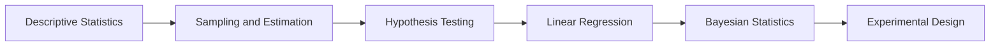

<!-- Generated by tools/build_indexes.py from tools/curriculum.json. Do not edit by hand. -->

# Statistics

*Learning from data*

[Mathematics](../README.md) › Statistics

Descriptive statistics, estimation, hypothesis testing, regression and Bayesian inference: the part of probability that turns data into decisions.

## At a glance

| | |
|---|---|
| Topics | 6 (0 complete, 1 draft, 5 planned) |
| Estimated study time | ~53 hours |
| Prerequisites | [10-probability](../10-probability/README.md) |

## Study order

The numbers are the recommended order. Study a topic only after the ones before it —
the dependency chain below is the shortest safe route through the discipline.

## Topic inventory

| # | Topic | Level | Est. time | Status | Materials |
|---|---|---|---|---|---|
| 1 | [Descriptive Statistics](01-descriptive-statistics/README.md) | Beginner | 8 h | Draft | [Tutorial](01-descriptive-statistics/README.md) |
| 2 | Sampling and Estimation | Intermediate | 9 h | Planned | — |
| 3 | Hypothesis Testing | Intermediate | 10 h | Planned | — |
| 4 | Linear Regression | Intermediate | 9 h | Planned | — |
| 5 | Bayesian Statistics | Advanced | 10 h | Planned | — |
| 6 | Experimental Design | Intermediate | 7 h | Planned | — |

### What each topic covers

- **Descriptive Statistics** — Means, medians, spread, quartiles, outliers and honest data visualisation.
- **Sampling and Estimation** — Sampling distributions, standard error, confidence intervals and bias.
- **Hypothesis Testing** — Null models, p-values, t-tests, power, multiplicity and common misuses.
- **Linear Regression** — Least squares, inference for coefficients, residuals and model checking.
- **Bayesian Statistics** — Priors, posteriors, conjugacy, credible intervals and Bayesian computation.
- **Experimental Design** — Randomisation, blocking, confounding, causal inference and Simpson's paradox.

## Related disciplines

- [19-numerical-analysis](../19-numerical-analysis/README.md)
- [23-applied-mathematics](../23-applied-mathematics/README.md)

## Status key

- **Complete** — tutorial, exercises and full solutions exist and the tutorial meets the
  [authoring standard](../CONTRIBUTING.md).
- **Draft** — some material exists but the topic is not finished.
- **Planned** — identified in the curriculum, not written yet.

Overall progress and the full topic inventory live in [ROADMAP.md](../ROADMAP.md).
