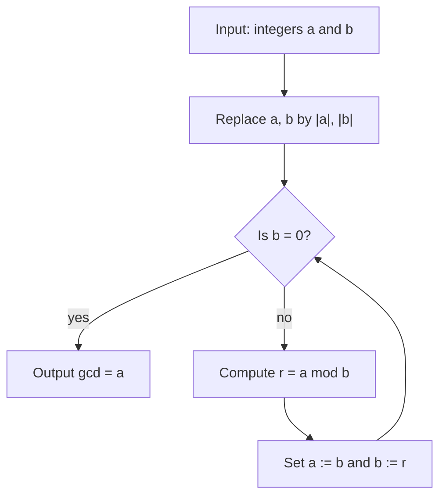
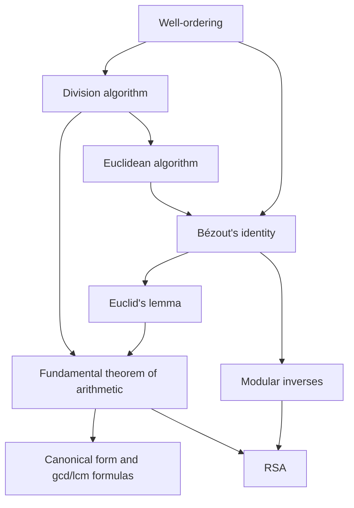

# Divisibility and Primes

> [Mathematics](../../README.md) › [Number Theory](../README.md) › Divisibility and Primes · Level: Intermediate · Prerequisites: [Proof Techniques](../../00-foundations/04-proof-techniques/README.md), [Natural Numbers](../../01-arithmetic/01-natural-numbers/README.md), [Factors and Multiples](../../02-pre-algebra/03-factors-and-multiples/README.md), [Mathematical Induction](../../09-discrete-mathematics/01-mathematical-induction/README.md) · Estimated time: 540 min

## 1. Introduction

Multiplication is the operation that makes the integers interesting. Addition alone gives a line: every integer is $1 + 1 + \cdots + 1$. Multiplication lets a single integer be built from smaller ones in many different ways, and the first surprising theorem in all of mathematics is that the ways are *not* many — every integer above $1$ is built from primes in exactly one way, up to the order of the factors.

That statement, the **fundamental theorem of arithmetic**, is old enough to feel obvious and deep enough that its proof needs real work. It is obvious that $360 = 2^3 \cdot 3^2 \cdot 5$. It is not obvious that no other collection of primes multiplies to $360$, and it is not obvious that the property is special: in the ring $\mathbb{Z}[\sqrt{-5}]$ the number $6$ factors as $2 \cdot 3$ and as $(1 + \sqrt{-5})(1 - \sqrt{-5})$, with all four factors "prime" in the appropriate sense. Uniqueness of factorisation is a *theorem about the integers*, not a truism about multiplication.

This tutorial builds the machinery that makes the theorem provable and the machinery that makes it useful.

* **Division with remainder.** Every integer $a$ can be written $a = qb + r$ with $0 \le r < b$, and the pair $(q, r)$ is unique. This single fact generates almost everything else: it gives the Euclidean algorithm, it gives the base-$b$ representation of numbers, and it is the engine behind the congruence arithmetic of the [next topic](../02-congruences/README.md).
* **The Euclidean algorithm.** Repeated division computes $\gcd(a,b)$ in a number of steps proportional to the number of digits, not to the size of the numbers. It is the oldest algorithm still in daily use, and it comes with a *certificate*: integers $x, y$ with $ax + by = \gcd(a,b)$ (Bézout's identity). That certificate is what turns statements about divisibility into equations, and it is how computers compute modular inverses — which is how RSA decryption works.
* **Primes.** Infinitely many, irregularly spaced, and the input to every public-key cryptosystem. We prove infinitude three times (Euclid, Fermat numbers, factorials) and add a note explaining that the sum of the reciprocals of the primes diverges, which is a much stronger statement than infinitude. We state, without proof, the theorems that describe how primes are distributed: the prime number theorem, Bertrand's postulate and Dirichlet's theorem on primes in arithmetic progressions.
* **Applications.** Cryptography, error detection, hashing, calendar arithmetic, and the design of algorithms that must run in exact integer arithmetic.

The tone throughout is that of a proof course. Every claim about divisibility is proved from the definition, every algorithm comes with a termination proof and a correctness proof, and every numerical claim is checked. The theorems here are used constantly later — in [Congruences](../02-congruences/README.md), in abstract algebra, and in any argument that needs to know that a product of primes is determined by its factors.

## 2. Prerequisites

The following are used freely. Each is taught earlier in the repository.

* **The integers as an ordered ring.** Addition, subtraction, multiplication, the order $\le$, absolute value, and the laws of signs. Taught in [Integers](../../01-arithmetic/02-integers/README.md).
* **The natural numbers and well-ordering.** $\mathbb{N} = \{1, 2, 3, \dots\}$ and $\mathbb{N}_0 = \{0, 1, 2, 3, \dots\}$ (this repository's convention; see [MATHEMATICAL_NOTATION.md](../../MATHEMATICAL_NOTATION.md)). Every nonempty subset of $\mathbb{N}_0$ has a least element. Taught in [Natural Numbers](../../01-arithmetic/01-natural-numbers/README.md).
* **Mathematical induction, weak and strong.** The template — statement, base case, hypothesis, step, conclusion — and course-of-values induction. Taught in [Mathematical Induction](../../09-discrete-mathematics/01-mathematical-induction/README.md). We use induction for the existence half of the fundamental theorem of arithmetic and for identities about gcd.
* **Proof techniques.** Direct proof, proof by contradiction, proof by contrapositive, uniqueness proofs (existence plus "at most one"). Taught in [Proof Techniques](../../00-foundations/04-proof-techniques/README.md).
* **Sets and quantifiers.** $\mid$, set-builder notation, $\forall$, $\exists$, $\exists!$, and the negation rules. Taught in [Set Theory](../../00-foundations/03-set-theory/README.md) and [Logic](../../00-foundations/02-logic/README.md).
* **Elementary algebra.** Expanding products, factoring $a^2 - b^2$, manipulating fractions, and the laws of exponents $a^{m+n} = a^m a^n$, $(a^m)^n = a^{mn}$. Taught in [Elementary Algebra](../../03-algebra/01-elementary-algebra/README.md) and [Exponents and Roots](../../01-arithmetic/07-exponents-and-roots/README.md).
* **Sum and product notation.** $\sum_{k=1}^{n} a_k$ and $\prod_{k=1}^{n} a_k$. Taught in [Advanced Algebra](../../03-algebra/14-advanced-algebra/README.md).
* **A first pass at gcd, lcm and divisibility rules.** You should have seen factor trees, the Euclidean algorithm as a procedure, and the divisibility tests for $2, 3, 5, 9$. Those ideas are revisited here with proofs; the beginner treatment is [Factors and Multiples](../../02-pre-algebra/03-factors-and-multiples/README.md).

Two conventions matter throughout:

* $0$ is divisible by every integer, because $0 = 0 \cdot a$. Correspondingly $\gcd(0,0)$ is **undefined** — every positive integer divides both entries, so there is no greatest common divisor. Every statement below that mentions $\gcd(a,b)$ silently assumes $(a,b) \neq (0,0)$, and where the case is delicate it is stated.
* $1$ is neither prime nor composite. This is not pedantry: it is what makes the fundamental theorem of arithmetic true in the form "unique". Were $1$ prime, $360 = 2^3 \cdot 3^2 \cdot 5 = 1 \cdot 2^3 \cdot 3^2 \cdot 5 = 1^2 \cdot 2^3 \cdot 3^2 \cdot 5$ would be three distinct factorisations.

## 3. Learning Objectives

By the end of this tutorial you will be able to:

1. State the definition of $a \mid b$ and use it to prove the elementary properties of divisibility, including transitivity and closure under integer linear combinations.
2. State the division algorithm with its exact hypotheses, and prove both existence and uniqueness.
3. Explain why the well-ordering principle is the right tool for both halves, and where the proof would fail without the hypothesis $b \ne 0$.
4. Define $\gcd$ and $\operatorname{lcm}$ for integers not both zero, prove that they exist, and compute them by the Euclidean algorithm.
5. Prove that the Euclidean algorithm terminates and returns $\gcd(a,b)$, and explain why the remainder sequence strictly decreases.
6. State and prove Bézout's identity, and run the extended Euclidean algorithm by hand to produce the coefficients.
7. Prove Euclid's lemma, and explain exactly where coprimality enters.
8. Prove both halves of the fundamental theorem of arithmetic, and explain why uniqueness needs Euclid's lemma rather than induction alone.
9. Prove that there are infinitely many primes in at least three different ways, and state why divergence of $\sum_p 1/p$ is a stronger fact.
10. Describe the sieve of Eratosthenes, prove that it leaves exactly the primes, and state its cost.
11. State the prime number theorem, Bertrand's postulate and Dirichlet's theorem, and distinguish what is proved here from what is merely stated.
12. Use the identities $\gcd(a,b)\operatorname{lcm}(a,b) = \lvert ab\rvert$ and $\gcd(a,b) = \gcd(a, b \bmod a)$ in computations and in proofs.
13. Explain the role of primality and of the extended Euclidean algorithm in RSA key generation and decryption.

## 4. Intuition

### 4.1 Atoms of multiplication

Chemistry has a periodic table because matter can be taken apart and the pieces stop getting simpler: hydrogen is not made of anything smaller. Integers behave the same way under multiplication. Take $360$ apart: $360 = 2 \cdot 180 = 2 \cdot 2 \cdot 90 = 2 \cdot 2 \cdot 2 \cdot 45 = 2^3 \cdot 3 \cdot 15 = 2^3 \cdot 3^2 \cdot 5$. You can take it apart in a different order, but you cannot avoid arriving at three $2$s, two $3$s and one $5$. A **prime** is an integer that cannot be taken apart; the fundamental theorem of arithmetic says that the primes are complete and non-redundant building blocks.

The chemistry analogy breaks in one place, and the break is instructive. Chemical elements combine in only a few ways; integers combine in exactly one way. That rigidity is what makes divisibility a usable tool, and it is what fails in other number systems.

### 4.2 Tiling a rectangle with squares

The Euclidean algorithm has a picture. Take a rectangle with integer sides, say $1071 \times 462$. Cut off the largest possible square: a $462 \times 462$ square fits twice, so $1071 = 2 \cdot 462 + 147$, and the leftover strip is $462 \times 147$. Cut the largest square from that: $462 = 3 \cdot 147 + 21$, leaving $147 \times 21$. Then $147 = 7 \cdot 21$ exactly, and the $21 \times 21$ square tiles the remainder perfectly.

The side of the largest square tile that fills the original rectangle is $\gcd(1071, 462) = 21$. Two facts are visible in the picture:

* the process must stop, because each cut produces a strictly smaller rectangle with integer sides;
* when it stops, the last square tiles everything, so its side divides both original sides — and the geometric slicing shows it is the largest such side.

Section 7.6 turns both observations into proofs.

### 4.3 Why the algorithm is fast

Suppose someone hands you two $600$-digit numbers and asks for their gcd. Factoring both is hopeless — the best known algorithms would take longer than the age of the universe. The Euclidean algorithm takes about $1800$ divisions.

The reason is that the remainders shrink *multiplicatively*, not additively. In the division $a = qb + r$ with $0 \le r < b$, either $r \le b/2$, or $r > b/2$ in which case the next step divides $b$ by $r$ and leaves remainder $b - r < b/2$. So every two steps at least halve the smaller number, and the number of steps is at most about $2\log_2 b$ — roughly $6.6$ times the number of decimal digits.

This speed — not the existence of a common divisor — is what makes the algorithm the backbone of computational number theory, and why it survives verbatim in every modern mathematics library.

## 5. Formal Definition

### 5.1 Division

**Definition 5.1.1 (Divisibility).** Let $a, b \in \mathbb{Z}$. We say that $a$ **divides** $b$, written $a \mid b$, when
$$\exists\, k \in \mathbb{Z} \quad b = ak.$$
In that case $a$ is a **divisor** of $b$, $b$ is a **multiple** of $a$, and $b$ is **divisible** by $a$. We write $a \nmid b$ for the negation:
$$a \nmid b \iff \forall\, k \in \mathbb{Z}\quad b \neq ak.$$

The definition is an existential statement, and every proof about divisibility begins by *unpacking it into a witness*: from $a \mid b$ we may name an integer $k$ with $b = ak$, and to prove $a \mid b$ we must exhibit such a $k$. Note that the quantifier is over *all* integers, so negative quotients are allowed: $6 \mid (-18)$ because $-18 = 6 \cdot (-3)$.

### 5.2 Primes and composites

**Definition 5.2.1 (Prime, composite).** An integer $p$ is **prime** when $p > 1$ and the only positive divisors of $p$ are $1$ and $p$. An integer $n > 1$ that is not prime is **composite**; equivalently $n = ab$ with integers $1 < a < n$ and $1 < b < n$.

The phrase "the only positive divisors" is a universally quantified statement: for all $d \in \mathbb{N}$, if $d \mid p$ then $d = 1$ or $d = p$. To prove that a specific number $n$ is prime you must exclude *every* $d$ with $1 < d < n$ — which is why primality testing is a computational problem and not a matter of checking a formula.

The first primes are
$$2,\ 3,\ 5,\ 7,\ 11,\ 13,\ 17,\ 19,\ 23,\ 29,\ 31,\ 37,\ 41,\ 43,\ 47,\ \dots$$

### 5.3 Greatest common divisor and least common multiple

**Definition 5.3.1 (Greatest common divisor).** Let $a, b \in \mathbb{Z}$ with $(a,b) \neq (0,0)$. A **common divisor** of $a$ and $b$ is an integer $d$ with $d \mid a$ and $d \mid b$. The **greatest common divisor** $\gcd(a,b)$ is the largest positive common divisor:
$$\gcd(a,b) = \max\{\, d \in \mathbb{N} : d \mid a \ \text{and}\ d \mid b \,\}.$$

**Definition 5.3.2 (Least common multiple).** With $a, b$ as above, a **common multiple** is an integer $m \ne 0$ with $a \mid m$ and $b \mid m$; the **least common multiple** $\operatorname{lcm}(a,b)$ is the smallest positive common multiple:
$$\operatorname{lcm}(a,b) = \min\{\, m \in \mathbb{N} : a \mid m \ \text{and}\ b \mid m \,\}.$$

Both definitions presuppose that the sets in question have the extremum claimed. That is a genuine obligation, discharged in Theorems 7.5.1 and 7.13.1: the set of positive common divisors is nonempty (it contains $1$) and bounded above, and the set of positive common multiples is nonempty (it contains $\lvert ab\rvert$ when $ab \ne 0$) and well-ordered, so both extrema exist.

### 5.4 Coprimality

**Definition 5.4.1 (Coprime).** Integers $a, b$ are **coprime** (or **relatively prime**) when $\gcd(a,b) = 1$; equivalently, when their only positive common divisor is $1$.

Coprimality is not a property of either number alone. $6$ and $35$ are coprime even though both are composite, because $6 = 2\cdot 3$ and $35 = 5 \cdot 7$ share no prime factor. Almost every theorem in this tutorial that is false in general is true under a coprimality hypothesis; Section 11 collects the resulting errors.

### 5.5 Quotient and remainder

**Definition 5.5.1 (Quotient and remainder).** Let $a \in \mathbb{Z}$, $b \in \mathbb{N}$. The **quotient** $q$ and **remainder** $r$ of $a$ on division by $b$ are the unique integers with
$$a = qb + r, \qquad 0 \le r < b,$$
whose existence and uniqueness are proved in Section 7.3. We write $a \bmod b$ for $r$; the operation is the one implemented by the `%` operator in most programming languages (for non-negative $b$).

## 6. Mathematical Notation

| Symbol | Read as | Meaning |
|---|---|---|
| $a \mid b$ | $a$ divides $b$ | $b = ak$ for some $k \in \mathbb{Z}$ |
| $a \nmid b$ | $a$ does not divide $b$ | no such $k$ exists |
| $p, q$ | prime | $p > 1$ with no positive divisors other than $1$ and $p$ |
| $\gcd(a,b)$ | gcd of $a$ and $b$ | largest positive common divisor |
| $\operatorname{lcm}(a,b)$ | lcm of $a$ and $b$ | least positive common multiple |
| $a \bmod b$ | $a$ modulo $b$ | the remainder $r$ with $0 \le r < b$ |
| $\lfloor x \rfloor$ | floor of $x$ | greatest integer $\le x$ |
| $\lvert a\rvert$ | absolute value | $a$ if $a \ge 0$, otherwise $-a$ |
| $n!$ | $n$ factorial | $1 \cdot 2 \cdots n$, with $0! = 1$ |
| $\prod_{k=1}^{n} a_k$ | product | $a_1 a_2 \cdots a_n$ |
| $\sum_{k=1}^{n} a_k$ | sum | $a_1 + a_2 + \cdots + a_n$ |
| $\pi(x)$ | pi of $x$ | the number of primes $p \le x$ |
| $p_n$ | the $n$-th prime | $p_1 = 2$, $p_2 = 3$, $p_3 = 5, \dots$ |
| $\ln x$ | natural log | logarithm base $e$ |
| $\sim$ | asymptotic equivalence | $f \sim g$ means $f(x)/g(x) \to 1$ |
| $\blacksquare$ | end of proof | the argument is complete |

Reading aloud: "$a \mid b$" is "a divides b" or "a is a factor of b"; "$a \nmid b$" is "a does not divide b"; "$\gcd(a,b)=1$" is "a and b are coprime". The barred symbol $\nmid$ negates the *relation*, not the number: $4 \nmid 6$ is read "four does not divide six".

## 7. Core Concepts

### 7.1 The well-ordering principle

**Axiom 7.1.1 (Well-ordering).** Every nonempty subset $S \subseteq \mathbb{N}_0$ has a least element: there is $m \in S$ with $m \le s$ for every $s \in S$.

This is the axiom on which every existence proof in this tutorial rests. It is logically equivalent to the principle of induction — the equivalence is proved in [Mathematical Induction](../../09-discrete-mathematics/01-mathematical-induction/README.md) — so using it is not a new assumption, only a more convenient form of the old one.

Two consequences we use repeatedly:

* **No infinite descent.** There is no infinite sequence $n_0 > n_1 > n_2 > \cdots$ of natural numbers. For the set of its terms would have a least element $n_k$, and $n_{k+1} < n_k$ would contradict minimality. This is how termination of the Euclidean algorithm is proved.
* **Least counterexample.** If a property fails for some natural number, there is a *least* natural number for which it fails. This is how the existence half of the fundamental theorem of arithmetic is proved, and it is the form of induction that stays closest to the structure of the proof.

The hypothesis "subset of $\mathbb{N}_0$" cannot be relaxed. The set of positive rationals has no least element, the set of positive reals has no least element, and $\mathbb{Z}$ itself has no least element. Every well-ordering argument must first produce a set of *non-negative integers*.

### 7.2 The division algorithm: statement

**Theorem 7.2.1 (The division algorithm).** Let $a \in \mathbb{Z}$ and $b \in \mathbb{N}$. Then there exist **unique** integers $q, r$ with
$$a = qb + r \qquad \text{and} \qquad 0 \le r < b.$$

The name is traditional and misleading: the statement is a theorem, not an algorithm, and it says nothing about how to find $q$ and $r$ efficiently. It is nonetheless the single most used theorem in elementary number theory, because it is the only general procedure that converts an arbitrary integer into one lying in a fixed finite range.

Three remarks on the hypotheses.

* $b \in \mathbb{N}$ means $b \ge 1$. The case $b = 0$ is excluded because no $r$ can satisfy $0 \le r < 0$, and because the equation $a = q \cdot 0 + r = r$ would force $r = a$, destroying uniqueness of $q$.
* Negative $b$ is allowed by a reduction: if $b < 0$, apply the theorem to $-b$ and negate the quotient. We keep $b > 0$ to avoid carrying signs through every proof.
* Negative $a$ is allowed and is the case that requires care in computation. For $a = -47$ and $b = 9$ the answer is $q = -6$, $r = 7$, not $q = -5$, $r = -2$, because the remainder must be non-negative. Many programming languages disagree about this convention for negative operands; the mathematical convention is fixed by $0 \le r < b$.

### 7.3 Proof of the division algorithm

**Proof of Theorem 7.2.1.**

*Existence.* Consider the set
$$S = \{\, a - qb : q \in \mathbb{Z},\ a - qb \ge 0 \,\} \subseteq \mathbb{N}_0 .$$
The set $S$ is nonempty: taking $q = -\lvert a\rvert$ gives
$$a - qb = a + \lvert a\rvert b \ge a + \lvert a\rvert \ge 0,$$
where the first inequality uses $b \ge 1$ and the second uses $\lvert a \rvert \ge -a$. So by Axiom 7.1.1 the set $S$ has a least element; write it as
$$r = a - qb$$
for the corresponding integer $q$. By construction $r \ge 0$. We claim $r < b$. If instead $r \ge b$, then
$$r - b = a - (q+1)b \ge 0,$$
so $r - b \in S$, and $r - b < r$ contradicts the minimality of $r$ in $S$. Hence $0 \le r < b$, and $a = qb + r$ as required.

*Uniqueness.* Suppose
$$a = qb + r = q'b + r', \qquad 0 \le r < b, \quad 0 \le r' < b.$$
Subtracting gives
$$(q - q')\,b = r' - r .$$
Hence $b \mid (r' - r)$. On the other hand $-b < r' - r < b$, because $0 \le r < b$ and $0 \le r' < b$. The only multiple of $b$ strictly between $-b$ and $b$ is $0$: indeed if $b \mid n$ with $n \ne 0$ then $\lvert n \rvert \ge b$ (property D5 of Section 7.4). Therefore $r' - r = 0$, so $r = r'$, and then $(q - q')b = 0$ with $b \ne 0$ gives $q = q'$. $\blacksquare$

The proof of existence *finds* $r$ by minimizing over a set, which is not an algorithm. To compute, one uses the classical school method — repeatedly subtract $b$ — or, in practice, floating-point estimation with correction. The minimality argument is the standard way to prove that the answer one computes is the answer the theorem describes.

**Corollary 7.3.1 (Bounded representatives).** Every integer is congruent modulo $b$ to exactly one element of $\{0, 1, \dots, b-1\}$. (Congruence is defined in [Congruences](../02-congruences/README.md); the corollary is used there as the definition of a complete residue system.)

### 7.4 Elementary properties of divisibility

The following are used so often that they deserve names. Each is proved from Definition 5.1.1 by producing the required integer.

**(D1) Trivialities.** For all $a, b \in \mathbb{Z}$: $a \mid 0$, $\;1 \mid a$, $\;a \mid a$, $\;-a \mid a$, and $a \mid b \iff a \mid (-b)$.

*Proof.* $0 = a \cdot 0$; $a = 1 \cdot a$; $a = a \cdot 1$; $a = (-a)(-1)$; and $b = ak \iff -b = a(-k)$. $\square$

**(D2) Transitivity.** If $a \mid b$ and $b \mid c$ then $a \mid c$.

*Proof.* Write $b = ak$ and $c = bm$ with $k, m \in \mathbb{Z}$. Then $c = (ak)m = a(km)$, and $km \in \mathbb{Z}$. $\square$

**(D3) Closure under linear combinations.** If $a \mid b$ and $a \mid c$ then $a \mid (bx + cy)$ for all $x, y \in \mathbb{Z}$.

*Proof.* Write $b = ak$, $c = am$. Then $bx + cy = a(kx + my)$ and $kx + my \in \mathbb{Z}$. $\square$

This is the workhorse of divisibility arguments: it says the set of multiples of $a$ is closed under addition and subtraction. In particular, if $a \mid b$ then $a \mid (b + ka)$ for every integer $k$ — which is why the Euclidean algorithm may replace $a$ by $a - qb$ without changing the set of common divisors.

**(D4) Multiplication.** If $a \mid b$ then $ac \mid bc$ for every $c \in \mathbb{Z}$.

*Proof.* $b = ak$ gives $bc = (ac)k$. $\square$

**(D5) Size bound.** If $a \mid b$ and $b \ne 0$ then $\lvert a\rvert \le \lvert b\rvert$.

*Proof.* Write $b = ak$ with $k \ne 0$, so $\lvert k \rvert \ge 1$. Then $\lvert b\rvert = \lvert a\rvert\,\lvert k\rvert \ge \lvert a\rvert$. $\square$

This is the only property that uses the order structure of $\mathbb{Z}$, and it is what makes "greatest" meaningful: without a size bound, a set of divisors could be infinite and would have no maximum.

**(D6) Antisymmetry up to sign.** For nonzero $a, b$: $\;a \mid b$ and $b \mid a$ if and only if $a = \pm b$.

*Proof.* If $a = \pm b$ the divisibilities are D1. Conversely, by D5 applied twice, $\lvert a \rvert \le \lvert b \rvert \le \lvert a \rvert$, so $\lvert a\rvert = \lvert b\rvert$, that is $a = \pm b$. $\square$

**(D7) Cancellation.** If $ac \mid bc$ and $c \ne 0$ then $a \mid b$.

*Proof.* Write $bc = (ac)k$. Then $c(b - ak) = 0$, and since $c \ne 0$ and $\mathbb{Z}$ has no zero divisors, $b = ak$. $\square$

Note what D7 does **not** say: from $ac \equiv bc \pmod n$ you may **not** conclude $a \equiv b \pmod n$ without a coprimality hypothesis on $c$ and $n$. The divisibility statement above is fine because the modulus is an actual factor; the congruence statement is not, and [Congruences](../02-congruences/README.md) gives the correct criterion.

**(D8) Coprime cancellation.** If $\gcd(a, c) = 1$ and $a \mid bc$ then $a \mid c$.

*Proof.* By Bézout's identity (Theorem 7.5.2 below) there are $x, y$ with $ax + cy = 1$. Multiplying by $c$,
$$c = a(cx) + (bc)\,y .$$
Both terms on the right are divisible by $a$: the first since $a \mid a$, the second since $a \mid bc$. By D3, $a \mid c$. $\square$

D8 is the form in which coprimality usually enters. Without it the statement is false: $4 \mid 6 \cdot 2$ but $4 \nmid 6$ and $4 \nmid 2$.

### 7.5 The greatest common divisor exists and is a linear combination

**Theorem 7.5.1 (Existence and basic properties of gcd).** Let $a, b \in \mathbb{Z}$ with $(a,b) \neq (0,0)$.

1. $\gcd(a,b)$ exists, is positive, and $\gcd(a,b) = \gcd(b,a) = \gcd(\lvert a\rvert, \lvert b\rvert)$.
2. If $b = 0$ then $\gcd(a,b) = \lvert a \rvert$.
3. If $a \mid b$ then $\gcd(a,b) = \lvert a \rvert$.

*Proof.* (1) The set $D$ of positive common divisors is nonempty since $1 \in D$. It is bounded above: if $a \ne 0$ then every $d \in D$ satisfies $d \le \lvert a\rvert$ by D5, and similarly for $b$; since $(a,b)\ne(0,0)$ at least one of these bounds applies. A nonempty subset of $\mathbb{Z}$ that is bounded above and contained in $\mathbb{N}$ has a maximum (it is a finite set), so the maximum exists. The equalities hold because $d \mid a \iff d \mid \lvert a\rvert$ by D1.

(2) Every positive divisor of $a$ divides $a$ and divides $0$, so $D$ is the set of positive divisors of $a$, whose maximum is $\lvert a \rvert$.

(3) $\lvert a\rvert$ divides both $a$ and $b$, and no positive common divisor exceeds $\lvert a \rvert$ by D5. $\blacksquare$

**Theorem 7.5.2 (Bézout's identity).** Let $a, b \in \mathbb{Z}$, not both zero. Then there exist integers $x, y$ with
$$ax + by = \gcd(a,b).$$
Moreover $\gcd(a,b)$ is the *least positive* integer of the form $ax + by$.

*Proof.* Consider
$$S = \{\, ax + by : x, y \in \mathbb{Z},\ ax + by > 0 \,\} \subseteq \mathbb{N}.$$
The set $S$ is nonempty: taking $x = a$ and $y = b$ gives $a^2 + b^2 > 0$, which lies in $S$. By Axiom 7.1.1, $S$ has a least element; write it as
$$d = ax_0 + by_0 > 0 .$$

*Claim 1: $d \mid a$ and $d \mid b$.* Divide $a$ by $d$ using Theorem 7.2.1: $a = qd + r$ with $0 \le r < d$. Then
$$r = a - qd = a - q(ax_0 + by_0) = a(1 - qx_0) + b(-qy_0),$$
so $r$ has the form $ax + by$. If $r > 0$ then $r \in S$ and $r < d$, contradicting the minimality of $d$. Hence $r = 0$ and $d \mid a$. The same argument with $a$ replaced by $b$ gives $d \mid b$.

*Claim 2: $d$ is the greatest common divisor.* By Claim 1, $d$ is a common divisor. If $c$ is any positive common divisor of $a$ and $b$, then $c \mid (ax_0 + by_0) = d$ by D3, so $c \le d$ by D5. Hence $d = \gcd(a,b)$, and it is the least positive element of $S$ because every element of $S$ is a positive multiple of $d$ and hence at least $d$. $\blacksquare$

Note that the proof is *non-constructive*: it produces $x_0, y_0$ from a minimum rather than from a computation. Section 7.7 supplies the computation, which is exactly the extended Euclidean algorithm. This separation of existence from construction is standard and worth noticing.

**Corollary 7.5.3 (Coprimality as an equation).** For $a, b$ not both zero,
$$\gcd(a,b) = 1 \iff \exists\, x, y \in \mathbb{Z} \quad ax + by = 1 .$$

*Proof.* ($\Rightarrow$) is Bézout. ($\Leftarrow$) If $ax + by = 1$ and $d$ is a positive common divisor of $a,b$, then $d \mid 1$, so $d = 1$. $\square$

This corollary is the reason coprimality hypotheses are so powerful: they give you an *equation* to work with. The proof of D8 and of Euclid's lemma both consist of multiplying that equation by something.

**Corollary 7.5.4 (Common divisors divide the gcd).** For $a, b$ not both zero, the common divisors of $a$ and $b$ are precisely the divisors of $\gcd(a,b)$.

*Proof.* Let $g = \gcd(a,b)$. If $d \mid g$ then $d \mid a$ and $d \mid b$ by D2. Conversely, if $d \mid a$ and $d \mid b$, then $d \mid (ax + by) = g$ by D3 and Bézout. $\square$

**Corollary 7.5.5 (Scaling).** For $m \in \mathbb{N}$ and $(a,b) \ne (0,0)$: $\;\gcd(ma, mb) = m\,\gcd(a,b)$.

*Proof.* Let $g = \gcd(a,b)$, so $a = ga'$, $b = gb'$ with $\gcd(a',b') = 1$ by the previous corollary (if $d \mid a'$ and $d \mid b'$ then $gd$ is a common divisor of $a,b$, so $gd \mid g$, so $d = 1$). Then $mg$ divides both $ma$ and $mb$. Conversely if $c$ divides $ma$ and $mb$, then $c/m$ need not be an integer, so we argue with Bézout instead: write $a'x + b'y = 1$; multiplying by $mg$ gives $ma \cdot x + mb \cdot y = mg$. Any common divisor $c$ of $ma$ and $mb$ divides the left side, hence divides $mg$. So $mg$ is the greatest common divisor. $\square$

### 7.6 The Euclidean algorithm

The algorithm rests on one observation, which converts the problem of computing $\gcd(a,b)$ into a smaller instance of itself.

**Lemma 7.6.1 (Invariance under division).** Let $a = qb + r$ with $q, r \in \mathbb{Z}$. Then the set of common divisors of $a$ and $b$ equals the set of common divisors of $b$ and $r$; consequently
$$\gcd(a,b) = \gcd(b,r).$$

*Proof.* If $d \mid a$ and $d \mid b$ then $d \mid (a - qb) = r$ by D3. If $d \mid b$ and $d \mid r$ then $d \mid (qb + r) = a$ by D3. So the two sets of common divisors are equal, and they have the same maximum. (If both sets are empty — which happens only when $a = b = 0$ — the conclusion is vacuous; the hypothesis $(a,b) \neq (0,0)$ excludes it.) $\square$

**Theorem 7.6.2 (The Euclidean algorithm).** Let $a, b \in \mathbb{Z}$ with $b \ge 1$. Define $r_{-1} = a$, $r_0 = b$, and for $i \ge 0$, as long as $r_i \ne 0$, let $q_{i+1}$ and $r_{i+1}$ be the quotient and remainder of $r_{i-1}$ on division by $r_i$:
$$r_{i-1} = q_{i+1} r_i + r_{i+1}, \qquad 0 \le r_{i+1} < r_i .$$
Then the process terminates: there is an index $N \ge 0$ with $r_{N+1} = 0$, and
$$\gcd(a,b) = r_N .$$

*Proof.* *Termination.* The sequence $r_1, r_2, \dots$ consists of non-negative integers and satisfies $r_{i+1} < r_i$ strictly for every $i$ for which $r_{i+1}$ is defined. By the no-infinite-descent consequence of Axiom 7.1.1 (Section 7.1), such a sequence cannot be infinite; hence some remainder is $0$. Let $N$ be the index of the last nonzero remainder, so $r_N > 0$ and $r_{N+1} = 0$.

*Correctness.* By Lemma 7.6.1 applied to $r_{i-1} = q_{i+1}r_i + r_{i+1}$,
$$\gcd(r_{i-1}, r_i) = \gcd(r_i, r_{i+1})$$
for each $i$. Chaining these equalities from $i = 0$ to $i = N-1$,
$$\gcd(a,b) = \gcd(r_{-1}, r_0) = \gcd(r_0, r_1) = \cdots = \gcd(r_N, r_{N+1}) = \gcd(r_N, 0) = r_N ,$$
using Theorem 7.5.1(2) for the last step. $\blacksquare$

Note the two obligations, and note that they are different: *termination* uses only the arithmetic of $\mathbb{N}_0$ (the remainder is smaller than the divisor), while *correctness* uses the divisibility lemma. An algorithm can terminate without being correct, and the proofs must be given separately.

**Worked tableau.** For $a = 1071$, $b = 462$:

| Step | Division | Quotient | Remainder |
|---|---|---|---|
| 1 | $1071 = 2 \cdot 462 + 147$ | $2$ | $147$ |
| 2 | $462 = 3 \cdot 147 + 21$ | $3$ | $21$ |
| 3 | $147 = 7 \cdot 21 + 0$ | $7$ | $0$ |

The last nonzero remainder is $21$, so $\gcd(1071,462) = 21$. Cross-check by factoring: $1071 = 3^2 \cdot 7 \cdot 17$ and $462 = 2 \cdot 3 \cdot 7 \cdot 11$, so the common part is $3 \cdot 7 = 21$. ✓

**Theorem 7.6.3 (Cost of the Euclidean algorithm).** With $a, b \ge 1$ and $a > b$, the number of divisions performed is at most $2\log_2 b + 1$. In particular the algorithm runs in time polynomial in the number of digits of the inputs — $\mathrm{O}(\log b)$ divisions, each of them a division of numbers of at most $\log b$ bits.

*Sketch.* In each step $r_{i+1} < r_i$. Moreover $r_{i+1} < \tfrac{1}{2} r_{i-1}$: if $r_i \le \tfrac{1}{2} r_{i-1}$ this is immediate from $r_{i+1} < r_i$; if $r_i > \tfrac{1}{2}r_{i-1}$ then $q_{i+1} = 1$ and $r_{i+1} = r_{i-1} - r_i < \tfrac{1}{2} r_{i-1}$. So every two steps halve the remainder, giving the bound. $\square$

**Remark 7.6.4 (Lamé, 1844).** The number of divisions is at most five times the number of decimal digits of the smaller input. The bound is attained, up to a constant, by consecutive Fibonacci numbers: for $a = F_{n+1}$, $b = F_n$ every quotient equals $1$ and the algorithm performs $n-1$ divisions, the maximum possible for inputs of that size. This is the standard explanation of why the "worst case" of the Euclidean algorithm looks like slow, even growth rather than like random numbers.

### 7.7 The extended Euclidean algorithm

Bézout's identity guarantees coefficients; the **extended Euclidean algorithm** computes them by carrying two extra columns through the same divisions. The invariant is
$$r_i = s_i a + t_i b ,$$
initialized with $(r_{-1}, s_{-1}, t_{-1}) = (a, 1, 0)$ and $(r_0, s_0, t_0) = (b, 0, 1)$. Since $r_{i+1} = r_{i-1} - q_{i+1}r_i$, the update is
$$s_{i+1} = s_{i-1} - q_{i+1}s_i, \qquad t_{i+1} = t_{i-1} - q_{i+1}t_i .$$
Because each row's identity $r_i = s_i a + t_i b$ is a linear combination of the two preceding rows, the invariant holds at every step; at the end, $r_N = \gcd(a,b)$ and $(s_N, t_N)$ is a Bézout pair.

**Worked example: $a = 240$, $b = 46$.**

| $i$ | $r_i$ | $q_i$ | $s_i$ | $t_i$ |
|---|---|---|---|---|
| $-1$ | $240$ | — | $1$ | $0$ |
| $0$ | $46$ | — | $0$ | $1$ |
| $1$ | $10$ | $5$ | $1$ | $-5$ |
| $2$ | $6$ | $4$ | $-4$ | $21$ |
| $3$ | $4$ | $1$ | $5$ | $-26$ |
| $4$ | $2$ | $1$ | $-9$ | $47$ |
| $5$ | $0$ | $2$ | — | — |

Reading the rows: $10 = 240 - 5\cdot 46$; $\;6 = -4\cdot 240 + 21 \cdot 46 = -960 + 966$ ✓; $\;4 = 5 \cdot 240 - 26 \cdot 46 = 1200 - 1196$ ✓; $\;2 = -9 \cdot 240 + 47 \cdot 46 = -2160 + 2162$ ✓. So
$$\gcd(240,46) = 2, \qquad 240 \cdot (-9) + 46 \cdot 47 = 2 .$$

**Remark 7.7.1 (Size of the coefficients).** The pair $(s_N, t_N)$ produced by this recursion satisfies $\lvert s_N \rvert \le b/(2g)$ and $\lvert t_N \rvert \le a/(2g)$ when $a, b > 0$ and $g = \gcd(a,b)$; in the example, $9 \le 46/4 = 11.5$ and $47 \le 240/4 = 60$. So the coefficients are not much larger than the inputs — a fact that matters in cryptography, where $a$ and $b$ have hundreds of digits.

**Corollary 7.7.2 (Modular inverses).** If $\gcd(a,n) = 1$ then the extended Euclidean algorithm produces $x, y$ with $ax + ny = 1$, and then $ax \equiv 1 \pmod n$. The integer $x \bmod n$ is the **inverse of $a$ modulo $n$**, written $a^{-1}$. This is the only practical method for computing inverses modulo a large $n$, and it is used in every implementation of RSA. The theory of inverses is developed in [Congruences](../02-congruences/README.md).

### 7.8 Euclid's lemma

**Lemma 7.8.1 (Every integer above $1$ has a prime divisor).** For every integer $n \ge 2$ there exists a prime $p$ with $p \mid n$.

*Proof.* The set of divisors $d$ of $n$ with $d \ge 2$ is nonempty (it contains $n$) and finite, so it has a least element $p$. If $p$ were composite, then $p = ab$ with $1 < a < p$, and then $a \mid p \mid n$, so $a$ would be a smaller divisor $\ge 2$ of $n$, contradicting minimality. Hence $p$ is prime. $\square$

**Theorem 7.8.2 (Euclid's lemma).** Let $p$ be prime and $a, b \in \mathbb{Z}$. If $p \mid ab$ then $p \mid a$ or $p \mid b$.

*Proof.* Suppose $p \mid ab$. If $p \mid a$ there is nothing to prove, so assume $p \nmid a$. The positive divisors of $p$ are $1$ and $p$; since $p \nmid a$, the only common positive divisor of $p$ and $a$ is $1$, that is $\gcd(p,a) = 1$. By Bézout there are integers $x, y$ with $px + ay = 1$. Multiplying by $b$,
$$b = pbx + aby .$$
Now $p \mid pbx$ trivially, and $p \mid aby$ because $p \mid ab$. By D3, $p \mid b$. $\square$

**Warning.** The lemma is false if $p$ is replaced by a composite number: $6 \mid 4 \cdot 3$ but $6 \nmid 4$ and $6 \nmid 3$. The primality of $p$ enters at exactly one point — the claim that the only positive divisors of $p$ are $1$ and $p$ — and that is what makes $\gcd(p,a) = 1$ rather than some nontrivial value.

**Corollary 7.8.3 (Iterated form).** If $p$ is prime and $p \mid a_1 a_2 \cdots a_k$ then $p \mid a_j$ for some $j$.

*Proof.* Induction on $k$. For $k = 1$ trivial. For $k \ge 2$, apply Theorem 7.8.2 with $a = a_1\cdots a_{k-1}$ and $b = a_k$: either $p \mid a_k$, or $p \mid a_1 \cdots a_{k-1}$ and the inductive hypothesis applies. $\square$

**Corollary 7.8.4.** If $p$ is prime and $p \mid a^k$ for some $k \ge 1$, then $p \mid a$.

*Proof.* Apply Corollary 7.8.3 with all $a_j = a$. $\square$

### 7.9 The fundamental theorem of arithmetic

**Theorem 7.9.1 (Fundamental theorem of arithmetic).** Every integer $n \ge 2$ can be written as a product of primes,
$$n = p_1 p_2 \cdots p_r ,$$
and this representation is **unique up to the order of the factors**: if also $n = q_1 q_2 \cdots q_s$ with all $q_j$ prime, then $r = s$ and there is a permutation $\sigma$ of $\{1, \dots, r\}$ with $p_i = q_{\sigma(i)}$ for all $i$.

*Proof.* *Existence.* Strong induction on $n$. For $n = 2$ the number $2$ is prime, so $r = 1$ and $p_1 = 2$. Now let $n \ge 3$ and assume every integer $m$ with $2 \le m < n$ has a prime factorisation. If $n$ is prime we are done as before. Otherwise $n$ is composite, so $n = ab$ with $1 < a < n$ and $1 < b < n$. By the inductive hypothesis both $a$ and $b$ are products of primes; concatenating those two products expresses $n$ as a product of primes.

*Uniqueness.* Suppose $p_1 \cdots p_r = q_1 \cdots q_s$ with all $p_i, q_j$ prime. We induct on $r$.

If $r = 1$ then $p_1 = q_1 \cdots q_s$. Each $q_j$ divides $p_1$, and the only positive divisors of the prime $p_1$ are $1$ and $p_1$; since $q_j \ge 2$ we get $q_j = p_1$ for every $j$. If $s \ge 2$ this would give $p_1 = p_1^2 \cdot (\text{other factors}) \ge p_1^2 > p_1$, absurd. Hence $s = 1$ and $p_1 = q_1$.

Now let $r \ge 2$ and assume uniqueness whenever the left-hand product has fewer than $r$ factors. The prime $p_1$ divides $p_1\cdots p_r = q_1 \cdots q_s$, so by Corollary 7.8.3 there is an index $j$ with $p_1 \mid q_j$. Both are prime, so $p_1 = q_j$. Cancel $p_1$ from both sides — legitimate because $p_1 \ne 0$ and $\mathbb{Z}$ has no zero divisors:
$$p_2 \cdots p_r = \prod_{i \ne j} q_i .$$
The left side is a product of $r - 1$ primes, so by the inductive hypothesis $r - 1 = s - 1$ and the multisets $\{p_2, \dots, p_r\}$ and $\{q_i : i \ne j\}$ coincide. Adding the common element $p_1 = q_j$ to both gives the claim. $\square$

**Corollary 7.9.2 (Canonical form).** Every $n \ge 2$ has a unique expression
$$n = p_1^{e_1} p_2^{e_2} \cdots p_k^{e_k}$$
with $p_1 < p_2 < \cdots < p_k$ prime and all $e_i \ge 1$.

*Proof.* Group equal primes in Theorem 7.9.1 and sort the groups by size of prime. Uniqueness of the grouped form follows from uniqueness of the ungrouped form. $\square$

**Corollary 7.9.3 (Divisibility by exponents).** Let $m, n \ge 2$ have canonical forms with exponents $e_p(m)$ and $e_p(n)$, allowing $e_p = 0$ for primes not dividing the number. Then
$$m \mid n \iff e_p(m) \le e_p(n) \ \text{for every prime } p .$$

*Proof.* If $m \mid n$, write $n = mk$; comparing exponents in the canonical forms and using uniqueness gives $e_p(n) = e_p(m) + e_p(k) \ge e_p(m)$. Conversely, if $e_p(m) \le e_p(n)$ for all $p$, then $k = \prod_p p^{e_p(n) - e_p(m)}$ is an integer with $mk = n$. $\square$

**Corollary 7.9.4 (gcd and lcm from factorisations).** With the notation of Corollary 7.9.3,
$$\gcd(m,n) = \prod_p p^{\min(e_p(m),\, e_p(n))}, \qquad \operatorname{lcm}(m,n) = \prod_p p^{\max(e_p(m),\, e_p(n))} .$$

*Proof.* By Corollary 7.5.4 and Corollary 7.9.3, a number $d$ is a common divisor if and only if $e_p(d) \le \min(e_p(m), e_p(n))$ for all $p$; the greatest such $d$ is the product of the largest admissible powers. The argument for the lcm is the mirror image, using that a common multiple must satisfy $e_p(m) \le e_p(\ell)$ and $e_p(n) \le e_p(\ell)$. $\square$

**Corollary 7.9.5 (Divisor counts and divisor sums).** If $n = p_1^{e_1} \cdots p_k^{e_k}$ then the number of positive divisors of $n$ is $\prod_{i=1}^{k}(e_i + 1)$, and the sum of the positive divisors is $\prod_{i=1}^{k} \dfrac{p_i^{e_i+1} - 1}{p_i - 1}$.

*Proof.* A divisor picks, independently for each prime, an exponent between $0$ and $e_i$, giving $e_i + 1$ choices; the product rule counts the selections. For the sum, expand $\prod_i (1 + p_i + p_i^2 + \cdots + p_i^{e_i})$ and use uniqueness of factorisation: each divisor appears exactly once, and the geometric sum is $(p_i^{e_i+1}-1)/(p_i-1)$. $\square$

Both functions reappear in the study of arithmetic functions; here we only record them because they show how much information the canonical form carries.

**Corollary 7.9.6 (Irrationality of $\sqrt{n}$).** If $n \in \mathbb{N}$ is not a perfect square, then $\sqrt{n}$ is irrational.

*Proof.* Suppose $\sqrt n = a/b$ with $a, b \in \mathbb{N}$ and $\gcd(a,b) = 1$. Then $a^2 = n b^2$. Compare the exponent of a prime $p$ on both sides: $2 e_p(a) = 2e_p(b) + e_p(n)$. Hence $e_p(n)$ is even for every $p$ (it equals $2(e_p(a) - e_p(b))$), so $n = \prod p^{e_p(n)}$ is a perfect square, contradicting the hypothesis. $\square$

### 7.10 Infinitely many primes

**Theorem 7.10.1 (Euclid, c. 300 BCE).** There are infinitely many primes.

*Proof.* Suppose, for contradiction, that there are only finitely many, say $p_1, p_2, \dots, p_n$. Let
$$N = p_1 p_2 \cdots p_n + 1 .$$
Then $N \ge 2$, so by Lemma 7.8.1 it has a prime divisor $p$. Since the list $p_1, \dots, p_n$ was assumed complete, $p = p_i$ for some $i$. Then $p \mid N$ and $p \mid p_1\cdots p_n$, so $p \mid (N - p_1\cdots p_n) = 1$ by D3, which is impossible since $p \ge 2$. Hence the assumption fails. $\square$

**Watch the logic.** The proof does *not* claim that $N$ is prime; it claims that any prime divisor of $N$ is outside the list. And indeed $N$ is often composite: for the list $2, 3, 5, 7, 11, 13$ one gets
$$N = 2\cdot3\cdot5\cdot7\cdot11\cdot13 + 1 = 30031 = 59 \cdot 509 .$$
Both $59$ and $509$ are new primes, so the conclusion still holds.

**Theorem 7.10.2 (Fermat numbers).** For $n \ge 0$ let $F_n = 2^{2^n} + 1$. Then:

1. $\displaystyle\prod_{k=0}^{n-1} F_k = F_n - 2$ for every $n \ge 1$;
2. $\gcd(F_m, F_n) = 1$ whenever $m \ne n$.

Consequently there are infinitely many primes, since each $F_n$ has a prime divisor and no prime divides two different Fermat numbers.

*Proof.* (1) Induction on $n$. For $n = 1$: $\prod_{k=0}^{0} F_k = F_0 = 3$ and $F_1 - 2 = 5 - 2 = 3$ ✓. If $\prod_{k=0}^{n-1}F_k = F_n - 2$ then
$$\prod_{k=0}^{n} F_k = (F_n - 2)F_n = (2^{2^n} - 1)(2^{2^n} + 1) = 2^{2^{n+1}} - 1 = F_{n+1} - 2 .$$

(2) Let $m > n$. By (1) applied with $n$ replaced by $m$, the product $F_0 F_1 \cdots F_{m-1}$ is $F_m - 2$, and $F_n$ occurs among those factors. So $F_m = (\text{multiple of } F_n) + 2$, and therefore
$$\gcd(F_m, F_n) = \gcd(F_n, 2) .$$
Every $F_n$ is odd (it is one more than an even number), so $\gcd(F_n,2) = 1$. $\square$

The first Fermat numbers are
$$F_0 = 3,\quad F_1 = 5,\quad F_2 = 17,\quad F_3 = 257,\quad F_4 = 65537,$$
all prime. Fermat conjectured in 1640 that every $F_n$ is prime; Euler refuted this in 1732 by exhibiting
$$F_5 = 4294967297 = 641 \cdot 6700417 .$$
The Fermat numbers are still a rich source of open questions, but for us they serve only as a second, completely different proof of infinitude.

**Theorem 7.10.3 (Factorial proof).** For $n \ge 2$, the number $n! + 1$ has a prime divisor greater than $n$. Hence for every $n$ there is a prime exceeding $n$, so there are infinitely many primes.

*Proof.* Let $p$ be a prime divisor of $n! + 1$, which exists by Lemma 7.8.1 since $n! + 1 \ge 3$. If $p \le n$ then $p \mid n!$ (as $p$ is one of the factors of $n!$), hence $p \mid (n! + 1) - n! = 1$, impossible. So $p > n$. $\square$

**Remark 7.10.4 (Euler 1737: the reciprocals of the primes diverge).** Infinitude says that the primes never stop. A much stronger statement is that they do not thin out too fast:
$$\sum_{p} \frac{1}{p} \ \text{diverges}.$$
This is a genuinely stronger claim, because a sequence can be infinite while the sum of its reciprocals converges — the squares are the standard example, $\sum_{n \ge 1} 1/n^2 = \pi^2/6 < \infty$. The primes, by contrast, are "dense enough" that even their reciprocal sum grows without bound.

Here is Euler's argument, written out with the one input from calculus flagged. Let $x \ge 2$ and consider the finite product over primes $p \le x$:
$$\prod_{p \le x} \frac{1}{1 - 1/p} = \prod_{p \le x}\Bigl(1 + \frac{1}{p} + \frac{1}{p^2} + \cdots\Bigr) .$$
Expanding the finite product (legitimate: a product of finitely many absolutely convergent series) gives the sum of $1/n$ over all $n$ whose prime factors are all at most $x$. Every $n \le x$ has this property, so
$$\prod_{p \le x} \frac{1}{1 - 1/p} \ge H_x := \sum_{n=1}^{\lfloor x \rfloor} \frac{1}{n} .$$
Take logarithms. For $0 \le t < 1$ one has $-\ln(1-t) = \sum_{k\ge1} t^k/k \le \sum_{k \ge 1} t^k = \dfrac{t}{1-t}$, so with $t = 1/p$,
$$-\ln\Bigl(1 - \frac{1}{p}\Bigr) \le \frac{1/p}{1 - 1/p} = \frac{1}{p-1} \le \frac{2}{p} .$$
Therefore
$$\ln H_x \le \sum_{p \le x} -\ln\Bigl(1 - \frac1p\Bigr) \le 2\sum_{p \le x} \frac{1}{p} .$$
The harmonic numbers diverge — $H_x \ge \ln(x+1) \to \infty$, by comparison of the sum with an integral — so the left side tends to infinity, and hence so does $\sum_{p \le x} 1/p$.

The precise asymptotic is **Mertens' second theorem** (1874):
$$\sum_{p \le x} \frac{1}{p} = \ln \ln x + B + o(1), \qquad B \approx 0.2614972 .$$
We state it without proof; it sits at the same level of difficulty as the prime number theorem.

### 7.11 The sieve of Eratosthenes

**Algorithm 7.11.1 (Sieve).** To list all primes up to a bound $N \ge 2$:

1. Write down the integers $2, 3, \dots, N$.
2. Set $p = 2$.
3. If $p^2 > N$, stop; every number not yet crossed out is prime.
4. Otherwise cross out $p^2, p^2 + p, p^2 + 2p, \dots$ up to $N$ (the multiples of $p$ starting at $p$ itself are already gone, having been crossed out by smaller primes).
5. Replace $p$ by the smallest number greater than $p$ that has not been crossed out, and return to step 3.

**Theorem 7.11.2 (Correctness of the sieve).** After the sieve terminates, the numbers left uncrossed are exactly the primes $p \le N$.

*Proof.* *No prime is crossed out.* A prime $q \le N$ is crossed out only at some step $p$ with $p^2 \le N$, and only if $p \mid q$ with $p^2 \le q$. Since $q$ is prime its only positive divisors are $1$ and $q$, and $p \ge 2$ with $p \ne q$ (as $p^2 \le q$ forces $p < q$), contradiction.

*No composite survives.* Let $n \le N$ be composite, and let $\ell$ be its least prime divisor. Then $\ell \le \sqrt n \le \sqrt N$, because $n = \ell \cdot m$ with $m \ge \ell$, so $\ell^2 \le n$. Also $n = \ell m$ with $m \ge \ell$, so $n \ge \ell^2$, which means the sieve reaches $n$ when it crosses out multiples of $\ell$ starting from $\ell^2$. Hence $n$ is crossed out. $\square$

For $N = 500$ the sieve uses only the primes $2, 3, 5, 7, 11, 13, 17, 19$, since $23^2 = 529 > 500$. That is the practical content of the bound: trial division, and the sieve, only ever need primes up to $\sqrt N$.

**Theorem 7.11.3 (Cost).** The sieve performs
$$\sum_{p \le \sqrt N} \left( \frac{N}{p} + O(1) \right) = O(N \log\log N)$$
marking operations, so with $N$ bits of storage it lists the primes up to $N$ in time $O(N\log\log N)$. A single test of whether a given $n$ is prime, by trial division, costs $O(\sqrt n)$ — the sieve is far better when the whole list is wanted, and far worse when only one number is in question.

### 7.12 How the primes are distributed

The sieve answers "which numbers are prime" but not "how many". That is a different and much harder question, and its answer is the deepest theorem stated in this tutorial.

**Definition 7.12.1 (Prime counting function).** For $x > 0$, $\pi(x)$ is the number of primes $p$ with $p \le x$.

| $x$ | $10$ | $10^2$ | $10^3$ | $10^4$ | $10^5$ | $10^6$ | $10^7$ | $10^8$ | $10^9$ |
|---|---|---|---|---|---|---|---|---|---|
| $\pi(x)$ | $4$ | $25$ | $168$ | $1{,}229$ | $9{,}592$ | $78{,}498$ | $664{,}579$ | $5{,}761{,}455$ | $50{,}847{,}534$ |
| $x/\ln x$ | $4.3$ | $21.7$ | $144.8$ | $1{,}085.7$ | $8{,}685.9$ | $72{,}382.4$ | $620{,}420.6$ | $5{,}428{,}681.0$ | $48{,}254{,}942.4$ |

The last row is already within about $10\%$ of the true count at $x = 10^9$, and the relative error shrinks to zero. That is the content of the following theorem, which we state and do **not** prove — it is the goal of the analytic theory of numbers.

**Theorem 7.12.2 (The prime number theorem, Hadamard and de la Vallée Poussin, 1896).**
$$\pi(x) \sim \frac{x}{\ln x} \quad \text{as } x \to \infty, \qquad \text{equivalently} \qquad \lim_{x\to\infty} \frac{\pi(x)\ln x}{x} = 1 .$$
Equivalently, if $p_n$ denotes the $n$-th prime, then $p_n \sim n \ln n$. For instance $p_{100} = 541$ while $100 \ln 100 \approx 460.5$, and $p_{1000} = 7919$ while $1000\ln 1000 \approx 6907.8$ — both agree with the prediction that the ratio tends to $1$.

**Theorem 7.12.3 (Chebyshev's bounds, 1852).** There are constants $0 < c_1 < c_2$ such that for all sufficiently large $x$,
$$c_1 \frac{x}{\ln x} \ \le\ \pi(x) \ \le\ c_2 \frac{x}{\ln x} .$$
Chebyshev's argument is elementary (no complex analysis) and gives the order of magnitude of $\pi(x)$ without the exact constant. The prime number theorem is precisely the statement that the constant can be taken to be $1$ on both sides.

**Theorem 7.12.4 (Bertrand's postulate, proved by Chebyshev; elementary proof by Erdős, 1932).** For every integer $n \ge 1$ there is a prime $p$ with
$$n < p \le 2n .$$
So the gaps between consecutive primes never exceed a fixed multiple of the numbers themselves: after any $n$ there is a prime before $2n$.

**Theorem 7.12.5 (Dirichlet, 1837).** Let $a, n \in \mathbb{N}$ with $\gcd(a,n) = 1$. Then the arithmetic progression
$$a,\ a+n,\ a+2n,\ a+3n,\ \dots$$
contains infinitely many primes.

We state this without proof. The coprimality hypothesis is necessary, not decorative: if $\gcd(a,n) = d > 1$ then every term $a + kn$ is divisible by $d$, so at most one term (the number $d$ itself, when $a = d$) can be prime. For example $2, 4, 6, 8, \dots$ contains exactly one prime, and $3, 9, 15, 21, \dots$ contains exactly one. The case $a = 1$, $n = 2$ would say there are infinitely many odd primes, and the case $a = 1$, $n = 4$ says there are infinitely many primes $\equiv 1 \pmod 4$ — a statement already provable by elementary means, while Dirichlet's general theorem needs analysis over characters modulo $n$.

**Proposition 7.12.6 (Arbitrarily long runs of composite numbers).** For every $k \ge 2$ there are $k$ consecutive composite integers.

*Proof.* Consider
$$(k+1)! + 2,\quad (k+1)! + 3,\quad \dots,\quad (k+1)! + (k+1).$$
For $2 \le j \le k+1$, the number $(k+1)! + j$ is divisible by $j$, since $j \mid (k+1)!$. It is also greater than $j$, so it is composite. That is $k$ consecutive composite numbers. $\square$

So the primes do not merely become rare on average; they contain gaps of every prescribed length. Conversely, there are also arbitrarily long gaps *between* primes of the "short" kind only conjecturally: the **twin prime conjecture** asserts that $p$ and $p+2$ are both prime infinitely often, and remains open. The best unconditional result at the time of writing is that there are infinitely many pairs of primes differing by at most $246$.

### 7.13 gcd and lcm identities

**Theorem 7.13.1 (Existence of the lcm).** For $(a,b) \ne (0,0)$ the least common multiple exists, and $\operatorname{lcm}(a,b) \le \lvert ab\rvert$ when $ab \ne 0$.

*Proof.* The set $M = \{m \in \mathbb{N} : a \mid m,\ b \mid m\}$ is nonempty: if $a \ne 0$ and $b \ne 0$ then $\lvert ab \rvert \in M$ because $\lvert ab\rvert = \lvert a\rvert \cdot \lvert b\rvert$ is a multiple of both; if, say, $a = 0$ and $b \ne 0$ then $\lvert b \rvert \in M$. Being a nonempty subset of $\mathbb{N}$, $M$ has a least element by Axiom 7.1.1. $\square$

**Theorem 7.13.2 (Product of gcd and lcm).** For $a, b$ not both zero,
$$\gcd(a,b) \cdot \operatorname{lcm}(a,b) = \lvert ab \rvert .$$

*Proof.* Let $g = \gcd(a,b)$ and write $a = g a'$, $b = g b'$. Then $\gcd(a',b') = 1$: any common divisor $d$ of $a'$ and $b'$ gives a common divisor $gd$ of $a$ and $b$, hence $gd \le g$ and $d = 1$.

*Claim: $\operatorname{lcm}(a,b) = g\,\lvert a'\rvert\,\lvert b'\rvert$.* Certainly $g\lvert a'\rvert \lvert b' \rvert = \lvert a\rvert \lvert b'\rvert = \lvert b\rvert \lvert a' \rvert$ is a positive common multiple of $a$ and $b$, so $\operatorname{lcm}(a,b) \le g\lvert a'\rvert\lvert b'\rvert$. Conversely let $m$ be any positive common multiple, and write $m = a k = g a' k$ with $k \ne 0$. Since $b \mid m$ we get $g b' \mid g a' k$, hence $b' \mid a' k$ by D7, and since $\gcd(a',b')=1$, D8 gives $b' \mid k$. Write $k = b' t$ with $t \ne 0$; then
$$m = g a' b' t, \qquad \text{so} \qquad \lvert m \rvert = g\,\lvert a'\rvert\,\lvert b'\rvert\,\lvert t\rvert \ \ge\ g\,\lvert a'\rvert\,\lvert b'\rvert ,$$
because $\lvert t \rvert \ge 1$ and $m > 0$ means $\lvert m\rvert = m$. So $g\lvert a'\rvert\lvert b'\rvert$ is the least positive common multiple.

Then $g \cdot \operatorname{lcm}(a,b) = g \cdot g \lvert a'\rvert \lvert b' \rvert = \lvert ga'\rvert \cdot \lvert gb'\rvert = \lvert ab\rvert$. $\blacksquare$

**Example.** $a = 84$, $b = 132$: $\gcd = 12$, so $\operatorname{lcm} = 84 \cdot 132 / 12 = 11088/12 = 924$. Check by factorisation: $84 = 2^2\cdot3\cdot7$ and $132 = 2^2 \cdot 3 \cdot 11$, so $\operatorname{lcm} = 2^2\cdot3\cdot7\cdot11 = 924$ ✓.

**Corollary 7.13.3.** If $\gcd(a,b) = 1$ then $\operatorname{lcm}(a,b) = \lvert ab\rvert$.

**Corollary 7.13.4 (Coprime factors of a product).** If $a \mid n$ and $b \mid n$ and $\gcd(a,b) = 1$, then $ab \mid n$.

*Proof.* By Theorem 7.13.1 and Corollary 7.9.4, or directly: $n$ is a common multiple, so $\operatorname{lcm}(a,b) \mid n$ (the lcm divides every common multiple, by the same argument as in the proof of Theorem 7.13.2). Since $\gcd(a,b)=1$, $\operatorname{lcm}(a,b) = \lvert ab\rvert$, so $\lvert ab \rvert \mid n$. $\square$

Corollary 7.13.4 is the arithmetic behind the Chinese remainder theorem's uniqueness clause: a number divisible by $3$ and by $5$ is divisible by $15$, but a number divisible by $6$ and by $4$ need only be divisible by $12$, not by $24$.

**Identities worth memorising.**

| Identity | Hypotheses |
|---|---|
| $\gcd(a,b) = \gcd(b,a) = \gcd(\lvert a\rvert,\lvert b\rvert)$ | $(a,b)\ne(0,0)$ |
| $\gcd(a,b) = \gcd(a,\, b \bmod a)$ | $a \ne 0$ |
| $\gcd(a, 0) = \lvert a\rvert$ | $a \ne 0$ |
| $\gcd(ma, mb) = m\gcd(a,b)$ | $m \in \mathbb{N}$ |
| $\gcd(a,b)\operatorname{lcm}(a,b) = \lvert ab\rvert$ | $ab \ne 0$ |
| $\operatorname{lcm}(a,b) = \lvert ab\rvert$ | $\gcd(a,b)=1$, $ab \ne 0$ |
| $d \mid a,\ d\mid b \Rightarrow d \mid \gcd(a,b)$ | $(a,b)\ne(0,0)$ |
| $\gcd(a,b)=g \Rightarrow \gcd(a/g, b/g) = 1$ | $g = \gcd(a,b)$ |

### 7.14 A first look at cryptography

Everything in this tutorial feeds into one concrete application, the RSA cryptosystem (Rivest, Shamir and Adleman, 1977), which we preview here and finish in [Congruences](../02-congruences/README.md).

**Key generation.**

1. Choose two large distinct primes $p$ and $q$, each with several hundred digits, and set $n = pq$.
2. Compute $\varphi(n) = (p-1)(q-1)$. This uses the multiplicativity of $\varphi$ and the primality of $p$ and $q$; the identity $\varphi(p) = p-1$ is exactly the statement that a prime has no divisors other than $1$ and itself.
3. Choose $e$ with $1 < e < \varphi(n)$ and $\gcd(e, \varphi(n)) = 1$ — for example $e = 65537$, provided $65537 \nmid \varphi(n)$.
4. Compute $d$ with $ed \equiv 1 \pmod{\varphi(n)}$ by Corollary 7.7.2, that is, by the extended Euclidean algorithm on $e$ and $\varphi(n)$.

The public key is $(n,e)$; the private key is $d$. Encryption sends $m \mapsto m^e \bmod n$ and decryption computes $c \mapsto c^d \bmod n$; that $m^{ed} \equiv m \pmod n$ is Euler's theorem, proved in [Congruences](../02-congruences/README.md).

**Where each theorem of this tutorial is used.**

| Step | Theorem needed |
|---|---|
| finding $p, q$ | primality testing; infinitely many primes guarantee candidates exist |
| $n = pq$ has exactly four divisors | fundamental theorem of arithmetic |
| $\varphi(n) = (p-1)(q-1)$ | multiplicativity of $\varphi$ plus primality |
| inverting $e$ modulo $\varphi(n)$ | Bézout / extended Euclidean algorithm |
| decryption is correct | Euler's theorem, which needs $\gcd(m,n)=1$ (or a two-case argument) |
| breaking the system | would be easy if $n$ could be factored — no efficient method is known |

The security rests on an *asymmetry*: multiplying two $500$-digit primes is instant, while factoring the $1000$-digit product is beyond known technology. Note that this asymmetry is a computational conjecture, not a theorem; no one has proved that factoring is hard. A great deal of modern cryptography consists of building schemes whose security reduces to such conjectures.

## 8. Formulas and Properties

The table collects the statements a reader should be able to reproduce, with their hypotheses and the one-line reason each is true. "Why" is a proof sketch, not a substitute for the proofs above.

| Statement | Hypotheses | Why it is true |
|---|---|---|
| $a = qb + r$, $0 \le r < b$ | $a \in \mathbb{Z}$, $b \in \mathbb{N}$; $q, r$ unique | minimize $a - qb \ge 0$; uniqueness from $0 \le \lvert r' - r\rvert < b$ |
| $a \mid b,\ b \mid c \Rightarrow a \mid c$ | — | multiply the two witnesses |
| $a \mid b,\ a\mid c \Rightarrow a \mid bx + cy$ | $x,y \in \mathbb{Z}$ | factor out $a$ |
| $a \mid b,\ b \ne 0 \Rightarrow \lvert a\rvert \le \lvert b \rvert$ | $b \ne 0$ | $\lvert b\rvert = \lvert a\rvert\lvert k\rvert$ with $\lvert k \rvert \ge 1$ |
| $a \mid b,\ b\mid a \iff a = \pm b$ | $a,b \ne 0$ | two applications of the size bound |
| $\gcd(a,b)$ exists | $(a,b) \ne (0,0)$ | finite nonempty set of common divisors has a max |
| $ax + by = \gcd(a,b)$ solvable | $(a,b) \ne (0,0)$ | least positive value of $ax+by$ |
| $\gcd(a,b) = 1 \iff \exists x,y: ax+by=1$ | $(a,b)\ne(0,0)$ | Bézout, and any common divisor divides $1$ |
| common divisors $=$ divisors of $\gcd$ | $(a,b)\ne(0,0)$ | $d \mid a,b \Rightarrow d \mid ax+by = g$ |
| $\gcd(ma,mb) = m\gcd(a,b)$ | $m \in \mathbb{N}$ | Bézout after scaling |
| $\gcd(a,b) = \gcd(b, a \bmod b)$ | $a \ne 0$ | the two pairs have the same common divisors |
| Euclidean algorithm returns $\gcd$ and stops | $b \ge 1$ | invariant + strictly decreasing non-negative remainders |
| $\gcd(a,b) = r_N$ (last nonzero remainder) | as above | chain of equalities + $\gcd(r_N,0) = r_N$ |
| $p \mid ab \Rightarrow p\mid a$ or $p\mid b$ | $p$ **prime** | Bézout with $\gcd(p,a)=1$; false for composite $p$ |
| $n \ge 2$ is a product of primes | — | strong induction / least counterexample |
| the factorisation is unique | primes, up to order | Euclid's lemma + cancellation |
| $m \mid n \iff e_p(m) \le e_p(n)\ \forall p$ | $m,n \ge 2$ | compare canonical forms |
| $\gcd = \prod p^{\min}$, $\operatorname{lcm} = \prod p^{\max}$ | $m,n \ge 2$ | largest admissible / smallest forcing exponent |
| $\tau(n) = \prod (e_i+1)$ | $n = \prod p_i^{e_i}$ | independent choices of exponent |
| $\sigma(n) = \prod \frac{p_i^{e_i+1}-1}{p_i-1}$ | $n = \prod p_i^{e_i}$ | expand the product of geometric sums |
| infinitely many primes | — | Euclid; Fermat numbers; factorials |
| $\prod_{k<n} F_k = F_n - 2$ | $F_k = 2^{2^k}+1$ | induction, difference of squares |
| $\gcd(F_m,F_n) = 1$ for $m \ne n$ | Fermat numbers | $\gcd(F_n, 2) = 1$ |
| sieve leaves exactly the primes $\le N$ | $N \ge 2$ | least prime factor $\le \sqrt n$ |
| $\pi(x) \sim x/\ln x$ | — | **stated only** (prime number theorem) |
| $n < p \le 2n$ has a solution $p$ | $n \ge 1$ | stated only (Bertrand) |
| infinitely many primes in $a, a+n, \dots$ | $\gcd(a,n)=1$ | stated only (Dirichlet) |
| $k$ consecutive composites exist | $k \ge 2$ | $(k+1)!+2, \dots, (k+1)!+(k+1)$ |
| $\gcd(a,b)\operatorname{lcm}(a,b) = \lvert ab\rvert$ | $ab \ne 0$ | $a = ga'$, $b = gb'$, $\operatorname{lcm} = g\lvert a'b'\rvert$ |
| $\operatorname{lcm}(a,b) \le \lvert ab\rvert$ | $ab \ne 0$ | $\lvert ab \rvert$ is a common multiple |
| $a \mid n,\ b\mid n,\ \gcd(a,b)=1 \Rightarrow ab \mid n$ | coprimality | $\operatorname{lcm} = \lvert ab\rvert$ divides every common multiple |

## 9. Step-by-Step Examples

Every numerical claim below has been checked by a second method — by factoring, or by direct multiplication — and the check is displayed.

### Example 1 (Easy): the division algorithm with a negative dividend

Divide $a = -47$ by $b = 9$.

*Strategy: the remainder must satisfy $0 \le r < 9$. Estimate the quotient first, then correct it.*

The nearest multiple of $9$ below $-47$ is $-54 = (-6)\cdot 9$. Hence
$$-47 = (-6)\cdot 9 + 7, \qquad 0 \le 7 < 9,$$
so $q = -6$ and $r = 7$.

Why is $q = -5$, $r = -2$ wrong? It satisfies the equation $-5 \cdot 9 + (-2) = -47$, but the remainder is negative. The theorem fixes the remainder, hence fixes the quotient. *Check:* $(-6) \cdot 9 + 7 = -54 + 7 = -47$ ✓, and $0 \le 7 < 9$ ✓.

### Example 2 (Easy): the Euclidean algorithm

Compute $\gcd(2024, 748)$.

*Strategy: divide repeatedly, replacing the larger number by the remainder, until the remainder is zero.*

$$\begin{aligned}
2024 &= 2 \cdot 748 + 528 \\
748 &= 1 \cdot 528 + 220 \\
528 &= 2 \cdot 220 + 88 \\
220 &= 2 \cdot 88 + 44 \\
88 &= 2 \cdot 44 + 0
\end{aligned}$$

The last nonzero remainder is $44$, so $\gcd(2024,748) = 44$.

*Check by factoring.* $2024 = 8 \cdot 253 = 2^3 \cdot 11 \cdot 23$ and $748 = 4 \cdot 187 = 2^2 \cdot 11 \cdot 17$. The shared part is $2^2 \cdot 11 = 44$ ✓.

### Example 3 (Medium): the extended Euclidean algorithm by back-substitution

Find integers $x, y$ with $2024x + 748y = 44$.

*Strategy: run the chain of Example 2 upwards, substituting each remainder into the one above it.*

$$\begin{aligned}
44 &= 220 - 2 \cdot 88 \\
   &= 220 - 2(528 - 2 \cdot 220) = 5 \cdot 220 - 2 \cdot 528 \\
   &= 5(748 - 528) - 2 \cdot 528 = 5 \cdot 748 - 7 \cdot 528 \\
   &= 5 \cdot 748 - 7(2024 - 2 \cdot 748) = 19 \cdot 748 - 7 \cdot 2024
\end{aligned}$$

So $x = -7$, $y = 19$:
$$2024 \cdot (-7) + 748 \cdot 19 = -14168 + 14212 = 44 \ \checkmark$$

The solution is not unique — Example 4 describes all of them — and the coefficients produced here are within the bounds of Remark 7.7.1: $\lvert -7 \rvert \le 748/88 = 8.5$ and $\lvert 19 \rvert \le 2024/88 = 23$.

### Example 4 (Medium): a linear equation in two unknowns

Solve $2024x + 748y = 88$ in integers.

*Strategy: first decide whether any solution can exist, then scale a Bézout pair, then describe the full solution set.*

*Existence.* If $x, y$ solve the equation, then any common divisor of $2024$ and $748$ — in particular $44$ — divides the left side, hence divides $88$. Since $44 \mid 88$, there is no obstruction. Conversely, multiplying the Bézout identity of Example 3 by $2$ gives a solution. So solutions exist exactly because $\gcd(2024,748) = 44$ divides $88 = 2 \cdot 44$.

*A particular solution.* Multiply $2024(-7) + 748(19) = 44$ by $2$:
$$2024 \cdot (-14) + 748 \cdot 38 = 88 .$$
*Check:* $2024 \cdot 14 = 28336$ and $748 \cdot 38 = 28424$; difference $88$ ✓.

*All solutions.* Put $x = -14 + 17t$ and $y = 38 - 46t$ with $t \in \mathbb{Z}$, where $17 = 748/44$ and $46 = 2024/44$. Then
$$2024x + 748y = 88 + 2024 \cdot 17t - 748 \cdot 46 t = 88 + 44(46 \cdot 17 - 17 \cdot 46)t = 88 .$$
Conversely, if $2024x + 748y = 88$ then subtracting the particular solution gives $2024(x + 14) = -748(y - 38)$, so $46(x+14) = -17(y-38)$; since $\gcd(46,17)=1$, D8 gives $17 \mid (x+14)$, say $x + 14 = 17t$, and then $y - 38 = -46t$. So these are *all* the solutions.

### Example 5 (Medium): canonical form, divisor count, divisor sum

Factor $360$, count its divisors, and sum them.

$$360 = 36 \cdot 10 = 2^2 3^2 \cdot 2 \cdot 5 = 2^3 \cdot 3^2 \cdot 5 .$$
By Corollary 7.9.5,
$$\tau(360) = (3+1)(2+1)(1+1) = 24, \qquad \sigma(360) = \frac{2^4-1}{2-1}\cdot\frac{3^3-1}{3-1}\cdot\frac{5^2-1}{5-1} = 15 \cdot 13 \cdot 6 = 1170 .$$

*Check by listing.* The divisors of $360$ in increasing order are
$$1, 2, 3, 4, 5, 6, 8, 9, 10, 12, 15, 18, 20, 24, 30, 36, 40, 45, 60, 72, 90, 120, 180, 360,$$
which is $24$ numbers ✓. Adding them in blocks confirms the second value:
$$1+2+3+4+5+6+8+9+10+12 = 60,$$
$$15+18+20+24+30 = 107, \qquad 36+40+45+60+72 = 253, \qquad 90+120+180+360 = 750,$$
and $60 + 107 + 253 + 750 = 1170$ ✓.

### Example 6 (Medium): Mersenne numbers

Prove: if $2^n - 1$ is prime, then $n$ is prime.

*Strategy: prove the contrapositive. A composite exponent factors the number, using $x^k - 1 = (x-1)(x^{k-1} + x^{k-2} + \cdots + 1)$.*

Suppose $n = ab$ with $1 < a, b < n$. Put $x = 2^a$, so $2^n = (2^a)^b = x^b$. Then
$$2^n - 1 = x^b - 1 = (x - 1)\bigl(x^{b-1} + x^{b-2} + \cdots + x + 1\bigr) = (2^a - 1)\bigl(2^{a(b-1)} + \cdots + 2^a + 1\bigr).$$
Both factors exceed $1$: the first because $a \ge 2$ gives $2^a - 1 \ge 3$, and the second because it is a sum of positive terms including the final $1$ and the term $2^a$. So $2^n - 1$ is composite. Contrapositive proved.

*Check at small values.* $n = 6 = 2\cdot3$ gives $2^6 - 1 = 63 = 3 \cdot 21 = (2^2-1)(2^4+2^2+1) = 3 \cdot 21$ ✓. The converse is false: $n = 11$ is prime but $2^{11} - 1 = 2047 = 23 \cdot 89$. So primality of $n$ is necessary but not sufficient — a good reminder that a one-directional theorem cannot be run backwards.

### Example 7 (Harder): $\gcd(2^m-1,\,2^n-1) = 2^{\gcd(m,n)} - 1$

Compute $\gcd(2^{12}-1,\, 2^8-1)$ and identify the general pattern.

*Strategy: the identity $\gcd(a,b) = \gcd(a, b \bmod a)$ applied to numbers of the form $2^k - 1$ mirrors the Euclidean algorithm on the exponents.*

First the computation. $2^{12} - 1 = 4095$ and $2^8 - 1 = 255$.
$$4095 = 16 \cdot 255 + 15, \qquad 255 = 17 \cdot 15 + 0,$$
so the gcd is $15 = 2^4 - 1$, and indeed $4 = \gcd(12, 8)$.

For the general statement, let $m > n$ and write $m = qn + r$ with $0 \le r < n$. Then
$$2^m - 1 = 2^{r}\bigl(2^{qn} - 1\bigr) + (2^r - 1).$$
Now $2^n - 1$ divides $2^{qn} - 1 = (2^n)^q - 1$, by the factorisation of Example 6 with $x = 2^n$. Hence, by Lemma 7.6.1 applied to the display above,
$$\gcd(2^m - 1,\, 2^n - 1) = \gcd(2^n - 1,\, 2^r - 1).$$
This is the Euclidean algorithm's recursion, carried out on the exponents instead of the numbers. Both recursions perform the same sequence of quotients and reach the same pair $(d, 0)$, where $d = \gcd(m,n)$. Hence the gcd is $2^d - 1$. $\blacksquare$

### Example 8 (Hard): one of $n+1$ chosen numbers divides another

Prove: among any $n+1$ integers chosen from $\{1, 2, \dots, 2n\}$, there are two such that one divides the other.

*Strategy: a pigeonhole argument. Every positive integer is an odd number times a power of $2$ — this is the fundamental theorem of arithmetic applied to the prime $2$ — and there are only $n$ odd numbers available.*

Write each chosen integer $a$ uniquely as
$$a = 2^{k(a)} \cdot m(a)$$
with $k(a) \ge 0$ and $m(a)$ odd. This is an application of the canonical form of Corollary 7.9.2: the exponent of $2$ in $a$ is $k(a)$ and $m(a)$ is the product of the odd prime powers.

The odd numbers in $\{1, \dots, 2n\}$ are $1, 3, 5, \dots, 2n-1$, and there are exactly $n$ of them. So the $n+1$ chosen integers give $n+1$ values of $m(a)$ lying in a set of size $n$. By the pigeonhole principle, two of them are equal: say $a \ne b$ with $m(a) = m(b) = m$. Then $a = 2^{i}m$ and $b = 2^{j}m$ with $i \ne j$; if $i < j$ then $a \mid b$, because $b = 2^{j-i}a$. $\blacksquare$

The bound is sharp: the $n$ numbers $n+1, n+2, \dots, 2n$ contain no pair with one dividing the other, since a proper multiple of a number exceeding $n$ exceeds $2n$.

### Example 9 (Hard): infinitely many primes leaving remainder $3$ on division by $4$

Prove that infinitely many primes are of the form $4k+3$.

*Strategy: adapt Euclid's argument. The obstacle is that a product of numbers of the form $4k+3$ need not have that form, so one uses $4P - 1$ and a parity-of-factors lemma.*

Two preliminary facts. Every odd integer is of the form $4k+1$ or $4k+3$, since division by $4$ leaves remainder $1$ or $3$. And the product of two numbers of the form $4k+1$ is again of that form:
$$(4a+1)(4b+1) = 16ab + 4a + 4b + 1 = 4(4ab + a + b) + 1 .$$

Suppose, for contradiction, that $p_1, \dots, p_n$ are all the primes of the form $4k+3$, and put
$$N = 4p_1p_2\cdots p_n - 1 .$$
Then $N$ is odd and leaves remainder $3$ on division by $4$, because $4P - 1 = 4(P-1) + 3$. Let $q$ be any prime divisor of $N$ (it exists by Lemma 7.8.1, and $q$ is odd since $N$ is odd). Were every prime divisor of $N$ of the form $4k+1$, then $N$, as a product of such numbers, would be of the form $4k+1$, contradicting the remainder computation. So $N$ has a prime divisor $q$ of the form $4k+3$, and by the assumption $q = p_i$ for some $i$. But then $q \mid N$ and $q \mid 4p_1\cdots p_n$, so $q \mid 1$ by D3, impossible. $\blacksquare$

## 10. Visual Explanations

### 10.1 The Euclidean algorithm as a flowchart

The loop body performs exactly one division of Theorem 7.2.1, and the quantity that decreases is the pair's second entry. Termination is the statement that this quantity cannot decrease forever; correctness is Lemma 7.6.1, which says the answer is not changed by the loop.

### 10.2 How the theorems depend on each other

Read the diagram as a proof dependency graph, not as a study order: every arrow means "the proof of the target uses the source". It shows why Bézout's identity is the pivotal result — it is the only route from the division algorithm to Euclid's lemma, and hence to uniqueness of factorisation.

### 10.3 The sieve up to $50$

Cross out multiples of $2, 3, 5, 7$ successively ($11^2 = 121 > 50$, so no further passes are needed). Primes in **bold**:

| | | | | | | | | | |
|---|---|---|---|---|---|---|---|---|---|
| **2** | **3** | 4 | **5** | 6 | **7** | 8 | 9 | 10 | **11** |
| 12 | **13** | 14 | 15 | 16 | **17** | 18 | **19** | 20 | 21 |
| 22 | **23** | 24 | 25 | 26 | 27 | 28 | **29** | 30 | **31** |
| 32 | 33 | 34 | 35 | 36 | **37** | 38 | 39 | 40 | **41** |
| 42 | **43** | 44 | 45 | 46 | **47** | 48 | 49 | 50 | — |

Fifteen primes remain below $50$: $2, 3, 5, 7, 11, 13, 17, 19, 23, 29, 31, 37, 41, 43, 47$. The survivors are irregularly spaced — gaps of $2$ and gaps of $6$ both occur — which is the visual form of the difficulty of the distribution problem.

### 10.4 Trial division only needs primes up to $\sqrt n$

To test whether a number is prime, it suffices to try the primes up to its square root. The table shows why the work grows slowly:

| $n$ | $\sqrt n$ | primes to try |
|---|---|---|
| $97$ | $9.8$ | $2,3,5,7$ |
| $1009$ | $31.8$ | $2,3,5,7,11,13,17,19,23,29,31$ |
| $10^4$ | $100$ | the $25$ primes up to $100$ |
| $10^8$ | $10^4$ | the $1{,}229$ primes up to $10^4$ |

This is fine for $10^8$ and hopeless for a $200$-digit number, whose square root has $100$ digits. That gap is precisely what public-key cryptography exploits.

## 11. Common Mistakes

**1. Reading "$a \mid b$" as "$a \le b$".** The two are unrelated: $7 \mid 7$ and $7 \mid 0$, while $5 \le 7$ and $5 \nmid 7$. Only one direction holds — if $a \mid b$ and $b \ne 0$ then $\lvert a\rvert \le \lvert b\rvert$ (D5) — and it is the size bound, not the definition.

**2. Cancelling without coprimality.** From $6 \cdot 2 \equiv 6 \cdot 5 \pmod 9$ you may not conclude $2 \equiv 5 \pmod 9$; indeed $12 \equiv 30 \equiv 3 \pmod 9$ while $2 \not\equiv 5$. The divisibility version D7 is safe because there is no modulus; the congruence version needs [the correct criterion](../02-congruences/README.md). Similarly D8 requires $\gcd(a,c)=1$: from $4 \mid 6\cdot 2$ you cannot conclude $4 \mid 6$.

**3. Assuming the Euclid number is prime.** In Euclid's proof, $p_1\cdots p_n + 1$ need not be prime; $2\cdot3\cdot5\cdot7\cdot11\cdot13+1 = 30031 = 59 \cdot 509$. The proof only needs *a prime divisor* to be new.

**4. Treating $1$ as prime.** If $1$ were prime, factorisations would not be unique, and theorems such as "$p \mid ab \Rightarrow p \mid a$ or $p \mid b$" would still hold for $p = 1$ but vacuously and uselessly. The convention $p > 1$ is load-bearing.

**5. Using Euclid's lemma with a composite number.** $6 \mid 4 \cdot 3$ but $6 \nmid 4$ and $6 \nmid 3$. The lemma is about primes only; the general correct statement is D8, which needs a coprimality hypothesis.

**6. Confusing $\gcd$ and $\operatorname{lcm}$ when one argument is $0$.** $\gcd(a,0) = \lvert a\rvert$, and $\operatorname{lcm}(a,0)$ is conventionally $0$; neither is "undefined", but $\gcd(0,0)$ genuinely is. And $\gcd(a,b) \le \min(\lvert a\rvert,\lvert b\rvert)$ while $\operatorname{lcm}(a,b) \ge \max(\lvert a\rvert,\lvert b\rvert)$ — the inequalities run in opposite directions.

**7. Believing $\operatorname{lcm}(a,b) = ab$ always.** It holds only when $\gcd(a,b)=1$. For $a = 6$, $b = 9$ the product is $54$ but the lcm is $18$, because the common factor $3$ is counted twice in the product.

**8. Thinking $\pi(x) \sim x/\ln x$ means $\pi(x) < x/\ln x$.** Asymptotic equivalence says the ratio tends to $1$; the difference $x/\ln x - \pi(x)$ changes sign infinitely often (it is negative for $x = 10$ and $x=10^2$, positive for $x = 10^9$). The comparison in Section 7.12 is a numerical coincidence of the early range, not an inequality.

**9. Using a negative remainder to save effort.** Writing $47 = 5\cdot 10 - 3$ is fine for hand arithmetic, but it violates $0 \le r < b$, breaks the uniqueness clause of Theorem 7.2.1, and contradicts the `%` operator of most languages. If you want a "balanced" remainder, say so explicitly and handle the uniqueness argument separately.

**10. Concluding infinitude from "the primes get rarer".** Density and infinitude are independent: the squares have density zero and are infinite; the set $\{2\}$ is finite. Infinitude needs its own proof, and every proof above uses an explicit construction of a new prime.

## 12. Applications

**Cryptography.** RSA (Section 7.14) and Diffie–Hellman key exchange both take place in the multiplicative structure of $\mathbb{Z}/n\mathbb{Z}$; generating keys requires large primes, and inverting exponents requires the extended Euclidean algorithm. Elliptic-curve cryptography replaces $\mathbb{Z}/n\mathbb{Z}$ by a group of points, but the prime arithmetic remains in the parameters. The security of all of them rests on the gap between "easy" operations (multiplication, exponentiation, gcd) and "hard" ones (factoring, discrete logarithm).

**Exact computer arithmetic.** Floating-point numbers cannot represent $1/3$; rational arithmetic represents every rational exactly as a pair of integers held in lowest terms, which requires dividing by $\gcd(a,b)$ after every operation. Computer algebra systems, proof assistants and spreadsheet engines all do this, and the Euclidean algorithm is the inner loop.

**Error detection.** Divisibility tests turn arithmetic into cheap checks. The ISBN-10 check digit is chosen so that the weighted digit sum is divisible by $11$; the ISBN-13 and EAN check digit use weights $1,3$ and modulus $10$; the Luhn formula used for card numbers uses doubling and modulus $10$. All are congruence conditions, developed in [Congruences](../02-congruences/README.md).

**Hash tables and load balancing.** Distributing $n$ keys across $k$ buckets uses the remainder $n \bmod k$. The choice $k$ prime avoids systematic clustering when the keys have their own arithmetic structure — an instance of the general principle that coprimality prevents resonances.

**Calendar arithmetic.** Weeks have length $7$, so dates repeat with period $7$; the Gregorian calendar repeats every $400$ years because $400$ years contain a whole number of weeks. Computing a weekday is a congruence computation modulo $7$.

**Rational approximation.** Continued fractions produce the best rational approximations to a real number, and their theory is the Euclidean algorithm applied to reals. That is how $355/113$ arises as an approximation to $\pi$, and how gear ratios and musical temperaments are chosen.

**Algebraic number theory.** The failure of unique factorisation in rings such as $\mathbb{Z}[\sqrt{-5}]$ is the historical origin of ideals. Instead of an element dividing another, one asks whether an *ideal* is contained in another; the unique factorisation of ideals into prime ideals restores the theorem at the level of ideals. The abstract theory is developed in [Abstract Algebra](../../13-abstract-algebra/README.md).

## 13. Exercises

The problem set is [exercises.md](exercises.md): thirty-six problems graded from beginner to challenge, covering computations with the Euclidean algorithm, proofs of divisibility claims, the fundamental theorem of arithmetic, infinitude of primes, the sieve, and a few competition-flavoured arguments. Attempt them in writing before consulting [solutions.md](solutions.md).

## 14. Solutions

Complete solutions, with every step shown and every numerical claim cross-checked, are in [solutions.md](solutions.md).

## 15. Summary

* **Divisibility** is the existential relation $a \mid b \iff \exists k,\ b = ak$. Everything follows from it by producing witnesses; the size bound D5 and the linear-combination property D3 do most of the work.
* **The division algorithm** states that $a = qb + r$ with $0 \le r < b$ and that $(q,r)$ is unique. Existence is proved by well-ordering; uniqueness by the fact that the only multiple of $b$ of absolute value less than $b$ is $0$.
* **$\gcd(a,b)$** exists for $(a,b)\ne(0,0)$, is the greatest positive common divisor, and equals the least positive value of $ax+by$ (Bézout). Common divisors of $a,b$ are exactly the divisors of the gcd.
* **The Euclidean algorithm** replaces $(a,b)$ by $(b, a \bmod b)$ without changing the gcd, terminates because the remainders strictly decrease, and returns the last nonzero remainder. Its cost is $O(\log b)$ divisions.
* **The extended Euclidean algorithm** carries the Bézout coefficients alongside; it is the standard way to compute modular inverses, hence a step in RSA.
* **Euclid's lemma** ($p$ prime, $p \mid ab \Rightarrow p \mid a$ or $p\mid b$) is the extra input that makes factorisation unique. It requires primality; the composite version requires coprimality (D8).
* **The fundamental theorem of arithmetic** holds: existence by strong induction, uniqueness by induction using Euclid's lemma. Every divisibility, gcd and lcm question reduces to comparing exponents in the canonical form.
* **There are infinitely many primes**, proved three ways here — Euclid's product-plus-one, Fermat numbers with $\prod_{k<n}F_k = F_n - 2$, and $n!+1$. A stronger fact is Euler's: $\sum_p 1/p$ diverges, so the primes are denser than the squares.
* **The sieve of Eratosthenes** lists the primes up to $N$ in $O(N\log\log N)$ operations, and it works because every composite has a prime factor at most its square root.
* **Distribution.** $\pi(x) \sim x/\ln x$ (prime number theorem, stated only), Chebyshev's order-of-magnitude bounds, Bertrand's postulate, and Dirichlet's theorem on primes in arithmetic progressions (requires $\gcd(a,n)=1$). Arbitrarily long runs of composites exist; the twin prime conjecture is open.
* **gcd and lcm** satisfy $\gcd(a,b)\operatorname{lcm}(a,b) = \lvert ab\rvert$ and are given by min/max of exponents. Coprime factors of a common multiple multiply: $a \mid n$, $b\mid n$, $\gcd(a,b)=1 \Rightarrow ab \mid n$.

## 16. Further Learning

**Next in this discipline.** [Congruences](../02-congruences/README.md) reuses the division algorithm to define arithmetic modulo $n$, proves the Chinese remainder theorem, and derives Fermat's little theorem and Euler's theorem — the tools that complete the RSA story begun in Section 7.14. After that, the discipline index [Number Theory](../README.md) lists the planned topics on arithmetic functions, Diophantine equations and quadratic reciprocity.

**Elsewhere in the repository.** [Abstract Algebra](../../13-abstract-algebra/README.md) recasts $\gcd$ as a generator of an ideal and unique factorisation as a property of unique factorisation domains. [Mathematical Induction](../../09-discrete-mathematics/01-mathematical-induction/README.md) supplies the induction principles used in Section 7.9. [Combinatorics](../../20-combinatorics/README.md) develops the counting arguments that Example 8 only sketches. [Real Analysis](../../14-real-analysis/README.md) is where the harmonic series and the logarithm used in Remark 7.10.4 are treated rigorously.

**Standard references.**

* G. H. Hardy and E. M. Wright, *An Introduction to the Theory of Numbers* — the classical account, still the best source for the elementary theory and its history.
* T. M. Apostol, *Introduction to Analytic Number Theory* — for the prime number theorem, Dirichlet's theorem and Mertens' estimates.
* K. Ireland and M. Rosen, *A Classical Introduction to Modern Number Theory* — bridges to the algebraic side.
* I. Niven, H. Zuckerman and H. Montgomery, *An Introduction to the Theory of Numbers* — a careful textbook treatment with many exercises.
* D. E. Knuth, *The Art of Computer Programming*, Volume 2, Section 4.5.2 — the analysis of the Euclidean algorithm, including Lamé's theorem and the worst case.
* Euclid, *Elements*, Book VII — the original statements of the division algorithm, the Euclidean algorithm and the infinitude of primes.

